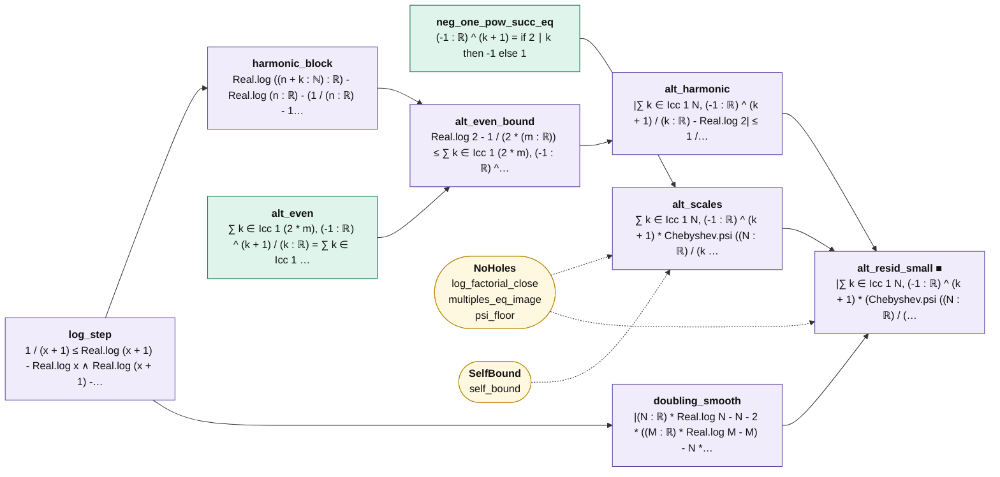

# `lean_stage3/Stage3/Doubling.lean`

> **Read from the source text.** This file changed after the last `python3 utilities/lean_map.py --dump`, so the arrows on this page are names occurring in each proof and have not been confirmed by Lean.

Doubling — block R15 of `lean_stage3/design/runs.md`. 2026-11-24. The self-bound at `N` less twice the self-bound at `⌊N/2⌋`. The even scales `N/(2j)` are the scales of `⌊N/2⌋`, so the difference keeps the odd scales and subtracts the even ones: an alternating sum of the staircase, equal to `log N! − 2·log ⌊N/2⌋!`. By Stirling that is `N log 2` up to `O(log N)`, and the alternating sum of `N/k` is `N log 2` up to `N` times the tail of the alternating harmonic series, at most `1`. The alternating residuals add up to…

9 theorems, 0 definitions, 261 lines. 

**Imports:** [`NoHoles`](../lean_stage3/NoHoles.md)  
**Imported by:** [`Stage3`](../lean_stage3/Stage3.md)

## The picture



An arrow A → B reads "A is used in the proof of B". Green: counting, integers only. Violet: shape, analysis with no ζ. Blue: reads ζ. A name ending in ■ is an end: nothing else uses it. Red: contains `sorry`. Yellow: theorems in another file, counted; a dotted arrow crosses files. Definitions are not drawn; they are listed below the diagram.

## Theorems

<a name="Doubling-neg_one_pow_succ_eq"></a>
### `Doubling.neg_one_pow_succ_eq`

line 25 · arrows read from text

**Counting.** Integers only: nothing in its statement or proof, or in anything it rests on, uses analysis or ζ.

**Why.** The sign `(−1)^(k+1)` read off the parity of `k`.

**Proves**

```lean
(-1 : ℝ) ^ (k + 1) = if 2 ∣ k then -1 else 1
```

**Needs** (its hypotheses)

  - `` k : ℕ ``

**Fed by:** no theorem of this repo; it stands on Mathlib.

**Feeds** (1 that use it)

  - [`Doubling.alt_scales`](#Doubling-alt_scales) — `` ∑ k ∈ Icc 1 N, (-1 : ℝ) ^ (k + 1) * Chebyshev.psi ((N : ℝ) / (k : ℝ)) = ∑ n ∈ Icc 1 N, Real.log n - 2 * ∑ n ∈ Icc 1 (N / 2), Real.log n ``

<a name="Doubling-alt_scales"></a>
### `Doubling.alt_scales`

line 37 · arrows read from text

**Shape.** Uses real or complex analysis; nothing in it or beneath it reads ζ.

**Why.** The doubling. The self-bound at `N` less twice the self-bound at `⌊N/2⌋` is the alternating sum of the staircase over the scales `N/k`.

**Proves**

```lean
∑ k ∈ Icc 1 N, (-1 : ℝ) ^ (k + 1) * Chebyshev.psi ((N : ℝ) / (k : ℝ)) = ∑ n ∈ Icc 1 N, Real.log n - 2 * ∑ n ∈ Icc 1 (N / 2), Real.log n
```

**Needs** (its hypotheses)

  - `` N : ℕ ``

**Fed by** (4 theorems its proof uses)

  - [`Doubling.neg_one_pow_succ_eq`](#Doubling-neg_one_pow_succ_eq) — `` (-1 : ℝ) ^ (k + 1) = if 2 ∣ k then -1 else 1 ``
  - [`NoHoles.multiples_eq_image`](../lean_stage3/NoHoles.md#NoHoles-multiples_eq_image) (NoHoles) — `` (Icc 1 N).filter (fun m => k ∣ m) = (Icc 1 (N / k)).image (fun j => k * j) ``
  - [`NoHoles.psi_floor`](../lean_stage3/NoHoles.md#NoHoles-psi_floor) (NoHoles) — `` Chebyshev.psi ((N : ℝ) / (k : ℝ)) = Chebyshev.psi ((N / k : ℕ) : ℝ) ``
  - [`SelfBound.self_bound`](../lean_stage3/SelfBound.md#SelfBound-self_bound) (SelfBound) — `` ∑ k ∈ Icc 1 N, Chebyshev.psi ((N : ℝ) / (k : ℝ)) = ∑ n ∈ Icc 1 N, Real.log (n : ℝ) ``

**Feeds** (1 that use it)

  - [`Doubling.alt_resid_small`](#Doubling-alt_resid_small) — `` |∑ k ∈ Icc 1 N, (-1 : ℝ) ^ (k + 1) * (Chebyshev.psi ((N : ℝ) / (k : ℝ)) - (N : ℝ) / (k : ℝ))| ≤ 4 * Real.log N + 5 ``

<a name="Doubling-log_step"></a>
### `Doubling.log_step`

line 55 · arrows read from text

**Shape.** Uses real or complex analysis; nothing in it or beneath it reads ζ.

**Why.** One step of the logarithm against `1/x`.

**Proves**

```lean
1 / (x + 1) ≤ Real.log (x + 1) - Real.log x ∧ Real.log (x + 1) - Real.log x ≤ 1 / x
```

**Needs** (its hypotheses)

  - `` hx : 0 < x ``

**Fed by:** no theorem of this repo; it stands on Mathlib.

**Feeds** (2 that use it)

  - [`Doubling.doubling_smooth`](#Doubling-doubling_smooth) — `` |(N : ℝ) * Real.log N - N - 2 * ((M : ℝ) * Real.log M - M) - N * Real.log 2| ≤ Real.log N + 1 ``
  - [`Doubling.harmonic_block`](#Doubling-harmonic_block) — `` Real.log ((n + k : ℕ) : ℝ) - Real.log (n : ℝ) - (1 / (n : ℝ) - 1 / ((n + k : ℕ) : ℝ)) ≤ ∑ i ∈ Icc 1 (n + k), 1 / (i : ℝ) - ∑ i ∈ Icc 1 n, 1 / (i : ℝ) … ``

<a name="Doubling-harmonic_block"></a>
### `Doubling.harmonic_block`

line 74 · arrows read from text

**Shape.** Uses real or complex analysis; nothing in it or beneath it reads ζ.

**Why.** The harmonic sum from `n+1` to `n+k` against `log((n+k)/n)`.

**Proves**

```lean
Real.log ((n + k : ℕ) : ℝ) - Real.log (n : ℝ) - (1 / (n : ℝ) - 1 / ((n + k : ℕ) : ℝ)) ≤ ∑ i ∈ Icc 1 (n + k), 1 / (i : ℝ) - ∑ i ∈ Icc 1 n, 1 / (i : ℝ) ∧ ∑ i ∈ Icc 1 (n + k), 1 / (i : ℝ) - ∑ i ∈ Icc 1 n, 1 / (i : ℝ) ≤ Real.log ((n + k : ℕ) : ℝ) - Real.log (n : ℝ)
```

**Needs** (its hypotheses)

  - `` hn : 1 ≤ n ``
  - `` k : ℕ ``

**Fed by** (1 theorem its proof uses)

  - [`Doubling.log_step`](#Doubling-log_step) — `` 1 / (x + 1) ≤ Real.log (x + 1) - Real.log x ∧ Real.log (x + 1) - Real.log x ≤ 1 / x ``

**Feeds** (1 that use it)

  - [`Doubling.alt_even_bound`](#Doubling-alt_even_bound) — `` Real.log 2 - 1 / (2 * (m : ℝ)) ≤ ∑ k ∈ Icc 1 (2 * m), (-1 : ℝ) ^ (k + 1) / (k : ℝ) ∧ ∑ k ∈ Icc 1 (2 * m), (-1 : ℝ) ^ (k + 1) / (k : ℝ) ≤ Real.log 2 ``

<a name="Doubling-alt_even"></a>
### `Doubling.alt_even`

line 90 · arrows read from text

**Counting.** Integers only: nothing in its statement or proof, or in anything it rests on, uses analysis or ζ.

**Why.** The alternating sum up to `2m` is the harmonic sum from `m+1` to `2m`.

**Proves**

```lean
∑ k ∈ Icc 1 (2 * m), (-1 : ℝ) ^ (k + 1) / (k : ℝ) = ∑ k ∈ Icc 1 (2 * m), 1 / (k : ℝ) - ∑ k ∈ Icc 1 m, 1 / (k : ℝ)
```

**Needs** (its hypotheses)

  - `` m : ℕ ``

**Fed by:** no theorem of this repo; it stands on Mathlib.

**Feeds** (1 that use it)

  - [`Doubling.alt_even_bound`](#Doubling-alt_even_bound) — `` Real.log 2 - 1 / (2 * (m : ℝ)) ≤ ∑ k ∈ Icc 1 (2 * m), (-1 : ℝ) ^ (k + 1) / (k : ℝ) ∧ ∑ k ∈ Icc 1 (2 * m), (-1 : ℝ) ^ (k + 1) / (k : ℝ) ≤ Real.log 2 ``

<a name="Doubling-alt_even_bound"></a>
### `Doubling.alt_even_bound`

line 118 · arrows read from text

**Shape.** Uses real or complex analysis; nothing in it or beneath it reads ζ.

**Why.** The alternating sum up to `2m` lies within `1/(2m)` below `log 2`.

**Proves**

```lean
Real.log 2 - 1 / (2 * (m : ℝ)) ≤ ∑ k ∈ Icc 1 (2 * m), (-1 : ℝ) ^ (k + 1) / (k : ℝ) ∧ ∑ k ∈ Icc 1 (2 * m), (-1 : ℝ) ^ (k + 1) / (k : ℝ) ≤ Real.log 2
```

**Needs** (its hypotheses)

  - `` hm : 1 ≤ m ``

**Fed by** (2 theorems its proof uses)

  - [`Doubling.alt_even`](#Doubling-alt_even) — `` ∑ k ∈ Icc 1 (2 * m), (-1 : ℝ) ^ (k + 1) / (k : ℝ) = ∑ k ∈ Icc 1 (2 * m), 1 / (k : ℝ) - ∑ k ∈ Icc 1 m, 1 / (k : ℝ) ``
  - [`Doubling.harmonic_block`](#Doubling-harmonic_block) — `` Real.log ((n + k : ℕ) : ℝ) - Real.log (n : ℝ) - (1 / (n : ℝ) - 1 / ((n + k : ℕ) : ℝ)) ≤ ∑ i ∈ Icc 1 (n + k), 1 / (i : ℝ) - ∑ i ∈ Icc 1 n, 1 / (i : ℝ) … ``

**Feeds** (1 that use it)

  - [`Doubling.alt_harmonic`](#Doubling-alt_harmonic) — `` |∑ k ∈ Icc 1 N, (-1 : ℝ) ^ (k + 1) / (k : ℝ) - Real.log 2| ≤ 1 / (N : ℝ) ``

<a name="Doubling-alt_harmonic"></a>
### `Doubling.alt_harmonic`

line 134 · arrows read from text

**Shape.** Uses real or complex analysis; nothing in it or beneath it reads ζ.

**Why.** The alternating harmonic sum. Within `1/N` of `log 2`.

**Proves**

```lean
|∑ k ∈ Icc 1 N, (-1 : ℝ) ^ (k + 1) / (k : ℝ) - Real.log 2| ≤ 1 / (N : ℝ)
```

**Needs** (its hypotheses)

  - `` hN : 1 ≤ N ``

**Fed by** (1 theorem its proof uses)

  - [`Doubling.alt_even_bound`](#Doubling-alt_even_bound) — `` Real.log 2 - 1 / (2 * (m : ℝ)) ≤ ∑ k ∈ Icc 1 (2 * m), (-1 : ℝ) ^ (k + 1) / (k : ℝ) ∧ ∑ k ∈ Icc 1 (2 * m), (-1 : ℝ) ^ (k + 1) / (k : ℝ) ≤ Real.log 2 ``

**Feeds** (1 that use it)

  - [`Doubling.alt_resid_small`](#Doubling-alt_resid_small) — `` |∑ k ∈ Icc 1 N, (-1 : ℝ) ^ (k + 1) * (Chebyshev.psi ((N : ℝ) / (k : ℝ)) - (N : ℝ) / (k : ℝ))| ≤ 4 * Real.log N + 5 ``

<a name="Doubling-doubling_smooth"></a>
### `Doubling.doubling_smooth`

line 167 · arrows read from text

**Shape.** Uses real or complex analysis; nothing in it or beneath it reads ζ.

**Why.** The smooth parts of the two log-sums against `N log 2`.

**Proves**

```lean
|(N : ℝ) * Real.log N - N - 2 * ((M : ℝ) * Real.log M - M) - N * Real.log 2| ≤ Real.log N + 1
```

**Needs** (its hypotheses)

  - `` hM : 1 ≤ M ``
  - `` h : N = 2 * M ∨ N = 2 * M + 1 ``

**Fed by** (1 theorem its proof uses)

  - [`Doubling.log_step`](#Doubling-log_step) — `` 1 / (x + 1) ≤ Real.log (x + 1) - Real.log x ∧ Real.log (x + 1) - Real.log x ≤ 1 / x ``

**Feeds** (1 that use it)

  - [`Doubling.alt_resid_small`](#Doubling-alt_resid_small) — `` |∑ k ∈ Icc 1 N, (-1 : ℝ) ^ (k + 1) * (Chebyshev.psi ((N : ℝ) / (k : ℝ)) - (N : ℝ) / (k : ℝ))| ≤ 4 * Real.log N + 5 ``

<a name="Doubling-alt_resid_small"></a>
### `Doubling.alt_resid_small`

line 209 · arrows read from text

**Shape.** Uses real or complex analysis; nothing in it or beneath it reads ζ.

**Why.** The alternating residuals are small. Over the scales `N/k` with the signs `(−1)^(k+1)`, the residuals of the staircase add up to at most `4 log N + 5`.

**Proves**

```lean
|∑ k ∈ Icc 1 N, (-1 : ℝ) ^ (k + 1) * (Chebyshev.psi ((N : ℝ) / (k : ℝ)) - (N : ℝ) / (k : ℝ))| ≤ 4 * Real.log N + 5
```

**Needs** (its hypotheses)

  - `` hN : 2 ≤ N ``

**Fed by** (4 theorems its proof uses)

  - [`Doubling.alt_harmonic`](#Doubling-alt_harmonic) — `` |∑ k ∈ Icc 1 N, (-1 : ℝ) ^ (k + 1) / (k : ℝ) - Real.log 2| ≤ 1 / (N : ℝ) ``
  - [`Doubling.alt_scales`](#Doubling-alt_scales) — `` ∑ k ∈ Icc 1 N, (-1 : ℝ) ^ (k + 1) * Chebyshev.psi ((N : ℝ) / (k : ℝ)) = ∑ n ∈ Icc 1 N, Real.log n - 2 * ∑ n ∈ Icc 1 (N / 2), Real.log n ``
  - [`Doubling.doubling_smooth`](#Doubling-doubling_smooth) — `` |(N : ℝ) * Real.log N - N - 2 * ((M : ℝ) * Real.log M - M) - N * Real.log 2| ≤ Real.log N + 1 ``
  - [`NoHoles.log_factorial_close`](../lean_stage3/NoHoles.md#NoHoles-log_factorial_close) (NoHoles) — `` |∑ n ∈ Icc 1 M, Real.log (n : ℝ) - ((M : ℝ) * Real.log (M : ℝ) - (M : ℝ))| ≤ Real.log (M : ℝ) + 1 ``

**Feeds:** nothing. It is an end.

