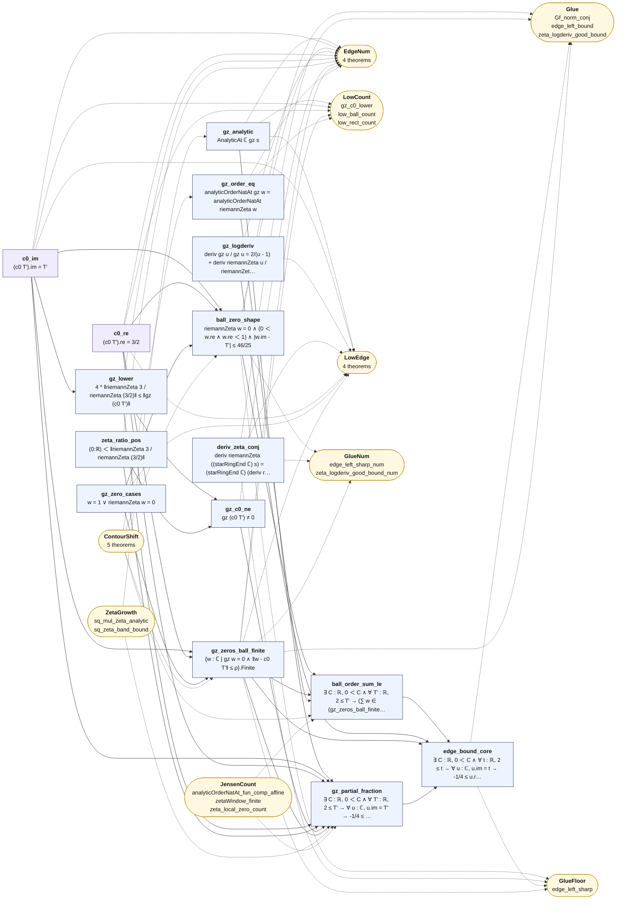

# `lean_stage3/Stage3/EdgeBound.lean`

# S3 — the edge bound (FinalBound rescale + gap-eating) The Landau partial fraction transported from PNT+'s normalized `FinalBound` (unit ball) to the ball at `3/2 + iT′`, for `g = (s−1)²·ζ` (entire; the pole cleared, one extra order-1 zero at `1`). Inputs: `ZetaGrowth.sq_zeta_band_bound` (the B), PNT+'s `ZetaFixedLowerBound` (the f(0)), `ContourShift`'s good heights, fences, and reflection-order (the eating).

15 theorems, 2 definitions, 835 lines. Arrows are Lean's own record of what each proof uses.

**Imports:** [`ZetaGrowth`](../lean_stage3/ZetaGrowth.md)  
**Imported by:** [`Stage3`](../lean_stage3/Stage3.md), [`Glue`](../lean_stage3/Glue.md), [`LowCount`](../lean_stage3/LowCount.md)

## The picture



An arrow A → B reads "A is used in the proof of B". Green: counting, integers only. Violet: shape, analysis with no ζ. Blue: reads ζ. A name ending in ■ is an end: nothing else uses it. Red: contains `sorry`. Yellow: theorems in another file, counted; a dotted arrow crosses files. Definitions are not drawn; they are listed below the diagram.

## Definitions

<a name="EdgeBound-c0"></a>
### `EdgeBound.c0`

def · line 21

The ball center at height `T′`.

- **Is:** `` c0 (T' : ℝ) : ℂ := 3/2 + Complex.I * T' ``
- **Used by 23:** [`EdgeBound.ball_order_sum_le`](#EdgeBound-ball_order_sum_le), [`EdgeBound.ball_zero_shape`](#EdgeBound-ball_zero_shape), [`EdgeBound.c0_im`](#EdgeBound-c0_im), [`EdgeBound.c0_re`](#EdgeBound-c0_re), [`EdgeBound.edge_bound_core`](#EdgeBound-edge_bound_core), [`EdgeBound.gz_c0_ne`](#EdgeBound-gz_c0_ne), [`EdgeBound.gz_lower`](#EdgeBound-gz_lower), [`EdgeBound.gz_partial_fraction`](#EdgeBound-gz_partial_fraction), [`EdgeBound.gz_zeros_ball_finite`](#EdgeBound-gz_zeros_ball_finite), [`EdgeBound.ball_order_sum_le_num`](../lean_stage3/EdgeNum.md#EdgeBound-ball_order_sum_le_num), [`EdgeBound.edge_bound_core_num`](../lean_stage3/EdgeNum.md#EdgeBound-edge_bound_core_num), [`EdgeBound.gz_partial_fraction_num`](../lean_stage3/EdgeNum.md#EdgeBound-gz_partial_fraction_num), [`Glue.edge_left_bound`](../lean_stage3/Glue.md#Glue-edge_left_bound), [`Glue.zeta_logderiv_good_bound`](../lean_stage3/Glue.md#Glue-zeta_logderiv_good_bound), [`Glue.edge_left_sharp`](../lean_stage3/GlueFloor.md#Glue-edge_left_sharp), [`Glue.edge_left_sharp_num`](../lean_stage3/GlueNum.md#Glue-edge_left_sharp_num), [`Glue.zeta_logderiv_good_bound_num`](../lean_stage3/GlueNum.md#Glue-zeta_logderiv_good_bound_num), [`EdgeBound.gz_c0_lower`](../lean_stage3/LowCount.md#EdgeBound-gz_c0_lower), [`EdgeBound.low_ball_count`](../lean_stage3/LowCount.md#EdgeBound-low_ball_count), [`EdgeBound.low_rect_count`](../lean_stage3/LowCount.md#EdgeBound-low_rect_count), [`EdgeBound.gz_partial_fraction_low`](../lean_stage3/LowEdge.md#EdgeBound-gz_partial_fraction_low), [`EdgeBound.logDerivZeta_low_edge`](../lean_stage3/LowEdge.md#EdgeBound-logDerivZeta_low_edge), [`EdgeBound.low_ball_count_wide`](../lean_stage3/LowEdge.md#EdgeBound-low_ball_count_wide)

<a name="EdgeBound-gz"></a>
### `EdgeBound.gz`

def · line 24

`g = (s−1)²·ζ` — entire, zeros = ζ-zeros plus an order-1 zero at 1.

- **Is:** `` gz (s : ℂ) : ℂ := (s - 1)^2 * riemannZeta s ``
- **Used by 25:** [`EdgeBound.ball_order_sum_le`](#EdgeBound-ball_order_sum_le), [`EdgeBound.ball_zero_shape`](#EdgeBound-ball_zero_shape), [`EdgeBound.edge_bound_core`](#EdgeBound-edge_bound_core), [`EdgeBound.gz_analytic`](#EdgeBound-gz_analytic), [`EdgeBound.gz_c0_ne`](#EdgeBound-gz_c0_ne), [`EdgeBound.gz_logderiv`](#EdgeBound-gz_logderiv), [`EdgeBound.gz_lower`](#EdgeBound-gz_lower), [`EdgeBound.gz_order_eq`](#EdgeBound-gz_order_eq), [`EdgeBound.gz_partial_fraction`](#EdgeBound-gz_partial_fraction), [`EdgeBound.gz_zero_cases`](#EdgeBound-gz_zero_cases), [`EdgeBound.gz_zeros_ball_finite`](#EdgeBound-gz_zeros_ball_finite), [`EdgeBound.ball_order_sum_le_num`](../lean_stage3/EdgeNum.md#EdgeBound-ball_order_sum_le_num), [`EdgeBound.edge_bound_core_num`](../lean_stage3/EdgeNum.md#EdgeBound-edge_bound_core_num), [`EdgeBound.gz_partial_fraction_num`](../lean_stage3/EdgeNum.md#EdgeBound-gz_partial_fraction_num), [`Glue.edge_left_bound`](../lean_stage3/Glue.md#Glue-edge_left_bound), [`Glue.zeta_logderiv_good_bound`](../lean_stage3/Glue.md#Glue-zeta_logderiv_good_bound), [`Glue.edge_left_sharp`](../lean_stage3/GlueFloor.md#Glue-edge_left_sharp), [`Glue.edge_left_sharp_num`](../lean_stage3/GlueNum.md#Glue-edge_left_sharp_num), [`Glue.zeta_logderiv_good_bound_num`](../lean_stage3/GlueNum.md#Glue-zeta_logderiv_good_bound_num), [`EdgeBound.gz_c0_lower`](../lean_stage3/LowCount.md#EdgeBound-gz_c0_lower), [`EdgeBound.low_ball_count`](../lean_stage3/LowCount.md#EdgeBound-low_ball_count), [`EdgeBound.low_rect_count`](../lean_stage3/LowCount.md#EdgeBound-low_rect_count), [`EdgeBound.gz_partial_fraction_low`](../lean_stage3/LowEdge.md#EdgeBound-gz_partial_fraction_low), [`EdgeBound.logDerivZeta_low_edge`](../lean_stage3/LowEdge.md#EdgeBound-logDerivZeta_low_edge), [`EdgeBound.low_ball_count_wide`](../lean_stage3/LowEdge.md#EdgeBound-low_ball_count_wide)

## Theorems

<a name="EdgeBound-gz_analytic"></a>
### `EdgeBound.gz_analytic`

line 26

**Reads ζ.** It, or something it rests on, uses the zeta function, its zeros or the Riemann hypothesis.

**Proves**

```lean
AnalyticAt ℂ gz s
```

**Needs** (its hypotheses)

  - `` s : ℂ ``

**Stated with:** [`EdgeBound.gz`](#EdgeBound-gz)

**Fed by** (1 theorem its proof uses)

  - [`ZetaGrowth.sq_mul_zeta_analytic`](../lean_stage3/ZetaGrowth.md#ZetaGrowth-sq_mul_zeta_analytic) (ZetaGrowth) — `` AnalyticAt ℂ (fun z : ℂ ↦ (z - 1)^2 * riemannZeta z) s ``

**Feeds** (5 that use it)

  - [`EdgeBound.gz_partial_fraction`](#EdgeBound-gz_partial_fraction) — `` ∃ C : ℝ, 0 < C ∧ ∀ T' : ℝ, 2 ≤ T' → ∀ u : ℂ, u.im = T' → -1/4 ≤ u.re → u.re ≤ 2 → gz u ≠ 0 → ‖deriv gz u / gz u - ∑ w ∈ (gz_zeros_ball_finite T' (by n… ``
  - [`EdgeBound.gz_partial_fraction_num`](../lean_stage3/EdgeNum.md#EdgeBound-gz_partial_fraction_num) (EdgeNum) — `` ∀ T' : ℝ, 2 ≤ T' → ∀ u : ℂ, u.im = T' → -1/4 ≤ u.re → u.re ≤ 2 → gz u ≠ 0 → ‖deriv gz u / gz u - ∑ w ∈ (gz_zeros_ball_finite T' (by norm_num : (0:ℝ) ≤… ``
  - [`EdgeBound.low_ball_count`](../lean_stage3/LowCount.md#EdgeBound-low_ball_count) (LowCount) — `` (∑ w ∈ (gz_zeros_ball_finite T' (by norm_num : (0 : ℝ) ≤ 8 / 5)).toFinset, (analyticOrderNatAt gz w : ℝ)) ≤ 119 ``
  - [`EdgeBound.gz_partial_fraction_low`](../lean_stage3/LowEdge.md#EdgeBound-gz_partial_fraction_low) (LowEdge) — `` ‖deriv gz u / gz u - ∑ w ∈ (gz_zeros_ball_finite T' (by norm_num : (0:ℝ) ≤ 46/25)).toFinset, (analyticOrderNatAt gz w : ℂ) / (u - w)‖ ≤ 1617537 ``
  - [`EdgeBound.low_ball_count_wide`](../lean_stage3/LowEdge.md#EdgeBound-low_ball_count_wide) (LowEdge) — `` (∑ w ∈ (gz_zeros_ball_finite T' (by norm_num : (0 : ℝ) ≤ 46 / 25)).toFinset, (analyticOrderNatAt gz w : ℝ)) ≤ 250 ``

<a name="EdgeBound-c0_im"></a>
### `EdgeBound.c0_im`

line 28

**Shape.** Uses real or complex analysis; nothing in it or beneath it reads ζ.

**Proves**

```lean
(c0 T').im = T'
```

**Needs** (its hypotheses)

  - `` T' : ℝ ``

**Stated with:** [`EdgeBound.c0`](#EdgeBound-c0)

**Fed by:** no theorem of this repo; it stands on Mathlib and the definitions below.

**Feeds** (9 that use it)

  - [`EdgeBound.ball_zero_shape`](#EdgeBound-ball_zero_shape) — `` riemannZeta w = 0 ∧ (0 < w.re ∧ w.re < 1) ∧ |w.im - T'| ≤ 46/25 ``
  - [`EdgeBound.gz_lower`](#EdgeBound-gz_lower) — `` 4 * ‖riemannZeta 3 / riemannZeta (3/2)‖ ≤ ‖gz (c0 T')‖ ``
  - [`EdgeBound.gz_partial_fraction`](#EdgeBound-gz_partial_fraction) — `` ∃ C : ℝ, 0 < C ∧ ∀ T' : ℝ, 2 ≤ T' → ∀ u : ℂ, u.im = T' → -1/4 ≤ u.re → u.re ≤ 2 → gz u ≠ 0 → ‖deriv gz u / gz u - ∑ w ∈ (gz_zeros_ball_finite T' (by n… ``
  - [`EdgeBound.gz_zeros_ball_finite`](#EdgeBound-gz_zeros_ball_finite) — `` {w : ℂ | gz w = 0 ∧ ‖w - c0 T'‖ ≤ ρ}.Finite ``
  - [`EdgeBound.gz_partial_fraction_num`](../lean_stage3/EdgeNum.md#EdgeBound-gz_partial_fraction_num) (EdgeNum) — `` ∀ T' : ℝ, 2 ≤ T' → ∀ u : ℂ, u.im = T' → -1/4 ≤ u.re → u.re ≤ 2 → gz u ≠ 0 → ‖deriv gz u / gz u - ∑ w ∈ (gz_zeros_ball_finite T' (by norm_num : (0:ℝ) ≤… ``
  - [`EdgeBound.low_ball_count`](../lean_stage3/LowCount.md#EdgeBound-low_ball_count) (LowCount) — `` (∑ w ∈ (gz_zeros_ball_finite T' (by norm_num : (0 : ℝ) ≤ 8 / 5)).toFinset, (analyticOrderNatAt gz w : ℝ)) ≤ 119 ``
  - [`EdgeBound.low_rect_count`](../lean_stage3/LowCount.md#EdgeBound-low_rect_count) (LowCount) — `` (∑ ρ ∈ (ContourShift.zeta_zeros_rectangle_finite (0 : ℂ) ((1 : ℝ) + Complex.I * (6 : ℝ))).toFinset, (analyticOrderNatAt riemannZeta ρ : ℝ)) ≤ 714 ``
  - [`EdgeBound.gz_partial_fraction_low`](../lean_stage3/LowEdge.md#EdgeBound-gz_partial_fraction_low) (LowEdge) — `` ‖deriv gz u / gz u - ∑ w ∈ (gz_zeros_ball_finite T' (by norm_num : (0:ℝ) ≤ 46/25)).toFinset, (analyticOrderNatAt gz w : ℂ) / (u - w)‖ ≤ 1617537 ``
  - [`EdgeBound.low_ball_count_wide`](../lean_stage3/LowEdge.md#EdgeBound-low_ball_count_wide) (LowEdge) — `` (∑ w ∈ (gz_zeros_ball_finite T' (by norm_num : (0 : ℝ) ≤ 46 / 25)).toFinset, (analyticOrderNatAt gz w : ℝ)) ≤ 250 ``

<a name="EdgeBound-c0_re"></a>
### `EdgeBound.c0_re`

line 32

**Shape.** Uses real or complex analysis; nothing in it or beneath it reads ζ.

**Proves**

```lean
(c0 T').re = 3/2
```

**Needs** (its hypotheses)

  - `` T' : ℝ ``

**Stated with:** [`EdgeBound.c0`](#EdgeBound-c0)

**Fed by:** no theorem of this repo; it stands on Mathlib and the definitions below.

**Feeds** (10 that use it)

  - [`EdgeBound.ball_zero_shape`](#EdgeBound-ball_zero_shape) — `` riemannZeta w = 0 ∧ (0 < w.re ∧ w.re < 1) ∧ |w.im - T'| ≤ 46/25 ``
  - [`EdgeBound.gz_partial_fraction`](#EdgeBound-gz_partial_fraction) — `` ∃ C : ℝ, 0 < C ∧ ∀ T' : ℝ, 2 ≤ T' → ∀ u : ℂ, u.im = T' → -1/4 ≤ u.re → u.re ≤ 2 → gz u ≠ 0 → ‖deriv gz u / gz u - ∑ w ∈ (gz_zeros_ball_finite T' (by n… ``
  - [`EdgeBound.gz_zeros_ball_finite`](#EdgeBound-gz_zeros_ball_finite) — `` {w : ℂ | gz w = 0 ∧ ‖w - c0 T'‖ ≤ ρ}.Finite ``
  - [`EdgeBound.gz_partial_fraction_num`](../lean_stage3/EdgeNum.md#EdgeBound-gz_partial_fraction_num) (EdgeNum) — `` ∀ T' : ℝ, 2 ≤ T' → ∀ u : ℂ, u.im = T' → -1/4 ≤ u.re → u.re ≤ 2 → gz u ≠ 0 → ‖deriv gz u / gz u - ∑ w ∈ (gz_zeros_ball_finite T' (by norm_num : (0:ℝ) ≤… ``
  - [`EdgeBound.gz_c0_lower`](../lean_stage3/LowCount.md#EdgeBound-gz_c0_lower) (LowCount) — `` 1 / 14 ≤ ‖gz (c0 T')‖ ``
  - [`EdgeBound.low_ball_count`](../lean_stage3/LowCount.md#EdgeBound-low_ball_count) (LowCount) — `` (∑ w ∈ (gz_zeros_ball_finite T' (by norm_num : (0 : ℝ) ≤ 8 / 5)).toFinset, (analyticOrderNatAt gz w : ℝ)) ≤ 119 ``
  - [`EdgeBound.low_rect_count`](../lean_stage3/LowCount.md#EdgeBound-low_rect_count) (LowCount) — `` (∑ ρ ∈ (ContourShift.zeta_zeros_rectangle_finite (0 : ℂ) ((1 : ℝ) + Complex.I * (6 : ℝ))).toFinset, (analyticOrderNatAt riemannZeta ρ : ℝ)) ≤ 714 ``
  - [`EdgeBound.gz_partial_fraction_low`](../lean_stage3/LowEdge.md#EdgeBound-gz_partial_fraction_low) (LowEdge) — `` ‖deriv gz u / gz u - ∑ w ∈ (gz_zeros_ball_finite T' (by norm_num : (0:ℝ) ≤ 46/25)).toFinset, (analyticOrderNatAt gz w : ℂ) / (u - w)‖ ≤ 1617537 ``
  - [`EdgeBound.logDerivZeta_low_edge`](../lean_stage3/LowEdge.md#EdgeBound-logDerivZeta_low_edge) (LowEdge) — `` ‖deriv riemannZeta u / riemannZeta u‖ ≤ 1620000 ``
  - [`EdgeBound.low_ball_count_wide`](../lean_stage3/LowEdge.md#EdgeBound-low_ball_count_wide) (LowEdge) — `` (∑ w ∈ (gz_zeros_ball_finite T' (by norm_num : (0 : ℝ) ≤ 46 / 25)).toFinset, (analyticOrderNatAt gz w : ℝ)) ≤ 250 ``

<a name="EdgeBound-gz_lower"></a>
### `EdgeBound.gz_lower`

line 37

**Reads ζ.** It, or something it rests on, uses the zeta function, its zeros or the Riemann hypothesis.

**Why.** The explicit lower bound at the center.

**Proves**

```lean
4 * ‖riemannZeta 3 / riemannZeta (3/2)‖ ≤ ‖gz (c0 T')‖
```

**Needs** (its hypotheses)

  - `` hT' : 2 ≤ T' ``

**Stated with:** [`EdgeBound.c0`](#EdgeBound-c0), [`EdgeBound.gz`](#EdgeBound-gz)

**Fed by** (1 theorem its proof uses)

  - [`EdgeBound.c0_im`](#EdgeBound-c0_im) — `` (c0 T').im = T' ``

**Feeds** (3 that use it)

  - [`EdgeBound.gz_c0_ne`](#EdgeBound-gz_c0_ne) — `` gz (c0 T') ≠ 0 ``
  - [`EdgeBound.gz_partial_fraction`](#EdgeBound-gz_partial_fraction) — `` ∃ C : ℝ, 0 < C ∧ ∀ T' : ℝ, 2 ≤ T' → ∀ u : ℂ, u.im = T' → -1/4 ≤ u.re → u.re ≤ 2 → gz u ≠ 0 → ‖deriv gz u / gz u - ∑ w ∈ (gz_zeros_ball_finite T' (by n… ``
  - [`EdgeBound.gz_partial_fraction_num`](../lean_stage3/EdgeNum.md#EdgeBound-gz_partial_fraction_num) (EdgeNum) — `` ∀ T' : ℝ, 2 ≤ T' → ∀ u : ℂ, u.im = T' → -1/4 ≤ u.re → u.re ≤ 2 → gz u ≠ 0 → ‖deriv gz u / gz u - ∑ w ∈ (gz_zeros_ball_finite T' (by norm_num : (0:ℝ) ≤… ``

<a name="EdgeBound-zeta_ratio_pos"></a>
### `EdgeBound.zeta_ratio_pos`

line 61

**Reads ζ.** It, or something it rests on, uses the zeta function, its zeros or the Riemann hypothesis.

**Why.** The lower-bound constant is positive.

**Proves**

```lean
(0:ℝ) < ‖riemannZeta 3 / riemannZeta (3/2)‖
```

**Fed by:** no theorem of this repo; it stands on Mathlib.

**Feeds** (4 that use it)

  - [`EdgeBound.gz_c0_ne`](#EdgeBound-gz_c0_ne) — `` gz (c0 T') ≠ 0 ``
  - [`EdgeBound.gz_partial_fraction`](#EdgeBound-gz_partial_fraction) — `` ∃ C : ℝ, 0 < C ∧ ∀ T' : ℝ, 2 ≤ T' → ∀ u : ℂ, u.im = T' → -1/4 ≤ u.re → u.re ≤ 2 → gz u ≠ 0 → ‖deriv gz u / gz u - ∑ w ∈ (gz_zeros_ball_finite T' (by n… ``
  - [`EdgeBound.C1n_pos`](../lean_stage3/EdgeNum.md#EdgeBound-C1n_pos) (EdgeNum) — `` 0 < C1n ``
  - [`EdgeBound.gz_partial_fraction_num`](../lean_stage3/EdgeNum.md#EdgeBound-gz_partial_fraction_num) (EdgeNum) — `` ∀ T' : ℝ, 2 ≤ T' → ∀ u : ℂ, u.im = T' → -1/4 ≤ u.re → u.re ≤ 2 → gz u ≠ 0 → ‖deriv gz u / gz u - ∑ w ∈ (gz_zeros_ball_finite T' (by norm_num : (0:ℝ) ≤… ``

<a name="EdgeBound-gz_c0_ne"></a>
### `EdgeBound.gz_c0_ne`

line 70

**Reads ζ.** It, or something it rests on, uses the zeta function, its zeros or the Riemann hypothesis.

**Why.** The center's value is nonzero.

**Proves**

```lean
gz (c0 T') ≠ 0
```

**Needs** (its hypotheses)

  - `` hT' : 2 ≤ T' ``

**Stated with:** [`EdgeBound.c0`](#EdgeBound-c0), [`EdgeBound.gz`](#EdgeBound-gz)

**Fed by** (2 theorems its proof uses)

  - [`EdgeBound.gz_lower`](#EdgeBound-gz_lower) — `` 4 * ‖riemannZeta 3 / riemannZeta (3/2)‖ ≤ ‖gz (c0 T')‖ ``
  - [`EdgeBound.zeta_ratio_pos`](#EdgeBound-zeta_ratio_pos) — `` (0:ℝ) < ‖riemannZeta 3 / riemannZeta (3/2)‖ ``

**Feeds** (2 that use it)

  - [`EdgeBound.gz_partial_fraction`](#EdgeBound-gz_partial_fraction) — `` ∃ C : ℝ, 0 < C ∧ ∀ T' : ℝ, 2 ≤ T' → ∀ u : ℂ, u.im = T' → -1/4 ≤ u.re → u.re ≤ 2 → gz u ≠ 0 → ‖deriv gz u / gz u - ∑ w ∈ (gz_zeros_ball_finite T' (by n… ``
  - [`EdgeBound.gz_partial_fraction_num`](../lean_stage3/EdgeNum.md#EdgeBound-gz_partial_fraction_num) (EdgeNum) — `` ∀ T' : ℝ, 2 ≤ T' → ∀ u : ℂ, u.im = T' → -1/4 ≤ u.re → u.re ≤ 2 → gz u ≠ 0 → ‖deriv gz u / gz u - ∑ w ∈ (gz_zeros_ball_finite T' (by norm_num : (0:ℝ) ≤… ``

<a name="EdgeBound-gz_zero_cases"></a>
### `EdgeBound.gz_zero_cases`

line 77

**Reads ζ.** It, or something it rests on, uses the zeta function, its zeros or the Riemann hypothesis.

**Why.** A `gz`-zero is `1` or a `ζ`-zero.

**Proves**

```lean
w = 1 ∨ riemannZeta w = 0
```

**Needs** (its hypotheses)

  - `` h : gz w = 0 ``

**Stated with:** [`EdgeBound.gz`](#EdgeBound-gz)

**Fed by:** no theorem of this repo; it stands on Mathlib and the definitions below.

**Feeds** (3 that use it)

  - [`EdgeBound.ball_zero_shape`](#EdgeBound-ball_zero_shape) — `` riemannZeta w = 0 ∧ (0 < w.re ∧ w.re < 1) ∧ |w.im - T'| ≤ 46/25 ``
  - [`EdgeBound.gz_zeros_ball_finite`](#EdgeBound-gz_zeros_ball_finite) — `` {w : ℂ | gz w = 0 ∧ ‖w - c0 T'‖ ≤ ρ}.Finite ``
  - [`EdgeBound.logDerivZeta_low_edge`](../lean_stage3/LowEdge.md#EdgeBound-logDerivZeta_low_edge) (LowEdge) — `` ‖deriv riemannZeta u / riemannZeta u‖ ≤ 1620000 ``

<a name="EdgeBound-gz_zeros_ball_finite"></a>
### `EdgeBound.gz_zeros_ball_finite`

line 87

**Reads ζ.** It, or something it rests on, uses the zeta function, its zeros or the Riemann hypothesis.

**Why.** The `gz`-zeros in any ball around the center are finite.

**Proves**

```lean
{w : ℂ | gz w = 0 ∧ ‖w - c0 T'‖ ≤ ρ}.Finite
```

**Needs** (its hypotheses)

  - `` T' : ℝ ``
  - `` hρ : 0 ≤ ρ ``

**Stated with:** [`EdgeBound.c0`](#EdgeBound-c0), [`EdgeBound.gz`](#EdgeBound-gz)

**Fed by** (4 theorems its proof uses)

  - [`ContourShift.zeta_zeros_rectangle_finite`](../lean_stage3/ContourShift.md#ContourShift-zeta_zeros_rectangle_finite) (ContourShift) — `` {ρ : ℂ | riemannZeta ρ = 0 ∧ ρ ∈ Rectangle z w}.Finite ``
  - [`EdgeBound.c0_im`](#EdgeBound-c0_im) — `` (c0 T').im = T' ``
  - [`EdgeBound.c0_re`](#EdgeBound-c0_re) — `` (c0 T').re = 3/2 ``
  - [`EdgeBound.gz_zero_cases`](#EdgeBound-gz_zero_cases) — `` w = 1 ∨ riemannZeta w = 0 ``

**Feeds** (16 that use it)

  - [`EdgeBound.ball_order_sum_le`](#EdgeBound-ball_order_sum_le) — `` ∃ C : ℝ, 0 < C ∧ ∀ T' : ℝ, 2 ≤ T' → (∑ w ∈ (gz_zeros_ball_finite T' (by norm_num : (0:ℝ) ≤ 46/25)).toFinset, (analyticOrderNatAt gz w : ℝ)) ≤ C * Real… ``
  - [`EdgeBound.edge_bound_core`](#EdgeBound-edge_bound_core) — `` ∃ C : ℝ, 0 < C ∧ ∀ t : ℝ, 2 ≤ t → ∀ u : ℂ, u.im = t → -1/4 ≤ u.re → u.re ≤ 2 → riemannZeta u ≠ 0 → ∀ δ : ℝ, 0 < δ → δ ≤ 1 → (∀ w ∈ (gz_zeros_ball_fini… ``
  - [`EdgeBound.gz_partial_fraction`](#EdgeBound-gz_partial_fraction) — `` ∃ C : ℝ, 0 < C ∧ ∀ T' : ℝ, 2 ≤ T' → ∀ u : ℂ, u.im = T' → -1/4 ≤ u.re → u.re ≤ 2 → gz u ≠ 0 → ‖deriv gz u / gz u - ∑ w ∈ (gz_zeros_ball_finite T' (by n… ``
  - [`EdgeBound.ball_order_sum_le_num`](../lean_stage3/EdgeNum.md#EdgeBound-ball_order_sum_le_num) (EdgeNum) — `` ∀ T' : ℝ, 2 ≤ T' → (∑ w ∈ (gz_zeros_ball_finite T' (by norm_num : (0:ℝ) ≤ 46/25)).toFinset, (analyticOrderNatAt gz w : ℝ)) ≤ C2n * Real.log T' ``
  - [`EdgeBound.edge_bound_core_num`](../lean_stage3/EdgeNum.md#EdgeBound-edge_bound_core_num) (EdgeNum) — `` ∀ t : ℝ, 2 ≤ t → ∀ u : ℂ, u.im = t → -1/4 ≤ u.re → u.re ≤ 2 → riemannZeta u ≠ 0 → ∀ δ : ℝ, 0 < δ → δ ≤ 1 → (∀ w ∈ (gz_zeros_ball_finite t (by norm_num… ``
  - [`EdgeBound.gz_partial_fraction_num`](../lean_stage3/EdgeNum.md#EdgeBound-gz_partial_fraction_num) (EdgeNum) — `` ∀ T' : ℝ, 2 ≤ T' → ∀ u : ℂ, u.im = T' → -1/4 ≤ u.re → u.re ≤ 2 → gz u ≠ 0 → ‖deriv gz u / gz u - ∑ w ∈ (gz_zeros_ball_finite T' (by norm_num : (0:ℝ) ≤… ``
  - [`Glue.edge_left_bound`](../lean_stage3/Glue.md#Glue-edge_left_bound) (Glue) — `` ∃ C : ℝ, 0 < C ∧ ∀ x T' : ℝ, 16 ≤ x → 2 ≤ T' → T' ≤ 2*x^2 → ‖VIntegral (Gf x) (-1/4) (-T') T'‖ ≤ C * Real.log x ``
  - [`Glue.zeta_logderiv_good_bound`](../lean_stage3/Glue.md#Glue-zeta_logderiv_good_bound) (Glue) — `` ∃ C : ℝ, 0 < C ∧ ∀ T T' : ℝ, 2 ≤ T → T' ∈ Set.Icc T (T+1) → (∀ ρ : ℂ, riemannZeta ρ = 0 → 0 < ρ.re → ContourShift.zeroGap T ≤ |ρ.im - T'|) → ∀ u : ℂ, … ``
  - [`Glue.edge_left_sharp`](../lean_stage3/GlueFloor.md#Glue-edge_left_sharp) (GlueFloor) — `` ∃ D : ℝ, 0 < D ∧ ∀ x T' : ℝ, 16 ≤ x → 2 ≤ T' → T' ≤ 2*x^2 → ‖VIntegral (Gf x) (-1/4) (-T') T'‖ ≤ 72 * D * ((Real.log x)^2 * x ^ (-(1:ℝ)/4)) ``
  - [`Glue.edge_left_sharp_num`](../lean_stage3/GlueNum.md#Glue-edge_left_sharp_num) (GlueNum) — `` ∀ x T' : ℝ, 16 ≤ x → 2 ≤ T' → T' ≤ 2*x^2 → ‖VIntegral (Gf x) (-1/4) (-T') T'‖ ≤ 72 * Dln * ((Real.log x)^2 * x ^ (-(1:ℝ)/4)) ``
  - [`Glue.zeta_logderiv_good_bound_num`](../lean_stage3/GlueNum.md#Glue-zeta_logderiv_good_bound_num) (GlueNum) — `` ∀ T T' : ℝ, 2 ≤ T → T' ∈ Set.Icc T (T+1) → (∀ ρ : ℂ, riemannZeta ρ = 0 → 0 < ρ.re → ContourShift.zeroGap T ≤ |ρ.im - T'|) → ∀ u : ℂ, |u.im| = T' → -1/… ``
  - [`EdgeBound.low_ball_count`](../lean_stage3/LowCount.md#EdgeBound-low_ball_count) (LowCount) — `` (∑ w ∈ (gz_zeros_ball_finite T' (by norm_num : (0 : ℝ) ≤ 8 / 5)).toFinset, (analyticOrderNatAt gz w : ℝ)) ≤ 119 ``
  - [`EdgeBound.low_rect_count`](../lean_stage3/LowCount.md#EdgeBound-low_rect_count) (LowCount) — `` (∑ ρ ∈ (ContourShift.zeta_zeros_rectangle_finite (0 : ℂ) ((1 : ℝ) + Complex.I * (6 : ℝ))).toFinset, (analyticOrderNatAt riemannZeta ρ : ℝ)) ≤ 714 ``
  - [`EdgeBound.gz_partial_fraction_low`](../lean_stage3/LowEdge.md#EdgeBound-gz_partial_fraction_low) (LowEdge) — `` ‖deriv gz u / gz u - ∑ w ∈ (gz_zeros_ball_finite T' (by norm_num : (0:ℝ) ≤ 46/25)).toFinset, (analyticOrderNatAt gz w : ℂ) / (u - w)‖ ≤ 1617537 ``
  - [`EdgeBound.logDerivZeta_low_edge`](../lean_stage3/LowEdge.md#EdgeBound-logDerivZeta_low_edge) (LowEdge) — `` ‖deriv riemannZeta u / riemannZeta u‖ ≤ 1620000 ``
  - [`EdgeBound.low_ball_count_wide`](../lean_stage3/LowEdge.md#EdgeBound-low_ball_count_wide) (LowEdge) — `` (∑ w ∈ (gz_zeros_ball_finite T' (by norm_num : (0 : ℝ) ≤ 46 / 25)).toFinset, (analyticOrderNatAt gz w : ℝ)) ≤ 250 ``

<a name="EdgeBound-gz_partial_fraction"></a>
### `EdgeBound.gz_partial_fraction`

line 128

**Reads ζ.** It, or something it rests on, uses the zeta function, its zeros or the Riemann hypothesis.

**Why.** The rescaled Landau partial fraction. At any height `T′ ≥ 2` and any `u` on the segment `re ∈ [−1/4, 2]` at that height that is not a `gz`-zero, the log-derivative of `gz` minus the simple-pole sum over `gz`-zeros within `46/25` of the center is `≤ C·log T′`. Transported from PNT+'s normalized `FinalBound` with radii `22/25 < 23/25 < 19/20 < 49/50`.

**Proves**

```lean
∃ C : ℝ, 0 < C ∧ ∀ T' : ℝ, 2 ≤ T' → ∀ u : ℂ, u.im = T' → -1/4 ≤ u.re → u.re ≤ 2 → gz u ≠ 0 → ‖deriv gz u / gz u - ∑ w ∈ (gz_zeros_ball_finite T' (by norm_num : (0:ℝ) ≤ 46/25)).toFinset, (analyticOrderNatAt gz w : ℂ) / (u - w)‖ ≤ C * Real.log T'
```

**Stated with:** [`EdgeBound.c0`](#EdgeBound-c0), [`EdgeBound.gz`](#EdgeBound-gz), [`EdgeBound.gz_zeros_ball_finite`](#EdgeBound-gz_zeros_ball_finite)

**Fed by** (8 theorems its proof uses)

  - [`EdgeBound.c0_im`](#EdgeBound-c0_im) — `` (c0 T').im = T' ``
  - [`EdgeBound.c0_re`](#EdgeBound-c0_re) — `` (c0 T').re = 3/2 ``
  - [`EdgeBound.gz_analytic`](#EdgeBound-gz_analytic) — `` AnalyticAt ℂ gz s ``
  - [`EdgeBound.gz_c0_ne`](#EdgeBound-gz_c0_ne) — `` gz (c0 T') ≠ 0 ``
  - [`EdgeBound.gz_lower`](#EdgeBound-gz_lower) — `` 4 * ‖riemannZeta 3 / riemannZeta (3/2)‖ ≤ ‖gz (c0 T')‖ ``
  - [`EdgeBound.zeta_ratio_pos`](#EdgeBound-zeta_ratio_pos) — `` (0:ℝ) < ‖riemannZeta 3 / riemannZeta (3/2)‖ ``
  - [`Stage3.analyticOrderNatAt_fun_comp_affine`](../lean_stage3/JensenCount.md#Stage3-analyticOrderNatAt_fun_comp_affine) (JensenCount) — `` analyticOrderNatAt (fun w : ℂ => g (a * w + b)) z = analyticOrderNatAt g (a * z + b) ``
  - [`ZetaGrowth.sq_zeta_band_bound`](../lean_stage3/ZetaGrowth.md#ZetaGrowth-sq_zeta_band_bound) (ZetaGrowth) — `` ∃ C : ℝ, 0 < C ∧ ∀ s : ℂ, -1/2 ≤ s.re → s.re ≤ 4 → ‖(s - 1)^2 * riemannZeta s‖ ≤ C * (2 + |s.im|) ^ 4 ``

**Feeds** (1 that use it)

  - [`EdgeBound.edge_bound_core`](#EdgeBound-edge_bound_core) — `` ∃ C : ℝ, 0 < C ∧ ∀ t : ℝ, 2 ≤ t → ∀ u : ℂ, u.im = t → -1/4 ≤ u.re → u.re ≤ 2 → riemannZeta u ≠ 0 → ∀ δ : ℝ, 0 < δ → δ ≤ 1 → (∀ w ∈ (gz_zeros_ball_fini… ``

<a name="EdgeBound-gz_order_eq"></a>
### `EdgeBound.gz_order_eq`

line 365

**Reads ζ.** It, or something it rests on, uses the zeta function, its zeros or the Riemann hypothesis.

**Why.** Away from `1`, the order of `gz` is the order of `ζ` — the factor `(s−1)²` carries order zero there.

**Proves**

```lean
analyticOrderNatAt gz w = analyticOrderNatAt riemannZeta w
```

**Needs** (its hypotheses)

  - `` hw : w ≠ 1 ``

**Stated with:** [`EdgeBound.gz`](#EdgeBound-gz)

**Fed by** (1 theorem its proof uses)

  - [`ContourShift.zeta_analyticAt`](../lean_stage3/ContourShift.md#ContourShift-zeta_analyticAt) (ContourShift) — `` AnalyticAt ℂ riemannZeta ρ ``

**Feeds** (3 that use it)

  - [`EdgeBound.ball_order_sum_le`](#EdgeBound-ball_order_sum_le) — `` ∃ C : ℝ, 0 < C ∧ ∀ T' : ℝ, 2 ≤ T' → (∑ w ∈ (gz_zeros_ball_finite T' (by norm_num : (0:ℝ) ≤ 46/25)).toFinset, (analyticOrderNatAt gz w : ℝ)) ≤ C * Real… ``
  - [`EdgeBound.ball_order_sum_le_num`](../lean_stage3/EdgeNum.md#EdgeBound-ball_order_sum_le_num) (EdgeNum) — `` ∀ T' : ℝ, 2 ≤ T' → (∑ w ∈ (gz_zeros_ball_finite T' (by norm_num : (0:ℝ) ≤ 46/25)).toFinset, (analyticOrderNatAt gz w : ℝ)) ≤ C2n * Real.log T' ``
  - [`EdgeBound.low_rect_count`](../lean_stage3/LowCount.md#EdgeBound-low_rect_count) (LowCount) — `` (∑ ρ ∈ (ContourShift.zeta_zeros_rectangle_finite (0 : ℂ) ((1 : ℝ) + Complex.I * (6 : ℝ))).toFinset, (analyticOrderNatAt riemannZeta ρ : ℝ)) ≤ 714 ``

<a name="EdgeBound-ball_zero_shape"></a>
### `EdgeBound.ball_zero_shape`

line 386

**Reads ζ.** It, or something it rests on, uses the zeta function, its zeros or the Riemann hypothesis.

**Why.** Every ball zero at heights `≥ 2` is a `ζ`-zero on the open strip, with ordinate within `46/25` of `T′`.

**Proves**

```lean
riemannZeta w = 0 ∧ (0 < w.re ∧ w.re < 1) ∧ |w.im - T'| ≤ 46/25
```

**Needs** (its hypotheses)

  - `` hT' : 2 ≤ T' ``
  - `` hz : gz w = 0 ``
  - `` hball : ‖w - c0 T'‖ ≤ 46/25 ``

**Stated with:** [`EdgeBound.c0`](#EdgeBound-c0), [`EdgeBound.gz`](#EdgeBound-gz)

**Fed by** (4 theorems its proof uses)

  - [`ContourShift.zeta_ne_zero_of_re_mem`](../lean_stage3/ContourShift.md#ContourShift-zeta_ne_zero_of_re_mem) (ContourShift) — `` riemannZeta w ≠ 0 ``
  - [`EdgeBound.c0_im`](#EdgeBound-c0_im) — `` (c0 T').im = T' ``
  - [`EdgeBound.c0_re`](#EdgeBound-c0_re) — `` (c0 T').re = 3/2 ``
  - [`EdgeBound.gz_zero_cases`](#EdgeBound-gz_zero_cases) — `` w = 1 ∨ riemannZeta w = 0 ``

**Feeds** (7 that use it)

  - [`EdgeBound.ball_order_sum_le`](#EdgeBound-ball_order_sum_le) — `` ∃ C : ℝ, 0 < C ∧ ∀ T' : ℝ, 2 ≤ T' → (∑ w ∈ (gz_zeros_ball_finite T' (by norm_num : (0:ℝ) ≤ 46/25)).toFinset, (analyticOrderNatAt gz w : ℝ)) ≤ C * Real… ``
  - [`EdgeBound.ball_order_sum_le_num`](../lean_stage3/EdgeNum.md#EdgeBound-ball_order_sum_le_num) (EdgeNum) — `` ∀ T' : ℝ, 2 ≤ T' → (∑ w ∈ (gz_zeros_ball_finite T' (by norm_num : (0:ℝ) ≤ 46/25)).toFinset, (analyticOrderNatAt gz w : ℝ)) ≤ C2n * Real.log T' ``
  - [`Glue.edge_left_bound`](../lean_stage3/Glue.md#Glue-edge_left_bound) (Glue) — `` ∃ C : ℝ, 0 < C ∧ ∀ x T' : ℝ, 16 ≤ x → 2 ≤ T' → T' ≤ 2*x^2 → ‖VIntegral (Gf x) (-1/4) (-T') T'‖ ≤ C * Real.log x ``
  - [`Glue.zeta_logderiv_good_bound`](../lean_stage3/Glue.md#Glue-zeta_logderiv_good_bound) (Glue) — `` ∃ C : ℝ, 0 < C ∧ ∀ T T' : ℝ, 2 ≤ T → T' ∈ Set.Icc T (T+1) → (∀ ρ : ℂ, riemannZeta ρ = 0 → 0 < ρ.re → ContourShift.zeroGap T ≤ |ρ.im - T'|) → ∀ u : ℂ, … ``
  - [`Glue.edge_left_sharp`](../lean_stage3/GlueFloor.md#Glue-edge_left_sharp) (GlueFloor) — `` ∃ D : ℝ, 0 < D ∧ ∀ x T' : ℝ, 16 ≤ x → 2 ≤ T' → T' ≤ 2*x^2 → ‖VIntegral (Gf x) (-1/4) (-T') T'‖ ≤ 72 * D * ((Real.log x)^2 * x ^ (-(1:ℝ)/4)) ``
  - [`Glue.edge_left_sharp_num`](../lean_stage3/GlueNum.md#Glue-edge_left_sharp_num) (GlueNum) — `` ∀ x T' : ℝ, 16 ≤ x → 2 ≤ T' → T' ≤ 2*x^2 → ‖VIntegral (Gf x) (-1/4) (-T') T'‖ ≤ 72 * Dln * ((Real.log x)^2 * x ^ (-(1:ℝ)/4)) ``
  - [`Glue.zeta_logderiv_good_bound_num`](../lean_stage3/GlueNum.md#Glue-zeta_logderiv_good_bound_num) (GlueNum) — `` ∀ T T' : ℝ, 2 ≤ T → T' ∈ Set.Icc T (T+1) → (∀ ρ : ℂ, riemannZeta ρ = 0 → 0 < ρ.re → ContourShift.zeroGap T ≤ |ρ.im - T'|) → ∀ u : ℂ, |u.im| = T' → -1/… ``

<a name="EdgeBound-ball_order_sum_le"></a>
### `EdgeBound.ball_order_sum_le`

line 417

**Reads ζ.** It, or something it rests on, uses the zeta function, its zeros or the Riemann hypothesis.

**Why.** The ball order-count: the total multiplicity of `gz`-zeros in the `46/25`-ball at height `T′` is `≤ C·log T′` — four Jensen windows for `T′ ≥ 4` with the reflection charging left-zeros to partners, and a fixed-rectangle constant for `T′ < 4`.

**Proves**

```lean
∃ C : ℝ, 0 < C ∧ ∀ T' : ℝ, 2 ≤ T' → (∑ w ∈ (gz_zeros_ball_finite T' (by norm_num : (0:ℝ) ≤ 46/25)).toFinset, (analyticOrderNatAt gz w : ℝ)) ≤ C * Real.log T'
```

**Stated with:** [`EdgeBound.c0`](#EdgeBound-c0), [`EdgeBound.gz`](#EdgeBound-gz), [`EdgeBound.gz_zeros_ball_finite`](#EdgeBound-gz_zeros_ball_finite)

**Fed by** (7 theorems its proof uses)

  - [`ContourShift.mem_zetaWindow`](../lean_stage3/ContourShift.md#ContourShift-mem_zetaWindow) (ContourShift) — `` ρ ∈ Stage3.zetaWindow T₀ ``
  - [`ContourShift.zeta_order_reflect`](../lean_stage3/ContourShift.md#ContourShift-zeta_order_reflect) (ContourShift) — `` analyticOrderNatAt riemannZeta (1 - (starRingEnd ℂ) ρ) = analyticOrderNatAt riemannZeta ρ ``
  - [`ContourShift.zeta_zeros_rectangle_finite`](../lean_stage3/ContourShift.md#ContourShift-zeta_zeros_rectangle_finite) (ContourShift) — `` {ρ : ℂ | riemannZeta ρ = 0 ∧ ρ ∈ Rectangle z w}.Finite ``
  - [`EdgeBound.ball_zero_shape`](#EdgeBound-ball_zero_shape) — `` riemannZeta w = 0 ∧ (0 < w.re ∧ w.re < 1) ∧ |w.im - T'| ≤ 46/25 ``
  - [`EdgeBound.gz_order_eq`](#EdgeBound-gz_order_eq) — `` analyticOrderNatAt gz w = analyticOrderNatAt riemannZeta w ``
  - [`Stage3.zetaWindow_finite`](../lean_stage3/JensenCount.md#Stage3-zetaWindow_finite) (JensenCount) — `` (zetaWindow T).Finite ``
  - [`Stage3.zeta_local_zero_count`](../lean_stage3/JensenCount.md#Stage3-zeta_local_zero_count) (JensenCount) — `` ∑ ρ ∈ (zetaWindow_finite hT).toFinset, (analyticOrderNatAt ζ ρ : ℝ) ≤ 15 * Real.log T + 73 ``

**Definitions its proof touches:** [`Stage3.zetaWindow`](../lean_stage3/JensenCount.md#Stage3-zetaWindow)

**Feeds** (1 that use it)

  - [`EdgeBound.edge_bound_core`](#EdgeBound-edge_bound_core) — `` ∃ C : ℝ, 0 < C ∧ ∀ t : ℝ, 2 ≤ t → ∀ u : ℂ, u.im = t → -1/4 ≤ u.re → u.re ≤ 2 → riemannZeta u ≠ 0 → ∀ δ : ℝ, 0 < δ → δ ≤ 1 → (∀ w ∈ (gz_zeros_ball_fini… ``

<a name="EdgeBound-gz_logderiv"></a>
### `EdgeBound.gz_logderiv`

line 680

**Reads ζ.** It, or something it rests on, uses the zeta function, its zeros or the Riemann hypothesis.

**Why.** The log-derivative identity: `gz′/gz = 2/(s−1) + ζ′/ζ` away from the pole and the zeros.

**Proves**

```lean
deriv gz u / gz u = 2/(u - 1) + deriv riemannZeta u / riemannZeta u
```

**Needs** (its hypotheses)

  - `` hu1 : u ≠ 1 ``
  - `` huζ : riemannZeta u ≠ 0 ``

**Stated with:** [`EdgeBound.gz`](#EdgeBound-gz)

**Fed by:** no theorem of this repo; it stands on Mathlib and the definitions below.

**Feeds** (3 that use it)

  - [`EdgeBound.edge_bound_core`](#EdgeBound-edge_bound_core) — `` ∃ C : ℝ, 0 < C ∧ ∀ t : ℝ, 2 ≤ t → ∀ u : ℂ, u.im = t → -1/4 ≤ u.re → u.re ≤ 2 → riemannZeta u ≠ 0 → ∀ δ : ℝ, 0 < δ → δ ≤ 1 → (∀ w ∈ (gz_zeros_ball_fini… ``
  - [`EdgeBound.edge_bound_core_num`](../lean_stage3/EdgeNum.md#EdgeBound-edge_bound_core_num) (EdgeNum) — `` ∀ t : ℝ, 2 ≤ t → ∀ u : ℂ, u.im = t → -1/4 ≤ u.re → u.re ≤ 2 → riemannZeta u ≠ 0 → ∀ δ : ℝ, 0 < δ → δ ≤ 1 → (∀ w ∈ (gz_zeros_ball_finite t (by norm_num… ``
  - [`EdgeBound.logDerivZeta_low_edge`](../lean_stage3/LowEdge.md#EdgeBound-logDerivZeta_low_edge) (LowEdge) — `` ‖deriv riemannZeta u / riemannZeta u‖ ≤ 1620000 ``

<a name="EdgeBound-deriv_zeta_conj"></a>
### `EdgeBound.deriv_zeta_conj`

line 702

**Reads ζ.** It, or something it rests on, uses the zeta function, its zeros or the Riemann hypothesis.

**Why.** Conjugation transfers the derivative of `ζ`.

**Proves**

```lean
deriv riemannZeta ((starRingEnd ℂ) s) = (starRingEnd ℂ) (deriv riemannZeta s)
```

**Needs** (its hypotheses)

  - `` hs : s ≠ 1 ``

**Fed by:** no theorem of this repo; it stands on Mathlib.

**Feeds** (7 that use it)

  - [`Glue.Gf_norm_conj`](../lean_stage3/Glue.md#Glue-Gf_norm_conj) (Glue) — `` ‖Gf x ((starRingEnd ℂ) u)‖ = ‖Gf x u‖ ``
  - [`Glue.edge_left_bound`](../lean_stage3/Glue.md#Glue-edge_left_bound) (Glue) — `` ∃ C : ℝ, 0 < C ∧ ∀ x T' : ℝ, 16 ≤ x → 2 ≤ T' → T' ≤ 2*x^2 → ‖VIntegral (Gf x) (-1/4) (-T') T'‖ ≤ C * Real.log x ``
  - [`Glue.zeta_logderiv_good_bound`](../lean_stage3/Glue.md#Glue-zeta_logderiv_good_bound) (Glue) — `` ∃ C : ℝ, 0 < C ∧ ∀ T T' : ℝ, 2 ≤ T → T' ∈ Set.Icc T (T+1) → (∀ ρ : ℂ, riemannZeta ρ = 0 → 0 < ρ.re → ContourShift.zeroGap T ≤ |ρ.im - T'|) → ∀ u : ℂ, … ``
  - [`Glue.edge_left_sharp`](../lean_stage3/GlueFloor.md#Glue-edge_left_sharp) (GlueFloor) — `` ∃ D : ℝ, 0 < D ∧ ∀ x T' : ℝ, 16 ≤ x → 2 ≤ T' → T' ≤ 2*x^2 → ‖VIntegral (Gf x) (-1/4) (-T') T'‖ ≤ 72 * D * ((Real.log x)^2 * x ^ (-(1:ℝ)/4)) ``
  - [`Glue.edge_left_sharp_num`](../lean_stage3/GlueNum.md#Glue-edge_left_sharp_num) (GlueNum) — `` ∀ x T' : ℝ, 16 ≤ x → 2 ≤ T' → T' ≤ 2*x^2 → ‖VIntegral (Gf x) (-1/4) (-T') T'‖ ≤ 72 * Dln * ((Real.log x)^2 * x ^ (-(1:ℝ)/4)) ``
  - [`Glue.zeta_logderiv_good_bound_num`](../lean_stage3/GlueNum.md#Glue-zeta_logderiv_good_bound_num) (GlueNum) — `` ∀ T T' : ℝ, 2 ≤ T → T' ∈ Set.Icc T (T+1) → (∀ ρ : ℂ, riemannZeta ρ = 0 → 0 < ρ.re → ContourShift.zeroGap T ≤ |ρ.im - T'|) → ∀ u : ℂ, |u.im| = T' → -1/… ``
  - [`EdgeBound.logDerivZeta_short_segment`](../lean_stage3/LowEdge.md#EdgeBound-logDerivZeta_short_segment) (LowEdge) — `` ‖deriv riemannZeta (((-1/4 : ℝ):ℂ) + t * Complex.I) / riemannZeta (((-1/4 : ℝ):ℂ) + t * Complex.I)‖ ≤ 1620000 ``

<a name="EdgeBound-edge_bound_core"></a>
### `EdgeBound.edge_bound_core`

line 717

**Reads ζ.** It, or something it rests on, uses the zeta function, its zeros or the Riemann hypothesis.

**Why.** The pointwise edge bound, unified. For `u` on the band `re ∈ [−1/4, 2]` at height `t ≥ 2`, with a lower bound `δ ≤ 1` on the distance from `u` to every ball zero: `‖ζ′/ζ(u)‖ ≤ C·(log t)/δ + C·log t`. Both edges specialize this: the left edge with `δ = 1/4`, the good horizontals with `δ = zeroGap T`.

**Proves**

```lean
∃ C : ℝ, 0 < C ∧ ∀ t : ℝ, 2 ≤ t → ∀ u : ℂ, u.im = t → -1/4 ≤ u.re → u.re ≤ 2 → riemannZeta u ≠ 0 → ∀ δ : ℝ, 0 < δ → δ ≤ 1 → (∀ w ∈ (gz_zeros_ball_finite t (by norm_num : (0:ℝ) ≤ 46/25)).toFinset, δ ≤ ‖u - w‖) → ‖deriv riemannZeta u / riemannZeta u‖ ≤ C * Real.log t / δ
```

**Stated with:** [`EdgeBound.c0`](#EdgeBound-c0), [`EdgeBound.gz`](#EdgeBound-gz), [`EdgeBound.gz_zeros_ball_finite`](#EdgeBound-gz_zeros_ball_finite)

**Fed by** (3 theorems its proof uses)

  - [`EdgeBound.ball_order_sum_le`](#EdgeBound-ball_order_sum_le) — `` ∃ C : ℝ, 0 < C ∧ ∀ T' : ℝ, 2 ≤ T' → (∑ w ∈ (gz_zeros_ball_finite T' (by norm_num : (0:ℝ) ≤ 46/25)).toFinset, (analyticOrderNatAt gz w : ℝ)) ≤ C * Real… ``
  - [`EdgeBound.gz_logderiv`](#EdgeBound-gz_logderiv) — `` deriv gz u / gz u = 2/(u - 1) + deriv riemannZeta u / riemannZeta u ``
  - [`EdgeBound.gz_partial_fraction`](#EdgeBound-gz_partial_fraction) — `` ∃ C : ℝ, 0 < C ∧ ∀ T' : ℝ, 2 ≤ T' → ∀ u : ℂ, u.im = T' → -1/4 ≤ u.re → u.re ≤ 2 → gz u ≠ 0 → ‖deriv gz u / gz u - ∑ w ∈ (gz_zeros_ball_finite T' (by n… ``

**Feeds** (3 that use it)

  - [`Glue.edge_left_bound`](../lean_stage3/Glue.md#Glue-edge_left_bound) (Glue) — `` ∃ C : ℝ, 0 < C ∧ ∀ x T' : ℝ, 16 ≤ x → 2 ≤ T' → T' ≤ 2*x^2 → ‖VIntegral (Gf x) (-1/4) (-T') T'‖ ≤ C * Real.log x ``
  - [`Glue.zeta_logderiv_good_bound`](../lean_stage3/Glue.md#Glue-zeta_logderiv_good_bound) (Glue) — `` ∃ C : ℝ, 0 < C ∧ ∀ T T' : ℝ, 2 ≤ T → T' ∈ Set.Icc T (T+1) → (∀ ρ : ℂ, riemannZeta ρ = 0 → 0 < ρ.re → ContourShift.zeroGap T ≤ |ρ.im - T'|) → ∀ u : ℂ, … ``
  - [`Glue.edge_left_sharp`](../lean_stage3/GlueFloor.md#Glue-edge_left_sharp) (GlueFloor) — `` ∃ D : ℝ, 0 < D ∧ ∀ x T' : ℝ, 16 ≤ x → 2 ≤ T' → T' ≤ 2*x^2 → ‖VIntegral (Gf x) (-1/4) (-T') T'‖ ≤ 72 * D * ((Real.log x)^2 * x ^ (-(1:ℝ)/4)) ``

