# `lean_stage3/Stage3/EdgeBound.lean`

**What it does** (its own header): # S3 — the edge bound (FinalBound rescale + gap-eating) The Landau partial fraction transported from PNT+'s normalized `FinalBound` (unit ball) to the ball at `3/2 + iT′`, for `g = (s−1)²·ζ` (entire; the pole cleared, one extra order-1 zero at `1`). Inputs: `ZetaGrowth.sq_zeta_band_bound` (the B), PNT+'s `ZetaFixedLowerBound` (the f(0)), `ContourShift`'s good heights, fences, and reflection-order (the eating).

**Imports:** [`ZetaGrowth`](../lean_stage3/ZetaGrowth.md).
**Imported by:** [`Stage3`](../lean_stage3/Stage3.md), [`Glue`](../lean_stage3/Glue.md), [`LowCount`](../lean_stage3/LowCount.md).

```mermaid
flowchart LR
  n0["c0<br/>(def)"]:::dfn
  n1["gz<br/>(def)"]:::dfn
  n2["gz_analytic<br/>⊢ AnalyticAt ℂ gz s"]:::thm
  n3["c0_im<br/>⊢ (c0 T').im = T'"]:::thm
  n4["c0_re<br/>⊢ (c0 T').re = 3/2"]:::thm
  n5["gz_lower<br/>⊢ 4 * ‖riemannZeta 3 / riemannZeta (3/2)‖ ≤ ‖gz (c0 T')‖"]:::thm
  n6["zeta_ratio_pos<br/>⊢ (0:ℝ) ＜ ‖riemannZeta 3 / riemannZeta (3/2)‖"]:::thm
  n7["gz_c0_ne<br/>⊢ gz (c0 T') ≠ 0"]:::thm
  n8["gz_zero_cases<br/>⊢ w = 1 ∨ riemannZeta w = 0"]:::thm
  n9["gz_zeros_ball_finite<br/>⊢ {w : ℂ | gz w = 0 ∧ ‖w - c0 T'‖ ≤ ρ}.Finite"]:::thm
  n10["gz_partial_fraction<br/>⊢ ∃ C : ℝ, 0 ＜ C ∧ ∀ T' : ℝ, 2 ≤ T' → ∀ u : ℂ, u.im = T' → -1/4 ≤ u.re →…"]:::thm
  n11["gz_order_eq<br/>⊢ analyticOrderNatAt gz w = analyticOrderNatAt riemannZeta w"]:::thm
  n12["ball_zero_shape<br/>⊢ riemannZeta w = 0 ∧ (0 ＜ w.re ∧ w.re ＜ 1) ∧ |w.im - T'| ≤ 46/25"]:::thm
  n13["ball_order_sum_le<br/>⊢ ∃ C : ℝ, 0 ＜ C ∧ ∀ T' : ℝ, 2 ≤ T' → (∑ w ∈ (gz_zeros_ball_finite T' (b…"]:::thm
  n14["gz_logderiv<br/>⊢ deriv gz u / gz u = 2/(u - 1) + deriv riemannZeta u / riemannZeta u"]:::thm
  n15["deriv_zeta_conj<br/>⊢ deriv riemannZeta ((starRingEnd ℂ) s) = (starRingEnd ℂ) (deriv riemann…"]:::thm
  n16["edge_bound_core<br/>⊢ ∃ C : ℝ, 0 ＜ C ∧ ∀ t : ℝ, 2 ≤ t → ∀ u : ℂ, u.im = t → -1/4 ≤ u.re → u.…"]:::thm
  x0(["ContourShift · mem_zetaWindow"]):::ext
  x1(["ContourShift · zeta_analyticAt"]):::ext
  x2(["ContourShift · zeta_ne_zero_of_re_mem"]):::ext
  x3(["ContourShift · zeta_order_reflect"]):::ext
  x4(["ContourShift · zeta_zeros_rectangle_finite"]):::ext
  x5(["EdgeNum · C1n_pos"]):::ext
  x6(["EdgeNum · ball_order_sum_le_num"]):::ext
  x7(["EdgeNum · edge_bound_core_num"]):::ext
  x8(["EdgeNum · gz_partial_fraction_num"]):::ext
  x9(["Glue · Gf_norm_conj"]):::ext
  x10(["Glue · edge_left_bound"]):::ext
  x11(["Glue · zeta_logderiv_good_bound"]):::ext
  x12(["GlueFloor · edge_left_sharp"]):::ext
  x13(["GlueNum · edge_left_sharp_num"]):::ext
  x14(["GlueNum · zeta_logderiv_good_bound_num"]):::ext
  x15(["JensenCount · analyticOrderNatAt_fun_comp_affine"]):::ext
  x16(["JensenCount · zetaWindow_finite"]):::ext
  x17(["JensenCount · zeta_local_zero_count"]):::ext
  x18(["LowCount · gz_c0_lower"]):::ext
  x19(["LowCount · low_ball_count"]):::ext
  x20(["LowCount · low_rect_count"]):::ext
  x21(["LowEdge · gz_partial_fraction_low"]):::ext
  x22(["LowEdge · logDerivZeta_low_edge"]):::ext
  x23(["LowEdge · logDerivZeta_short_segment"]):::ext
  x24(["LowEdge · low_ball_count_wide"]):::ext
  x25(["ZetaGrowth · sq_mul_zeta_analytic"]):::ext
  x26(["ZetaGrowth · sq_zeta_band_bound"]):::ext
  n0 --> n10
  n0 --> n12
  n0 --> n13
  n0 --> n3
  n0 --> n4
  n0 --> n5
  n0 --> n7
  n0 --> n9
  n0 --> x18
  n0 --> x19
  n0 --> x20
  n0 --> x21
  n0 --> x22
  n0 --> x24
  n0 --> x6
  n0 --> x8
  n1 --> n10
  n1 --> n11
  n1 --> n12
  n1 --> n13
  n1 --> n14
  n1 --> n16
  n1 --> n2
  n1 --> n5
  n1 --> n7
  n1 --> n8
  n1 --> n9
  n1 --> x18
  n1 --> x19
  n1 --> x20
  n1 --> x21
  n1 --> x22
  n1 --> x24
  n1 --> x6
  n1 --> x7
  n1 --> x8
  n10 --> n16
  n11 --> n13
  n11 --> x20
  n11 --> x6
  n12 --> n13
  n12 --> x10
  n12 --> x11
  n12 --> x12
  n12 --> x13
  n12 --> x14
  n12 --> x6
  n13 --> n16
  n14 --> n16
  n14 --> x22
  n14 --> x7
  n15 --> x10
  n15 --> x11
  n15 --> x12
  n15 --> x13
  n15 --> x14
  n15 --> x23
  n15 --> x9
  n16 --> x10
  n16 --> x11
  n16 --> x12
  n2 --> n10
  n2 --> x19
  n2 --> x21
  n2 --> x24
  n2 --> x8
  n3 --> n10
  n3 --> n12
  n3 --> n5
  n3 --> n9
  n3 --> x19
  n3 --> x20
  n3 --> x21
  n3 --> x24
  n3 --> x8
  n4 --> n10
  n4 --> n12
  n4 --> n9
  n4 --> x18
  n4 --> x19
  n4 --> x20
  n4 --> x21
  n4 --> x22
  n4 --> x24
  n4 --> x8
  n5 --> n10
  n5 --> n7
  n5 --> x8
  n6 --> n10
  n6 --> n7
  n6 --> x5
  n6 --> x8
  n7 --> n10
  n7 --> x8
  n8 --> n12
  n8 --> n9
  n8 --> x22
  n9 --> n10
  n9 --> n13
  n9 --> n16
  n9 --> x10
  n9 --> x11
  n9 --> x12
  n9 --> x13
  n9 --> x14
  n9 --> x19
  n9 --> x20
  n9 --> x21
  n9 --> x22
  n9 --> x24
  n9 --> x6
  n9 --> x7
  n9 --> x8
  x0 --> n13
  x1 --> n11
  x15 --> n10
  x16 --> n13
  x17 --> n13
  x2 --> n12
  x25 --> n2
  x26 --> n10
  x3 --> n13
  x4 --> n13
  x4 --> n9
  classDef thm fill:#eef4ff,stroke:#335,color:#111
  classDef dfn fill:#f2f2f2,stroke:#777,color:#111
  classDef end_ fill:#e7f7e7,stroke:#2a7,color:#111,stroke-width:2px
  classDef lone fill:#fff,stroke:#999,color:#111,stroke-dasharray:4 3
  classDef bad fill:#ffe5e5,stroke:#c22,color:#111,stroke-width:2px
  classDef ext fill:#fff8e1,stroke:#b80,color:#111,stroke-dasharray:2 2
```

Blue: theorem. Green: a theorem nothing else uses (an end). Dashed white: connects to nothing. Grey: definition. Red: contains `sorry`. Yellow: in another file. An arrow A → B reads "A is used by B".

## Every declaration

| declaration | proves (output) | needs (input) | why (its own docstring) | uses | used by |
|---|---|---|---|---|---|
| `EdgeBound.c0` def, line 21 | ℂ | T' : ℝ | The ball center at height `T′`. | — | `EdgeBound.ball_order_sum_le`, `EdgeBound.ball_zero_shape`, `EdgeBound.c0_im`, `EdgeBound.c0_re`, `EdgeBound.gz_c0_ne`, `EdgeBound.gz_lower`, `EdgeBound.gz_partial_fraction`, `EdgeBound.gz_zeros_ball_finite`, `EdgeBound.ball_order_sum_le_num`, `EdgeBound.gz_partial_fraction_num`, `EdgeBound.gz_c0_lower`, `EdgeBound.low_ball_count`, `EdgeBound.low_rect_count`, `EdgeBound.gz_partial_fraction_low`, `EdgeBound.logDerivZeta_low_edge`, `EdgeBound.low_ball_count_wide` |
| `EdgeBound.gz` def, line 24 | ℂ | s : ℂ | `g = (s−1)²·ζ` — entire, zeros = ζ-zeros plus an order-1 zero at 1. | — | `EdgeBound.ball_order_sum_le`, `EdgeBound.ball_zero_shape`, `EdgeBound.edge_bound_core`, `EdgeBound.gz_analytic`, `EdgeBound.gz_c0_ne`, `EdgeBound.gz_logderiv`, `EdgeBound.gz_lower`, `EdgeBound.gz_order_eq`, `EdgeBound.gz_partial_fraction`, `EdgeBound.gz_zero_cases`, `EdgeBound.gz_zeros_ball_finite`, `EdgeBound.ball_order_sum_le_num`, `EdgeBound.edge_bound_core_num`, `EdgeBound.gz_partial_fraction_num`, `EdgeBound.gz_c0_lower`, `EdgeBound.low_ball_count`, `EdgeBound.low_rect_count`, `EdgeBound.gz_partial_fraction_low`, `EdgeBound.logDerivZeta_low_edge`, `EdgeBound.low_ball_count_wide` |
| `EdgeBound.gz_analytic` theorem, line 26 | AnalyticAt ℂ gz s | s : ℂ | — | `EdgeBound.gz`, `ZetaGrowth.sq_mul_zeta_analytic` | `EdgeBound.gz_partial_fraction`, `EdgeBound.gz_partial_fraction_num`, `EdgeBound.low_ball_count`, `EdgeBound.gz_partial_fraction_low`, `EdgeBound.low_ball_count_wide` |
| `EdgeBound.c0_im` theorem, line 28 | (c0 T').im = T' | T' : ℝ | — | `EdgeBound.c0` | `EdgeBound.ball_zero_shape`, `EdgeBound.gz_lower`, `EdgeBound.gz_partial_fraction`, `EdgeBound.gz_zeros_ball_finite`, `EdgeBound.gz_partial_fraction_num`, `EdgeBound.low_ball_count`, `EdgeBound.low_rect_count`, `EdgeBound.gz_partial_fraction_low`, `EdgeBound.low_ball_count_wide` |
| `EdgeBound.c0_re` theorem, line 32 | (c0 T').re = 3/2 | T' : ℝ | — | `EdgeBound.c0` | `EdgeBound.ball_zero_shape`, `EdgeBound.gz_partial_fraction`, `EdgeBound.gz_zeros_ball_finite`, `EdgeBound.gz_partial_fraction_num`, `EdgeBound.gz_c0_lower`, `EdgeBound.low_ball_count`, `EdgeBound.low_rect_count`, `EdgeBound.gz_partial_fraction_low`, `EdgeBound.logDerivZeta_low_edge`, `EdgeBound.low_ball_count_wide` |
| `EdgeBound.gz_lower` theorem, line 37 | 4 * ‖riemannZeta 3 / riemannZeta (3/2)‖ ≤ ‖gz (c0 T')‖ | hT' : 2 ≤ T' | The explicit lower bound at the center. | `EdgeBound.c0`, `EdgeBound.c0_im`, `EdgeBound.gz` | `EdgeBound.gz_c0_ne`, `EdgeBound.gz_partial_fraction`, `EdgeBound.gz_partial_fraction_num` |
| `EdgeBound.zeta_ratio_pos` theorem, line 61 | (0:ℝ) &lt; ‖riemannZeta 3 / riemannZeta (3/2)‖ | — | The lower-bound constant is positive. | — | `EdgeBound.gz_c0_ne`, `EdgeBound.gz_partial_fraction`, `EdgeBound.C1n_pos`, `EdgeBound.gz_partial_fraction_num` |
| `EdgeBound.gz_c0_ne` theorem, line 70 | gz (c0 T') ≠ 0 | hT' : 2 ≤ T' | The center's value is nonzero. | `EdgeBound.c0`, `EdgeBound.gz`, `EdgeBound.gz_lower`, `EdgeBound.zeta_ratio_pos` | `EdgeBound.gz_partial_fraction`, `EdgeBound.gz_partial_fraction_num` |
| `EdgeBound.gz_zero_cases` theorem, line 77 | w = 1 ∨ riemannZeta w = 0 | h : gz w = 0 | A `gz`-zero is `1` or a `ζ`-zero. | `EdgeBound.gz` | `EdgeBound.ball_zero_shape`, `EdgeBound.gz_zeros_ball_finite`, `EdgeBound.logDerivZeta_low_edge` |
| `EdgeBound.gz_zeros_ball_finite` theorem, line 87 | {w : ℂ \| gz w = 0 ∧ ‖w - c0 T'‖ ≤ ρ}.Finite | T' : ℝ; hρ : 0 ≤ ρ | The `gz`-zeros in any ball around the center are finite. | `ContourShift.zeta_zeros_rectangle_finite`, `EdgeBound.c0`, `EdgeBound.c0_im`, `EdgeBound.c0_re`, `EdgeBound.gz`, `EdgeBound.gz_zero_cases` | `EdgeBound.ball_order_sum_le`, `EdgeBound.edge_bound_core`, `EdgeBound.gz_partial_fraction`, `EdgeBound.ball_order_sum_le_num`, `EdgeBound.edge_bound_core_num`, `EdgeBound.gz_partial_fraction_num`, `Glue.edge_left_bound`, `Glue.zeta_logderiv_good_bound`, `Glue.edge_left_sharp`, `Glue.edge_left_sharp_num`, `Glue.zeta_logderiv_good_bound_num`, `EdgeBound.low_ball_count`, `EdgeBound.low_rect_count`, `EdgeBound.gz_partial_fraction_low`, `EdgeBound.logDerivZeta_low_edge`, `EdgeBound.low_ball_count_wide` |
| `EdgeBound.gz_partial_fraction` theorem, line 128 | ∃ C : ℝ, 0 &lt; C ∧ ∀ T' : ℝ, 2 ≤ T' → ∀ u : ℂ, u.im = T' → -1/4 ≤ u.re → u.re ≤ 2 → gz u ≠ 0 → ‖deriv gz u / gz u - ∑ w ∈ (gz_zeros_ball_finite T' (by norm_num : (0:ℝ) ≤ 46/25)).toFinset, (analyticOrderNatAt gz w : ℂ) / (u - w)‖ ≤ C * Real.log T' | — | The rescaled Landau partial fraction. At any height `T′ ≥ 2` and any `u` on the segment `re ∈ [−1/4, 2]` at that height that is not a `gz`-zero, the log-derivative of `gz` minus the simple-pole sum over `gz`-zeros within `46/25` of the center is `≤ C·log T′`. Transported from PNT+'s normalized `FinalBound` with radii `22/25 &lt; 23/25 &lt; 19/20 &lt; 49/50`. | `EdgeBound.c0`, `EdgeBound.c0_im`, `EdgeBound.c0_re`, `EdgeBound.gz`, `EdgeBound.gz_analytic`, `EdgeBound.gz_c0_ne`, `EdgeBound.gz_lower`, `EdgeBound.gz_zeros_ball_finite`, `EdgeBound.zeta_ratio_pos`, `Stage3.analyticOrderNatAt_fun_comp_affine`, `ZetaGrowth.sq_zeta_band_bound` | `EdgeBound.edge_bound_core` |
| `EdgeBound.gz_order_eq` theorem, line 365 | analyticOrderNatAt gz w = analyticOrderNatAt riemannZeta w | hw : w ≠ 1 | Away from `1`, the order of `gz` is the order of `ζ` — the factor `(s−1)²` carries order zero there. | `ContourShift.zeta_analyticAt`, `EdgeBound.gz` | `EdgeBound.ball_order_sum_le`, `EdgeBound.ball_order_sum_le_num`, `EdgeBound.low_rect_count` |
| `EdgeBound.ball_zero_shape` theorem, line 386 | riemannZeta w = 0 ∧ (0 &lt; w.re ∧ w.re &lt; 1) ∧ \|w.im - T'\| ≤ 46/25 | hT' : 2 ≤ T'; hz : gz w = 0; hball : ‖w - c0 T'‖ ≤ 46/25 | Every ball zero at heights `≥ 2` is a `ζ`-zero on the open strip, with ordinate within `46/25` of `T′`. | `ContourShift.zeta_ne_zero_of_re_mem`, `EdgeBound.c0`, `EdgeBound.c0_im`, `EdgeBound.c0_re`, `EdgeBound.gz`, `EdgeBound.gz_zero_cases` | `EdgeBound.ball_order_sum_le`, `EdgeBound.ball_order_sum_le_num`, `Glue.edge_left_bound`, `Glue.zeta_logderiv_good_bound`, `Glue.edge_left_sharp`, `Glue.edge_left_sharp_num`, `Glue.zeta_logderiv_good_bound_num` |
| `EdgeBound.ball_order_sum_le` theorem, line 417 | ∃ C : ℝ, 0 &lt; C ∧ ∀ T' : ℝ, 2 ≤ T' → (∑ w ∈ (gz_zeros_ball_finite T' (by norm_num : (0:ℝ) ≤ 46/25)).toFinset, (analyticOrderNatAt gz w : ℝ)) ≤ C * Real.log T' | — | The ball order-count: the total multiplicity of `gz`-zeros in the `46/25`-ball at height `T′` is `≤ C·log T′` — four Jensen windows for `T′ ≥ 4` with the reflection charging left-zeros to partners, and a fixed-rectangle constant for `T′ &lt; 4`. | `ContourShift.mem_zetaWindow`, `ContourShift.zeta_order_reflect`, `ContourShift.zeta_zeros_rectangle_finite`, `EdgeBound.ball_zero_shape`, `EdgeBound.c0`, `EdgeBound.gz`, `EdgeBound.gz_order_eq`, `EdgeBound.gz_zeros_ball_finite`, `Stage3.zetaWindow_finite`, `Stage3.zeta_local_zero_count` | `EdgeBound.edge_bound_core` |
| `EdgeBound.gz_logderiv` theorem, line 680 | deriv gz u / gz u = 2/(u - 1) + deriv riemannZeta u / riemannZeta u | hu1 : u ≠ 1; huζ : riemannZeta u ≠ 0 | The log-derivative identity: `gz′/gz = 2/(s−1) + ζ′/ζ` away from the pole and the zeros. | `EdgeBound.gz` | `EdgeBound.edge_bound_core`, `EdgeBound.edge_bound_core_num`, `EdgeBound.logDerivZeta_low_edge` |
| `EdgeBound.deriv_zeta_conj` theorem, line 702 | deriv riemannZeta ((starRingEnd ℂ) s) = (starRingEnd ℂ) (deriv riemannZeta s) | hs : s ≠ 1 | Conjugation transfers the derivative of `ζ`. | — | `Glue.Gf_norm_conj`, `Glue.edge_left_bound`, `Glue.zeta_logderiv_good_bound`, `Glue.edge_left_sharp`, `Glue.edge_left_sharp_num`, `Glue.zeta_logderiv_good_bound_num`, `EdgeBound.logDerivZeta_short_segment` |
| `EdgeBound.edge_bound_core` theorem, line 717 | ∃ C : ℝ, 0 &lt; C ∧ ∀ t : ℝ, 2 ≤ t → ∀ u : ℂ, u.im = t → -1/4 ≤ u.re → u.re ≤ 2 → riemannZeta u ≠ 0 → ∀ δ : ℝ, 0 &lt; δ → δ ≤ 1 → (∀ w ∈ (gz_zeros_ball_finite t (by norm_num : (0:ℝ) ≤ 46/25)).toFinset, δ ≤ ‖u - w‖) → ‖deriv riemannZeta u / riemannZeta u‖ ≤ C * Real.log t / δ | — | The pointwise edge bound, unified. For `u` on the band `re ∈ [−1/4, 2]` at height `t ≥ 2`, with a lower bound `δ ≤ 1` on the distance from `u` to every ball zero: `‖ζ′/ζ(u)‖ ≤ C·(log t)/δ + C·log t`. Both edges specialize this: the left edge with `δ = 1/4`, the good horizontals with `δ = zeroGap T`. | `EdgeBound.ball_order_sum_le`, `EdgeBound.gz`, `EdgeBound.gz_logderiv`, `EdgeBound.gz_partial_fraction`, `EdgeBound.gz_zeros_ball_finite` | `Glue.edge_left_bound`, `Glue.zeta_logderiv_good_bound`, `Glue.edge_left_sharp` |
