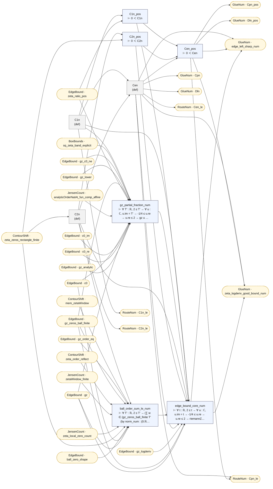

# `lean_stage3/Stage3/EdgeNum.lean`

**What it does** (its own header): EdgeNum — block E8a of `lean_stage3/design/joints.md`. 2026-11-22. `EdgeBound`'s three edge theorems with their constants as definitions. Each proof is the original with its existence step replaced: the band bound is `BoxBounds.sq_zeta_band_explicit` in place of `sq_zeta_band_bound`, and each `refine ⟨<expression>, _, ?_⟩` is the definition unfolding to that expression (`LOOP.md` § 3). `EdgeBound.lean` is untouched.

**Imports:** [`LowEdge`](../lean_stage3/LowEdge.md).
**Imported by:** [`Stage3`](../lean_stage3/Stage3.md), [`GlueNum`](../lean_stage3/GlueNum.md).

Blue: theorem. Green: a theorem nothing else uses (an end). Dashed white: connects to nothing. Grey: definition. Red: contains `sorry`. Yellow: in another file. An arrow A → B reads "A is used by B".

## Every declaration

| declaration | proves (output) | needs (input) | why (its own docstring) | uses | used by |
|---|---|---|---|---|---|
| `EdgeBound.C1n` def, line 30 | ℝ | — | The partial fraction's constant. | — | `EdgeBound.C1n_pos`, `EdgeBound.Cen`, `EdgeBound.edge_bound_core_num`, `EdgeBound.gz_partial_fraction_num`, `RouteNum.C1n_le` |
| `EdgeBound.C1n_pos` theorem, line 35 | 0 &lt; C1n | — | — | `EdgeBound.zeta_ratio_pos`, `EdgeBound.C1n` | `EdgeBound.Cen_pos`, `EdgeBound.edge_bound_core_num` |
| `EdgeBound.gz_partial_fraction_num` theorem, line 54 | ∀ T' : ℝ, 2 ≤ T' → ∀ u : ℂ, u.im = T' → -1/4 ≤ u.re → u.re ≤ 2 → gz u ≠ 0 → ‖deriv gz u / gz u - ∑ w ∈ (gz_zeros_ball_finite T' (by norm_num : (0:ℝ) ≤ 46/25)).toFinset, (analyticOrderNatAt gz w : ℂ) / (u - w)‖ ≤ C1n * Real.log T' | — | The rescaled Landau partial fraction. At any height `T′ ≥ 2` and any `u` on the segment `re ∈ [−1/4, 2]` at that height that is not a `gz`-zero, the log-derivative of `gz` minus the simple-pole sum over `gz`-zeros within `46/25` of the center is `≤ C·log T′`. Transported from PNT+'s normalized `FinalBound` with radii `22/25 &lt; 23/25 &lt; 19/20 &lt; 49/50`. | `BoxBounds.sq_zeta_band_explicit`, `EdgeBound.c0`, `EdgeBound.c0_im`, `EdgeBound.c0_re`, `EdgeBound.gz`, `EdgeBound.gz_analytic`, `EdgeBound.gz_c0_ne`, `EdgeBound.gz_lower`, `EdgeBound.gz_zeros_ball_finite`, `EdgeBound.zeta_ratio_pos`, `EdgeBound.C1n`, `Stage3.analyticOrderNatAt_fun_comp_affine` | `EdgeBound.edge_bound_core_num` |
| `EdgeBound.C2n` def, line 300 | ℝ | — | The ball count's constant. | `ContourShift.zeta_zeros_rectangle_finite` | `EdgeBound.C2n_pos`, `EdgeBound.Cen`, `EdgeBound.ball_order_sum_le_num`, `EdgeBound.edge_bound_core_num`, `RouteNum.C2n_le` |
| `EdgeBound.C2n_pos` theorem, line 305 | 0 &lt; C2n | — | — | `ContourShift.zeta_zeros_rectangle_finite`, `EdgeBound.C2n` | `EdgeBound.Cen_pos`, `EdgeBound.edge_bound_core_num` |
| `EdgeBound.ball_order_sum_le_num` theorem, line 317 | ∀ T' : ℝ, 2 ≤ T' → (∑ w ∈ (gz_zeros_ball_finite T' (by norm_num : (0:ℝ) ≤ 46/25)).toFinset, (analyticOrderNatAt gz w : ℝ)) ≤ C2n * Real.log T' | — | The ball order-count: the total multiplicity of `gz`-zeros in the `46/25`-ball at height `T′` is `≤ C·log T′` — four Jensen windows for `T′ ≥ 4` with the reflection charging left-zeros to partners, and a fixed-rectangle constant for `T′ &lt; 4`. | `ContourShift.mem_zetaWindow`, `ContourShift.zeta_order_reflect`, `ContourShift.zeta_zeros_rectangle_finite`, `EdgeBound.ball_zero_shape`, `EdgeBound.c0`, `EdgeBound.gz`, `EdgeBound.gz_order_eq`, `EdgeBound.gz_zeros_ball_finite`, `EdgeBound.C2n`, `Stage3.zetaWindow_finite`, `Stage3.zeta_local_zero_count` | `EdgeBound.edge_bound_core_num` |
| `EdgeBound.Cen` def, line 583 | ℝ | — | The edge constant. | `EdgeBound.C1n`, `EdgeBound.C2n` | `EdgeBound.Cen_pos`, `EdgeBound.edge_bound_core_num`, `Glue.Cpn`, `Glue.Dln`, `Glue.edge_left_sharp_num`, `Glue.zeta_logderiv_good_bound_num`, `RouteNum.Cen_le`, `RouteNum.Cpn_le` |
| `EdgeBound.Cen_pos` theorem, line 585 | 0 &lt; Cen | — | — | `EdgeBound.C1n_pos`, `EdgeBound.C2n_pos`, `EdgeBound.Cen` | `Glue.Cpn_pos`, `Glue.Dln_pos`, `Glue.edge_left_sharp_num`, `Glue.zeta_logderiv_good_bound_num`, `RouteNum.Cpn_le` |
| `EdgeBound.edge_bound_core_num` theorem, line 597 | ∀ t : ℝ, 2 ≤ t → ∀ u : ℂ, u.im = t → -1/4 ≤ u.re → u.re ≤ 2 → riemannZeta u ≠ 0 → ∀ δ : ℝ, 0 &lt; δ → δ ≤ 1 → (∀ w ∈ (gz_zeros_ball_finite t (by norm_num : (0:ℝ) ≤ 46/25)).toFinset, δ ≤ ‖u - w‖) → ‖deriv riemannZeta u / riemannZeta u‖ ≤ Cen * Real.log t / δ | — | The pointwise edge bound, unified. For `u` on the band `re ∈ [−1/4, 2]` at height `t ≥ 2`, with a lower bound `δ ≤ 1` on the distance from `u` to every ball zero: `‖ζ′/ζ(u)‖ ≤ C·(log t)/δ + C·log t`. Both edges specialize this: the left edge with `δ = 1/4`, the good horizontals with `δ = zeroGap T`. | `EdgeBound.gz`, `EdgeBound.gz_logderiv`, `EdgeBound.gz_zeros_ball_finite`, `EdgeBound.C1n`, `EdgeBound.C1n_pos`, `EdgeBound.C2n`, `EdgeBound.C2n_pos`, `EdgeBound.Cen`, `EdgeBound.ball_order_sum_le_num`, `EdgeBound.gz_partial_fraction_num` | `Glue.edge_left_sharp_num`, `Glue.zeta_logderiv_good_bound_num` |
