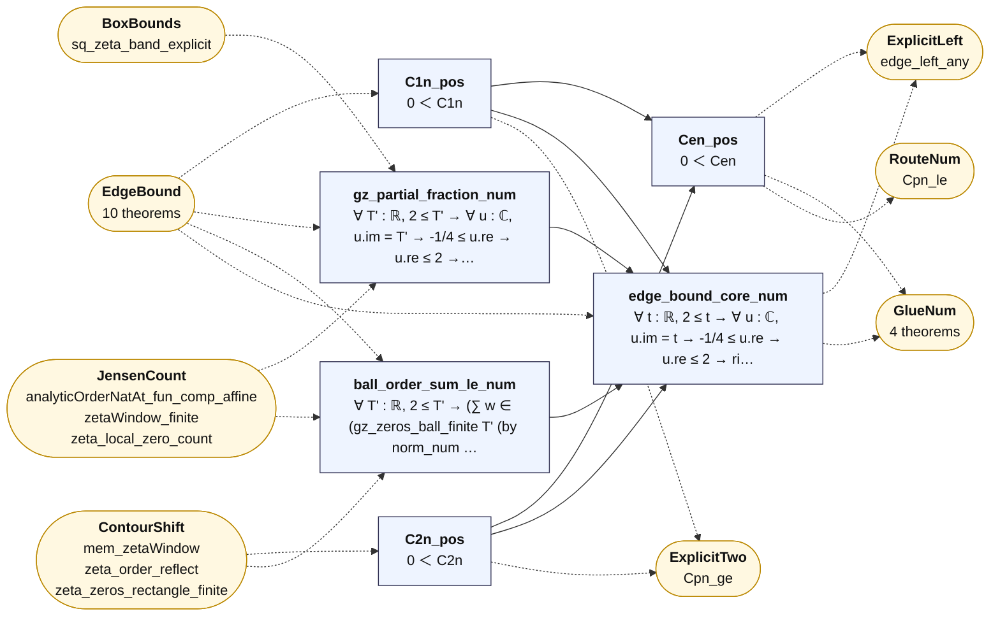

# `lean_stage3/Stage3/EdgeNum.lean`

EdgeNum — block E8a of `lean_stage3/design/joints.md`. 2026-11-22. `EdgeBound`'s three edge theorems with their constants as definitions. Each proof is the original with its existence step replaced: the band bound is `BoxBounds.sq_zeta_band_explicit` in place of `sq_zeta_band_bound`, and each `refine ⟨<expression>, _, ?_⟩` is the definition unfolding to that expression (`LOOP.md` § 3). `EdgeBound.lean` is untouched.

6 theorems, 3 definitions, 719 lines. Arrows are Lean's own record of what each proof uses.

**Imports:** [`LowEdge`](../lean_stage3/LowEdge.md)  
**Imported by:** [`Stage3`](../lean_stage3/Stage3.md), [`GlueNum`](../lean_stage3/GlueNum.md)

## The picture



An arrow A → B reads "A is used in the proof of B". Green: counting, integers only. Violet: shape, analysis with no ζ. Blue: reads ζ. A name ending in ■ is an end: nothing else uses it. Red: contains `sorry`. Yellow: theorems in another file, counted; a dotted arrow crosses files. Definitions are not drawn; they are listed below the diagram.

## Definitions

<a name="EdgeBound-C1n"></a>
### `EdgeBound.C1n`

def · line 30

The partial fraction's constant.

- **Is:** `` C1n : ℝ := (16 * (23/25:ℝ) ^ 2 / ((23/25:ℝ) - 22/25) ^ 3 + 1 / (((49/50:ℝ) ^ 2 / (19/20) - 19/20) * Real.log ((49/50:ℝ) / (19/20)))) / 2 * (Real.log (135 * 81 / (4 * ‖riemannZeta 3 / riemannZeta (3/2)‖) + 2) / Real.log 2 + 4) ``
- **Used by 7:** [`EdgeBound.C1n_pos`](#EdgeBound-C1n_pos), [`EdgeBound.Cen`](#EdgeBound-Cen), [`EdgeBound.Cen_pos`](#EdgeBound-Cen_pos), [`EdgeBound.edge_bound_core_num`](#EdgeBound-edge_bound_core_num), [`EdgeBound.gz_partial_fraction_num`](#EdgeBound-gz_partial_fraction_num), [`RouteNum.C1n_le`](../lean_stage3/RouteNum.md#RouteNum-C1n_le), [`RouteNum.Cen_le`](../lean_stage3/RouteNum.md#RouteNum-Cen_le)

<a name="EdgeBound-C2n"></a>
### `EdgeBound.C2n`

def · line 301

The ball count's constant.

- **Is:** `` C2n : ℝ := (∑ ρ ∈ (ContourShift.zeta_zeros_rectangle_finite (0:ℂ) ((1:ℝ) + Complex.I * (6:ℝ))).toFinset, (analyticOrderNatAt riemannZeta ρ : ℝ)) / Real.log 2 + 8 * (15 + 88 / Real.log 2) + 1 ``
- **Built from:** [`ContourShift.zeta_zeros_rectangle_finite`](../lean_stage3/ContourShift.md#ContourShift-zeta_zeros_rectangle_finite)
- **Used by 7:** [`EdgeBound.C2n_pos`](#EdgeBound-C2n_pos), [`EdgeBound.Cen`](#EdgeBound-Cen), [`EdgeBound.Cen_pos`](#EdgeBound-Cen_pos), [`EdgeBound.ball_order_sum_le_num`](#EdgeBound-ball_order_sum_le_num), [`EdgeBound.edge_bound_core_num`](#EdgeBound-edge_bound_core_num), [`RouteNum.C2n_le`](../lean_stage3/RouteNum.md#RouteNum-C2n_le), [`RouteNum.Cen_le`](../lean_stage3/RouteNum.md#RouteNum-Cen_le)

<a name="EdgeBound-Cen"></a>
### `EdgeBound.Cen`

def · line 585

The edge constant.

- **Is:** `` Cen : ℝ := C1n + C2n + 1 / Real.log 2 ``
- **Built from:** [`EdgeBound.C1n`](#EdgeBound-C1n), [`EdgeBound.C2n`](#EdgeBound-C2n)
- **Used by 13:** [`EdgeBound.Cen_pos`](#EdgeBound-Cen_pos), [`EdgeBound.edge_bound_core_num`](#EdgeBound-edge_bound_core_num), [`ExplicitLeft.edge_left_any`](../lean_stage3/ExplicitLeft.md#ExplicitLeft-edge_left_any), [`ExplicitTwo.Cpn_ge`](../lean_stage3/ExplicitTwo.md#ExplicitTwo-Cpn_ge), [`Glue.Cpn`](../lean_stage3/GlueNum.md#Glue-Cpn), [`Glue.Cpn_pos`](../lean_stage3/GlueNum.md#Glue-Cpn_pos), [`Glue.Dln`](../lean_stage3/GlueNum.md#Glue-Dln), [`Glue.Dln_pos`](../lean_stage3/GlueNum.md#Glue-Dln_pos), [`Glue.edge_left_sharp_num`](../lean_stage3/GlueNum.md#Glue-edge_left_sharp_num), [`Glue.zeta_logderiv_good_bound_num`](../lean_stage3/GlueNum.md#Glue-zeta_logderiv_good_bound_num), [`RouteNum.Cen_le`](../lean_stage3/RouteNum.md#RouteNum-Cen_le), [`RouteNum.Cpn_le`](../lean_stage3/RouteNum.md#RouteNum-Cpn_le), [`RouteNum.Dln_le`](../lean_stage3/RouteNum.md#RouteNum-Dln_le)

## Theorems

<a name="EdgeBound-C1n_pos"></a>
### `EdgeBound.C1n_pos`

line 36

**Reads ζ.** It, or something it rests on, uses the zeta function, its zeros or the Riemann hypothesis.

**Why.** The partial fraction's constant `C1n` is positive.

**Proves**

```lean
0 < C1n
```

**Stated with:** [`EdgeBound.C1n`](#EdgeBound-C1n)

**Fed by** (1 theorem its proof uses)

  - [`EdgeBound.zeta_ratio_pos`](../lean_stage3/EdgeBound.md#EdgeBound-zeta_ratio_pos) (EdgeBound) — `` (0:ℝ) < ‖riemannZeta 3 / riemannZeta (3/2)‖ ``

**Feeds** (3 that use it)

  - [`EdgeBound.Cen_pos`](#EdgeBound-Cen_pos) — `` 0 < Cen ``
  - [`EdgeBound.edge_bound_core_num`](#EdgeBound-edge_bound_core_num) — `` ∀ t : ℝ, 2 ≤ t → ∀ u : ℂ, u.im = t → -1/4 ≤ u.re → u.re ≤ 2 → riemannZeta u ≠ 0 → ∀ δ : ℝ, 0 < δ → δ ≤ 1 → (∀ w ∈ (gz_zeros_ball_finite t (by norm_num… ``
  - [`ExplicitTwo.Cpn_ge`](../lean_stage3/ExplicitTwo.md#ExplicitTwo-Cpn_ge) (ExplicitTwo) — `` (360:ℝ) ≤ Glue.Cpn ``

<a name="EdgeBound-gz_partial_fraction_num"></a>
### `EdgeBound.gz_partial_fraction_num`

line 55

**Reads ζ.** It, or something it rests on, uses the zeta function, its zeros or the Riemann hypothesis.

**Why.** The rescaled Landau partial fraction. At any height `T′ ≥ 2` and any `u` on the segment `re ∈ [−1/4, 2]` at that height that is not a `gz`-zero, the log-derivative of `gz` minus the simple-pole sum over `gz`-zeros within `46/25` of the center is `≤ C·log T′`. Transported from PNT+'s normalized `FinalBound` with radii `22/25 < 23/25 < 19/20 < 49/50`.

**Proves**

```lean
∀ T' : ℝ, 2 ≤ T' → ∀ u : ℂ, u.im = T' → -1/4 ≤ u.re → u.re ≤ 2 → gz u ≠ 0 → ‖deriv gz u / gz u - ∑ w ∈ (gz_zeros_ball_finite T' (by norm_num : (0:ℝ) ≤ 46/25)).toFinset, (analyticOrderNatAt gz w : ℂ) / (u - w)‖ ≤ C1n * Real.log T'
```

**Stated with:** [`EdgeBound.c0`](../lean_stage3/EdgeBound.md#EdgeBound-c0), [`EdgeBound.gz`](../lean_stage3/EdgeBound.md#EdgeBound-gz), [`EdgeBound.gz_zeros_ball_finite`](../lean_stage3/EdgeBound.md#EdgeBound-gz_zeros_ball_finite), [`EdgeBound.C1n`](#EdgeBound-C1n)

**Fed by** (8 theorems its proof uses)

  - [`BoxBounds.sq_zeta_band_explicit`](../lean_stage3/BoxBounds.md#BoxBounds-sq_zeta_band_explicit) (BoxBounds) — `` ‖(s - 1) ^ 2 * riemannZeta s‖ ≤ 135 * (2 + |s.im|) ^ 4 ``
  - [`EdgeBound.c0_im`](../lean_stage3/EdgeBound.md#EdgeBound-c0_im) (EdgeBound) — `` (c0 T').im = T' ``
  - [`EdgeBound.c0_re`](../lean_stage3/EdgeBound.md#EdgeBound-c0_re) (EdgeBound) — `` (c0 T').re = 3/2 ``
  - [`EdgeBound.gz_analytic`](../lean_stage3/EdgeBound.md#EdgeBound-gz_analytic) (EdgeBound) — `` AnalyticAt ℂ gz s ``
  - [`EdgeBound.gz_c0_ne`](../lean_stage3/EdgeBound.md#EdgeBound-gz_c0_ne) (EdgeBound) — `` gz (c0 T') ≠ 0 ``
  - [`EdgeBound.gz_lower`](../lean_stage3/EdgeBound.md#EdgeBound-gz_lower) (EdgeBound) — `` 4 * ‖riemannZeta 3 / riemannZeta (3/2)‖ ≤ ‖gz (c0 T')‖ ``
  - [`EdgeBound.zeta_ratio_pos`](../lean_stage3/EdgeBound.md#EdgeBound-zeta_ratio_pos) (EdgeBound) — `` (0:ℝ) < ‖riemannZeta 3 / riemannZeta (3/2)‖ ``
  - [`Stage3.analyticOrderNatAt_fun_comp_affine`](../lean_stage3/JensenCount.md#Stage3-analyticOrderNatAt_fun_comp_affine) (JensenCount) — `` analyticOrderNatAt (fun w : ℂ => g (a * w + b)) z = analyticOrderNatAt g (a * z + b) ``

**Feeds** (1 that use it)

  - [`EdgeBound.edge_bound_core_num`](#EdgeBound-edge_bound_core_num) — `` ∀ t : ℝ, 2 ≤ t → ∀ u : ℂ, u.im = t → -1/4 ≤ u.re → u.re ≤ 2 → riemannZeta u ≠ 0 → ∀ δ : ℝ, 0 < δ → δ ≤ 1 → (∀ w ∈ (gz_zeros_ball_finite t (by norm_num… ``

<a name="EdgeBound-C2n_pos"></a>
### `EdgeBound.C2n_pos`

line 307

**Reads ζ.** It, or something it rests on, uses the zeta function, its zeros or the Riemann hypothesis.

**Why.** The ball count's constant `C2n` is positive.

**Proves**

```lean
0 < C2n
```

**Stated with:** [`EdgeBound.C2n`](#EdgeBound-C2n)

**Fed by** (1 theorem its proof uses)

  - [`ContourShift.zeta_zeros_rectangle_finite`](../lean_stage3/ContourShift.md#ContourShift-zeta_zeros_rectangle_finite) (ContourShift) — `` {ρ : ℂ | riemannZeta ρ = 0 ∧ ρ ∈ Rectangle z w}.Finite ``

**Feeds** (3 that use it)

  - [`EdgeBound.Cen_pos`](#EdgeBound-Cen_pos) — `` 0 < Cen ``
  - [`EdgeBound.edge_bound_core_num`](#EdgeBound-edge_bound_core_num) — `` ∀ t : ℝ, 2 ≤ t → ∀ u : ℂ, u.im = t → -1/4 ≤ u.re → u.re ≤ 2 → riemannZeta u ≠ 0 → ∀ δ : ℝ, 0 < δ → δ ≤ 1 → (∀ w ∈ (gz_zeros_ball_finite t (by norm_num… ``
  - [`ExplicitTwo.Cpn_ge`](../lean_stage3/ExplicitTwo.md#ExplicitTwo-Cpn_ge) (ExplicitTwo) — `` (360:ℝ) ≤ Glue.Cpn ``

<a name="EdgeBound-ball_order_sum_le_num"></a>
### `EdgeBound.ball_order_sum_le_num`

line 319

**Reads ζ.** It, or something it rests on, uses the zeta function, its zeros or the Riemann hypothesis.

**Why.** The ball order-count: the total multiplicity of `gz`-zeros in the `46/25`-ball at height `T′` is `≤ C·log T′` — four Jensen windows for `T′ ≥ 4` with the reflection charging left-zeros to partners, and a fixed-rectangle constant for `T′ < 4`.

**Proves**

```lean
∀ T' : ℝ, 2 ≤ T' → (∑ w ∈ (gz_zeros_ball_finite T' (by norm_num : (0:ℝ) ≤ 46/25)).toFinset, (analyticOrderNatAt gz w : ℝ)) ≤ C2n * Real.log T'
```

**Stated with:** [`EdgeBound.c0`](../lean_stage3/EdgeBound.md#EdgeBound-c0), [`EdgeBound.gz`](../lean_stage3/EdgeBound.md#EdgeBound-gz), [`EdgeBound.gz_zeros_ball_finite`](../lean_stage3/EdgeBound.md#EdgeBound-gz_zeros_ball_finite), [`EdgeBound.C2n`](#EdgeBound-C2n)

**Fed by** (7 theorems its proof uses)

  - [`ContourShift.mem_zetaWindow`](../lean_stage3/ContourShift.md#ContourShift-mem_zetaWindow) (ContourShift) — `` ρ ∈ Stage3.zetaWindow T₀ ``
  - [`ContourShift.zeta_order_reflect`](../lean_stage3/ContourShift.md#ContourShift-zeta_order_reflect) (ContourShift) — `` analyticOrderNatAt riemannZeta (1 - (starRingEnd ℂ) ρ) = analyticOrderNatAt riemannZeta ρ ``
  - [`ContourShift.zeta_zeros_rectangle_finite`](../lean_stage3/ContourShift.md#ContourShift-zeta_zeros_rectangle_finite) (ContourShift) — `` {ρ : ℂ | riemannZeta ρ = 0 ∧ ρ ∈ Rectangle z w}.Finite ``
  - [`EdgeBound.ball_zero_shape`](../lean_stage3/EdgeBound.md#EdgeBound-ball_zero_shape) (EdgeBound) — `` riemannZeta w = 0 ∧ (0 < w.re ∧ w.re < 1) ∧ |w.im - T'| ≤ 46/25 ``
  - [`EdgeBound.gz_order_eq`](../lean_stage3/EdgeBound.md#EdgeBound-gz_order_eq) (EdgeBound) — `` analyticOrderNatAt gz w = analyticOrderNatAt riemannZeta w ``
  - [`Stage3.zetaWindow_finite`](../lean_stage3/JensenCount.md#Stage3-zetaWindow_finite) (JensenCount) — `` (zetaWindow T).Finite ``
  - [`Stage3.zeta_local_zero_count`](../lean_stage3/JensenCount.md#Stage3-zeta_local_zero_count) (JensenCount) — `` ∑ ρ ∈ (zetaWindow_finite hT).toFinset, (analyticOrderNatAt ζ ρ : ℝ) ≤ 15 * Real.log T + 73 ``

**Definitions its proof touches:** [`Stage3.zetaWindow`](../lean_stage3/JensenCount.md#Stage3-zetaWindow)

**Feeds** (1 that use it)

  - [`EdgeBound.edge_bound_core_num`](#EdgeBound-edge_bound_core_num) — `` ∀ t : ℝ, 2 ≤ t → ∀ u : ℂ, u.im = t → -1/4 ≤ u.re → u.re ≤ 2 → riemannZeta u ≠ 0 → ∀ δ : ℝ, 0 < δ → δ ≤ 1 → (∀ w ∈ (gz_zeros_ball_finite t (by norm_num… ``

<a name="EdgeBound-Cen_pos"></a>
### `EdgeBound.Cen_pos`

line 588

**Reads ζ.** It, or something it rests on, uses the zeta function, its zeros or the Riemann hypothesis.

**Why.** The edge constant `Cen` is positive.

**Proves**

```lean
0 < Cen
```

**Stated with:** [`EdgeBound.Cen`](#EdgeBound-Cen)

**Fed by** (2 theorems its proof uses)

  - [`EdgeBound.C1n_pos`](#EdgeBound-C1n_pos) — `` 0 < C1n ``
  - [`EdgeBound.C2n_pos`](#EdgeBound-C2n_pos) — `` 0 < C2n ``

**Definitions its proof touches:** [`EdgeBound.C1n`](#EdgeBound-C1n), [`EdgeBound.C2n`](#EdgeBound-C2n)

**Feeds** (6 that use it)

  - [`ExplicitLeft.edge_left_any`](../lean_stage3/ExplicitLeft.md#ExplicitLeft-edge_left_any) (ExplicitLeft) — `` ‖VIntegral (Glue.Gf x) (-1/4) (-T') T'‖ ≤ Aleft * (Real.log T')^2 * x ^ (-(1:ℝ)/4) ``
  - [`Glue.Cpn_pos`](../lean_stage3/GlueNum.md#Glue-Cpn_pos) (GlueNum) — `` 0 < Cpn ``
  - [`Glue.Dln_pos`](../lean_stage3/GlueNum.md#Glue-Dln_pos) (GlueNum) — `` 0 < Dln ``
  - [`Glue.edge_left_sharp_num`](../lean_stage3/GlueNum.md#Glue-edge_left_sharp_num) (GlueNum) — `` ∀ x T' : ℝ, 16 ≤ x → 2 ≤ T' → T' ≤ 2*x^2 → ‖VIntegral (Gf x) (-1/4) (-T') T'‖ ≤ 72 * Dln * ((Real.log x)^2 * x ^ (-(1:ℝ)/4)) ``
  - [`Glue.zeta_logderiv_good_bound_num`](../lean_stage3/GlueNum.md#Glue-zeta_logderiv_good_bound_num) (GlueNum) — `` ∀ T T' : ℝ, 2 ≤ T → T' ∈ Set.Icc T (T+1) → (∀ ρ : ℂ, riemannZeta ρ = 0 → 0 < ρ.re → ContourShift.zeroGap T ≤ |ρ.im - T'|) → ∀ u : ℂ, |u.im| = T' → -1/… ``
  - [`RouteNum.Cpn_le`](../lean_stage3/RouteNum.md#RouteNum-Cpn_le) (RouteNum) — `` Glue.Cpn ≤ 6534550000 ``

<a name="EdgeBound-edge_bound_core_num"></a>
### `EdgeBound.edge_bound_core_num`

line 600

**Reads ζ.** It, or something it rests on, uses the zeta function, its zeros or the Riemann hypothesis.

**Why.** The pointwise edge bound, unified. For `u` on the band `re ∈ [−1/4, 2]` at height `t ≥ 2`, with a lower bound `δ ≤ 1` on the distance from `u` to every ball zero: `‖ζ′/ζ(u)‖ ≤ C·(log t)/δ + C·log t`. Both edges specialize this: the left edge with `δ = 1/4`, the good horizontals with `δ = zeroGap T`.

**Proves**

```lean
∀ t : ℝ, 2 ≤ t → ∀ u : ℂ, u.im = t → -1/4 ≤ u.re → u.re ≤ 2 → riemannZeta u ≠ 0 → ∀ δ : ℝ, 0 < δ → δ ≤ 1 → (∀ w ∈ (gz_zeros_ball_finite t (by norm_num : (0:ℝ) ≤ 46/25)).toFinset, δ ≤ ‖u - w‖) → ‖deriv riemannZeta u / riemannZeta u‖ ≤ Cen * Real.log t / δ
```

**Stated with:** [`EdgeBound.c0`](../lean_stage3/EdgeBound.md#EdgeBound-c0), [`EdgeBound.gz`](../lean_stage3/EdgeBound.md#EdgeBound-gz), [`EdgeBound.gz_zeros_ball_finite`](../lean_stage3/EdgeBound.md#EdgeBound-gz_zeros_ball_finite), [`EdgeBound.Cen`](#EdgeBound-Cen)

**Fed by** (5 theorems its proof uses)

  - [`EdgeBound.gz_logderiv`](../lean_stage3/EdgeBound.md#EdgeBound-gz_logderiv) (EdgeBound) — `` deriv gz u / gz u = 2/(u - 1) + deriv riemannZeta u / riemannZeta u ``
  - [`EdgeBound.C1n_pos`](#EdgeBound-C1n_pos) — `` 0 < C1n ``
  - [`EdgeBound.C2n_pos`](#EdgeBound-C2n_pos) — `` 0 < C2n ``
  - [`EdgeBound.ball_order_sum_le_num`](#EdgeBound-ball_order_sum_le_num) — `` ∀ T' : ℝ, 2 ≤ T' → (∑ w ∈ (gz_zeros_ball_finite T' (by norm_num : (0:ℝ) ≤ 46/25)).toFinset, (analyticOrderNatAt gz w : ℝ)) ≤ C2n * Real.log T' ``
  - [`EdgeBound.gz_partial_fraction_num`](#EdgeBound-gz_partial_fraction_num) — `` ∀ T' : ℝ, 2 ≤ T' → ∀ u : ℂ, u.im = T' → -1/4 ≤ u.re → u.re ≤ 2 → gz u ≠ 0 → ‖deriv gz u / gz u - ∑ w ∈ (gz_zeros_ball_finite T' (by norm_num : (0:ℝ) ≤… ``

**Definitions its proof touches:** [`EdgeBound.C1n`](#EdgeBound-C1n), [`EdgeBound.C2n`](#EdgeBound-C2n)

**Feeds** (3 that use it)

  - [`ExplicitLeft.edge_left_any`](../lean_stage3/ExplicitLeft.md#ExplicitLeft-edge_left_any) (ExplicitLeft) — `` ‖VIntegral (Glue.Gf x) (-1/4) (-T') T'‖ ≤ Aleft * (Real.log T')^2 * x ^ (-(1:ℝ)/4) ``
  - [`Glue.edge_left_sharp_num`](../lean_stage3/GlueNum.md#Glue-edge_left_sharp_num) (GlueNum) — `` ∀ x T' : ℝ, 16 ≤ x → 2 ≤ T' → T' ≤ 2*x^2 → ‖VIntegral (Gf x) (-1/4) (-T') T'‖ ≤ 72 * Dln * ((Real.log x)^2 * x ^ (-(1:ℝ)/4)) ``
  - [`Glue.zeta_logderiv_good_bound_num`](../lean_stage3/GlueNum.md#Glue-zeta_logderiv_good_bound_num) (GlueNum) — `` ∀ T T' : ℝ, 2 ≤ T → T' ∈ Set.Icc T (T+1) → (∀ ρ : ℂ, riemannZeta ρ = 0 → 0 < ρ.re → ContourShift.zeroGap T ≤ |ρ.im - T'|) → ∀ u : ℂ, |u.im| = T' → -1/… ``

