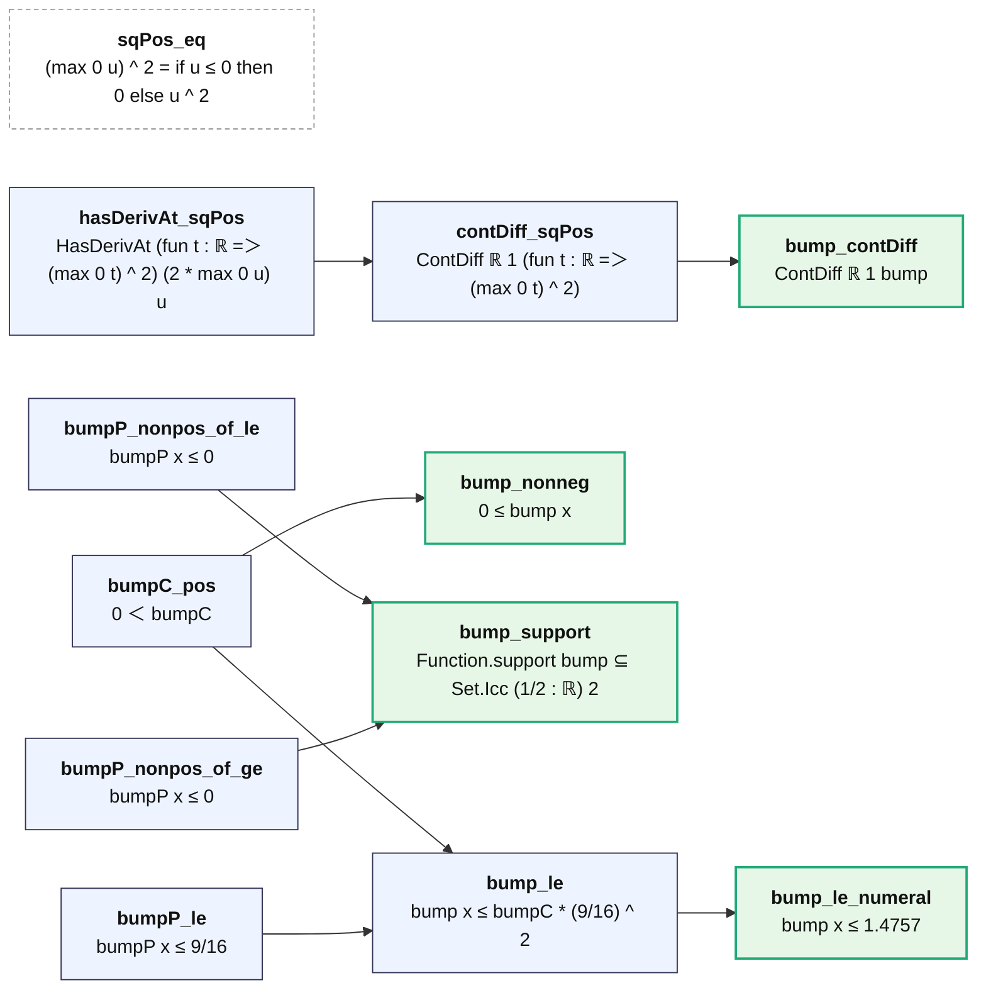

# `lean_stage3/Stage3/ExplicitBump.lean`

ExplicitBump — a concrete `ν`, so `mellin_bump_bounded`'s `B` is a numeral. WHY THIS FILE EXISTS. `RHPull.psi_weak_of_RH` (`Stage3/LineBound.lean:2357`) assembles its constant from four distinct existentials:

12 theorems, 3 definitions, 246 lines. Arrows are Lean's own record of what each proof uses.

**Imports:** nothing in this tree  
**Imported by:** [`Stage3`](../lean_stage3/Stage3.md)

## The picture



An arrow A → B reads "A is used in the proof of B". Blue: theorem. Green: a theorem nothing else uses (an end). Dashed: connects to nothing. Red: contains `sorry`. Yellow: theorems in another file, counted; a dotted arrow crosses files. Definitions are not drawn; they are listed below the diagram.

## Definitions

<a name="Stage3-bumpP"></a>
### `Stage3.bumpP`

def · line 125

The interval polynomial: `p x = (x − 1/2)(2 − x)`, positive exactly on `Ioo (1/2) 2`.

- **Is:** `` bumpP (x : ℝ) : ℝ := (x - 1/2) * (2 - x) ``
- **Used by 8:** [`Stage3.bump`](#Stage3-bump), [`Stage3.bumpP_le`](#Stage3-bumpP_le), [`Stage3.bumpP_nonpos_of_ge`](#Stage3-bumpP_nonpos_of_ge), [`Stage3.bumpP_nonpos_of_le`](#Stage3-bumpP_nonpos_of_le), [`Stage3.bump_contDiff`](#Stage3-bump_contDiff), [`Stage3.bump_le`](#Stage3-bump_le), [`Stage3.bump_nonneg`](#Stage3-bump_nonneg), [`Stage3.bump_support`](#Stage3-bump_support)

<a name="Stage3-bumpC"></a>
### `Stage3.bumpC`

def · line 129

The normalising constant `c = 1 / ∫_{1/2}^{2} p²/x`, in closed form. `∫ p²/x = 33/16 − (3/2)·log 2`.

- **Is:** `` bumpC : ℝ := 1 / (33/16 - (3/2) * Real.log 2) ``
- **Used by 7:** [`Stage3.bump`](#Stage3-bump), [`Stage3.bumpC_pos`](#Stage3-bumpC_pos), [`Stage3.bump_contDiff`](#Stage3-bump_contDiff), [`Stage3.bump_le`](#Stage3-bump_le), [`Stage3.bump_le_numeral`](#Stage3-bump_le_numeral), [`Stage3.bump_nonneg`](#Stage3-bump_nonneg), [`Stage3.bump_support`](#Stage3-bump_support)

<a name="Stage3-bump"></a>
### `Stage3.bump`

def · line 133

The explicit bump. `C¹`, supported exactly on `Icc (1/2) 2`, non-negative, and normalised so `∫ ν(x)/x dx = 1`.

- **Is:** `` bump (x : ℝ) : ℝ := bumpC * (max 0 (bumpP x)) ^ 2 ``
- **Built from:** [`Stage3.bumpC`](#Stage3-bumpC), [`Stage3.bumpP`](#Stage3-bumpP)
- **Used by 5:** [`Stage3.bump_contDiff`](#Stage3-bump_contDiff), [`Stage3.bump_le`](#Stage3-bump_le), [`Stage3.bump_le_numeral`](#Stage3-bump_le_numeral), [`Stage3.bump_nonneg`](#Stage3-bump_nonneg), [`Stage3.bump_support`](#Stage3-bump_support)

## Theorems

<a name="Stage3-sqPos_eq"></a>
### `Stage3.sqPos_eq`

line 60

**Why.** `(max 0 u)²` written without the max, for differentiation.

**Proves**

```lean
(max 0 u) ^ 2 = if u ≤ 0 then 0 else u ^ 2
```

**Needs** (its hypotheses)

  - `` u : ℝ ``

**Fed by:** no theorem of this repo; it stands on Mathlib.

**Feeds:** nothing. It connects to nothing.

<a name="Stage3-hasDerivAt_sqPos"></a>
### `Stage3.hasDerivAt_sqPos`

line 68

**Why.** The derivative of `(max 0 ·)²` is `2·max 0 ·`, everywhere — including at the join, where both one-sided derivatives vanish.

**Proves**

```lean
HasDerivAt (fun t : ℝ => (max 0 t) ^ 2) (2 * max 0 u) u
```

**Needs** (its hypotheses)

  - `` u : ℝ ``

**Fed by:** no theorem of this repo; it stands on Mathlib.

**Feeds** (1 that use it)

  - [`Stage3.contDiff_sqPos`](#Stage3-contDiff_sqPos) — `` ContDiff ℝ 1 (fun t : ℝ => (max 0 t) ^ 2) ``

<a name="Stage3-contDiff_sqPos"></a>
### `Stage3.contDiff_sqPos`

line 112

**Proves**

```lean
ContDiff ℝ 1 (fun t : ℝ => (max 0 t) ^ 2)
```

**Fed by** (1 theorem its proof uses)

  - [`Stage3.hasDerivAt_sqPos`](#Stage3-hasDerivAt_sqPos) — `` HasDerivAt (fun t : ℝ => (max 0 t) ^ 2) (2 * max 0 u) u ``

**Feeds** (1 that use it)

  - [`Stage3.bump_contDiff`](#Stage3-bump_contDiff) — `` ContDiff ℝ 1 bump ``

<a name="Stage3-bumpP_nonpos_of_le"></a>
### `Stage3.bumpP_nonpos_of_le`

line 135

**Proves**

```lean
bumpP x ≤ 0
```

**Needs** (its hypotheses)

  - `` hx : x ≤ 1/2 ``

**Stated with:** [`Stage3.bumpP`](#Stage3-bumpP)

**Fed by:** no theorem of this repo; it stands on Mathlib and the definitions below.

**Feeds** (1 that use it)

  - [`Stage3.bump_support`](#Stage3-bump_support) — `` Function.support bump ⊆ Set.Icc (1/2 : ℝ) 2 ``

<a name="Stage3-bumpP_nonpos_of_ge"></a>
### `Stage3.bumpP_nonpos_of_ge`

line 141

**Proves**

```lean
bumpP x ≤ 0
```

**Needs** (its hypotheses)

  - `` hx : 2 ≤ x ``

**Stated with:** [`Stage3.bumpP`](#Stage3-bumpP)

**Fed by:** no theorem of this repo; it stands on Mathlib and the definitions below.

**Feeds** (1 that use it)

  - [`Stage3.bump_support`](#Stage3-bump_support) — `` Function.support bump ⊆ Set.Icc (1/2 : ℝ) 2 ``

<a name="Stage3-bumpC_pos"></a>
### `Stage3.bumpC_pos`

line 146

**Why.** `∫ p²/x` is positive, so `bumpC` is well defined and positive.

**Proves**

```lean
0 < bumpC
```

**Stated with:** [`Stage3.bumpC`](#Stage3-bumpC)

**Fed by:** no theorem of this repo; it stands on Mathlib and the definitions below.

**Feeds** (2 that use it)

  - [`Stage3.bump_le`](#Stage3-bump_le) — `` bump x ≤ bumpC * (9/16) ^ 2 ``
  - [`Stage3.bump_nonneg`](#Stage3-bump_nonneg) — `` 0 ≤ bump x ``

<a name="Stage3-bump_nonneg"></a>
### `Stage3.bump_nonneg`

line 154

**Proves**

```lean
0 ≤ bump x
```

**Needs** (its hypotheses)

  - `` x : ℝ ``

**Stated with:** [`Stage3.bump`](#Stage3-bump)

**Fed by** (1 theorem its proof uses)

  - [`Stage3.bumpC_pos`](#Stage3-bumpC_pos) — `` 0 < bumpC ``

**Definitions its proof touches:** [`Stage3.bumpC`](#Stage3-bumpC), [`Stage3.bumpP`](#Stage3-bumpP)

**Feeds:** nothing. It is an end.

<a name="Stage3-bump_support"></a>
### `Stage3.bump_support`

line 160

**Why.** Support. Off `Icc (1/2) 2` the polynomial is non-positive, so the positive part is zero.

**Proves**

```lean
Function.support bump ⊆ Set.Icc (1/2 : ℝ) 2
```

**Stated with:** [`Stage3.bump`](#Stage3-bump)

**Fed by** (2 theorems its proof uses)

  - [`Stage3.bumpP_nonpos_of_ge`](#Stage3-bumpP_nonpos_of_ge) — `` bumpP x ≤ 0 ``
  - [`Stage3.bumpP_nonpos_of_le`](#Stage3-bumpP_nonpos_of_le) — `` bumpP x ≤ 0 ``

**Definitions its proof touches:** [`Stage3.bumpC`](#Stage3-bumpC), [`Stage3.bumpP`](#Stage3-bumpP)

**Feeds:** nothing. It is an end.

<a name="Stage3-bump_contDiff"></a>
### `Stage3.bump_contDiff`

line 176

**Why.** `C¹`. The polynomial is smooth and the positive-part square is `C¹`, so the composite is.

**Proves**

```lean
ContDiff ℝ 1 bump
```

**Stated with:** [`Stage3.bump`](#Stage3-bump)

**Fed by** (1 theorem its proof uses)

  - [`Stage3.contDiff_sqPos`](#Stage3-contDiff_sqPos) — `` ContDiff ℝ 1 (fun t : ℝ => (max 0 t) ^ 2) ``

**Definitions its proof touches:** [`Stage3.bumpC`](#Stage3-bumpC), [`Stage3.bumpP`](#Stage3-bumpP)

**Feeds:** nothing. It is an end.

<a name="Stage3-bumpP_le"></a>
### `Stage3.bumpP_le`

line 185

**Why.** `p` peaks at `x = 5/4` with value `9/16`.

**Proves**

```lean
bumpP x ≤ 9/16
```

**Needs** (its hypotheses)

  - `` x : ℝ ``

**Stated with:** [`Stage3.bumpP`](#Stage3-bumpP)

**Fed by:** no theorem of this repo; it stands on Mathlib and the definitions below.

**Feeds** (1 that use it)

  - [`Stage3.bump_le`](#Stage3-bump_le) — `` bump x ≤ bumpC * (9/16) ^ 2 ``

<a name="Stage3-bump_le"></a>
### `Stage3.bump_le`

line 190

**Why.** The sup of the bump, at the peak: `sup ν = c·(9/16)²`.

**Proves**

```lean
bump x ≤ bumpC * (9/16) ^ 2
```

**Needs** (its hypotheses)

  - `` x : ℝ ``

**Stated with:** [`Stage3.bump`](#Stage3-bump), [`Stage3.bumpC`](#Stage3-bumpC)

**Fed by** (2 theorems its proof uses)

  - [`Stage3.bumpC_pos`](#Stage3-bumpC_pos) — `` 0 < bumpC ``
  - [`Stage3.bumpP_le`](#Stage3-bumpP_le) — `` bumpP x ≤ 9/16 ``

**Definitions its proof touches:** [`Stage3.bumpP`](#Stage3-bumpP)

**Feeds** (1 that use it)

  - [`Stage3.bump_le_numeral`](#Stage3-bump_le_numeral) — `` bump x ≤ 1.4757 ``

<a name="Stage3-bump_le_numeral"></a>
### `Stage3.bump_le_numeral`

line 200

**Why.** The numeral. `sup ν ≤ 1.4757`, hence `mellin_bump_bounded`'s `B = 3·sup‖ν‖ + 1 ≤ 5.4271`. Both bounds are decimal, so a consumer can carry them arithmetically.

**Proves**

```lean
bump x ≤ 1.4757
```

**Needs** (its hypotheses)

  - `` x : ℝ ``

**Stated with:** [`Stage3.bump`](#Stage3-bump)

**Fed by** (1 theorem its proof uses)

  - [`Stage3.bump_le`](#Stage3-bump_le) — `` bump x ≤ bumpC * (9/16) ^ 2 ``

**Definitions its proof touches:** [`Stage3.bumpC`](#Stage3-bumpC)

**Feeds:** nothing. It is an end.

