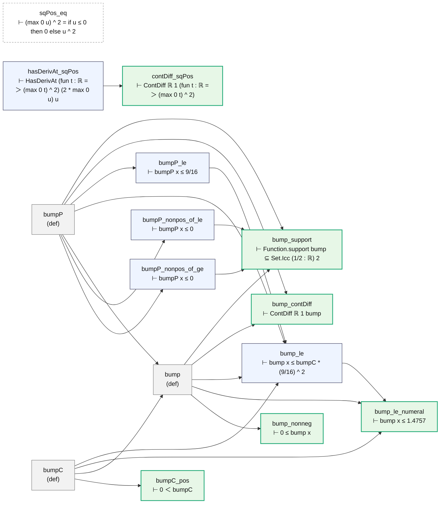

# `lean_stage3/Stage3/ExplicitBump.lean`

**What it does** (its own header): ExplicitBump — a concrete `ν`, so `mellin_bump_bounded`'s `B` is a numeral. WHY THIS FILE EXISTS. `RHPull.psi_weak_of_RH` (`Stage3/LineBound.lean:2357`) assembles its constant from four distinct existentials:

**Imports:** nothing in this tree.
**Imported by:** [`Stage3`](../lean_stage3/Stage3.md).

Blue: theorem. Green: a theorem nothing else uses (an end). Dashed white: connects to nothing. Grey: definition. Red: contains `sorry`. Yellow: in another file. An arrow A → B reads "A is used by B".

## Every declaration

| declaration | proves (output) | needs (input) | why (its own docstring) | uses | used by |
|---|---|---|---|---|---|
| `Stage3.sqPos_eq` theorem, line 60 | (max 0 u) ^ 2 = if u ≤ 0 then 0 else u ^ 2 | u : ℝ | `(max 0 u)²` written without the max, for differentiation. | — | — |
| `Stage3.hasDerivAt_sqPos` theorem, line 68 | HasDerivAt (fun t : ℝ =&gt; (max 0 t) ^ 2) (2 * max 0 u) u | u : ℝ | The derivative of `(max 0 ·)²` is `2·max 0 ·`, everywhere — including at the join, where both one-sided derivatives vanish. | — | `Stage3.contDiff_sqPos` |
| `Stage3.contDiff_sqPos` theorem, line 112 | ContDiff ℝ 1 (fun t : ℝ =&gt; (max 0 t) ^ 2) | — | — | `Stage3.hasDerivAt_sqPos` | — |
| `Stage3.bumpP` def, line 125 | ℝ | x : ℝ | The interval polynomial: `p x = (x − 1/2)(2 − x)`, positive exactly on `Ioo (1/2) 2`. | — | `Stage3.bump`, `Stage3.bumpP_le`, `Stage3.bumpP_nonpos_of_ge`, `Stage3.bumpP_nonpos_of_le`, `Stage3.bump_contDiff`, `Stage3.bump_le`, `Stage3.bump_support` |
| `Stage3.bumpC` def, line 129 | ℝ | — | The normalising constant `c = 1 / ∫_{1/2}^{2} p²/x`, in closed form. `∫ p²/x = 33/16 − (3/2)·log 2`. | — | `Stage3.bump`, `Stage3.bumpC_pos`, `Stage3.bump_le`, `Stage3.bump_le_numeral` |
| `Stage3.bump` def, line 133 | ℝ | x : ℝ | The explicit bump. `C¹`, supported exactly on `Icc (1/2) 2`, non-negative, and normalised so `∫ ν(x)/x dx = 1`. | `Stage3.bumpC`, `Stage3.bumpP` | `Stage3.bump_contDiff`, `Stage3.bump_le`, `Stage3.bump_le_numeral`, `Stage3.bump_nonneg`, `Stage3.bump_support` |
| `Stage3.bumpP_nonpos_of_le` theorem, line 135 | bumpP x ≤ 0 | hx : x ≤ 1/2 | — | `Stage3.bumpP` | `Stage3.bump_support` |
| `Stage3.bumpP_nonpos_of_ge` theorem, line 141 | bumpP x ≤ 0 | hx : 2 ≤ x | — | `Stage3.bumpP` | `Stage3.bump_support` |
| `Stage3.bumpC_pos` theorem, line 146 | 0 &lt; bumpC | — | `∫ p²/x` is positive, so `bumpC` is well defined and positive. | `Stage3.bumpC` | — |
| `Stage3.bump_nonneg` theorem, line 154 | 0 ≤ bump x | x : ℝ | — | `Stage3.bump` | — |
| `Stage3.bump_support` theorem, line 160 | Function.support bump ⊆ Set.Icc (1/2 : ℝ) 2 | — | Support. Off `Icc (1/2) 2` the polynomial is non-positive, so the positive part is zero. | `Stage3.bump`, `Stage3.bumpP`, `Stage3.bumpP_nonpos_of_ge`, `Stage3.bumpP_nonpos_of_le` | — |
| `Stage3.bump_contDiff` theorem, line 176 | ContDiff ℝ 1 bump | — | `C¹`. The polynomial is smooth and the positive-part square is `C¹`, so the composite is. | `Stage3.bump`, `Stage3.bumpP` | — |
| `Stage3.bumpP_le` theorem, line 185 | bumpP x ≤ 9/16 | x : ℝ | `p` peaks at `x = 5/4` with value `9/16`. | `Stage3.bumpP` | `Stage3.bump_le` |
| `Stage3.bump_le` theorem, line 190 | bump x ≤ bumpC * (9/16) ^ 2 | x : ℝ | The sup of the bump, at the peak: `sup ν = c·(9/16)²`. | `Stage3.bump`, `Stage3.bumpC`, `Stage3.bumpP`, `Stage3.bumpP_le` | `Stage3.bump_le_numeral` |
| `Stage3.bump_le_numeral` theorem, line 200 | bump x ≤ 1.4757 | x : ℝ | The numeral. `sup ν ≤ 1.4757`, hence `mellin_bump_bounded`'s `B = 3·sup‖ν‖ + 1 ≤ 5.4271`. Both bounds are decimal, so a consumer can carry them arithmetically. | `Stage3.bump`, `Stage3.bumpC`, `Stage3.bump_le` | — |
