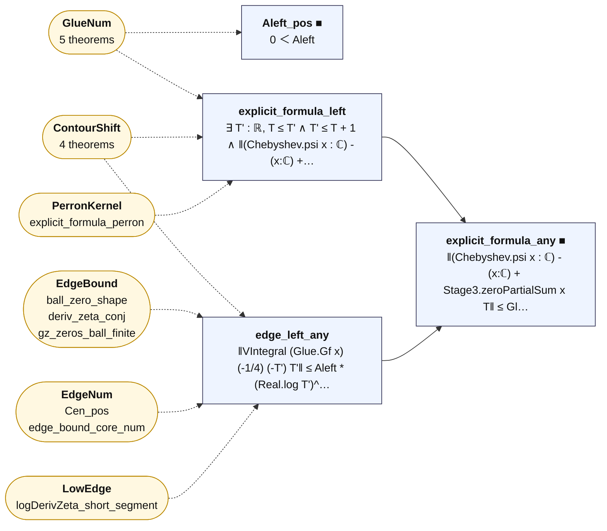

# `lean_stage3/Stage3/ExplicitLeft.lean`

> **Read from the source text.** This file changed after the last `python3 utilities/lean_map.py --dump`, so the arrows on this page are names occurring in each proof and have not been confirmed by Lean.

ExplicitLeft — block F1 of `lean_stage3/design/leftedge.md`. 2026-11-23. The truncated explicit formula at every height `T ≥ 2`, with no cap `T ≤ x²`. `Glue.explicit_formula_split_num` used the cap once, to bound the left edge `VIntegral (Gf x) (-1/4) (-T') T'` by `log²x`. Here the left edge is kept as a term, and bounded separately by `log²T'`. The bound grows with the height: an absolute value on the line `Re s = −1/4` loses `log²T'` (the lost factor of the design note). Block F2 removes it.

4 theorems, 1 definition, 670 lines. 

**Imports:** [`GlueNum`](../lean_stage3/GlueNum.md)  
**Imported by:** [`Stage3`](../lean_stage3/Stage3.md), [`LeftKernel`](../lean_stage3/LeftKernel.md)

## The picture



An arrow A → B reads "A is used in the proof of B". Green: counting, integers only. Violet: shape, analysis with no ζ. Blue: reads ζ. A name ending in ■ is an end: nothing else uses it. Red: contains `sorry`. Yellow: theorems in another file, counted; a dotted arrow crosses files. Definitions are not drawn; they are listed below the diagram.

## Definitions

<a name="ExplicitLeft-Aleft"></a>
### `ExplicitLeft.Aleft`

def · line 28

The left-edge constant at every height: eight times `Glue.Dln`.

- **Is:** `` Aleft : ℝ := 8 * Glue.Dln ``
- **Built from:** [`Glue.Dln`](../lean_stage3/GlueNum.md#Glue-Dln)
- **Used by 3:** [`ExplicitLeft.Aleft_pos`](#ExplicitLeft-Aleft_pos), [`ExplicitLeft.edge_left_any`](#ExplicitLeft-edge_left_any), [`ExplicitLeft.explicit_formula_any`](#ExplicitLeft-explicit_formula_any)

## Theorems

<a name="ExplicitLeft-Aleft_pos"></a>
### `ExplicitLeft.Aleft_pos`

line 31 · arrows read from text

**Reads ζ.** It, or something it rests on, uses the zeta function, its zeros or the Riemann hypothesis.

**Why.** The left-edge constant `Aleft` is positive.

**Proves**

```lean
0 < Aleft
```

**Fed by** (1 theorem its proof uses)

  - [`Glue.Dln_pos`](../lean_stage3/GlueNum.md#Glue-Dln_pos) (GlueNum) — `` 0 < Dln ``

**Definitions its proof touches:** [`ExplicitLeft.Aleft`](#ExplicitLeft-Aleft)

**Feeds:** nothing. It is an end.

<a name="ExplicitLeft-explicit_formula_left"></a>
### `ExplicitLeft.explicit_formula_left`

line 42 · arrows read from text

**Reads ζ.** It, or something it rests on, uses the zeta function, its zeros or the Riemann hypothesis.

**Why.** The explicit formula with the left edge kept. For `16 ≤ x` and `2 ≤ T` there is a height `T′` in `[T, T+1]` with `‖ψ(x) − x + Σ_{|γ|<T} m·x^ρ/ρ‖ ≤ c1n·x·log²(xT)/T + c3n·log x + ‖left edge at T′‖`. `Glue.explicit_formula_split_num`'s proof with the left edge left unbounded; no cap on `T`.

**Proves**

```lean
∃ T' : ℝ, T ≤ T' ∧ T' ≤ T + 1 ∧ ‖(Chebyshev.psi x : ℂ) - (x:ℂ) + Stage3.zeroPartialSum x T‖ ≤ Glue.c1n * x * Real.log (x*T)^2 / T + Glue.c3n * Real.log x + ‖VIntegral (Glue.Gf x) (-1/4) (-T') T'‖
```

**Needs** (its hypotheses)

  - `` hx : 16 ≤ x ``
  - `` hT : 2 ≤ T ``

**Fed by** (7 theorems its proof uses)

  - [`ContourShift.goodT_exists`](../lean_stage3/ContourShift.md#ContourShift-goodT_exists) (ContourShift) — `` ∃ T' ∈ Set.Icc T (T+1), ∀ ρ : ℂ, riemannZeta ρ = 0 → 0 < ρ.re → zeroGap T ≤ |ρ.im - T'| ``
  - [`ContourShift.residue_identity`](../lean_stage3/ContourShift.md#ContourShift-residue_identity) (ContourShift) — `` RectangleIntegral' (fun s : ℂ ↦ (- deriv riemannZeta s / riemannZeta s) * ((x:ℝ):ℂ) ^ s / s) (((-1/4 : ℝ):ℂ) - Complex.I * T') (((1 + 1/Real.log x : ℝ… ``
  - [`Glue.Chn_pos`](../lean_stage3/GlueNum.md#Glue-Chn_pos) (GlueNum) — `` 0 < Chn ``
  - [`Glue.Csn_pos`](../lean_stage3/GlueNum.md#Glue-Csn_pos) (GlueNum) — `` 0 < Csn ``
  - [`Glue.edge_horizontal_bound_num`](../lean_stage3/GlueNum.md#Glue-edge_horizontal_bound_num) (GlueNum) — `` ∀ x T T' : ℝ, 16 ≤ x → 2 ≤ T → T' ∈ Set.Icc T (T+1) → (∀ ρ : ℂ, riemannZeta ρ = 0 → 0 < ρ.re → ContourShift.zeroGap T ≤ |ρ.im - T'|) → ∀ y : ℝ, |y| = … ``
  - [`Glue.zeroPartialSum_swap_num`](../lean_stage3/GlueNum.md#Glue-zeroPartialSum_swap_num) (GlueNum) — `` ∀ x T T' : ℝ, 16 ≤ x → 2 ≤ T → T ≤ T' → T' ≤ T + 1 → ‖Stage3.zeroPartialSum x T' - Stage3.zeroPartialSum x T‖ ≤ Csn * x * Real.log T / T ``
  - [`PerronKernel.explicit_formula_perron`](../lean_stage3/PerronKernel.md#PerronKernel-explicit_formula_perron) (PerronKernel) — `` ‖(Chebyshev.psi x : ℂ) - (2 * (Real.pi:ℂ) * Complex.I)⁻¹ * ∫ t in (-T)..T, (- deriv riemannZeta (((1 + 1/Real.log x : ℝ):ℂ) + Complex.I * t) / riemann… ``

**Definitions its proof touches:** [`Stage3.zeroPartialSum`](../lean_stage3/Assembly.md#Stage3-zeroPartialSum), [`Glue.Gf`](../lean_stage3/Glue.md#Glue-Gf), [`Glue.Chn`](../lean_stage3/GlueNum.md#Glue-Chn), [`Glue.Csn`](../lean_stage3/GlueNum.md#Glue-Csn), [`Glue.c1n`](../lean_stage3/GlueNum.md#Glue-c1n), [`Glue.c3n`](../lean_stage3/GlueNum.md#Glue-c3n)

**Feeds** (1 that use it)

  - [`ExplicitLeft.explicit_formula_any`](#ExplicitLeft-explicit_formula_any) — `` ‖(Chebyshev.psi x : ℂ) - (x:ℂ) + Stage3.zeroPartialSum x T‖ ≤ Glue.c1n * x * Real.log (x*T)^2 / T + Glue.c3n * Real.log x + Aleft * (Real.log (T+1))^2… ``

<a name="ExplicitLeft-edge_left_any"></a>
### `ExplicitLeft.edge_left_any`

line 274 · arrows read from text

**Reads ζ.** It, or something it rests on, uses the zeta function, its zeros or the Riemann hypothesis.

**Why.** The left edge at any height. For `16 ≤ x` and `2 ≤ T′`, the integral of `−ζ′/ζ(s)·x^s/s` up `Re s = −1/4` from `−T′` to `T′` has norm at most `Aleft·log²T′·x^(−1/4)`. `Glue.edge_left_sharp_num`'s proof with `log T′` kept.

**Proves**

```lean
‖VIntegral (Glue.Gf x) (-1/4) (-T') T'‖ ≤ Aleft * (Real.log T')^2 * x ^ (-(1:ℝ)/4)
```

**Needs** (its hypotheses)

  - `` hx : 16 ≤ x ``
  - `` hT'2 : 2 ≤ T' ``

**Fed by** (8 theorems its proof uses)

  - [`ContourShift.zeta_analyticAt`](../lean_stage3/ContourShift.md#ContourShift-zeta_analyticAt) (ContourShift) — `` AnalyticAt ℂ riemannZeta ρ ``
  - [`ContourShift.zeta_ne_zero_of_re_mem`](../lean_stage3/ContourShift.md#ContourShift-zeta_ne_zero_of_re_mem) (ContourShift) — `` riemannZeta w ≠ 0 ``
  - [`EdgeBound.ball_zero_shape`](../lean_stage3/EdgeBound.md#EdgeBound-ball_zero_shape) (EdgeBound) — `` riemannZeta w = 0 ∧ (0 < w.re ∧ w.re < 1) ∧ |w.im - T'| ≤ 46/25 ``
  - [`EdgeBound.deriv_zeta_conj`](../lean_stage3/EdgeBound.md#EdgeBound-deriv_zeta_conj) (EdgeBound) — `` deriv riemannZeta ((starRingEnd ℂ) s) = (starRingEnd ℂ) (deriv riemannZeta s) ``
  - [`EdgeBound.gz_zeros_ball_finite`](../lean_stage3/EdgeBound.md#EdgeBound-gz_zeros_ball_finite) (EdgeBound) — `` {w : ℂ | gz w = 0 ∧ ‖w - c0 T'‖ ≤ ρ}.Finite ``
  - [`EdgeBound.Cen_pos`](../lean_stage3/EdgeNum.md#EdgeBound-Cen_pos) (EdgeNum) — `` 0 < Cen ``
  - [`EdgeBound.edge_bound_core_num`](../lean_stage3/EdgeNum.md#EdgeBound-edge_bound_core_num) (EdgeNum) — `` ∀ t : ℝ, 2 ≤ t → ∀ u : ℂ, u.im = t → -1/4 ≤ u.re → u.re ≤ 2 → riemannZeta u ≠ 0 → ∀ δ : ℝ, 0 < δ → δ ≤ 1 → (∀ w ∈ (gz_zeros_ball_finite t (by norm_num… ``
  - [`EdgeBound.logDerivZeta_short_segment`](../lean_stage3/LowEdge.md#EdgeBound-logDerivZeta_short_segment) (LowEdge) — `` ‖deriv riemannZeta (((-1/4 : ℝ):ℂ) + t * Complex.I) / riemannZeta (((-1/4 : ℝ):ℂ) + t * Complex.I)‖ ≤ 1620000 ``

**Definitions its proof touches:** [`EdgeBound.Cen`](../lean_stage3/EdgeNum.md#EdgeBound-Cen), [`ExplicitLeft.Aleft`](#ExplicitLeft-Aleft), [`Glue.Gf`](../lean_stage3/Glue.md#Glue-Gf), [`Glue.Dln`](../lean_stage3/GlueNum.md#Glue-Dln)

**Feeds** (1 that use it)

  - [`ExplicitLeft.explicit_formula_any`](#ExplicitLeft-explicit_formula_any) — `` ‖(Chebyshev.psi x : ℂ) - (x:ℂ) + Stage3.zeroPartialSum x T‖ ≤ Glue.c1n * x * Real.log (x*T)^2 / T + Glue.c3n * Real.log x + Aleft * (Real.log (T+1))^2… ``

<a name="ExplicitLeft-explicit_formula_any"></a>
### `ExplicitLeft.explicit_formula_any`

line 647 · arrows read from text

**Reads ζ.** It, or something it rests on, uses the zeta function, its zeros or the Riemann hypothesis.

**Why.** The truncated explicit formula at every height. For `16 ≤ x` and `2 ≤ T`, `‖ψ(x) − x + Σ_{|γ|<T} m·x^ρ/ρ‖ ≤ c1n·x·log²(xT)/T + c3n·log x + Aleft·log²(T+1)·x^(−1/4)`. No cap on `T`; the last term grows with `T`.

**Proves**

```lean
‖(Chebyshev.psi x : ℂ) - (x:ℂ) + Stage3.zeroPartialSum x T‖ ≤ Glue.c1n * x * Real.log (x*T)^2 / T + Glue.c3n * Real.log x + Aleft * (Real.log (T+1))^2 * x ^ (-(1:ℝ)/4)
```

**Needs** (its hypotheses)

  - `` hx : 16 ≤ x ``
  - `` hT : 2 ≤ T ``

**Fed by** (2 theorems its proof uses)

  - [`ExplicitLeft.edge_left_any`](#ExplicitLeft-edge_left_any) — `` ‖VIntegral (Glue.Gf x) (-1/4) (-T') T'‖ ≤ Aleft * (Real.log T')^2 * x ^ (-(1:ℝ)/4) ``
  - [`ExplicitLeft.explicit_formula_left`](#ExplicitLeft-explicit_formula_left) — `` ∃ T' : ℝ, T ≤ T' ∧ T' ≤ T + 1 ∧ ‖(Chebyshev.psi x : ℂ) - (x:ℂ) + Stage3.zeroPartialSum x T‖ ≤ Glue.c1n * x * Real.log (x*T)^2 / T + Glue.c3n * Real.lo… ``

**Definitions its proof touches:** [`Stage3.zeroPartialSum`](../lean_stage3/Assembly.md#Stage3-zeroPartialSum), [`ExplicitLeft.Aleft`](#ExplicitLeft-Aleft), [`Glue.c1n`](../lean_stage3/GlueNum.md#Glue-c1n), [`Glue.c3n`](../lean_stage3/GlueNum.md#Glue-c3n)

**Feeds:** nothing. It is an end.

