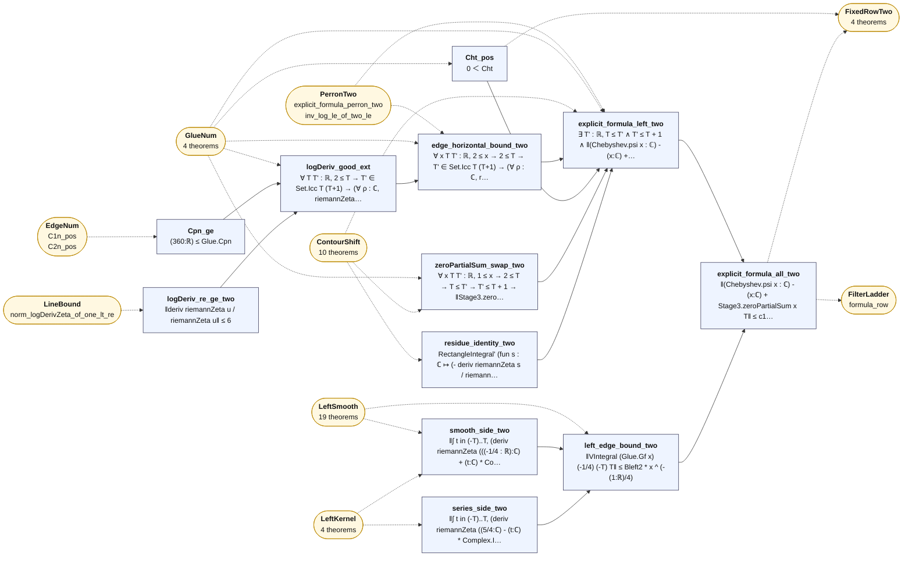

# `lean_stage3/Stage3/ExplicitTwo.lean`

> **Read from the source text.** This file changed after the last `python3 utilities/lean_map.py --dump`, so the arrows on this page are names occurring in each proof and have not been confirmed by Lean.

ExplicitTwo — block G2 of `lean_stage3/design/floor.md`. 2026-11-23. `LeftSmooth.explicit_formula_all` with the floor lowered from `16 ≤ x` to `2 ≤ x`, as a parallel chain. Perron's formula comes from block G1 (`PerronTwo.explicit_formula_perron_two`). Every `x`-free lemma is reused unchanged; the lemmas below are copies of the originals with the lines that used the floor rewritten. No proved file is edited.

12 theorems, 4 definitions, 1138 lines. 

**Imports:** [`LeftSmooth`](../lean_stage3/LeftSmooth.md), [`LineBound`](../lean_stage3/LineBound.md), [`PerronTwo`](../lean_stage3/PerronTwo.md)  
**Imported by:** [`Stage3`](../lean_stage3/Stage3.md), [`FixedRowTwo`](../lean_stage3/FixedRowTwo.md)

## The picture



An arrow A → B reads "A is used in the proof of B". Green: counting, integers only. Violet: shape, analysis with no ζ. Blue: reads ζ. A name ending in ■ is an end: nothing else uses it. Red: contains `sorry`. Yellow: theorems in another file, counted; a dotted arrow crosses files. Definitions are not drawn; they are listed below the diagram.

## Definitions

<a name="ExplicitTwo-Cht"></a>
### `ExplicitTwo.Cht`

def · line 427

The horizontal-edge constant from `x = 2`: `Cpn·3·(11/4)`. The edge runs from `−1/4` to `c ≤ 5/2`, length at most `11/4`.

- **Is:** `` Cht : ℝ := Glue.Cpn * 3 * (11/4) ``
- **Built from:** [`Glue.Cpn`](../lean_stage3/GlueNum.md#Glue-Cpn)
- **Used by 4:** [`ExplicitTwo.Cht_pos`](#ExplicitTwo-Cht_pos), [`ExplicitTwo.c1t`](#ExplicitTwo-c1t), [`ExplicitTwo.edge_horizontal_bound_two`](#ExplicitTwo-edge_horizontal_bound_two), [`ExplicitTwo.explicit_formula_left_two`](#ExplicitTwo-explicit_formula_left_two)

<a name="ExplicitTwo-c1t"></a>
### `ExplicitTwo.c1t`

def · line 533

The explicit formula's first constant from `x = 2`: `2800 + 2·Cht + Csn`.

- **Is:** `` c1t : ℝ := 2800 + 2 * Cht + Glue.Csn ``
- **Built from:** [`ExplicitTwo.Cht`](#ExplicitTwo-Cht), [`Glue.Csn`](../lean_stage3/GlueNum.md#Glue-Csn)
- **Used by 13:** [`CountReduction.count_modes_small`](../lean_stage3/CountReduction.md#CountReduction-count_modes_small), [`ExplicitTwo.explicit_formula_all_two`](#ExplicitTwo-explicit_formula_all_two), [`ExplicitTwo.explicit_formula_left_two`](#ExplicitTwo-explicit_formula_left_two), [`FilterLadder.Kf`](../lean_stage3/FilterLadder.md#FilterLadder-Kf), [`FilterLadder.formula_row`](../lean_stage3/FilterLadder.md#FilterLadder-formula_row), [`FixedRowTwo.c1t_nonneg`](../lean_stage3/FixedRowTwo.md#FixedRowTwo-c1t_nonneg), [`FixedRowTwo.cell_eq_zero_sum_two`](../lean_stage3/FixedRowTwo.md#FixedRowTwo-cell_eq_zero_sum_two), [`FixedRowTwo.cell_fixed_row_two`](../lean_stage3/FixedRowTwo.md#FixedRowTwo-cell_fixed_row_two), [`FixedRowTwo.cell_zero_sum_finset_two`](../lean_stage3/FixedRowTwo.md#FixedRowTwo-cell_zero_sum_finset_two), [`FixedRowTwo.norm_integral_two_le`](../lean_stage3/FixedRowTwo.md#FixedRowTwo-norm_integral_two_le), [`FixedRowTwo.norm_integrand_two_le`](../lean_stage3/FixedRowTwo.md#FixedRowTwo-norm_integrand_two_le), [`FixedRowTwo.norm_tr_efRem_le_height_two`](../lean_stage3/FixedRowTwo.md#FixedRowTwo-norm_tr_efRem_le_height_two), [`FixedRowTwo.tr_efRem_fixed_two`](../lean_stage3/FixedRowTwo.md#FixedRowTwo-tr_efRem_fixed_two)

<a name="ExplicitTwo-c3t"></a>
### `ExplicitTwo.c3t`

def · line 536

The explicit formula's log-constant from `x = 2`: `18 + ‖ζ′(0)/ζ(0)‖/log 2`.

- **Is:** `` c3t : ℝ := 18 + ‖deriv riemannZeta 0 / riemannZeta 0‖ / Real.log 2 ``
- **Used by 11:** [`ExplicitTwo.explicit_formula_all_two`](#ExplicitTwo-explicit_formula_all_two), [`ExplicitTwo.explicit_formula_left_two`](#ExplicitTwo-explicit_formula_left_two), [`FilterLadder.Kf`](../lean_stage3/FilterLadder.md#FilterLadder-Kf), [`FilterLadder.formula_row`](../lean_stage3/FilterLadder.md#FilterLadder-formula_row), [`FixedRowTwo.Api2`](../lean_stage3/FixedRowTwo.md#FixedRowTwo-Api2), [`FixedRowTwo.c3t_nonneg`](../lean_stage3/FixedRowTwo.md#FixedRowTwo-c3t_nonneg), [`FixedRowTwo.cell_eq_zero_sum_two`](../lean_stage3/FixedRowTwo.md#FixedRowTwo-cell_eq_zero_sum_two), [`FixedRowTwo.cell_fixed_row_two`](../lean_stage3/FixedRowTwo.md#FixedRowTwo-cell_fixed_row_two), [`FixedRowTwo.cell_zero_sum_finset_two`](../lean_stage3/FixedRowTwo.md#FixedRowTwo-cell_zero_sum_finset_two), [`FixedRowTwo.norm_integrand_two_le`](../lean_stage3/FixedRowTwo.md#FixedRowTwo-norm_integrand_two_le), [`FixedRowTwo.norm_tr_efRem_le_height_two`](../lean_stage3/FixedRowTwo.md#FixedRowTwo-norm_tr_efRem_le_height_two)

<a name="ExplicitTwo-Bleft2"></a>
### `ExplicitTwo.Bleft2`

def · line 1072

The left-edge constant from `x = 2`: four times `LeftSmooth.Bleft`.

- **Is:** `` Bleft2 : ℝ := 4 * Bleft ``
- **Built from:** [`LeftSmooth.Bleft`](../lean_stage3/LeftSmooth.md#LeftSmooth-Bleft)
- **Used by 11:** [`ExplicitTwo.explicit_formula_all_two`](#ExplicitTwo-explicit_formula_all_two), [`ExplicitTwo.left_edge_bound_two`](#ExplicitTwo-left_edge_bound_two), [`FilterLadder.Kf`](../lean_stage3/FilterLadder.md#FilterLadder-Kf), [`FilterLadder.formula_row`](../lean_stage3/FilterLadder.md#FilterLadder-formula_row), [`FixedRowTwo.Api2`](../lean_stage3/FixedRowTwo.md#FixedRowTwo-Api2), [`FixedRowTwo.Bleft2_nonneg`](../lean_stage3/FixedRowTwo.md#FixedRowTwo-Bleft2_nonneg), [`FixedRowTwo.cell_eq_zero_sum_two`](../lean_stage3/FixedRowTwo.md#FixedRowTwo-cell_eq_zero_sum_two), [`FixedRowTwo.cell_fixed_row_two`](../lean_stage3/FixedRowTwo.md#FixedRowTwo-cell_fixed_row_two), [`FixedRowTwo.cell_zero_sum_finset_two`](../lean_stage3/FixedRowTwo.md#FixedRowTwo-cell_zero_sum_finset_two), [`FixedRowTwo.norm_integrand_two_le`](../lean_stage3/FixedRowTwo.md#FixedRowTwo-norm_integrand_two_le), [`FixedRowTwo.norm_tr_efRem_le_height_two`](../lean_stage3/FixedRowTwo.md#FixedRowTwo-norm_tr_efRem_le_height_two)

## Theorems

<a name="ExplicitTwo-residue_identity_two"></a>
### `ExplicitTwo.residue_identity_two`

line 51 · arrows read from text

**Reads ζ.** It, or something it rests on, uses the zeta function, its zeros or the Riemann hypothesis.

**Why.** The residue identity from `x > 1`. `ContourShift.residue_identity` with the hypothesis `16 ≤ x` lowered to `1 < x`: on the good rectangle from `−1/4 − iT′` to `1 + 1/log x + iT′`, the normalized contour integral of `−ζ′/ζ(s)·x^s/s` is `x − ζ′/ζ(0) − Σ_{|γ|<T′} m·x^ρ/ρ`. The proof is the original's; only the derivations of `0 < x` and `0 < log x` change.

**Proves**

```lean
RectangleIntegral' (fun s : ℂ ↦ (- deriv riemannZeta s / riemannZeta s) * ((x:ℝ):ℂ) ^ s / s) (((-1/4 : ℝ):ℂ) - Complex.I * T') (((1 + 1/Real.log x : ℝ):ℂ) + Complex.I * T') = (x : ℂ) - deriv riemannZeta 0 / riemannZeta 0 - Stage3.zeroPartialSum x T'
```

**Needs** (its hypotheses)

  - `` hx : 1 < x ``
  - `` hT : 2 ≤ T ``
  - `` hT' : T' ∈ Set.Icc T (T+1) ``
  - `` hgood : ∀ ρ : ℂ, riemannZeta ρ = 0 → 0 < ρ.re → zeroGap T ≤ |ρ.im - T'| ``

**Fed by** (9 theorems its proof uses)

  - [`ContourShift.residue_rectangle_of_local`](../lean_stage3/ContourShift.md#ContourShift-residue_rectangle_of_local) (ContourShift) — `` RectangleIntegral' f z w = ∑ p ∈ P, A p ``
  - [`ContourShift.zeroGap_pos`](../lean_stage3/ContourShift.md#ContourShift-zeroGap_pos) (ContourShift) — `` 0 < zeroGap T ``
  - [`ContourShift.zeroPartialSum_eq_sum`](../lean_stage3/ContourShift.md#ContourShift-zeroPartialSum_eq_sum) (ContourShift) — `` Stage3.zeroPartialSum x T' = ∑ p ∈ ZF, ((analyticOrderNatAt riemannZeta p : ℂ) * ((x : ℂ) ^ p / p)) ``
  - [`ContourShift.zeta_analyticAt`](../lean_stage3/ContourShift.md#ContourShift-zeta_analyticAt) (ContourShift) — `` AnalyticAt ℂ riemannZeta ρ ``
  - [`ContourShift.zeta_local_data_one`](../lean_stage3/ContourShift.md#ContourShift-zeta_local_data_one) (ContourShift) — `` ∃ h : ℂ → ℂ, AnalyticAt ℂ h 1 ∧ ∀ᶠ s in nhdsWithin 1 {1}ᶜ, - deriv riemannZeta s / riemannZeta s * ((x:ℝ):ℂ) ^ s / s = h s + ((x:ℝ):ℂ) / (s - 1) ``
  - [`ContourShift.zeta_local_data_origin`](../lean_stage3/ContourShift.md#ContourShift-zeta_local_data_origin) (ContourShift) — `` ∃ h : ℂ → ℂ, AnalyticAt ℂ h 0 ∧ ∀ᶠ s in nhdsWithin 0 {0}ᶜ, - deriv riemannZeta s / riemannZeta s * ((x:ℝ):ℂ) ^ s / s = h s + (- deriv riemannZeta 0 / … ``
  - [`ContourShift.zeta_local_data_zero`](../lean_stage3/ContourShift.md#ContourShift-zeta_local_data_zero) (ContourShift) — `` ∃ h : ℂ → ℂ, AnalyticAt ℂ h ρ ∧ ∀ᶠ s in nhdsWithin ρ {ρ}ᶜ, - deriv riemannZeta s / riemannZeta s * ((x:ℝ):ℂ) ^ s / s = h s + (-(analyticOrderNatAt rie… ``
  - [`ContourShift.zeta_ne_zero_of_re_mem`](../lean_stage3/ContourShift.md#ContourShift-zeta_ne_zero_of_re_mem) (ContourShift) — `` riemannZeta w ≠ 0 ``
  - [`ContourShift.zeta_zeros_rectangle_finite`](../lean_stage3/ContourShift.md#ContourShift-zeta_zeros_rectangle_finite) (ContourShift) — `` {ρ : ℂ | riemannZeta ρ = 0 ∧ ρ ∈ Rectangle z w}.Finite ``

**Definitions its proof touches:** [`Stage3.zeroPartialSum`](../lean_stage3/Assembly.md#Stage3-zeroPartialSum), [`ContourShift.zeroGap`](../lean_stage3/ContourShift.md#ContourShift-zeroGap)

**Feeds** (1 that use it)

  - [`ExplicitTwo.explicit_formula_left_two`](#ExplicitTwo-explicit_formula_left_two) — `` ∃ T' : ℝ, T ≤ T' ∧ T' ≤ T + 1 ∧ ‖(Chebyshev.psi x : ℂ) - (x:ℂ) + Stage3.zeroPartialSum x T‖ ≤ c1t * x * Real.log (x*T)^2 / T + c3t * Real.log x + ‖VIn… ``

<a name="ExplicitTwo-zeroPartialSum_swap_two"></a>
### `ExplicitTwo.zeroPartialSum_swap_two`

line 264 · arrows read from text

**Reads ζ.** It, or something it rests on, uses the zeta function, its zeros or the Riemann hypothesis.

**Why.** The swap from `x ≥ 1`. `Glue.zeroPartialSum_swap_num` with `16 ≤ x` lowered to `1 ≤ x`: moving the zero sum from a height `T′ ∈ [T, T+1]` back to `T` costs at most `Csn·x·log T/T`.

**Proves**

```lean
∀ x T T' : ℝ, 1 ≤ x → 2 ≤ T → T ≤ T' → T' ≤ T + 1 → ‖Stage3.zeroPartialSum x T' - Stage3.zeroPartialSum x T‖ ≤ Glue.Csn * x * Real.log T / T
```

**Fed by** (5 theorems its proof uses)

  - [`ContourShift.zeroPartialSum_eq_sum`](../lean_stage3/ContourShift.md#ContourShift-zeroPartialSum_eq_sum) (ContourShift) — `` Stage3.zeroPartialSum x T' = ∑ p ∈ ZF, ((analyticOrderNatAt riemannZeta p : ℂ) * ((x : ℂ) ^ p / p)) ``
  - [`ContourShift.zeta_ne_zero_of_re_mem`](../lean_stage3/ContourShift.md#ContourShift-zeta_ne_zero_of_re_mem) (ContourShift) — `` riemannZeta w ≠ 0 ``
  - [`ContourShift.zeta_zeros_rectangle_finite`](../lean_stage3/ContourShift.md#ContourShift-zeta_zeros_rectangle_finite) (ContourShift) — `` {ρ : ℂ | riemannZeta ρ = 0 ∧ ρ ∈ Rectangle z w}.Finite ``
  - [`Glue.Csn_pos`](../lean_stage3/GlueNum.md#Glue-Csn_pos) (GlueNum) — `` 0 < Csn ``
  - [`Glue.band_order_sum_le_num`](../lean_stage3/GlueNum.md#Glue-band_order_sum_le_num) (GlueNum) — `` ∀ T : ℝ, 2 ≤ T → ∀ F : Finset ℂ, (∀ ρ ∈ F, riemannZeta ρ = 0 ∧ (0 < ρ.re ∧ ρ.re < 1) ∧ T ≤ |ρ.im| ∧ |ρ.im| ≤ T + 1) → (∑ ρ ∈ F, (analyticOrderNatAt ri… ``

**Definitions its proof touches:** [`Stage3.zeroPartialSum`](../lean_stage3/Assembly.md#Stage3-zeroPartialSum), [`Glue.Csn`](../lean_stage3/GlueNum.md#Glue-Csn)

**Feeds** (1 that use it)

  - [`ExplicitTwo.explicit_formula_left_two`](#ExplicitTwo-explicit_formula_left_two) — `` ∃ T' : ℝ, T ≤ T' ∧ T' ≤ T + 1 ∧ ‖(Chebyshev.psi x : ℂ) - (x:ℂ) + Stage3.zeroPartialSum x T‖ ≤ c1t * x * Real.log (x*T)^2 / T + c3t * Real.log x + ‖VIn… ``

<a name="ExplicitTwo-logDeriv_re_ge_two"></a>
### `ExplicitTwo.logDeriv_re_ge_two`

line 375 · arrows read from text

**Reads ζ.** It, or something it rests on, uses the zeta function, its zeros or the Riemann hypothesis.

**Why.** The absolute bound right of `Re = 2`. For `2 ≤ Re u`, `‖ζ′/ζ(u)‖ ≤ 6`, from `Slice5.norm_logDerivZeta_of_one_lt_re` (`≤ 2/(σ−1) + 4/(σ−1)²`, RH-free).

**Proves**

```lean
‖deriv riemannZeta u / riemannZeta u‖ ≤ 6
```

**Needs** (its hypotheses)

  - `` hu : 2 ≤ u.re ``

**Fed by** (1 theorem its proof uses)

  - [`Slice5.norm_logDerivZeta_of_one_lt_re`](../lean_stage3/LineBound.md#Slice5-norm_logDerivZeta_of_one_lt_re) (LineBound) — `` ‖deriv ζ s / ζ s‖ ≤ 2 / (s.re - 1) + 4 / (s.re - 1) ^ 2 ``

**Feeds** (1 that use it)

  - [`ExplicitTwo.logDeriv_good_ext`](#ExplicitTwo-logDeriv_good_ext) — `` ∀ T T' : ℝ, 2 ≤ T → T' ∈ Set.Icc T (T+1) → (∀ ρ : ℂ, riemannZeta ρ = 0 → 0 < ρ.re → ContourShift.zeroGap T ≤ |ρ.im - T'|) → ∀ u : ℂ, |u.im| = T' → -1/… ``

<a name="ExplicitTwo-Cpn_ge"></a>
### `ExplicitTwo.Cpn_ge`

line 389 · arrows read from text

**Reads ζ.** It, or something it rests on, uses the zeta function, its zeros or the Riemann hypothesis.

**Why.** The good-height constant is at least `360`: `Cpn = Cen·2·(180 + 1060/log 2)` with `Cen = C1n + C2n + 1/log 2 ≥ 1`.

**Proves**

```lean
(360:ℝ) ≤ Glue.Cpn
```

**Fed by** (2 theorems its proof uses)

  - [`EdgeBound.C1n_pos`](../lean_stage3/EdgeNum.md#EdgeBound-C1n_pos) (EdgeNum) — `` 0 < C1n ``
  - [`EdgeBound.C2n_pos`](../lean_stage3/EdgeNum.md#EdgeBound-C2n_pos) (EdgeNum) — `` 0 < C2n ``

**Definitions its proof touches:** [`EdgeBound.Cen`](../lean_stage3/EdgeNum.md#EdgeBound-Cen), [`Glue.Cpn`](../lean_stage3/GlueNum.md#Glue-Cpn)

**Feeds** (1 that use it)

  - [`ExplicitTwo.logDeriv_good_ext`](#ExplicitTwo-logDeriv_good_ext) — `` ∀ T T' : ℝ, 2 ≤ T → T' ∈ Set.Icc T (T+1) → (∀ ρ : ℂ, riemannZeta ρ = 0 → 0 < ρ.re → ContourShift.zeroGap T ≤ |ρ.im - T'|) → ∀ u : ℂ, |u.im| = T' → -1/… ``

<a name="ExplicitTwo-logDeriv_good_ext"></a>
### `ExplicitTwo.logDeriv_good_ext`

line 409 · arrows read from text

**Reads ζ.** It, or something it rests on, uses the zeta function, its zeros or the Riemann hypothesis.

**Why.** The good-height bound on the wider band. `Glue.zeta_logderiv_good_bound_num` extended from `−1/4 ≤ Re u ≤ 2` to `−1/4 ≤ Re u ≤ 5/2`, same constant `Cpn`: below `Re u = 2` it is the original; above, `‖ζ′/ζ(u)‖ ≤ 6 ≤ 360·log²2 ≤ Cpn·log²T`.

**Proves**

```lean
∀ T T' : ℝ, 2 ≤ T → T' ∈ Set.Icc T (T+1) → (∀ ρ : ℂ, riemannZeta ρ = 0 → 0 < ρ.re → ContourShift.zeroGap T ≤ |ρ.im - T'|) → ∀ u : ℂ, |u.im| = T' → -1/4 ≤ u.re → u.re ≤ 5/2 → ‖deriv riemannZeta u / riemannZeta u‖ ≤ Glue.Cpn * Real.log T ^ 2
```

**Fed by** (3 theorems its proof uses)

  - [`ExplicitTwo.Cpn_ge`](#ExplicitTwo-Cpn_ge) — `` (360:ℝ) ≤ Glue.Cpn ``
  - [`ExplicitTwo.logDeriv_re_ge_two`](#ExplicitTwo-logDeriv_re_ge_two) — `` ‖deriv riemannZeta u / riemannZeta u‖ ≤ 6 ``
  - [`Glue.zeta_logderiv_good_bound_num`](../lean_stage3/GlueNum.md#Glue-zeta_logderiv_good_bound_num) (GlueNum) — `` ∀ T T' : ℝ, 2 ≤ T → T' ∈ Set.Icc T (T+1) → (∀ ρ : ℂ, riemannZeta ρ = 0 → 0 < ρ.re → ContourShift.zeroGap T ≤ |ρ.im - T'|) → ∀ u : ℂ, |u.im| = T' → -1/… ``

**Definitions its proof touches:** [`ContourShift.zeroGap`](../lean_stage3/ContourShift.md#ContourShift-zeroGap), [`Glue.Cpn`](../lean_stage3/GlueNum.md#Glue-Cpn)

**Feeds** (1 that use it)

  - [`ExplicitTwo.edge_horizontal_bound_two`](#ExplicitTwo-edge_horizontal_bound_two) — `` ∀ x T T' : ℝ, 2 ≤ x → 2 ≤ T → T' ∈ Set.Icc T (T+1) → (∀ ρ : ℂ, riemannZeta ρ = 0 → 0 < ρ.re → ContourShift.zeroGap T ≤ |ρ.im - T'|) → ∀ y : ℝ, |y| = T… ``

<a name="ExplicitTwo-Cht_pos"></a>
### `ExplicitTwo.Cht_pos`

line 430 · arrows read from text

**Reads ζ.** It, or something it rests on, uses the zeta function, its zeros or the Riemann hypothesis.

**Why.** The horizontal-edge constant `Cht` is positive.

**Proves**

```lean
0 < Cht
```

**Fed by** (1 theorem its proof uses)

  - [`Glue.Cpn_pos`](../lean_stage3/GlueNum.md#Glue-Cpn_pos) (GlueNum) — `` 0 < Cpn ``

**Definitions its proof touches:** [`ExplicitTwo.Cht`](#ExplicitTwo-Cht)

**Feeds** (2 that use it)

  - [`ExplicitTwo.explicit_formula_left_two`](#ExplicitTwo-explicit_formula_left_two) — `` ∃ T' : ℝ, T ≤ T' ∧ T' ≤ T + 1 ∧ ‖(Chebyshev.psi x : ℂ) - (x:ℂ) + Stage3.zeroPartialSum x T‖ ≤ c1t * x * Real.log (x*T)^2 / T + c3t * Real.log x + ‖VIn… ``
  - [`FixedRowTwo.c1t_nonneg`](../lean_stage3/FixedRowTwo.md#FixedRowTwo-c1t_nonneg) (FixedRowTwo) — `` 0 ≤ ExplicitTwo.c1t ``

<a name="ExplicitTwo-edge_horizontal_bound_two"></a>
### `ExplicitTwo.edge_horizontal_bound_two`

line 440 · arrows read from text

**Reads ζ.** It, or something it rests on, uses the zeta function, its zeros or the Riemann hypothesis.

**Why.** The horizontal-edge integral bound from `x = 2`. `Glue.edge_horizontal_bound_num` for `2 ≤ x`: at a good height, both signs, the integral of `−ζ′/ζ(s)·x^s/s` along `Im s = y`, `|y| = T′`, from `−1/4` to `1 + 1/log x`, has norm at most `Cht·x·log²T/T`. The abscissa is now `≤ 5/2`, the good bound is `logDeriv_good_ext`, and the edge length is `≤ 11/4`.

**Proves**

```lean
∀ x T T' : ℝ, 2 ≤ x → 2 ≤ T → T' ∈ Set.Icc T (T+1) → (∀ ρ : ℂ, riemannZeta ρ = 0 → 0 < ρ.re → ContourShift.zeroGap T ≤ |ρ.im - T'|) → ∀ y : ℝ, |y| = T' → ‖HIntegral (Glue.Gf x) (-1/4) (1 + 1/Real.log x) y‖ ≤ Cht * x * Real.log T ^ 2 / T
```

**Fed by** (3 theorems its proof uses)

  - [`ExplicitTwo.logDeriv_good_ext`](#ExplicitTwo-logDeriv_good_ext) — `` ∀ T T' : ℝ, 2 ≤ T → T' ∈ Set.Icc T (T+1) → (∀ ρ : ℂ, riemannZeta ρ = 0 → 0 < ρ.re → ContourShift.zeroGap T ≤ |ρ.im - T'|) → ∀ u : ℂ, |u.im| = T' → -1/… ``
  - [`Glue.Cpn_pos`](../lean_stage3/GlueNum.md#Glue-Cpn_pos) (GlueNum) — `` 0 < Cpn ``
  - [`PerronTwo.inv_log_le_of_two_le`](../lean_stage3/PerronTwo.md#PerronTwo-inv_log_le_of_two_le) (PerronTwo) — `` 1 / Real.log x ≤ 3/2 ``

**Definitions its proof touches:** [`ContourShift.zeroGap`](../lean_stage3/ContourShift.md#ContourShift-zeroGap), [`ExplicitTwo.Cht`](#ExplicitTwo-Cht), [`Glue.Gf`](../lean_stage3/Glue.md#Glue-Gf), [`Glue.Cpn`](../lean_stage3/GlueNum.md#Glue-Cpn)

**Feeds** (1 that use it)

  - [`ExplicitTwo.explicit_formula_left_two`](#ExplicitTwo-explicit_formula_left_two) — `` ∃ T' : ℝ, T ≤ T' ∧ T' ≤ T + 1 ∧ ‖(Chebyshev.psi x : ℂ) - (x:ℂ) + Stage3.zeroPartialSum x T‖ ≤ c1t * x * Real.log (x*T)^2 / T + c3t * Real.log x + ‖VIn… ``

<a name="ExplicitTwo-explicit_formula_left_two"></a>
### `ExplicitTwo.explicit_formula_left_two`

line 544 · arrows read from text

**Reads ζ.** It, or something it rests on, uses the zeta function, its zeros or the Riemann hypothesis.

**Why.** The explicit formula with the left edge kept, from `x = 2`. For `2 ≤ x` and `2 ≤ T` there is a height `T′` in `[T, T+1]` with `‖ψ(x) − x + Σ_{|γ|<T} m·x^ρ/ρ‖ ≤ c1t·x·log²(xT)/T + c3t·log x + ‖left edge at T′‖`. `ExplicitLeft.explicit_formula_left`'s proof on the chain from `x = 2`: Perron from `PerronTwo`, the residue identity, the horizontal edges and the swap from this file.

**Proves**

```lean
∃ T' : ℝ, T ≤ T' ∧ T' ≤ T + 1 ∧ ‖(Chebyshev.psi x : ℂ) - (x:ℂ) + Stage3.zeroPartialSum x T‖ ≤ c1t * x * Real.log (x*T)^2 / T + c3t * Real.log x + ‖VIntegral (Glue.Gf x) (-1/4) (-T') T'‖
```

**Needs** (its hypotheses)

  - `` hx : 2 ≤ x ``
  - `` hT : 2 ≤ T ``

**Fed by** (7 theorems its proof uses)

  - [`ContourShift.goodT_exists`](../lean_stage3/ContourShift.md#ContourShift-goodT_exists) (ContourShift) — `` ∃ T' ∈ Set.Icc T (T+1), ∀ ρ : ℂ, riemannZeta ρ = 0 → 0 < ρ.re → zeroGap T ≤ |ρ.im - T'| ``
  - [`ExplicitTwo.Cht_pos`](#ExplicitTwo-Cht_pos) — `` 0 < Cht ``
  - [`ExplicitTwo.edge_horizontal_bound_two`](#ExplicitTwo-edge_horizontal_bound_two) — `` ∀ x T T' : ℝ, 2 ≤ x → 2 ≤ T → T' ∈ Set.Icc T (T+1) → (∀ ρ : ℂ, riemannZeta ρ = 0 → 0 < ρ.re → ContourShift.zeroGap T ≤ |ρ.im - T'|) → ∀ y : ℝ, |y| = T… ``
  - [`ExplicitTwo.residue_identity_two`](#ExplicitTwo-residue_identity_two) — `` RectangleIntegral' (fun s : ℂ ↦ (- deriv riemannZeta s / riemannZeta s) * ((x:ℝ):ℂ) ^ s / s) (((-1/4 : ℝ):ℂ) - Complex.I * T') (((1 + 1/Real.log x : ℝ… ``
  - [`ExplicitTwo.zeroPartialSum_swap_two`](#ExplicitTwo-zeroPartialSum_swap_two) — `` ∀ x T T' : ℝ, 1 ≤ x → 2 ≤ T → T ≤ T' → T' ≤ T + 1 → ‖Stage3.zeroPartialSum x T' - Stage3.zeroPartialSum x T‖ ≤ Glue.Csn * x * Real.log T / T ``
  - [`Glue.Csn_pos`](../lean_stage3/GlueNum.md#Glue-Csn_pos) (GlueNum) — `` 0 < Csn ``
  - [`PerronTwo.explicit_formula_perron_two`](../lean_stage3/PerronTwo.md#PerronTwo-explicit_formula_perron_two) (PerronTwo) — `` ‖(Chebyshev.psi x : ℂ) - (2 * (Real.pi:ℂ) * Complex.I)⁻¹ * ∫ t in (-T)..T, (- deriv riemannZeta (((1 + 1/Real.log x : ℝ):ℂ) + Complex.I * t) / riemann… ``

**Definitions its proof touches:** [`Stage3.zeroPartialSum`](../lean_stage3/Assembly.md#Stage3-zeroPartialSum), [`ExplicitTwo.Cht`](#ExplicitTwo-Cht), [`ExplicitTwo.c1t`](#ExplicitTwo-c1t), [`ExplicitTwo.c3t`](#ExplicitTwo-c3t), [`Glue.Gf`](../lean_stage3/Glue.md#Glue-Gf), [`Glue.Csn`](../lean_stage3/GlueNum.md#Glue-Csn)

**Feeds** (1 that use it)

  - [`ExplicitTwo.explicit_formula_all_two`](#ExplicitTwo-explicit_formula_all_two) — `` ‖(Chebyshev.psi x : ℂ) - (x:ℂ) + Stage3.zeroPartialSum x T‖ ≤ c1t * x * Real.log (x*T)^2 / T + c3t * Real.log x + Bleft2 * x ^ (-(1:ℝ)/4) ``

<a name="ExplicitTwo-series_side_two"></a>
### `ExplicitTwo.series_side_two`

line 778 · arrows read from text

**Reads ζ.** It, or something it rests on, uses the zeta function, its zeros or the Riemann hypothesis.

**Why.** The series side from `x = 2`. `LeftKernel.series_side` for `2 ≤ x`: the Dirichlet-series half of the left edge, `∫_{−T}^{T} ζ'/ζ(5/4 − it)·x^(−1/4+it)/(−1/4+it) dt`, has norm at most `4·Bser·x^(−1/4)`. The kernel's `1/log(x·n)` is now bounded by `1/log 2 = 4/log 16`.

**Proves**

```lean
‖∫ t in (-T)..T, (deriv riemannZeta ((5/4:ℂ) - (t:ℂ) * Complex.I) / riemannZeta ((5/4:ℂ) - (t:ℂ) * Complex.I)) * ((x:ℂ) ^ (((-1/4 : ℝ):ℂ) + (t:ℂ) * Complex.I)) / (((-1/4 : ℝ):ℂ) + (t:ℂ) * Complex.I)‖ ≤ 4 * Bser * x ^ (-(1:ℝ)/4)
```

**Needs** (its hypotheses)

  - `` hx : 2 ≤ x ``
  - `` hT : 2 ≤ T ``

**Fed by** (4 theorems its proof uses)

  - [`LeftKernel.cpow_tI`](../lean_stage3/LeftKernel.md#LeftKernel-cpow_tI) (LeftKernel) — `` (y:ℂ) ^ ((t:ℂ) * Complex.I) = Complex.exp ((Real.log y : ℂ) * ((t:ℂ) * Complex.I)) ``
  - [`LeftKernel.kernel_bound`](../lean_stage3/LeftKernel.md#LeftKernel-kernel_bound) (LeftKernel) — `` ‖∫ t in (-T)..T, ((y:ℂ) ^ ((t:ℂ) * Complex.I)) / ((a:ℂ) + (t:ℂ) * Complex.I)‖ ≤ (2 / T + Real.pi / |a|) / Real.log y ``
  - [`LeftKernel.norm_cpow_tI`](../lean_stage3/LeftKernel.md#LeftKernel-norm_cpow_tI) (LeftKernel) — `` ‖(y:ℂ) ^ ((t:ℂ) * Complex.I)‖ = 1 ``
  - [`LeftKernel.vmTerm_nonneg`](../lean_stage3/LeftKernel.md#LeftKernel-vmTerm_nonneg) (LeftKernel) — `` 0 ≤ vmTerm n ``

**Definitions its proof touches:** [`LeftKernel.Bser`](../lean_stage3/LeftKernel.md#LeftKernel-Bser), [`LeftKernel.vmTerm`](../lean_stage3/LeftKernel.md#LeftKernel-vmTerm)

**Feeds** (1 that use it)

  - [`ExplicitTwo.left_edge_bound_two`](#ExplicitTwo-left_edge_bound_two) — `` ‖VIntegral (Glue.Gf x) (-1/4) (-T) T‖ ≤ Bleft2 * x ^ (-(1:ℝ)/4) ``

<a name="ExplicitTwo-smooth_side_two"></a>
### `ExplicitTwo.smooth_side_two`

line 951 · arrows read from text

**Reads ζ.** It, or something it rests on, uses the zeta function, its zeros or the Riemann hypothesis.

**Why.** The smooth side from `x = 2`. `LeftSmooth.smooth_side` for `2 ≤ x`: with `s = −1/4 + it` and `w = 5/4 − it`, the integral of `(ζ′/ζ(s) + ζ′/ζ(w))·x^s/s` over `[−T, T]` has norm at most `4·Bsm·x^(−1/4)`. The three pieces are bounded by `Nsm/log x` as before; the last step uses `log 2 ≤ log x`, and `Nsm/log 2 = 4·Bsm`.

**Proves**

```lean
‖∫ t in (-T)..T, (deriv riemannZeta (((-1/4 : ℝ):ℂ) + (t:ℂ) * Complex.I) / riemannZeta (((-1/4 : ℝ):ℂ) + (t:ℂ) * Complex.I) + deriv riemannZeta ((5/4:ℂ) - (t:ℂ) * Complex.I) / riemannZeta ((5/4:ℂ) - (t:ℂ) * Complex.I)) * ((x:ℂ) ^ (((-1/4 : ℝ):ℂ) + (t:ℂ) * Complex.I)) / (((-1/4 : ℝ):ℂ) + (t:ℂ) * Complex.I)‖ ≤ 4 * Bsm * x ^ (-(1:ℝ)/4)
```

**Needs** (its hypotheses)

  - `` hx : 2 ≤ x ``
  - `` hT : 2 ≤ T ``

**Fed by** (13 theorems its proof uses)

  - [`LeftKernel.kernel_bound`](../lean_stage3/LeftKernel.md#LeftKernel-kernel_bound) (LeftKernel) — `` ‖∫ t in (-T)..T, ((y:ℂ) ^ ((t:ℂ) * Complex.I)) / ((a:ℂ) + (t:ℂ) * Complex.I)‖ ≤ (2 / T + Real.pi / |a|) / Real.log y ``
  - [`LeftSmooth.Nsm_nonneg`](../lean_stage3/LeftSmooth.md#LeftSmooth-Nsm_nonneg) (LeftSmooth) — `` 0 ≤ Nsm ``
  - [`LeftSmooth.continuous_cpow_tI`](../lean_stage3/LeftSmooth.md#LeftSmooth-continuous_cpow_tI) (LeftSmooth) — `` Continuous fun t : ℝ => (y:ℂ) ^ ((t:ℂ) * Complex.I) ``
  - [`LeftSmooth.continuous_tanPiece`](../lean_stage3/LeftSmooth.md#LeftSmooth-continuous_tanPiece) (LeftSmooth) — `` Continuous tanPiece ``
  - [`LeftSmooth.cos_wL_ne`](../lean_stage3/LeftSmooth.md#LeftSmooth-cos_wL_ne) (LeftSmooth) — `` Complex.cos ((Real.pi:ℂ) * wL t / 2) ≠ 0 ``
  - [`LeftSmooth.cpow_sL`](../lean_stage3/LeftSmooth.md#LeftSmooth-cpow_sL) (LeftSmooth) — `` (x:ℂ) ^ (sL t) = ((x ^ (-(1:ℝ)/4) : ℝ):ℂ) * (x:ℂ) ^ ((t:ℂ) * Complex.I) ``
  - [`LeftSmooth.digamma_piece`](../lean_stage3/LeftSmooth.md#LeftSmooth-digamma_piece) (LeftSmooth) — `` ‖∫ t in (-T)..T, ((y:ℂ) ^ ((t:ℂ) * Complex.I)) * ((-Complex.digamma (wL t) - (Real.eulerMascheroniConstant:ℂ)) * (sL t)⁻¹)‖ ≤ (∑' n : ℕ, dgTerm n) * (… ``
  - [`LeftSmooth.kc_pos`](../lean_stage3/LeftSmooth.md#LeftSmooth-kc_pos) (LeftSmooth) — `` 0 < kc ``
  - [`LeftSmooth.logDeriv_sum`](../lean_stage3/LeftSmooth.md#LeftSmooth-logDeriv_sum) (LeftSmooth) — `` riemannZeta (1 - w) ≠ 0 ∧ deriv riemannZeta (1 - w) / riemannZeta (1 - w) + deriv riemannZeta w / riemannZeta w = Gs w ``
  - [`LeftSmooth.one_sub_wL`](../lean_stage3/LeftSmooth.md#LeftSmooth-one_sub_wL) (LeftSmooth) — `` 1 - wL t = sL t ``
  - [`LeftSmooth.sL_ne`](../lean_stage3/LeftSmooth.md#LeftSmooth-sL_ne) (LeftSmooth) — `` sL t ≠ 0 ``
  - [`LeftSmooth.tan_piece`](../lean_stage3/LeftSmooth.md#LeftSmooth-tan_piece) (LeftSmooth) — `` ‖∫ t in (-T)..T, ((y:ℂ) ^ ((t:ℂ) * Complex.I)) * tanPiece t‖ ≤ (8 + 2 * Real.pi ^ 2 + 4 * Real.pi) / (kc * Real.log y) ``
  - [`LeftSmooth.wL_re`](../lean_stage3/LeftSmooth.md#LeftSmooth-wL_re) (LeftSmooth) — `` (wL t).re = 5/4 ``

**Definitions its proof touches:** [`LeftSmooth.Bsm`](../lean_stage3/LeftSmooth.md#LeftSmooth-Bsm), [`LeftSmooth.Gs`](../lean_stage3/LeftSmooth.md#LeftSmooth-Gs), [`LeftSmooth.Nsm`](../lean_stage3/LeftSmooth.md#LeftSmooth-Nsm), [`LeftSmooth.c0`](../lean_stage3/LeftSmooth.md#LeftSmooth-c0), [`LeftSmooth.dgTerm`](../lean_stage3/LeftSmooth.md#LeftSmooth-dgTerm), [`LeftSmooth.kc`](../lean_stage3/LeftSmooth.md#LeftSmooth-kc), [`LeftSmooth.sL`](../lean_stage3/LeftSmooth.md#LeftSmooth-sL), [`LeftSmooth.tanPiece`](../lean_stage3/LeftSmooth.md#LeftSmooth-tanPiece), [`LeftSmooth.wL`](../lean_stage3/LeftSmooth.md#LeftSmooth-wL)

**Feeds** (1 that use it)

  - [`ExplicitTwo.left_edge_bound_two`](#ExplicitTwo-left_edge_bound_two) — `` ‖VIntegral (Glue.Gf x) (-1/4) (-T) T‖ ≤ Bleft2 * x ^ (-(1:ℝ)/4) ``

<a name="ExplicitTwo-left_edge_bound_two"></a>
### `ExplicitTwo.left_edge_bound_two`

line 1078 · arrows read from text

**Reads ζ.** It, or something it rests on, uses the zeta function, its zeros or the Riemann hypothesis.

**Why.** The left edge from `x = 2`. For `2 ≤ x` and `2 ≤ T`, the integral of `−ζ′/ζ(s)·x^s/s` up `Re s = −1/4` from `−T` to `T` has norm at most `Bleft2·x^(−1/4)`, with `Bleft2` free of `x` and `T`: the smooth side plus the series side.

**Proves**

```lean
‖VIntegral (Glue.Gf x) (-1/4) (-T) T‖ ≤ Bleft2 * x ^ (-(1:ℝ)/4)
```

**Needs** (its hypotheses)

  - `` hx : 2 ≤ x ``
  - `` hT : 2 ≤ T ``

**Fed by** (10 theorems its proof uses)

  - [`ExplicitTwo.series_side_two`](#ExplicitTwo-series_side_two) — `` ‖∫ t in (-T)..T, (deriv riemannZeta ((5/4:ℂ) - (t:ℂ) * Complex.I) / riemannZeta ((5/4:ℂ) - (t:ℂ) * Complex.I)) * ((x:ℂ) ^ (((-1/4 : ℝ):ℂ) + (t:ℂ) * Co… ``
  - [`ExplicitTwo.smooth_side_two`](#ExplicitTwo-smooth_side_two) — `` ‖∫ t in (-T)..T, (deriv riemannZeta (((-1/4 : ℝ):ℂ) + (t:ℂ) * Complex.I) / riemannZeta (((-1/4 : ℝ):ℂ) + (t:ℂ) * Complex.I) + deriv riemannZeta ((5/4:… ``
  - [`LeftSmooth.continuous_logDeriv_path`](../lean_stage3/LeftSmooth.md#LeftSmooth-continuous_logDeriv_path) (LeftSmooth) — `` Continuous fun t => deriv riemannZeta (p t) / riemannZeta (p t) ``
  - [`LeftSmooth.continuous_sL`](../lean_stage3/LeftSmooth.md#LeftSmooth-continuous_sL) (LeftSmooth) — `` Continuous sL ``
  - [`LeftSmooth.continuous_wL`](../lean_stage3/LeftSmooth.md#LeftSmooth-continuous_wL) (LeftSmooth) — `` Continuous wL ``
  - [`LeftSmooth.sL_ne`](../lean_stage3/LeftSmooth.md#LeftSmooth-sL_ne) (LeftSmooth) — `` sL t ≠ 0 ``
  - [`LeftSmooth.sL_ne_one`](../lean_stage3/LeftSmooth.md#LeftSmooth-sL_ne_one) (LeftSmooth) — `` sL t ≠ 1 ``
  - [`LeftSmooth.wL_ne_one`](../lean_stage3/LeftSmooth.md#LeftSmooth-wL_ne_one) (LeftSmooth) — `` wL t ≠ 1 ``
  - [`LeftSmooth.zeta_sL_ne`](../lean_stage3/LeftSmooth.md#LeftSmooth-zeta_sL_ne) (LeftSmooth) — `` riemannZeta (sL t) ≠ 0 ``
  - [`LeftSmooth.zeta_wL_ne`](../lean_stage3/LeftSmooth.md#LeftSmooth-zeta_wL_ne) (LeftSmooth) — `` riemannZeta (wL t) ≠ 0 ``

**Definitions its proof touches:** [`ExplicitTwo.Bleft2`](#ExplicitTwo-Bleft2), [`Glue.Gf`](../lean_stage3/Glue.md#Glue-Gf), [`LeftKernel.Bser`](../lean_stage3/LeftKernel.md#LeftKernel-Bser), [`LeftSmooth.Bleft`](../lean_stage3/LeftSmooth.md#LeftSmooth-Bleft), [`LeftSmooth.Bsm`](../lean_stage3/LeftSmooth.md#LeftSmooth-Bsm), [`LeftSmooth.sL`](../lean_stage3/LeftSmooth.md#LeftSmooth-sL), [`LeftSmooth.wL`](../lean_stage3/LeftSmooth.md#LeftSmooth-wL)

**Feeds** (1 that use it)

  - [`ExplicitTwo.explicit_formula_all_two`](#ExplicitTwo-explicit_formula_all_two) — `` ‖(Chebyshev.psi x : ℂ) - (x:ℂ) + Stage3.zeroPartialSum x T‖ ≤ c1t * x * Real.log (x*T)^2 / T + c3t * Real.log x + Bleft2 * x ^ (-(1:ℝ)/4) ``

<a name="ExplicitTwo-explicit_formula_all_two"></a>
### `ExplicitTwo.explicit_formula_all_two`

line 1125 · arrows read from text

**Reads ζ.** It, or something it rests on, uses the zeta function, its zeros or the Riemann hypothesis.

**Why.** The explicit formula at every height, from `x = 2`. For `2 ≤ x` and `2 ≤ T`: `‖ψ(x) − x + Σ_{|γ|<T} m·x^ρ/ρ‖ ≤ c1t·x·log²(xT)/T + c3t·log x + Bleft2·x^(−1/4)`, with no cap on `T` and the left edge bounded free of the height.

**Proves**

```lean
‖(Chebyshev.psi x : ℂ) - (x:ℂ) + Stage3.zeroPartialSum x T‖ ≤ c1t * x * Real.log (x*T)^2 / T + c3t * Real.log x + Bleft2 * x ^ (-(1:ℝ)/4)
```

**Needs** (its hypotheses)

  - `` hx : 2 ≤ x ``
  - `` hT : 2 ≤ T ``

**Fed by** (2 theorems its proof uses)

  - [`ExplicitTwo.explicit_formula_left_two`](#ExplicitTwo-explicit_formula_left_two) — `` ∃ T' : ℝ, T ≤ T' ∧ T' ≤ T + 1 ∧ ‖(Chebyshev.psi x : ℂ) - (x:ℂ) + Stage3.zeroPartialSum x T‖ ≤ c1t * x * Real.log (x*T)^2 / T + c3t * Real.log x + ‖VIn… ``
  - [`ExplicitTwo.left_edge_bound_two`](#ExplicitTwo-left_edge_bound_two) — `` ‖VIntegral (Glue.Gf x) (-1/4) (-T) T‖ ≤ Bleft2 * x ^ (-(1:ℝ)/4) ``

**Definitions its proof touches:** [`Stage3.zeroPartialSum`](../lean_stage3/Assembly.md#Stage3-zeroPartialSum), [`ExplicitTwo.Bleft2`](#ExplicitTwo-Bleft2), [`ExplicitTwo.c1t`](#ExplicitTwo-c1t), [`ExplicitTwo.c3t`](#ExplicitTwo-c3t)

**Feeds** (4 that use it)

  - [`FilterLadder.formula_row`](../lean_stage3/FilterLadder.md#FilterLadder-formula_row) (FilterLadder) — `` ‖ladder k + ∑ ρ ∈ ZF ((2:ℝ) ^ n), wz ρ * ((2:ℂ) ^ (ρ : ℂ)) ^ k‖ ≤ Kf * (n:ℝ) ^ 2 ``
  - [`FixedRowTwo.cell_eq_zero_sum_two`](../lean_stage3/FixedRowTwo.md#FixedRowTwo-cell_eq_zero_sum_two) (FixedRowTwo) — `` ‖CellZeros.stencil d (fun n : ℤ => (Chebyshev.psi ((2:ℝ) ^ n) : ℂ)) r - (2:ℂ) ^ r * (1 - (2:ℂ)⁻¹) ^ d + ∑' ρ : {ρ : Kadiri.NontrivialZeros // |(ρ : ℂ)… ``
  - [`FixedRowTwo.norm_integrand_two_le`](../lean_stage3/FixedRowTwo.md#FixedRowTwo-norm_integrand_two_le) (FixedRowTwo) — `` ‖efRem T t * wt t‖ ≤ 9 / 4 * ExplicitTwo.c1t * Real.log (x * T) ^ 2 / T + Api2 * t⁻¹ ``
  - [`FixedRowTwo.norm_tr_efRem_le_height_two`](../lean_stage3/FixedRowTwo.md#FixedRowTwo-norm_tr_efRem_le_height_two) (FixedRowTwo) — `` ‖tr (efRem T) x‖ ≤ Api2 * (1 + Real.log x) + 4 * ExplicitTwo.c1t * x * Real.log (x * T) ^ 2 / T ``

