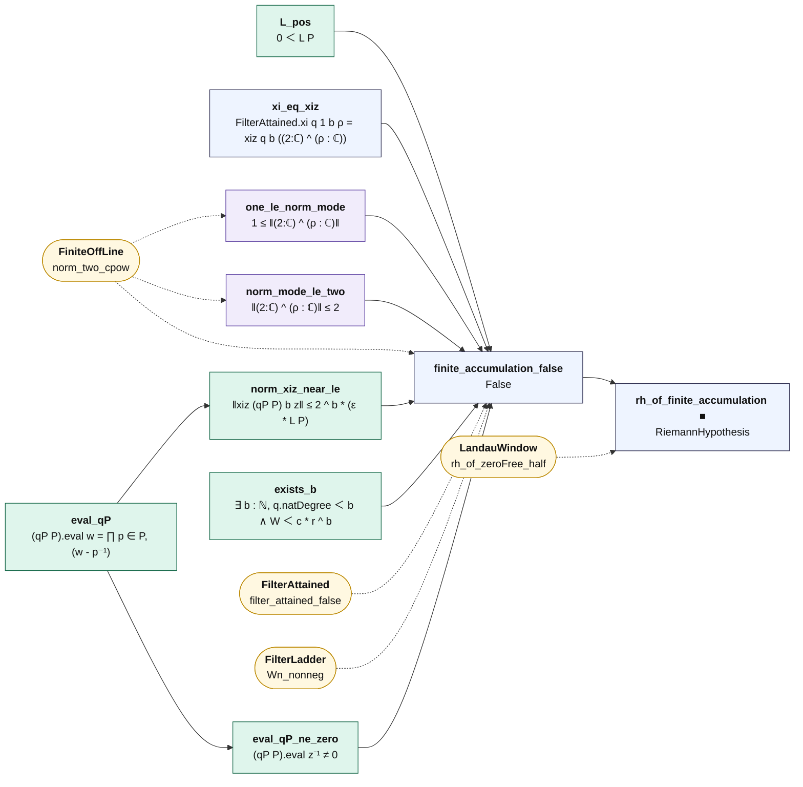

# `lean_stage3/Stage3/FilterAccum.lean`

> **Read from the source text.** This file changed after the last `python3 utilities/lean_map.py --dump`, so the arrows on this page are names occurring in each proof and have not been confirmed by Lean.

FilterAccum — block S3 of `lean_stage3/design/stencil.md`, in its corrected form (the section "After the independent check"). 2026-11-23.

10 theorems, 3 definitions, 246 lines. 

**Imports:** [`FilterAttained`](../lean_stage3/FilterAttained.md)  
**Imported by:** [`Stage3`](../lean_stage3/Stage3.md)

## The picture



An arrow A → B reads "A is used in the proof of B". Green: counting, integers only. Violet: shape, analysis with no ζ. Blue: reads ζ. A name ending in ■ is an end: nothing else uses it. Red: contains `sorry`. Yellow: theorems in another file, counted; a dotted arrow crosses files. Definitions are not drawn; they are listed below the diagram.

## Definitions

<a name="FilterAccum-qP"></a>
### `FilterAccum.qP`

def · line 41

The filter that vanishes at the inverses of the points of `P`: `q(u) = Π_{p ∈ P} (u − 1/p)`.

- **Is:** `` qP (P : Finset ℂ) : Polynomial ℂ := ∏ p ∈ P, (X - C p⁻¹) ``
- **Used by 4:** [`FilterAccum.eval_qP`](#FilterAccum-eval_qP), [`FilterAccum.eval_qP_ne_zero`](#FilterAccum-eval_qP_ne_zero), [`FilterAccum.finite_accumulation_false`](#FilterAccum-finite_accumulation_false), [`FilterAccum.norm_xiz_near_le`](#FilterAccum-norm_xiz_near_le)

<a name="FilterAccum-L"></a>
### `FilterAccum.L`

def · line 50

The bound `Π_{p ∈ P} (1 + |1/p|)` on the product of the factors of the filter.

- **Is:** `` L (P : Finset ℂ) : ℝ := ∏ p ∈ P, (1 + ‖p⁻¹‖) ``
- **Used by 3:** [`FilterAccum.L_pos`](#FilterAccum-L_pos), [`FilterAccum.finite_accumulation_false`](#FilterAccum-finite_accumulation_false), [`FilterAccum.norm_xiz_near_le`](#FilterAccum-norm_xiz_near_le)

<a name="FilterAccum-xiz"></a>
### `FilterAccum.xiz`

def · line 57

The rate with `a = 1`, as a function of the mode `z`: `z^b·q(1/z)`.

- **Is:** `` xiz (q : Polynomial ℂ) (b : ℕ) (z : ℂ) : ℂ := z ^ b * q.eval z⁻¹ ``
- **Used by 3:** [`FilterAccum.finite_accumulation_false`](#FilterAccum-finite_accumulation_false), [`FilterAccum.norm_xiz_near_le`](#FilterAccum-norm_xiz_near_le), [`FilterAccum.xi_eq_xiz`](#FilterAccum-xi_eq_xiz)

## Theorems

<a name="FilterAccum-eval_qP"></a>
### `FilterAccum.eval_qP`

line 44 · arrows read from text

**Counting.** Integers only: nothing in its statement or proof, or in anything it rests on, uses analysis or ζ.

**Why.** The filter's value at `w` is the product of `w − 1/p` over the points of `P`.

**Proves**

```lean
(qP P).eval w = ∏ p ∈ P, (w - p⁻¹)
```

**Needs** (its hypotheses)

  - `` P : Finset ℂ ``
  - `` w : ℂ ``

**Fed by:** no theorem of this repo; it stands on Mathlib and the definitions below.

**Definitions its proof touches:** [`FilterAccum.qP`](#FilterAccum-qP)

**Feeds** (2 that use it)

  - [`FilterAccum.eval_qP_ne_zero`](#FilterAccum-eval_qP_ne_zero) — `` (qP P).eval z⁻¹ ≠ 0 ``
  - [`FilterAccum.norm_xiz_near_le`](#FilterAccum-norm_xiz_near_le) — `` ‖xiz (qP P) b z‖ ≤ 2 ^ b * (ε * L P) ``

<a name="FilterAccum-L_pos"></a>
### `FilterAccum.L_pos`

line 53 · arrows read from text

**Counting.** Integers only: nothing in its statement or proof, or in anything it rests on, uses analysis or ζ.

**Why.** The bound `L` is positive.

**Proves**

```lean
0 < L P
```

**Needs** (its hypotheses)

  - `` P : Finset ℂ ``

**Fed by:** no theorem of this repo; it stands on Mathlib and the definitions below.

**Definitions its proof touches:** [`FilterAccum.L`](#FilterAccum-L)

**Feeds** (1 that use it)

  - [`FilterAccum.finite_accumulation_false`](#FilterAccum-finite_accumulation_false) — `` False ``

<a name="FilterAccum-xi_eq_xiz"></a>
### `FilterAccum.xi_eq_xiz`

line 60 · arrows read from text

**Reads ζ.** It, or something it rests on, uses the zeta function, its zeros or the Riemann hypothesis.

**Why.** With `a = 1` the rate of a zero depends on the zero only through its mode.

**Proves**

```lean
FilterAttained.xi q 1 b ρ = xiz q b ((2:ℂ) ^ (ρ : ℂ))
```

**Needs** (its hypotheses)

  - `` q : Polynomial ℂ ``
  - `` b : ℕ ``
  - `` ρ : NontrivialZeros ``

**Fed by:** no theorem of this repo; it stands on Mathlib and the definitions below.

**Definitions its proof touches:** [`FilterAccum.xiz`](#FilterAccum-xiz), [`FilterAttained.xi`](../lean_stage3/FilterAttained.md#FilterAttained-xi)

**Feeds** (1 that use it)

  - [`FilterAccum.finite_accumulation_false`](#FilterAccum-finite_accumulation_false) — `` False ``

<a name="FilterAccum-one_le_norm_mode"></a>
### `FilterAccum.one_le_norm_mode`

line 66 · arrows read from text

**Shape.** Uses real or complex analysis; nothing in it or beneath it reads ζ.

**Why.** The mode of a zero has size at least one.

**Proves**

```lean
1 ≤ ‖(2:ℂ) ^ (ρ : ℂ)‖
```

**Needs** (its hypotheses)

  - `` ρ : NontrivialZeros ``

**Fed by** (1 theorem its proof uses)

  - [`FiniteOffLine.norm_two_cpow`](../lean_stage3/FiniteOffLine.md#FiniteOffLine-norm_two_cpow) (FiniteOffLine) — `` ‖(2:ℂ) ^ ρ‖ = (2:ℝ) ^ ρ.re ``

**Feeds** (1 that use it)

  - [`FilterAccum.finite_accumulation_false`](#FilterAccum-finite_accumulation_false) — `` False ``

<a name="FilterAccum-norm_mode_le_two"></a>
### `FilterAccum.norm_mode_le_two`

line 71 · arrows read from text

**Shape.** Uses real or complex analysis; nothing in it or beneath it reads ζ.

**Why.** The mode of a zero has size at most two.

**Proves**

```lean
‖(2:ℂ) ^ (ρ : ℂ)‖ ≤ 2
```

**Needs** (its hypotheses)

  - `` ρ : NontrivialZeros ``

**Fed by** (1 theorem its proof uses)

  - [`FiniteOffLine.norm_two_cpow`](../lean_stage3/FiniteOffLine.md#FiniteOffLine-norm_two_cpow) (FiniteOffLine) — `` ‖(2:ℂ) ^ ρ‖ = (2:ℝ) ^ ρ.re ``

**Feeds** (1 that use it)

  - [`FilterAccum.finite_accumulation_false`](#FilterAccum-finite_accumulation_false) — `` False ``

<a name="FilterAccum-norm_xiz_near_le"></a>
### `FilterAccum.norm_xiz_near_le`

line 80 · arrows read from text

**Counting.** Integers only: nothing in its statement or proof, or in anything it rests on, uses analysis or ζ.

**Why.** A mode near a point of `P` has a small rate. For a mode `z` with `1 ≤ |z| ≤ 2` and a point `p₀` of `P` with `|z − p₀| ≤ ε`, the rate under the filter of `P` is at most `2^b·(ε·L)`.

**Proves**

```lean
‖xiz (qP P) b z‖ ≤ 2 ^ b * (ε * L P)
```

**Needs** (its hypotheses)

  - `` hP0 : ∀ p ∈ P, p ≠ 0 ``
  - `` b : ℕ ``
  - `` hz1 : 1 ≤ ‖z‖ ``
  - `` hz2 : ‖z‖ ≤ 2 ``
  - `` hp₀ : p₀ ∈ P ``
  - `` hε : ‖z - p₀‖ ≤ ε ``

**Fed by** (1 theorem its proof uses)

  - [`FilterAccum.eval_qP`](#FilterAccum-eval_qP) — `` (qP P).eval w = ∏ p ∈ P, (w - p⁻¹) ``

**Definitions its proof touches:** [`FilterAccum.L`](#FilterAccum-L), [`FilterAccum.qP`](#FilterAccum-qP), [`FilterAccum.xiz`](#FilterAccum-xiz)

**Feeds** (1 that use it)

  - [`FilterAccum.finite_accumulation_false`](#FilterAccum-finite_accumulation_false) — `` False ``

<a name="FilterAccum-eval_qP_ne_zero"></a>
### `FilterAccum.eval_qP_ne_zero`

line 114 · arrows read from text

**Counting.** Integers only: nothing in its statement or proof, or in anything it rests on, uses analysis or ζ.

**Why.** A mode outside `P` is not a zero of the filter. For `z` outside `P`, `q(1/z) ≠ 0`.

**Proves**

```lean
(qP P).eval z⁻¹ ≠ 0
```

**Needs** (its hypotheses)

  - `` hzP : z ∉ P ``

**Fed by** (1 theorem its proof uses)

  - [`FilterAccum.eval_qP`](#FilterAccum-eval_qP) — `` (qP P).eval w = ∏ p ∈ P, (w - p⁻¹) ``

**Definitions its proof touches:** [`FilterAccum.qP`](#FilterAccum-qP)

**Feeds** (1 that use it)

  - [`FilterAccum.finite_accumulation_false`](#FilterAccum-finite_accumulation_false) — `` False ``

<a name="FilterAccum-exists_b"></a>
### `FilterAccum.exists_b`

line 123 · arrows read from text

**Counting.** Integers only: nothing in its statement or proof, or in anything it rests on, uses analysis or ζ.

**Why.** A large enough `b`. For `c > 0` and `r > 1` there is `b` above the degree of `q` with `W < c·r^b`.

**Proves**

```lean
∃ b : ℕ, q.natDegree < b ∧ W < c * r ^ b
```

**Needs** (its hypotheses)

  - `` q : Polynomial ℂ ``
  - `` W : ℝ ``
  - `` hc : 0 < c ``
  - `` hr : 1 < r ``

**Fed by:** no theorem of this repo; it stands on Mathlib.

**Feeds** (1 that use it)

  - [`FilterAccum.finite_accumulation_false`](#FilterAccum-finite_accumulation_false) — `` False ``

<a name="FilterAccum-finite_accumulation_false"></a>
### `FilterAccum.finite_accumulation_false`

line 137 · arrows read from text

**Reads ζ.** It, or something it rests on, uses the zeta function, its zeros or the Riemann hypothesis.

**Why.** Finitely many accumulation points, and a zero right of `σ` off them: the ladder bound fails. Let `|ψ(2^k) − 2^k| ≤ C·k²·√2^k` for `k ≥ 1` and `σ > 1/2`. Let `P` be a finite set of nonzero points such that, for every `ε > 0`, the mode values `2^ρ` of the zeros with real part at least `σ` that lie at distance at least `ε` from every point of `P` form a finite set. Then no zero with real part above `σ` has its mode outside `P`.

**Proves**

```lean
False
```

**Needs** (its hypotheses)

  - `` hH : ∀ k : ℕ, 1 ≤ k → ‖(Chebyshev.psi ((2:ℝ)^k) : ℂ) - (((2:ℝ)^k : ℝ) : ℂ)‖ ≤ C * (k:ℝ)^2 * Real.sqrt 2 ^ k ``
  - `` hσ : 1/2 < σ ``
  - `` P : Finset ℂ ``
  - `` hP0 : ∀ p ∈ P, p ≠ 0 ``
  - `` hacc : ∀ ε : ℝ, 0 < ε → {z : ℂ | ∃ ρ : Kadiri.NontrivialZeros, σ ≤ (ρ : ℂ).re ∧ (2:ℂ) ^ (ρ : ℂ) = z ∧ ∀ p ∈ P, ε ≤ ‖z - p‖}.Finite ``
  - `` ρ₁ : Kadiri.NontrivialZeros ``
  - `` hρ₁ : σ < (ρ₁ : ℂ).re ``
  - `` hρ₁P : (2:ℂ) ^ (ρ₁ : ℂ) ∉ P ``

**Fed by** (10 theorems its proof uses)

  - [`FilterAccum.L_pos`](#FilterAccum-L_pos) — `` 0 < L P ``
  - [`FilterAccum.eval_qP_ne_zero`](#FilterAccum-eval_qP_ne_zero) — `` (qP P).eval z⁻¹ ≠ 0 ``
  - [`FilterAccum.exists_b`](#FilterAccum-exists_b) — `` ∃ b : ℕ, q.natDegree < b ∧ W < c * r ^ b ``
  - [`FilterAccum.norm_mode_le_two`](#FilterAccum-norm_mode_le_two) — `` ‖(2:ℂ) ^ (ρ : ℂ)‖ ≤ 2 ``
  - [`FilterAccum.norm_xiz_near_le`](#FilterAccum-norm_xiz_near_le) — `` ‖xiz (qP P) b z‖ ≤ 2 ^ b * (ε * L P) ``
  - [`FilterAccum.one_le_norm_mode`](#FilterAccum-one_le_norm_mode) — `` 1 ≤ ‖(2:ℂ) ^ (ρ : ℂ)‖ ``
  - [`FilterAccum.xi_eq_xiz`](#FilterAccum-xi_eq_xiz) — `` FilterAttained.xi q 1 b ρ = xiz q b ((2:ℂ) ^ (ρ : ℂ)) ``
  - [`FilterAttained.filter_attained_false`](../lean_stage3/FilterAttained.md#FilterAttained-filter_attained_false) (FilterAttained) — `` False ``
  - [`FilterLadder.Wn_nonneg`](../lean_stage3/FilterLadder.md#FilterLadder-Wn_nonneg) (FilterLadder) — `` 0 ≤ Wn q ``
  - [`FiniteOffLine.norm_two_cpow`](../lean_stage3/FiniteOffLine.md#FiniteOffLine-norm_two_cpow) (FiniteOffLine) — `` ‖(2:ℂ) ^ ρ‖ = (2:ℝ) ^ ρ.re ``

**Definitions its proof touches:** [`FilterAccum.L`](#FilterAccum-L), [`FilterAccum.qP`](#FilterAccum-qP), [`FilterAccum.xiz`](#FilterAccum-xiz), [`FilterLadder.Wn`](../lean_stage3/FilterLadder.md#FilterLadder-Wn)

**Feeds** (1 that use it)

  - [`FilterAccum.rh_of_finite_accumulation`](#FilterAccum-rh_of_finite_accumulation) — `` RiemannHypothesis ``

<a name="FilterAccum-rh_of_finite_accumulation"></a>
### `FilterAccum.rh_of_finite_accumulation`

line 218 · arrows read from text

**Reads ζ.** It, or something it rests on, uses the zeta function, its zeros or the Riemann hypothesis.

**Why.** Finitely many accumulation points on every line right of `1/2`, and the ladder of `ψ` of square-root size: then the Riemann hypothesis holds. Let `|ψ(2^k) − 2^k| ≤ C·k²·√2^k` for every `k ≥ 1`. Suppose that for every `σ > 1/2` the modes `2^ρ` of the zeros with real part at least `σ` accumulate only at the points of a finite set `P` of nonzero points (for every `ε > 0` the mode values at distance at least `ε` from all of `P` are finitely many), none of which is the mode of a zero with real part above `σ`. Then the Riemann hypothesis holds.

**Proves**

```lean
RiemannHypothesis
```

**Needs** (its hypotheses)

  - `` hH : ∀ k : ℕ, 1 ≤ k → ‖(Chebyshev.psi ((2:ℝ)^k) : ℂ) - (((2:ℝ)^k : ℝ) : ℂ)‖ ≤ C * (k:ℝ)^2 * Real.sqrt 2 ^ k ``
  - `` hfin : ∀ σ : ℝ, 1/2 < σ → ∃ P : Finset ℂ, (∀ p ∈ P, p ≠ 0) ∧ (∀ ε : ℝ, 0 < ε → {z : ℂ | ∃ ρ : Kadiri.NontrivialZeros, σ ≤ (ρ : ℂ).re ∧ (2:ℂ) ^ (ρ : ℂ) = z ∧ ∀ p ∈ P, ε ≤ ‖z - p‖}.Finite) ∧ (∀ ρ : Kadiri.NontrivialZeros, σ < (ρ : ℂ).re → (2:ℂ) ^ (ρ : ℂ) ∉ P) ``

**Fed by** (2 theorems its proof uses)

  - [`FilterAccum.finite_accumulation_false`](#FilterAccum-finite_accumulation_false) — `` False ``
  - [`LandauWindow.rh_of_zeroFree_half`](../lean_stage3/LandauWindow.md#LandauWindow-rh_of_zeroFree_half) (LandauWindow) — `` RiemannHypothesis ``

**Feeds:** nothing. It is an end.

