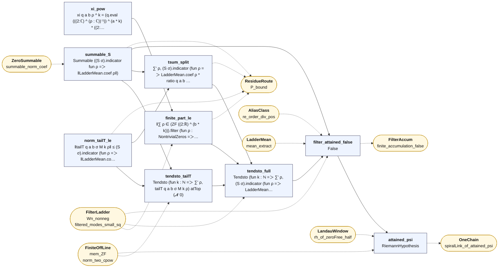

# `lean_stage3/Stage3/FilterAttained.lean`

> **Read from the source text.** This file changed after the last `python3 utilities/lean_map.py --dump`, so the arrows on this page are names occurring in each proof and have not been confirmed by Lean.

FilterAttained — block S2 of `lean_stage3/design/stencil.md`, in its corrected form (the section "After the independent check"). 2026-11-23.

9 theorems, 4 definitions, 384 lines. 

**Imports:** [`FilterLadder`](../lean_stage3/FilterLadder.md), [`LadderMean`](../lean_stage3/LadderMean.md), [`ZeroSummable`](../lean_stage3/ZeroSummable.md)  
**Imported by:** [`Stage3`](../lean_stage3/Stage3.md), [`FilterAccum`](../lean_stage3/FilterAccum.md)

## The picture



An arrow A → B reads "A is used in the proof of B". Green: counting, integers only. Violet: shape, analysis with no ζ. Blue: reads ζ. A name ending in ■ is an end: nothing else uses it. Red: contains `sorry`. Yellow: theorems in another file, counted; a dotted arrow crosses files. Definitions are not drawn; they are listed below the diagram.

## Definitions

<a name="FilterAttained-xi"></a>
### `FilterAttained.xi`

def · line 42

the rate of a zero under the filter

- **Is:** `` xi (q : Polynomial ℂ) (a b : ℕ) (ρ : Kadiri.NontrivialZeros) : ℂ := ((2:ℂ) ^ (ρ : ℂ)) ^ b * (q.eval (((2:ℂ) ^ (ρ : ℂ))⁻¹)) ^ a ``
- **Used by 6:** [`FilterAccum.xi_eq_xiz`](../lean_stage3/FilterAccum.md#FilterAccum-xi_eq_xiz), [`FilterAttained.attained_psi`](#FilterAttained-attained_psi), [`FilterAttained.filter_attained_false`](#FilterAttained-filter_attained_false), [`FilterAttained.ratio`](#FilterAttained-ratio), [`FilterAttained.xi_pow`](#FilterAttained-xi_pow), [`ResidueRoute.P_bound`](../lean_stage3/ResidueRoute.md#ResidueRoute-P_bound)

<a name="FilterAttained-S"></a>
### `FilterAttained.S`

def · line 46

The zeros with real part at least `σ`.

- **Is:** `` S (σ : ℝ) : Set NontrivialZeros := {ρ | σ ≤ (ρ : ℂ).re} ``
- **Used by 14:** [`FilterAttained.filter_attained_false`](#FilterAttained-filter_attained_false), [`FilterAttained.norm_tailT_le`](#FilterAttained-norm_tailT_le), [`FilterAttained.summable_S`](#FilterAttained-summable_S), [`FilterAttained.tailT`](#FilterAttained-tailT), [`FilterAttained.tendsto_full`](#FilterAttained-tendsto_full), [`FilterAttained.tendsto_tailT`](#FilterAttained-tendsto_tailT), [`FilterAttained.tsum_split`](#FilterAttained-tsum_split), [`ResidueRoute.F`](../lean_stage3/ResidueRoute.md#ResidueRoute-F), [`ResidueRoute.G_eq_F`](../lean_stage3/ResidueRoute.md#ResidueRoute-G_eq_F), [`ResidueRoute.P`](../lean_stage3/ResidueRoute.md#ResidueRoute-P), [`ResidueRoute.P_bound`](../lean_stage3/ResidueRoute.md#ResidueRoute-P_bound), [`ResidueRoute.differentiableAt_F`](../lean_stage3/ResidueRoute.md#ResidueRoute-differentiableAt_F), [`ResidueRoute.isolated_boundary_mode_false`](../lean_stage3/ResidueRoute.md#ResidueRoute-isolated_boundary_mode_false), [`ResidueRoute.summable_coef`](../lean_stage3/ResidueRoute.md#ResidueRoute-summable_coef)

<a name="FilterAttained-ratio"></a>
### `FilterAttained.ratio`

def · line 49

The rate of a zero divided by a fixed size `M`.

- **Is:** `` ratio (q : Polynomial ℂ) (a b : ℕ) (M : ℝ) (ρ : NontrivialZeros) : ℂ := xi q a b ρ / (M : ℂ) ``
- **Built from:** [`FilterAttained.xi`](#FilterAttained-xi)
- **Used by 8:** [`FilterAttained.filter_attained_false`](#FilterAttained-filter_attained_false), [`FilterAttained.finite_part_le`](#FilterAttained-finite_part_le), [`FilterAttained.norm_tailT_le`](#FilterAttained-norm_tailT_le), [`FilterAttained.tailT`](#FilterAttained-tailT), [`FilterAttained.tendsto_full`](#FilterAttained-tendsto_full), [`FilterAttained.tendsto_tailT`](#FilterAttained-tendsto_tailT), [`FilterAttained.tsum_split`](#FilterAttained-tsum_split), [`ResidueRoute.P_bound`](../lean_stage3/ResidueRoute.md#ResidueRoute-P_bound)

<a name="FilterAttained-tailT"></a>
### `FilterAttained.tailT`

def · line 109

One zero's term at row `k`, kept only when it is right of `σ` and above height `2^(bk)`.

- **Is:** `` tailT (q : Polynomial ℂ) (a b : ℕ) (σ M : ℝ) (k : ℕ) (ρ : NontrivialZeros) : ℂ := if ρ ∈ ZF ((2:ℝ) ^ (b * k)) then 0 else (S σ).indicator (fun ρ => LadderMean.coef ρ * ratio q a b M ρ ^ k) ρ ``
- **Built from:** [`FilterAttained.S`](#FilterAttained-S), [`FilterAttained.ratio`](#FilterAttained-ratio), [`FiniteOffLine.ZF`](../lean_stage3/FiniteOffLine.md#FiniteOffLine-ZF), [`LadderMean.coef`](../lean_stage3/LadderMean.md#LadderMean-coef)
- **Used by 4:** [`FilterAttained.norm_tailT_le`](#FilterAttained-norm_tailT_le), [`FilterAttained.tendsto_tailT`](#FilterAttained-tendsto_tailT), [`FilterAttained.tsum_split`](#FilterAttained-tsum_split), [`ResidueRoute.P_bound`](../lean_stage3/ResidueRoute.md#ResidueRoute-P_bound)

## Theorems

<a name="FilterAttained-xi_pow"></a>
### `FilterAttained.xi_pow`

line 53 · arrows read from text

**Reads ζ.** It, or something it rests on, uses the zeta function, its zeros or the Riemann hypothesis.

**Why.** The `k`-th power of the rate is the filter `q^(ak)` read on the mode `(2^ρ)^(bk)`.

**Proves**

```lean
xi q a b ρ ^ k = (q.eval (((2:ℂ) ^ (ρ : ℂ))⁻¹)) ^ (a * k) * ((2:ℂ) ^ (ρ : ℂ)) ^ (b * k)
```

**Needs** (its hypotheses)

  - `` q : Polynomial ℂ ``
  - `` a b k : ℕ ``
  - `` ρ : NontrivialZeros ``

**Fed by:** no theorem of this repo; it stands on Mathlib and the definitions below.

**Definitions its proof touches:** [`FilterAttained.xi`](#FilterAttained-xi)

**Feeds** (1 that use it)

  - [`FilterAttained.finite_part_le`](#FilterAttained-finite_part_le) — `` ‖∑ ρ ∈ (ZF ((2:ℝ) ^ (b * k))).filter (fun ρ : NontrivialZeros => σ ≤ (ρ : ℂ).re), LadderMean.coef ρ * ratio q a b M ρ ^ k‖ ≤ FilterLadder.Afl C * (b:ℝ… ``

<a name="FilterAttained-summable_S"></a>
### `FilterAttained.summable_S`

line 60 · arrows read from text

**Reads ζ.** It, or something it rests on, uses the zeta function, its zeros or the Riemann hypothesis.

**Why.** For `σ > 1/2` the weights `|m(ρ)/ρ|` of the zeros right of `σ`, as a function on all zeros, are summable.

**Proves**

```lean
Summable ((S σ).indicator fun ρ => ‖LadderMean.coef ρ‖)
```

**Needs** (its hypotheses)

  - `` hσ : 1 / 2 < σ ``

**Fed by** (1 theorem its proof uses)

  - [`ZeroSummable.summable_norm_coef`](../lean_stage3/ZeroSummable.md#ZeroSummable-summable_norm_coef) (ZeroSummable) — `` Summable fun ρ : S => ‖LadderMean.coef ρ‖ ``

**Definitions its proof touches:** [`FilterAttained.S`](#FilterAttained-S), [`LadderMean.coef`](../lean_stage3/LadderMean.md#LadderMean-coef)

**Feeds** (4 that use it)

  - [`FilterAttained.filter_attained_false`](#FilterAttained-filter_attained_false) — `` False ``
  - [`FilterAttained.tendsto_tailT`](#FilterAttained-tendsto_tailT) — `` Tendsto (fun k : ℕ => ∑' ρ, tailT q a b σ M k ρ) atTop (𝓝 0) ``
  - [`FilterAttained.tsum_split`](#FilterAttained-tsum_split) — `` ∑' ρ, (S σ).indicator (fun ρ => LadderMean.coef ρ * ratio q a b M ρ ^ k) ρ = ∑ ρ ∈ (ZF ((2:ℝ) ^ (b * k))).filter (fun ρ : NontrivialZeros => σ ≤ (ρ : … ``
  - [`ResidueRoute.P_bound`](../lean_stage3/ResidueRoute.md#ResidueRoute-P_bound) (ResidueRoute) — `` ∃ θ' Ct : ℝ, θ' < 1 ∧ 0 ≤ Ct ∧ ∀ σ : ℝ, σ₀ ≤ σ → Θ ≤ σ + (1 - θ') → ∀ k : ℕ, 2 ≤ k → ‖P σ k‖ ≤ (|FilterLadder.Afl C| + Ct) * (k:ℝ) ^ 2 * ((2:ℝ) ^ σ) ^… ``

<a name="FilterAttained-finite_part_le"></a>
### `FilterAttained.finite_part_le`

line 68 · arrows read from text

**Reads ζ.** It, or something it rests on, uses the zeta function, its zeros or the Riemann hypothesis.

**Why.** The zeros below height `2^(bk)`. Under the hypothesis on the ladder, for `k ≥ 2` and `M > 0`, the sum over the zeros below `2^(bk)` with real part at least `σ ≥ 1/2` of `m(ρ)/ρ·(ξ(ρ)/M)^k` is at most `Afl C·b²·k²·(2^(σb)·‖q‖_W^a/M)^k`.

**Proves**

```lean
‖∑ ρ ∈ (ZF ((2:ℝ) ^ (b * k))).filter (fun ρ : NontrivialZeros => σ ≤ (ρ : ℂ).re), LadderMean.coef ρ * ratio q a b M ρ ^ k‖ ≤ FilterLadder.Afl C * (b:ℝ) ^ 2 * (k:ℝ) ^ 2 * ((2:ℝ) ^ (σ * b) * FilterLadder.Wn q ^ a / M) ^ k
```

**Needs** (its hypotheses)

  - `` hH : ∀ k : ℕ, 1 ≤ k → ‖(Chebyshev.psi ((2:ℝ)^k) : ℂ) - (((2:ℝ)^k : ℝ) : ℂ)‖ ≤ C * (k:ℝ)^2 * Real.sqrt 2 ^ k ``
  - `` q : Polynomial ℂ ``
  - `` hb : 1 ≤ b ``
  - `` hab : a * q.natDegree < b ``
  - `` hσ : 1 / 2 ≤ σ ``
  - `` hM : 0 < M ``
  - `` hk : 2 ≤ k ``

**Fed by** (2 theorems its proof uses)

  - [`FilterAttained.xi_pow`](#FilterAttained-xi_pow) — `` xi q a b ρ ^ k = (q.eval (((2:ℂ) ^ (ρ : ℂ))⁻¹)) ^ (a * k) * ((2:ℂ) ^ (ρ : ℂ)) ^ (b * k) ``
  - [`FilterLadder.filtered_modes_small_sq`](../lean_stage3/FilterLadder.md#FilterLadder-filtered_modes_small_sq) (FilterLadder) — `` ‖∑ ρ ∈ (FiniteOffLine.ZF ((2:ℝ)^n)).filter (fun ρ : NontrivialZeros => σ ≤ (ρ : ℂ).re), ((riemannZeta.order (ρ : ℂ) : ℤ) : ℂ) / (ρ : ℂ) * (q.eval (((2… ``

**Definitions its proof touches:** [`FilterAttained.ratio`](#FilterAttained-ratio), [`FilterLadder.Afl`](../lean_stage3/FilterLadder.md#FilterLadder-Afl), [`FilterLadder.Wn`](../lean_stage3/FilterLadder.md#FilterLadder-Wn), [`FiniteOffLine.ZF`](../lean_stage3/FiniteOffLine.md#FiniteOffLine-ZF), [`LadderMean.coef`](../lean_stage3/LadderMean.md#LadderMean-coef)

**Feeds** (2 that use it)

  - [`FilterAttained.tendsto_full`](#FilterAttained-tendsto_full) — `` Tendsto (fun k : ℕ => ∑' ρ, (S σ).indicator (fun ρ => LadderMean.coef ρ * ratio q a b M ρ ^ k) ρ) atTop (𝓝 0) ``
  - [`ResidueRoute.P_bound`](../lean_stage3/ResidueRoute.md#ResidueRoute-P_bound) (ResidueRoute) — `` ∃ θ' Ct : ℝ, θ' < 1 ∧ 0 ≤ Ct ∧ ∀ σ : ℝ, σ₀ ≤ σ → Θ ≤ σ + (1 - θ') → ∀ k : ℕ, 2 ≤ k → ‖P σ k‖ ≤ (|FilterLadder.Afl C| + Ct) * (k:ℝ) ^ 2 * ((2:ℝ) ^ σ) ^… ``

<a name="FilterAttained-norm_tailT_le"></a>
### `FilterAttained.norm_tailT_le`

line 115 · arrows read from text

**Reads ζ.** It, or something it rests on, uses the zeta function, its zeros or the Riemann hypothesis.

**Why.** If the rate over `M` has size at most one right of `σ`, the part of a term above height `2^(bk)` is at most the weight `|m(ρ)/ρ|` of the zero, kept right of `σ`.

**Proves**

```lean
‖tailT q a b σ M k ρ‖ ≤ (S σ).indicator (fun ρ => ‖LadderMean.coef ρ‖) ρ
```

**Needs** (its hypotheses)

  - `` q : Polynomial ℂ ``
  - `` a b : ℕ ``
  - `` hle : ∀ ρ ∈ S σ, ‖ratio q a b M ρ‖ ≤ 1 ``
  - `` k : ℕ ``
  - `` ρ : NontrivialZeros ``

**Fed by:** no theorem of this repo; it stands on Mathlib and the definitions below.

**Definitions its proof touches:** [`FilterAttained.S`](#FilterAttained-S), [`FilterAttained.ratio`](#FilterAttained-ratio), [`FilterAttained.tailT`](#FilterAttained-tailT), [`LadderMean.coef`](../lean_stage3/LadderMean.md#LadderMean-coef)

**Feeds** (3 that use it)

  - [`FilterAttained.tendsto_tailT`](#FilterAttained-tendsto_tailT) — `` Tendsto (fun k : ℕ => ∑' ρ, tailT q a b σ M k ρ) atTop (𝓝 0) ``
  - [`FilterAttained.tsum_split`](#FilterAttained-tsum_split) — `` ∑' ρ, (S σ).indicator (fun ρ => LadderMean.coef ρ * ratio q a b M ρ ^ k) ρ = ∑ ρ ∈ (ZF ((2:ℝ) ^ (b * k))).filter (fun ρ : NontrivialZeros => σ ≤ (ρ : … ``
  - [`ResidueRoute.P_bound`](../lean_stage3/ResidueRoute.md#ResidueRoute-P_bound) (ResidueRoute) — `` ∃ θ' Ct : ℝ, θ' < 1 ∧ 0 ≤ Ct ∧ ∀ σ : ℝ, σ₀ ≤ σ → Θ ≤ σ + (1 - θ') → ∀ k : ℕ, 2 ≤ k → ‖P σ k‖ ≤ (|FilterLadder.Afl C| + Ct) * (k:ℝ) ^ 2 * ((2:ℝ) ^ σ) ^… ``

<a name="FilterAttained-tendsto_tailT"></a>
### `FilterAttained.tendsto_tailT`

line 129 · arrows read from text

**Reads ζ.** It, or something it rests on, uses the zeta function, its zeros or the Riemann hypothesis.

**Why.** The parts above height `2^(bk)` fade. For `b ≥ 1`, `σ > 1/2` and the rate over `M` of size at most one right of `σ`, the sum of the parts above `2^(bk)` tends to zero.

**Proves**

```lean
Tendsto (fun k : ℕ => ∑' ρ, tailT q a b σ M k ρ) atTop (𝓝 0)
```

**Needs** (its hypotheses)

  - `` q : Polynomial ℂ ``
  - `` a : ℕ ``
  - `` hb : 1 ≤ b ``
  - `` hσ : 1 / 2 < σ ``
  - `` hle : ∀ ρ ∈ S σ, ‖ratio q a b M ρ‖ ≤ 1 ``

**Fed by** (3 theorems its proof uses)

  - [`FilterAttained.norm_tailT_le`](#FilterAttained-norm_tailT_le) — `` ‖tailT q a b σ M k ρ‖ ≤ (S σ).indicator (fun ρ => ‖LadderMean.coef ρ‖) ρ ``
  - [`FilterAttained.summable_S`](#FilterAttained-summable_S) — `` Summable ((S σ).indicator fun ρ => ‖LadderMean.coef ρ‖) ``
  - [`FiniteOffLine.mem_ZF`](../lean_stage3/FiniteOffLine.md#FiniteOffLine-mem_ZF) (FiniteOffLine) — `` ρ ∈ ZF T ↔ |(ρ : ℂ).im| < T ``

**Definitions its proof touches:** [`FilterAttained.S`](#FilterAttained-S), [`FilterAttained.ratio`](#FilterAttained-ratio), [`FilterAttained.tailT`](#FilterAttained-tailT), [`FiniteOffLine.ZF`](../lean_stage3/FiniteOffLine.md#FiniteOffLine-ZF)

**Feeds** (1 that use it)

  - [`FilterAttained.tendsto_full`](#FilterAttained-tendsto_full) — `` Tendsto (fun k : ℕ => ∑' ρ, (S σ).indicator (fun ρ => LadderMean.coef ρ * ratio q a b M ρ ^ k) ρ) atTop (𝓝 0) ``

<a name="FilterAttained-tsum_split"></a>
### `FilterAttained.tsum_split`

line 151 · arrows read from text

**Reads ζ.** It, or something it rests on, uses the zeta function, its zeros or the Riemann hypothesis.

**Why.** The sum right of `σ` splits at height `2^(bk)`: it is the finite sum over the zeros below `2^(bk)` plus the sum of the parts above.

**Proves**

```lean
∑' ρ, (S σ).indicator (fun ρ => LadderMean.coef ρ * ratio q a b M ρ ^ k) ρ = ∑ ρ ∈ (ZF ((2:ℝ) ^ (b * k))).filter (fun ρ : NontrivialZeros => σ ≤ (ρ : ℂ).re), LadderMean.coef ρ * ratio q a b M ρ ^ k + ∑' ρ, tailT q a b σ M k ρ
```

**Needs** (its hypotheses)

  - `` q : Polynomial ℂ ``
  - `` a b : ℕ ``
  - `` hσ : 1 / 2 < σ ``
  - `` hle : ∀ ρ ∈ S σ, ‖ratio q a b M ρ‖ ≤ 1 ``
  - `` k : ℕ ``

**Fed by** (2 theorems its proof uses)

  - [`FilterAttained.norm_tailT_le`](#FilterAttained-norm_tailT_le) — `` ‖tailT q a b σ M k ρ‖ ≤ (S σ).indicator (fun ρ => ‖LadderMean.coef ρ‖) ρ ``
  - [`FilterAttained.summable_S`](#FilterAttained-summable_S) — `` Summable ((S σ).indicator fun ρ => ‖LadderMean.coef ρ‖) ``

**Definitions its proof touches:** [`FilterAttained.S`](#FilterAttained-S), [`FilterAttained.ratio`](#FilterAttained-ratio), [`FilterAttained.tailT`](#FilterAttained-tailT), [`FiniteOffLine.ZF`](../lean_stage3/FiniteOffLine.md#FiniteOffLine-ZF), [`LadderMean.coef`](../lean_stage3/LadderMean.md#LadderMean-coef)

**Feeds** (2 that use it)

  - [`FilterAttained.tendsto_full`](#FilterAttained-tendsto_full) — `` Tendsto (fun k : ℕ => ∑' ρ, (S σ).indicator (fun ρ => LadderMean.coef ρ * ratio q a b M ρ ^ k) ρ) atTop (𝓝 0) ``
  - [`ResidueRoute.P_bound`](../lean_stage3/ResidueRoute.md#ResidueRoute-P_bound) (ResidueRoute) — `` ∃ θ' Ct : ℝ, θ' < 1 ∧ 0 ≤ Ct ∧ ∀ σ : ℝ, σ₀ ≤ σ → Θ ≤ σ + (1 - θ') → ∀ k : ℕ, 2 ≤ k → ‖P σ k‖ ≤ (|FilterLadder.Afl C| + Ct) * (k:ℝ) ^ 2 * ((2:ℝ) ^ σ) ^… ``

<a name="FilterAttained-tendsto_full"></a>
### `FilterAttained.tendsto_full`

line 187 · arrows read from text

**Reads ζ.** It, or something it rests on, uses the zeta function, its zeros or the Riemann hypothesis.

**Why.** The normalized sum right of `σ` tends to zero. Under the hypothesis on the ladder, with `b ≥ 1`, `a·deg q < b`, `σ > 1/2`, the rate over `M` of size at most one right of `σ`, and `M` above the threshold `2^(σb)·‖q‖_W^a`, the sum over the zeros right of `σ` of `m(ρ)/ρ·(ξ(ρ)/M)^k` tends to zero.

**Proves**

```lean
Tendsto (fun k : ℕ => ∑' ρ, (S σ).indicator (fun ρ => LadderMean.coef ρ * ratio q a b M ρ ^ k) ρ) atTop (𝓝 0)
```

**Needs** (its hypotheses)

  - `` hH : ∀ k : ℕ, 1 ≤ k → ‖(Chebyshev.psi ((2:ℝ)^k) : ℂ) - (((2:ℝ)^k : ℝ) : ℂ)‖ ≤ C * (k:ℝ)^2 * Real.sqrt 2 ^ k ``
  - `` q : Polynomial ℂ ``
  - `` hb : 1 ≤ b ``
  - `` hab : a * q.natDegree < b ``
  - `` hσ : 1 / 2 < σ ``
  - `` hle : ∀ ρ ∈ S σ, ‖ratio q a b M ρ‖ ≤ 1 ``
  - `` hthr : (2:ℝ) ^ (σ * b) * FilterLadder.Wn q ^ a < M ``

**Fed by** (4 theorems its proof uses)

  - [`FilterAttained.finite_part_le`](#FilterAttained-finite_part_le) — `` ‖∑ ρ ∈ (ZF ((2:ℝ) ^ (b * k))).filter (fun ρ : NontrivialZeros => σ ≤ (ρ : ℂ).re), LadderMean.coef ρ * ratio q a b M ρ ^ k‖ ≤ FilterLadder.Afl C * (b:ℝ… ``
  - [`FilterAttained.tendsto_tailT`](#FilterAttained-tendsto_tailT) — `` Tendsto (fun k : ℕ => ∑' ρ, tailT q a b σ M k ρ) atTop (𝓝 0) ``
  - [`FilterAttained.tsum_split`](#FilterAttained-tsum_split) — `` ∑' ρ, (S σ).indicator (fun ρ => LadderMean.coef ρ * ratio q a b M ρ ^ k) ρ = ∑ ρ ∈ (ZF ((2:ℝ) ^ (b * k))).filter (fun ρ : NontrivialZeros => σ ≤ (ρ : … ``
  - [`FilterLadder.Wn_nonneg`](../lean_stage3/FilterLadder.md#FilterLadder-Wn_nonneg) (FilterLadder) — `` 0 ≤ Wn q ``

**Definitions its proof touches:** [`FilterAttained.S`](#FilterAttained-S), [`FilterAttained.ratio`](#FilterAttained-ratio), [`FilterLadder.Afl`](../lean_stage3/FilterLadder.md#FilterLadder-Afl), [`FilterLadder.Wn`](../lean_stage3/FilterLadder.md#FilterLadder-Wn), [`FiniteOffLine.ZF`](../lean_stage3/FiniteOffLine.md#FiniteOffLine-ZF), [`LadderMean.coef`](../lean_stage3/LadderMean.md#LadderMean-coef)

**Feeds** (1 that use it)

  - [`FilterAttained.filter_attained_false`](#FilterAttained-filter_attained_false) — `` False ``

<a name="FilterAttained-filter_attained_false"></a>
### `FilterAttained.filter_attained_false`

line 228 · arrows read from text

**Reads ζ.** It, or something it rests on, uses the zeta function, its zeros or the Riemann hypothesis.

**Why.** An attained rate above the threshold under some filter is impossible. Let the ladder of `ψ` be of square-root size, `|ψ(2^k) − 2^k| ≤ C·k²·√2^k` for `k ≥ 1`. Fix a polynomial `q`, naturals `a`, `b` with `b ≥ 1` and `a·deg q < b`, and `σ > 1/2`. No zero `ρ₀` with real part at least `σ` can have the largest rate `|ξ|` among the zeros with real part at least `σ` while that rate exceeds `2^(σb)·‖q‖_W^a`.

**Proves**

```lean
False
```

**Needs** (its hypotheses)

  - `` hH : ∀ k : ℕ, 1 ≤ k → ‖(Chebyshev.psi ((2:ℝ)^k) : ℂ) - (((2:ℝ)^k : ℝ) : ℂ)‖ ≤ C * (k:ℝ)^2 * Real.sqrt 2 ^ k ``
  - `` q : Polynomial ℂ ``
  - `` hb : 1 ≤ b ``
  - `` hab : a * q.natDegree < b ``
  - `` hσ : 1/2 < σ ``
  - `` ρ₀ : Kadiri.NontrivialZeros ``
  - `` hρ₀ : σ ≤ (ρ₀ : ℂ).re ``
  - `` hmax : ∀ ρ : Kadiri.NontrivialZeros, σ ≤ (ρ : ℂ).re → ‖xi q a b ρ‖ ≤ ‖xi q a b ρ₀‖ ``
  - `` hthr : (2:ℝ) ^ (σ * b) * FilterLadder.Wn q ^ a < ‖xi q a b ρ₀‖ ``

**Fed by** (5 theorems its proof uses)

  - [`AliasClass.re_order_div_pos`](../lean_stage3/AliasClass.md#AliasClass-re_order_div_pos) (AliasClass) — `` 0 < ((((riemannZeta.order (ρ : ℂ) : ℤ) : ℂ)) / (ρ : ℂ)).re ``
  - [`FilterAttained.summable_S`](#FilterAttained-summable_S) — `` Summable ((S σ).indicator fun ρ => ‖LadderMean.coef ρ‖) ``
  - [`FilterAttained.tendsto_full`](#FilterAttained-tendsto_full) — `` Tendsto (fun k : ℕ => ∑' ρ, (S σ).indicator (fun ρ => LadderMean.coef ρ * ratio q a b M ρ ^ k) ρ) atTop (𝓝 0) ``
  - [`FilterLadder.Wn_nonneg`](../lean_stage3/FilterLadder.md#FilterLadder-Wn_nonneg) (FilterLadder) — `` 0 ≤ Wn q ``
  - [`LadderMean.mean_extract`](../lean_stage3/LadderMean.md#LadderMean-mean_extract) (LadderMean) — `` ∑' i, (if w i = w k then C i else 0) = 0 ``

**Definitions its proof touches:** [`FilterAttained.S`](#FilterAttained-S), [`FilterAttained.ratio`](#FilterAttained-ratio), [`FilterAttained.xi`](#FilterAttained-xi), [`FilterLadder.Wn`](../lean_stage3/FilterLadder.md#FilterLadder-Wn), [`LadderMean.coef`](../lean_stage3/LadderMean.md#LadderMean-coef)

**Feeds** (2 that use it)

  - [`FilterAccum.finite_accumulation_false`](../lean_stage3/FilterAccum.md#FilterAccum-finite_accumulation_false) (FilterAccum) — `` False ``
  - [`FilterAttained.attained_psi`](#FilterAttained-attained_psi) — `` RiemannHypothesis ``

<a name="FilterAttained-attained_psi"></a>
### `FilterAttained.attained_psi`

line 349 · arrows read from text

**Reads ζ.** It, or something it rests on, uses the zeta function, its zeros or the Riemann hypothesis.

**Why.** The largest real part attained, and the ladder of `ψ` of square-root size: then the Riemann hypothesis holds. Let `ρ₀` have the largest real part among the zeros of ζ. If `|ψ(2^k) − 2^k| ≤ C·k²·√2^k` for every `k ≥ 1`, the Riemann hypothesis holds. It is `filter_attained_false` with no filter: `q = 1`, `a = 0`, `b = 1`.

**Proves**

```lean
RiemannHypothesis
```

**Needs** (its hypotheses)

  - `` hH : ∀ k : ℕ, 1 ≤ k → ‖(Chebyshev.psi ((2:ℝ)^k) : ℂ) - (((2:ℝ)^k : ℝ) : ℂ)‖ ≤ C * (k:ℝ)^2 * Real.sqrt 2 ^ k ``
  - `` ρ₀ : Kadiri.NontrivialZeros ``
  - `` hmax : ∀ ρ : Kadiri.NontrivialZeros, (ρ : ℂ).re ≤ (ρ₀ : ℂ).re ``

**Fed by** (3 theorems its proof uses)

  - [`FilterAttained.filter_attained_false`](#FilterAttained-filter_attained_false) — `` False ``
  - [`FiniteOffLine.norm_two_cpow`](../lean_stage3/FiniteOffLine.md#FiniteOffLine-norm_two_cpow) (FiniteOffLine) — `` ‖(2:ℂ) ^ ρ‖ = (2:ℝ) ^ ρ.re ``
  - [`LandauWindow.rh_of_zeroFree_half`](../lean_stage3/LandauWindow.md#LandauWindow-rh_of_zeroFree_half) (LandauWindow) — `` RiemannHypothesis ``

**Definitions its proof touches:** [`FilterAttained.xi`](#FilterAttained-xi), [`FilterLadder.Wn`](../lean_stage3/FilterLadder.md#FilterLadder-Wn)

**Feeds** (1 that use it)

  - [`OneChain.spiralLink_of_attained_psi`](../lean_stage3/OneChain.md#OneChain-spiralLink_of_attained_psi) (OneChain) — `` SpiralLink.SpiralLink ``

