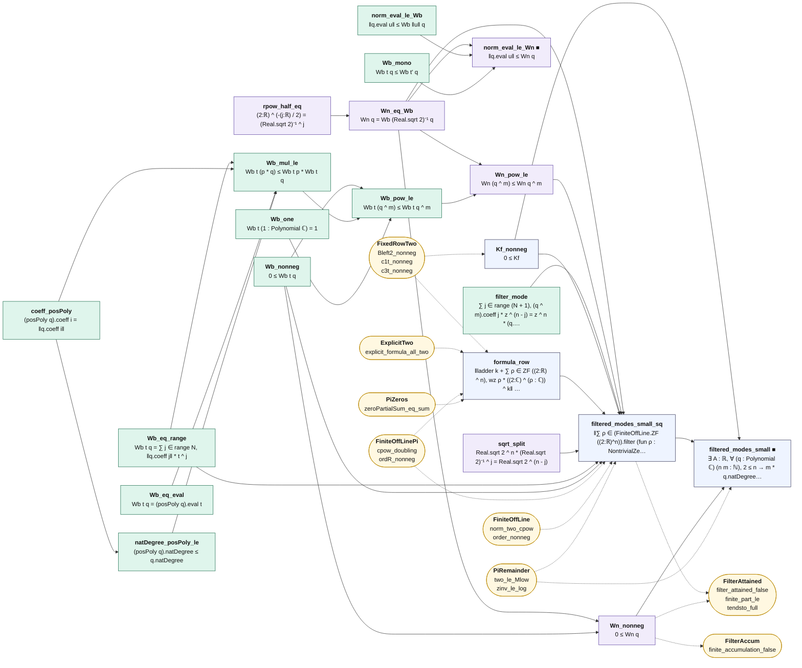

# `lean_stage3/Stage3/FilterLadder.lean`

> **Read from the source text.** This file changed after the last `python3 utilities/lean_map.py --dump`, so the arrows on this page are names occurring in each proof and have not been confirmed by Lean.

FilterLadder — block S1 of `lean_stage3/design/stencil.md`. 2026-11-23. The filtered ladder. Put `a_k = ψ(2^k) − 2^k`. A polynomial `q` acts on the ladder by `Σ_j q_j·a_{n−j}`, and on a mode `z^n` as multiplication by `q(1/z)`. With the weighted norm `‖q‖_W = Σ_j |q_j|·2^(−j/2)`, which is submultiplicative, the filter `q^m` with `m·deg q < n` reads only rows `≥ 1`. If the ladder is of square-root size, `|a_k| ≤ C·k²·√2^k`, then the explicit formula at `x = 2^k` and the one height `2^n` for every `k ≤ n` writes the …

21 theorems, 7 definitions, 561 lines. 

**Imports:** [`FiniteOffLinePi`](../lean_stage3/FiniteOffLinePi.md), [`FixedRowTwo`](../lean_stage3/FixedRowTwo.md)  
**Imported by:** [`Stage3`](../lean_stage3/Stage3.md), [`FilterAttained`](../lean_stage3/FilterAttained.md)

## The picture



An arrow A → B reads "A is used in the proof of B". Green: counting, integers only. Violet: shape, analysis with no ζ. Blue: reads ζ. A name ending in ■ is an end: nothing else uses it. Red: contains `sorry`. Yellow: theorems in another file, counted; a dotted arrow crosses files. Definitions are not drawn; they are listed below the diagram.

## Definitions

<a name="FilterLadder-Wb"></a>
### `FilterLadder.Wb`

def · line 41

The weighted size of a polynomial at weight `t`: the sum of the sizes of its coefficients, the `j`-th times `t^j`.

- **Is:** `` Wb (t : ℝ) (q : Polynomial ℂ) : ℝ := ∑ j ∈ range (q.natDegree + 1), ‖q.coeff j‖ * t ^ j ``
- **Used by 10:** [`FilterLadder.Wb_eq_eval`](#FilterLadder-Wb_eq_eval), [`FilterLadder.Wb_eq_range`](#FilterLadder-Wb_eq_range), [`FilterLadder.Wb_mono`](#FilterLadder-Wb_mono), [`FilterLadder.Wb_mul_le`](#FilterLadder-Wb_mul_le), [`FilterLadder.Wb_nonneg`](#FilterLadder-Wb_nonneg), [`FilterLadder.Wb_one`](#FilterLadder-Wb_one), [`FilterLadder.Wb_pow_le`](#FilterLadder-Wb_pow_le), [`FilterLadder.Wn_eq_Wb`](#FilterLadder-Wn_eq_Wb), [`FilterLadder.filtered_modes_small_sq`](#FilterLadder-filtered_modes_small_sq), [`FilterLadder.norm_eval_le_Wb`](#FilterLadder-norm_eval_le_Wb)

<a name="FilterLadder-Wn"></a>
### `FilterLadder.Wn`

def · line 45

The weighted norm of the design: the `j`-th coefficient's size times `2^(−j/2)`.

- **Is:** `` Wn (q : Polynomial ℂ) : ℝ := ∑ j ∈ range (q.natDegree + 1), ‖q.coeff j‖ * (2:ℝ) ^ (-(j:ℝ) / 2) ``
- **Used by 11:** [`FilterAccum.finite_accumulation_false`](../lean_stage3/FilterAccum.md#FilterAccum-finite_accumulation_false), [`FilterAttained.attained_psi`](../lean_stage3/FilterAttained.md#FilterAttained-attained_psi), [`FilterAttained.filter_attained_false`](../lean_stage3/FilterAttained.md#FilterAttained-filter_attained_false), [`FilterAttained.finite_part_le`](../lean_stage3/FilterAttained.md#FilterAttained-finite_part_le), [`FilterAttained.tendsto_full`](../lean_stage3/FilterAttained.md#FilterAttained-tendsto_full), [`FilterLadder.Wn_eq_Wb`](#FilterLadder-Wn_eq_Wb), [`FilterLadder.Wn_nonneg`](#FilterLadder-Wn_nonneg), [`FilterLadder.Wn_pow_le`](#FilterLadder-Wn_pow_le), [`FilterLadder.filtered_modes_small`](#FilterLadder-filtered_modes_small), [`FilterLadder.filtered_modes_small_sq`](#FilterLadder-filtered_modes_small_sq), [`FilterLadder.norm_eval_le_Wn`](#FilterLadder-norm_eval_le_Wn)

<a name="FilterLadder-posPoly"></a>
### `FilterLadder.posPoly`

def · line 83

The real polynomial whose coefficients are the sizes of the coefficients of `q`.

- **Is:** `` posPoly (q : Polynomial ℂ) : Polynomial ℝ := ∑ j ∈ range (q.natDegree + 1), Polynomial.monomial j ‖q.coeff j‖ ``
- **Used by 4:** [`FilterLadder.Wb_eq_eval`](#FilterLadder-Wb_eq_eval), [`FilterLadder.Wb_mul_le`](#FilterLadder-Wb_mul_le), [`FilterLadder.coeff_posPoly`](#FilterLadder-coeff_posPoly), [`FilterLadder.natDegree_posPoly_le`](#FilterLadder-natDegree_posPoly_le)

<a name="FilterLadder-ladder"></a>
### `FilterLadder.ladder`

def · line 195

The ladder: `a_k = ψ(2^k) − 2^k`, as a complex number.

- **Is:** `` ladder (k : ℕ) : ℂ := (Chebyshev.psi ((2:ℝ) ^ k) : ℂ) - (((2:ℝ) ^ k : ℝ) : ℂ) ``
- **Used by 2:** [`FilterLadder.filtered_modes_small_sq`](#FilterLadder-filtered_modes_small_sq), [`FilterLadder.formula_row`](#FilterLadder-formula_row)

<a name="FilterLadder-Kf"></a>
### `FilterLadder.Kf`

def · line 199

The constant of the explicit formula on the rows `k ≤ n` at height `2^n`: `4·c1t + c3t + Bleft2`.

- **Is:** `` Kf : ℝ := 4 * ExplicitTwo.c1t + ExplicitTwo.c3t + ExplicitTwo.Bleft2 ``
- **Built from:** [`ExplicitTwo.Bleft2`](../lean_stage3/ExplicitTwo.md#ExplicitTwo-Bleft2), [`ExplicitTwo.c1t`](../lean_stage3/ExplicitTwo.md#ExplicitTwo-c1t), [`ExplicitTwo.c3t`](../lean_stage3/ExplicitTwo.md#ExplicitTwo-c3t)
- **Used by 4:** [`FilterLadder.Afl`](#FilterLadder-Afl), [`FilterLadder.Kf_nonneg`](#FilterLadder-Kf_nonneg), [`FilterLadder.filtered_modes_small_sq`](#FilterLadder-filtered_modes_small_sq), [`FilterLadder.formula_row`](#FilterLadder-formula_row)

<a name="FilterLadder-wz"></a>
### `FilterLadder.wz`

def · line 210

The weight of a zero in the explicit formula: its order over the zero.

- **Is:** `` wz (ρ : NontrivialZeros) : ℂ := ((riemannZeta.order (ρ : ℂ) : ℤ) : ℂ) / (ρ : ℂ) ``
- **Used by 2:** [`FilterLadder.filtered_modes_small_sq`](#FilterLadder-filtered_modes_small_sq), [`FilterLadder.formula_row`](#FilterLadder-formula_row)

<a name="FilterLadder-Afl"></a>
### `FilterLadder.Afl`

def · line 279

The constant of the filtered sum: `C + Kf + 39000·Mlow`. It depends on the constant `C` of the hypothesis and on nothing else.

- **Is:** `` Afl (C : ℝ) : ℝ := C + Kf + Mlow * 39000 ``
- **Built from:** [`FilterLadder.Kf`](#FilterLadder-Kf), [`PiRemainder.Mlow`](../lean_stage3/PiRemainder.md#PiRemainder-Mlow)
- **Used by 4:** [`FilterAttained.finite_part_le`](../lean_stage3/FilterAttained.md#FilterAttained-finite_part_le), [`FilterAttained.tendsto_full`](../lean_stage3/FilterAttained.md#FilterAttained-tendsto_full), [`FilterLadder.filtered_modes_small`](#FilterLadder-filtered_modes_small), [`FilterLadder.filtered_modes_small_sq`](#FilterLadder-filtered_modes_small_sq)

## Theorems

<a name="FilterLadder-rpow_half_eq"></a>
### `FilterLadder.rpow_half_eq`

line 49 · arrows read from text

**Shape.** Uses real or complex analysis; nothing in it or beneath it reads ζ.

**Why.** The weight `2^(−j/2)` is the `j`-th power of `1/√2`.

**Proves**

```lean
(2:ℝ) ^ (-(j:ℝ) / 2) = (Real.sqrt 2)⁻¹ ^ j
```

**Needs** (its hypotheses)

  - `` j : ℕ ``

**Fed by:** no theorem of this repo; it stands on Mathlib.

**Feeds** (1 that use it)

  - [`FilterLadder.Wn_eq_Wb`](#FilterLadder-Wn_eq_Wb) — `` Wn q = Wb (Real.sqrt 2)⁻¹ q ``

<a name="FilterLadder-Wn_eq_Wb"></a>
### `FilterLadder.Wn_eq_Wb`

line 56 · arrows read from text

**Shape.** Uses real or complex analysis; nothing in it or beneath it reads ζ.

**Why.** The weighted norm of the design is the weighted size at weight `1/√2`.

**Proves**

```lean
Wn q = Wb (Real.sqrt 2)⁻¹ q
```

**Needs** (its hypotheses)

  - `` q : Polynomial ℂ ``

**Fed by** (1 theorem its proof uses)

  - [`FilterLadder.rpow_half_eq`](#FilterLadder-rpow_half_eq) — `` (2:ℝ) ^ (-(j:ℝ) / 2) = (Real.sqrt 2)⁻¹ ^ j ``

**Definitions its proof touches:** [`FilterLadder.Wb`](#FilterLadder-Wb), [`FilterLadder.Wn`](#FilterLadder-Wn)

**Feeds** (4 that use it)

  - [`FilterLadder.Wn_nonneg`](#FilterLadder-Wn_nonneg) — `` 0 ≤ Wn q ``
  - [`FilterLadder.Wn_pow_le`](#FilterLadder-Wn_pow_le) — `` Wn (q ^ m) ≤ Wn q ^ m ``
  - [`FilterLadder.filtered_modes_small_sq`](#FilterLadder-filtered_modes_small_sq) — `` ‖∑ ρ ∈ (FiniteOffLine.ZF ((2:ℝ)^n)).filter (fun ρ : NontrivialZeros => σ ≤ (ρ : ℂ).re), ((riemannZeta.order (ρ : ℂ) : ℤ) : ℂ) / (ρ : ℂ) * (q.eval (((2… ``
  - [`FilterLadder.norm_eval_le_Wn`](#FilterLadder-norm_eval_le_Wn) — `` ‖q.eval u‖ ≤ Wn q ``

<a name="FilterLadder-Wb_eq_range"></a>
### `FilterLadder.Wb_eq_range`

line 62 · arrows read from text

**Counting.** Integers only: nothing in its statement or proof, or in anything it rests on, uses analysis or ζ.

**Why.** The weighted size is the same sum over any range longer than the degree.

**Proves**

```lean
Wb t q = ∑ j ∈ range N, ‖q.coeff j‖ * t ^ j
```

**Needs** (its hypotheses)

  - `` t : ℝ ``
  - `` q : Polynomial ℂ ``
  - `` hN : q.natDegree < N ``

**Fed by:** no theorem of this repo; it stands on Mathlib and the definitions below.

**Definitions its proof touches:** [`FilterLadder.Wb`](#FilterLadder-Wb)

**Feeds** (2 that use it)

  - [`FilterLadder.Wb_mul_le`](#FilterLadder-Wb_mul_le) — `` Wb t (p * q) ≤ Wb t p * Wb t q ``
  - [`FilterLadder.filtered_modes_small_sq`](#FilterLadder-filtered_modes_small_sq) — `` ‖∑ ρ ∈ (FiniteOffLine.ZF ((2:ℝ)^n)).filter (fun ρ : NontrivialZeros => σ ≤ (ρ : ℂ).re), ((riemannZeta.order (ρ : ℂ) : ℤ) : ℂ) / (ρ : ℂ) * (q.eval (((2… ``

<a name="FilterLadder-Wb_nonneg"></a>
### `FilterLadder.Wb_nonneg`

line 74 · arrows read from text

**Counting.** Integers only: nothing in its statement or proof, or in anything it rests on, uses analysis or ζ.

**Why.** The weighted size is nonnegative at a nonnegative weight.

**Proves**

```lean
0 ≤ Wb t q
```

**Needs** (its hypotheses)

  - `` ht : 0 ≤ t ``
  - `` q : Polynomial ℂ ``

**Fed by:** no theorem of this repo; it stands on Mathlib and the definitions below.

**Definitions its proof touches:** [`FilterLadder.Wb`](#FilterLadder-Wb)

**Feeds** (3 that use it)

  - [`FilterLadder.Wb_pow_le`](#FilterLadder-Wb_pow_le) — `` Wb t (q ^ m) ≤ Wb t q ^ m ``
  - [`FilterLadder.Wn_nonneg`](#FilterLadder-Wn_nonneg) — `` 0 ≤ Wn q ``
  - [`FilterLadder.filtered_modes_small_sq`](#FilterLadder-filtered_modes_small_sq) — `` ‖∑ ρ ∈ (FiniteOffLine.ZF ((2:ℝ)^n)).filter (fun ρ : NontrivialZeros => σ ≤ (ρ : ℂ).re), ((riemannZeta.order (ρ : ℂ) : ℤ) : ℂ) / (ρ : ℂ) * (q.eval (((2… ``

<a name="FilterLadder-Wn_nonneg"></a>
### `FilterLadder.Wn_nonneg`

line 78 · arrows read from text

**Shape.** Uses real or complex analysis; nothing in it or beneath it reads ζ.

**Why.** The weighted norm of the design is nonnegative.

**Proves**

```lean
0 ≤ Wn q
```

**Needs** (its hypotheses)

  - `` q : Polynomial ℂ ``

**Fed by** (2 theorems its proof uses)

  - [`FilterLadder.Wb_nonneg`](#FilterLadder-Wb_nonneg) — `` 0 ≤ Wb t q ``
  - [`FilterLadder.Wn_eq_Wb`](#FilterLadder-Wn_eq_Wb) — `` Wn q = Wb (Real.sqrt 2)⁻¹ q ``

**Definitions its proof touches:** [`FilterLadder.Wn`](#FilterLadder-Wn)

**Feeds** (4 that use it)

  - [`FilterAccum.finite_accumulation_false`](../lean_stage3/FilterAccum.md#FilterAccum-finite_accumulation_false) (FilterAccum) — `` False ``
  - [`FilterAttained.filter_attained_false`](../lean_stage3/FilterAttained.md#FilterAttained-filter_attained_false) (FilterAttained) — `` False ``
  - [`FilterAttained.tendsto_full`](../lean_stage3/FilterAttained.md#FilterAttained-tendsto_full) (FilterAttained) — `` Tendsto (fun k : ℕ => ∑' ρ, (S σ).indicator (fun ρ => LadderMean.coef ρ * ratio q a b M ρ ^ k) ρ) atTop (𝓝 0) ``
  - [`FilterLadder.filtered_modes_small`](#FilterLadder-filtered_modes_small) — `` ∃ A : ℝ, ∀ (q : Polynomial ℂ) (n m : ℕ), 2 ≤ n → m * q.natDegree < n → ‖∑ ρ ∈ (FiniteOffLine.ZF ((2:ℝ)^n)).filter (fun ρ : NontrivialZeros => σ ≤ (ρ :… ``

<a name="FilterLadder-coeff_posPoly"></a>
### `FilterLadder.coeff_posPoly`

line 87 · arrows read from text

**Counting.** Integers only: nothing in its statement or proof, or in anything it rests on, uses analysis or ζ.

**Why.** Each coefficient of `posPoly q` is the size of the same coefficient of `q`.

**Proves**

```lean
(posPoly q).coeff i = ‖q.coeff i‖
```

**Needs** (its hypotheses)

  - `` q : Polynomial ℂ ``
  - `` i : ℕ ``

**Fed by:** no theorem of this repo; it stands on Mathlib and the definitions below.

**Definitions its proof touches:** [`FilterLadder.posPoly`](#FilterLadder-posPoly)

**Feeds** (2 that use it)

  - [`FilterLadder.Wb_mul_le`](#FilterLadder-Wb_mul_le) — `` Wb t (p * q) ≤ Wb t p * Wb t q ``
  - [`FilterLadder.natDegree_posPoly_le`](#FilterLadder-natDegree_posPoly_le) — `` (posPoly q).natDegree ≤ q.natDegree ``

<a name="FilterLadder-Wb_eq_eval"></a>
### `FilterLadder.Wb_eq_eval`

line 98 · arrows read from text

**Counting.** Integers only: nothing in its statement or proof, or in anything it rests on, uses analysis or ζ.

**Why.** The weighted size is the value of `posPoly q` at the weight.

**Proves**

```lean
Wb t q = (posPoly q).eval t
```

**Needs** (its hypotheses)

  - `` t : ℝ ``
  - `` q : Polynomial ℂ ``

**Fed by:** no theorem of this repo; it stands on Mathlib and the definitions below.

**Definitions its proof touches:** [`FilterLadder.Wb`](#FilterLadder-Wb), [`FilterLadder.posPoly`](#FilterLadder-posPoly)

**Feeds** (1 that use it)

  - [`FilterLadder.Wb_mul_le`](#FilterLadder-Wb_mul_le) — `` Wb t (p * q) ≤ Wb t p * Wb t q ``

<a name="FilterLadder-natDegree_posPoly_le"></a>
### `FilterLadder.natDegree_posPoly_le`

line 104 · arrows read from text

**Counting.** Integers only: nothing in its statement or proof, or in anything it rests on, uses analysis or ζ.

**Why.** The degree of `posPoly q` is at most that of `q`.

**Proves**

```lean
(posPoly q).natDegree ≤ q.natDegree
```

**Needs** (its hypotheses)

  - `` q : Polynomial ℂ ``

**Fed by** (1 theorem its proof uses)

  - [`FilterLadder.coeff_posPoly`](#FilterLadder-coeff_posPoly) — `` (posPoly q).coeff i = ‖q.coeff i‖ ``

**Definitions its proof touches:** [`FilterLadder.posPoly`](#FilterLadder-posPoly)

**Feeds** (1 that use it)

  - [`FilterLadder.Wb_mul_le`](#FilterLadder-Wb_mul_le) — `` Wb t (p * q) ≤ Wb t p * Wb t q ``

<a name="FilterLadder-Wb_mul_le"></a>
### `FilterLadder.Wb_mul_le`

line 112 · arrows read from text

**Counting.** Integers only: nothing in its statement or proof, or in anything it rests on, uses analysis or ζ.

**Why.** The weighted size is submultiplicative. At a nonnegative weight, `Wb t (p·q) ≤ Wb t p · Wb t q`: each coefficient of the product is at most the same coefficient of `posPoly p · posPoly q`, whose value at `t` is the product.

**Proves**

```lean
Wb t (p * q) ≤ Wb t p * Wb t q
```

**Needs** (its hypotheses)

  - `` ht : 0 ≤ t ``
  - `` p q : Polynomial ℂ ``

**Fed by** (4 theorems its proof uses)

  - [`FilterLadder.Wb_eq_eval`](#FilterLadder-Wb_eq_eval) — `` Wb t q = (posPoly q).eval t ``
  - [`FilterLadder.Wb_eq_range`](#FilterLadder-Wb_eq_range) — `` Wb t q = ∑ j ∈ range N, ‖q.coeff j‖ * t ^ j ``
  - [`FilterLadder.coeff_posPoly`](#FilterLadder-coeff_posPoly) — `` (posPoly q).coeff i = ‖q.coeff i‖ ``
  - [`FilterLadder.natDegree_posPoly_le`](#FilterLadder-natDegree_posPoly_le) — `` (posPoly q).natDegree ≤ q.natDegree ``

**Definitions its proof touches:** [`FilterLadder.Wb`](#FilterLadder-Wb), [`FilterLadder.posPoly`](#FilterLadder-posPoly)

**Feeds** (1 that use it)

  - [`FilterLadder.Wb_pow_le`](#FilterLadder-Wb_pow_le) — `` Wb t (q ^ m) ≤ Wb t q ^ m ``

<a name="FilterLadder-Wb_one"></a>
### `FilterLadder.Wb_one`

line 133 · arrows read from text

**Counting.** Integers only: nothing in its statement or proof, or in anything it rests on, uses analysis or ζ.

**Why.** The weighted size of the constant `1` is `1`.

**Proves**

```lean
Wb t (1 : Polynomial ℂ) = 1
```

**Needs** (its hypotheses)

  - `` t : ℝ ``

**Fed by:** no theorem of this repo; it stands on Mathlib and the definitions below.

**Definitions its proof touches:** [`FilterLadder.Wb`](#FilterLadder-Wb)

**Feeds** (1 that use it)

  - [`FilterLadder.Wb_pow_le`](#FilterLadder-Wb_pow_le) — `` Wb t (q ^ m) ≤ Wb t q ^ m ``

<a name="FilterLadder-Wb_pow_le"></a>
### `FilterLadder.Wb_pow_le`

line 138 · arrows read from text

**Counting.** Integers only: nothing in its statement or proof, or in anything it rests on, uses analysis or ζ.

**Why.** The weighted size of a power is at most the power of the weighted size.

**Proves**

```lean
Wb t (q ^ m) ≤ Wb t q ^ m
```

**Needs** (its hypotheses)

  - `` ht : 0 ≤ t ``
  - `` q : Polynomial ℂ ``
  - `` m : ℕ ``

**Fed by** (3 theorems its proof uses)

  - [`FilterLadder.Wb_mul_le`](#FilterLadder-Wb_mul_le) — `` Wb t (p * q) ≤ Wb t p * Wb t q ``
  - [`FilterLadder.Wb_nonneg`](#FilterLadder-Wb_nonneg) — `` 0 ≤ Wb t q ``
  - [`FilterLadder.Wb_one`](#FilterLadder-Wb_one) — `` Wb t (1 : Polynomial ℂ) = 1 ``

**Definitions its proof touches:** [`FilterLadder.Wb`](#FilterLadder-Wb)

**Feeds** (1 that use it)

  - [`FilterLadder.Wn_pow_le`](#FilterLadder-Wn_pow_le) — `` Wn (q ^ m) ≤ Wn q ^ m ``

<a name="FilterLadder-Wn_pow_le"></a>
### `FilterLadder.Wn_pow_le`

line 149 · arrows read from text

**Shape.** Uses real or complex analysis; nothing in it or beneath it reads ζ.

**Why.** Fact (i) of block S1. The weighted norm of a power is at most the power of the weighted norm: `‖q^m‖_W ≤ ‖q‖_W^m`.

**Proves**

```lean
Wn (q ^ m) ≤ Wn q ^ m
```

**Needs** (its hypotheses)

  - `` q : Polynomial ℂ ``
  - `` m : ℕ ``

**Fed by** (2 theorems its proof uses)

  - [`FilterLadder.Wb_pow_le`](#FilterLadder-Wb_pow_le) — `` Wb t (q ^ m) ≤ Wb t q ^ m ``
  - [`FilterLadder.Wn_eq_Wb`](#FilterLadder-Wn_eq_Wb) — `` Wn q = Wb (Real.sqrt 2)⁻¹ q ``

**Definitions its proof touches:** [`FilterLadder.Wn`](#FilterLadder-Wn)

**Feeds** (1 that use it)

  - [`FilterLadder.filtered_modes_small_sq`](#FilterLadder-filtered_modes_small_sq) — `` ‖∑ ρ ∈ (FiniteOffLine.ZF ((2:ℝ)^n)).filter (fun ρ : NontrivialZeros => σ ≤ (ρ : ℂ).re), ((riemannZeta.order (ρ : ℂ) : ℤ) : ℂ) / (ρ : ℂ) * (q.eval (((2… ``

<a name="FilterLadder-norm_eval_le_Wb"></a>
### `FilterLadder.norm_eval_le_Wb`

line 158 · arrows read from text

**Counting.** Integers only: nothing in its statement or proof, or in anything it rests on, uses analysis or ζ.

**Why.** The value of a polynomial at `u` has size at most its weighted size at `|u|`.

**Proves**

```lean
‖q.eval u‖ ≤ Wb ‖u‖ q
```

**Needs** (its hypotheses)

  - `` q : Polynomial ℂ ``
  - `` u : ℂ ``

**Fed by:** no theorem of this repo; it stands on Mathlib and the definitions below.

**Definitions its proof touches:** [`FilterLadder.Wb`](#FilterLadder-Wb)

**Feeds** (1 that use it)

  - [`FilterLadder.norm_eval_le_Wn`](#FilterLadder-norm_eval_le_Wn) — `` ‖q.eval u‖ ≤ Wn q ``

<a name="FilterLadder-Wb_mono"></a>
### `FilterLadder.Wb_mono`

line 166 · arrows read from text

**Counting.** Integers only: nothing in its statement or proof, or in anything it rests on, uses analysis or ζ.

**Why.** The weighted size grows with the weight.

**Proves**

```lean
Wb t q ≤ Wb t' q
```

**Needs** (its hypotheses)

  - `` ht : 0 ≤ t ``
  - `` htt : t ≤ t' ``
  - `` q : Polynomial ℂ ``

**Fed by:** no theorem of this repo; it stands on Mathlib and the definitions below.

**Definitions its proof touches:** [`FilterLadder.Wb`](#FilterLadder-Wb)

**Feeds** (1 that use it)

  - [`FilterLadder.norm_eval_le_Wn`](#FilterLadder-norm_eval_le_Wn) — `` ‖q.eval u‖ ≤ Wn q ``

<a name="FilterLadder-norm_eval_le_Wn"></a>
### `FilterLadder.norm_eval_le_Wn`

line 174 · arrows read from text

**Shape.** Uses real or complex analysis; nothing in it or beneath it reads ζ.

**Why.** Fact (ii) of block S1. For `|u| ≤ 2^(−1/2)` the value `q(u)` has size at most `‖q‖_W`. For `|u| ≤ 2^(−β)` in general, `norm_eval_le_Wb` and `Wb_mono` give `|q(u)| ≤ Wb (2^(−β)) q = Σ_j |q_j|·2^(−jβ)`.

**Proves**

```lean
‖q.eval u‖ ≤ Wn q
```

**Needs** (its hypotheses)

  - `` q : Polynomial ℂ ``
  - `` hu : ‖u‖ ≤ (Real.sqrt 2)⁻¹ ``

**Fed by** (3 theorems its proof uses)

  - [`FilterLadder.Wb_mono`](#FilterLadder-Wb_mono) — `` Wb t q ≤ Wb t' q ``
  - [`FilterLadder.Wn_eq_Wb`](#FilterLadder-Wn_eq_Wb) — `` Wn q = Wb (Real.sqrt 2)⁻¹ q ``
  - [`FilterLadder.norm_eval_le_Wb`](#FilterLadder-norm_eval_le_Wb) — `` ‖q.eval u‖ ≤ Wb ‖u‖ q ``

**Definitions its proof touches:** [`FilterLadder.Wn`](#FilterLadder-Wn)

**Feeds:** nothing. It is an end.

<a name="FilterLadder-filter_mode"></a>
### `FilterLadder.filter_mode`

line 181 · arrows read from text

**Counting.** Integers only: nothing in its statement or proof, or in anything it rests on, uses analysis or ζ.

**Why.** Fact (iii) of block S1: the filter on a mode. If `(q^m)` has degree at most `N ≤ n` and `z ≠ 0`, then `Σ_{j≤N} (q^m)_j·z^(n−j) = z^n·q(1/z)^m`.

**Proves**

```lean
∑ j ∈ range (N + 1), (q ^ m).coeff j * z ^ (n - j) = z ^ n * (q.eval z⁻¹) ^ m
```

**Needs** (its hypotheses)

  - `` q : Polynomial ℂ ``
  - `` hN : (q ^ m).natDegree ≤ N ``
  - `` hNn : N ≤ n ``
  - `` hz : z ≠ 0 ``

**Fed by:** no theorem of this repo; it stands on Mathlib.

**Feeds** (1 that use it)

  - [`FilterLadder.filtered_modes_small_sq`](#FilterLadder-filtered_modes_small_sq) — `` ‖∑ ρ ∈ (FiniteOffLine.ZF ((2:ℝ)^n)).filter (fun ρ : NontrivialZeros => σ ≤ (ρ : ℂ).re), ((riemannZeta.order (ρ : ℂ) : ℤ) : ℂ) / (ρ : ℂ) * (q.eval (((2… ``

<a name="FilterLadder-Kf_nonneg"></a>
### `FilterLadder.Kf_nonneg`

line 202 · arrows read from text

**Reads ζ.** It, or something it rests on, uses the zeta function, its zeros or the Riemann hypothesis.

**Why.** The constant `Kf` is nonnegative.

**Proves**

```lean
0 ≤ Kf
```

**Fed by** (3 theorems its proof uses)

  - [`FixedRowTwo.Bleft2_nonneg`](../lean_stage3/FixedRowTwo.md#FixedRowTwo-Bleft2_nonneg) (FixedRowTwo) — `` 0 ≤ ExplicitTwo.Bleft2 ``
  - [`FixedRowTwo.c1t_nonneg`](../lean_stage3/FixedRowTwo.md#FixedRowTwo-c1t_nonneg) (FixedRowTwo) — `` 0 ≤ ExplicitTwo.c1t ``
  - [`FixedRowTwo.c3t_nonneg`](../lean_stage3/FixedRowTwo.md#FixedRowTwo-c3t_nonneg) (FixedRowTwo) — `` 0 ≤ ExplicitTwo.c3t ``

**Definitions its proof touches:** [`FilterLadder.Kf`](#FilterLadder-Kf)

**Feeds** (2 that use it)

  - [`FilterLadder.filtered_modes_small`](#FilterLadder-filtered_modes_small) — `` ∃ A : ℝ, ∀ (q : Polynomial ℂ) (n m : ℕ), 2 ≤ n → m * q.natDegree < n → ‖∑ ρ ∈ (FiniteOffLine.ZF ((2:ℝ)^n)).filter (fun ρ : NontrivialZeros => σ ≤ (ρ :… ``
  - [`FilterLadder.filtered_modes_small_sq`](#FilterLadder-filtered_modes_small_sq) — `` ‖∑ ρ ∈ (FiniteOffLine.ZF ((2:ℝ)^n)).filter (fun ρ : NontrivialZeros => σ ≤ (ρ : ℂ).re), ((riemannZeta.order (ρ : ℂ) : ℤ) : ℂ) / (ρ : ℂ) * (q.eval (((2… ``

<a name="FilterLadder-formula_row"></a>
### `FilterLadder.formula_row`

line 215 · arrows read from text

**Reads ζ.** It, or something it rests on, uses the zeta function, its zeros or the Riemann hypothesis.

**Why.** The explicit formula on one row, at the one height `2^n`. For `1 ≤ k ≤ n`, the ladder at row `k` plus the sum over the zeros below `2^n` of `m(ρ)/ρ·(2^ρ)^k` has size at most `Kf·n²`. The set of zeros is the same for every `k`.

**Proves**

```lean
‖ladder k + ∑ ρ ∈ ZF ((2:ℝ) ^ n), wz ρ * ((2:ℂ) ^ (ρ : ℂ)) ^ k‖ ≤ Kf * (n:ℝ) ^ 2
```

**Needs** (its hypotheses)

  - `` hk : 1 ≤ k ``
  - `` hkn : k ≤ n ``

**Fed by** (6 theorems its proof uses)

  - [`ExplicitTwo.explicit_formula_all_two`](../lean_stage3/ExplicitTwo.md#ExplicitTwo-explicit_formula_all_two) (ExplicitTwo) — `` ‖(Chebyshev.psi x : ℂ) - (x:ℂ) + Stage3.zeroPartialSum x T‖ ≤ c1t * x * Real.log (x*T)^2 / T + c3t * Real.log x + Bleft2 * x ^ (-(1:ℝ)/4) ``
  - [`FiniteOffLinePi.cpow_doubling`](../lean_stage3/FiniteOffLinePi.md#FiniteOffLinePi-cpow_doubling) (FiniteOffLinePi) — `` (((2:ℝ) ^ r : ℝ) : ℂ) ^ ρ = ((2:ℂ) ^ ρ) ^ r ``
  - [`FixedRowTwo.Bleft2_nonneg`](../lean_stage3/FixedRowTwo.md#FixedRowTwo-Bleft2_nonneg) (FixedRowTwo) — `` 0 ≤ ExplicitTwo.Bleft2 ``
  - [`FixedRowTwo.c1t_nonneg`](../lean_stage3/FixedRowTwo.md#FixedRowTwo-c1t_nonneg) (FixedRowTwo) — `` 0 ≤ ExplicitTwo.c1t ``
  - [`FixedRowTwo.c3t_nonneg`](../lean_stage3/FixedRowTwo.md#FixedRowTwo-c3t_nonneg) (FixedRowTwo) — `` 0 ≤ ExplicitTwo.c3t ``
  - [`PiZeros.zeroPartialSum_eq_sum`](../lean_stage3/PiZeros.md#PiZeros-zeroPartialSum_eq_sum) (PiZeros) — `` Stage3.zeroPartialSum t T = ∑ ρ ∈ ZF T, ((riemannZeta.order (ρ : ℂ) : ℤ) : ℂ) * ((t : ℂ) ^ (ρ : ℂ) / (ρ : ℂ)) ``

**Definitions its proof touches:** [`ExplicitTwo.Bleft2`](../lean_stage3/ExplicitTwo.md#ExplicitTwo-Bleft2), [`ExplicitTwo.c1t`](../lean_stage3/ExplicitTwo.md#ExplicitTwo-c1t), [`ExplicitTwo.c3t`](../lean_stage3/ExplicitTwo.md#ExplicitTwo-c3t), [`FilterLadder.Kf`](#FilterLadder-Kf), [`FilterLadder.ladder`](#FilterLadder-ladder), [`FilterLadder.wz`](#FilterLadder-wz), [`FiniteOffLine.ZF`](../lean_stage3/FiniteOffLine.md#FiniteOffLine-ZF)

**Feeds** (1 that use it)

  - [`FilterLadder.filtered_modes_small_sq`](#FilterLadder-filtered_modes_small_sq) — `` ‖∑ ρ ∈ (FiniteOffLine.ZF ((2:ℝ)^n)).filter (fun ρ : NontrivialZeros => σ ≤ (ρ : ℂ).re), ((riemannZeta.order (ρ : ℂ) : ℤ) : ℂ) / (ρ : ℂ) * (q.eval (((2… ``

<a name="FilterLadder-sqrt_split"></a>
### `FilterLadder.sqrt_split`

line 282 · arrows read from text

**Shape.** Uses real or complex analysis; nothing in it or beneath it reads ζ.

**Why.** `√2^n · (1/√2)^j = √2^(n−j)` for `j ≤ n`.

**Proves**

```lean
Real.sqrt 2 ^ n * (Real.sqrt 2)⁻¹ ^ j = Real.sqrt 2 ^ (n - j)
```

**Needs** (its hypotheses)

  - `` hj : j ≤ n ``

**Fed by:** no theorem of this repo; it stands on Mathlib.

**Feeds** (1 that use it)

  - [`FilterLadder.filtered_modes_small_sq`](#FilterLadder-filtered_modes_small_sq) — `` ‖∑ ρ ∈ (FiniteOffLine.ZF ((2:ℝ)^n)).filter (fun ρ : NontrivialZeros => σ ≤ (ρ : ℂ).re), ((riemannZeta.order (ρ : ℂ) : ℤ) : ℂ) / (ρ : ℂ) * (q.eval (((2… ``

<a name="FilterLadder-filtered_modes_small_sq"></a>
### `FilterLadder.filtered_modes_small_sq`

line 294 · arrows read from text

**Reads ζ.** It, or something it rests on, uses the zeta function, its zeros or the Riemann hypothesis.

**Why.** The filtered modes of the zeros with real part at least `σ`, sharp form. Let the ladder be of square-root size, `|ψ(2^k) − 2^k| ≤ C·k²·√2^k` for `k ≥ 1`, and let `σ ≥ 1/2`. For every polynomial `q` and every `n ≥ 2`, `m` with `m·deg q < n`, the sum over the zeros below `2^n` with real part at least `σ` of `m(ρ)/ρ·q(2^(−ρ))^m·(2^ρ)^n` has size at most `Afl C·n²·2^(σn)·‖q‖_W^m`.

**Proves**

```lean
‖∑ ρ ∈ (FiniteOffLine.ZF ((2:ℝ)^n)).filter (fun ρ : NontrivialZeros => σ ≤ (ρ : ℂ).re), ((riemannZeta.order (ρ : ℂ) : ℤ) : ℂ) / (ρ : ℂ) * (q.eval (((2:ℂ) ^ (ρ : ℂ))⁻¹)) ^ m * ((2:ℂ) ^ (ρ : ℂ)) ^ n‖ ≤ Afl C * (n:ℝ)^2 * (2:ℝ)^(σ * n) * Wn q ^ m
```

**Needs** (its hypotheses)

  - `` hH : ∀ k : ℕ, 1 ≤ k → ‖(Chebyshev.psi ((2:ℝ)^k) : ℂ) - (((2:ℝ)^k : ℝ) : ℂ)‖ ≤ C * (k:ℝ)^2 * Real.sqrt 2 ^ k ``
  - `` hσ : 1/2 ≤ σ ``
  - `` q : Polynomial ℂ ``
  - `` hn : 2 ≤ n ``
  - `` hmn : m * q.natDegree < n ``

**Fed by** (13 theorems its proof uses)

  - [`FilterLadder.Kf_nonneg`](#FilterLadder-Kf_nonneg) — `` 0 ≤ Kf ``
  - [`FilterLadder.Wb_eq_range`](#FilterLadder-Wb_eq_range) — `` Wb t q = ∑ j ∈ range N, ‖q.coeff j‖ * t ^ j ``
  - [`FilterLadder.Wb_nonneg`](#FilterLadder-Wb_nonneg) — `` 0 ≤ Wb t q ``
  - [`FilterLadder.Wn_eq_Wb`](#FilterLadder-Wn_eq_Wb) — `` Wn q = Wb (Real.sqrt 2)⁻¹ q ``
  - [`FilterLadder.Wn_pow_le`](#FilterLadder-Wn_pow_le) — `` Wn (q ^ m) ≤ Wn q ^ m ``
  - [`FilterLadder.filter_mode`](#FilterLadder-filter_mode) — `` ∑ j ∈ range (N + 1), (q ^ m).coeff j * z ^ (n - j) = z ^ n * (q.eval z⁻¹) ^ m ``
  - [`FilterLadder.formula_row`](#FilterLadder-formula_row) — `` ‖ladder k + ∑ ρ ∈ ZF ((2:ℝ) ^ n), wz ρ * ((2:ℂ) ^ (ρ : ℂ)) ^ k‖ ≤ Kf * (n:ℝ) ^ 2 ``
  - [`FilterLadder.sqrt_split`](#FilterLadder-sqrt_split) — `` Real.sqrt 2 ^ n * (Real.sqrt 2)⁻¹ ^ j = Real.sqrt 2 ^ (n - j) ``
  - [`FiniteOffLine.norm_two_cpow`](../lean_stage3/FiniteOffLine.md#FiniteOffLine-norm_two_cpow) (FiniteOffLine) — `` ‖(2:ℂ) ^ ρ‖ = (2:ℝ) ^ ρ.re ``
  - [`FiniteOffLine.order_nonneg`](../lean_stage3/FiniteOffLine.md#FiniteOffLine-order_nonneg) (FiniteOffLine) — `` (0 : ℝ) ≤ ((riemannZeta.order (ρ : ℂ) : ℤ) : ℝ) ``
  - [`FiniteOffLinePi.ordR_nonneg`](../lean_stage3/FiniteOffLinePi.md#FiniteOffLinePi-ordR_nonneg) (FiniteOffLinePi) — `` 0 ≤ ordR ρ ``
  - [`PiRemainder.two_le_Mlow`](../lean_stage3/PiRemainder.md#PiRemainder-two_le_Mlow) (PiRemainder) — `` 2 ≤ Mlow ``
  - [`PiRemainder.zinv_le_log`](../lean_stage3/PiRemainder.md#PiRemainder-zinv_le_log) (PiRemainder) — `` zinv x ≤ Mlow * 39000 * Real.log x ^ 2 ``

**Definitions its proof touches:** [`FilterLadder.Afl`](#FilterLadder-Afl), [`FilterLadder.Kf`](#FilterLadder-Kf), [`FilterLadder.Wb`](#FilterLadder-Wb), [`FilterLadder.Wn`](#FilterLadder-Wn), [`FilterLadder.ladder`](#FilterLadder-ladder), [`FilterLadder.wz`](#FilterLadder-wz), [`FiniteOffLine.ZF`](../lean_stage3/FiniteOffLine.md#FiniteOffLine-ZF), [`FiniteOffLinePi.ordR`](../lean_stage3/FiniteOffLinePi.md#FiniteOffLinePi-ordR), [`PiRemainder.Mlow`](../lean_stage3/PiRemainder.md#PiRemainder-Mlow), [`PiRemainder.zinv`](../lean_stage3/PiRemainder.md#PiRemainder-zinv)

**Feeds** (2 that use it)

  - [`FilterAttained.finite_part_le`](../lean_stage3/FilterAttained.md#FilterAttained-finite_part_le) (FilterAttained) — `` ‖∑ ρ ∈ (ZF ((2:ℝ) ^ (b * k))).filter (fun ρ : NontrivialZeros => σ ≤ (ρ : ℂ).re), LadderMean.coef ρ * ratio q a b M ρ ^ k‖ ≤ FilterLadder.Afl C * (b:ℝ… ``
  - [`FilterLadder.filtered_modes_small`](#FilterLadder-filtered_modes_small) — `` ∃ A : ℝ, ∀ (q : Polynomial ℂ) (n m : ℕ), 2 ≤ n → m * q.natDegree < n → ‖∑ ρ ∈ (FiniteOffLine.ZF ((2:ℝ)^n)).filter (fun ρ : NontrivialZeros => σ ≤ (ρ :… ``

<a name="FilterLadder-filtered_modes_small"></a>
### `FilterLadder.filtered_modes_small`

line 518 · arrows read from text

**Reads ζ.** It, or something it rests on, uses the zeta function, its zeros or the Riemann hypothesis.

**Why.** Block S1: the filtered modes of the zeros with real part at least `σ`. Let the ladder be of square-root size, `|ψ(2^k) − 2^k| ≤ C·k²·√2^k` for `k ≥ 1`, and let `σ > 1/2`. There is one constant `A` (it is `Afl C`, and depends on `C` alone) such that for every polynomial `q` and every `n ≥ 2`, `m` with `m·deg q < n`, the sum over the zeros below `2^n` with real part at least `σ` of `m(ρ)/ρ·q(2^(−ρ))^m·(2^ρ)^n` has size at most `A·n⁴·2^(σn)·‖q‖_W^m`. The sharp form with `n²` is `filtered_modes_small_sq`.

**Proves**

```lean
∃ A : ℝ, ∀ (q : Polynomial ℂ) (n m : ℕ), 2 ≤ n → m * q.natDegree < n → ‖∑ ρ ∈ (FiniteOffLine.ZF ((2:ℝ)^n)).filter (fun ρ : NontrivialZeros => σ ≤ (ρ : ℂ).re), ((riemannZeta.order (ρ : ℂ) : ℤ) : ℂ) / (ρ : ℂ) * (q.eval (((2:ℂ) ^ (ρ : ℂ))⁻¹)) ^ m * ((2:ℂ) ^ (ρ : ℂ)) ^ n‖ ≤ A * (n:ℝ)^4 * (2:ℝ)^(σ * n) * Wn q ^ m
```

**Needs** (its hypotheses)

  - `` hH : ∀ k : ℕ, 1 ≤ k → ‖(Chebyshev.psi ((2:ℝ)^k) : ℂ) - (((2:ℝ)^k : ℝ) : ℂ)‖ ≤ C * (k:ℝ)^2 * Real.sqrt 2 ^ k ``
  - `` hσ : 1/2 < σ ``

**Fed by** (4 theorems its proof uses)

  - [`FilterLadder.Kf_nonneg`](#FilterLadder-Kf_nonneg) — `` 0 ≤ Kf ``
  - [`FilterLadder.Wn_nonneg`](#FilterLadder-Wn_nonneg) — `` 0 ≤ Wn q ``
  - [`FilterLadder.filtered_modes_small_sq`](#FilterLadder-filtered_modes_small_sq) — `` ‖∑ ρ ∈ (FiniteOffLine.ZF ((2:ℝ)^n)).filter (fun ρ : NontrivialZeros => σ ≤ (ρ : ℂ).re), ((riemannZeta.order (ρ : ℂ) : ℤ) : ℂ) / (ρ : ℂ) * (q.eval (((2… ``
  - [`PiRemainder.two_le_Mlow`](../lean_stage3/PiRemainder.md#PiRemainder-two_le_Mlow) (PiRemainder) — `` 2 ≤ Mlow ``

**Definitions its proof touches:** [`FilterLadder.Afl`](#FilterLadder-Afl), [`FilterLadder.Wn`](#FilterLadder-Wn), [`FiniteOffLine.ZF`](../lean_stage3/FiniteOffLine.md#FiniteOffLine-ZF)

**Feeds:** nothing. It is an end.

