# `lean_stage3/Stage3/FiniteOffLine.lean`

FiniteOffLine — block J10d of `lean_stage3/design/joints.md`. 2026-11-22. The one-ladder converse, in the case of finitely many zeros off the line. Let a finite set hold every zero of ζ off the line. If at one depth the cells of the log-weighted prime count on the table's own ladder stay within `C·r²·√2^r` of their main term, then no zero is off the line.

12 theorems, 3 definitions, 573 lines. Arrows are Lean's own record of what each proof uses.

**Imports:** [`AssemblyFloor`](../lean_stage3/AssemblyFloor.md), [`CellModes`](../lean_stage3/CellModes.md), [`LadderMean`](../lean_stage3/LadderMean.md), [`LandauWindow`](../lean_stage3/LandauWindow.md), [`RealSegment`](../lean_stage3/RealSegment.md)  
**Imported by:** [`Stage3`](../lean_stage3/Stage3.md), [`CellRows`](../lean_stage3/CellRows.md), [`ClosedLoopJoin`](../lean_stage3/ClosedLoopJoin.md), [`PiZeros`](../lean_stage3/PiZeros.md), [`ZeroSummable`](../lean_stage3/ZeroSummable.md)

## The picture

```mermaid
flowchart LR
  n0["<b>mem_ZF</b><br/>ρ ∈ ZF T ↔ |(ρ : ℂ).im| ＜ T"]:::thm
  n1["<b>tsum_sub_eq_sum</b><br/>∑' σ : {ρ : NontrivialZeros // |(ρ : ℂ).im| ＜ T}, f σ.1 = ∑ ρ ∈ …"]:::thm
  n2["<b>order_nonneg</b><br/>(0 : ℝ) ≤ ((riemannZeta.order (ρ : ℂ) : ℤ) : ℝ)"]:::thm
  n3["<b>onLineInv_nonneg</b><br/>0 ≤ onLineInv ρ"]:::thm
  n4["<b>onLineInv_le_dyadic</b><br/>onLineInv ρ ≤ 2 * ∑ j ∈ range (K + 1), ((2 : ℝ) ^ j)⁻¹ * (if |(ρ…"]:::thm
  n5["<b>sum_order_onLineInv_le</b><br/>∑ ρ ∈ ZF ((2 : ℝ) ^ (K + 1)), ((riemannZeta.order (ρ : ℂ) : ℤ) :…"]:::thm
  n6["<b>dyadic_count_le</b><br/>∑ j ∈ range (K + 1), ((2 : ℝ) ^ j)⁻¹ * (2 * |riemannZeta.N ((2 :…"]:::thm
  n7["<b>norm_two_cpow</b><br/>‖(2:ℂ) ^ ρ‖ = (2:ℝ) ^ ρ.re"]:::shp
  n8["<b>norm_term_le</b><br/>‖term d (r : ℤ) ρ‖ ≤ ((riemannZeta.order (ρ : ℂ) : ℤ) : ℝ) * (2 …"]:::thm
  n9["<b>cell_zero_sum_finset</b><br/>‖CellZeros.stencil d (fun n : ℤ =＞ (Chebyshev.psi ((2:ℝ) ^ n) : …"]:::thm
  n10["<b>err_le</b><br/>∑ j ∈ range (d + 1), (d.choose j : ℝ) * (Glue.c1n * (2:ℝ) ^ ((r …"]:::thm
  n11["<b>finite_off_line ■</b><br/>RiemannHypothesis"]:::thm
  x0(["<b>AttainedPi</b><br/>tendsto_tail"]):::ext
  x1(["<b>CountReduction</b><br/>count_modes_small"]):::ext
  x2(["<b>FilterAttained</b><br/>attained_psi<br/>tendsto_tailT"]):::ext
  x3(["<b>FiniteOffLinePi</b><br/>finite_off_line_pi<br/>norm_order_mul<br/>ordR_nonneg"]):::ext
  x4(["<b>PiFixedRow</b><br/>norm_low_integral_le<br/>sum_order_inv_sq_le<br/>zinv_dyadic_le"]):::ext
  x5(["<b>PiRemainder</b><br/>5 theorems"]):::ext
  x6(["<b>ZeroSummable</b><br/>4 theorems"]):::ext
  x7(["<b>CellFixedRow</b><br/>cell_zero_sum_finset_all"]):::ext
  x8(["<b>FixedRowTwo</b><br/>cell_zero_sum_finset_two"]):::ext
  x9(["<b>PiZeros</b><br/>zeroPartialSum_eq_sum"]):::ext
  x10(["<b>FilterLadder</b><br/>filtered_modes_small_sq"]):::ext
  x11(["<b>StepsPeak</b><br/>norm_order<br/>peak_height"]):::ext
  x12(["<b>Assembly</b><br/>inv_le_dyadic_sum"]):::ext
  x13(["<b>ArgCount</b><br/>rvM_crude"]):::ext
  x14(["<b>RealSegment</b><br/>weightedZeroHeightBucket_eq_zero"]):::ext
  x15(["<b>ZeroSum</b><br/>dyadic_abs_N_sum_le"]):::ext
  x16(["<b>CountEuler</b><br/>core<br/>term_other"]):::ext
  x17(["<b>FilterAccum</b><br/>finite_accumulation_false<br/>norm_mode_le_two<br/>one_le_norm_mode"]):::ext
  x18(["<b>CellZeros</b><br/>cell_eq_zero_sum"]):::ext
  x19(["<b>CellRows</b><br/>cell_eq_zero_sum_rows"]):::ext
  x20(["<b>GlueNum</b><br/>c1n_nonneg<br/>c3n_nonneg<br/>c4n_nonneg"]):::ext
  x21(["<b>CellModes</b><br/>mode_two_int<br/>sym_two"]):::ext
  x22(["<b>LadderFading</b><br/>line_not_fading"]):::ext
  x23(["<b>LandauWindow</b><br/>rh_of_zeroFree_half"]):::ext
  n0 --> n1
  n0 --> n11
  n0 --> n5
  n1 --> n5
  n1 --> n9
  n10 --> n11
  n2 --> n11
  n2 --> n5
  n2 --> n8
  n3 --> n11
  n4 --> n5
  n5 --> n11
  n6 --> n11
  n7 --> n8
  n8 --> n11
  n9 --> n11
  n0 -.-> x0
  n0 -.-> x1
  n0 -.-> x2
  n0 -.-> x3
  n0 -.-> x4
  n0 -.-> x5
  n0 -.-> x6
  n1 -.-> x5
  n1 -.-> x7
  n1 -.-> x8
  n1 -.-> x9
  n10 -.-> x19
  n2 -.-> x10
  n2 -.-> x11
  n2 -.-> x3
  n2 -.-> x4
  n2 -.-> x5
  n2 -.-> x6
  n6 -.-> x4
  n6 -.-> x5
  n7 -.-> x10
  n7 -.-> x16
  n7 -.-> x17
  n7 -.-> x2
  n9 -.-> x19
  x12 -.-> n4
  x13 -.-> n6
  x14 -.-> n6
  x15 -.-> n6
  x18 -.-> n9
  x20 -.-> n10
  x21 -.-> n11
  x22 -.-> n11
  x23 -.-> n11
  classDef cnt fill:#dff5ec,stroke:#17694a,color:#111
  classDef shp fill:#f1ecfb,stroke:#5b3fa0,color:#111
  classDef rh fill:#ffe5e5,stroke:#c22,color:#111,stroke-width:2px
  classDef thm fill:#eef4ff,stroke:#335,color:#111
  classDef end_ fill:#e7f7e7,stroke:#2a7,color:#111,stroke-width:2px
  classDef lone fill:#fff,stroke:#999,color:#111,stroke-dasharray:4 3
  classDef bad fill:#ffe5e5,stroke:#c22,color:#111,stroke-width:2px
  classDef ext fill:#fff8e1,stroke:#b80,color:#111
```



An arrow A → B reads "A is used in the proof of B". Green: counting, integers only. Violet: shape, analysis with no ζ. Blue: reads ζ. A name ending in ■ is an end: nothing else uses it. Red: contains `sorry`. Yellow: theorems in another file, counted; a dotted arrow crosses files. Definitions are not drawn; they are listed below the diagram.

## Definitions

<a name="FiniteOffLine-ZF"></a>
### `FiniteOffLine.ZF`

def · line 47

The zeros below a height, as a finite set.

- **Is:** `` ZF (T : ℝ) : Finset NontrivialZeros := (nontrivialZeros_abs_im_lt_finite T).toFinset ``
- **Used by 55:** [`AttainedPi.fin_bound`](../lean_stage3/AttainedPi.md#AttainedPi-fin_bound), [`AttainedPi.norm_tailTerm_le`](../lean_stage3/AttainedPi.md#AttainedPi-norm_tailTerm_le), [`AttainedPi.tailTerm`](../lean_stage3/AttainedPi.md#AttainedPi-tailTerm), [`AttainedPi.tendsto_tail`](../lean_stage3/AttainedPi.md#AttainedPi-tendsto_tail), [`AttainedPi.topRow`](../lean_stage3/AttainedPi.md#AttainedPi-topRow), [`AttainedPi.tsum_split`](../lean_stage3/AttainedPi.md#AttainedPi-tsum_split), [`CellFixedRow.cell_fixed_row`](../lean_stage3/CellFixedRow.md#CellFixedRow-cell_fixed_row), [`CellFixedRow.cell_zero_sum_finset_all`](../lean_stage3/CellFixedRow.md#CellFixedRow-cell_zero_sum_finset_all), [`CellRows.cell_eq_zero_sum_rows`](../lean_stage3/CellRows.md#CellRows-cell_eq_zero_sum_rows), [`CellRows.cell_tail_tendsto`](../lean_stage3/CellRows.md#CellRows-cell_tail_tendsto), [`CountReduction.cim`](../lean_stage3/CountReduction.md#CountReduction-cim), [`CountReduction.count_modes_small`](../lean_stage3/CountReduction.md#CountReduction-count_modes_small), [`CountReduction.inv_abs_im_le`](../lean_stage3/CountReduction.md#CountReduction-inv_abs_im_le), [`CountReduction.two_le_cim`](../lean_stage3/CountReduction.md#CountReduction-two_le_cim), [`FilterAttained.finite_part_le`](../lean_stage3/FilterAttained.md#FilterAttained-finite_part_le), [`FilterAttained.tailT`](../lean_stage3/FilterAttained.md#FilterAttained-tailT), [`FilterAttained.tendsto_full`](../lean_stage3/FilterAttained.md#FilterAttained-tendsto_full), [`FilterAttained.tendsto_tailT`](../lean_stage3/FilterAttained.md#FilterAttained-tendsto_tailT), [`FilterAttained.tsum_split`](../lean_stage3/FilterAttained.md#FilterAttained-tsum_split), [`FilterLadder.filtered_modes_small`](../lean_stage3/FilterLadder.md#FilterLadder-filtered_modes_small), [`FilterLadder.filtered_modes_small_sq`](../lean_stage3/FilterLadder.md#FilterLadder-filtered_modes_small_sq), [`FilterLadder.formula_row`](../lean_stage3/FilterLadder.md#FilterLadder-formula_row), [`FiniteOffLine.cell_zero_sum_finset`](#FiniteOffLine-cell_zero_sum_finset), [`FiniteOffLine.finite_off_line`](#FiniteOffLine-finite_off_line), [`FiniteOffLine.mem_ZF`](#FiniteOffLine-mem_ZF), [`FiniteOffLine.sum_order_onLineInv_le`](#FiniteOffLine-sum_order_onLineInv_le), [`FiniteOffLine.tsum_sub_eq_sum`](#FiniteOffLine-tsum_sub_eq_sum), [`FiniteOffLinePi.finite_off_line_pi`](../lean_stage3/FiniteOffLinePi.md#FiniteOffLinePi-finite_off_line_pi), [`FiniteOffLinePi.row_bound`](../lean_stage3/FiniteOffLinePi.md#FiniteOffLinePi-row_bound), [`FixedRowTwo.cell_fixed_row_two`](../lean_stage3/FixedRowTwo.md#FixedRowTwo-cell_fixed_row_two), [`FixedRowTwo.cell_zero_sum_finset_two`](../lean_stage3/FixedRowTwo.md#FixedRowTwo-cell_zero_sum_finset_two), [`FixedRowTwo.pi_fixed_row_two`](../lean_stage3/FixedRowTwo.md#FixedRowTwo-pi_fixed_row_two), [`FixedRowTwo.table_cell_fixed_row_two`](../lean_stage3/FixedRowTwo.md#FixedRowTwo-table_cell_fixed_row_two), [`PiFixedRow.norm_low_integral_le`](../lean_stage3/PiFixedRow.md#PiFixedRow-norm_low_integral_le), [`PiFixedRow.pi_fixed_row`](../lean_stage3/PiFixedRow.md#PiFixedRow-pi_fixed_row), [`PiFixedRow.sum_order_inv_sq_le`](../lean_stage3/PiFixedRow.md#PiFixedRow-sum_order_inv_sq_le), [`PiFixedRow.table_cell_fixed_row`](../lean_stage3/PiFixedRow.md#PiFixedRow-table_cell_fixed_row), [`PiFixedRow.zinv_dyadic_le`](../lean_stage3/PiFixedRow.md#PiFixedRow-zinv_dyadic_le), [`PiRemainder.Mlow`](../lean_stage3/PiRemainder.md#PiRemainder-Mlow), [`PiRemainder.integrable_efRem`](../lean_stage3/PiRemainder.md#PiRemainder-integrable_efRem), and 15 more (full list in `map/lean_map.json`)

<a name="FiniteOffLine-onLineInv"></a>
### `FiniteOffLine.onLineInv`

def · line 68

The reciprocal size of a zero on the line; zero off the line.

- **Is:** `` onLineInv (ρ : NontrivialZeros) : ℝ := if (ρ : ℂ).re = 1 / 2 then ‖(ρ : ℂ)‖⁻¹ else 0 ``
- **Used by 4:** [`FiniteOffLine.finite_off_line`](#FiniteOffLine-finite_off_line), [`FiniteOffLine.onLineInv_le_dyadic`](#FiniteOffLine-onLineInv_le_dyadic), [`FiniteOffLine.onLineInv_nonneg`](#FiniteOffLine-onLineInv_nonneg), [`FiniteOffLine.sum_order_onLineInv_le`](#FiniteOffLine-sum_order_onLineInv_le)

<a name="FiniteOffLine-term"></a>
### `FiniteOffLine.term`

def · line 221

One zero's term in the cell `(r, d)` of the log-weighted count.

- **Is:** `` term (d : ℕ) (r : ℤ) (ρ : NontrivialZeros) : ℂ := ((riemannZeta.order (ρ : ℂ) : ℤ) : ℂ) * (((2:ℂ) ^ (ρ : ℂ)) ^ r * (1 - ((2:ℂ) ^ (ρ : ℂ))⁻¹) ^ d / (ρ : ℂ)) ``
- **Used by 9:** [`CellFixedRow.cell_fixed_row`](../lean_stage3/CellFixedRow.md#CellFixedRow-cell_fixed_row), [`CellFixedRow.cell_zero_sum_finset_all`](../lean_stage3/CellFixedRow.md#CellFixedRow-cell_zero_sum_finset_all), [`CellRows.cell_eq_zero_sum_rows`](../lean_stage3/CellRows.md#CellRows-cell_eq_zero_sum_rows), [`CellRows.cell_tail_tendsto`](../lean_stage3/CellRows.md#CellRows-cell_tail_tendsto), [`FiniteOffLine.cell_zero_sum_finset`](#FiniteOffLine-cell_zero_sum_finset), [`FiniteOffLine.finite_off_line`](#FiniteOffLine-finite_off_line), [`FiniteOffLine.norm_term_le`](#FiniteOffLine-norm_term_le), [`FixedRowTwo.cell_fixed_row_two`](../lean_stage3/FixedRowTwo.md#FixedRowTwo-cell_fixed_row_two), [`FixedRowTwo.cell_zero_sum_finset_two`](../lean_stage3/FixedRowTwo.md#FixedRowTwo-cell_zero_sum_finset_two)

## Theorems

<a name="FiniteOffLine-mem_ZF"></a>
### `FiniteOffLine.mem_ZF`

line 50

**Reads ζ.** It, or something it rests on, uses the zeta function, its zeros or the Riemann hypothesis.

**Why.** A zero is in the finite set exactly when its height is below `T`.

**Proves**

```lean
ρ ∈ ZF T ↔ |(ρ : ℂ).im| < T
```

**Stated with:** [`FiniteOffLine.ZF`](#FiniteOffLine-ZF)

**Fed by:** no theorem of this repo; it stands on Mathlib and the definitions below.

**Feeds** (12 that use it)

  - [`AttainedPi.tendsto_tail`](../lean_stage3/AttainedPi.md#AttainedPi-tendsto_tail) (AttainedPi) — `` Tendsto (fun r : ℕ => ∑' ρ, tailTerm Θ r ρ) atTop (𝓝 0) ``
  - [`CountReduction.count_modes_small`](../lean_stage3/CountReduction.md#CountReduction-count_modes_small) (CountReduction) — `` ∃ E A : ℝ, σ ≤ E ∧ E < Θ ∧ ∀ k : ℕ, 2 ≤ k → ‖∑' ρ : {ρ : Kadiri.NontrivialZeros // σ ≤ (ρ:ℂ).re}, ((riemannZeta.order ((ρ:Kadiri.NontrivialZeros):ℂ) :… ``
  - [`FilterAttained.tendsto_tailT`](../lean_stage3/FilterAttained.md#FilterAttained-tendsto_tailT) (FilterAttained) — `` Tendsto (fun k : ℕ => ∑' ρ, tailT q a b σ M k ρ) atTop (𝓝 0) ``
  - [`FiniteOffLine.finite_off_line`](#FiniteOffLine-finite_off_line) — `` RiemannHypothesis ``
  - [`FiniteOffLine.sum_order_onLineInv_le`](#FiniteOffLine-sum_order_onLineInv_le) — `` ∑ ρ ∈ ZF ((2 : ℝ) ^ (K + 1)), ((riemannZeta.order (ρ : ℂ) : ℤ) : ℝ) * onLineInv ρ ≤ 2 * ∑ j ∈ range (K + 1), ((2 : ℝ) ^ j)⁻¹ * (2 * |riemannZeta.N ((2… ``
  - [`FiniteOffLine.tsum_sub_eq_sum`](#FiniteOffLine-tsum_sub_eq_sum) — `` ∑' σ : {ρ : NontrivialZeros // |(ρ : ℂ).im| < T}, f σ.1 = ∑ ρ ∈ ZF T, f ρ ``
  - [`FiniteOffLinePi.finite_off_line_pi`](../lean_stage3/FiniteOffLinePi.md#FiniteOffLinePi-finite_off_line_pi) (FiniteOffLinePi) — `` RiemannHypothesis ``
  - [`PiFixedRow.sum_order_inv_sq_le`](../lean_stage3/PiFixedRow.md#PiFixedRow-sum_order_inv_sq_le) (PiFixedRow) — `` ∑ ρ ∈ ZF T, ((riemannZeta.order (ρ : ℂ) : ℤ) : ℝ) * (‖(ρ : ℂ)‖⁻¹) ^ 2 ≤ Z2 ``
  - [`PiRemainder.inv_norm_le_Mlow`](../lean_stage3/PiRemainder.md#PiRemainder-inv_norm_le_Mlow) (PiRemainder) — `` ‖(ρ : ℂ)‖⁻¹ ≤ Mlow ``
  - [`PiRemainder.sum_order_inv_le`](../lean_stage3/PiRemainder.md#PiRemainder-sum_order_inv_le) (PiRemainder) — `` ∑ ρ ∈ ZF ((2 : ℝ) ^ (K + 1)), ((riemannZeta.order (ρ : ℂ) : ℤ) : ℝ) * ‖(ρ : ℂ)‖⁻¹ ≤ Mlow * ∑ j ∈ range (K + 1), ((2 : ℝ) ^ j)⁻¹ * (2 * |riemannZeta.N … ``
  - [`PiRemainder.zinv_le_log`](../lean_stage3/PiRemainder.md#PiRemainder-zinv_le_log) (PiRemainder) — `` zinv x ≤ Mlow * 39000 * Real.log x ^ 2 ``
  - [`ZeroSummable.sum_le_const`](../lean_stage3/ZeroSummable.md#ZeroSummable-sum_le_const) (ZeroSummable) — `` ∃ M : ℝ, ∀ v : Finset NontrivialZeros, (∀ ρ ∈ v, σ ≤ (ρ : ℂ).re) → ∑ ρ ∈ v, w ρ ≤ M ``

<a name="FiniteOffLine-tsum_sub_eq_sum"></a>
### `FiniteOffLine.tsum_sub_eq_sum`

line 54

**Reads ζ.** It, or something it rests on, uses the zeta function, its zeros or the Riemann hypothesis.

**Why.** A sum over the zeros below a height, read over the finite set.

**Proves**

```lean
∑' σ : {ρ : NontrivialZeros // |(ρ : ℂ).im| < T}, f σ.1 = ∑ ρ ∈ ZF T, f ρ
```

**Needs** (its hypotheses)

  - `` T : ℝ ``
  - `` f : NontrivialZeros → E ``

**Stated with:** [`FiniteOffLine.ZF`](#FiniteOffLine-ZF)

**Fed by** (1 theorem its proof uses)

  - [`FiniteOffLine.mem_ZF`](#FiniteOffLine-mem_ZF) — `` ρ ∈ ZF T ↔ |(ρ : ℂ).im| < T ``

**Feeds** (6 that use it)

  - [`CellFixedRow.cell_zero_sum_finset_all`](../lean_stage3/CellFixedRow.md#CellFixedRow-cell_zero_sum_finset_all) (CellFixedRow) — `` ‖CellZeros.stencil d (fun n : ℤ => (Chebyshev.psi ((2:ℝ) ^ n) : ℂ)) r - (2:ℂ) ^ r * (1 - (2:ℂ)⁻¹) ^ d + ∑ ρ ∈ ZF T, term d r ρ‖ ≤ ∑ j ∈ range (d + 1),… ``
  - [`FiniteOffLine.cell_zero_sum_finset`](#FiniteOffLine-cell_zero_sum_finset) — `` ‖CellZeros.stencil d (fun n : ℤ => (Chebyshev.psi ((2:ℝ) ^ n) : ℂ)) r - (2:ℂ) ^ r * (1 - (2:ℂ)⁻¹) ^ d + ∑ ρ ∈ ZF T, term d r ρ‖ ≤ ∑ j ∈ range (d + 1),… ``
  - [`FiniteOffLine.sum_order_onLineInv_le`](#FiniteOffLine-sum_order_onLineInv_le) — `` ∑ ρ ∈ ZF ((2 : ℝ) ^ (K + 1)), ((riemannZeta.order (ρ : ℂ) : ℤ) : ℝ) * onLineInv ρ ≤ 2 * ∑ j ∈ range (K + 1), ((2 : ℝ) ^ j)⁻¹ * (2 * |riemannZeta.N ((2… ``
  - [`FixedRowTwo.cell_zero_sum_finset_two`](../lean_stage3/FixedRowTwo.md#FixedRowTwo-cell_zero_sum_finset_two) (FixedRowTwo) — `` ‖CellZeros.stencil d (fun n : ℤ => (Chebyshev.psi ((2:ℝ) ^ n) : ℂ)) r - (2:ℂ) ^ r * (1 - (2:ℂ)⁻¹) ^ d + ∑ ρ ∈ ZF T, term d r ρ‖ ≤ ∑ j ∈ range (d + 1),… ``
  - [`PiRemainder.sum_order_inv_le`](../lean_stage3/PiRemainder.md#PiRemainder-sum_order_inv_le) (PiRemainder) — `` ∑ ρ ∈ ZF ((2 : ℝ) ^ (K + 1)), ((riemannZeta.order (ρ : ℂ) : ℤ) : ℝ) * ‖(ρ : ℂ)‖⁻¹ ≤ Mlow * ∑ j ∈ range (K + 1), ((2 : ℝ) ^ j)⁻¹ * (2 * |riemannZeta.N … ``
  - [`PiZeros.zeroPartialSum_eq_sum`](../lean_stage3/PiZeros.md#PiZeros-zeroPartialSum_eq_sum) (PiZeros) — `` Stage3.zeroPartialSum t T = ∑ ρ ∈ ZF T, ((riemannZeta.order (ρ : ℂ) : ℤ) : ℂ) * ((t : ℂ) ^ (ρ : ℂ) / (ρ : ℂ)) ``

<a name="FiniteOffLine-order_nonneg"></a>
### `FiniteOffLine.order_nonneg`

line 64

**Reads ζ.** It, or something it rests on, uses the zeta function, its zeros or the Riemann hypothesis.

**Why.** The order of a zero is nonnegative.

**Proves**

```lean
(0 : ℝ) ≤ ((riemannZeta.order (ρ : ℂ) : ℤ) : ℝ)
```

**Needs** (its hypotheses)

  - `` ρ : NontrivialZeros ``

**Fed by:** no theorem of this repo; it stands on Mathlib.

**Feeds** (17 that use it)

  - [`FilterLadder.filtered_modes_small_sq`](../lean_stage3/FilterLadder.md#FilterLadder-filtered_modes_small_sq) (FilterLadder) — `` ‖∑ ρ ∈ (FiniteOffLine.ZF ((2:ℝ)^n)).filter (fun ρ : NontrivialZeros => σ ≤ (ρ : ℂ).re), ((riemannZeta.order (ρ : ℂ) : ℤ) : ℂ) / (ρ : ℂ) * (q.eval (((2… ``
  - [`FiniteOffLine.finite_off_line`](#FiniteOffLine-finite_off_line) — `` RiemannHypothesis ``
  - [`FiniteOffLine.norm_term_le`](#FiniteOffLine-norm_term_le) — `` ‖term d (r : ℤ) ρ‖ ≤ ((riemannZeta.order (ρ : ℂ) : ℤ) : ℝ) * (2 ^ d * ((2:ℝ) ^ (ρ : ℂ).re) ^ r * ‖(ρ : ℂ)‖⁻¹) ``
  - [`FiniteOffLine.sum_order_onLineInv_le`](#FiniteOffLine-sum_order_onLineInv_le) — `` ∑ ρ ∈ ZF ((2 : ℝ) ^ (K + 1)), ((riemannZeta.order (ρ : ℂ) : ℤ) : ℝ) * onLineInv ρ ≤ 2 * ∑ j ∈ range (K + 1), ((2 : ℝ) ^ j)⁻¹ * (2 * |riemannZeta.N ((2… ``
  - [`FiniteOffLinePi.norm_order_mul`](../lean_stage3/FiniteOffLinePi.md#FiniteOffLinePi-norm_order_mul) (FiniteOffLinePi) — `` ‖((riemannZeta.order (ρ : ℂ) : ℤ) : ℂ) * w‖ = ordR ρ * ‖w‖ ``
  - [`FiniteOffLinePi.ordR_nonneg`](../lean_stage3/FiniteOffLinePi.md#FiniteOffLinePi-ordR_nonneg) (FiniteOffLinePi) — `` 0 ≤ ordR ρ ``
  - [`PiFixedRow.norm_low_integral_le`](../lean_stage3/PiFixedRow.md#PiFixedRow-norm_low_integral_le) (PiFixedRow) — `` ‖∫ t in (2:ℝ)..16, efRem T t * wt t‖ ≤ Clow ``
  - [`PiFixedRow.sum_order_inv_sq_le`](../lean_stage3/PiFixedRow.md#PiFixedRow-sum_order_inv_sq_le) (PiFixedRow) — `` ∑ ρ ∈ ZF T, ((riemannZeta.order (ρ : ℂ) : ℤ) : ℝ) * (‖(ρ : ℂ)‖⁻¹) ^ 2 ≤ Z2 ``
  - [`PiRemainder.norm_zeroPartialSum_le`](../lean_stage3/PiRemainder.md#PiRemainder-norm_zeroPartialSum_le) (PiRemainder) — `` ‖Stage3.zeroPartialSum t T‖ ≤ t * zinv T ``
  - [`PiRemainder.sum_order_inv_le`](../lean_stage3/PiRemainder.md#PiRemainder-sum_order_inv_le) (PiRemainder) — `` ∑ ρ ∈ ZF ((2 : ℝ) ^ (K + 1)), ((riemannZeta.order (ρ : ℂ) : ℤ) : ℝ) * ‖(ρ : ℂ)‖⁻¹ ≤ Mlow * ∑ j ∈ range (K + 1), ((2 : ℝ) ^ j)⁻¹ * (2 * |riemannZeta.N … ``
  - [`PiRemainder.zinv_le_log`](../lean_stage3/PiRemainder.md#PiRemainder-zinv_le_log) (PiRemainder) — `` zinv x ≤ Mlow * 39000 * Real.log x ^ 2 ``
  - [`PiRemainder.zinv_nonneg`](../lean_stage3/PiRemainder.md#PiRemainder-zinv_nonneg) (PiRemainder) — `` 0 ≤ zinv T ``
  - [`StepsPeak.norm_order`](../lean_stage3/StepsPeak.md#StepsPeak-norm_order) (StepsPeak) — `` ‖((riemannZeta.order (ρ : ℂ) : ℤ) : ℂ)‖ = ((riemannZeta.order (ρ : ℂ) : ℤ) : ℝ) ``
  - [`StepsPeak.peak_height`](../lean_stage3/StepsPeak.md#StepsPeak-peak_height) (StepsPeak) — `` ‖S N ρ₀ - K N ρ₀ 1 + ((riemannZeta.order (ρ₀ : ℂ) : ℤ) : ℂ) * (Real.log N : ℂ)‖ ≤ ((riemannZeta.order (ρ₀ : ℂ) : ℤ) : ℝ) * Real.log 2 + ((riemannZeta.… ``
  - [`ZeroSummable.norm_coef`](../lean_stage3/ZeroSummable.md#ZeroSummable-norm_coef) (ZeroSummable) — `` ‖LadderMean.coef ρ‖ = w ρ ``
  - [`ZeroSummable.shell_sum_le`](../lean_stage3/ZeroSummable.md#ZeroSummable-shell_sum_le) (ZeroSummable) — `` ∑ ρ ∈ F, w ρ ≤ 2 * (C * ((2 : ℝ) ^ (j + 1) + 2) ^ θ) * (103 * ((j : ℝ) + 1) / 2 ^ j) ``
  - [`ZeroSummable.w_nonneg`](../lean_stage3/ZeroSummable.md#ZeroSummable-w_nonneg) (ZeroSummable) — `` 0 ≤ w ρ ``

<a name="FiniteOffLine-onLineInv_nonneg"></a>
### `FiniteOffLine.onLineInv_nonneg`

line 71

**Reads ζ.** It, or something it rests on, uses the zeta function, its zeros or the Riemann hypothesis.

**Why.** The reciprocal size of a zero on the line, and zero off it, is nonnegative.

**Proves**

```lean
0 ≤ onLineInv ρ
```

**Needs** (its hypotheses)

  - `` ρ : NontrivialZeros ``

**Stated with:** [`FiniteOffLine.onLineInv`](#FiniteOffLine-onLineInv)

**Fed by:** no theorem of this repo; it stands on Mathlib and the definitions below.

**Feeds** (1 that use it)

  - [`FiniteOffLine.finite_off_line`](#FiniteOffLine-finite_off_line) — `` RiemannHypothesis ``

<a name="FiniteOffLine-onLineInv_le_dyadic"></a>
### `FiniteOffLine.onLineInv_le_dyadic`

line 78

**Reads ζ.** It, or something it rests on, uses the zeta function, its zeros or the Riemann hypothesis.

**Why.** A zero on the line, below `2^(K+1)`, is dominated by the dyadic weights.

**Proves**

```lean
onLineInv ρ ≤ 2 * ∑ j ∈ range (K + 1), ((2 : ℝ) ^ j)⁻¹ * (if |(ρ : ℂ).im| < 2 ^ (j + 1) then 1 else 0)
```

**Needs** (its hypotheses)

  - `` ρ : NontrivialZeros ``
  - `` K : ℕ ``
  - `` him : |(ρ : ℂ).im| < 2 ^ (K + 1) ``

**Stated with:** [`FiniteOffLine.onLineInv`](#FiniteOffLine-onLineInv)

**Fed by** (1 theorem its proof uses)

  - [`Stage3.inv_le_dyadic_sum`](../lean_stage3/Assembly.md#Stage3-inv_le_dyadic_sum) (Assembly) — `` ∀ γ : ℝ, 1 ≤ γ → γ < 2 ^ (K + 1) → γ⁻¹ ≤ ∑ j ∈ Finset.range (K + 1), ((2 : ℝ) ^ j)⁻¹ * (if γ < 2 ^ (j + 1) then 1 else 0) ``

**Feeds** (1 that use it)

  - [`FiniteOffLine.sum_order_onLineInv_le`](#FiniteOffLine-sum_order_onLineInv_le) — `` ∑ ρ ∈ ZF ((2 : ℝ) ^ (K + 1)), ((riemannZeta.order (ρ : ℂ) : ℤ) : ℝ) * onLineInv ρ ≤ 2 * ∑ j ∈ range (K + 1), ((2 : ℝ) ^ j)⁻¹ * (2 * |riemannZeta.N ((2… ``

<a name="FiniteOffLine-sum_order_onLineInv_le"></a>
### `FiniteOffLine.sum_order_onLineInv_le`

line 122

**Reads ζ.** It, or something it rests on, uses the zeta function, its zeros or the Riemann hypothesis.

**Why.** The zeros on the line, weighted by reciprocal size, below a height.

**Proves**

```lean
∑ ρ ∈ ZF ((2 : ℝ) ^ (K + 1)), ((riemannZeta.order (ρ : ℂ) : ℤ) : ℝ) * onLineInv ρ ≤ 2 * ∑ j ∈ range (K + 1), ((2 : ℝ) ^ j)⁻¹ * (2 * |riemannZeta.N ((2 : ℝ) ^ (j + 1))| + weightedZeroHeightBucket)
```

**Needs** (its hypotheses)

  - `` K : ℕ ``

**Stated with:** [`FiniteOffLine.ZF`](#FiniteOffLine-ZF), [`FiniteOffLine.onLineInv`](#FiniteOffLine-onLineInv)

**Fed by** (4 theorems its proof uses)

  - [`FiniteOffLine.mem_ZF`](#FiniteOffLine-mem_ZF) — `` ρ ∈ ZF T ↔ |(ρ : ℂ).im| < T ``
  - [`FiniteOffLine.onLineInv_le_dyadic`](#FiniteOffLine-onLineInv_le_dyadic) — `` onLineInv ρ ≤ 2 * ∑ j ∈ range (K + 1), ((2 : ℝ) ^ j)⁻¹ * (if |(ρ : ℂ).im| < 2 ^ (j + 1) then 1 else 0) ``
  - [`FiniteOffLine.order_nonneg`](#FiniteOffLine-order_nonneg) — `` (0 : ℝ) ≤ ((riemannZeta.order (ρ : ℂ) : ℤ) : ℝ) ``
  - [`FiniteOffLine.tsum_sub_eq_sum`](#FiniteOffLine-tsum_sub_eq_sum) — `` ∑' σ : {ρ : NontrivialZeros // |(ρ : ℂ).im| < T}, f σ.1 = ∑ ρ ∈ ZF T, f ρ ``

**Feeds** (1 that use it)

  - [`FiniteOffLine.finite_off_line`](#FiniteOffLine-finite_off_line) — `` RiemannHypothesis ``

<a name="FiniteOffLine-dyadic_count_le"></a>
### `FiniteOffLine.dyadic_count_le`

line 177

**Reads ζ.** It, or something it rests on, uses the zeta function, its zeros or the Riemann hypothesis.

**Why.** The dyadic count, as a square of the number of levels.

**Proves**

```lean
∑ j ∈ range (K + 1), ((2 : ℝ) ^ j)⁻¹ * (2 * |riemannZeta.N ((2 : ℝ) ^ (j + 1))| + weightedZeroHeightBucket) ≤ 3000 * ((K : ℝ) + 2) ^ 2
```

**Needs** (its hypotheses)

  - `` K : ℕ ``

**Fed by** (3 theorems its proof uses)

  - [`ArgCount.rvM_crude`](../lean_stage3/ArgCount.md#ArgCount-rvM_crude) (ArgCount) — `` riemannZeta.Riemann_vonMangoldt_bound 112 0 698 ``
  - [`Stage3.weightedZeroHeightBucket_eq_zero`](../lean_stage3/RealSegment.md#Stage3-weightedZeroHeightBucket_eq_zero) (RealSegment) — `` Kadiri.weightedZeroHeightBucket = 0 ``
  - [`Stage3.dyadic_abs_N_sum_le`](../lean_stage3/ZeroSum.md#Stage3-dyadic_abs_N_sum_le) (ZeroSum) — `` (∑ j ∈ range (K + 1), ((2 : ℝ) ^ j)⁻¹ * |riemannZeta.N ((2 : ℝ) ^ (j + 1))|) ≤ Real.log 2 / (2 * Real.pi) * (K + 1) * (K + 2) + 3 * (K + 1) / Real.pi … ``

**Feeds** (3 that use it)

  - [`FiniteOffLine.finite_off_line`](#FiniteOffLine-finite_off_line) — `` RiemannHypothesis ``
  - [`PiFixedRow.zinv_dyadic_le`](../lean_stage3/PiFixedRow.md#PiFixedRow-zinv_dyadic_le) (PiFixedRow) — `` ∑ ρ ∈ ZF ((2 : ℝ) ^ (j + 1)), ((riemannZeta.order (ρ : ℂ) : ℤ) : ℝ) * ‖(ρ : ℂ)‖⁻¹ ≤ Mlow * (3000 * ((j : ℝ) + 2) ^ 2) ``
  - [`PiRemainder.zinv_le_log`](../lean_stage3/PiRemainder.md#PiRemainder-zinv_le_log) (PiRemainder) — `` zinv x ≤ Mlow * 39000 * Real.log x ^ 2 ``

<a name="FiniteOffLine-norm_two_cpow"></a>
### `FiniteOffLine.norm_two_cpow`

line 226

**Shape.** Uses real or complex analysis; nothing in it or beneath it reads ζ.

**Why.** The size of `2^ρ` is `2` to the real part of `ρ`.

**Proves**

```lean
‖(2:ℂ) ^ ρ‖ = (2:ℝ) ^ ρ.re
```

**Needs** (its hypotheses)

  - `` ρ : ℂ ``

**Fed by:** no theorem of this repo; it stands on Mathlib.

**Feeds** (8 that use it)

  - [`CountEuler.core`](../lean_stage3/CountEuler.md#CountEuler-core) (CountEuler) — `` False ``
  - [`CountEuler.term_other`](../lean_stage3/CountEuler.md#CountEuler-term_other) (CountEuler) — `` Tendsto (fun m : ℕ => ordC ρ * (F (wz ρ) c m / Nn u R m)) atTop (𝓝 0) ∧ ∀ m : ℕ, ‖ordC ρ * (F (wz ρ) c m / Nn u R m)‖ ≤ K₃ * (FiniteOffLinePi.ordR ρ /… ``
  - [`FilterAccum.finite_accumulation_false`](../lean_stage3/FilterAccum.md#FilterAccum-finite_accumulation_false) (FilterAccum) — `` False ``
  - [`FilterAccum.norm_mode_le_two`](../lean_stage3/FilterAccum.md#FilterAccum-norm_mode_le_two) (FilterAccum) — `` ‖(2:ℂ) ^ (ρ : ℂ)‖ ≤ 2 ``
  - [`FilterAccum.one_le_norm_mode`](../lean_stage3/FilterAccum.md#FilterAccum-one_le_norm_mode) (FilterAccum) — `` 1 ≤ ‖(2:ℂ) ^ (ρ : ℂ)‖ ``
  - [`FilterAttained.attained_psi`](../lean_stage3/FilterAttained.md#FilterAttained-attained_psi) (FilterAttained) — `` RiemannHypothesis ``
  - [`FilterLadder.filtered_modes_small_sq`](../lean_stage3/FilterLadder.md#FilterLadder-filtered_modes_small_sq) (FilterLadder) — `` ‖∑ ρ ∈ (FiniteOffLine.ZF ((2:ℝ)^n)).filter (fun ρ : NontrivialZeros => σ ≤ (ρ : ℂ).re), ((riemannZeta.order (ρ : ℂ) : ℤ) : ℂ) / (ρ : ℂ) * (q.eval (((2… ``
  - [`FiniteOffLine.norm_term_le`](#FiniteOffLine-norm_term_le) — `` ‖term d (r : ℤ) ρ‖ ≤ ((riemannZeta.order (ρ : ℂ) : ℤ) : ℝ) * (2 ^ d * ((2:ℝ) ^ (ρ : ℂ).re) ^ r * ‖(ρ : ℂ)‖⁻¹) ``

<a name="FiniteOffLine-norm_term_le"></a>
### `FiniteOffLine.norm_term_le`

line 231

**Reads ζ.** It, or something it rests on, uses the zeta function, its zeros or the Riemann hypothesis.

**Why.** The size of one zero's term: its order over its size, times the mode's size.

**Proves**

```lean
‖term d (r : ℤ) ρ‖ ≤ ((riemannZeta.order (ρ : ℂ) : ℤ) : ℝ) * (2 ^ d * ((2:ℝ) ^ (ρ : ℂ).re) ^ r * ‖(ρ : ℂ)‖⁻¹)
```

**Needs** (its hypotheses)

  - `` d : ℕ ``
  - `` r : ℕ ``
  - `` ρ : NontrivialZeros ``

**Stated with:** [`FiniteOffLine.term`](#FiniteOffLine-term)

**Fed by** (2 theorems its proof uses)

  - [`FiniteOffLine.norm_two_cpow`](#FiniteOffLine-norm_two_cpow) — `` ‖(2:ℂ) ^ ρ‖ = (2:ℝ) ^ ρ.re ``
  - [`FiniteOffLine.order_nonneg`](#FiniteOffLine-order_nonneg) — `` (0 : ℝ) ≤ ((riemannZeta.order (ρ : ℂ) : ℤ) : ℝ) ``

**Feeds** (1 that use it)

  - [`FiniteOffLine.finite_off_line`](#FiniteOffLine-finite_off_line) — `` RiemannHypothesis ``

<a name="FiniteOffLine-cell_zero_sum_finset"></a>
### `FiniteOffLine.cell_zero_sum_finset`

line 255

**Reads ζ.** It, or something it rests on, uses the zeta function, its zeros or the Riemann hypothesis.

**Why.** The cell as a sum over the zeros below a height, read over the finite set.

**Proves**

```lean
‖CellZeros.stencil d (fun n : ℤ => (Chebyshev.psi ((2:ℝ) ^ n) : ℂ)) r - (2:ℂ) ^ r * (1 - (2:ℂ)⁻¹) ^ d + ∑ ρ ∈ ZF T, term d r ρ‖ ≤ ∑ j ∈ range (d + 1), (d.choose j : ℝ) * (Glue.c1n * (2:ℝ) ^ (r - (j : ℤ)) * Real.log ((2:ℝ) ^ (r - (j : ℤ)) * T) ^ 2 / T + Glue.c3n * Real.log ((2:ℝ) ^ (r - (j : ℤ))) + Glue.c4n * ((Real.log ((2:ℝ) ^ (r - (j : ℤ)))) ^ 2 * ((2:ℝ) ^ (r - (j : ℤ))) ^ (-(1:ℝ) / 4)))
```

**Needs** (its hypotheses)

  - `` d : ℕ ``
  - `` r : ℤ ``
  - `` h16 : 16 ≤ (2:ℝ) ^ (r - (d : ℤ)) ``
  - `` hT : 2 ≤ T ``
  - `` hTx : T ≤ ((2:ℝ) ^ (r - (d : ℤ))) ^ 2 ``

**Stated with:** [`CellZeros.stencil`](../lean_stage3/CellZeros.md#CellZeros-stencil), [`FiniteOffLine.ZF`](#FiniteOffLine-ZF), [`FiniteOffLine.term`](#FiniteOffLine-term), [`Glue.c1n`](../lean_stage3/GlueNum.md#Glue-c1n), [`Glue.c3n`](../lean_stage3/GlueNum.md#Glue-c3n), [`Glue.c4n`](../lean_stage3/GlueNum.md#Glue-c4n)

**Fed by** (2 theorems its proof uses)

  - [`CellZeros.cell_eq_zero_sum`](../lean_stage3/CellZeros.md#CellZeros-cell_eq_zero_sum) (CellZeros) — `` ‖stencil d (fun n : ℤ => (Chebyshev.psi ((2:ℝ) ^ n) : ℂ)) r - (2:ℂ) ^ r * (1 - (2:ℂ)⁻¹) ^ d + ∑' ρ : {ρ : Kadiri.NontrivialZeros // |(ρ : ℂ).im| < T},… ``
  - [`FiniteOffLine.tsum_sub_eq_sum`](#FiniteOffLine-tsum_sub_eq_sum) — `` ∑' σ : {ρ : NontrivialZeros // |(ρ : ℂ).im| < T}, f σ.1 = ∑ ρ ∈ ZF T, f ρ ``

**Feeds** (2 that use it)

  - [`CellRows.cell_eq_zero_sum_rows`](../lean_stage3/CellRows.md#CellRows-cell_eq_zero_sum_rows) (CellRows) — `` ‖CellZeros.stencil d (fun n : ℤ => (Chebyshev.psi ((2:ℝ) ^ n) : ℂ)) (r : ℤ) - (2:ℂ) ^ (r : ℤ) * (1 - (2:ℂ)⁻¹) ^ d + ∑ ρ ∈ ZF ((2:ℝ) ^ (K + 1)), term d… ``
  - [`FiniteOffLine.finite_off_line`](#FiniteOffLine-finite_off_line) — `` RiemannHypothesis ``

<a name="FiniteOffLine-err_le"></a>
### `FiniteOffLine.err_le`

line 269

**Reads ζ.** It, or something it rests on, uses the zeta function, its zeros or the Riemann hypothesis.

**Why.** The error of the cell's zero sum at height `2^(K+1)`, `r = d + K + 1`: at most a constant times `r²`.

**Proves**

```lean
∑ j ∈ range (d + 1), (d.choose j : ℝ) * (Glue.c1n * (2:ℝ) ^ ((r : ℤ) - (j : ℤ)) * Real.log ((2:ℝ) ^ ((r : ℤ) - (j : ℤ)) * (2:ℝ) ^ (K + 1)) ^ 2 / (2:ℝ) ^ (K + 1) + Glue.c3n * Real.log ((2:ℝ) ^ ((r : ℤ) - (j : ℤ))) + Glue.c4n * ((Real.log ((2:ℝ) ^ ((r : ℤ) - (j : ℤ)))) ^ 2 * ((2:ℝ) ^ ((r : ℤ) - (j : ℤ))) ^ (-(1:ℝ) / 4))) ≤ 2 ^ d * ((4 * 2 ^ d * Glue.c1n + Glue.c3n + Glue.c4n) * (r : ℝ) ^ 2)
```

**Needs** (its hypotheses)

  - `` d K r : ℕ ``
  - `` hr : r = d + K + 1 ``

**Stated with:** [`Glue.c1n`](../lean_stage3/GlueNum.md#Glue-c1n), [`Glue.c3n`](../lean_stage3/GlueNum.md#Glue-c3n), [`Glue.c4n`](../lean_stage3/GlueNum.md#Glue-c4n)

**Fed by** (3 theorems its proof uses)

  - [`Glue.c1n_nonneg`](../lean_stage3/GlueNum.md#Glue-c1n_nonneg) (GlueNum) — `` 0 ≤ c1n ``
  - [`Glue.c3n_nonneg`](../lean_stage3/GlueNum.md#Glue-c3n_nonneg) (GlueNum) — `` 0 ≤ c3n ``
  - [`Glue.c4n_nonneg`](../lean_stage3/GlueNum.md#Glue-c4n_nonneg) (GlueNum) — `` 0 ≤ c4n ``

**Feeds** (2 that use it)

  - [`CellRows.cell_eq_zero_sum_rows`](../lean_stage3/CellRows.md#CellRows-cell_eq_zero_sum_rows) (CellRows) — `` ‖CellZeros.stencil d (fun n : ℤ => (Chebyshev.psi ((2:ℝ) ^ n) : ℂ)) (r : ℤ) - (2:ℂ) ^ (r : ℤ) * (1 - (2:ℂ)⁻¹) ^ d + ∑ ρ ∈ ZF ((2:ℝ) ^ (K + 1)), term d… ``
  - [`FiniteOffLine.finite_off_line`](#FiniteOffLine-finite_off_line) — `` RiemannHypothesis ``

<a name="FiniteOffLine-finite_off_line"></a>
### `FiniteOffLine.finite_off_line`

line 356

**Reads ζ.** It, or something it rests on, uses the zeta function, its zeros or the Riemann hypothesis.

**Why.** Finitely many zeros off the line, and cells of square-root size on the one ladder: then no zero is off the line. Let a finite set hold every zero of ζ off the line. If at one depth the cells of the log-weighted prime count on the table's own ladder stay within `C·r²·√2^r` of their main term, the Riemann hypothesis holds.

**Proves**

```lean
RiemannHypothesis
```

**Needs** (its hypotheses)

  - `` F : Finset NontrivialZeros ``
  - `` hF : ∀ ρ : NontrivialZeros, (ρ : ℂ).re ≠ 1 / 2 → ρ ∈ F ``
  - `` d : ℕ ``
  - `` C : ℝ ``
  - `` hcells : ∀ᶠ r : ℕ in atTop, ‖CellZeros.stencil d (fun n : ℤ => (Chebyshev.psi ((2:ℝ) ^ n) : ℂ)) (r : ℤ) - (2:ℂ) ^ (r : ℤ) * (1 - (2:ℂ)⁻¹) ^ d‖ ≤ C * (r : ℝ) ^ 2 * Real.sqrt 2 ^ r ``

**Stated with:** [`CellZeros.stencil`](../lean_stage3/CellZeros.md#CellZeros-stencil)

**Fed by** (12 theorems its proof uses)

  - [`CellModes.mode_two_int`](../lean_stage3/CellModes.md#CellModes-mode_two_int) (CellModes) — `` Chain.mode 2 ρ (r : ℂ) = ((2:ℂ) ^ ρ) ^ r ``
  - [`CellModes.sym_two`](../lean_stage3/CellModes.md#CellModes-sym_two) (CellModes) — `` Chain.Sym 2 ρ = 1 - ((2:ℂ) ^ ρ)⁻¹ ``
  - [`FiniteOffLine.cell_zero_sum_finset`](#FiniteOffLine-cell_zero_sum_finset) — `` ‖CellZeros.stencil d (fun n : ℤ => (Chebyshev.psi ((2:ℝ) ^ n) : ℂ)) r - (2:ℂ) ^ r * (1 - (2:ℂ)⁻¹) ^ d + ∑ ρ ∈ ZF T, term d r ρ‖ ≤ ∑ j ∈ range (d + 1),… ``
  - [`FiniteOffLine.dyadic_count_le`](#FiniteOffLine-dyadic_count_le) — `` ∑ j ∈ range (K + 1), ((2 : ℝ) ^ j)⁻¹ * (2 * |riemannZeta.N ((2 : ℝ) ^ (j + 1))| + weightedZeroHeightBucket) ≤ 3000 * ((K : ℝ) + 2) ^ 2 ``
  - [`FiniteOffLine.err_le`](#FiniteOffLine-err_le) — `` ∑ j ∈ range (d + 1), (d.choose j : ℝ) * (Glue.c1n * (2:ℝ) ^ ((r : ℤ) - (j : ℤ)) * Real.log ((2:ℝ) ^ ((r : ℤ) - (j : ℤ)) * (2:ℝ) ^ (K + 1)) ^ 2 / (2:ℝ)… ``
  - [`FiniteOffLine.mem_ZF`](#FiniteOffLine-mem_ZF) — `` ρ ∈ ZF T ↔ |(ρ : ℂ).im| < T ``
  - [`FiniteOffLine.norm_term_le`](#FiniteOffLine-norm_term_le) — `` ‖term d (r : ℤ) ρ‖ ≤ ((riemannZeta.order (ρ : ℂ) : ℤ) : ℝ) * (2 ^ d * ((2:ℝ) ^ (ρ : ℂ).re) ^ r * ‖(ρ : ℂ)‖⁻¹) ``
  - [`FiniteOffLine.onLineInv_nonneg`](#FiniteOffLine-onLineInv_nonneg) — `` 0 ≤ onLineInv ρ ``
  - [`FiniteOffLine.order_nonneg`](#FiniteOffLine-order_nonneg) — `` (0 : ℝ) ≤ ((riemannZeta.order (ρ : ℂ) : ℤ) : ℝ) ``
  - [`FiniteOffLine.sum_order_onLineInv_le`](#FiniteOffLine-sum_order_onLineInv_le) — `` ∑ ρ ∈ ZF ((2 : ℝ) ^ (K + 1)), ((riemannZeta.order (ρ : ℂ) : ℤ) : ℝ) * onLineInv ρ ≤ 2 * ∑ j ∈ range (K + 1), ((2 : ℝ) ^ j)⁻¹ * (2 * |riemannZeta.N ((2… ``
  - [`LadderFading.line_not_fading`](../lean_stage3/LadderFading.md#LadderFading-line_not_fading) (LadderFading) — `` ¬ Tendsto (fun r : ℕ => (∑ ρ ∈ S, (((riemannZeta.order (ρ : ℂ) : ℤ) : ℂ)) / (ρ : ℂ) * Chain.Sym 2 (ρ : ℂ) ^ d * Chain.mode 2 (ρ : ℂ) (((r : ℤ)) : ℂ)) … ``
  - [`LandauWindow.rh_of_zeroFree_half`](../lean_stage3/LandauWindow.md#LandauWindow-rh_of_zeroFree_half) (LandauWindow) — `` RiemannHypothesis ``

**Definitions its proof touches:** [`Chain.Sym`](../lean/Chain.md#Chain-Sym), [`Chain.mode`](../lean/Chain.md#Chain-mode), [`FiniteOffLine.ZF`](#FiniteOffLine-ZF), [`FiniteOffLine.onLineInv`](#FiniteOffLine-onLineInv), [`FiniteOffLine.term`](#FiniteOffLine-term), [`Glue.c1n`](../lean_stage3/GlueNum.md#Glue-c1n), [`Glue.c3n`](../lean_stage3/GlueNum.md#Glue-c3n), [`Glue.c4n`](../lean_stage3/GlueNum.md#Glue-c4n)

**Feeds:** nothing. It is an end.

