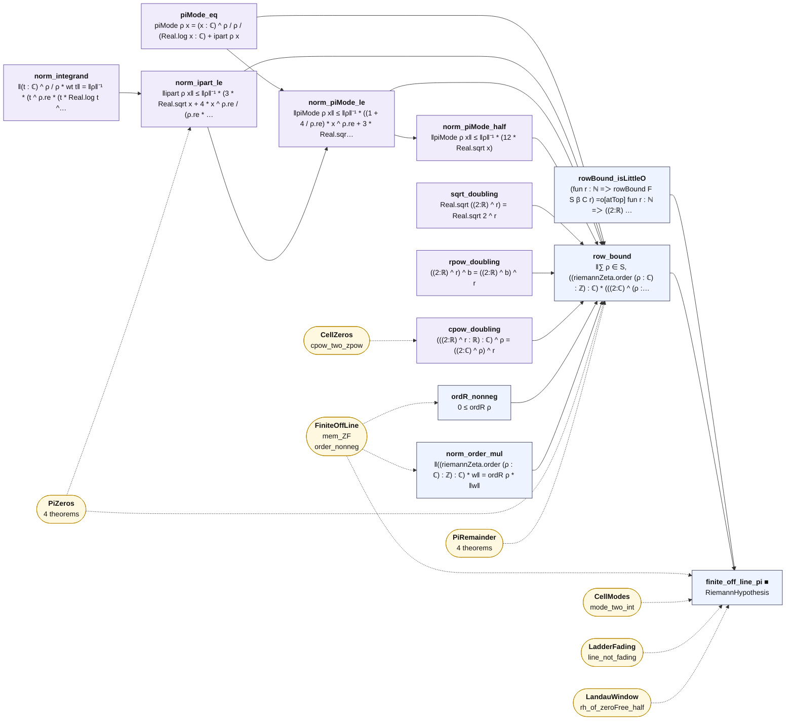

# `lean_stage3/Stage3/FiniteOffLinePi.lean`

FiniteOffLinePi — block J10e of `lean_stage3/design/joints.md`. 2026-11-23. The one-ladder converse for the count of primes, in the case of finitely many zeros off the line. Let a finite set hold every zero of ζ off the line. If the count of primes at the doublings `2^r` stays within `C·r²·√2^r` of `Li`, then no zero is off the line.

13 theorems, 3 definitions, 631 lines. Arrows are Lean's own record of what each proof uses.

**Imports:** [`CellModes`](../lean_stage3/CellModes.md), [`LadderFading`](../lean_stage3/LadderFading.md), [`LandauWindow`](../lean_stage3/LandauWindow.md), [`PiRemainder`](../lean_stage3/PiRemainder.md)  
**Imported by:** [`Stage3`](../lean_stage3/Stage3.md)

## The picture



An arrow A → B reads "A is used in the proof of B". Green: counting, integers only. Violet: shape, analysis with no ζ. Blue: reads ζ. A name ending in ■ is an end: nothing else uses it. Red: contains `sorry`. Yellow: theorems in another file, counted; a dotted arrow crosses files. Definitions are not drawn; they are listed below the diagram.

## Definitions

<a name="FiniteOffLinePi-ipart"></a>
### `FiniteOffLinePi.ipart`

def · line 50

The integral in one zero's part of the count.

- **Is:** `` ipart (ρ : ℂ) (x : ℝ) : ℂ := ∫ t in (2:ℝ)..x, (t : ℂ) ^ ρ / ρ * wt t ``
- **Built from:** [`PiZeros.wt`](../lean_stage3/PiZeros.md#PiZeros-wt)
- **Used by 4:** [`FiniteOffLinePi.norm_ipart_le`](#FiniteOffLinePi-norm_ipart_le), [`FiniteOffLinePi.norm_piMode_le`](#FiniteOffLinePi-norm_piMode_le), [`FiniteOffLinePi.piMode_eq`](#FiniteOffLinePi-piMode_eq), [`FiniteOffLinePi.row_bound`](#FiniteOffLinePi-row_bound)

<a name="FiniteOffLinePi-ordR"></a>
### `FiniteOffLinePi.ordR`

def · line 250

The order of a zero, as a real number.

- **Is:** `` ordR (ρ : NontrivialZeros) : ℝ := ((riemannZeta.order (ρ : ℂ) : ℤ) : ℝ) ``
- **Used by 5:** [`FiniteOffLinePi.norm_order_mul`](#FiniteOffLinePi-norm_order_mul), [`FiniteOffLinePi.ordR_nonneg`](#FiniteOffLinePi-ordR_nonneg), [`FiniteOffLinePi.rowBound`](#FiniteOffLinePi-rowBound), [`FiniteOffLinePi.rowBound_isLittleO`](#FiniteOffLinePi-rowBound_isLittleO), [`FiniteOffLinePi.row_bound`](#FiniteOffLinePi-row_bound)

<a name="FiniteOffLinePi-rowBound"></a>
### `FiniteOffLinePi.rowBound`

def · line 262

The bound on the top line's sum at row `r`.

- **Is:** `` rowBound (F S : Finset NontrivialZeros) (β C : ℝ) (r : ℕ) : ℝ := (C * Real.log 2 + Arem + 8 + 12 * (Mlow * 39000)) * ((r : ℝ) ^ 3 * Real.sqrt 2 ^ r) + ∑ ρ ∈ F \ S, ((ordR ρ * ‖(ρ : ℂ)‖⁻¹ * (1 + 4 / (ρ : ℂ).re)) * ((r : ℝ) ^ 3 * ((2:ℝ) ^ (ρ : ℂ).re) ^ r) + (3 * (ordR ρ * ‖(ρ : ℂ)‖⁻¹)) * ((r : ℝ) ^ 3 * Real.sqrt 2 ^ r)) + ∑ ρ ∈ S, ((3 * (ordR ρ * ‖(ρ : ℂ)‖⁻¹)) * ((r : ℝ) ^ 3 * Real.sqrt 2 ^ r) + (4 * (ordR ρ * ‖(ρ : ℂ)… ``
- **Built from:** [`FiniteOffLinePi.ordR`](#FiniteOffLinePi-ordR), [`PiRemainder.Arem`](../lean_stage3/PiRemainder.md#PiRemainder-Arem), [`PiRemainder.Mlow`](../lean_stage3/PiRemainder.md#PiRemainder-Mlow)
- **Used by 3:** [`FiniteOffLinePi.finite_off_line_pi`](#FiniteOffLinePi-finite_off_line_pi), [`FiniteOffLinePi.rowBound_isLittleO`](#FiniteOffLinePi-rowBound_isLittleO), [`FiniteOffLinePi.row_bound`](#FiniteOffLinePi-row_bound)

## Theorems

<a name="FiniteOffLinePi-piMode_eq"></a>
### `FiniteOffLinePi.piMode_eq`

line 53

**Shape.** Uses real or complex analysis; nothing in it or beneath it reads ζ.

**Why.** One zero's part of the count is `x^ρ/ρ` over `log x`, plus the integral.

**Proves**

```lean
piMode ρ x = (x : ℂ) ^ ρ / ρ / (Real.log x : ℂ) + ipart ρ x
```

**Needs** (its hypotheses)

  - `` ρ : ℂ ``
  - `` x : ℝ ``

**Stated with:** [`FiniteOffLinePi.ipart`](#FiniteOffLinePi-ipart), [`PiZeros.piMode`](../lean_stage3/PiZeros.md#PiZeros-piMode)

**Fed by:** no theorem of this repo; it stands on Mathlib and the definitions below.

**Feeds** (2 that use it)

  - [`FiniteOffLinePi.norm_piMode_le`](#FiniteOffLinePi-norm_piMode_le) — `` ‖piMode ρ x‖ ≤ ‖ρ‖⁻¹ * ((1 + 4 / ρ.re) * x ^ ρ.re + 3 * Real.sqrt x) ``
  - [`FiniteOffLinePi.row_bound`](#FiniteOffLinePi-row_bound) — `` ‖∑ ρ ∈ S, ((riemannZeta.order (ρ : ℂ) : ℤ) : ℂ) * (((2:ℂ) ^ (ρ : ℂ)) ^ r / (ρ : ℂ))‖ ≤ rowBound F S β C r ``

<a name="FiniteOffLinePi-norm_integrand"></a>
### `FiniteOffLinePi.norm_integrand`

line 57

**Shape.** Uses real or complex analysis; nothing in it or beneath it reads ζ.

**Why.** For `t ≥ 2` the integrand has size `t^b/(|ρ|·t·log²t)`, with `b` the real part.

**Proves**

```lean
‖(t : ℂ) ^ ρ / ρ * wt t‖ = ‖ρ‖⁻¹ * (t ^ ρ.re * (t * Real.log t ^ 2)⁻¹)
```

**Needs** (its hypotheses)

  - `` ρ : ℂ ``
  - `` ht : 2 ≤ t ``

**Stated with:** [`PiZeros.wt`](../lean_stage3/PiZeros.md#PiZeros-wt)

**Fed by:** no theorem of this repo; it stands on Mathlib and the definitions below.

**Feeds** (1 that use it)

  - [`FiniteOffLinePi.norm_ipart_le`](#FiniteOffLinePi-norm_ipart_le) — `` ‖ipart ρ x‖ ≤ ‖ρ‖⁻¹ * (3 * Real.sqrt x + 4 * x ^ ρ.re / (ρ.re * Real.log x ^ 2)) ``

<a name="FiniteOffLinePi-norm_ipart_le"></a>
### `FiniteOffLinePi.norm_ipart_le`

line 69

**Shape.** Uses real or complex analysis; nothing in it or beneath it reads ζ.

**Why.** The integral in one zero's part. For a real part `b` in `(0, 1]` and `x ≥ 4`, the integral is at most `(3√x + 4x^b/(b·log²x))/|ρ|`.

**Proves**

```lean
‖ipart ρ x‖ ≤ ‖ρ‖⁻¹ * (3 * Real.sqrt x + 4 * x ^ ρ.re / (ρ.re * Real.log x ^ 2))
```

**Needs** (its hypotheses)

  - `` hb0 : 0 < ρ.re ``
  - `` hb1 : ρ.re ≤ 1 ``
  - `` hx : 4 ≤ x ``

**Stated with:** [`FiniteOffLinePi.ipart`](#FiniteOffLinePi-ipart)

**Fed by** (3 theorems its proof uses)

  - [`FiniteOffLinePi.norm_integrand`](#FiniteOffLinePi-norm_integrand) — `` ‖(t : ℂ) ^ ρ / ρ * wt t‖ = ‖ρ‖⁻¹ * (t ^ ρ.re * (t * Real.log t ^ 2)⁻¹) ``
  - [`PiZeros.integrable_cpow`](../lean_stage3/PiZeros.md#PiZeros-integrable_cpow) (PiZeros) — `` IntervalIntegrable (fun t : ℝ => (t : ℂ) ^ ρ / ρ) volume 2 x ``
  - [`PiZeros.integrable_mul_wt`](../lean_stage3/PiZeros.md#PiZeros-integrable_mul_wt) (PiZeros) — `` IntervalIntegrable (fun t => f t * wt t) volume 2 x ``

**Definitions its proof touches:** [`PiZeros.wt`](../lean_stage3/PiZeros.md#PiZeros-wt)

**Feeds** (2 that use it)

  - [`FiniteOffLinePi.norm_piMode_le`](#FiniteOffLinePi-norm_piMode_le) — `` ‖piMode ρ x‖ ≤ ‖ρ‖⁻¹ * ((1 + 4 / ρ.re) * x ^ ρ.re + 3 * Real.sqrt x) ``
  - [`FiniteOffLinePi.row_bound`](#FiniteOffLinePi-row_bound) — `` ‖∑ ρ ∈ S, ((riemannZeta.order (ρ : ℂ) : ℤ) : ℂ) * (((2:ℂ) ^ (ρ : ℂ)) ^ r / (ρ : ℂ))‖ ≤ rowBound F S β C r ``

<a name="FiniteOffLinePi-norm_piMode_le"></a>
### `FiniteOffLinePi.norm_piMode_le`

line 187

**Shape.** Uses real or complex analysis; nothing in it or beneath it reads ζ.

**Why.** One zero's part of the count. For a real part `b` in `(0, 1]` and `x ≥ 4`, the part is at most `((1 + 4/b)·x^b + 3√x)/|ρ|`.

**Proves**

```lean
‖piMode ρ x‖ ≤ ‖ρ‖⁻¹ * ((1 + 4 / ρ.re) * x ^ ρ.re + 3 * Real.sqrt x)
```

**Needs** (its hypotheses)

  - `` hb0 : 0 < ρ.re ``
  - `` hb1 : ρ.re ≤ 1 ``
  - `` hx : 4 ≤ x ``

**Stated with:** [`PiZeros.piMode`](../lean_stage3/PiZeros.md#PiZeros-piMode)

**Fed by** (2 theorems its proof uses)

  - [`FiniteOffLinePi.norm_ipart_le`](#FiniteOffLinePi-norm_ipart_le) — `` ‖ipart ρ x‖ ≤ ‖ρ‖⁻¹ * (3 * Real.sqrt x + 4 * x ^ ρ.re / (ρ.re * Real.log x ^ 2)) ``
  - [`FiniteOffLinePi.piMode_eq`](#FiniteOffLinePi-piMode_eq) — `` piMode ρ x = (x : ℂ) ^ ρ / ρ / (Real.log x : ℂ) + ipart ρ x ``

**Definitions its proof touches:** [`FiniteOffLinePi.ipart`](#FiniteOffLinePi-ipart)

**Feeds** (2 that use it)

  - [`FiniteOffLinePi.norm_piMode_half`](#FiniteOffLinePi-norm_piMode_half) — `` ‖piMode ρ x‖ ≤ ‖ρ‖⁻¹ * (12 * Real.sqrt x) ``
  - [`FiniteOffLinePi.row_bound`](#FiniteOffLinePi-row_bound) — `` ‖∑ ρ ∈ S, ((riemannZeta.order (ρ : ℂ) : ℤ) : ℂ) * (((2:ℂ) ^ (ρ : ℂ)) ^ r / (ρ : ℂ))‖ ≤ rowBound F S β C r ``

<a name="FiniteOffLinePi-norm_piMode_half"></a>
### `FiniteOffLinePi.norm_piMode_half`

line 224

**Shape.** Uses real or complex analysis; nothing in it or beneath it reads ζ.

**Why.** One zero on the line. For real part `1/2` and `x ≥ 4`, the zero's part of the count is at most `12√x/|ρ|`.

**Proves**

```lean
‖piMode ρ x‖ ≤ ‖ρ‖⁻¹ * (12 * Real.sqrt x)
```

**Needs** (its hypotheses)

  - `` hre : ρ.re = 1 / 2 ``
  - `` hx : 4 ≤ x ``

**Stated with:** [`PiZeros.piMode`](../lean_stage3/PiZeros.md#PiZeros-piMode)

**Fed by** (1 theorem its proof uses)

  - [`FiniteOffLinePi.norm_piMode_le`](#FiniteOffLinePi-norm_piMode_le) — `` ‖piMode ρ x‖ ≤ ‖ρ‖⁻¹ * ((1 + 4 / ρ.re) * x ^ ρ.re + 3 * Real.sqrt x) ``

**Feeds** (1 that use it)

  - [`FiniteOffLinePi.row_bound`](#FiniteOffLinePi-row_bound) — `` ‖∑ ρ ∈ S, ((riemannZeta.order (ρ : ℂ) : ℤ) : ℂ) * (((2:ℂ) ^ (ρ : ℂ)) ^ r / (ρ : ℂ))‖ ≤ rowBound F S β C r ``

<a name="FiniteOffLinePi-sqrt_doubling"></a>
### `FiniteOffLinePi.sqrt_doubling`

line 232

**Shape.** Uses real or complex analysis; nothing in it or beneath it reads ζ.

**Why.** The square root of `2^r` is `√2^r`.

**Proves**

```lean
Real.sqrt ((2:ℝ) ^ r) = Real.sqrt 2 ^ r
```

**Needs** (its hypotheses)

  - `` r : ℕ ``

**Fed by:** no theorem of this repo; it stands on Mathlib.

**Feeds** (1 that use it)

  - [`FiniteOffLinePi.row_bound`](#FiniteOffLinePi-row_bound) — `` ‖∑ ρ ∈ S, ((riemannZeta.order (ρ : ℂ) : ℤ) : ℂ) * (((2:ℂ) ^ (ρ : ℂ)) ^ r / (ρ : ℂ))‖ ≤ rowBound F S β C r ``

<a name="FiniteOffLinePi-rpow_doubling"></a>
### `FiniteOffLinePi.rpow_doubling`

line 238

**Shape.** Uses real or complex analysis; nothing in it or beneath it reads ζ.

**Why.** The real power `b` of `2^r` is `(2^b)^r`.

**Proves**

```lean
((2:ℝ) ^ r) ^ b = ((2:ℝ) ^ b) ^ r
```

**Needs** (its hypotheses)

  - `` r : ℕ ``
  - `` b : ℝ ``

**Fed by:** no theorem of this repo; it stands on Mathlib.

**Feeds** (1 that use it)

  - [`FiniteOffLinePi.row_bound`](#FiniteOffLinePi-row_bound) — `` ‖∑ ρ ∈ S, ((riemannZeta.order (ρ : ℂ) : ℤ) : ℂ) * (((2:ℂ) ^ (ρ : ℂ)) ^ r / (ρ : ℂ))‖ ≤ rowBound F S β C r ``

<a name="FiniteOffLinePi-cpow_doubling"></a>
### `FiniteOffLinePi.cpow_doubling`

line 244

**Shape.** Uses real or complex analysis; nothing in it or beneath it reads ζ.

**Why.** The complex power `ρ` of `2^r` is `(2^ρ)^r`.

**Proves**

```lean
(((2:ℝ) ^ r : ℝ) : ℂ) ^ ρ = ((2:ℂ) ^ ρ) ^ r
```

**Needs** (its hypotheses)

  - `` r : ℕ ``
  - `` ρ : ℂ ``

**Fed by** (1 theorem its proof uses)

  - [`CellZeros.cpow_two_zpow`](../lean_stage3/CellZeros.md#CellZeros-cpow_two_zpow) (CellZeros) — `` (((2:ℝ) ^ n : ℝ) : ℂ) ^ ρ = ((2:ℂ) ^ ρ) ^ n ``

**Feeds** (1 that use it)

  - [`FiniteOffLinePi.row_bound`](#FiniteOffLinePi-row_bound) — `` ‖∑ ρ ∈ S, ((riemannZeta.order (ρ : ℂ) : ℤ) : ℂ) * (((2:ℂ) ^ (ρ : ℂ)) ^ r / (ρ : ℂ))‖ ≤ rowBound F S β C r ``

<a name="FiniteOffLinePi-ordR_nonneg"></a>
### `FiniteOffLinePi.ordR_nonneg`

line 253

**Reads ζ.** It, or something it rests on, uses the zeta function, its zeros or the Riemann hypothesis.

**Why.** The order of a zero is nonnegative.

**Proves**

```lean
0 ≤ ordR ρ
```

**Needs** (its hypotheses)

  - `` ρ : NontrivialZeros ``

**Stated with:** [`FiniteOffLinePi.ordR`](#FiniteOffLinePi-ordR)

**Fed by** (1 theorem its proof uses)

  - [`FiniteOffLine.order_nonneg`](../lean_stage3/FiniteOffLine.md#FiniteOffLine-order_nonneg) (FiniteOffLine) — `` (0 : ℝ) ≤ ((riemannZeta.order (ρ : ℂ) : ℤ) : ℝ) ``

**Feeds** (1 that use it)

  - [`FiniteOffLinePi.row_bound`](#FiniteOffLinePi-row_bound) — `` ‖∑ ρ ∈ S, ((riemannZeta.order (ρ : ℂ) : ℤ) : ℂ) * (((2:ℂ) ^ (ρ : ℂ)) ^ r / (ρ : ℂ))‖ ≤ rowBound F S β C r ``

<a name="FiniteOffLinePi-norm_order_mul"></a>
### `FiniteOffLinePi.norm_order_mul`

line 256

**Reads ζ.** It, or something it rests on, uses the zeta function, its zeros or the Riemann hypothesis.

**Why.** The order of a zero, as a factor, multiplies the size by the order.

**Proves**

```lean
‖((riemannZeta.order (ρ : ℂ) : ℤ) : ℂ) * w‖ = ordR ρ * ‖w‖
```

**Needs** (its hypotheses)

  - `` ρ : NontrivialZeros ``
  - `` w : ℂ ``

**Stated with:** [`FiniteOffLinePi.ordR`](#FiniteOffLinePi-ordR)

**Fed by** (1 theorem its proof uses)

  - [`FiniteOffLine.order_nonneg`](../lean_stage3/FiniteOffLine.md#FiniteOffLine-order_nonneg) (FiniteOffLine) — `` (0 : ℝ) ≤ ((riemannZeta.order (ρ : ℂ) : ℤ) : ℝ) ``

**Feeds** (1 that use it)

  - [`FiniteOffLinePi.row_bound`](#FiniteOffLinePi-row_bound) — `` ‖∑ ρ ∈ S, ((riemannZeta.order (ρ : ℂ) : ℤ) : ℂ) * (((2:ℂ) ^ (ρ : ℂ)) ^ r / (ρ : ℂ))‖ ≤ rowBound F S β C r ``

<a name="FiniteOffLinePi-rowBound_isLittleO"></a>
### `FiniteOffLinePi.rowBound_isLittleO`

line 272

**Reads ζ.** It, or something it rests on, uses the zeta function, its zeros or the Riemann hypothesis.

**Why.** The row's bound is small against the top line. If `β > 1/2` and every zero of `F \ S` has real part below `β`, the bound is `o((2^β)^r)`.

**Proves**

```lean
(fun r : ℕ => rowBound F S β C r) =o[atTop] fun r : ℕ => ((2:ℝ) ^ β) ^ r
```

**Needs** (its hypotheses)

  - `` F S : Finset NontrivialZeros ``
  - `` hβ : 1 / 2 < β ``
  - `` hlt : ∀ ρ ∈ F \ S, (ρ : ℂ).re < β ``
  - `` C : ℝ ``

**Stated with:** [`FiniteOffLinePi.rowBound`](#FiniteOffLinePi-rowBound)

**Fed by:** no theorem of this repo; it stands on Mathlib and the definitions below.

**Definitions its proof touches:** [`FiniteOffLinePi.ordR`](#FiniteOffLinePi-ordR), [`PiRemainder.Arem`](../lean_stage3/PiRemainder.md#PiRemainder-Arem), [`PiRemainder.Mlow`](../lean_stage3/PiRemainder.md#PiRemainder-Mlow)

**Feeds** (1 that use it)

  - [`FiniteOffLinePi.finite_off_line_pi`](#FiniteOffLinePi-finite_off_line_pi) — `` RiemannHypothesis ``

<a name="FiniteOffLinePi-row_bound"></a>
### `FiniteOffLinePi.row_bound`

line 312

**Reads ζ.** It, or something it rests on, uses the zeta function, its zeros or the Riemann hypothesis.

**Why.** The top line's sum at one row. Let `S ⊆ F` have real part `β`, let `F` hold every zero off the line and lie below `2^r`, with `r ≥ 8`. If the count of primes at `2^r` is within `C·r²·√2^r` of `Li`, the sum `Σ_{ρ∈S} m(ρ)·(2^ρ)^r/ρ` is at most `rowBound F S β C r`.

**Proves**

```lean
‖∑ ρ ∈ S, ((riemannZeta.order (ρ : ℂ) : ℤ) : ℂ) * (((2:ℂ) ^ (ρ : ℂ)) ^ r / (ρ : ℂ))‖ ≤ rowBound F S β C r
```

**Needs** (its hypotheses)

  - `` F S : Finset NontrivialZeros ``
  - `` hSF : S ⊆ F ``
  - `` hSβ : ∀ ρ ∈ S, (ρ : ℂ).re = β ``
  - `` hF : ∀ ρ : NontrivialZeros, (ρ : ℂ).re ≠ 1 / 2 → ρ ∈ F ``
  - `` C : ℝ ``
  - `` hr : 8 ≤ r ``
  - `` hFr : F ⊆ ZF ((2:ℝ) ^ r) ``
  - `` hrow : |(Nat.primeCounting ⌊(2:ℝ) ^ r⌋₊ : ℝ) - Stage3.Li ((2:ℝ) ^ r)| ≤ C * (r : ℝ) ^ 2 * Real.sqrt 2 ^ r ``

**Stated with:** [`FiniteOffLine.ZF`](../lean_stage3/FiniteOffLine.md#FiniteOffLine-ZF), [`FiniteOffLinePi.rowBound`](#FiniteOffLinePi-rowBound), [`Stage3.Li`](../lean_stage3/PsiToPi.md#Stage3-Li)

**Fed by** (15 theorems its proof uses)

  - [`FiniteOffLinePi.cpow_doubling`](#FiniteOffLinePi-cpow_doubling) — `` (((2:ℝ) ^ r : ℝ) : ℂ) ^ ρ = ((2:ℂ) ^ ρ) ^ r ``
  - [`FiniteOffLinePi.norm_ipart_le`](#FiniteOffLinePi-norm_ipart_le) — `` ‖ipart ρ x‖ ≤ ‖ρ‖⁻¹ * (3 * Real.sqrt x + 4 * x ^ ρ.re / (ρ.re * Real.log x ^ 2)) ``
  - [`FiniteOffLinePi.norm_order_mul`](#FiniteOffLinePi-norm_order_mul) — `` ‖((riemannZeta.order (ρ : ℂ) : ℤ) : ℂ) * w‖ = ordR ρ * ‖w‖ ``
  - [`FiniteOffLinePi.norm_piMode_half`](#FiniteOffLinePi-norm_piMode_half) — `` ‖piMode ρ x‖ ≤ ‖ρ‖⁻¹ * (12 * Real.sqrt x) ``
  - [`FiniteOffLinePi.norm_piMode_le`](#FiniteOffLinePi-norm_piMode_le) — `` ‖piMode ρ x‖ ≤ ‖ρ‖⁻¹ * ((1 + 4 / ρ.re) * x ^ ρ.re + 3 * Real.sqrt x) ``
  - [`FiniteOffLinePi.ordR_nonneg`](#FiniteOffLinePi-ordR_nonneg) — `` 0 ≤ ordR ρ ``
  - [`FiniteOffLinePi.piMode_eq`](#FiniteOffLinePi-piMode_eq) — `` piMode ρ x = (x : ℂ) ^ ρ / ρ / (Real.log x : ℂ) + ipart ρ x ``
  - [`FiniteOffLinePi.rpow_doubling`](#FiniteOffLinePi-rpow_doubling) — `` ((2:ℝ) ^ r) ^ b = ((2:ℝ) ^ b) ^ r ``
  - [`FiniteOffLinePi.sqrt_doubling`](#FiniteOffLinePi-sqrt_doubling) — `` Real.sqrt ((2:ℝ) ^ r) = Real.sqrt 2 ^ r ``
  - [`PiRemainder.Arem_nonneg`](../lean_stage3/PiRemainder.md#PiRemainder-Arem_nonneg) (PiRemainder) — `` 0 ≤ Arem ``
  - [`PiRemainder.norm_tr_efRem_le_of`](../lean_stage3/PiRemainder.md#PiRemainder-norm_tr_efRem_le_of) (PiRemainder) — `` ‖tr (efRem x) x‖ ≤ Arem * Real.sqrt x * Real.log x ^ 2 ``
  - [`PiRemainder.two_le_Mlow`](../lean_stage3/PiRemainder.md#PiRemainder-two_le_Mlow) (PiRemainder) — `` 2 ≤ Mlow ``
  - [`PiRemainder.zinv_le_log`](../lean_stage3/PiRemainder.md#PiRemainder-zinv_le_log) (PiRemainder) — `` zinv x ≤ Mlow * 39000 * Real.log x ^ 2 ``
  - [`PiZeros.norm_tr_psiTheta_le`](../lean_stage3/PiZeros.md#PiZeros-norm_tr_psiTheta_le) (PiZeros) — `` ‖tr psiTheta x‖ ≤ 8 * Real.sqrt x ``
  - [`PiZeros.pi_eq_zero_sum`](../lean_stage3/PiZeros.md#PiZeros-pi_eq_zero_sum) (PiZeros) — `` (((Nat.primeCounting ⌊x⌋₊ : ℝ) - Stage3.Li x : ℝ) : ℂ) = -∑ ρ ∈ ZF T, ((riemannZeta.order (ρ : ℂ) : ℤ) : ℂ) * piMode (ρ : ℂ) x + tr (efRem T) x - tr p… ``

**Definitions its proof touches:** [`FiniteOffLinePi.ipart`](#FiniteOffLinePi-ipart), [`FiniteOffLinePi.ordR`](#FiniteOffLinePi-ordR), [`PiRemainder.Arem`](../lean_stage3/PiRemainder.md#PiRemainder-Arem), [`PiRemainder.Mlow`](../lean_stage3/PiRemainder.md#PiRemainder-Mlow), [`PiRemainder.zinv`](../lean_stage3/PiRemainder.md#PiRemainder-zinv), [`PiZeros.efRem`](../lean_stage3/PiZeros.md#PiZeros-efRem), [`PiZeros.piMode`](../lean_stage3/PiZeros.md#PiZeros-piMode), [`PiZeros.psiTheta`](../lean_stage3/PiZeros.md#PiZeros-psiTheta), [`PiZeros.tr`](../lean_stage3/PiZeros.md#PiZeros-tr)

**Feeds** (1 that use it)

  - [`FiniteOffLinePi.finite_off_line_pi`](#FiniteOffLinePi-finite_off_line_pi) — `` RiemannHypothesis ``

<a name="FiniteOffLinePi-finite_off_line_pi"></a>
### `FiniteOffLinePi.finite_off_line_pi`

line 543

**Reads ζ.** It, or something it rests on, uses the zeta function, its zeros or the Riemann hypothesis.

**Why.** Finitely many zeros off the line, and the count of primes of square-root size at the doublings: then no zero is off the line. Let a finite set hold every zero of ζ off the line. If the count of primes at `2^r` stays within `C·r²·√2^r` of `Li` from some row on, the Riemann hypothesis holds.

**Proves**

```lean
RiemannHypothesis
```

**Needs** (its hypotheses)

  - `` F : Finset NontrivialZeros ``
  - `` hF : ∀ ρ : NontrivialZeros, (ρ : ℂ).re ≠ 1 / 2 → ρ ∈ F ``
  - `` C : ℝ ``
  - `` hrows : ∀ᶠ r : ℕ in atTop, |(Nat.primeCounting ⌊(2:ℝ) ^ r⌋₊ : ℝ) - Stage3.Li ((2:ℝ) ^ r)| ≤ C * (r : ℝ) ^ 2 * Real.sqrt 2 ^ r ``

**Stated with:** [`Stage3.Li`](../lean_stage3/PsiToPi.md#Stage3-Li)

**Fed by** (6 theorems its proof uses)

  - [`CellModes.mode_two_int`](../lean_stage3/CellModes.md#CellModes-mode_two_int) (CellModes) — `` Chain.mode 2 ρ (r : ℂ) = ((2:ℂ) ^ ρ) ^ r ``
  - [`FiniteOffLine.mem_ZF`](../lean_stage3/FiniteOffLine.md#FiniteOffLine-mem_ZF) (FiniteOffLine) — `` ρ ∈ ZF T ↔ |(ρ : ℂ).im| < T ``
  - [`FiniteOffLinePi.rowBound_isLittleO`](#FiniteOffLinePi-rowBound_isLittleO) — `` (fun r : ℕ => rowBound F S β C r) =o[atTop] fun r : ℕ => ((2:ℝ) ^ β) ^ r ``
  - [`FiniteOffLinePi.row_bound`](#FiniteOffLinePi-row_bound) — `` ‖∑ ρ ∈ S, ((riemannZeta.order (ρ : ℂ) : ℤ) : ℂ) * (((2:ℂ) ^ (ρ : ℂ)) ^ r / (ρ : ℂ))‖ ≤ rowBound F S β C r ``
  - [`LadderFading.line_not_fading`](../lean_stage3/LadderFading.md#LadderFading-line_not_fading) (LadderFading) — `` ¬ Tendsto (fun r : ℕ => (∑ ρ ∈ S, (((riemannZeta.order (ρ : ℂ) : ℤ) : ℂ)) / (ρ : ℂ) * Chain.Sym 2 (ρ : ℂ) ^ d * Chain.mode 2 (ρ : ℂ) (((r : ℤ)) : ℂ)) … ``
  - [`LandauWindow.rh_of_zeroFree_half`](../lean_stage3/LandauWindow.md#LandauWindow-rh_of_zeroFree_half) (LandauWindow) — `` RiemannHypothesis ``

**Definitions its proof touches:** [`Chain.Sym`](../lean/Chain.md#Chain-Sym), [`Chain.mode`](../lean/Chain.md#Chain-mode), [`FiniteOffLine.ZF`](../lean_stage3/FiniteOffLine.md#FiniteOffLine-ZF), [`FiniteOffLinePi.rowBound`](#FiniteOffLinePi-rowBound)

**Feeds:** nothing. It is an end.

