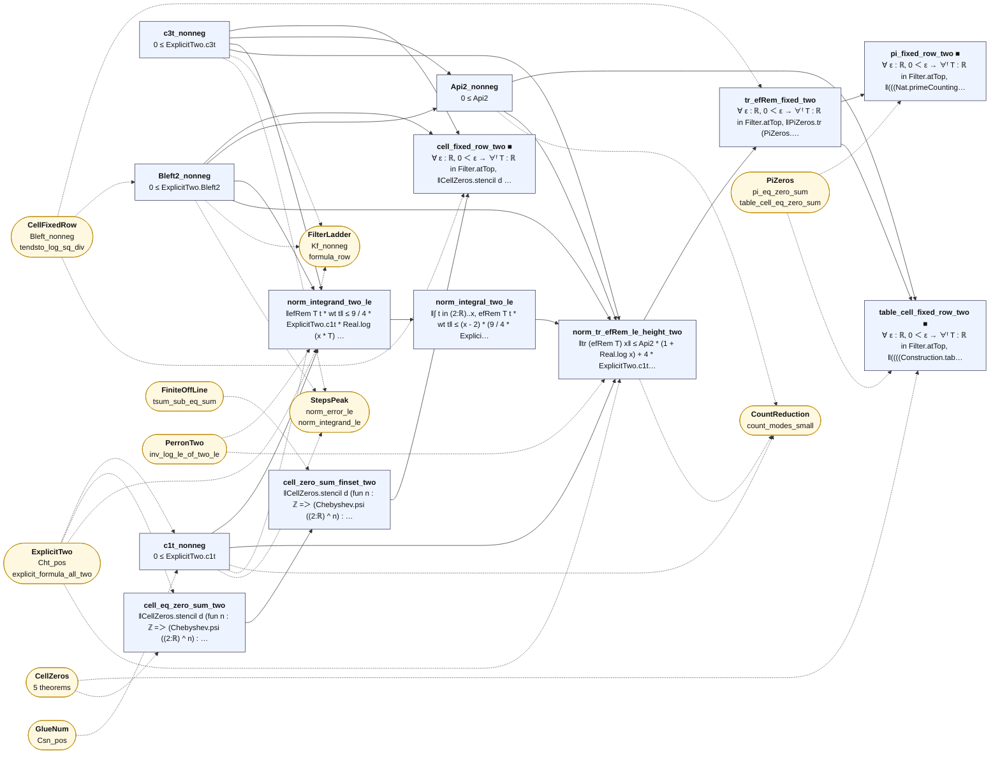

# `lean_stage3/Stage3/FixedRowTwo.lean`

> **Read from the source text.** This file changed after the last `python3 utilities/lean_map.py --dump`, so the arrows on this page are names occurring in each proof and have not been confirmed by Lean.

FixedRowTwo — block G3 of `lean_stage3/design/floor.md`. 2026-11-23. The fixed-row theorems of `CellFixedRow` and `PiFixedRow` restated on `ExplicitTwo.explicit_formula_all_two`, the explicit formula at every height from `x = 2`. The originals read `LeftSmooth.explicit_formula_all` and carry its floor (`r ≥ d + 4`, `r ≥ d + 6`, `x ≥ 16`). Here every row the cell's identity reads is at least `2`, so the theorems hold at every row where the identity holds. For the count the whole integral `∫₂ˣ` is read from the formu…

13 theorems, 1 definition, 495 lines. 

**Imports:** [`ExplicitTwo`](../lean_stage3/ExplicitTwo.md), [`PiFixedRow`](../lean_stage3/PiFixedRow.md)  
**Imported by:** [`Stage3`](../lean_stage3/Stage3.md), [`CountReduction`](../lean_stage3/CountReduction.md), [`FilterLadder`](../lean_stage3/FilterLadder.md), [`StepsPeak`](../lean_stage3/StepsPeak.md)

## The picture



An arrow A → B reads "A is used in the proof of B". Green: counting, integers only. Violet: shape, analysis with no ζ. Blue: reads ζ. A name ending in ■ is an end: nothing else uses it. Red: contains `sorry`. Yellow: theorems in another file, counted; a dotted arrow crosses files. Definitions are not drawn; they are listed below the diagram.

## Definitions

<a name="FixedRowTwo-Api2"></a>
### `FixedRowTwo.Api2`

def · line 216

The constant of the count at a fixed row from `x = 2`: `(3/2)·c3t + (9/4)·Bleft2`. The factors are `1/log t ≤ 3/2` and `1/log²t ≤ 9/4` on `t ≥ 2`.

- **Is:** `` Api2 : ℝ := 3 / 2 * ExplicitTwo.c3t + 9 / 4 * ExplicitTwo.Bleft2 ``
- **Built from:** [`ExplicitTwo.Bleft2`](../lean_stage3/ExplicitTwo.md#ExplicitTwo-Bleft2), [`ExplicitTwo.c3t`](../lean_stage3/ExplicitTwo.md#ExplicitTwo-c3t)
- **Used by 8:** [`CountReduction.count_modes_small`](../lean_stage3/CountReduction.md#CountReduction-count_modes_small), [`FixedRowTwo.Api2_nonneg`](#FixedRowTwo-Api2_nonneg), [`FixedRowTwo.norm_integral_two_le`](#FixedRowTwo-norm_integral_two_le), [`FixedRowTwo.norm_integrand_two_le`](#FixedRowTwo-norm_integrand_two_le), [`FixedRowTwo.norm_tr_efRem_le_height_two`](#FixedRowTwo-norm_tr_efRem_le_height_two), [`FixedRowTwo.pi_fixed_row_two`](#FixedRowTwo-pi_fixed_row_two), [`FixedRowTwo.table_cell_fixed_row_two`](#FixedRowTwo-table_cell_fixed_row_two), [`FixedRowTwo.tr_efRem_fixed_two`](#FixedRowTwo-tr_efRem_fixed_two)

## Theorems

<a name="FixedRowTwo-c1t_nonneg"></a>
### `FixedRowTwo.c1t_nonneg`

line 44 · arrows read from text

**Reads ζ.** It, or something it rests on, uses the zeta function, its zeros or the Riemann hypothesis.

**Why.** The first constant of the formula from `x = 2` is nonnegative.

**Proves**

```lean
0 ≤ ExplicitTwo.c1t
```

**Fed by** (2 theorems its proof uses)

  - [`ExplicitTwo.Cht_pos`](../lean_stage3/ExplicitTwo.md#ExplicitTwo-Cht_pos) (ExplicitTwo) — `` 0 < Cht ``
  - [`Glue.Csn_pos`](../lean_stage3/GlueNum.md#Glue-Csn_pos) (GlueNum) — `` 0 < Csn ``

**Definitions its proof touches:** [`ExplicitTwo.c1t`](../lean_stage3/ExplicitTwo.md#ExplicitTwo-c1t)

**Feeds** (7 that use it)

  - [`CountReduction.count_modes_small`](../lean_stage3/CountReduction.md#CountReduction-count_modes_small) (CountReduction) — `` ∃ E A : ℝ, σ ≤ E ∧ E < Θ ∧ ∀ k : ℕ, 2 ≤ k → ‖∑' ρ : {ρ : Kadiri.NontrivialZeros // σ ≤ (ρ:ℂ).re}, ((riemannZeta.order ((ρ:Kadiri.NontrivialZeros):ℂ) :… ``
  - [`FilterLadder.Kf_nonneg`](../lean_stage3/FilterLadder.md#FilterLadder-Kf_nonneg) (FilterLadder) — `` 0 ≤ Kf ``
  - [`FilterLadder.formula_row`](../lean_stage3/FilterLadder.md#FilterLadder-formula_row) (FilterLadder) — `` ‖ladder k + ∑ ρ ∈ ZF ((2:ℝ) ^ n), wz ρ * ((2:ℂ) ^ (ρ : ℂ)) ^ k‖ ≤ Kf * (n:ℝ) ^ 2 ``
  - [`FixedRowTwo.norm_integrand_two_le`](#FixedRowTwo-norm_integrand_two_le) — `` ‖efRem T t * wt t‖ ≤ 9 / 4 * ExplicitTwo.c1t * Real.log (x * T) ^ 2 / T + Api2 * t⁻¹ ``
  - [`FixedRowTwo.norm_tr_efRem_le_height_two`](#FixedRowTwo-norm_tr_efRem_le_height_two) — `` ‖tr (efRem T) x‖ ≤ Api2 * (1 + Real.log x) + 4 * ExplicitTwo.c1t * x * Real.log (x * T) ^ 2 / T ``
  - [`StepsPeak.norm_error_le`](../lean_stage3/StepsPeak.md#StepsPeak-norm_error_le) (StepsPeak) — `` ‖∫ u in (2:ℝ)..(N:ℝ), slope N s u * PiZeros.efRem T u‖ ≤ (‖s‖ + ‖s - 1‖) * (ExplicitTwo.c1t * N * Real.log ((N:ℝ) * T) ^ 2 / T + C1 s.re) ``
  - [`StepsPeak.norm_integrand_le`](../lean_stage3/StepsPeak.md#StepsPeak-norm_integrand_le) (StepsPeak) — `` ‖slope N s u * PiZeros.efRem T u‖ ≤ (‖s‖ + ‖s - 1‖) * (ExplicitTwo.c1t * Real.log ((N:ℝ) * T) ^ 2 / T + (ExplicitTwo.c3t * (2 / s.re) + ExplicitTwo.Bl… ``

<a name="FixedRowTwo-c3t_nonneg"></a>
### `FixedRowTwo.c3t_nonneg`

line 51 · arrows read from text

**Reads ζ.** It, or something it rests on, uses the zeta function, its zeros or the Riemann hypothesis.

**Why.** The logarithmic constant of the formula from `x = 2` is nonnegative.

**Proves**

```lean
0 ≤ ExplicitTwo.c3t
```

**Fed by:** no theorem of this repo; it stands on Mathlib and the definitions below.

**Definitions its proof touches:** [`ExplicitTwo.c3t`](../lean_stage3/ExplicitTwo.md#ExplicitTwo-c3t)

**Feeds** (8 that use it)

  - [`FilterLadder.Kf_nonneg`](../lean_stage3/FilterLadder.md#FilterLadder-Kf_nonneg) (FilterLadder) — `` 0 ≤ Kf ``
  - [`FilterLadder.formula_row`](../lean_stage3/FilterLadder.md#FilterLadder-formula_row) (FilterLadder) — `` ‖ladder k + ∑ ρ ∈ ZF ((2:ℝ) ^ n), wz ρ * ((2:ℂ) ^ (ρ : ℂ)) ^ k‖ ≤ Kf * (n:ℝ) ^ 2 ``
  - [`FixedRowTwo.Api2_nonneg`](#FixedRowTwo-Api2_nonneg) — `` 0 ≤ Api2 ``
  - [`FixedRowTwo.cell_fixed_row_two`](#FixedRowTwo-cell_fixed_row_two) — `` ∀ ε : ℝ, 0 < ε → ∀ᶠ T : ℝ in Filter.atTop, ‖CellZeros.stencil d (fun n : ℤ => (Chebyshev.psi ((2:ℝ) ^ n) : ℂ)) (r : ℤ) - (2:ℂ) ^ (r : ℤ) * (1 - (2:ℂ)⁻… ``
  - [`FixedRowTwo.norm_integrand_two_le`](#FixedRowTwo-norm_integrand_two_le) — `` ‖efRem T t * wt t‖ ≤ 9 / 4 * ExplicitTwo.c1t * Real.log (x * T) ^ 2 / T + Api2 * t⁻¹ ``
  - [`FixedRowTwo.norm_tr_efRem_le_height_two`](#FixedRowTwo-norm_tr_efRem_le_height_two) — `` ‖tr (efRem T) x‖ ≤ Api2 * (1 + Real.log x) + 4 * ExplicitTwo.c1t * x * Real.log (x * T) ^ 2 / T ``
  - [`StepsPeak.norm_error_le`](../lean_stage3/StepsPeak.md#StepsPeak-norm_error_le) (StepsPeak) — `` ‖∫ u in (2:ℝ)..(N:ℝ), slope N s u * PiZeros.efRem T u‖ ≤ (‖s‖ + ‖s - 1‖) * (ExplicitTwo.c1t * N * Real.log ((N:ℝ) * T) ^ 2 / T + C1 s.re) ``
  - [`StepsPeak.norm_integrand_le`](../lean_stage3/StepsPeak.md#StepsPeak-norm_integrand_le) (StepsPeak) — `` ‖slope N s u * PiZeros.efRem T u‖ ≤ (‖s‖ + ‖s - 1‖) * (ExplicitTwo.c1t * Real.log ((N:ℝ) * T) ^ 2 / T + (ExplicitTwo.c3t * (2 / s.re) + ExplicitTwo.Bl… ``

<a name="FixedRowTwo-Bleft2_nonneg"></a>
### `FixedRowTwo.Bleft2_nonneg`

line 58 · arrows read from text

**Reads ζ.** It, or something it rests on, uses the zeta function, its zeros or the Riemann hypothesis.

**Why.** The left-edge constant from `x = 2` is nonnegative: it is four times `Bleft`.

**Proves**

```lean
0 ≤ ExplicitTwo.Bleft2
```

**Fed by** (1 theorem its proof uses)

  - [`CellFixedRow.Bleft_nonneg`](../lean_stage3/CellFixedRow.md#CellFixedRow-Bleft_nonneg) (CellFixedRow) — `` 0 ≤ LeftSmooth.Bleft ``

**Definitions its proof touches:** [`ExplicitTwo.Bleft2`](../lean_stage3/ExplicitTwo.md#ExplicitTwo-Bleft2)

**Feeds** (8 that use it)

  - [`FilterLadder.Kf_nonneg`](../lean_stage3/FilterLadder.md#FilterLadder-Kf_nonneg) (FilterLadder) — `` 0 ≤ Kf ``
  - [`FilterLadder.formula_row`](../lean_stage3/FilterLadder.md#FilterLadder-formula_row) (FilterLadder) — `` ‖ladder k + ∑ ρ ∈ ZF ((2:ℝ) ^ n), wz ρ * ((2:ℂ) ^ (ρ : ℂ)) ^ k‖ ≤ Kf * (n:ℝ) ^ 2 ``
  - [`FixedRowTwo.Api2_nonneg`](#FixedRowTwo-Api2_nonneg) — `` 0 ≤ Api2 ``
  - [`FixedRowTwo.cell_fixed_row_two`](#FixedRowTwo-cell_fixed_row_two) — `` ∀ ε : ℝ, 0 < ε → ∀ᶠ T : ℝ in Filter.atTop, ‖CellZeros.stencil d (fun n : ℤ => (Chebyshev.psi ((2:ℝ) ^ n) : ℂ)) (r : ℤ) - (2:ℂ) ^ (r : ℤ) * (1 - (2:ℂ)⁻… ``
  - [`FixedRowTwo.norm_integrand_two_le`](#FixedRowTwo-norm_integrand_two_le) — `` ‖efRem T t * wt t‖ ≤ 9 / 4 * ExplicitTwo.c1t * Real.log (x * T) ^ 2 / T + Api2 * t⁻¹ ``
  - [`FixedRowTwo.norm_tr_efRem_le_height_two`](#FixedRowTwo-norm_tr_efRem_le_height_two) — `` ‖tr (efRem T) x‖ ≤ Api2 * (1 + Real.log x) + 4 * ExplicitTwo.c1t * x * Real.log (x * T) ^ 2 / T ``
  - [`StepsPeak.norm_error_le`](../lean_stage3/StepsPeak.md#StepsPeak-norm_error_le) (StepsPeak) — `` ‖∫ u in (2:ℝ)..(N:ℝ), slope N s u * PiZeros.efRem T u‖ ≤ (‖s‖ + ‖s - 1‖) * (ExplicitTwo.c1t * N * Real.log ((N:ℝ) * T) ^ 2 / T + C1 s.re) ``
  - [`StepsPeak.norm_integrand_le`](../lean_stage3/StepsPeak.md#StepsPeak-norm_integrand_le) (StepsPeak) — `` ‖slope N s u * PiZeros.efRem T u‖ ≤ (‖s‖ + ‖s - 1‖) * (ExplicitTwo.c1t * Real.log ((N:ℝ) * T) ^ 2 / T + (ExplicitTwo.c3t * (2 / s.re) + ExplicitTwo.Bl… ``

<a name="FixedRowTwo-cell_eq_zero_sum_two"></a>
### `FixedRowTwo.cell_eq_zero_sum_two`

line 67 · arrows read from text

**Reads ζ.** It, or something it rests on, uses the zeta function, its zeros or the Riemann hypothesis.

**Why.** The cell as a sum over the zeros, at every height, from row value `2`. For `2 ≤ 2^(r−d)` and any `T ≥ 2`, the cell at row `r`, depth `d`, minus its main term, plus the sum over the zeros below `T`, has norm at most the stencil of the error of the explicit formula from `x = 2`, read on the `d + 1` rows the stencil touches.

**Proves**

```lean
‖CellZeros.stencil d (fun n : ℤ => (Chebyshev.psi ((2:ℝ) ^ n) : ℂ)) r - (2:ℂ) ^ r * (1 - (2:ℂ)⁻¹) ^ d + ∑' ρ : {ρ : Kadiri.NontrivialZeros // |(ρ : ℂ).im| < T}, ((riemannZeta.order ((ρ : Kadiri.NontrivialZeros) : ℂ) : ℤ) : ℂ) * (((2:ℂ) ^ ((ρ : Kadiri.NontrivialZeros) : ℂ)) ^ r * (1 - ((2:ℂ) ^ ((ρ : Kadiri.NontrivialZeros) : ℂ))⁻¹) ^ d / ((ρ : Kadiri.NontrivialZeros) : ℂ))‖ ≤ ∑ j ∈ range (d + 1), (d.choose j : ℝ) * (ExplicitTwo.c1t * (2:ℝ) ^ (r - (j : ℤ)) * Real.log ((2:ℝ) ^ (r - (j : ℤ)) * T) ^ 2 / T + ExplicitTwo.c3t * Real.log ((2:ℝ) ^ (r - (j : ℤ))) + ExplicitTwo.Bleft2 * ((2:ℝ) ^ (r - (j : ℤ))) ^ (-(1:ℝ) / 4))
```

**Needs** (its hypotheses)

  - `` d : ℕ ``
  - `` r : ℤ ``
  - `` h2 : 2 ≤ (2:ℝ) ^ (r - (d : ℤ)) ``
  - `` hT : 2 ≤ T ``

**Fed by** (6 theorems its proof uses)

  - [`CellZeros.norm_stencil_le`](../lean_stage3/CellZeros.md#CellZeros-norm_stencil_le) (CellZeros) — `` ‖stencil d a r‖ ≤ ∑ j ∈ range (d + 1), (d.choose j : ℝ) * B j ``
  - [`CellZeros.stencil_add`](../lean_stage3/CellZeros.md#CellZeros-stencil_add) (CellZeros) — `` stencil d (fun n => a n + b n) r = stencil d a r + stencil d b r ``
  - [`CellZeros.stencil_mode`](../lean_stage3/CellZeros.md#CellZeros-stencil_mode) (CellZeros) — `` stencil d (fun n : ℤ => w ^ n) r = w ^ r * (1 - w⁻¹) ^ d ``
  - [`CellZeros.stencil_sub`](../lean_stage3/CellZeros.md#CellZeros-stencil_sub) (CellZeros) — `` stencil d (fun n => a n - b n) r = stencil d a r - stencil d b r ``
  - [`CellZeros.stencil_zeroPartialSum`](../lean_stage3/CellZeros.md#CellZeros-stencil_zeroPartialSum) (CellZeros) — `` stencil d (fun n : ℤ => Stage3.zeroPartialSum ((2:ℝ) ^ n) T) r = ∑' ρ : {ρ : Kadiri.NontrivialZeros // |(ρ : ℂ).im| < T}, ((riemannZeta.order ((ρ : Ka… ``
  - [`ExplicitTwo.explicit_formula_all_two`](../lean_stage3/ExplicitTwo.md#ExplicitTwo-explicit_formula_all_two) (ExplicitTwo) — `` ‖(Chebyshev.psi x : ℂ) - (x:ℂ) + Stage3.zeroPartialSum x T‖ ≤ c1t * x * Real.log (x*T)^2 / T + c3t * Real.log x + Bleft2 * x ^ (-(1:ℝ)/4) ``

**Definitions its proof touches:** [`Stage3.zeroPartialSum`](../lean_stage3/Assembly.md#Stage3-zeroPartialSum), [`CellZeros.stencil`](../lean_stage3/CellZeros.md#CellZeros-stencil), [`ExplicitTwo.Bleft2`](../lean_stage3/ExplicitTwo.md#ExplicitTwo-Bleft2), [`ExplicitTwo.c1t`](../lean_stage3/ExplicitTwo.md#ExplicitTwo-c1t), [`ExplicitTwo.c3t`](../lean_stage3/ExplicitTwo.md#ExplicitTwo-c3t)

**Feeds** (1 that use it)

  - [`FixedRowTwo.cell_zero_sum_finset_two`](#FixedRowTwo-cell_zero_sum_finset_two) — `` ‖CellZeros.stencil d (fun n : ℤ => (Chebyshev.psi ((2:ℝ) ^ n) : ℂ)) r - (2:ℂ) ^ r * (1 - (2:ℂ)⁻¹) ^ d + ∑ ρ ∈ ZF T, term d r ρ‖ ≤ ∑ j ∈ range (d + 1),… ``

<a name="FixedRowTwo-cell_zero_sum_finset_two"></a>
### `FixedRowTwo.cell_zero_sum_finset_two`

line 112 · arrows read from text

**Reads ζ.** It, or something it rests on, uses the zeta function, its zeros or the Riemann hypothesis.

**Why.** The same, over the finite set of zeros below the height.

**Proves**

```lean
‖CellZeros.stencil d (fun n : ℤ => (Chebyshev.psi ((2:ℝ) ^ n) : ℂ)) r - (2:ℂ) ^ r * (1 - (2:ℂ)⁻¹) ^ d + ∑ ρ ∈ ZF T, term d r ρ‖ ≤ ∑ j ∈ range (d + 1), (d.choose j : ℝ) * (ExplicitTwo.c1t * (2:ℝ) ^ (r - (j : ℤ)) * Real.log ((2:ℝ) ^ (r - (j : ℤ)) * T) ^ 2 / T + ExplicitTwo.c3t * Real.log ((2:ℝ) ^ (r - (j : ℤ))) + ExplicitTwo.Bleft2 * ((2:ℝ) ^ (r - (j : ℤ))) ^ (-(1:ℝ) / 4))
```

**Needs** (its hypotheses)

  - `` d : ℕ ``
  - `` r : ℤ ``
  - `` h2 : 2 ≤ (2:ℝ) ^ (r - (d : ℤ)) ``
  - `` hT : 2 ≤ T ``

**Fed by** (2 theorems its proof uses)

  - [`FiniteOffLine.tsum_sub_eq_sum`](../lean_stage3/FiniteOffLine.md#FiniteOffLine-tsum_sub_eq_sum) (FiniteOffLine) — `` ∑' σ : {ρ : NontrivialZeros // |(ρ : ℂ).im| < T}, f σ.1 = ∑ ρ ∈ ZF T, f ρ ``
  - [`FixedRowTwo.cell_eq_zero_sum_two`](#FixedRowTwo-cell_eq_zero_sum_two) — `` ‖CellZeros.stencil d (fun n : ℤ => (Chebyshev.psi ((2:ℝ) ^ n) : ℂ)) r - (2:ℂ) ^ r * (1 - (2:ℂ)⁻¹) ^ d + ∑' ρ : {ρ : Kadiri.NontrivialZeros // |(ρ : ℂ)… ``

**Definitions its proof touches:** [`CellZeros.stencil`](../lean_stage3/CellZeros.md#CellZeros-stencil), [`ExplicitTwo.Bleft2`](../lean_stage3/ExplicitTwo.md#ExplicitTwo-Bleft2), [`ExplicitTwo.c1t`](../lean_stage3/ExplicitTwo.md#ExplicitTwo-c1t), [`ExplicitTwo.c3t`](../lean_stage3/ExplicitTwo.md#ExplicitTwo-c3t), [`FiniteOffLine.ZF`](../lean_stage3/FiniteOffLine.md#FiniteOffLine-ZF), [`FiniteOffLine.term`](../lean_stage3/FiniteOffLine.md#FiniteOffLine-term)

**Feeds** (1 that use it)

  - [`FixedRowTwo.cell_fixed_row_two`](#FixedRowTwo-cell_fixed_row_two) — `` ∀ ε : ℝ, 0 < ε → ∀ᶠ T : ℝ in Filter.atTop, ‖CellZeros.stencil d (fun n : ℤ => (Chebyshev.psi ((2:ℝ) ^ n) : ℂ)) (r : ℤ) - (2:ℂ) ^ (r : ℤ) * (1 - (2:ℂ)⁻… ``

<a name="FixedRowTwo-cell_fixed_row_two"></a>
### `FixedRowTwo.cell_fixed_row_two`

line 128 · arrows read from text

**Reads ζ.** It, or something it rests on, uses the zeta function, its zeros or the Riemann hypothesis.

**Why.** The cell at a fixed row, the height to infinity, from row `d + 1`. For `d + 1 ≤ r` and every `ε > 0`, for all large heights `T` the cell at row `r`, depth `d`, minus its main term, plus its sum over the zeros below `T`, has norm at most `2^d·(c3t·log 2·r + Bleft2) + ε`. The bound left is free of the height.

**Proves**

```lean
∀ ε : ℝ, 0 < ε → ∀ᶠ T : ℝ in Filter.atTop, ‖CellZeros.stencil d (fun n : ℤ => (Chebyshev.psi ((2:ℝ) ^ n) : ℂ)) (r : ℤ) - (2:ℂ) ^ (r : ℤ) * (1 - (2:ℂ)⁻¹) ^ d + ∑ ρ ∈ FiniteOffLine.ZF T, FiniteOffLine.term d (r : ℤ) ρ‖ ≤ 2 ^ d * (ExplicitTwo.c3t * Real.log 2 * r + ExplicitTwo.Bleft2) + ε
```

**Needs** (its hypotheses)

  - `` d : ℕ ``
  - `` r : ℕ ``
  - `` hr : d + 1 ≤ r ``

**Fed by** (4 theorems its proof uses)

  - [`CellFixedRow.tendsto_log_sq_div`](../lean_stage3/CellFixedRow.md#CellFixedRow-tendsto_log_sq_div) (CellFixedRow) — `` Tendsto (fun T : ℝ => a * c * Real.log (c * T) ^ 2 / T) atTop (𝓝 0) ``
  - [`FixedRowTwo.Bleft2_nonneg`](#FixedRowTwo-Bleft2_nonneg) — `` 0 ≤ ExplicitTwo.Bleft2 ``
  - [`FixedRowTwo.c3t_nonneg`](#FixedRowTwo-c3t_nonneg) — `` 0 ≤ ExplicitTwo.c3t ``
  - [`FixedRowTwo.cell_zero_sum_finset_two`](#FixedRowTwo-cell_zero_sum_finset_two) — `` ‖CellZeros.stencil d (fun n : ℤ => (Chebyshev.psi ((2:ℝ) ^ n) : ℂ)) r - (2:ℂ) ^ r * (1 - (2:ℂ)⁻¹) ^ d + ∑ ρ ∈ ZF T, term d r ρ‖ ≤ ∑ j ∈ range (d + 1),… ``

**Definitions its proof touches:** [`CellZeros.stencil`](../lean_stage3/CellZeros.md#CellZeros-stencil), [`ExplicitTwo.Bleft2`](../lean_stage3/ExplicitTwo.md#ExplicitTwo-Bleft2), [`ExplicitTwo.c1t`](../lean_stage3/ExplicitTwo.md#ExplicitTwo-c1t), [`ExplicitTwo.c3t`](../lean_stage3/ExplicitTwo.md#ExplicitTwo-c3t), [`FiniteOffLine.ZF`](../lean_stage3/FiniteOffLine.md#FiniteOffLine-ZF), [`FiniteOffLine.term`](../lean_stage3/FiniteOffLine.md#FiniteOffLine-term)

**Feeds:** nothing. It is an end.

<a name="FixedRowTwo-Api2_nonneg"></a>
### `FixedRowTwo.Api2_nonneg`

line 219 · arrows read from text

**Reads ζ.** It, or something it rests on, uses the zeta function, its zeros or the Riemann hypothesis.

**Why.** The constant `Api2` is nonnegative.

**Proves**

```lean
0 ≤ Api2
```

**Fed by** (2 theorems its proof uses)

  - [`FixedRowTwo.Bleft2_nonneg`](#FixedRowTwo-Bleft2_nonneg) — `` 0 ≤ ExplicitTwo.Bleft2 ``
  - [`FixedRowTwo.c3t_nonneg`](#FixedRowTwo-c3t_nonneg) — `` 0 ≤ ExplicitTwo.c3t ``

**Definitions its proof touches:** [`FixedRowTwo.Api2`](#FixedRowTwo-Api2)

**Feeds** (3 that use it)

  - [`CountReduction.count_modes_small`](../lean_stage3/CountReduction.md#CountReduction-count_modes_small) (CountReduction) — `` ∃ E A : ℝ, σ ≤ E ∧ E < Θ ∧ ∀ k : ℕ, 2 ≤ k → ‖∑' ρ : {ρ : Kadiri.NontrivialZeros // σ ≤ (ρ:ℂ).re}, ((riemannZeta.order ((ρ:Kadiri.NontrivialZeros):ℂ) :… ``
  - [`FixedRowTwo.norm_tr_efRem_le_height_two`](#FixedRowTwo-norm_tr_efRem_le_height_two) — `` ‖tr (efRem T) x‖ ≤ Api2 * (1 + Real.log x) + 4 * ExplicitTwo.c1t * x * Real.log (x * T) ^ 2 / T ``
  - [`FixedRowTwo.table_cell_fixed_row_two`](#FixedRowTwo-table_cell_fixed_row_two) — `` ∀ ε : ℝ, 0 < ε → ∀ᶠ T : ℝ in Filter.atTop, ‖((((Construction.tableFrom TableRoute.rowN (r : ℤ) d : ℤ) : ℝ) - Nonvanishing.stencilR (d + 1) (fun m : ℤ … ``

<a name="FixedRowTwo-norm_integrand_two_le"></a>
### `FixedRowTwo.norm_integrand_two_le`

line 227 · arrows read from text

**Reads ζ.** It, or something it rests on, uses the zeta function, its zeros or the Riemann hypothesis.

**Why.** The integrand on `[2, x]`. For `2 ≤ t ≤ x` and `T ≥ 2`, the remainder of the explicit formula times the weight has norm at most `(9/4)·c1t·log²(xT)/T + Api2/t`.

**Proves**

```lean
‖efRem T t * wt t‖ ≤ 9 / 4 * ExplicitTwo.c1t * Real.log (x * T) ^ 2 / T + Api2 * t⁻¹
```

**Needs** (its hypotheses)

  - `` hT : 2 ≤ T ``
  - `` ht : 2 ≤ t ``
  - `` htx : t ≤ x ``

**Fed by** (5 theorems its proof uses)

  - [`ExplicitTwo.explicit_formula_all_two`](../lean_stage3/ExplicitTwo.md#ExplicitTwo-explicit_formula_all_two) (ExplicitTwo) — `` ‖(Chebyshev.psi x : ℂ) - (x:ℂ) + Stage3.zeroPartialSum x T‖ ≤ c1t * x * Real.log (x*T)^2 / T + c3t * Real.log x + Bleft2 * x ^ (-(1:ℝ)/4) ``
  - [`FixedRowTwo.Bleft2_nonneg`](#FixedRowTwo-Bleft2_nonneg) — `` 0 ≤ ExplicitTwo.Bleft2 ``
  - [`FixedRowTwo.c1t_nonneg`](#FixedRowTwo-c1t_nonneg) — `` 0 ≤ ExplicitTwo.c1t ``
  - [`FixedRowTwo.c3t_nonneg`](#FixedRowTwo-c3t_nonneg) — `` 0 ≤ ExplicitTwo.c3t ``
  - [`PerronTwo.inv_log_le_of_two_le`](../lean_stage3/PerronTwo.md#PerronTwo-inv_log_le_of_two_le) (PerronTwo) — `` 1 / Real.log x ≤ 3/2 ``

**Definitions its proof touches:** [`ExplicitTwo.Bleft2`](../lean_stage3/ExplicitTwo.md#ExplicitTwo-Bleft2), [`ExplicitTwo.c1t`](../lean_stage3/ExplicitTwo.md#ExplicitTwo-c1t), [`ExplicitTwo.c3t`](../lean_stage3/ExplicitTwo.md#ExplicitTwo-c3t), [`FixedRowTwo.Api2`](#FixedRowTwo-Api2), [`PiZeros.efRem`](../lean_stage3/PiZeros.md#PiZeros-efRem), [`PiZeros.wt`](../lean_stage3/PiZeros.md#PiZeros-wt)

**Feeds** (1 that use it)

  - [`FixedRowTwo.norm_integral_two_le`](#FixedRowTwo-norm_integral_two_le) — `` ‖∫ t in (2:ℝ)..x, efRem T t * wt t‖ ≤ (x - 2) * (9 / 4 * ExplicitTwo.c1t * Real.log (x * T) ^ 2 / T) + Api2 * Real.log (x / 2) ``

<a name="FixedRowTwo-norm_integral_two_le"></a>
### `FixedRowTwo.norm_integral_two_le`

line 309 · arrows read from text

**Reads ζ.** It, or something it rests on, uses the zeta function, its zeros or the Riemann hypothesis.

**Why.** The whole integral from `x = 2`. For `2 ≤ x` and `T ≥ 2`, the integral of the remainder against the weight over `[2, x]` is at most `(x − 2)·(9/4)·c1t·log²(xT)/T + Api2·log(x/2)`.

**Proves**

```lean
‖∫ t in (2:ℝ)..x, efRem T t * wt t‖ ≤ (x - 2) * (9 / 4 * ExplicitTwo.c1t * Real.log (x * T) ^ 2 / T) + Api2 * Real.log (x / 2)
```

**Needs** (its hypotheses)

  - `` hx : 2 ≤ x ``
  - `` hT : 2 ≤ T ``

**Fed by** (1 theorem its proof uses)

  - [`FixedRowTwo.norm_integrand_two_le`](#FixedRowTwo-norm_integrand_two_le) — `` ‖efRem T t * wt t‖ ≤ 9 / 4 * ExplicitTwo.c1t * Real.log (x * T) ^ 2 / T + Api2 * t⁻¹ ``

**Definitions its proof touches:** [`ExplicitTwo.c1t`](../lean_stage3/ExplicitTwo.md#ExplicitTwo-c1t), [`FixedRowTwo.Api2`](#FixedRowTwo-Api2), [`PiZeros.efRem`](../lean_stage3/PiZeros.md#PiZeros-efRem), [`PiZeros.wt`](../lean_stage3/PiZeros.md#PiZeros-wt)

**Feeds** (1 that use it)

  - [`FixedRowTwo.norm_tr_efRem_le_height_two`](#FixedRowTwo-norm_tr_efRem_le_height_two) — `` ‖tr (efRem T) x‖ ≤ Api2 * (1 + Real.log x) + 4 * ExplicitTwo.c1t * x * Real.log (x * T) ^ 2 / T ``

<a name="FixedRowTwo-norm_tr_efRem_le_height_two"></a>
### `FixedRowTwo.norm_tr_efRem_le_height_two`

line 332 · arrows read from text

**Reads ζ.** It, or something it rests on, uses the zeta function, its zeros or the Riemann hypothesis.

**Why.** The passage of the remainder at a fixed row and a finite height, from `x = 2`. For `2 ≤ x` and `T ≥ 2`, `‖tr (efRem T) x‖ ≤ Api2·(1 + log x) + 4·c1t·x·log²(xT)/T`.

**Proves**

```lean
‖tr (efRem T) x‖ ≤ Api2 * (1 + Real.log x) + 4 * ExplicitTwo.c1t * x * Real.log (x * T) ^ 2 / T
```

**Needs** (its hypotheses)

  - `` hx : 2 ≤ x ``
  - `` hT : 2 ≤ T ``

**Fed by** (7 theorems its proof uses)

  - [`ExplicitTwo.explicit_formula_all_two`](../lean_stage3/ExplicitTwo.md#ExplicitTwo-explicit_formula_all_two) (ExplicitTwo) — `` ‖(Chebyshev.psi x : ℂ) - (x:ℂ) + Stage3.zeroPartialSum x T‖ ≤ c1t * x * Real.log (x*T)^2 / T + c3t * Real.log x + Bleft2 * x ^ (-(1:ℝ)/4) ``
  - [`FixedRowTwo.Api2_nonneg`](#FixedRowTwo-Api2_nonneg) — `` 0 ≤ Api2 ``
  - [`FixedRowTwo.Bleft2_nonneg`](#FixedRowTwo-Bleft2_nonneg) — `` 0 ≤ ExplicitTwo.Bleft2 ``
  - [`FixedRowTwo.c1t_nonneg`](#FixedRowTwo-c1t_nonneg) — `` 0 ≤ ExplicitTwo.c1t ``
  - [`FixedRowTwo.c3t_nonneg`](#FixedRowTwo-c3t_nonneg) — `` 0 ≤ ExplicitTwo.c3t ``
  - [`FixedRowTwo.norm_integral_two_le`](#FixedRowTwo-norm_integral_two_le) — `` ‖∫ t in (2:ℝ)..x, efRem T t * wt t‖ ≤ (x - 2) * (9 / 4 * ExplicitTwo.c1t * Real.log (x * T) ^ 2 / T) + Api2 * Real.log (x / 2) ``
  - [`PerronTwo.inv_log_le_of_two_le`](../lean_stage3/PerronTwo.md#PerronTwo-inv_log_le_of_two_le) (PerronTwo) — `` 1 / Real.log x ≤ 3/2 ``

**Definitions its proof touches:** [`ExplicitTwo.Bleft2`](../lean_stage3/ExplicitTwo.md#ExplicitTwo-Bleft2), [`ExplicitTwo.c1t`](../lean_stage3/ExplicitTwo.md#ExplicitTwo-c1t), [`ExplicitTwo.c3t`](../lean_stage3/ExplicitTwo.md#ExplicitTwo-c3t), [`FixedRowTwo.Api2`](#FixedRowTwo-Api2), [`PiZeros.efRem`](../lean_stage3/PiZeros.md#PiZeros-efRem), [`PiZeros.tr`](../lean_stage3/PiZeros.md#PiZeros-tr), [`PiZeros.wt`](../lean_stage3/PiZeros.md#PiZeros-wt)

**Feeds** (2 that use it)

  - [`CountReduction.count_modes_small`](../lean_stage3/CountReduction.md#CountReduction-count_modes_small) (CountReduction) — `` ∃ E A : ℝ, σ ≤ E ∧ E < Θ ∧ ∀ k : ℕ, 2 ≤ k → ‖∑' ρ : {ρ : Kadiri.NontrivialZeros // σ ≤ (ρ:ℂ).re}, ((riemannZeta.order ((ρ:Kadiri.NontrivialZeros):ℂ) :… ``
  - [`FixedRowTwo.tr_efRem_fixed_two`](#FixedRowTwo-tr_efRem_fixed_two) — `` ∀ ε : ℝ, 0 < ε → ∀ᶠ T : ℝ in Filter.atTop, ‖PiZeros.tr (PiZeros.efRem T) x‖ ≤ Api2 * (1 + Real.log x) + ε ``

<a name="FixedRowTwo-tr_efRem_fixed_two"></a>
### `FixedRowTwo.tr_efRem_fixed_two`

line 401 · arrows read from text

**Reads ζ.** It, or something it rests on, uses the zeta function, its zeros or the Riemann hypothesis.

**Why.** The passage of the remainder at a fixed row, the height to infinity, from `x = 2`. For `2 ≤ x` and every `ε > 0`, for all large heights `T`, `‖tr (efRem T) x‖ ≤ Api2·(1 + log x) + ε`.

**Proves**

```lean
∀ ε : ℝ, 0 < ε → ∀ᶠ T : ℝ in Filter.atTop, ‖PiZeros.tr (PiZeros.efRem T) x‖ ≤ Api2 * (1 + Real.log x) + ε
```

**Needs** (its hypotheses)

  - `` hx : 2 ≤ x ``

**Fed by** (2 theorems its proof uses)

  - [`CellFixedRow.tendsto_log_sq_div`](../lean_stage3/CellFixedRow.md#CellFixedRow-tendsto_log_sq_div) (CellFixedRow) — `` Tendsto (fun T : ℝ => a * c * Real.log (c * T) ^ 2 / T) atTop (𝓝 0) ``
  - [`FixedRowTwo.norm_tr_efRem_le_height_two`](#FixedRowTwo-norm_tr_efRem_le_height_two) — `` ‖tr (efRem T) x‖ ≤ Api2 * (1 + Real.log x) + 4 * ExplicitTwo.c1t * x * Real.log (x * T) ^ 2 / T ``

**Definitions its proof touches:** [`ExplicitTwo.c1t`](../lean_stage3/ExplicitTwo.md#ExplicitTwo-c1t), [`FixedRowTwo.Api2`](#FixedRowTwo-Api2), [`PiZeros.efRem`](../lean_stage3/PiZeros.md#PiZeros-efRem), [`PiZeros.tr`](../lean_stage3/PiZeros.md#PiZeros-tr)

**Feeds** (2 that use it)

  - [`FixedRowTwo.pi_fixed_row_two`](#FixedRowTwo-pi_fixed_row_two) — `` ∀ ε : ℝ, 0 < ε → ∀ᶠ T : ℝ in Filter.atTop, ‖(((Nat.primeCounting ⌊x⌋₊ : ℝ) - Stage3.Li x : ℝ) : ℂ) + ∑ ρ ∈ ZF T, ((riemannZeta.order (ρ : ℂ) : ℤ) : ℂ)… ``
  - [`FixedRowTwo.table_cell_fixed_row_two`](#FixedRowTwo-table_cell_fixed_row_two) — `` ∀ ε : ℝ, 0 < ε → ∀ᶠ T : ℝ in Filter.atTop, ‖((((Construction.tableFrom TableRoute.rowN (r : ℤ) d : ℤ) : ℝ) - Nonvanishing.stencilR (d + 1) (fun m : ℤ … ``

<a name="FixedRowTwo-pi_fixed_row_two"></a>
### `FixedRowTwo.pi_fixed_row_two`

line 419 · arrows read from text

**Reads ζ.** It, or something it rests on, uses the zeta function, its zeros or the Riemann hypothesis.

**Why.** The count at a fixed row, the height to infinity, from `x = 2`. For `2 ≤ x` and every `ε > 0`, for all large heights `T`, the count minus `Li`, plus each zero's part below `T`, plus the higher prime powers, is at most `Api2·(1 + log x) + ε`.

**Proves**

```lean
∀ ε : ℝ, 0 < ε → ∀ᶠ T : ℝ in Filter.atTop, ‖(((Nat.primeCounting ⌊x⌋₊ : ℝ) - Stage3.Li x : ℝ) : ℂ) + ∑ ρ ∈ ZF T, ((riemannZeta.order (ρ : ℂ) : ℤ) : ℂ) * piMode (ρ : ℂ) x + tr psiTheta x‖ ≤ Api2 * (1 + Real.log x) + ε
```

**Needs** (its hypotheses)

  - `` hx : 2 ≤ x ``

**Fed by** (2 theorems its proof uses)

  - [`FixedRowTwo.tr_efRem_fixed_two`](#FixedRowTwo-tr_efRem_fixed_two) — `` ∀ ε : ℝ, 0 < ε → ∀ᶠ T : ℝ in Filter.atTop, ‖PiZeros.tr (PiZeros.efRem T) x‖ ≤ Api2 * (1 + Real.log x) + ε ``
  - [`PiZeros.pi_eq_zero_sum`](../lean_stage3/PiZeros.md#PiZeros-pi_eq_zero_sum) (PiZeros) — `` (((Nat.primeCounting ⌊x⌋₊ : ℝ) - Stage3.Li x : ℝ) : ℂ) = -∑ ρ ∈ ZF T, ((riemannZeta.order (ρ : ℂ) : ℤ) : ℂ) * piMode (ρ : ℂ) x + tr (efRem T) x - tr p… ``

**Definitions its proof touches:** [`FiniteOffLine.ZF`](../lean_stage3/FiniteOffLine.md#FiniteOffLine-ZF), [`FixedRowTwo.Api2`](#FixedRowTwo-Api2), [`PiZeros.piMode`](../lean_stage3/PiZeros.md#PiZeros-piMode), [`PiZeros.psiTheta`](../lean_stage3/PiZeros.md#PiZeros-psiTheta), [`PiZeros.tr`](../lean_stage3/PiZeros.md#PiZeros-tr), [`Stage3.Li`](../lean_stage3/PsiToPi.md#Stage3-Li)

**Feeds:** nothing. It is an end.

<a name="FixedRowTwo-table_cell_fixed_row_two"></a>
### `FixedRowTwo.table_cell_fixed_row_two`

line 440 · arrows read from text

**Reads ζ.** It, or something it rests on, uses the zeta function, its zeros or the Riemann hypothesis.

**Why.** The integer table's cell at a fixed row, the height to infinity, from row `d + 2`. For `d + 2 ≤ r` and every `ε > 0`, for all large heights `T`, the cell `(r, d)` of the table of the prime count along the doublings, less the smooth cell, plus each zero's part below `T` under the stencil, plus the stencil of the higher prime powers, is at most `2^(d+1)·(Api2·(1 + log 2·r)) + ε`.

**Proves**

```lean
∀ ε : ℝ, 0 < ε → ∀ᶠ T : ℝ in Filter.atTop, ‖((((Construction.tableFrom TableRoute.rowN (r : ℤ) d : ℤ) : ℝ) - Nonvanishing.stencilR (d + 1) (fun m : ℤ => Stage3.Li ((2 : ℝ) ^ (m : ℝ))) (r : ℤ) : ℝ) : ℂ) + ∑ ρ ∈ ZF T, ((riemannZeta.order (ρ : ℂ) : ℤ) : ℂ) * CellZeros.stencil (d + 1) (fun m : ℤ => piMode (ρ : ℂ) ((2:ℝ) ^ (m : ℝ))) (r : ℤ) + CellZeros.stencil (d + 1) (fun m : ℤ => tr psiTheta ((2:ℝ) ^ (m : ℝ))) (r : ℤ)‖ ≤ 2 ^ (d + 1) * (Api2 * (1 + Real.log 2 * r)) + ε
```

**Needs** (its hypotheses)

  - `` r : ℕ ``
  - `` d : ℕ ``
  - `` hr : d + 2 ≤ r ``

**Fed by** (4 theorems its proof uses)

  - [`CellZeros.norm_stencil_le`](../lean_stage3/CellZeros.md#CellZeros-norm_stencil_le) (CellZeros) — `` ‖stencil d a r‖ ≤ ∑ j ∈ range (d + 1), (d.choose j : ℝ) * B j ``
  - [`FixedRowTwo.Api2_nonneg`](#FixedRowTwo-Api2_nonneg) — `` 0 ≤ Api2 ``
  - [`FixedRowTwo.tr_efRem_fixed_two`](#FixedRowTwo-tr_efRem_fixed_two) — `` ∀ ε : ℝ, 0 < ε → ∀ᶠ T : ℝ in Filter.atTop, ‖PiZeros.tr (PiZeros.efRem T) x‖ ≤ Api2 * (1 + Real.log x) + ε ``
  - [`PiZeros.table_cell_eq_zero_sum`](../lean_stage3/PiZeros.md#PiZeros-table_cell_eq_zero_sum) (PiZeros) — `` ((((Construction.tableFrom TableRoute.rowN r d : ℤ) : ℝ) - Nonvanishing.stencilR (d + 1) (fun m : ℤ => Stage3.Li ((2 : ℝ) ^ (m : ℝ))) r : ℝ) : ℂ) = -∑… ``

**Definitions its proof touches:** [`Construction.tableFrom`](../lean/Construction.md#Construction-tableFrom), [`Nonvanishing.stencilR`](../lean/Nonvanishing.md#Nonvanishing-stencilR), [`CellZeros.stencil`](../lean_stage3/CellZeros.md#CellZeros-stencil), [`FiniteOffLine.ZF`](../lean_stage3/FiniteOffLine.md#FiniteOffLine-ZF), [`FixedRowTwo.Api2`](#FixedRowTwo-Api2), [`PiZeros.efRem`](../lean_stage3/PiZeros.md#PiZeros-efRem), [`PiZeros.piMode`](../lean_stage3/PiZeros.md#PiZeros-piMode), [`PiZeros.psiTheta`](../lean_stage3/PiZeros.md#PiZeros-psiTheta), [`PiZeros.tr`](../lean_stage3/PiZeros.md#PiZeros-tr), [`Stage3.Li`](../lean_stage3/PsiToPi.md#Stage3-Li), [`TableRoute.rowN`](../lean_stage3/TableRoute.md#TableRoute-rowN)

**Feeds:** nothing. It is an end.

