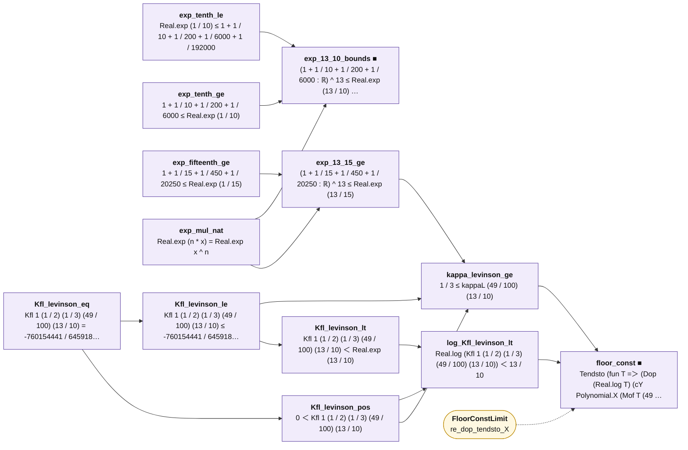

# `lean_stage3/Stage3/FloorConst.lean`

> **Read from the source text.** This file changed after the last `python3 utilities/lean_map.py --dump`, so the arrows on this page are names occurring in each proof and have not been confirmed by Lean.

# FloorConst — block S12 of `lean_stage3/design/stencil.md`, piece 5a, the closed form: the limit and its value. 2026-11-25.

13 theorems, 1 definition, 158 lines. 

**Imports:** [`FloorConstLimit`](../lean_stage3/FloorConstLimit.md)  
**Imported by:** [`Stage3`](../lean_stage3/Stage3.md)

## The picture



An arrow A → B reads "A is used in the proof of B". Green: counting, integers only. Violet: shape, analysis with no ζ. Blue: reads ζ. A name ending in ■ is an end: nothing else uses it. Red: contains `sorry`. Yellow: theorems in another file, counted; a dotted arrow crosses files. Definitions are not drawn; they are listed below the diagram.

## Definitions

<a name="FloorConst-kappaL"></a>
### `FloorConst.kappaL`

def · line 36

Levinson's proportion at `P(x) = x`: `κ = 1 − log K / R`.

- **Is:** `` kappaL (θ R : ℝ) : ℝ := 1 - Real.log (Kfl 1 (1 / 2) (1 / 3) θ R) / R ``
- **Built from:** [`FloorConst.Kfl`](../lean_stage3/FloorConstLimit.md#FloorConst-Kfl)
- **Used by 2:** [`FloorConst.floor_const`](#FloorConst-floor_const), [`FloorConst.kappa_levinson_ge`](#FloorConst-kappa_levinson_ge)

## Theorems

<a name="FloorConst-exp_tenth_le"></a>
### `FloorConst.exp_tenth_le`

line 40 · arrows read from text

**Shape.** Uses real or complex analysis; nothing in it or beneath it reads ζ.

**Proves**

```lean
Real.exp (1 / 10) ≤ 1 + 1 / 10 + 1 / 200 + 1 / 6000 + 1 / 192000
```

**Fed by:** no theorem of this repo; it stands on Mathlib.

**Feeds** (1 that use it)

  - [`FloorConst.exp_13_10_bounds`](#FloorConst-exp_13_10_bounds) — `` (1 + 1 / 10 + 1 / 200 + 1 / 6000 : ℝ) ^ 13 ≤ Real.exp (13 / 10) ∧ Real.exp (13 / 10) ≤ (1 + 1 / 10 + 1 / 200 + 1 / 6000 + 1 / 192000 : ℝ) ^ 13 ``

<a name="FloorConst-exp_tenth_ge"></a>
### `FloorConst.exp_tenth_ge`

line 46 · arrows read from text

**Shape.** Uses real or complex analysis; nothing in it or beneath it reads ζ.

**Proves**

```lean
1 + 1 / 10 + 1 / 200 + 1 / 6000 ≤ Real.exp (1 / 10)
```

**Fed by:** no theorem of this repo; it stands on Mathlib.

**Feeds** (1 that use it)

  - [`FloorConst.exp_13_10_bounds`](#FloorConst-exp_13_10_bounds) — `` (1 + 1 / 10 + 1 / 200 + 1 / 6000 : ℝ) ^ 13 ≤ Real.exp (13 / 10) ∧ Real.exp (13 / 10) ≤ (1 + 1 / 10 + 1 / 200 + 1 / 6000 + 1 / 192000 : ℝ) ^ 13 ``

<a name="FloorConst-exp_fifteenth_ge"></a>
### `FloorConst.exp_fifteenth_ge`

line 52 · arrows read from text

**Shape.** Uses real or complex analysis; nothing in it or beneath it reads ζ.

**Proves**

```lean
1 + 1 / 15 + 1 / 450 + 1 / 20250 ≤ Real.exp (1 / 15)
```

**Fed by:** no theorem of this repo; it stands on Mathlib.

**Feeds** (1 that use it)

  - [`FloorConst.exp_13_15_ge`](#FloorConst-exp_13_15_ge) — `` (1 + 1 / 15 + 1 / 450 + 1 / 20250 : ℝ) ^ 13 ≤ Real.exp (13 / 15) ``

<a name="FloorConst-exp_mul_nat"></a>
### `FloorConst.exp_mul_nat`

line 58 · arrows read from text

**Shape.** Uses real or complex analysis; nothing in it or beneath it reads ζ.

**Proves**

```lean
Real.exp (n * x) = Real.exp x ^ n
```

**Needs** (its hypotheses)

  - `` n : ℕ ``
  - `` x : ℝ ``

**Fed by:** no theorem of this repo; it stands on Mathlib.

**Feeds** (2 that use it)

  - [`FloorConst.exp_13_10_bounds`](#FloorConst-exp_13_10_bounds) — `` (1 + 1 / 10 + 1 / 200 + 1 / 6000 : ℝ) ^ 13 ≤ Real.exp (13 / 10) ∧ Real.exp (13 / 10) ≤ (1 + 1 / 10 + 1 / 200 + 1 / 6000 + 1 / 192000 : ℝ) ^ 13 ``
  - [`FloorConst.exp_13_15_ge`](#FloorConst-exp_13_15_ge) — `` (1 + 1 / 15 + 1 / 450 + 1 / 20250 : ℝ) ^ 13 ≤ Real.exp (13 / 15) ``

<a name="FloorConst-Kfl_levinson_eq"></a>
### `FloorConst.Kfl_levinson_eq`

line 61 · arrows read from text

**Shape.** Uses real or complex analysis; nothing in it or beneath it reads ζ.

**Why.** `K = r + c · e^(13/10)²` at `P(x) = x`, `θ = 49/100`, `R = 13/10`.

**Proves**

```lean
Kfl 1 (1 / 2) (1 / 3) (49 / 100) (13 / 10) = -760154441 / 645918000 + 3405769 / 12918360 * Real.exp (13 / 10) ^ 2
```

**Fed by:** no theorem of this repo; it stands on Mathlib and the definitions below.

**Definitions its proof touches:** [`FloorConst.Kfl`](../lean_stage3/FloorConstLimit.md#FloorConst-Kfl)

**Feeds** (2 that use it)

  - [`FloorConst.Kfl_levinson_le`](#FloorConst-Kfl_levinson_le) — `` Kfl 1 (1 / 2) (1 / 3) (49 / 100) (13 / 10) ≤ -760154441 / 645918000 + 3405769 / 12918360 * ((1 + 1 / 10 + 1 / 200 + 1 / 6000 + 1 / 192000 : ℝ) ^ 13) ^… ``
  - [`FloorConst.Kfl_levinson_pos`](#FloorConst-Kfl_levinson_pos) — `` 0 < Kfl 1 (1 / 2) (1 / 3) (49 / 100) (13 / 10) ``

<a name="FloorConst-exp_13_10_bounds"></a>
### `FloorConst.exp_13_10_bounds`

line 68 · arrows read from text

**Shape.** Uses real or complex analysis; nothing in it or beneath it reads ζ.

**Proves**

```lean
(1 + 1 / 10 + 1 / 200 + 1 / 6000 : ℝ) ^ 13 ≤ Real.exp (13 / 10) ∧ Real.exp (13 / 10) ≤ (1 + 1 / 10 + 1 / 200 + 1 / 6000 + 1 / 192000 : ℝ) ^ 13
```

**Fed by** (3 theorems its proof uses)

  - [`FloorConst.exp_mul_nat`](#FloorConst-exp_mul_nat) — `` Real.exp (n * x) = Real.exp x ^ n ``
  - [`FloorConst.exp_tenth_ge`](#FloorConst-exp_tenth_ge) — `` 1 + 1 / 10 + 1 / 200 + 1 / 6000 ≤ Real.exp (1 / 10) ``
  - [`FloorConst.exp_tenth_le`](#FloorConst-exp_tenth_le) — `` Real.exp (1 / 10) ≤ 1 + 1 / 10 + 1 / 200 + 1 / 6000 + 1 / 192000 ``

**Feeds:** nothing. It is an end.

<a name="FloorConst-exp_13_15_ge"></a>
### `FloorConst.exp_13_15_ge`

line 78 · arrows read from text

**Shape.** Uses real or complex analysis; nothing in it or beneath it reads ζ.

**Proves**

```lean
(1 + 1 / 15 + 1 / 450 + 1 / 20250 : ℝ) ^ 13 ≤ Real.exp (13 / 15)
```

**Fed by** (2 theorems its proof uses)

  - [`FloorConst.exp_fifteenth_ge`](#FloorConst-exp_fifteenth_ge) — `` 1 + 1 / 15 + 1 / 450 + 1 / 20250 ≤ Real.exp (1 / 15) ``
  - [`FloorConst.exp_mul_nat`](#FloorConst-exp_mul_nat) — `` Real.exp (n * x) = Real.exp x ^ n ``

**Feeds** (1 that use it)

  - [`FloorConst.kappa_levinson_ge`](#FloorConst-kappa_levinson_ge) — `` 1 / 3 ≤ kappaL (49 / 100) (13 / 10) ``

<a name="FloorConst-Kfl_levinson_le"></a>
### `FloorConst.Kfl_levinson_le`

line 86 · arrows read from text

**Shape.** Uses real or complex analysis; nothing in it or beneath it reads ζ.

**Why.** `K ≤ r + c · hi²`, `hi` the upper Taylor bound on `e^(13/10)`.

**Proves**

```lean
Kfl 1 (1 / 2) (1 / 3) (49 / 100) (13 / 10) ≤ -760154441 / 645918000 + 3405769 / 12918360 * ((1 + 1 / 10 + 1 / 200 + 1 / 6000 + 1 / 192000 : ℝ) ^ 13) ^ 2
```

**Fed by** (1 theorem its proof uses)

  - [`FloorConst.Kfl_levinson_eq`](#FloorConst-Kfl_levinson_eq) — `` Kfl 1 (1 / 2) (1 / 3) (49 / 100) (13 / 10) = -760154441 / 645918000 + 3405769 / 12918360 * Real.exp (13 / 10) ^ 2 ``

**Definitions its proof touches:** [`FloorConst.Kfl`](../lean_stage3/FloorConstLimit.md#FloorConst-Kfl)

**Feeds** (2 that use it)

  - [`FloorConst.Kfl_levinson_lt`](#FloorConst-Kfl_levinson_lt) — `` Kfl 1 (1 / 2) (1 / 3) (49 / 100) (13 / 10) < Real.exp (13 / 10) ``
  - [`FloorConst.kappa_levinson_ge`](#FloorConst-kappa_levinson_ge) — `` 1 / 3 ≤ kappaL (49 / 100) (13 / 10) ``

<a name="FloorConst-Kfl_levinson_pos"></a>
### `FloorConst.Kfl_levinson_pos`

line 97 · arrows read from text

**Shape.** Uses real or complex analysis; nothing in it or beneath it reads ζ.

**Why.** `0 < K`.

**Proves**

```lean
0 < Kfl 1 (1 / 2) (1 / 3) (49 / 100) (13 / 10)
```

**Fed by** (1 theorem its proof uses)

  - [`FloorConst.Kfl_levinson_eq`](#FloorConst-Kfl_levinson_eq) — `` Kfl 1 (1 / 2) (1 / 3) (49 / 100) (13 / 10) = -760154441 / 645918000 + 3405769 / 12918360 * Real.exp (13 / 10) ^ 2 ``

**Definitions its proof touches:** [`FloorConst.Kfl`](../lean_stage3/FloorConstLimit.md#FloorConst-Kfl)

**Feeds** (2 that use it)

  - [`FloorConst.kappa_levinson_ge`](#FloorConst-kappa_levinson_ge) — `` 1 / 3 ≤ kappaL (49 / 100) (13 / 10) ``
  - [`FloorConst.log_Kfl_levinson_lt`](#FloorConst-log_Kfl_levinson_lt) — `` Real.log (Kfl 1 (1 / 2) (1 / 3) (49 / 100) (13 / 10)) < 13 / 10 ``

<a name="FloorConst-Kfl_levinson_lt"></a>
### `FloorConst.Kfl_levinson_lt`

line 107 · arrows read from text

**Shape.** Uses real or complex analysis; nothing in it or beneath it reads ζ.

**Why.** `K < e^R` at `P(x) = x`, `θ = 49/100`, `R = 13/10`.

**Proves**

```lean
Kfl 1 (1 / 2) (1 / 3) (49 / 100) (13 / 10) < Real.exp (13 / 10)
```

**Fed by** (1 theorem its proof uses)

  - [`FloorConst.Kfl_levinson_le`](#FloorConst-Kfl_levinson_le) — `` Kfl 1 (1 / 2) (1 / 3) (49 / 100) (13 / 10) ≤ -760154441 / 645918000 + 3405769 / 12918360 * ((1 + 1 / 10 + 1 / 200 + 1 / 6000 + 1 / 192000 : ℝ) ^ 13) ^… ``

**Definitions its proof touches:** [`FloorConst.Kfl`](../lean_stage3/FloorConstLimit.md#FloorConst-Kfl)

**Feeds** (1 that use it)

  - [`FloorConst.log_Kfl_levinson_lt`](#FloorConst-log_Kfl_levinson_lt) — `` Real.log (Kfl 1 (1 / 2) (1 / 3) (49 / 100) (13 / 10)) < 13 / 10 ``

<a name="FloorConst-log_Kfl_levinson_lt"></a>
### `FloorConst.log_Kfl_levinson_lt`

line 116 · arrows read from text

**Shape.** Uses real or complex analysis; nothing in it or beneath it reads ζ.

**Why.** `log K < R`.

**Proves**

```lean
Real.log (Kfl 1 (1 / 2) (1 / 3) (49 / 100) (13 / 10)) < 13 / 10
```

**Fed by** (2 theorems its proof uses)

  - [`FloorConst.Kfl_levinson_lt`](#FloorConst-Kfl_levinson_lt) — `` Kfl 1 (1 / 2) (1 / 3) (49 / 100) (13 / 10) < Real.exp (13 / 10) ``
  - [`FloorConst.Kfl_levinson_pos`](#FloorConst-Kfl_levinson_pos) — `` 0 < Kfl 1 (1 / 2) (1 / 3) (49 / 100) (13 / 10) ``

**Definitions its proof touches:** [`FloorConst.Kfl`](../lean_stage3/FloorConstLimit.md#FloorConst-Kfl)

**Feeds** (1 that use it)

  - [`FloorConst.floor_const`](#FloorConst-floor_const) — `` Tendsto (fun T => (Dop (Real.log T) (cY Polynomial.X (Mof T (49 / 100)) T) ((-((13 / 10) / Real.log T) : ℝ) : ℂ) ((-((13 / 10) / Real.log T) : ℝ) : ℂ)… ``

<a name="FloorConst-kappa_levinson_ge"></a>
### `FloorConst.kappa_levinson_ge`

line 120 · arrows read from text

**Shape.** Uses real or complex analysis; nothing in it or beneath it reads ζ.

**Why.** `κ ≥ 1/3` at `P(x) = x`, `θ = 49/100`, `R = 13/10`.

**Proves**

```lean
1 / 3 ≤ kappaL (49 / 100) (13 / 10)
```

**Fed by** (3 theorems its proof uses)

  - [`FloorConst.Kfl_levinson_le`](#FloorConst-Kfl_levinson_le) — `` Kfl 1 (1 / 2) (1 / 3) (49 / 100) (13 / 10) ≤ -760154441 / 645918000 + 3405769 / 12918360 * ((1 + 1 / 10 + 1 / 200 + 1 / 6000 + 1 / 192000 : ℝ) ^ 13) ^… ``
  - [`FloorConst.Kfl_levinson_pos`](#FloorConst-Kfl_levinson_pos) — `` 0 < Kfl 1 (1 / 2) (1 / 3) (49 / 100) (13 / 10) ``
  - [`FloorConst.exp_13_15_ge`](#FloorConst-exp_13_15_ge) — `` (1 + 1 / 15 + 1 / 450 + 1 / 20250 : ℝ) ^ 13 ≤ Real.exp (13 / 15) ``

**Definitions its proof touches:** [`FloorConst.kappaL`](#FloorConst-kappaL), [`FloorConst.Kfl`](../lean_stage3/FloorConstLimit.md#FloorConst-Kfl)

**Feeds** (1 that use it)

  - [`FloorConst.floor_const`](#FloorConst-floor_const) — `` Tendsto (fun T => (Dop (Real.log T) (cY Polynomial.X (Mof T (49 / 100)) T) ((-((13 / 10) / Real.log T) : ℝ) : ℂ) ((-((13 / 10) / Real.log T) : ℝ) : ℂ)… ``

<a name="FloorConst-floor_const"></a>
### `FloorConst.floor_const`

line 137 · arrows read from text

**Shape.** Uses real or complex analysis; nothing in it or beneath it reads ζ.

**Why.** Piece 5a: at `P(x) = x`, `θ = 49/100`, `R = 13/10`, `Re D[c](T) → K` with `log K < R` and `1 − log K / R ≥ 1/3`.

**Proves**

```lean
Tendsto (fun T => (Dop (Real.log T) (cY Polynomial.X (Mof T (49 / 100)) T) ((-((13 / 10) / Real.log T) : ℝ) : ℂ) ((-((13 / 10) / Real.log T) : ℝ) : ℂ)).re) atTop (𝓝 (Kfl 1 (1 / 2) (1 / 3) (49 / 100) (13 / 10))) ∧ Real.log (Kfl 1 (1 / 2) (1 / 3) (49 / 100) (13 / 10)) < 13 / 10 ∧ 1 / 3 ≤ kappaL (49 / 100) (13 / 10)
```

**Fed by** (3 theorems its proof uses)

  - [`FloorConst.kappa_levinson_ge`](#FloorConst-kappa_levinson_ge) — `` 1 / 3 ≤ kappaL (49 / 100) (13 / 10) ``
  - [`FloorConst.log_Kfl_levinson_lt`](#FloorConst-log_Kfl_levinson_lt) — `` Real.log (Kfl 1 (1 / 2) (1 / 3) (49 / 100) (13 / 10)) < 13 / 10 ``
  - [`FloorConst.re_dop_tendsto_X`](../lean_stage3/FloorConstLimit.md#FloorConst-re_dop_tendsto_X) (FloorConstLimit) — `` Tendsto (fun T => (Dop (Real.log T) (cY Polynomial.X (Mof T θ) T) ((-(R / Real.log T) : ℝ) : ℂ) ((-(R / Real.log T) : ℝ) : ℂ)).re) atTop (𝓝 (Kfl 1 (1 … ``

**Definitions its proof touches:** [`FloorConst.kappaL`](#FloorConst-kappaL), [`FloorConst.Kfl`](../lean_stage3/FloorConstLimit.md#FloorConst-Kfl), [`Operator.Dop`](../lean_stage3/OperatorCauchy.md#Operator-Dop), [`TwistedMoment.Mof`](../lean_stage3/TwistedMoment.md#TwistedMoment-Mof), [`TwistedMoment.cY`](../lean_stage3/TwistedMoment.md#TwistedMoment-cY)

**Feeds:** nothing. It is an end.

