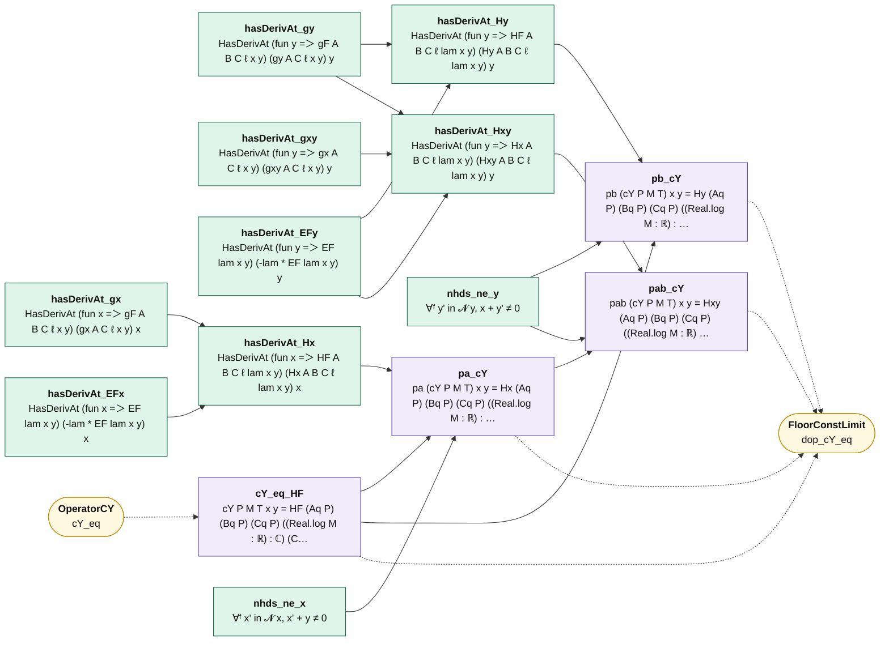

# `lean_stage3/Stage3/FloorConstDeriv.lean`

> **Read from the source text.** This file changed after the last `python3 utilities/lean_map.py --dump`, so the arrows on this page are names occurring in each proof and have not been confirmed by Lean.

# FloorConstDeriv — block S12 of `lean_stage3/design/stencil.md`, piece 5a, the closed form: the partials of `c(α,β)`. 2026-11-25.

14 theorems, 9 definitions, 222 lines. 

**Imports:** [`OperatorCY`](../lean_stage3/OperatorCY.md)  
**Imported by:** [`FloorConstLimit`](../lean_stage3/FloorConstLimit.md)

## The picture



An arrow A → B reads "A is used in the proof of B". Green: counting, integers only. Violet: shape, analysis with no ζ. Blue: reads ζ. A name ending in ■ is an end: nothing else uses it. Red: contains `sorry`. Yellow: theorems in another file, counted; a dotted arrow crosses files. Definitions are not drawn; they are listed below the diagram.

## Definitions

<a name="FloorConst-gF"></a>
### `FloorConst.gF`

def · line 35

`g = c₁ = A ℓ⁻¹ u⁻¹ + B + ℓ C x y u⁻¹`, `u = x + y`.

- **Is:** `` gF (A B C ℓ : ℂ) (x y : ℂ) : ℂ := A * ℓ⁻¹ * (x + y)⁻¹ + B + ℓ * C * x * y * (x + y)⁻¹ ``
- **Used by 8:** [`FloorConst.HF`](#FloorConst-HF), [`FloorConst.Hx`](#FloorConst-Hx), [`FloorConst.Hxy`](#FloorConst-Hxy), [`FloorConst.Hy`](#FloorConst-Hy), [`FloorConst.cY_eq_HF`](#FloorConst-cY_eq_HF), [`FloorConst.hasDerivAt_gx`](#FloorConst-hasDerivAt_gx), [`FloorConst.hasDerivAt_gy`](#FloorConst-hasDerivAt_gy), [`FloorConst.dop_closed`](../lean_stage3/FloorConstLimit.md#FloorConst-dop_closed)

<a name="FloorConst-EF"></a>
### `FloorConst.EF`

def · line 39

`E = exp(λ · (−(x + y)))`, `T^(−α−β)` with `λ = log T`.

- **Is:** `` EF (lam : ℂ) (x y : ℂ) : ℂ := cexp (lam * (-(x + y))) ``
- **Used by 8:** [`FloorConst.HF`](#FloorConst-HF), [`FloorConst.Hx`](#FloorConst-Hx), [`FloorConst.Hxy`](#FloorConst-Hxy), [`FloorConst.Hy`](#FloorConst-Hy), [`FloorConst.cY_eq_HF`](#FloorConst-cY_eq_HF), [`FloorConst.hasDerivAt_EFx`](#FloorConst-hasDerivAt_EFx), [`FloorConst.hasDerivAt_EFy`](#FloorConst-hasDerivAt_EFy), [`FloorConst.dop_closed`](../lean_stage3/FloorConstLimit.md#FloorConst-dop_closed)

<a name="FloorConst-HF"></a>
### `FloorConst.HF`

def · line 42

`c = g (1 − E) + 2 B E`.

- **Is:** `` HF (A B C ℓ lam : ℂ) (x y : ℂ) : ℂ := gF A B C ℓ x y * (1 - EF lam x y) + 2 * B * EF lam x y ``
- **Built from:** [`FloorConst.EF`](#FloorConst-EF), [`FloorConst.gF`](#FloorConst-gF)
- **Used by 6:** [`FloorConst.cY_eq_HF`](#FloorConst-cY_eq_HF), [`FloorConst.hasDerivAt_Hx`](#FloorConst-hasDerivAt_Hx), [`FloorConst.hasDerivAt_Hy`](#FloorConst-hasDerivAt_Hy), [`FloorConst.pa_cY`](#FloorConst-pa_cY), [`FloorConst.pb_cY`](#FloorConst-pb_cY), [`FloorConst.dop_closed`](../lean_stage3/FloorConstLimit.md#FloorConst-dop_closed)

<a name="FloorConst-gx"></a>
### `FloorConst.gx`

def · line 46

`∂x g`.

- **Is:** `` gx (A C ℓ : ℂ) (x y : ℂ) : ℂ := (ℓ * C * y ^ 2 - A * ℓ⁻¹) * ((x + y) ^ 2)⁻¹ ``
- **Used by 5:** [`FloorConst.Hx`](#FloorConst-Hx), [`FloorConst.Hxy`](#FloorConst-Hxy), [`FloorConst.hasDerivAt_gx`](#FloorConst-hasDerivAt_gx), [`FloorConst.hasDerivAt_gxy`](#FloorConst-hasDerivAt_gxy), [`FloorConst.dop_closed`](../lean_stage3/FloorConstLimit.md#FloorConst-dop_closed)

<a name="FloorConst-gy"></a>
### `FloorConst.gy`

def · line 49

`∂y g`.

- **Is:** `` gy (A C ℓ : ℂ) (x y : ℂ) : ℂ := (ℓ * C * x ^ 2 - A * ℓ⁻¹) * ((x + y) ^ 2)⁻¹ ``
- **Used by 4:** [`FloorConst.Hxy`](#FloorConst-Hxy), [`FloorConst.Hy`](#FloorConst-Hy), [`FloorConst.hasDerivAt_gy`](#FloorConst-hasDerivAt_gy), [`FloorConst.dop_closed`](../lean_stage3/FloorConstLimit.md#FloorConst-dop_closed)

<a name="FloorConst-gxy"></a>
### `FloorConst.gxy`

def · line 52

`∂y ∂x g`.

- **Is:** `` gxy (A C ℓ : ℂ) (x y : ℂ) : ℂ := 2 * ℓ * C * y * ((x + y) ^ 2)⁻¹ - 2 * (ℓ * C * y ^ 2 - A * ℓ⁻¹) * ((x + y) ^ 3)⁻¹ ``
- **Used by 3:** [`FloorConst.Hxy`](#FloorConst-Hxy), [`FloorConst.hasDerivAt_gxy`](#FloorConst-hasDerivAt_gxy), [`FloorConst.dop_closed`](../lean_stage3/FloorConstLimit.md#FloorConst-dop_closed)

<a name="FloorConst-Hx"></a>
### `FloorConst.Hx`

def · line 56

`∂x c`.

- **Is:** `` Hx (A B C ℓ lam : ℂ) (x y : ℂ) : ℂ := gx A C ℓ x y * (1 - EF lam x y) + lam * EF lam x y * (gF A B C ℓ x y - 2 * B) ``
- **Built from:** [`FloorConst.EF`](#FloorConst-EF), [`FloorConst.gF`](#FloorConst-gF), [`FloorConst.gx`](#FloorConst-gx)
- **Used by 5:** [`FloorConst.hasDerivAt_Hx`](#FloorConst-hasDerivAt_Hx), [`FloorConst.hasDerivAt_Hxy`](#FloorConst-hasDerivAt_Hxy), [`FloorConst.pa_cY`](#FloorConst-pa_cY), [`FloorConst.pab_cY`](#FloorConst-pab_cY), [`FloorConst.dop_closed`](../lean_stage3/FloorConstLimit.md#FloorConst-dop_closed)

<a name="FloorConst-Hy"></a>
### `FloorConst.Hy`

def · line 60

`∂y c`.

- **Is:** `` Hy (A B C ℓ lam : ℂ) (x y : ℂ) : ℂ := gy A C ℓ x y * (1 - EF lam x y) + lam * EF lam x y * (gF A B C ℓ x y - 2 * B) ``
- **Built from:** [`FloorConst.EF`](#FloorConst-EF), [`FloorConst.gF`](#FloorConst-gF), [`FloorConst.gy`](#FloorConst-gy)
- **Used by 3:** [`FloorConst.hasDerivAt_Hy`](#FloorConst-hasDerivAt_Hy), [`FloorConst.pb_cY`](#FloorConst-pb_cY), [`FloorConst.dop_closed`](../lean_stage3/FloorConstLimit.md#FloorConst-dop_closed)

<a name="FloorConst-Hxy"></a>
### `FloorConst.Hxy`

def · line 64

`∂y ∂x c`.

- **Is:** `` Hxy (A B C ℓ lam : ℂ) (x y : ℂ) : ℂ := gxy A C ℓ x y * (1 - EF lam x y) + lam * EF lam x y * (gx A C ℓ x y + gy A C ℓ x y) - lam ^ 2 * EF lam x y * (gF A B C ℓ x y - 2 * B) ``
- **Built from:** [`FloorConst.EF`](#FloorConst-EF), [`FloorConst.gF`](#FloorConst-gF), [`FloorConst.gx`](#FloorConst-gx), [`FloorConst.gxy`](#FloorConst-gxy), [`FloorConst.gy`](#FloorConst-gy)
- **Used by 3:** [`FloorConst.hasDerivAt_Hxy`](#FloorConst-hasDerivAt_Hxy), [`FloorConst.pab_cY`](#FloorConst-pab_cY), [`FloorConst.dop_closed`](../lean_stage3/FloorConstLimit.md#FloorConst-dop_closed)

## Theorems

<a name="FloorConst-hasDerivAt_gx"></a>
### `FloorConst.hasDerivAt_gx`

line 72 · arrows read from text

**Counting.** Integers only: nothing in its statement or proof, or in anything it rests on, uses analysis or ζ.

**Proves**

```lean
HasDerivAt (fun x => gF A B C ℓ x y) (gx A C ℓ x y) x
```

**Needs** (its hypotheses)

  - `` h : x + y ≠ 0 ``

**Fed by:** no theorem of this repo; it stands on Mathlib and the definitions below.

**Definitions its proof touches:** [`FloorConst.gF`](#FloorConst-gF), [`FloorConst.gx`](#FloorConst-gx)

**Feeds** (1 that use it)

  - [`FloorConst.hasDerivAt_Hx`](#FloorConst-hasDerivAt_Hx) — `` HasDerivAt (fun x => HF A B C ℓ lam x y) (Hx A B C ℓ lam x y) x ``

<a name="FloorConst-hasDerivAt_gy"></a>
### `FloorConst.hasDerivAt_gy`

line 84 · arrows read from text

**Counting.** Integers only: nothing in its statement or proof, or in anything it rests on, uses analysis or ζ.

**Proves**

```lean
HasDerivAt (fun y => gF A B C ℓ x y) (gy A C ℓ x y) y
```

**Needs** (its hypotheses)

  - `` h : x + y ≠ 0 ``

**Fed by:** no theorem of this repo; it stands on Mathlib and the definitions below.

**Definitions its proof touches:** [`FloorConst.gF`](#FloorConst-gF), [`FloorConst.gy`](#FloorConst-gy)

**Feeds** (2 that use it)

  - [`FloorConst.hasDerivAt_Hxy`](#FloorConst-hasDerivAt_Hxy) — `` HasDerivAt (fun y => Hx A B C ℓ lam x y) (Hxy A B C ℓ lam x y) y ``
  - [`FloorConst.hasDerivAt_Hy`](#FloorConst-hasDerivAt_Hy) — `` HasDerivAt (fun y => HF A B C ℓ lam x y) (Hy A B C ℓ lam x y) y ``

<a name="FloorConst-hasDerivAt_gxy"></a>
### `FloorConst.hasDerivAt_gxy`

line 96 · arrows read from text

**Counting.** Integers only: nothing in its statement or proof, or in anything it rests on, uses analysis or ζ.

**Proves**

```lean
HasDerivAt (fun y => gx A C ℓ x y) (gxy A C ℓ x y) y
```

**Needs** (its hypotheses)

  - `` h : x + y ≠ 0 ``

**Fed by:** no theorem of this repo; it stands on Mathlib and the definitions below.

**Definitions its proof touches:** [`FloorConst.gx`](#FloorConst-gx), [`FloorConst.gxy`](#FloorConst-gxy)

**Feeds** (1 that use it)

  - [`FloorConst.hasDerivAt_Hxy`](#FloorConst-hasDerivAt_Hxy) — `` HasDerivAt (fun y => Hx A B C ℓ lam x y) (Hxy A B C ℓ lam x y) y ``

<a name="FloorConst-hasDerivAt_EFx"></a>
### `FloorConst.hasDerivAt_EFx`

line 110 · arrows read from text

**Counting.** Integers only: nothing in its statement or proof, or in anything it rests on, uses analysis or ζ.

**Proves**

```lean
HasDerivAt (fun x => EF lam x y) (-lam * EF lam x y) x
```

**Needs** (its hypotheses)

  - `` x y : ℂ ``

**Fed by:** no theorem of this repo; it stands on Mathlib and the definitions below.

**Definitions its proof touches:** [`FloorConst.EF`](#FloorConst-EF)

**Feeds** (1 that use it)

  - [`FloorConst.hasDerivAt_Hx`](#FloorConst-hasDerivAt_Hx) — `` HasDerivAt (fun x => HF A B C ℓ lam x y) (Hx A B C ℓ lam x y) x ``

<a name="FloorConst-hasDerivAt_EFy"></a>
### `FloorConst.hasDerivAt_EFy`

line 118 · arrows read from text

**Counting.** Integers only: nothing in its statement or proof, or in anything it rests on, uses analysis or ζ.

**Proves**

```lean
HasDerivAt (fun y => EF lam x y) (-lam * EF lam x y) y
```

**Needs** (its hypotheses)

  - `` x y : ℂ ``

**Fed by:** no theorem of this repo; it stands on Mathlib and the definitions below.

**Definitions its proof touches:** [`FloorConst.EF`](#FloorConst-EF)

**Feeds** (2 that use it)

  - [`FloorConst.hasDerivAt_Hxy`](#FloorConst-hasDerivAt_Hxy) — `` HasDerivAt (fun y => Hx A B C ℓ lam x y) (Hxy A B C ℓ lam x y) y ``
  - [`FloorConst.hasDerivAt_Hy`](#FloorConst-hasDerivAt_Hy) — `` HasDerivAt (fun y => HF A B C ℓ lam x y) (Hy A B C ℓ lam x y) y ``

<a name="FloorConst-hasDerivAt_Hx"></a>
### `FloorConst.hasDerivAt_Hx`

line 126 · arrows read from text

**Counting.** Integers only: nothing in its statement or proof, or in anything it rests on, uses analysis or ζ.

**Proves**

```lean
HasDerivAt (fun x => HF A B C ℓ lam x y) (Hx A B C ℓ lam x y) x
```

**Needs** (its hypotheses)

  - `` h : x + y ≠ 0 ``

**Fed by** (2 theorems its proof uses)

  - [`FloorConst.hasDerivAt_EFx`](#FloorConst-hasDerivAt_EFx) — `` HasDerivAt (fun x => EF lam x y) (-lam * EF lam x y) x ``
  - [`FloorConst.hasDerivAt_gx`](#FloorConst-hasDerivAt_gx) — `` HasDerivAt (fun x => gF A B C ℓ x y) (gx A C ℓ x y) x ``

**Definitions its proof touches:** [`FloorConst.HF`](#FloorConst-HF), [`FloorConst.Hx`](#FloorConst-Hx)

**Feeds** (1 that use it)

  - [`FloorConst.pa_cY`](#FloorConst-pa_cY) — `` pa (cY P M T) x y = Hx (Aq P) (Bq P) (Cq P) ((Real.log M : ℝ) : ℂ) (Complex.log (T : ℂ)) x y ``

<a name="FloorConst-hasDerivAt_Hy"></a>
### `FloorConst.hasDerivAt_Hy`

line 135 · arrows read from text

**Counting.** Integers only: nothing in its statement or proof, or in anything it rests on, uses analysis or ζ.

**Proves**

```lean
HasDerivAt (fun y => HF A B C ℓ lam x y) (Hy A B C ℓ lam x y) y
```

**Needs** (its hypotheses)

  - `` h : x + y ≠ 0 ``

**Fed by** (2 theorems its proof uses)

  - [`FloorConst.hasDerivAt_EFy`](#FloorConst-hasDerivAt_EFy) — `` HasDerivAt (fun y => EF lam x y) (-lam * EF lam x y) y ``
  - [`FloorConst.hasDerivAt_gy`](#FloorConst-hasDerivAt_gy) — `` HasDerivAt (fun y => gF A B C ℓ x y) (gy A C ℓ x y) y ``

**Definitions its proof touches:** [`FloorConst.HF`](#FloorConst-HF), [`FloorConst.Hy`](#FloorConst-Hy)

**Feeds** (1 that use it)

  - [`FloorConst.pb_cY`](#FloorConst-pb_cY) — `` pb (cY P M T) x y = Hy (Aq P) (Bq P) (Cq P) ((Real.log M : ℝ) : ℂ) (Complex.log (T : ℂ)) x y ``

<a name="FloorConst-hasDerivAt_Hxy"></a>
### `FloorConst.hasDerivAt_Hxy`

line 144 · arrows read from text

**Counting.** Integers only: nothing in its statement or proof, or in anything it rests on, uses analysis or ζ.

**Proves**

```lean
HasDerivAt (fun y => Hx A B C ℓ lam x y) (Hxy A B C ℓ lam x y) y
```

**Needs** (its hypotheses)

  - `` h : x + y ≠ 0 ``

**Fed by** (3 theorems its proof uses)

  - [`FloorConst.hasDerivAt_EFy`](#FloorConst-hasDerivAt_EFy) — `` HasDerivAt (fun y => EF lam x y) (-lam * EF lam x y) y ``
  - [`FloorConst.hasDerivAt_gxy`](#FloorConst-hasDerivAt_gxy) — `` HasDerivAt (fun y => gx A C ℓ x y) (gxy A C ℓ x y) y ``
  - [`FloorConst.hasDerivAt_gy`](#FloorConst-hasDerivAt_gy) — `` HasDerivAt (fun y => gF A B C ℓ x y) (gy A C ℓ x y) y ``

**Definitions its proof touches:** [`FloorConst.Hx`](#FloorConst-Hx), [`FloorConst.Hxy`](#FloorConst-Hxy)

**Feeds** (1 that use it)

  - [`FloorConst.pab_cY`](#FloorConst-pab_cY) — `` pab (cY P M T) x y = Hxy (Aq P) (Bq P) (Cq P) ((Real.log M : ℝ) : ℂ) (Complex.log (T : ℂ)) x y ``

<a name="FloorConst-cY_eq_HF"></a>
### `FloorConst.cY_eq_HF`

line 155 · arrows read from text

**Shape.** Uses real or complex analysis; nothing in it or beneath it reads ζ.

**Why.** `c` off the line, `c(x,y) = g(1 − E) + 2BE`.

**Proves**

```lean
cY P M T x y = HF (Aq P) (Bq P) (Cq P) ((Real.log M : ℝ) : ℂ) (Complex.log (T : ℂ)) x y
```

**Needs** (its hypotheses)

  - `` P : Polynomial ℝ ``
  - `` M : ℕ ``
  - `` hT : T ≠ 0 ``
  - `` hℓ : Real.log M ≠ 0 ``
  - `` h : x + y ≠ 0 ``

**Fed by** (1 theorem its proof uses)

  - [`Operator.cY_eq`](../lean_stage3/OperatorCY.md#Operator-cY_eq) (OperatorCY) — `` cY P M T α β = cYform P M T (α, β) ``

**Definitions its proof touches:** [`FloorConst.EF`](#FloorConst-EF), [`FloorConst.HF`](#FloorConst-HF), [`FloorConst.gF`](#FloorConst-gF), [`Operator.Aq`](../lean_stage3/OperatorCY.md#Operator-Aq), [`Operator.Bq`](../lean_stage3/OperatorCY.md#Operator-Bq), [`Operator.Cq`](../lean_stage3/OperatorCY.md#Operator-Cq), [`Operator.c1form`](../lean_stage3/OperatorCY.md#Operator-c1form), [`Operator.cYform`](../lean_stage3/OperatorCY.md#Operator-cYform), [`TwistedMoment.cY`](../lean_stage3/TwistedMoment.md#TwistedMoment-cY)

**Feeds** (3 that use it)

  - [`FloorConst.pa_cY`](#FloorConst-pa_cY) — `` pa (cY P M T) x y = Hx (Aq P) (Bq P) (Cq P) ((Real.log M : ℝ) : ℂ) (Complex.log (T : ℂ)) x y ``
  - [`FloorConst.pb_cY`](#FloorConst-pb_cY) — `` pb (cY P M T) x y = Hy (Aq P) (Bq P) (Cq P) ((Real.log M : ℝ) : ℂ) (Complex.log (T : ℂ)) x y ``
  - [`FloorConst.dop_cY_eq`](../lean_stage3/FloorConstLimit.md#FloorConst-dop_cY_eq) (FloorConstLimit) — `` Dop (Real.log T) (cY P M T) ((-(R / Real.log T) : ℝ) : ℂ) ((-(R / Real.log T) : ℝ) : ℂ) = ((Kfl (Ar P) (Br P) (Cr P) (Real.log M / Real.log T) R : ℝ) … ``

<a name="FloorConst-nhds_ne_x"></a>
### `FloorConst.nhds_ne_x`

line 168 · arrows read from text

**Counting.** Integers only: nothing in its statement or proof, or in anything it rests on, uses analysis or ζ.

**Proves**

```lean
∀ᶠ x' in 𝓝 x, x' + y ≠ 0
```

**Needs** (its hypotheses)

  - `` h : x + y ≠ 0 ``

**Fed by:** no theorem of this repo; it stands on Mathlib.

**Feeds** (1 that use it)

  - [`FloorConst.pa_cY`](#FloorConst-pa_cY) — `` pa (cY P M T) x y = Hx (Aq P) (Bq P) (Cq P) ((Real.log M : ℝ) : ℂ) (Complex.log (T : ℂ)) x y ``

<a name="FloorConst-nhds_ne_y"></a>
### `FloorConst.nhds_ne_y`

line 171 · arrows read from text

**Counting.** Integers only: nothing in its statement or proof, or in anything it rests on, uses analysis or ζ.

**Proves**

```lean
∀ᶠ y' in 𝓝 y, x + y' ≠ 0
```

**Needs** (its hypotheses)

  - `` h : x + y ≠ 0 ``

**Fed by:** no theorem of this repo; it stands on Mathlib.

**Feeds** (2 that use it)

  - [`FloorConst.pab_cY`](#FloorConst-pab_cY) — `` pab (cY P M T) x y = Hxy (Aq P) (Bq P) (Cq P) ((Real.log M : ℝ) : ℂ) (Complex.log (T : ℂ)) x y ``
  - [`FloorConst.pb_cY`](#FloorConst-pb_cY) — `` pb (cY P M T) x y = Hy (Aq P) (Bq P) (Cq P) ((Real.log M : ℝ) : ℂ) (Complex.log (T : ℂ)) x y ``

<a name="FloorConst-pa_cY"></a>
### `FloorConst.pa_cY`

line 175 · arrows read from text

**Shape.** Uses real or complex analysis; nothing in it or beneath it reads ζ.

**Why.** `∂α c = Hx` off the line.

**Proves**

```lean
pa (cY P M T) x y = Hx (Aq P) (Bq P) (Cq P) ((Real.log M : ℝ) : ℂ) (Complex.log (T : ℂ)) x y
```

**Needs** (its hypotheses)

  - `` P : Polynomial ℝ ``
  - `` M : ℕ ``
  - `` hT : T ≠ 0 ``
  - `` hℓ : Real.log M ≠ 0 ``
  - `` h : x + y ≠ 0 ``

**Fed by** (3 theorems its proof uses)

  - [`FloorConst.cY_eq_HF`](#FloorConst-cY_eq_HF) — `` cY P M T x y = HF (Aq P) (Bq P) (Cq P) ((Real.log M : ℝ) : ℂ) (Complex.log (T : ℂ)) x y ``
  - [`FloorConst.hasDerivAt_Hx`](#FloorConst-hasDerivAt_Hx) — `` HasDerivAt (fun x => HF A B C ℓ lam x y) (Hx A B C ℓ lam x y) x ``
  - [`FloorConst.nhds_ne_x`](#FloorConst-nhds_ne_x) — `` ∀ᶠ x' in 𝓝 x, x' + y ≠ 0 ``

**Definitions its proof touches:** [`FloorConst.HF`](#FloorConst-HF), [`FloorConst.Hx`](#FloorConst-Hx), [`Operator.Aq`](../lean_stage3/OperatorCY.md#Operator-Aq), [`Operator.Bq`](../lean_stage3/OperatorCY.md#Operator-Bq), [`Operator.Cq`](../lean_stage3/OperatorCY.md#Operator-Cq), [`Operator.pa`](../lean_stage3/OperatorCauchy.md#Operator-pa), [`TwistedMoment.cY`](../lean_stage3/TwistedMoment.md#TwistedMoment-cY)

**Feeds** (2 that use it)

  - [`FloorConst.pab_cY`](#FloorConst-pab_cY) — `` pab (cY P M T) x y = Hxy (Aq P) (Bq P) (Cq P) ((Real.log M : ℝ) : ℂ) (Complex.log (T : ℂ)) x y ``
  - [`FloorConst.dop_cY_eq`](../lean_stage3/FloorConstLimit.md#FloorConst-dop_cY_eq) (FloorConstLimit) — `` Dop (Real.log T) (cY P M T) ((-(R / Real.log T) : ℝ) : ℂ) ((-(R / Real.log T) : ℝ) : ℂ) = ((Kfl (Ar P) (Br P) (Cr P) (Real.log M / Real.log T) R : ℝ) … ``

<a name="FloorConst-pb_cY"></a>
### `FloorConst.pb_cY`

line 188 · arrows read from text

**Shape.** Uses real or complex analysis; nothing in it or beneath it reads ζ.

**Why.** `∂β c = Hy` off the line.

**Proves**

```lean
pb (cY P M T) x y = Hy (Aq P) (Bq P) (Cq P) ((Real.log M : ℝ) : ℂ) (Complex.log (T : ℂ)) x y
```

**Needs** (its hypotheses)

  - `` P : Polynomial ℝ ``
  - `` M : ℕ ``
  - `` hT : T ≠ 0 ``
  - `` hℓ : Real.log M ≠ 0 ``
  - `` h : x + y ≠ 0 ``

**Fed by** (3 theorems its proof uses)

  - [`FloorConst.cY_eq_HF`](#FloorConst-cY_eq_HF) — `` cY P M T x y = HF (Aq P) (Bq P) (Cq P) ((Real.log M : ℝ) : ℂ) (Complex.log (T : ℂ)) x y ``
  - [`FloorConst.hasDerivAt_Hy`](#FloorConst-hasDerivAt_Hy) — `` HasDerivAt (fun y => HF A B C ℓ lam x y) (Hy A B C ℓ lam x y) y ``
  - [`FloorConst.nhds_ne_y`](#FloorConst-nhds_ne_y) — `` ∀ᶠ y' in 𝓝 y, x + y' ≠ 0 ``

**Definitions its proof touches:** [`FloorConst.HF`](#FloorConst-HF), [`FloorConst.Hy`](#FloorConst-Hy), [`Operator.Aq`](../lean_stage3/OperatorCY.md#Operator-Aq), [`Operator.Bq`](../lean_stage3/OperatorCY.md#Operator-Bq), [`Operator.Cq`](../lean_stage3/OperatorCY.md#Operator-Cq), [`Operator.pb`](../lean_stage3/OperatorCauchy.md#Operator-pb), [`TwistedMoment.cY`](../lean_stage3/TwistedMoment.md#TwistedMoment-cY)

**Feeds** (1 that use it)

  - [`FloorConst.dop_cY_eq`](../lean_stage3/FloorConstLimit.md#FloorConst-dop_cY_eq) (FloorConstLimit) — `` Dop (Real.log T) (cY P M T) ((-(R / Real.log T) : ℝ) : ℂ) ((-(R / Real.log T) : ℝ) : ℂ) = ((Kfl (Ar P) (Br P) (Cr P) (Real.log M / Real.log T) R : ℝ) … ``

<a name="FloorConst-pab_cY"></a>
### `FloorConst.pab_cY`

line 201 · arrows read from text

**Shape.** Uses real or complex analysis; nothing in it or beneath it reads ζ.

**Why.** `∂β ∂α c = Hxy` off the line.

**Proves**

```lean
pab (cY P M T) x y = Hxy (Aq P) (Bq P) (Cq P) ((Real.log M : ℝ) : ℂ) (Complex.log (T : ℂ)) x y
```

**Needs** (its hypotheses)

  - `` P : Polynomial ℝ ``
  - `` M : ℕ ``
  - `` hT : T ≠ 0 ``
  - `` hℓ : Real.log M ≠ 0 ``
  - `` h : x + y ≠ 0 ``

**Fed by** (3 theorems its proof uses)

  - [`FloorConst.hasDerivAt_Hxy`](#FloorConst-hasDerivAt_Hxy) — `` HasDerivAt (fun y => Hx A B C ℓ lam x y) (Hxy A B C ℓ lam x y) y ``
  - [`FloorConst.nhds_ne_y`](#FloorConst-nhds_ne_y) — `` ∀ᶠ y' in 𝓝 y, x + y' ≠ 0 ``
  - [`FloorConst.pa_cY`](#FloorConst-pa_cY) — `` pa (cY P M T) x y = Hx (Aq P) (Bq P) (Cq P) ((Real.log M : ℝ) : ℂ) (Complex.log (T : ℂ)) x y ``

**Definitions its proof touches:** [`FloorConst.Hx`](#FloorConst-Hx), [`FloorConst.Hxy`](#FloorConst-Hxy), [`Operator.Aq`](../lean_stage3/OperatorCY.md#Operator-Aq), [`Operator.Bq`](../lean_stage3/OperatorCY.md#Operator-Bq), [`Operator.Cq`](../lean_stage3/OperatorCY.md#Operator-Cq), [`Operator.pa`](../lean_stage3/OperatorCauchy.md#Operator-pa), [`Operator.pab`](../lean_stage3/OperatorCauchy.md#Operator-pab), [`TwistedMoment.cY`](../lean_stage3/TwistedMoment.md#TwistedMoment-cY)

**Feeds** (1 that use it)

  - [`FloorConst.dop_cY_eq`](../lean_stage3/FloorConstLimit.md#FloorConst-dop_cY_eq) (FloorConstLimit) — `` Dop (Real.log T) (cY P M T) ((-(R / Real.log T) : ℝ) : ℂ) ((-(R / Real.log T) : ℝ) : ℂ) = ((Kfl (Ar P) (Br P) (Cr P) (Real.log M / Real.log T) R : ℝ) … ``

