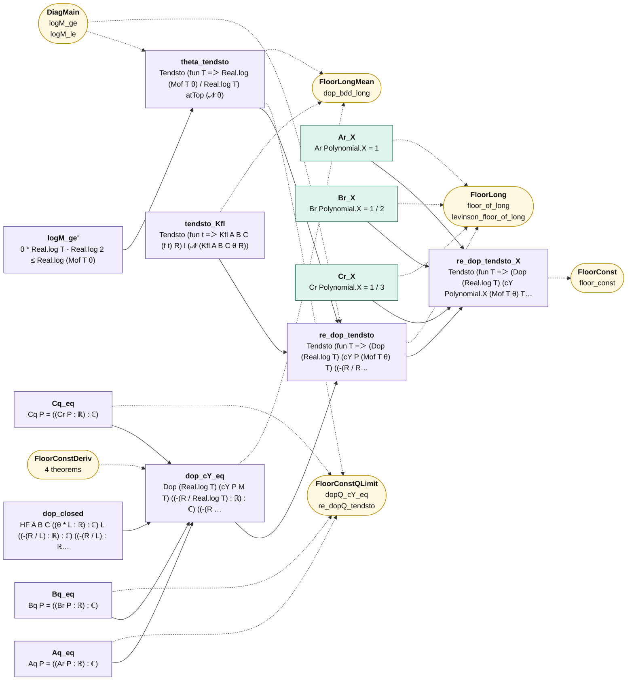

# `lean_stage3/Stage3/FloorConstLimit.lean`

> **Read from the source text.** This file changed after the last `python3 utilities/lean_map.py --dump`, so the arrows on this page are names occurring in each proof and have not been confirmed by Lean.

# FloorConstLimit — block S12 of `lean_stage3/design/stencil.md`, piece 5a, the closed form: Levinson's constant. 2026-11-25.

13 theorems, 4 definitions, 227 lines. 

**Imports:** [`DiagMain`](../lean_stage3/DiagMain.md), [`FloorConstDeriv`](../lean_stage3/FloorConstDeriv.md)  
**Imported by:** [`FloorConst`](../lean_stage3/FloorConst.md), [`FloorConstQLimit`](../lean_stage3/FloorConstQLimit.md), [`FloorLongMean`](../lean_stage3/FloorLongMean.md)

## The picture



An arrow A → B reads "A is used in the proof of B". Green: counting, integers only. Violet: shape, analysis with no ζ. Blue: reads ζ. A name ending in ■ is an end: nothing else uses it. Red: contains `sorry`. Yellow: theorems in another file, counted; a dotted arrow crosses files. Definitions are not drawn; they are listed below the diagram.

## Definitions

<a name="FloorConst-Kfl"></a>
### `FloorConst.Kfl`

def · line 43

Levinson's constant in closed form, `(1 + ∂a)(1 + ∂b)[f(a,b) + e^(−(a+b)) f(−b,−a)]` at `a = b = −R`, `f(a,b) = (A + (a+b)θB + abθ²C)/((a+b)θ)`.

- **Is:** `` Kfl (A B C θ R : ℝ) : ℝ := B - A / (2 * R * θ) - R * θ * C / 2 + θ * C / 2 - A / (2 * R ^ 2 * θ) - θ * C / (4 * R) - A / (4 * R ^ 3 * θ) + Real.exp (2 * R) * (θ * C / (4 * R) + A / (4 * R ^ 3 * θ)) ``
- **Used by 22:** [`FloorConst.Kfl_levinson_eq`](../lean_stage3/FloorConst.md#FloorConst-Kfl_levinson_eq), [`FloorConst.Kfl_levinson_le`](../lean_stage3/FloorConst.md#FloorConst-Kfl_levinson_le), [`FloorConst.Kfl_levinson_lt`](../lean_stage3/FloorConst.md#FloorConst-Kfl_levinson_lt), [`FloorConst.Kfl_levinson_pos`](../lean_stage3/FloorConst.md#FloorConst-Kfl_levinson_pos), [`FloorConst.floor_const`](../lean_stage3/FloorConst.md#FloorConst-floor_const), [`FloorConst.kappaL`](../lean_stage3/FloorConst.md#FloorConst-kappaL), [`FloorConst.kappa_levinson_ge`](../lean_stage3/FloorConst.md#FloorConst-kappa_levinson_ge), [`FloorConst.log_Kfl_levinson_lt`](../lean_stage3/FloorConst.md#FloorConst-log_Kfl_levinson_lt), [`FloorConst.dop_cY_eq`](#FloorConst-dop_cY_eq), [`FloorConst.dop_closed`](#FloorConst-dop_closed), [`FloorConst.re_dop_tendsto`](#FloorConst-re_dop_tendsto), [`FloorConst.re_dop_tendsto_X`](#FloorConst-re_dop_tendsto_X), [`FloorConst.tendsto_Kfl`](#FloorConst-tendsto_Kfl), [`FloorConstQ.KflQ_one_sub`](../lean_stage3/FloorConstQLimit.md#FloorConstQ-KflQ_one_sub), [`FloorLong.floor_lt_half`](../lean_stage3/FloorLong.md#FloorLong-floor_lt_half), [`FloorLong.floor_of_long`](../lean_stage3/FloorLong.md#FloorLong-floor_of_long), [`FloorLong.levinson_floor_of_long`](../lean_stage3/FloorLong.md#FloorLong-levinson_floor_of_long), [`FloorLong.dop_bdd_long`](../lean_stage3/FloorLongMean.md#FloorLong-dop_bdd_long), [`FloorSum.K_ge_one`](../lean_stage3/FloorSum.md#FloorSum-K_ge_one), [`FloorSum.log_K_le`](../lean_stage3/FloorSum.md#FloorSum-log_K_le), [`FloorSum.logmax_le`](../lean_stage3/FloorSum.md#FloorSum-logmax_le), [`FloorSum.step_X`](../lean_stage3/FloorSum.md#FloorSum-step_X)

<a name="FloorConst-Ar"></a>
### `FloorConst.Ar`

def · line 48

`A = ∫₀¹ P′²`, real.

- **Is:** `` Ar (P : Polynomial ℝ) : ℝ := ∫ u in (0 : ℝ)..1, P.derivative.eval u * P.derivative.eval u ``
- **Used by 20:** [`FloorConst.Aq_eq`](#FloorConst-Aq_eq), [`FloorConst.Ar_X`](#FloorConst-Ar_X), [`FloorConst.dop_cY_eq`](#FloorConst-dop_cY_eq), [`FloorConst.re_dop_tendsto`](#FloorConst-re_dop_tendsto), [`FloorConstQ.Ar_P0`](../lean_stage3/FloorConstQ.md#FloorConstQ-Ar_P0), [`FloorConstQ.KflQ_eq`](../lean_stage3/FloorConstQ.md#FloorConstQ-KflQ_eq), [`FloorConstQ.KflQ_lt`](../lean_stage3/FloorConstQ.md#FloorConstQ-KflQ_lt), [`FloorConstQ.KflQ_pos`](../lean_stage3/FloorConstQ.md#FloorConstQ-KflQ_pos), [`FloorConstQ.floor_constQ`](../lean_stage3/FloorConstQ.md#FloorConstQ-floor_constQ), [`FloorConstQ.kappaQ`](../lean_stage3/FloorConstQ.md#FloorConstQ-kappaQ), [`FloorConstQ.kappaQ_gt`](../lean_stage3/FloorConstQ.md#FloorConstQ-kappaQ_gt), [`FloorConstQ.log_KflQ_lt`](../lean_stage3/FloorConstQ.md#FloorConstQ-log_KflQ_lt), [`FloorConstQ.dopQ_cY_eq`](../lean_stage3/FloorConstQLimit.md#FloorConstQ-dopQ_cY_eq), [`FloorConstQ.re_dopQ_tendsto`](../lean_stage3/FloorConstQLimit.md#FloorConstQ-re_dopQ_tendsto), [`FloorLong.floor_lt_half`](../lean_stage3/FloorLong.md#FloorLong-floor_lt_half), [`FloorLong.floor_of_long`](../lean_stage3/FloorLong.md#FloorLong-floor_of_long), [`FloorLong.dop_bdd_long`](../lean_stage3/FloorLongMean.md#FloorLong-dop_bdd_long), [`FloorQ.logmaxQ_le`](../lean_stage3/FloorQ.md#FloorQ-logmaxQ_le), [`FloorQ.stepQ`](../lean_stage3/FloorQ.md#FloorQ-stepQ), [`FloorQ.floor_stepQ`](../lean_stage3/FloorQStep.md#FloorQ-floor_stepQ)

<a name="FloorConst-Br"></a>
### `FloorConst.Br`

def · line 51

`B = ∫₀¹ P′P`, real.

- **Is:** `` Br (P : Polynomial ℝ) : ℝ := ∫ u in (0 : ℝ)..1, P.derivative.eval u * P.eval u ``
- **Used by 20:** [`FloorConst.Bq_eq`](#FloorConst-Bq_eq), [`FloorConst.Br_X`](#FloorConst-Br_X), [`FloorConst.dop_cY_eq`](#FloorConst-dop_cY_eq), [`FloorConst.re_dop_tendsto`](#FloorConst-re_dop_tendsto), [`FloorConstQ.Br_P0`](../lean_stage3/FloorConstQ.md#FloorConstQ-Br_P0), [`FloorConstQ.KflQ_eq`](../lean_stage3/FloorConstQ.md#FloorConstQ-KflQ_eq), [`FloorConstQ.KflQ_lt`](../lean_stage3/FloorConstQ.md#FloorConstQ-KflQ_lt), [`FloorConstQ.KflQ_pos`](../lean_stage3/FloorConstQ.md#FloorConstQ-KflQ_pos), [`FloorConstQ.floor_constQ`](../lean_stage3/FloorConstQ.md#FloorConstQ-floor_constQ), [`FloorConstQ.kappaQ`](../lean_stage3/FloorConstQ.md#FloorConstQ-kappaQ), [`FloorConstQ.kappaQ_gt`](../lean_stage3/FloorConstQ.md#FloorConstQ-kappaQ_gt), [`FloorConstQ.log_KflQ_lt`](../lean_stage3/FloorConstQ.md#FloorConstQ-log_KflQ_lt), [`FloorConstQ.dopQ_cY_eq`](../lean_stage3/FloorConstQLimit.md#FloorConstQ-dopQ_cY_eq), [`FloorConstQ.re_dopQ_tendsto`](../lean_stage3/FloorConstQLimit.md#FloorConstQ-re_dopQ_tendsto), [`FloorLong.floor_lt_half`](../lean_stage3/FloorLong.md#FloorLong-floor_lt_half), [`FloorLong.floor_of_long`](../lean_stage3/FloorLong.md#FloorLong-floor_of_long), [`FloorLong.dop_bdd_long`](../lean_stage3/FloorLongMean.md#FloorLong-dop_bdd_long), [`FloorQ.logmaxQ_le`](../lean_stage3/FloorQ.md#FloorQ-logmaxQ_le), [`FloorQ.stepQ`](../lean_stage3/FloorQ.md#FloorQ-stepQ), [`FloorQ.floor_stepQ`](../lean_stage3/FloorQStep.md#FloorQ-floor_stepQ)

<a name="FloorConst-Cr"></a>
### `FloorConst.Cr`

def · line 54

`C = ∫₀¹ P²`, real.

- **Is:** `` Cr (P : Polynomial ℝ) : ℝ := ∫ u in (0 : ℝ)..1, P.eval u * P.eval u ``
- **Used by 20:** [`FloorConst.Cq_eq`](#FloorConst-Cq_eq), [`FloorConst.Cr_X`](#FloorConst-Cr_X), [`FloorConst.dop_cY_eq`](#FloorConst-dop_cY_eq), [`FloorConst.re_dop_tendsto`](#FloorConst-re_dop_tendsto), [`FloorConstQ.Cr_P0`](../lean_stage3/FloorConstQ.md#FloorConstQ-Cr_P0), [`FloorConstQ.KflQ_eq`](../lean_stage3/FloorConstQ.md#FloorConstQ-KflQ_eq), [`FloorConstQ.KflQ_lt`](../lean_stage3/FloorConstQ.md#FloorConstQ-KflQ_lt), [`FloorConstQ.KflQ_pos`](../lean_stage3/FloorConstQ.md#FloorConstQ-KflQ_pos), [`FloorConstQ.floor_constQ`](../lean_stage3/FloorConstQ.md#FloorConstQ-floor_constQ), [`FloorConstQ.kappaQ`](../lean_stage3/FloorConstQ.md#FloorConstQ-kappaQ), [`FloorConstQ.kappaQ_gt`](../lean_stage3/FloorConstQ.md#FloorConstQ-kappaQ_gt), [`FloorConstQ.log_KflQ_lt`](../lean_stage3/FloorConstQ.md#FloorConstQ-log_KflQ_lt), [`FloorConstQ.dopQ_cY_eq`](../lean_stage3/FloorConstQLimit.md#FloorConstQ-dopQ_cY_eq), [`FloorConstQ.re_dopQ_tendsto`](../lean_stage3/FloorConstQLimit.md#FloorConstQ-re_dopQ_tendsto), [`FloorLong.floor_lt_half`](../lean_stage3/FloorLong.md#FloorLong-floor_lt_half), [`FloorLong.floor_of_long`](../lean_stage3/FloorLong.md#FloorLong-floor_of_long), [`FloorLong.dop_bdd_long`](../lean_stage3/FloorLongMean.md#FloorLong-dop_bdd_long), [`FloorQ.logmaxQ_le`](../lean_stage3/FloorQ.md#FloorQ-logmaxQ_le), [`FloorQ.stepQ`](../lean_stage3/FloorQ.md#FloorQ-stepQ), [`FloorQ.floor_stepQ`](../lean_stage3/FloorQStep.md#FloorQ-floor_stepQ)

## Theorems

<a name="FloorConst-Aq_eq"></a>
### `FloorConst.Aq_eq`

line 58 · arrows read from text

**Shape.** Uses real or complex analysis; nothing in it or beneath it reads ζ.

**Proves**

```lean
Aq P = ((Ar P : ℝ) : ℂ)
```

**Needs** (its hypotheses)

  - `` P : Polynomial ℝ ``

**Fed by:** no theorem of this repo; it stands on Mathlib and the definitions below.

**Definitions its proof touches:** [`FloorConst.Ar`](#FloorConst-Ar), [`Operator.Aq`](../lean_stage3/OperatorCY.md#Operator-Aq)

**Feeds** (2 that use it)

  - [`FloorConst.dop_cY_eq`](#FloorConst-dop_cY_eq) — `` Dop (Real.log T) (cY P M T) ((-(R / Real.log T) : ℝ) : ℂ) ((-(R / Real.log T) : ℝ) : ℂ) = ((Kfl (Ar P) (Br P) (Cr P) (Real.log M / Real.log T) R : ℝ) … ``
  - [`FloorConstQ.dopQ_cY_eq`](../lean_stage3/FloorConstQLimit.md#FloorConstQ-dopQ_cY_eq) (FloorConstQLimit) — `` MeanQ.DopQ Q (Real.log T) (cY P M T) ((-(R / Real.log T) : ℝ) : ℂ) ((-(R / Real.log T) : ℝ) : ℂ) = ((KflQ Q (FloorConst.Ar P) (FloorConst.Br P) (Floor… ``

<a name="FloorConst-Bq_eq"></a>
### `FloorConst.Bq_eq`

line 63 · arrows read from text

**Shape.** Uses real or complex analysis; nothing in it or beneath it reads ζ.

**Proves**

```lean
Bq P = ((Br P : ℝ) : ℂ)
```

**Needs** (its hypotheses)

  - `` P : Polynomial ℝ ``

**Fed by:** no theorem of this repo; it stands on Mathlib and the definitions below.

**Definitions its proof touches:** [`FloorConst.Br`](#FloorConst-Br), [`Operator.Bq`](../lean_stage3/OperatorCY.md#Operator-Bq)

**Feeds** (2 that use it)

  - [`FloorConst.dop_cY_eq`](#FloorConst-dop_cY_eq) — `` Dop (Real.log T) (cY P M T) ((-(R / Real.log T) : ℝ) : ℂ) ((-(R / Real.log T) : ℝ) : ℂ) = ((Kfl (Ar P) (Br P) (Cr P) (Real.log M / Real.log T) R : ℝ) … ``
  - [`FloorConstQ.dopQ_cY_eq`](../lean_stage3/FloorConstQLimit.md#FloorConstQ-dopQ_cY_eq) (FloorConstQLimit) — `` MeanQ.DopQ Q (Real.log T) (cY P M T) ((-(R / Real.log T) : ℝ) : ℂ) ((-(R / Real.log T) : ℝ) : ℂ) = ((KflQ Q (FloorConst.Ar P) (FloorConst.Br P) (Floor… ``

<a name="FloorConst-Cq_eq"></a>
### `FloorConst.Cq_eq`

line 68 · arrows read from text

**Shape.** Uses real or complex analysis; nothing in it or beneath it reads ζ.

**Proves**

```lean
Cq P = ((Cr P : ℝ) : ℂ)
```

**Needs** (its hypotheses)

  - `` P : Polynomial ℝ ``

**Fed by:** no theorem of this repo; it stands on Mathlib and the definitions below.

**Definitions its proof touches:** [`FloorConst.Cr`](#FloorConst-Cr), [`Operator.Cq`](../lean_stage3/OperatorCY.md#Operator-Cq)

**Feeds** (2 that use it)

  - [`FloorConst.dop_cY_eq`](#FloorConst-dop_cY_eq) — `` Dop (Real.log T) (cY P M T) ((-(R / Real.log T) : ℝ) : ℂ) ((-(R / Real.log T) : ℝ) : ℂ) = ((Kfl (Ar P) (Br P) (Cr P) (Real.log M / Real.log T) R : ℝ) … ``
  - [`FloorConstQ.dopQ_cY_eq`](../lean_stage3/FloorConstQLimit.md#FloorConstQ-dopQ_cY_eq) (FloorConstQLimit) — `` MeanQ.DopQ Q (Real.log T) (cY P M T) ((-(R / Real.log T) : ℝ) : ℂ) ((-(R / Real.log T) : ℝ) : ℂ) = ((KflQ Q (FloorConst.Ar P) (FloorConst.Br P) (Floor… ``

<a name="FloorConst-dop_closed"></a>
### `FloorConst.dop_closed`

line 75 · arrows read from text

**Shape.** Uses real or complex analysis; nothing in it or beneath it reads ζ.

**Why.** The algebra: at `x = y = −R/L`, `λ = L`, `ℓ = θL`, the operator on `g(1 − E) + 2BE` is `Kfl`.

**Proves**

```lean
HF A B C ((θ * L : ℝ) : ℂ) L ((-(R / L) : ℝ) : ℂ) ((-(R / L) : ℝ) : ℂ) + 1 / (L : ℂ) * (Hx A B C ((θ * L : ℝ) : ℂ) L ((-(R / L) : ℝ) : ℂ) ((-(R / L) : ℝ) : ℂ) + Hy A B C ((θ * L : ℝ) : ℂ) L ((-(R / L) : ℝ) : ℂ) ((-(R / L) : ℝ) : ℂ)) + 1 / (L : ℂ) ^ 2 * Hxy A B C ((θ * L : ℝ) : ℂ) L ((-(R / L) : ℝ) : ℂ) ((-(R / L) : ℝ) : ℂ) = ((Kfl A B C θ R : ℝ) : ℂ)
```

**Needs** (its hypotheses)

  - `` hL : L ≠ 0 ``
  - `` hθ : θ ≠ 0 ``
  - `` hR : R ≠ 0 ``

**Fed by:** no theorem of this repo; it stands on Mathlib and the definitions below.

**Definitions its proof touches:** [`FloorConst.EF`](../lean_stage3/FloorConstDeriv.md#FloorConst-EF), [`FloorConst.HF`](../lean_stage3/FloorConstDeriv.md#FloorConst-HF), [`FloorConst.Hx`](../lean_stage3/FloorConstDeriv.md#FloorConst-Hx), [`FloorConst.Hxy`](../lean_stage3/FloorConstDeriv.md#FloorConst-Hxy), [`FloorConst.Hy`](../lean_stage3/FloorConstDeriv.md#FloorConst-Hy), [`FloorConst.gF`](../lean_stage3/FloorConstDeriv.md#FloorConst-gF), [`FloorConst.gx`](../lean_stage3/FloorConstDeriv.md#FloorConst-gx), [`FloorConst.gxy`](../lean_stage3/FloorConstDeriv.md#FloorConst-gxy), [`FloorConst.gy`](../lean_stage3/FloorConstDeriv.md#FloorConst-gy), [`FloorConst.Kfl`](#FloorConst-Kfl)

**Feeds** (1 that use it)

  - [`FloorConst.dop_cY_eq`](#FloorConst-dop_cY_eq) — `` Dop (Real.log T) (cY P M T) ((-(R / Real.log T) : ℝ) : ℂ) ((-(R / Real.log T) : ℝ) : ℂ) = ((Kfl (Ar P) (Br P) (Cr P) (Real.log M / Real.log T) R : ℝ) … ``

<a name="FloorConst-dop_cY_eq"></a>
### `FloorConst.dop_cY_eq`

line 100 · arrows read from text

**Shape.** Uses real or complex analysis; nothing in it or beneath it reads ζ.

**Why.** `D[c]` in closed form: `D[c](−R/L, −R/L) = Kfl A B C θ' R`, `θ' = log M / log T`, exactly, for `T > 1`, `log M ≠ 0`, `R ≠ 0`.

**Proves**

```lean
Dop (Real.log T) (cY P M T) ((-(R / Real.log T) : ℝ) : ℂ) ((-(R / Real.log T) : ℝ) : ℂ) = ((Kfl (Ar P) (Br P) (Cr P) (Real.log M / Real.log T) R : ℝ) : ℂ)
```

**Needs** (its hypotheses)

  - `` P : Polynomial ℝ ``
  - `` hT : 1 < T ``
  - `` hℓ : Real.log M ≠ 0 ``
  - `` hR : R ≠ 0 ``

**Fed by** (8 theorems its proof uses)

  - [`FloorConst.cY_eq_HF`](../lean_stage3/FloorConstDeriv.md#FloorConst-cY_eq_HF) (FloorConstDeriv) — `` cY P M T x y = HF (Aq P) (Bq P) (Cq P) ((Real.log M : ℝ) : ℂ) (Complex.log (T : ℂ)) x y ``
  - [`FloorConst.pa_cY`](../lean_stage3/FloorConstDeriv.md#FloorConst-pa_cY) (FloorConstDeriv) — `` pa (cY P M T) x y = Hx (Aq P) (Bq P) (Cq P) ((Real.log M : ℝ) : ℂ) (Complex.log (T : ℂ)) x y ``
  - [`FloorConst.pab_cY`](../lean_stage3/FloorConstDeriv.md#FloorConst-pab_cY) (FloorConstDeriv) — `` pab (cY P M T) x y = Hxy (Aq P) (Bq P) (Cq P) ((Real.log M : ℝ) : ℂ) (Complex.log (T : ℂ)) x y ``
  - [`FloorConst.pb_cY`](../lean_stage3/FloorConstDeriv.md#FloorConst-pb_cY) (FloorConstDeriv) — `` pb (cY P M T) x y = Hy (Aq P) (Bq P) (Cq P) ((Real.log M : ℝ) : ℂ) (Complex.log (T : ℂ)) x y ``
  - [`FloorConst.Aq_eq`](#FloorConst-Aq_eq) — `` Aq P = ((Ar P : ℝ) : ℂ) ``
  - [`FloorConst.Bq_eq`](#FloorConst-Bq_eq) — `` Bq P = ((Br P : ℝ) : ℂ) ``
  - [`FloorConst.Cq_eq`](#FloorConst-Cq_eq) — `` Cq P = ((Cr P : ℝ) : ℂ) ``
  - [`FloorConst.dop_closed`](#FloorConst-dop_closed) — `` HF A B C ((θ * L : ℝ) : ℂ) L ((-(R / L) : ℝ) : ℂ) ((-(R / L) : ℝ) : ℂ) + 1 / (L : ℂ) * (Hx A B C ((θ * L : ℝ) : ℂ) L ((-(R / L) : ℝ) : ℂ) ((-(R / L) :… ``

**Definitions its proof touches:** [`FloorConst.Ar`](#FloorConst-Ar), [`FloorConst.Br`](#FloorConst-Br), [`FloorConst.Cr`](#FloorConst-Cr), [`FloorConst.Kfl`](#FloorConst-Kfl), [`Operator.Dop`](../lean_stage3/OperatorCauchy.md#Operator-Dop), [`TwistedMoment.cY`](../lean_stage3/TwistedMoment.md#TwistedMoment-cY)

**Feeds** (2 that use it)

  - [`FloorConst.re_dop_tendsto`](#FloorConst-re_dop_tendsto) — `` Tendsto (fun T => (Dop (Real.log T) (cY P (Mof T θ) T) ((-(R / Real.log T) : ℝ) : ℂ) ((-(R / Real.log T) : ℝ) : ℂ)).re) atTop (𝓝 (Kfl (Ar P) (Br P) (C… ``
  - [`FloorLong.dop_bdd_long`](../lean_stage3/FloorLongMean.md#FloorLong-dop_bdd_long) (FloorLongMean) — `` ∃ K : ℝ, 0 ≤ K ∧ ∃ T₀ : ℝ, ∀ T : ℝ, T₀ ≤ T → ‖Dop (Real.log T) (cY P (Mof T θ) T) ((-(R / Real.log T) : ℝ) : ℂ) ((-(R / Real.log T) : ℝ) : ℂ)‖ ≤ K ``

<a name="FloorConst-logM_ge-"></a>
### `FloorConst.logM_ge'`

line 123 · arrows read from text

**Shape.** Uses real or complex analysis; nothing in it or beneath it reads ζ.

**Why.** `θ log T − log 2 ≤ log M`, `M = ⌊T^θ⌋`, `T ≥ 1`, `θ ≥ 0`.

**Proves**

```lean
θ * Real.log T - Real.log 2 ≤ Real.log (Mof T θ)
```

**Needs** (its hypotheses)

  - `` hT : 1 ≤ T ``
  - `` hθ : 0 ≤ θ ``

**Fed by:** no theorem of this repo; it stands on Mathlib and the definitions below.

**Definitions its proof touches:** [`TwistedMoment.Mof`](../lean_stage3/TwistedMoment.md#TwistedMoment-Mof)

**Feeds** (1 that use it)

  - [`FloorConst.theta_tendsto`](#FloorConst-theta_tendsto) — `` Tendsto (fun T => Real.log (Mof T θ) / Real.log T) atTop (𝓝 θ) ``

<a name="FloorConst-theta_tendsto"></a>
### `FloorConst.theta_tendsto`

line 138 · arrows read from text

**Shape.** Uses real or complex analysis; nothing in it or beneath it reads ζ.

**Why.** `θ' = log M / log T → θ`.

**Proves**

```lean
Tendsto (fun T => Real.log (Mof T θ) / Real.log T) atTop (𝓝 θ)
```

**Needs** (its hypotheses)

  - `` hθ : 0 < θ ``

**Fed by** (2 theorems its proof uses)

  - [`DiagMain.logM_le`](../lean_stage3/DiagMain.md#DiagMain-logM_le) (DiagMain) — `` Real.log (Mof T θ) ≤ θ * Real.log T ``
  - [`FloorConst.logM_ge'`](#FloorConst-logM_ge-) — `` θ * Real.log T - Real.log 2 ≤ Real.log (Mof T θ) ``

**Definitions its proof touches:** [`TwistedMoment.Mof`](../lean_stage3/TwistedMoment.md#TwistedMoment-Mof)

**Feeds** (3 that use it)

  - [`FloorConst.re_dop_tendsto`](#FloorConst-re_dop_tendsto) — `` Tendsto (fun T => (Dop (Real.log T) (cY P (Mof T θ) T) ((-(R / Real.log T) : ℝ) : ℂ) ((-(R / Real.log T) : ℝ) : ℂ)).re) atTop (𝓝 (Kfl (Ar P) (Br P) (C… ``
  - [`FloorConstQ.re_dopQ_tendsto`](../lean_stage3/FloorConstQLimit.md#FloorConstQ-re_dopQ_tendsto) (FloorConstQLimit) — `` Tendsto (fun T => (MeanQ.DopQ Q (Real.log T) (cY P (Mof T θ) T) ((-(R / Real.log T) : ℝ) : ℂ) ((-(R / Real.log T) : ℝ) : ℂ)).re) atTop (𝓝 (KflQ Q (Flo… ``
  - [`FloorLong.dop_bdd_long`](../lean_stage3/FloorLongMean.md#FloorLong-dop_bdd_long) (FloorLongMean) — `` ∃ K : ℝ, 0 ≤ K ∧ ∃ T₀ : ℝ, ∀ T : ℝ, T₀ ≤ T → ‖Dop (Real.log T) (cY P (Mof T θ) T) ((-(R / Real.log T) : ℝ) : ℂ) ((-(R / Real.log T) : ℝ) : ℂ)‖ ≤ K ``

<a name="FloorConst-tendsto_Kfl"></a>
### `FloorConst.tendsto_Kfl`

line 157 · arrows read from text

**Shape.** Uses real or complex analysis; nothing in it or beneath it reads ζ.

**Why.** `Kfl` is continuous in `θ ≠ 0`.

**Proves**

```lean
Tendsto (fun t => Kfl A B C (f t) R) l (𝓝 (Kfl A B C θ R))
```

**Needs** (its hypotheses)

  - `` A B C R : ℝ ``
  - `` hθ : θ ≠ 0 ``
  - `` h : Tendsto f l (𝓝 θ) ``

**Fed by:** no theorem of this repo; it stands on Mathlib and the definitions below.

**Definitions its proof touches:** [`FloorConst.Kfl`](#FloorConst-Kfl)

**Feeds** (2 that use it)

  - [`FloorConst.re_dop_tendsto`](#FloorConst-re_dop_tendsto) — `` Tendsto (fun T => (Dop (Real.log T) (cY P (Mof T θ) T) ((-(R / Real.log T) : ℝ) : ℂ) ((-(R / Real.log T) : ℝ) : ℂ)).re) atTop (𝓝 (Kfl (Ar P) (Br P) (C… ``
  - [`FloorLong.dop_bdd_long`](../lean_stage3/FloorLongMean.md#FloorLong-dop_bdd_long) (FloorLongMean) — `` ∃ K : ℝ, 0 ≤ K ∧ ∃ T₀ : ℝ, ∀ T : ℝ, T₀ ≤ T → ‖Dop (Real.log T) (cY P (Mof T θ) T) ((-(R / Real.log T) : ℝ) : ℂ) ((-(R / Real.log T) : ℝ) : ℂ)‖ ≤ K ``

<a name="FloorConst-re_dop_tendsto"></a>
### `FloorConst.re_dop_tendsto`

line 174 · arrows read from text

**Shape.** Uses real or complex analysis; nothing in it or beneath it reads ζ.

**Why.** The limit of Levinson's constant: `Re D[c](−R/L, −R/L) → Kfl A B C θ R` as `T → ∞`, `M = ⌊T^θ⌋`, for `θ > 0`, `R ≠ 0`.

**Proves**

```lean
Tendsto (fun T => (Dop (Real.log T) (cY P (Mof T θ) T) ((-(R / Real.log T) : ℝ) : ℂ) ((-(R / Real.log T) : ℝ) : ℂ)).re) atTop (𝓝 (Kfl (Ar P) (Br P) (Cr P) θ R))
```

**Needs** (its hypotheses)

  - `` P : Polynomial ℝ ``
  - `` hθ : 0 < θ ``
  - `` hR : R ≠ 0 ``

**Fed by** (4 theorems its proof uses)

  - [`DiagMain.logM_ge`](../lean_stage3/DiagMain.md#DiagMain-logM_ge) (DiagMain) — `` θ * Real.log T / 2 ≤ Real.log (Mof T θ) ``
  - [`FloorConst.dop_cY_eq`](#FloorConst-dop_cY_eq) — `` Dop (Real.log T) (cY P M T) ((-(R / Real.log T) : ℝ) : ℂ) ((-(R / Real.log T) : ℝ) : ℂ) = ((Kfl (Ar P) (Br P) (Cr P) (Real.log M / Real.log T) R : ℝ) … ``
  - [`FloorConst.tendsto_Kfl`](#FloorConst-tendsto_Kfl) — `` Tendsto (fun t => Kfl A B C (f t) R) l (𝓝 (Kfl A B C θ R)) ``
  - [`FloorConst.theta_tendsto`](#FloorConst-theta_tendsto) — `` Tendsto (fun T => Real.log (Mof T θ) / Real.log T) atTop (𝓝 θ) ``

**Definitions its proof touches:** [`FloorConst.Ar`](#FloorConst-Ar), [`FloorConst.Br`](#FloorConst-Br), [`FloorConst.Cr`](#FloorConst-Cr), [`FloorConst.Kfl`](#FloorConst-Kfl), [`Operator.Dop`](../lean_stage3/OperatorCauchy.md#Operator-Dop), [`TwistedMoment.Mof`](../lean_stage3/TwistedMoment.md#TwistedMoment-Mof), [`TwistedMoment.cY`](../lean_stage3/TwistedMoment.md#TwistedMoment-cY)

**Feeds** (2 that use it)

  - [`FloorConst.re_dop_tendsto_X`](#FloorConst-re_dop_tendsto_X) — `` Tendsto (fun T => (Dop (Real.log T) (cY Polynomial.X (Mof T θ) T) ((-(R / Real.log T) : ℝ) : ℂ) ((-(R / Real.log T) : ℝ) : ℂ)).re) atTop (𝓝 (Kfl 1 (1 … ``
  - [`FloorLong.floor_of_long`](../lean_stage3/FloorLong.md#FloorLong-floor_of_long) (FloorLong) — `` ∀ ε : ℝ, 0 < ε → ∃ T₀ : ℝ, ∀ T : ℝ, T₀ ≤ T → (1 - Real.log (max 1 (Kfl (Ar P) (Br P) (Cr P) θ R)) / R - ε) * riemannZeta.N T ≤ (LineCount.lineCount T … ``

<a name="FloorConst-Ar_X"></a>
### `FloorConst.Ar_X`

line 189 · arrows read from text

**Counting.** Integers only: nothing in its statement or proof, or in anything it rests on, uses analysis or ζ.

**Proves**

```lean
Ar Polynomial.X = 1
```

**Fed by:** no theorem of this repo; it stands on Mathlib and the definitions below.

**Definitions its proof touches:** [`FloorConst.Ar`](#FloorConst-Ar)

**Feeds** (2 that use it)

  - [`FloorConst.re_dop_tendsto_X`](#FloorConst-re_dop_tendsto_X) — `` Tendsto (fun T => (Dop (Real.log T) (cY Polynomial.X (Mof T θ) T) ((-(R / Real.log T) : ℝ) : ℂ) ((-(R / Real.log T) : ℝ) : ℂ)).re) atTop (𝓝 (Kfl 1 (1 … ``
  - [`FloorLong.levinson_floor_of_long`](../lean_stage3/FloorLong.md#FloorLong-levinson_floor_of_long) (FloorLong) — `` ∀ ε : ℝ, 0 < ε → ∃ T₀ : ℝ, ∀ T : ℝ, T₀ ≤ T → (1 / 3 - ε) * riemannZeta.N T ≤ (LineCount.lineCount T : ℝ) ``

<a name="FloorConst-Br_X"></a>
### `FloorConst.Br_X`

line 193 · arrows read from text

**Counting.** Integers only: nothing in its statement or proof, or in anything it rests on, uses analysis or ζ.

**Proves**

```lean
Br Polynomial.X = 1 / 2
```

**Fed by:** no theorem of this repo; it stands on Mathlib and the definitions below.

**Definitions its proof touches:** [`FloorConst.Br`](#FloorConst-Br)

**Feeds** (2 that use it)

  - [`FloorConst.re_dop_tendsto_X`](#FloorConst-re_dop_tendsto_X) — `` Tendsto (fun T => (Dop (Real.log T) (cY Polynomial.X (Mof T θ) T) ((-(R / Real.log T) : ℝ) : ℂ) ((-(R / Real.log T) : ℝ) : ℂ)).re) atTop (𝓝 (Kfl 1 (1 … ``
  - [`FloorLong.levinson_floor_of_long`](../lean_stage3/FloorLong.md#FloorLong-levinson_floor_of_long) (FloorLong) — `` ∀ ε : ℝ, 0 < ε → ∃ T₀ : ℝ, ∀ T : ℝ, T₀ ≤ T → (1 / 3 - ε) * riemannZeta.N T ≤ (LineCount.lineCount T : ℝ) ``

<a name="FloorConst-Cr_X"></a>
### `FloorConst.Cr_X`

line 199 · arrows read from text

**Counting.** Integers only: nothing in its statement or proof, or in anything it rests on, uses analysis or ζ.

**Proves**

```lean
Cr Polynomial.X = 1 / 3
```

**Fed by:** no theorem of this repo; it stands on Mathlib and the definitions below.

**Definitions its proof touches:** [`FloorConst.Cr`](#FloorConst-Cr)

**Feeds** (2 that use it)

  - [`FloorConst.re_dop_tendsto_X`](#FloorConst-re_dop_tendsto_X) — `` Tendsto (fun T => (Dop (Real.log T) (cY Polynomial.X (Mof T θ) T) ((-(R / Real.log T) : ℝ) : ℂ) ((-(R / Real.log T) : ℝ) : ℂ)).re) atTop (𝓝 (Kfl 1 (1 … ``
  - [`FloorLong.levinson_floor_of_long`](../lean_stage3/FloorLong.md#FloorLong-levinson_floor_of_long) (FloorLong) — `` ∀ ε : ℝ, 0 < ε → ∃ T₀ : ℝ, ∀ T : ℝ, T₀ ≤ T → (1 / 3 - ε) * riemannZeta.N T ≤ (LineCount.lineCount T : ℝ) ``

<a name="FloorConst-re_dop_tendsto_X"></a>
### `FloorConst.re_dop_tendsto_X`

line 207 · arrows read from text

**Shape.** Uses real or complex analysis; nothing in it or beneath it reads ζ.

**Why.** At Levinson's `P(x) = x`: `Re D[c] → Kfl 1 (1/2) (1/3) θ R`.

**Proves**

```lean
Tendsto (fun T => (Dop (Real.log T) (cY Polynomial.X (Mof T θ) T) ((-(R / Real.log T) : ℝ) : ℂ) ((-(R / Real.log T) : ℝ) : ℂ)).re) atTop (𝓝 (Kfl 1 (1 / 2) (1 / 3) θ R))
```

**Needs** (its hypotheses)

  - `` hθ : 0 < θ ``
  - `` hR : R ≠ 0 ``

**Fed by** (4 theorems its proof uses)

  - [`FloorConst.Ar_X`](#FloorConst-Ar_X) — `` Ar Polynomial.X = 1 ``
  - [`FloorConst.Br_X`](#FloorConst-Br_X) — `` Br Polynomial.X = 1 / 2 ``
  - [`FloorConst.Cr_X`](#FloorConst-Cr_X) — `` Cr Polynomial.X = 1 / 3 ``
  - [`FloorConst.re_dop_tendsto`](#FloorConst-re_dop_tendsto) — `` Tendsto (fun T => (Dop (Real.log T) (cY P (Mof T θ) T) ((-(R / Real.log T) : ℝ) : ℂ) ((-(R / Real.log T) : ℝ) : ℂ)).re) atTop (𝓝 (Kfl (Ar P) (Br P) (C… ``

**Definitions its proof touches:** [`FloorConst.Kfl`](#FloorConst-Kfl), [`Operator.Dop`](../lean_stage3/OperatorCauchy.md#Operator-Dop), [`TwistedMoment.Mof`](../lean_stage3/TwistedMoment.md#TwistedMoment-Mof), [`TwistedMoment.cY`](../lean_stage3/TwistedMoment.md#TwistedMoment-cY)

**Feeds** (1 that use it)

  - [`FloorConst.floor_const`](../lean_stage3/FloorConst.md#FloorConst-floor_const) (FloorConst) — `` Tendsto (fun T => (Dop (Real.log T) (cY Polynomial.X (Mof T (49 / 100)) T) ((-((13 / 10) / Real.log T) : ℝ) : ℂ) ((-((13 / 10) / Real.log T) : ℝ) : ℂ)… ``

