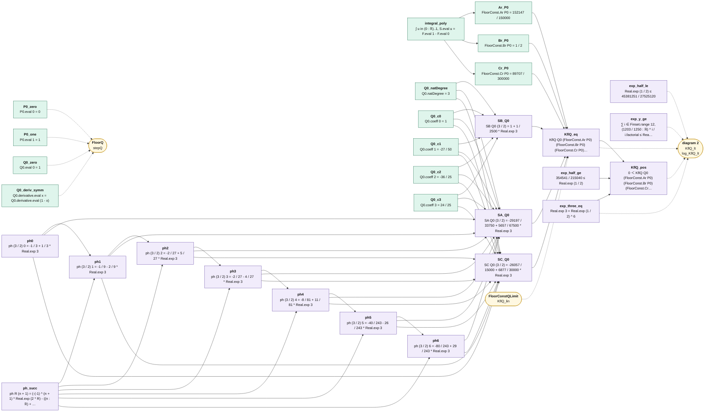
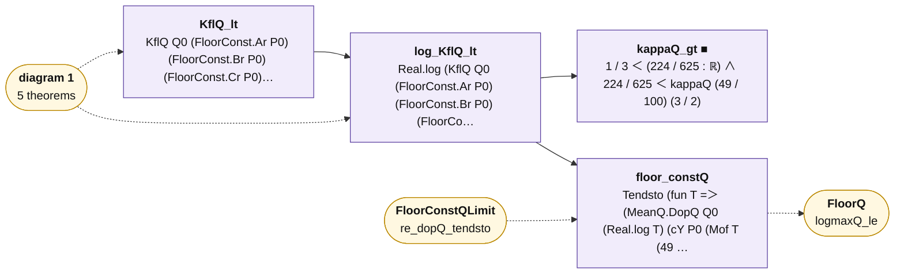

# `lean_stage3/Stage3/FloorConstQ.lean`

> **Read from the source text.** This file changed after the last `python3 utilities/lean_map.py --dump`, so the arrows on this page are names occurring in each proof and have not been confirmed by Lean.

# FloorConstQ — block S13 of `lean_stage3/design/stencil.md`, B4 step 4, the closed form for a general Q: the limit and its value at a cubic Q. 2026-11-25.

34 theorems, 3 definitions, 269 lines. 

**Imports:** [`FloorConstQLimit`](../lean_stage3/FloorConstQLimit.md)  
**Imported by:** [`Stage3`](../lean_stage3/Stage3.md), [`FloorQ`](../lean_stage3/FloorQ.md)

## The picture

### Diagram 1 of 2: `P0_zero` to `KflQ_pos`



### Diagram 2 of 2: `KflQ_lt` to `floor_constQ`



An arrow A → B reads "A is used in the proof of B". Green: counting, integers only. Violet: shape, analysis with no ζ. Blue: reads ζ. A name ending in ■ is an end: nothing else uses it. Red: contains `sorry`. Yellow: theorems in another file, counted; a dotted arrow crosses files. Definitions are not drawn; they are listed below the diagram.

## Definitions

<a name="FloorConstQ-P0"></a>
### `FloorConstQ.P0`

def · line 45

`P₀(x) = (7/50)x³ − (1/100)x² + (87/100)x`.

- **Is:** `` P0 : ℝ[X] := C (7 / 50) * X ^ 3 + C (-1 / 100) * X ^ 2 + C (87 / 100) * X ``
- **Used by 14:** [`FloorConstQ.Ar_P0`](#FloorConstQ-Ar_P0), [`FloorConstQ.Br_P0`](#FloorConstQ-Br_P0), [`FloorConstQ.Cr_P0`](#FloorConstQ-Cr_P0), [`FloorConstQ.KflQ_eq`](#FloorConstQ-KflQ_eq), [`FloorConstQ.KflQ_lt`](#FloorConstQ-KflQ_lt), [`FloorConstQ.KflQ_pos`](#FloorConstQ-KflQ_pos), [`FloorConstQ.P0_one`](#FloorConstQ-P0_one), [`FloorConstQ.P0_zero`](#FloorConstQ-P0_zero), [`FloorConstQ.floor_constQ`](#FloorConstQ-floor_constQ), [`FloorConstQ.kappaQ`](#FloorConstQ-kappaQ), [`FloorConstQ.kappaQ_gt`](#FloorConstQ-kappaQ_gt), [`FloorConstQ.log_KflQ_lt`](#FloorConstQ-log_KflQ_lt), [`FloorQ.logmaxQ_le`](../lean_stage3/FloorQ.md#FloorQ-logmaxQ_le), [`FloorQ.stepQ`](../lean_stage3/FloorQ.md#FloorQ-stepQ)

<a name="FloorConstQ-Q0"></a>
### `FloorConstQ.Q0`

def · line 48

`Q₀(x) = (24/25)x³ − (36/25)x² − (27/50)x + 1`.

- **Is:** `` Q0 : ℝ[X] := C (24 / 25) * X ^ 3 + C (-36 / 25) * X ^ 2 + C (-27 / 50) * X + C 1 ``
- **Used by 18:** [`FloorConstQ.KflQ_eq`](#FloorConstQ-KflQ_eq), [`FloorConstQ.KflQ_lt`](#FloorConstQ-KflQ_lt), [`FloorConstQ.KflQ_pos`](#FloorConstQ-KflQ_pos), [`FloorConstQ.Q0_c0`](#FloorConstQ-Q0_c0), [`FloorConstQ.Q0_c1`](#FloorConstQ-Q0_c1), [`FloorConstQ.Q0_c2`](#FloorConstQ-Q0_c2), [`FloorConstQ.Q0_c3`](#FloorConstQ-Q0_c3), [`FloorConstQ.Q0_deriv_symm`](#FloorConstQ-Q0_deriv_symm), [`FloorConstQ.Q0_zero`](#FloorConstQ-Q0_zero), [`FloorConstQ.SA_Q0`](#FloorConstQ-SA_Q0), [`FloorConstQ.SB_Q0`](#FloorConstQ-SB_Q0), [`FloorConstQ.SC_Q0`](#FloorConstQ-SC_Q0), [`FloorConstQ.floor_constQ`](#FloorConstQ-floor_constQ), [`FloorConstQ.kappaQ`](#FloorConstQ-kappaQ), [`FloorConstQ.kappaQ_gt`](#FloorConstQ-kappaQ_gt), [`FloorConstQ.log_KflQ_lt`](#FloorConstQ-log_KflQ_lt), [`FloorQ.logmaxQ_le`](../lean_stage3/FloorQ.md#FloorQ-logmaxQ_le), [`FloorQ.stepQ`](../lean_stage3/FloorQ.md#FloorQ-stepQ)

<a name="FloorConstQ-kappaQ"></a>
### `FloorConstQ.kappaQ`

def · line 51

The proportion `κ = 1 − log K / R` at `P₀`, `Q₀`.

- **Is:** `` kappaQ (θ R : ℝ) : ℝ := 1 - Real.log (KflQ Q0 (FloorConst.Ar P0) (FloorConst.Br P0) (FloorConst.Cr P0) θ R) / R ``
- **Built from:** [`FloorConst.Ar`](../lean_stage3/FloorConstLimit.md#FloorConst-Ar), [`FloorConst.Br`](../lean_stage3/FloorConstLimit.md#FloorConst-Br), [`FloorConst.Cr`](../lean_stage3/FloorConstLimit.md#FloorConst-Cr), [`FloorConstQ.P0`](#FloorConstQ-P0), [`FloorConstQ.Q0`](#FloorConstQ-Q0), [`FloorConstQ.KflQ`](../lean_stage3/FloorConstQLimit.md#FloorConstQ-KflQ)
- **Used by 1:** [`FloorConstQ.kappaQ_gt`](#FloorConstQ-kappaQ_gt)

## Theorems

<a name="FloorConstQ-P0_zero"></a>
### `FloorConstQ.P0_zero`

line 56 · arrows read from text

**Counting.** Integers only: nothing in its statement or proof, or in anything it rests on, uses analysis or ζ.

**Proves**

```lean
P0.eval 0 = 0
```

**Fed by:** no theorem of this repo; it stands on Mathlib and the definitions below.

**Definitions its proof touches:** [`FloorConstQ.P0`](#FloorConstQ-P0)

**Feeds** (1 that use it)

  - [`FloorQ.stepQ`](../lean_stage3/FloorQ.md#FloorQ-stepQ) (FloorQ) — `` ∃ T₁ : ℝ, 1 ≤ T₁ ∧ ∀ T : ℝ, T₁ ≤ T → (224 / 625 - 2 * ε₁) * (riemannZeta.N T - riemannZeta.N (T / 2)) - ε₁ * T * Real.log T ≤ (LineCount.lineCount T :… ``

<a name="FloorConstQ-P0_one"></a>
### `FloorConstQ.P0_one`

line 58 · arrows read from text

**Counting.** Integers only: nothing in its statement or proof, or in anything it rests on, uses analysis or ζ.

**Proves**

```lean
P0.eval 1 = 1
```

**Fed by:** no theorem of this repo; it stands on Mathlib and the definitions below.

**Definitions its proof touches:** [`FloorConstQ.P0`](#FloorConstQ-P0)

**Feeds** (1 that use it)

  - [`FloorQ.stepQ`](../lean_stage3/FloorQ.md#FloorQ-stepQ) (FloorQ) — `` ∃ T₁ : ℝ, 1 ≤ T₁ ∧ ∀ T : ℝ, T₁ ≤ T → (224 / 625 - 2 * ε₁) * (riemannZeta.N T - riemannZeta.N (T / 2)) - ε₁ * T * Real.log T ≤ (LineCount.lineCount T :… ``

<a name="FloorConstQ-Q0_zero"></a>
### `FloorConstQ.Q0_zero`

line 62 · arrows read from text

**Counting.** Integers only: nothing in its statement or proof, or in anything it rests on, uses analysis or ζ.

**Proves**

```lean
Q0.eval 0 = 1
```

**Fed by:** no theorem of this repo; it stands on Mathlib and the definitions below.

**Definitions its proof touches:** [`FloorConstQ.Q0`](#FloorConstQ-Q0)

**Feeds** (1 that use it)

  - [`FloorQ.stepQ`](../lean_stage3/FloorQ.md#FloorQ-stepQ) (FloorQ) — `` ∃ T₁ : ℝ, 1 ≤ T₁ ∧ ∀ T : ℝ, T₁ ≤ T → (224 / 625 - 2 * ε₁) * (riemannZeta.N T - riemannZeta.N (T / 2)) - ε₁ * T * Real.log T ≤ (LineCount.lineCount T :… ``

<a name="FloorConstQ-Q0_deriv_symm"></a>
### `FloorConstQ.Q0_deriv_symm`

line 64 · arrows read from text

**Counting.** Integers only: nothing in its statement or proof, or in anything it rests on, uses analysis or ζ.

**Proves**

```lean
Q0.derivative.eval x = Q0.derivative.eval (1 - x)
```

**Needs** (its hypotheses)

  - `` x : ℝ ``

**Fed by:** no theorem of this repo; it stands on Mathlib and the definitions below.

**Definitions its proof touches:** [`FloorConstQ.Q0`](#FloorConstQ-Q0)

**Feeds** (1 that use it)

  - [`FloorQ.stepQ`](../lean_stage3/FloorQ.md#FloorQ-stepQ) (FloorQ) — `` ∃ T₁ : ℝ, 1 ≤ T₁ ∧ ∀ T : ℝ, T₁ ≤ T → (224 / 625 - 2 * ε₁) * (riemannZeta.N T - riemannZeta.N (T / 2)) - ε₁ * T * Real.log T ≤ (LineCount.lineCount T :… ``

<a name="FloorConstQ-integral_poly"></a>
### `FloorConstQ.integral_poly`

line 70 · arrows read from text

**Counting.** Integers only: nothing in its statement or proof, or in anything it rests on, uses analysis or ζ.

**Proves**

```lean
∫ u in (0 : ℝ)..1, S.eval u = F.eval 1 - F.eval 0
```

**Needs** (its hypotheses)

  - `` S F : ℝ[X] ``
  - `` h : ∀ x, F.derivative.eval x = S.eval x ``

**Fed by:** no theorem of this repo; it stands on Mathlib.

**Feeds** (3 that use it)

  - [`FloorConstQ.Ar_P0`](#FloorConstQ-Ar_P0) — `` FloorConst.Ar P0 = 152147 / 150000 ``
  - [`FloorConstQ.Br_P0`](#FloorConstQ-Br_P0) — `` FloorConst.Br P0 = 1 / 2 ``
  - [`FloorConstQ.Cr_P0`](#FloorConstQ-Cr_P0) — `` FloorConst.Cr P0 = 89707 / 300000 ``

<a name="FloorConstQ-Ar_P0"></a>
### `FloorConstQ.Ar_P0`

line 77 · arrows read from text

**Counting.** Integers only: nothing in its statement or proof, or in anything it rests on, uses analysis or ζ.

**Proves**

```lean
FloorConst.Ar P0 = 152147 / 150000
```

**Fed by** (1 theorem its proof uses)

  - [`FloorConstQ.integral_poly`](#FloorConstQ-integral_poly) — `` ∫ u in (0 : ℝ)..1, S.eval u = F.eval 1 - F.eval 0 ``

**Definitions its proof touches:** [`FloorConst.Ar`](../lean_stage3/FloorConstLimit.md#FloorConst-Ar), [`FloorConstQ.P0`](#FloorConstQ-P0)

**Feeds** (1 that use it)

  - [`FloorConstQ.KflQ_eq`](#FloorConstQ-KflQ_eq) — `` KflQ Q0 (FloorConst.Ar P0) (FloorConst.Br P0) (FloorConst.Cr P0) (49 / 100) (3 / 2) = -43809258948013 / 28350000000000 + 82265943397751 / 396900000000… ``

<a name="FloorConstQ-Br_P0"></a>
### `FloorConstQ.Br_P0`

line 89 · arrows read from text

**Counting.** Integers only: nothing in its statement or proof, or in anything it rests on, uses analysis or ζ.

**Proves**

```lean
FloorConst.Br P0 = 1 / 2
```

**Fed by** (1 theorem its proof uses)

  - [`FloorConstQ.integral_poly`](#FloorConstQ-integral_poly) — `` ∫ u in (0 : ℝ)..1, S.eval u = F.eval 1 - F.eval 0 ``

**Definitions its proof touches:** [`FloorConst.Br`](../lean_stage3/FloorConstLimit.md#FloorConst-Br), [`FloorConstQ.P0`](#FloorConstQ-P0)

**Feeds** (1 that use it)

  - [`FloorConstQ.KflQ_eq`](#FloorConstQ-KflQ_eq) — `` KflQ Q0 (FloorConst.Ar P0) (FloorConst.Br P0) (FloorConst.Cr P0) (49 / 100) (3 / 2) = -43809258948013 / 28350000000000 + 82265943397751 / 396900000000… ``

<a name="FloorConstQ-Cr_P0"></a>
### `FloorConstQ.Cr_P0`

line 101 · arrows read from text

**Counting.** Integers only: nothing in its statement or proof, or in anything it rests on, uses analysis or ζ.

**Proves**

```lean
FloorConst.Cr P0 = 89707 / 300000
```

**Fed by** (1 theorem its proof uses)

  - [`FloorConstQ.integral_poly`](#FloorConstQ-integral_poly) — `` ∫ u in (0 : ℝ)..1, S.eval u = F.eval 1 - F.eval 0 ``

**Definitions its proof touches:** [`FloorConst.Cr`](../lean_stage3/FloorConstLimit.md#FloorConst-Cr), [`FloorConstQ.P0`](#FloorConstQ-P0)

**Feeds** (1 that use it)

  - [`FloorConstQ.KflQ_eq`](#FloorConstQ-KflQ_eq) — `` KflQ Q0 (FloorConst.Ar P0) (FloorConst.Br P0) (FloorConst.Cr P0) (49 / 100) (3 / 2) = -43809258948013 / 28350000000000 + 82265943397751 / 396900000000… ``

<a name="FloorConstQ-Q0_natDegree"></a>
### `FloorConstQ.Q0_natDegree`

line 115 · arrows read from text

**Counting.** Integers only: nothing in its statement or proof, or in anything it rests on, uses analysis or ζ.

**Proves**

```lean
Q0.natDegree = 3
```

**Fed by:** no theorem of this repo; it stands on Mathlib.

**Feeds** (3 that use it)

  - [`FloorConstQ.SA_Q0`](#FloorConstQ-SA_Q0) — `` SA Q0 (3 / 2) = -29197 / 33750 + 5657 / 67500 * Real.exp 3 ``
  - [`FloorConstQ.SB_Q0`](#FloorConstQ-SB_Q0) — `` SB Q0 (3 / 2) = 1 + 1 / 2500 * Real.exp 3 ``
  - [`FloorConstQ.SC_Q0`](#FloorConstQ-SC_Q0) — `` SC Q0 (3 / 2) = -26057 / 15000 + 6877 / 30000 * Real.exp 3 ``

<a name="FloorConstQ-Q0_c0"></a>
### `FloorConstQ.Q0_c0`

line 117 · arrows read from text

**Counting.** Integers only: nothing in its statement or proof, or in anything it rests on, uses analysis or ζ.

**Proves**

```lean
Q0.coeff 0 = 1
```

**Fed by:** no theorem of this repo; it stands on Mathlib and the definitions below.

**Definitions its proof touches:** [`FloorConstQ.Q0`](#FloorConstQ-Q0)

**Feeds** (3 that use it)

  - [`FloorConstQ.SA_Q0`](#FloorConstQ-SA_Q0) — `` SA Q0 (3 / 2) = -29197 / 33750 + 5657 / 67500 * Real.exp 3 ``
  - [`FloorConstQ.SB_Q0`](#FloorConstQ-SB_Q0) — `` SB Q0 (3 / 2) = 1 + 1 / 2500 * Real.exp 3 ``
  - [`FloorConstQ.SC_Q0`](#FloorConstQ-SC_Q0) — `` SC Q0 (3 / 2) = -26057 / 15000 + 6877 / 30000 * Real.exp 3 ``

<a name="FloorConstQ-Q0_c1"></a>
### `FloorConstQ.Q0_c1`

line 118 · arrows read from text

**Counting.** Integers only: nothing in its statement or proof, or in anything it rests on, uses analysis or ζ.

**Proves**

```lean
Q0.coeff 1 = -27 / 50
```

**Fed by:** no theorem of this repo; it stands on Mathlib and the definitions below.

**Definitions its proof touches:** [`FloorConstQ.Q0`](#FloorConstQ-Q0)

**Feeds** (3 that use it)

  - [`FloorConstQ.SA_Q0`](#FloorConstQ-SA_Q0) — `` SA Q0 (3 / 2) = -29197 / 33750 + 5657 / 67500 * Real.exp 3 ``
  - [`FloorConstQ.SB_Q0`](#FloorConstQ-SB_Q0) — `` SB Q0 (3 / 2) = 1 + 1 / 2500 * Real.exp 3 ``
  - [`FloorConstQ.SC_Q0`](#FloorConstQ-SC_Q0) — `` SC Q0 (3 / 2) = -26057 / 15000 + 6877 / 30000 * Real.exp 3 ``

<a name="FloorConstQ-Q0_c2"></a>
### `FloorConstQ.Q0_c2`

line 119 · arrows read from text

**Counting.** Integers only: nothing in its statement or proof, or in anything it rests on, uses analysis or ζ.

**Proves**

```lean
Q0.coeff 2 = -36 / 25
```

**Fed by:** no theorem of this repo; it stands on Mathlib and the definitions below.

**Definitions its proof touches:** [`FloorConstQ.Q0`](#FloorConstQ-Q0)

**Feeds** (3 that use it)

  - [`FloorConstQ.SA_Q0`](#FloorConstQ-SA_Q0) — `` SA Q0 (3 / 2) = -29197 / 33750 + 5657 / 67500 * Real.exp 3 ``
  - [`FloorConstQ.SB_Q0`](#FloorConstQ-SB_Q0) — `` SB Q0 (3 / 2) = 1 + 1 / 2500 * Real.exp 3 ``
  - [`FloorConstQ.SC_Q0`](#FloorConstQ-SC_Q0) — `` SC Q0 (3 / 2) = -26057 / 15000 + 6877 / 30000 * Real.exp 3 ``

<a name="FloorConstQ-Q0_c3"></a>
### `FloorConstQ.Q0_c3`

line 120 · arrows read from text

**Counting.** Integers only: nothing in its statement or proof, or in anything it rests on, uses analysis or ζ.

**Proves**

```lean
Q0.coeff 3 = 24 / 25
```

**Fed by:** no theorem of this repo; it stands on Mathlib and the definitions below.

**Definitions its proof touches:** [`FloorConstQ.Q0`](#FloorConstQ-Q0)

**Feeds** (3 that use it)

  - [`FloorConstQ.SA_Q0`](#FloorConstQ-SA_Q0) — `` SA Q0 (3 / 2) = -29197 / 33750 + 5657 / 67500 * Real.exp 3 ``
  - [`FloorConstQ.SB_Q0`](#FloorConstQ-SB_Q0) — `` SB Q0 (3 / 2) = 1 + 1 / 2500 * Real.exp 3 ``
  - [`FloorConstQ.SC_Q0`](#FloorConstQ-SC_Q0) — `` SC Q0 (3 / 2) = -26057 / 15000 + 6877 / 30000 * Real.exp 3 ``

<a name="FloorConstQ-ph0"></a>
### `FloorConstQ.ph0`

line 122 · arrows read from text

**Shape.** Uses real or complex analysis; nothing in it or beneath it reads ζ.

**Proves**

```lean
ph (3 / 2) 0 = -1 / 3 + 1 / 3 * Real.exp 3
```

**Fed by:** no theorem of this repo; it stands on Mathlib and the definitions below.

**Definitions its proof touches:** [`FloorConstQ.ph`](../lean_stage3/FloorConstQDeriv.md#FloorConstQ-ph)

**Feeds** (3 that use it)

  - [`FloorConstQ.SA_Q0`](#FloorConstQ-SA_Q0) — `` SA Q0 (3 / 2) = -29197 / 33750 + 5657 / 67500 * Real.exp 3 ``
  - [`FloorConstQ.SC_Q0`](#FloorConstQ-SC_Q0) — `` SC Q0 (3 / 2) = -26057 / 15000 + 6877 / 30000 * Real.exp 3 ``
  - [`FloorConstQ.ph1`](#FloorConstQ-ph1) — `` ph (3 / 2) 1 = -1 / 9 - 2 / 9 * Real.exp 3 ``

<a name="FloorConstQ-ph_succ"></a>
### `FloorConstQ.ph_succ`

line 127 · arrows read from text

**Shape.** Uses real or complex analysis; nothing in it or beneath it reads ζ.

**Proves**

```lean
ph R (n + 1) = (-(-1) ^ (n + 1) * Real.exp (2 * R) - ((n : ℝ) + 1) * ph R n) / (-(2 * R))
```

**Needs** (its hypotheses)

  - `` R : ℝ ``
  - `` n : ℕ ``

**Fed by:** no theorem of this repo; it stands on Mathlib and the definitions below.

**Definitions its proof touches:** [`FloorConstQ.ph`](../lean_stage3/FloorConstQDeriv.md#FloorConstQ-ph)

**Feeds** (6 that use it)

  - [`FloorConstQ.ph1`](#FloorConstQ-ph1) — `` ph (3 / 2) 1 = -1 / 9 - 2 / 9 * Real.exp 3 ``
  - [`FloorConstQ.ph2`](#FloorConstQ-ph2) — `` ph (3 / 2) 2 = -2 / 27 + 5 / 27 * Real.exp 3 ``
  - [`FloorConstQ.ph3`](#FloorConstQ-ph3) — `` ph (3 / 2) 3 = -2 / 27 - 4 / 27 * Real.exp 3 ``
  - [`FloorConstQ.ph4`](#FloorConstQ-ph4) — `` ph (3 / 2) 4 = -8 / 81 + 11 / 81 * Real.exp 3 ``
  - [`FloorConstQ.ph5`](#FloorConstQ-ph5) — `` ph (3 / 2) 5 = -40 / 243 - 26 / 243 * Real.exp 3 ``
  - [`FloorConstQ.ph6`](#FloorConstQ-ph6) — `` ph (3 / 2) 6 = -80 / 243 + 29 / 243 * Real.exp 3 ``

<a name="FloorConstQ-ph1"></a>
### `FloorConstQ.ph1`

line 131 · arrows read from text

**Shape.** Uses real or complex analysis; nothing in it or beneath it reads ζ.

**Proves**

```lean
ph (3 / 2) 1 = -1 / 9 - 2 / 9 * Real.exp 3
```

**Fed by** (2 theorems its proof uses)

  - [`FloorConstQ.ph0`](#FloorConstQ-ph0) — `` ph (3 / 2) 0 = -1 / 3 + 1 / 3 * Real.exp 3 ``
  - [`FloorConstQ.ph_succ`](#FloorConstQ-ph_succ) — `` ph R (n + 1) = (-(-1) ^ (n + 1) * Real.exp (2 * R) - ((n : ℝ) + 1) * ph R n) / (-(2 * R)) ``

**Definitions its proof touches:** [`FloorConstQ.ph`](../lean_stage3/FloorConstQDeriv.md#FloorConstQ-ph)

**Feeds** (3 that use it)

  - [`FloorConstQ.SA_Q0`](#FloorConstQ-SA_Q0) — `` SA Q0 (3 / 2) = -29197 / 33750 + 5657 / 67500 * Real.exp 3 ``
  - [`FloorConstQ.SC_Q0`](#FloorConstQ-SC_Q0) — `` SC Q0 (3 / 2) = -26057 / 15000 + 6877 / 30000 * Real.exp 3 ``
  - [`FloorConstQ.ph2`](#FloorConstQ-ph2) — `` ph (3 / 2) 2 = -2 / 27 + 5 / 27 * Real.exp 3 ``

<a name="FloorConstQ-ph2"></a>
### `FloorConstQ.ph2`

line 134 · arrows read from text

**Shape.** Uses real or complex analysis; nothing in it or beneath it reads ζ.

**Proves**

```lean
ph (3 / 2) 2 = -2 / 27 + 5 / 27 * Real.exp 3
```

**Fed by** (2 theorems its proof uses)

  - [`FloorConstQ.ph1`](#FloorConstQ-ph1) — `` ph (3 / 2) 1 = -1 / 9 - 2 / 9 * Real.exp 3 ``
  - [`FloorConstQ.ph_succ`](#FloorConstQ-ph_succ) — `` ph R (n + 1) = (-(-1) ^ (n + 1) * Real.exp (2 * R) - ((n : ℝ) + 1) * ph R n) / (-(2 * R)) ``

**Definitions its proof touches:** [`FloorConstQ.ph`](../lean_stage3/FloorConstQDeriv.md#FloorConstQ-ph)

**Feeds** (3 that use it)

  - [`FloorConstQ.SA_Q0`](#FloorConstQ-SA_Q0) — `` SA Q0 (3 / 2) = -29197 / 33750 + 5657 / 67500 * Real.exp 3 ``
  - [`FloorConstQ.SC_Q0`](#FloorConstQ-SC_Q0) — `` SC Q0 (3 / 2) = -26057 / 15000 + 6877 / 30000 * Real.exp 3 ``
  - [`FloorConstQ.ph3`](#FloorConstQ-ph3) — `` ph (3 / 2) 3 = -2 / 27 - 4 / 27 * Real.exp 3 ``

<a name="FloorConstQ-ph3"></a>
### `FloorConstQ.ph3`

line 137 · arrows read from text

**Shape.** Uses real or complex analysis; nothing in it or beneath it reads ζ.

**Proves**

```lean
ph (3 / 2) 3 = -2 / 27 - 4 / 27 * Real.exp 3
```

**Fed by** (2 theorems its proof uses)

  - [`FloorConstQ.ph2`](#FloorConstQ-ph2) — `` ph (3 / 2) 2 = -2 / 27 + 5 / 27 * Real.exp 3 ``
  - [`FloorConstQ.ph_succ`](#FloorConstQ-ph_succ) — `` ph R (n + 1) = (-(-1) ^ (n + 1) * Real.exp (2 * R) - ((n : ℝ) + 1) * ph R n) / (-(2 * R)) ``

**Definitions its proof touches:** [`FloorConstQ.ph`](../lean_stage3/FloorConstQDeriv.md#FloorConstQ-ph)

**Feeds** (3 that use it)

  - [`FloorConstQ.SA_Q0`](#FloorConstQ-SA_Q0) — `` SA Q0 (3 / 2) = -29197 / 33750 + 5657 / 67500 * Real.exp 3 ``
  - [`FloorConstQ.SC_Q0`](#FloorConstQ-SC_Q0) — `` SC Q0 (3 / 2) = -26057 / 15000 + 6877 / 30000 * Real.exp 3 ``
  - [`FloorConstQ.ph4`](#FloorConstQ-ph4) — `` ph (3 / 2) 4 = -8 / 81 + 11 / 81 * Real.exp 3 ``

<a name="FloorConstQ-ph4"></a>
### `FloorConstQ.ph4`

line 140 · arrows read from text

**Shape.** Uses real or complex analysis; nothing in it or beneath it reads ζ.

**Proves**

```lean
ph (3 / 2) 4 = -8 / 81 + 11 / 81 * Real.exp 3
```

**Fed by** (2 theorems its proof uses)

  - [`FloorConstQ.ph3`](#FloorConstQ-ph3) — `` ph (3 / 2) 3 = -2 / 27 - 4 / 27 * Real.exp 3 ``
  - [`FloorConstQ.ph_succ`](#FloorConstQ-ph_succ) — `` ph R (n + 1) = (-(-1) ^ (n + 1) * Real.exp (2 * R) - ((n : ℝ) + 1) * ph R n) / (-(2 * R)) ``

**Definitions its proof touches:** [`FloorConstQ.ph`](../lean_stage3/FloorConstQDeriv.md#FloorConstQ-ph)

**Feeds** (3 that use it)

  - [`FloorConstQ.SA_Q0`](#FloorConstQ-SA_Q0) — `` SA Q0 (3 / 2) = -29197 / 33750 + 5657 / 67500 * Real.exp 3 ``
  - [`FloorConstQ.SC_Q0`](#FloorConstQ-SC_Q0) — `` SC Q0 (3 / 2) = -26057 / 15000 + 6877 / 30000 * Real.exp 3 ``
  - [`FloorConstQ.ph5`](#FloorConstQ-ph5) — `` ph (3 / 2) 5 = -40 / 243 - 26 / 243 * Real.exp 3 ``

<a name="FloorConstQ-ph5"></a>
### `FloorConstQ.ph5`

line 143 · arrows read from text

**Shape.** Uses real or complex analysis; nothing in it or beneath it reads ζ.

**Proves**

```lean
ph (3 / 2) 5 = -40 / 243 - 26 / 243 * Real.exp 3
```

**Fed by** (2 theorems its proof uses)

  - [`FloorConstQ.ph4`](#FloorConstQ-ph4) — `` ph (3 / 2) 4 = -8 / 81 + 11 / 81 * Real.exp 3 ``
  - [`FloorConstQ.ph_succ`](#FloorConstQ-ph_succ) — `` ph R (n + 1) = (-(-1) ^ (n + 1) * Real.exp (2 * R) - ((n : ℝ) + 1) * ph R n) / (-(2 * R)) ``

**Definitions its proof touches:** [`FloorConstQ.ph`](../lean_stage3/FloorConstQDeriv.md#FloorConstQ-ph)

**Feeds** (3 that use it)

  - [`FloorConstQ.SA_Q0`](#FloorConstQ-SA_Q0) — `` SA Q0 (3 / 2) = -29197 / 33750 + 5657 / 67500 * Real.exp 3 ``
  - [`FloorConstQ.SC_Q0`](#FloorConstQ-SC_Q0) — `` SC Q0 (3 / 2) = -26057 / 15000 + 6877 / 30000 * Real.exp 3 ``
  - [`FloorConstQ.ph6`](#FloorConstQ-ph6) — `` ph (3 / 2) 6 = -80 / 243 + 29 / 243 * Real.exp 3 ``

<a name="FloorConstQ-ph6"></a>
### `FloorConstQ.ph6`

line 146 · arrows read from text

**Shape.** Uses real or complex analysis; nothing in it or beneath it reads ζ.

**Proves**

```lean
ph (3 / 2) 6 = -80 / 243 + 29 / 243 * Real.exp 3
```

**Fed by** (2 theorems its proof uses)

  - [`FloorConstQ.ph5`](#FloorConstQ-ph5) — `` ph (3 / 2) 5 = -40 / 243 - 26 / 243 * Real.exp 3 ``
  - [`FloorConstQ.ph_succ`](#FloorConstQ-ph_succ) — `` ph R (n + 1) = (-(-1) ^ (n + 1) * Real.exp (2 * R) - ((n : ℝ) + 1) * ph R n) / (-(2 * R)) ``

**Definitions its proof touches:** [`FloorConstQ.ph`](../lean_stage3/FloorConstQDeriv.md#FloorConstQ-ph)

**Feeds** (2 that use it)

  - [`FloorConstQ.SA_Q0`](#FloorConstQ-SA_Q0) — `` SA Q0 (3 / 2) = -29197 / 33750 + 5657 / 67500 * Real.exp 3 ``
  - [`FloorConstQ.SC_Q0`](#FloorConstQ-SC_Q0) — `` SC Q0 (3 / 2) = -26057 / 15000 + 6877 / 30000 * Real.exp 3 ``

<a name="FloorConstQ-SB_Q0"></a>
### `FloorConstQ.SB_Q0`

line 149 · arrows read from text

**Shape.** Uses real or complex analysis; nothing in it or beneath it reads ζ.

**Proves**

```lean
SB Q0 (3 / 2) = 1 + 1 / 2500 * Real.exp 3
```

**Fed by** (5 theorems its proof uses)

  - [`FloorConstQ.Q0_c0`](#FloorConstQ-Q0_c0) — `` Q0.coeff 0 = 1 ``
  - [`FloorConstQ.Q0_c1`](#FloorConstQ-Q0_c1) — `` Q0.coeff 1 = -27 / 50 ``
  - [`FloorConstQ.Q0_c2`](#FloorConstQ-Q0_c2) — `` Q0.coeff 2 = -36 / 25 ``
  - [`FloorConstQ.Q0_c3`](#FloorConstQ-Q0_c3) — `` Q0.coeff 3 = 24 / 25 ``
  - [`FloorConstQ.Q0_natDegree`](#FloorConstQ-Q0_natDegree) — `` Q0.natDegree = 3 ``

**Definitions its proof touches:** [`FloorConstQ.Q0`](#FloorConstQ-Q0), [`FloorConstQ.SB`](../lean_stage3/FloorConstQLimit.md#FloorConstQ-SB), [`FloorConstQ.gB`](../lean_stage3/FloorConstQLimit.md#FloorConstQ-gB)

**Feeds** (1 that use it)

  - [`FloorConstQ.KflQ_eq`](#FloorConstQ-KflQ_eq) — `` KflQ Q0 (FloorConst.Ar P0) (FloorConst.Br P0) (FloorConst.Cr P0) (49 / 100) (3 / 2) = -43809258948013 / 28350000000000 + 82265943397751 / 396900000000… ``

<a name="FloorConstQ-SA_Q0"></a>
### `FloorConstQ.SA_Q0`

line 156 · arrows read from text

**Shape.** Uses real or complex analysis; nothing in it or beneath it reads ζ.

**Proves**

```lean
SA Q0 (3 / 2) = -29197 / 33750 + 5657 / 67500 * Real.exp 3
```

**Fed by** (12 theorems its proof uses)

  - [`FloorConstQ.Q0_c0`](#FloorConstQ-Q0_c0) — `` Q0.coeff 0 = 1 ``
  - [`FloorConstQ.Q0_c1`](#FloorConstQ-Q0_c1) — `` Q0.coeff 1 = -27 / 50 ``
  - [`FloorConstQ.Q0_c2`](#FloorConstQ-Q0_c2) — `` Q0.coeff 2 = -36 / 25 ``
  - [`FloorConstQ.Q0_c3`](#FloorConstQ-Q0_c3) — `` Q0.coeff 3 = 24 / 25 ``
  - [`FloorConstQ.Q0_natDegree`](#FloorConstQ-Q0_natDegree) — `` Q0.natDegree = 3 ``
  - [`FloorConstQ.ph0`](#FloorConstQ-ph0) — `` ph (3 / 2) 0 = -1 / 3 + 1 / 3 * Real.exp 3 ``
  - [`FloorConstQ.ph1`](#FloorConstQ-ph1) — `` ph (3 / 2) 1 = -1 / 9 - 2 / 9 * Real.exp 3 ``
  - [`FloorConstQ.ph2`](#FloorConstQ-ph2) — `` ph (3 / 2) 2 = -2 / 27 + 5 / 27 * Real.exp 3 ``
  - [`FloorConstQ.ph3`](#FloorConstQ-ph3) — `` ph (3 / 2) 3 = -2 / 27 - 4 / 27 * Real.exp 3 ``
  - [`FloorConstQ.ph4`](#FloorConstQ-ph4) — `` ph (3 / 2) 4 = -8 / 81 + 11 / 81 * Real.exp 3 ``
  - [`FloorConstQ.ph5`](#FloorConstQ-ph5) — `` ph (3 / 2) 5 = -40 / 243 - 26 / 243 * Real.exp 3 ``
  - [`FloorConstQ.ph6`](#FloorConstQ-ph6) — `` ph (3 / 2) 6 = -80 / 243 + 29 / 243 * Real.exp 3 ``

**Definitions its proof touches:** [`FloorConstQ.Q0`](#FloorConstQ-Q0), [`FloorConstQ.SA`](../lean_stage3/FloorConstQLimit.md#FloorConstQ-SA)

**Feeds** (1 that use it)

  - [`FloorConstQ.KflQ_eq`](#FloorConstQ-KflQ_eq) — `` KflQ Q0 (FloorConst.Ar P0) (FloorConst.Br P0) (FloorConst.Cr P0) (49 / 100) (3 / 2) = -43809258948013 / 28350000000000 + 82265943397751 / 396900000000… ``

<a name="FloorConstQ-SC_Q0"></a>
### `FloorConstQ.SC_Q0`

line 163 · arrows read from text

**Shape.** Uses real or complex analysis; nothing in it or beneath it reads ζ.

**Proves**

```lean
SC Q0 (3 / 2) = -26057 / 15000 + 6877 / 30000 * Real.exp 3
```

**Fed by** (12 theorems its proof uses)

  - [`FloorConstQ.Q0_c0`](#FloorConstQ-Q0_c0) — `` Q0.coeff 0 = 1 ``
  - [`FloorConstQ.Q0_c1`](#FloorConstQ-Q0_c1) — `` Q0.coeff 1 = -27 / 50 ``
  - [`FloorConstQ.Q0_c2`](#FloorConstQ-Q0_c2) — `` Q0.coeff 2 = -36 / 25 ``
  - [`FloorConstQ.Q0_c3`](#FloorConstQ-Q0_c3) — `` Q0.coeff 3 = 24 / 25 ``
  - [`FloorConstQ.Q0_natDegree`](#FloorConstQ-Q0_natDegree) — `` Q0.natDegree = 3 ``
  - [`FloorConstQ.ph0`](#FloorConstQ-ph0) — `` ph (3 / 2) 0 = -1 / 3 + 1 / 3 * Real.exp 3 ``
  - [`FloorConstQ.ph1`](#FloorConstQ-ph1) — `` ph (3 / 2) 1 = -1 / 9 - 2 / 9 * Real.exp 3 ``
  - [`FloorConstQ.ph2`](#FloorConstQ-ph2) — `` ph (3 / 2) 2 = -2 / 27 + 5 / 27 * Real.exp 3 ``
  - [`FloorConstQ.ph3`](#FloorConstQ-ph3) — `` ph (3 / 2) 3 = -2 / 27 - 4 / 27 * Real.exp 3 ``
  - [`FloorConstQ.ph4`](#FloorConstQ-ph4) — `` ph (3 / 2) 4 = -8 / 81 + 11 / 81 * Real.exp 3 ``
  - [`FloorConstQ.ph5`](#FloorConstQ-ph5) — `` ph (3 / 2) 5 = -40 / 243 - 26 / 243 * Real.exp 3 ``
  - [`FloorConstQ.ph6`](#FloorConstQ-ph6) — `` ph (3 / 2) 6 = -80 / 243 + 29 / 243 * Real.exp 3 ``

**Definitions its proof touches:** [`FloorConstQ.Q0`](#FloorConstQ-Q0), [`FloorConstQ.SC`](../lean_stage3/FloorConstQLimit.md#FloorConstQ-SC)

**Feeds** (1 that use it)

  - [`FloorConstQ.KflQ_eq`](#FloorConstQ-KflQ_eq) — `` KflQ Q0 (FloorConst.Ar P0) (FloorConst.Br P0) (FloorConst.Cr P0) (49 / 100) (3 / 2) = -43809258948013 / 28350000000000 + 82265943397751 / 396900000000… ``

<a name="FloorConstQ-KflQ_eq"></a>
### `FloorConstQ.KflQ_eq`

line 171 · arrows read from text

**Shape.** Uses real or complex analysis; nothing in it or beneath it reads ζ.

**Why.** `K = r + c e³` at `P₀`, `Q₀`, `θ = 49/100`, `R = 3/2`.

**Proves**

```lean
KflQ Q0 (FloorConst.Ar P0) (FloorConst.Br P0) (FloorConst.Cr P0) (49 / 100) (3 / 2) = -43809258948013 / 28350000000000 + 82265943397751 / 396900000000000 * Real.exp 3
```

**Fed by** (7 theorems its proof uses)

  - [`FloorConstQ.Ar_P0`](#FloorConstQ-Ar_P0) — `` FloorConst.Ar P0 = 152147 / 150000 ``
  - [`FloorConstQ.Br_P0`](#FloorConstQ-Br_P0) — `` FloorConst.Br P0 = 1 / 2 ``
  - [`FloorConstQ.Cr_P0`](#FloorConstQ-Cr_P0) — `` FloorConst.Cr P0 = 89707 / 300000 ``
  - [`FloorConstQ.SA_Q0`](#FloorConstQ-SA_Q0) — `` SA Q0 (3 / 2) = -29197 / 33750 + 5657 / 67500 * Real.exp 3 ``
  - [`FloorConstQ.SB_Q0`](#FloorConstQ-SB_Q0) — `` SB Q0 (3 / 2) = 1 + 1 / 2500 * Real.exp 3 ``
  - [`FloorConstQ.SC_Q0`](#FloorConstQ-SC_Q0) — `` SC Q0 (3 / 2) = -26057 / 15000 + 6877 / 30000 * Real.exp 3 ``
  - [`FloorConstQ.KflQ_lin`](../lean_stage3/FloorConstQLimit.md#FloorConstQ-KflQ_lin) (FloorConstQLimit) — `` KflQ Q A B C θ R = B * SB Q R + A / θ * SA Q R + θ * C * SC Q R ``

**Definitions its proof touches:** [`FloorConst.Ar`](../lean_stage3/FloorConstLimit.md#FloorConst-Ar), [`FloorConst.Br`](../lean_stage3/FloorConstLimit.md#FloorConst-Br), [`FloorConst.Cr`](../lean_stage3/FloorConstLimit.md#FloorConst-Cr), [`FloorConstQ.P0`](#FloorConstQ-P0), [`FloorConstQ.Q0`](#FloorConstQ-Q0), [`FloorConstQ.KflQ`](../lean_stage3/FloorConstQLimit.md#FloorConstQ-KflQ)

**Feeds** (2 that use it)

  - [`FloorConstQ.KflQ_lt`](#FloorConstQ-KflQ_lt) — `` KflQ Q0 (FloorConst.Ar P0) (FloorConst.Br P0) (FloorConst.Cr P0) (49 / 100) (3 / 2) < Real.exp (1203 / 1250) ``
  - [`FloorConstQ.KflQ_pos`](#FloorConstQ-KflQ_pos) — `` 0 < KflQ Q0 (FloorConst.Ar P0) (FloorConst.Br P0) (FloorConst.Cr P0) (49 / 100) (3 / 2) ``

<a name="FloorConstQ-exp_half_le"></a>
### `FloorConstQ.exp_half_le`

line 179 · arrows read from text

**Shape.** Uses real or complex analysis; nothing in it or beneath it reads ζ.

**Proves**

```lean
Real.exp (1 / 2) ≤ 45381251 / 27525120
```

**Fed by:** no theorem of this repo; it stands on Mathlib.

**Feeds** (1 that use it)

  - [`FloorConstQ.KflQ_lt`](#FloorConstQ-KflQ_lt) — `` KflQ Q0 (FloorConst.Ar P0) (FloorConst.Br P0) (FloorConst.Cr P0) (49 / 100) (3 / 2) < Real.exp (1203 / 1250) ``

<a name="FloorConstQ-exp_half_ge"></a>
### `FloorConstQ.exp_half_ge`

line 185 · arrows read from text

**Shape.** Uses real or complex analysis; nothing in it or beneath it reads ζ.

**Proves**

```lean
354541 / 215040 ≤ Real.exp (1 / 2)
```

**Fed by:** no theorem of this repo; it stands on Mathlib.

**Feeds** (1 that use it)

  - [`FloorConstQ.KflQ_pos`](#FloorConstQ-KflQ_pos) — `` 0 < KflQ Q0 (FloorConst.Ar P0) (FloorConst.Br P0) (FloorConst.Cr P0) (49 / 100) (3 / 2) ``

<a name="FloorConstQ-exp_three_eq"></a>
### `FloorConstQ.exp_three_eq`

line 191 · arrows read from text

**Shape.** Uses real or complex analysis; nothing in it or beneath it reads ζ.

**Proves**

```lean
Real.exp 3 = Real.exp (1 / 2) ^ 6
```

**Fed by:** no theorem of this repo; it stands on Mathlib.

**Feeds** (2 that use it)

  - [`FloorConstQ.KflQ_lt`](#FloorConstQ-KflQ_lt) — `` KflQ Q0 (FloorConst.Ar P0) (FloorConst.Br P0) (FloorConst.Cr P0) (49 / 100) (3 / 2) < Real.exp (1203 / 1250) ``
  - [`FloorConstQ.KflQ_pos`](#FloorConstQ-KflQ_pos) — `` 0 < KflQ Q0 (FloorConst.Ar P0) (FloorConst.Br P0) (FloorConst.Cr P0) (49 / 100) (3 / 2) ``

<a name="FloorConstQ-exp_y_ge"></a>
### `FloorConstQ.exp_y_ge`

line 195 · arrows read from text

**Shape.** Uses real or complex analysis; nothing in it or beneath it reads ζ.

**Proves**

```lean
∑ i ∈ Finset.range 12, (1203 / 1250 : ℝ) ^ i / i.factorial ≤ Real.exp (1203 / 1250)
```

**Fed by:** no theorem of this repo; it stands on Mathlib.

**Feeds** (1 that use it)

  - [`FloorConstQ.KflQ_lt`](#FloorConstQ-KflQ_lt) — `` KflQ Q0 (FloorConst.Ar P0) (FloorConst.Br P0) (FloorConst.Cr P0) (49 / 100) (3 / 2) < Real.exp (1203 / 1250) ``

<a name="FloorConstQ-KflQ_pos"></a>
### `FloorConstQ.KflQ_pos`

line 199 · arrows read from text

**Shape.** Uses real or complex analysis; nothing in it or beneath it reads ζ.

**Proves**

```lean
0 < KflQ Q0 (FloorConst.Ar P0) (FloorConst.Br P0) (FloorConst.Cr P0) (49 / 100) (3 / 2)
```

**Fed by** (3 theorems its proof uses)

  - [`FloorConstQ.KflQ_eq`](#FloorConstQ-KflQ_eq) — `` KflQ Q0 (FloorConst.Ar P0) (FloorConst.Br P0) (FloorConst.Cr P0) (49 / 100) (3 / 2) = -43809258948013 / 28350000000000 + 82265943397751 / 396900000000… ``
  - [`FloorConstQ.exp_half_ge`](#FloorConstQ-exp_half_ge) — `` 354541 / 215040 ≤ Real.exp (1 / 2) ``
  - [`FloorConstQ.exp_three_eq`](#FloorConstQ-exp_three_eq) — `` Real.exp 3 = Real.exp (1 / 2) ^ 6 ``

**Definitions its proof touches:** [`FloorConst.Ar`](../lean_stage3/FloorConstLimit.md#FloorConst-Ar), [`FloorConst.Br`](../lean_stage3/FloorConstLimit.md#FloorConst-Br), [`FloorConst.Cr`](../lean_stage3/FloorConstLimit.md#FloorConst-Cr), [`FloorConstQ.P0`](#FloorConstQ-P0), [`FloorConstQ.Q0`](#FloorConstQ-Q0), [`FloorConstQ.KflQ`](../lean_stage3/FloorConstQLimit.md#FloorConstQ-KflQ)

**Feeds** (1 that use it)

  - [`FloorConstQ.log_KflQ_lt`](#FloorConstQ-log_KflQ_lt) — `` Real.log (KflQ Q0 (FloorConst.Ar P0) (FloorConst.Br P0) (FloorConst.Cr P0) (49 / 100) (3 / 2)) < 3 / 2 * (1 - 224 / 625) ``

<a name="FloorConstQ-KflQ_lt"></a>
### `FloorConstQ.KflQ_lt`

line 209 · arrows read from text

**Shape.** Uses real or complex analysis; nothing in it or beneath it reads ζ.

**Why.** `K < e^(R(1 − κ₀))`, `R(1 − κ₀) = 1203/1250`.

**Proves**

```lean
KflQ Q0 (FloorConst.Ar P0) (FloorConst.Br P0) (FloorConst.Cr P0) (49 / 100) (3 / 2) < Real.exp (1203 / 1250)
```

**Fed by** (4 theorems its proof uses)

  - [`FloorConstQ.KflQ_eq`](#FloorConstQ-KflQ_eq) — `` KflQ Q0 (FloorConst.Ar P0) (FloorConst.Br P0) (FloorConst.Cr P0) (49 / 100) (3 / 2) = -43809258948013 / 28350000000000 + 82265943397751 / 396900000000… ``
  - [`FloorConstQ.exp_half_le`](#FloorConstQ-exp_half_le) — `` Real.exp (1 / 2) ≤ 45381251 / 27525120 ``
  - [`FloorConstQ.exp_three_eq`](#FloorConstQ-exp_three_eq) — `` Real.exp 3 = Real.exp (1 / 2) ^ 6 ``
  - [`FloorConstQ.exp_y_ge`](#FloorConstQ-exp_y_ge) — `` ∑ i ∈ Finset.range 12, (1203 / 1250 : ℝ) ^ i / i.factorial ≤ Real.exp (1203 / 1250) ``

**Definitions its proof touches:** [`FloorConst.Ar`](../lean_stage3/FloorConstLimit.md#FloorConst-Ar), [`FloorConst.Br`](../lean_stage3/FloorConstLimit.md#FloorConst-Br), [`FloorConst.Cr`](../lean_stage3/FloorConstLimit.md#FloorConst-Cr), [`FloorConstQ.P0`](#FloorConstQ-P0), [`FloorConstQ.Q0`](#FloorConstQ-Q0), [`FloorConstQ.KflQ`](../lean_stage3/FloorConstQLimit.md#FloorConstQ-KflQ)

**Feeds** (1 that use it)

  - [`FloorConstQ.log_KflQ_lt`](#FloorConstQ-log_KflQ_lt) — `` Real.log (KflQ Q0 (FloorConst.Ar P0) (FloorConst.Br P0) (FloorConst.Cr P0) (49 / 100) (3 / 2)) < 3 / 2 * (1 - 224 / 625) ``

<a name="FloorConstQ-log_KflQ_lt"></a>
### `FloorConstQ.log_KflQ_lt`

line 224 · arrows read from text

**Shape.** Uses real or complex analysis; nothing in it or beneath it reads ζ.

**Why.** `log K < R(1 − κ₀)` at `P₀`, `Q₀`, `θ = 49/100`, `R = 3/2`, `κ₀ = 224/625`.

**Proves**

```lean
Real.log (KflQ Q0 (FloorConst.Ar P0) (FloorConst.Br P0) (FloorConst.Cr P0) (49 / 100) (3 / 2)) < 3 / 2 * (1 - 224 / 625)
```

**Fed by** (2 theorems its proof uses)

  - [`FloorConstQ.KflQ_lt`](#FloorConstQ-KflQ_lt) — `` KflQ Q0 (FloorConst.Ar P0) (FloorConst.Br P0) (FloorConst.Cr P0) (49 / 100) (3 / 2) < Real.exp (1203 / 1250) ``
  - [`FloorConstQ.KflQ_pos`](#FloorConstQ-KflQ_pos) — `` 0 < KflQ Q0 (FloorConst.Ar P0) (FloorConst.Br P0) (FloorConst.Cr P0) (49 / 100) (3 / 2) ``

**Definitions its proof touches:** [`FloorConst.Ar`](../lean_stage3/FloorConstLimit.md#FloorConst-Ar), [`FloorConst.Br`](../lean_stage3/FloorConstLimit.md#FloorConst-Br), [`FloorConst.Cr`](../lean_stage3/FloorConstLimit.md#FloorConst-Cr), [`FloorConstQ.P0`](#FloorConstQ-P0), [`FloorConstQ.Q0`](#FloorConstQ-Q0), [`FloorConstQ.KflQ`](../lean_stage3/FloorConstQLimit.md#FloorConstQ-KflQ)

**Feeds** (2 that use it)

  - [`FloorConstQ.floor_constQ`](#FloorConstQ-floor_constQ) — `` Tendsto (fun T => (MeanQ.DopQ Q0 (Real.log T) (cY P0 (Mof T (49 / 100)) T) ((-((3 / 2) / Real.log T) : ℝ) : ℂ) ((-((3 / 2) / Real.log T) : ℝ) : ℂ)).re… ``
  - [`FloorConstQ.kappaQ_gt`](#FloorConstQ-kappaQ_gt) — `` 1 / 3 < (224 / 625 : ℝ) ∧ 224 / 625 < kappaQ (49 / 100) (3 / 2) ``

<a name="FloorConstQ-kappaQ_gt"></a>
### `FloorConstQ.kappaQ_gt`

line 231 · arrows read from text

**Shape.** Uses real or complex analysis; nothing in it or beneath it reads ζ.

**Why.** `κ > κ₀ = 224/625 > 1/3`.

**Proves**

```lean
1 / 3 < (224 / 625 : ℝ) ∧ 224 / 625 < kappaQ (49 / 100) (3 / 2)
```

**Fed by** (1 theorem its proof uses)

  - [`FloorConstQ.log_KflQ_lt`](#FloorConstQ-log_KflQ_lt) — `` Real.log (KflQ Q0 (FloorConst.Ar P0) (FloorConst.Br P0) (FloorConst.Cr P0) (49 / 100) (3 / 2)) < 3 / 2 * (1 - 224 / 625) ``

**Definitions its proof touches:** [`FloorConst.Ar`](../lean_stage3/FloorConstLimit.md#FloorConst-Ar), [`FloorConst.Br`](../lean_stage3/FloorConstLimit.md#FloorConst-Br), [`FloorConst.Cr`](../lean_stage3/FloorConstLimit.md#FloorConst-Cr), [`FloorConstQ.P0`](#FloorConstQ-P0), [`FloorConstQ.Q0`](#FloorConstQ-Q0), [`FloorConstQ.kappaQ`](#FloorConstQ-kappaQ), [`FloorConstQ.KflQ`](../lean_stage3/FloorConstQLimit.md#FloorConstQ-KflQ)

**Feeds:** nothing. It is an end.

<a name="FloorConstQ-floor_constQ"></a>
### `FloorConstQ.floor_constQ`

line 243 · arrows read from text

**Shape.** Uses real or complex analysis; nothing in it or beneath it reads ζ.

**Why.** B4 step 4: at `P₀`, `Q₀`, `θ = 49/100`, `R = 3/2`, `Re DopQ c (T) → K` with `log K < R(1 − κ₀)`, `κ₀ = 224/625 > 1/3`.

**Proves**

```lean
Tendsto (fun T => (MeanQ.DopQ Q0 (Real.log T) (cY P0 (Mof T (49 / 100)) T) ((-((3 / 2) / Real.log T) : ℝ) : ℂ) ((-((3 / 2) / Real.log T) : ℝ) : ℂ)).re) atTop (𝓝 (KflQ Q0 (FloorConst.Ar P0) (FloorConst.Br P0) (FloorConst.Cr P0) (49 / 100) (3 / 2))) ∧ Real.log (KflQ Q0 (FloorConst.Ar P0) (FloorConst.Br P0) (FloorConst.Cr P0) (49 / 100) (3 / 2)) < 3 / 2 * (1 - 224 / 625) ∧ 1 / 3 < (224 / 625 : ℝ)
```

**Fed by** (2 theorems its proof uses)

  - [`FloorConstQ.log_KflQ_lt`](#FloorConstQ-log_KflQ_lt) — `` Real.log (KflQ Q0 (FloorConst.Ar P0) (FloorConst.Br P0) (FloorConst.Cr P0) (49 / 100) (3 / 2)) < 3 / 2 * (1 - 224 / 625) ``
  - [`FloorConstQ.re_dopQ_tendsto`](../lean_stage3/FloorConstQLimit.md#FloorConstQ-re_dopQ_tendsto) (FloorConstQLimit) — `` Tendsto (fun T => (MeanQ.DopQ Q (Real.log T) (cY P (Mof T θ) T) ((-(R / Real.log T) : ℝ) : ℂ) ((-(R / Real.log T) : ℝ) : ℂ)).re) atTop (𝓝 (KflQ Q (Flo… ``

**Definitions its proof touches:** [`FloorConst.Ar`](../lean_stage3/FloorConstLimit.md#FloorConst-Ar), [`FloorConst.Br`](../lean_stage3/FloorConstLimit.md#FloorConst-Br), [`FloorConst.Cr`](../lean_stage3/FloorConstLimit.md#FloorConst-Cr), [`FloorConstQ.P0`](#FloorConstQ-P0), [`FloorConstQ.Q0`](#FloorConstQ-Q0), [`FloorConstQ.KflQ`](../lean_stage3/FloorConstQLimit.md#FloorConstQ-KflQ), [`MeanQ.DopQ`](../lean_stage3/MeanQCauchy.md#MeanQ-DopQ), [`TwistedMoment.Mof`](../lean_stage3/TwistedMoment.md#TwistedMoment-Mof), [`TwistedMoment.cY`](../lean_stage3/TwistedMoment.md#TwistedMoment-cY)

**Feeds** (1 that use it)

  - [`FloorQ.logmaxQ_le`](../lean_stage3/FloorQ.md#FloorQ-logmaxQ_le) (FloorQ) — `` Real.log (max 1 x) / (3 / 2) ≤ (1 - 224 / 625) + 2 * ε₁ ``

