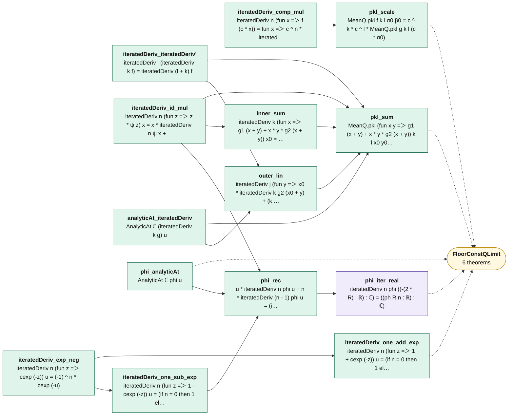

# `lean_stage3/Stage3/FloorConstQDeriv.lean`

> **Read from the source text.** This file changed after the last `python3 utilities/lean_map.py --dump`, so the arrows on this page are names occurring in each proof and have not been confirmed by Lean.

# FloorConstQDeriv — block S13 of `lean_stage3/design/stencil.md`, B4 step 4, the closed form for a general Q: the iterated partials. 2026-11-25.

14 theorems, 2 definitions, 275 lines. 

**Imports:** [`MeanQCauchy`](../lean_stage3/MeanQCauchy.md)  
**Imported by:** [`FloorConstQLimit`](../lean_stage3/FloorConstQLimit.md)

## The picture



An arrow A → B reads "A is used in the proof of B". Green: counting, integers only. Violet: shape, analysis with no ζ. Blue: reads ζ. A name ending in ■ is an end: nothing else uses it. Red: contains `sorry`. Yellow: theorems in another file, counted; a dotted arrow crosses files. Definitions are not drawn; they are listed below the diagram.

## Definitions

<a name="FloorConstQ-phi"></a>
### `FloorConstQ.phi`

def · line 40

`φ(u) = (1 − e^(−u))/u`.

- **Is:** `` phi (u : ℂ) : ℂ := (1 - cexp (-u)) / u ``
- **Used by 8:** [`FloorConstQ.phi_analyticAt`](#FloorConstQ-phi_analyticAt), [`FloorConstQ.phi_iter_real`](#FloorConstQ-phi_iter_real), [`FloorConstQ.phi_rec`](#FloorConstQ-phi_rec), [`FloorConstQ.cY_eq_FF`](../lean_stage3/FloorConstQLimit.md#FloorConstQ-cY_eq_FF), [`FloorConstQ.g1`](../lean_stage3/FloorConstQLimit.md#FloorConstQ-g1), [`FloorConstQ.g1_iter`](../lean_stage3/FloorConstQLimit.md#FloorConstQ-g1_iter), [`FloorConstQ.g2`](../lean_stage3/FloorConstQLimit.md#FloorConstQ-g2), [`FloorConstQ.g2_iter`](../lean_stage3/FloorConstQLimit.md#FloorConstQ-g2_iter)

<a name="FloorConstQ-ph"></a>
### `FloorConstQ.ph`

def · line 44

`φ^(n)(−2R)` as a real recursion: `ph 0 = (1 − e^(2R))/(−2R)`, `ph (n+1) = (−(−1)^(n+1) e^(2R) − (n+1) ph n)/(−2R)`.

- **Is:** `` ph (R : ℝ) : ℕ → ℝ | 0 => (1 - Real.exp (2 * R)) / (-(2 * R)) | n + 1 => (-(-1) ^ (n + 1) * Real.exp (2 * R) - ((n : ℝ) + 1) * ph R n) / (-(2 * R)) ``
- **Used by 15:** [`FloorConstQ.ph0`](../lean_stage3/FloorConstQ.md#FloorConstQ-ph0), [`FloorConstQ.ph1`](../lean_stage3/FloorConstQ.md#FloorConstQ-ph1), [`FloorConstQ.ph2`](../lean_stage3/FloorConstQ.md#FloorConstQ-ph2), [`FloorConstQ.ph3`](../lean_stage3/FloorConstQ.md#FloorConstQ-ph3), [`FloorConstQ.ph4`](../lean_stage3/FloorConstQ.md#FloorConstQ-ph4), [`FloorConstQ.ph5`](../lean_stage3/FloorConstQ.md#FloorConstQ-ph5), [`FloorConstQ.ph6`](../lean_stage3/FloorConstQ.md#FloorConstQ-ph6), [`FloorConstQ.ph_succ`](../lean_stage3/FloorConstQ.md#FloorConstQ-ph_succ), [`FloorConstQ.phi_iter_real`](#FloorConstQ-phi_iter_real), [`FloorConstQ.KflQ_one_sub`](../lean_stage3/FloorConstQLimit.md#FloorConstQ-KflQ_one_sub), [`FloorConstQ.SA`](../lean_stage3/FloorConstQLimit.md#FloorConstQ-SA), [`FloorConstQ.SC`](../lean_stage3/FloorConstQLimit.md#FloorConstQ-SC), [`FloorConstQ.XF`](../lean_stage3/FloorConstQLimit.md#FloorConstQ-XF), [`FloorConstQ.g1_iter`](../lean_stage3/FloorConstQLimit.md#FloorConstQ-g1_iter), [`FloorConstQ.g2_iter`](../lean_stage3/FloorConstQLimit.md#FloorConstQ-g2_iter)

## Theorems

<a name="FloorConstQ-iteratedDeriv_comp_mul"></a>
### `FloorConstQ.iteratedDeriv_comp_mul`

line 51 · arrows read from text

**Counting.** Integers only: nothing in its statement or proof, or in anything it rests on, uses analysis or ζ.

**Why.** Scaling, with no smoothness hypothesis.

**Proves**

```lean
iteratedDeriv n (fun x => f (c * x)) = fun x => c ^ n * iteratedDeriv n f (c * x)
```

**Needs** (its hypotheses)

  - `` f : ℂ → ℂ ``
  - `` c : ℂ ``
  - `` n : ℕ ``

**Fed by:** no theorem of this repo; it stands on Mathlib.

**Feeds** (1 that use it)

  - [`FloorConstQ.pkl_scale`](#FloorConstQ-pkl_scale) — `` MeanQ.pkl f k l α0 β0 = c ^ k * c ^ l * MeanQ.pkl g k l (c * α0) (c * β0) ``

<a name="FloorConstQ-iteratedDeriv_iteratedDeriv-"></a>
### `FloorConstQ.iteratedDeriv_iteratedDeriv'`

line 62 · arrows read from text

**Counting.** Integers only: nothing in its statement or proof, or in anything it rests on, uses analysis or ζ.

**Proves**

```lean
iteratedDeriv l (iteratedDeriv k f) = iteratedDeriv (l + k) f
```

**Needs** (its hypotheses)

  - `` f : ℂ → ℂ ``
  - `` k l : ℕ ``

**Fed by:** no theorem of this repo; it stands on Mathlib.

**Feeds** (2 that use it)

  - [`FloorConstQ.outer_lin`](#FloorConstQ-outer_lin) — `` iteratedDeriv j (fun y => x0 * iteratedDeriv k g2 (x0 + y) + (k : ℂ) * iteratedDeriv (k - 1) g2 (x0 + y)) y0 = x0 * iteratedDeriv (j + k) g2 (x0 + y0)… ``
  - [`FloorConstQ.pkl_sum`](#FloorConstQ-pkl_sum) — `` MeanQ.pkl (fun x y => g1 (x + y) + x * y * g2 (x + y)) k l x0 y0 = iteratedDeriv (l + k) g1 (x0 + y0) + (y0 * (x0 * iteratedDeriv (l + k) g2 (x0 + y0)… ``

<a name="FloorConstQ-iteratedDeriv_id_mul"></a>
### `FloorConstQ.iteratedDeriv_id_mul`

line 69 · arrows read from text

**Counting.** Integers only: nothing in its statement or proof, or in anything it rests on, uses analysis or ζ.

**Why.** Leibniz for `x·ψ(x)`.

**Proves**

```lean
iteratedDeriv n (fun z => z * ψ z) x = x * iteratedDeriv n ψ x + n * iteratedDeriv (n - 1) ψ x
```

**Needs** (its hypotheses)

  - `` n : ℕ ``
  - `` h : ContDiffAt ℂ n ψ x ``

**Fed by:** no theorem of this repo; it stands on Mathlib.

**Feeds** (3 that use it)

  - [`FloorConstQ.inner_sum`](#FloorConstQ-inner_sum) — `` iteratedDeriv k (fun x => g1 (x + y) + x * y * g2 (x + y)) x0 = iteratedDeriv k g1 (x0 + y) + y * (x0 * iteratedDeriv k g2 (x0 + y) + k * iteratedDeri… ``
  - [`FloorConstQ.phi_rec`](#FloorConstQ-phi_rec) — `` u * iteratedDeriv n phi u + n * iteratedDeriv (n - 1) phi u = (if n = 0 then 1 else 0) - (-1) ^ n * cexp (-u) ``
  - [`FloorConstQ.pkl_sum`](#FloorConstQ-pkl_sum) — `` MeanQ.pkl (fun x y => g1 (x + y) + x * y * g2 (x + y)) k l x0 y0 = iteratedDeriv (l + k) g1 (x0 + y0) + (y0 * (x0 * iteratedDeriv (l + k) g2 (x0 + y0)… ``

<a name="FloorConstQ-inner_sum"></a>
### `FloorConstQ.inner_sum`

line 79 · arrows read from text

**Counting.** Integers only: nothing in its statement or proof, or in anything it rests on, uses analysis or ζ.

**Proves**

```lean
iteratedDeriv k (fun x => g1 (x + y) + x * y * g2 (x + y)) x0 = iteratedDeriv k g1 (x0 + y) + y * (x0 * iteratedDeriv k g2 (x0 + y) + k * iteratedDeriv (k - 1) g2 (x0 + y))
```

**Needs** (its hypotheses)

  - `` h1 : AnalyticAt ℂ g1 (x0 + y) ``
  - `` h2 : AnalyticAt ℂ g2 (x0 + y) ``
  - `` k : ℕ ``

**Fed by** (1 theorem its proof uses)

  - [`FloorConstQ.iteratedDeriv_id_mul`](#FloorConstQ-iteratedDeriv_id_mul) — `` iteratedDeriv n (fun z => z * ψ z) x = x * iteratedDeriv n ψ x + n * iteratedDeriv (n - 1) ψ x ``

**Definitions its proof touches:** [`FloorConstQ.g1`](../lean_stage3/FloorConstQLimit.md#FloorConstQ-g1), [`FloorConstQ.g2`](../lean_stage3/FloorConstQLimit.md#FloorConstQ-g2)

**Feeds** (1 that use it)

  - [`FloorConstQ.pkl_sum`](#FloorConstQ-pkl_sum) — `` MeanQ.pkl (fun x y => g1 (x + y) + x * y * g2 (x + y)) k l x0 y0 = iteratedDeriv (l + k) g1 (x0 + y0) + (y0 * (x0 * iteratedDeriv (l + k) g2 (x0 + y0)… ``

<a name="FloorConstQ-analyticAt_iteratedDeriv"></a>
### `FloorConstQ.analyticAt_iteratedDeriv`

line 102 · arrows read from text

**Counting.** Integers only: nothing in its statement or proof, or in anything it rests on, uses analysis or ζ.

**Proves**

```lean
AnalyticAt ℂ (iteratedDeriv k g) u
```

**Needs** (its hypotheses)

  - `` h : AnalyticAt ℂ g u ``
  - `` k : ℕ ``

**Fed by:** no theorem of this repo; it stands on Mathlib.

**Feeds** (2 that use it)

  - [`FloorConstQ.outer_lin`](#FloorConstQ-outer_lin) — `` iteratedDeriv j (fun y => x0 * iteratedDeriv k g2 (x0 + y) + (k : ℂ) * iteratedDeriv (k - 1) g2 (x0 + y)) y0 = x0 * iteratedDeriv (j + k) g2 (x0 + y0)… ``
  - [`FloorConstQ.pkl_sum`](#FloorConstQ-pkl_sum) — `` MeanQ.pkl (fun x y => g1 (x + y) + x * y * g2 (x + y)) k l x0 y0 = iteratedDeriv (l + k) g1 (x0 + y0) + (y0 * (x0 * iteratedDeriv (l + k) g2 (x0 + y0)… ``

<a name="FloorConstQ-outer_lin"></a>
### `FloorConstQ.outer_lin`

line 107 · arrows read from text

**Counting.** Integers only: nothing in its statement or proof, or in anything it rests on, uses analysis or ζ.

**Proves**

```lean
iteratedDeriv j (fun y => x0 * iteratedDeriv k g2 (x0 + y) + (k : ℂ) * iteratedDeriv (k - 1) g2 (x0 + y)) y0 = x0 * iteratedDeriv (j + k) g2 (x0 + y0) + k * iteratedDeriv (j + (k - 1)) g2 (x0 + y0)
```

**Needs** (its hypotheses)

  - `` h2 : AnalyticAt ℂ g2 (x0 + y0) ``
  - `` k j : ℕ ``

**Fed by** (2 theorems its proof uses)

  - [`FloorConstQ.analyticAt_iteratedDeriv`](#FloorConstQ-analyticAt_iteratedDeriv) — `` AnalyticAt ℂ (iteratedDeriv k g) u ``
  - [`FloorConstQ.iteratedDeriv_iteratedDeriv'`](#FloorConstQ-iteratedDeriv_iteratedDeriv-) — `` iteratedDeriv l (iteratedDeriv k f) = iteratedDeriv (l + k) f ``

**Definitions its proof touches:** [`FloorConstQ.g2`](../lean_stage3/FloorConstQLimit.md#FloorConstQ-g2)

**Feeds** (1 that use it)

  - [`FloorConstQ.pkl_sum`](#FloorConstQ-pkl_sum) — `` MeanQ.pkl (fun x y => g1 (x + y) + x * y * g2 (x + y)) k l x0 y0 = iteratedDeriv (l + k) g1 (x0 + y0) + (y0 * (x0 * iteratedDeriv (l + k) g2 (x0 + y0)… ``

<a name="FloorConstQ-pkl_sum"></a>
### `FloorConstQ.pkl_sum`

line 129 · arrows read from text

**Counting.** Integers only: nothing in its statement or proof, or in anything it rests on, uses analysis or ζ.

**Why.** The partials of `g₁(x+y) + x y g₂(x+y)`, `g₁, g₂` analytic at `x₀ + y₀`.

**Proves**

```lean
MeanQ.pkl (fun x y => g1 (x + y) + x * y * g2 (x + y)) k l x0 y0 = iteratedDeriv (l + k) g1 (x0 + y0) + (y0 * (x0 * iteratedDeriv (l + k) g2 (x0 + y0) + k * iteratedDeriv (l + (k - 1)) g2 (x0 + y0)) + l * (x0 * iteratedDeriv (l - 1 + k) g2 (x0 + y0) + k * iteratedDeriv (l - 1 + (k - 1)) g2 (x0 + y0)))
```

**Needs** (its hypotheses)

  - `` h1 : AnalyticAt ℂ g1 (x0 + y0) ``
  - `` h2 : AnalyticAt ℂ g2 (x0 + y0) ``
  - `` k l : ℕ ``

**Fed by** (5 theorems its proof uses)

  - [`FloorConstQ.analyticAt_iteratedDeriv`](#FloorConstQ-analyticAt_iteratedDeriv) — `` AnalyticAt ℂ (iteratedDeriv k g) u ``
  - [`FloorConstQ.inner_sum`](#FloorConstQ-inner_sum) — `` iteratedDeriv k (fun x => g1 (x + y) + x * y * g2 (x + y)) x0 = iteratedDeriv k g1 (x0 + y) + y * (x0 * iteratedDeriv k g2 (x0 + y) + k * iteratedDeri… ``
  - [`FloorConstQ.iteratedDeriv_id_mul`](#FloorConstQ-iteratedDeriv_id_mul) — `` iteratedDeriv n (fun z => z * ψ z) x = x * iteratedDeriv n ψ x + n * iteratedDeriv (n - 1) ψ x ``
  - [`FloorConstQ.iteratedDeriv_iteratedDeriv'`](#FloorConstQ-iteratedDeriv_iteratedDeriv-) — `` iteratedDeriv l (iteratedDeriv k f) = iteratedDeriv (l + k) f ``
  - [`FloorConstQ.outer_lin`](#FloorConstQ-outer_lin) — `` iteratedDeriv j (fun y => x0 * iteratedDeriv k g2 (x0 + y) + (k : ℂ) * iteratedDeriv (k - 1) g2 (x0 + y)) y0 = x0 * iteratedDeriv (j + k) g2 (x0 + y0)… ``

**Definitions its proof touches:** [`FloorConstQ.g1`](../lean_stage3/FloorConstQLimit.md#FloorConstQ-g1), [`FloorConstQ.g2`](../lean_stage3/FloorConstQLimit.md#FloorConstQ-g2), [`MeanQ.pkl`](../lean_stage3/MeanQCauchy.md#MeanQ-pkl)

**Feeds** (1 that use it)

  - [`FloorConstQ.pkl_FF`](../lean_stage3/FloorConstQLimit.md#FloorConstQ-pkl_FF) (FloorConstQLimit) — `` MeanQ.pkl (FF A B C θ) k l ((-R : ℝ) : ℂ) ((-R : ℝ) : ℂ) = ((XF A B C θ R k l : ℝ) : ℂ) ``

<a name="FloorConstQ-pkl_scale"></a>
### `FloorConstQ.pkl_scale`

line 168 · arrows read from text

**Counting.** Integers only: nothing in its statement or proof, or in anything it rests on, uses analysis or ζ.

**Why.** Scaling of `pkl`: if `f(x,y) = g(cx, cy)` near `(α₀, β₀)`, the partials scale by `c^(k+l)`.

**Proves**

```lean
MeanQ.pkl f k l α0 β0 = c ^ k * c ^ l * MeanQ.pkl g k l (c * α0) (c * β0)
```

**Needs** (its hypotheses)

  - `` h : ∀ᶠ y in 𝓝 β0, ∀ᶠ x in 𝓝 α0, f x y = g (c * x) (c * y) ``
  - `` k l : ℕ ``

**Fed by** (1 theorem its proof uses)

  - [`FloorConstQ.iteratedDeriv_comp_mul`](#FloorConstQ-iteratedDeriv_comp_mul) — `` iteratedDeriv n (fun x => f (c * x)) = fun x => c ^ n * iteratedDeriv n f (c * x) ``

**Definitions its proof touches:** [`MeanQ.pkl`](../lean_stage3/MeanQCauchy.md#MeanQ-pkl)

**Feeds** (1 that use it)

  - [`FloorConstQ.dopQ_cY_eq`](../lean_stage3/FloorConstQLimit.md#FloorConstQ-dopQ_cY_eq) (FloorConstQLimit) — `` MeanQ.DopQ Q (Real.log T) (cY P M T) ((-(R / Real.log T) : ℝ) : ℂ) ((-(R / Real.log T) : ℝ) : ℂ) = ((KflQ Q (FloorConst.Ar P) (FloorConst.Br P) (Floor… ``

<a name="FloorConstQ-phi_analyticAt"></a>
### `FloorConstQ.phi_analyticAt`

line 188 · arrows read from text

**Counting.** Integers only: nothing in its statement or proof, or in anything it rests on, uses analysis or ζ.

**Proves**

```lean
AnalyticAt ℂ phi u
```

**Needs** (its hypotheses)

  - `` hu : u ≠ 0 ``

**Fed by:** no theorem of this repo; it stands on Mathlib and the definitions below.

**Definitions its proof touches:** [`FloorConstQ.phi`](#FloorConstQ-phi)

**Feeds** (4 that use it)

  - [`FloorConstQ.phi_rec`](#FloorConstQ-phi_rec) — `` u * iteratedDeriv n phi u + n * iteratedDeriv (n - 1) phi u = (if n = 0 then 1 else 0) - (-1) ^ n * cexp (-u) ``
  - [`FloorConstQ.g1_analyticAt`](../lean_stage3/FloorConstQLimit.md#FloorConstQ-g1_analyticAt) (FloorConstQLimit) — `` AnalyticAt ℂ (g1 A B θ) u ``
  - [`FloorConstQ.g1_iter`](../lean_stage3/FloorConstQLimit.md#FloorConstQ-g1_iter) (FloorConstQLimit) — `` iteratedDeriv n (g1 A B θ) ((-(2 * R) : ℝ) : ℂ) = ((B * gB R n + A / θ * ph R n : ℝ) : ℂ) ``
  - [`FloorConstQ.g2_analyticAt`](../lean_stage3/FloorConstQLimit.md#FloorConstQ-g2_analyticAt) (FloorConstQLimit) — `` AnalyticAt ℂ (g2 C θ) u ``

<a name="FloorConstQ-iteratedDeriv_exp_neg"></a>
### `FloorConstQ.iteratedDeriv_exp_neg`

line 192 · arrows read from text

**Counting.** Integers only: nothing in its statement or proof, or in anything it rests on, uses analysis or ζ.

**Proves**

```lean
iteratedDeriv n (fun z => cexp (-z)) u = (-1) ^ n * cexp (-u)
```

**Needs** (its hypotheses)

  - `` n : ℕ ``
  - `` u : ℂ ``

**Fed by:** no theorem of this repo; it stands on Mathlib.

**Feeds** (2 that use it)

  - [`FloorConstQ.iteratedDeriv_one_add_exp`](#FloorConstQ-iteratedDeriv_one_add_exp) — `` iteratedDeriv n (fun z => 1 + cexp (-z)) u = (if n = 0 then 1 else 0) + (-1) ^ n * cexp (-u) ``
  - [`FloorConstQ.iteratedDeriv_one_sub_exp`](#FloorConstQ-iteratedDeriv_one_sub_exp) — `` iteratedDeriv n (fun z => 1 - cexp (-z)) u = (if n = 0 then 1 else 0) - (-1) ^ n * cexp (-u) ``

<a name="FloorConstQ-iteratedDeriv_one_sub_exp"></a>
### `FloorConstQ.iteratedDeriv_one_sub_exp`

line 201 · arrows read from text

**Counting.** Integers only: nothing in its statement or proof, or in anything it rests on, uses analysis or ζ.

**Why.** `(1 − e^(−u))^(n) = [n = 0] − (−1)^n e^(−u)`.

**Proves**

```lean
iteratedDeriv n (fun z => 1 - cexp (-z)) u = (if n = 0 then 1 else 0) - (-1) ^ n * cexp (-u)
```

**Needs** (its hypotheses)

  - `` n : ℕ ``
  - `` u : ℂ ``

**Fed by** (1 theorem its proof uses)

  - [`FloorConstQ.iteratedDeriv_exp_neg`](#FloorConstQ-iteratedDeriv_exp_neg) — `` iteratedDeriv n (fun z => cexp (-z)) u = (-1) ^ n * cexp (-u) ``

**Feeds** (1 that use it)

  - [`FloorConstQ.phi_rec`](#FloorConstQ-phi_rec) — `` u * iteratedDeriv n phi u + n * iteratedDeriv (n - 1) phi u = (if n = 0 then 1 else 0) - (-1) ^ n * cexp (-u) ``

<a name="FloorConstQ-iteratedDeriv_one_add_exp"></a>
### `FloorConstQ.iteratedDeriv_one_add_exp`

line 211 · arrows read from text

**Counting.** Integers only: nothing in its statement or proof, or in anything it rests on, uses analysis or ζ.

**Why.** `(1 + e^(−u))^(n) = [n = 0] + (−1)^n e^(−u)`.

**Proves**

```lean
iteratedDeriv n (fun z => 1 + cexp (-z)) u = (if n = 0 then 1 else 0) + (-1) ^ n * cexp (-u)
```

**Needs** (its hypotheses)

  - `` n : ℕ ``
  - `` u : ℂ ``

**Fed by** (1 theorem its proof uses)

  - [`FloorConstQ.iteratedDeriv_exp_neg`](#FloorConstQ-iteratedDeriv_exp_neg) — `` iteratedDeriv n (fun z => cexp (-z)) u = (-1) ^ n * cexp (-u) ``

**Feeds** (1 that use it)

  - [`FloorConstQ.g1_iter`](../lean_stage3/FloorConstQLimit.md#FloorConstQ-g1_iter) (FloorConstQLimit) — `` iteratedDeriv n (g1 A B θ) ((-(2 * R) : ℝ) : ℂ) = ((B * gB R n + A / θ * ph R n : ℝ) : ℂ) ``

<a name="FloorConstQ-phi_rec"></a>
### `FloorConstQ.phi_rec`

line 221 · arrows read from text

**Counting.** Integers only: nothing in its statement or proof, or in anything it rests on, uses analysis or ζ.

**Why.** The recursion: `u φ^(n)(u) + n φ^(n−1)(u) = [n = 0] − (−1)^n e^(−u)`, `u ≠ 0`.

**Proves**

```lean
u * iteratedDeriv n phi u + n * iteratedDeriv (n - 1) phi u = (if n = 0 then 1 else 0) - (-1) ^ n * cexp (-u)
```

**Needs** (its hypotheses)

  - `` hu : u ≠ 0 ``
  - `` n : ℕ ``

**Fed by** (3 theorems its proof uses)

  - [`FloorConstQ.iteratedDeriv_id_mul`](#FloorConstQ-iteratedDeriv_id_mul) — `` iteratedDeriv n (fun z => z * ψ z) x = x * iteratedDeriv n ψ x + n * iteratedDeriv (n - 1) ψ x ``
  - [`FloorConstQ.iteratedDeriv_one_sub_exp`](#FloorConstQ-iteratedDeriv_one_sub_exp) — `` iteratedDeriv n (fun z => 1 - cexp (-z)) u = (if n = 0 then 1 else 0) - (-1) ^ n * cexp (-u) ``
  - [`FloorConstQ.phi_analyticAt`](#FloorConstQ-phi_analyticAt) — `` AnalyticAt ℂ phi u ``

**Definitions its proof touches:** [`FloorConstQ.phi`](#FloorConstQ-phi)

**Feeds** (1 that use it)

  - [`FloorConstQ.phi_iter_real`](#FloorConstQ-phi_iter_real) — `` iteratedDeriv n phi ((-(2 * R) : ℝ) : ℂ) = ((ph R n : ℝ) : ℂ) ``

<a name="FloorConstQ-phi_iter_real"></a>
### `FloorConstQ.phi_iter_real`

line 232 · arrows read from text

**Shape.** Uses real or complex analysis; nothing in it or beneath it reads ζ.

**Why.** `φ^(n)(−2R) = ph R n`, `R ≠ 0`.

**Proves**

```lean
iteratedDeriv n phi ((-(2 * R) : ℝ) : ℂ) = ((ph R n : ℝ) : ℂ)
```

**Needs** (its hypotheses)

  - `` hR : R ≠ 0 ``
  - `` n : ℕ ``

**Fed by** (1 theorem its proof uses)

  - [`FloorConstQ.phi_rec`](#FloorConstQ-phi_rec) — `` u * iteratedDeriv n phi u + n * iteratedDeriv (n - 1) phi u = (if n = 0 then 1 else 0) - (-1) ^ n * cexp (-u) ``

**Definitions its proof touches:** [`FloorConstQ.ph`](#FloorConstQ-ph), [`FloorConstQ.phi`](#FloorConstQ-phi)

**Feeds** (2 that use it)

  - [`FloorConstQ.g1_iter`](../lean_stage3/FloorConstQLimit.md#FloorConstQ-g1_iter) (FloorConstQLimit) — `` iteratedDeriv n (g1 A B θ) ((-(2 * R) : ℝ) : ℂ) = ((B * gB R n + A / θ * ph R n : ℝ) : ℂ) ``
  - [`FloorConstQ.g2_iter`](../lean_stage3/FloorConstQLimit.md#FloorConstQ-g2_iter) (FloorConstQLimit) — `` iteratedDeriv n (g2 C θ) ((-(2 * R) : ℝ) : ℂ) = ((θ * C * ph R n : ℝ) : ℂ) ``

