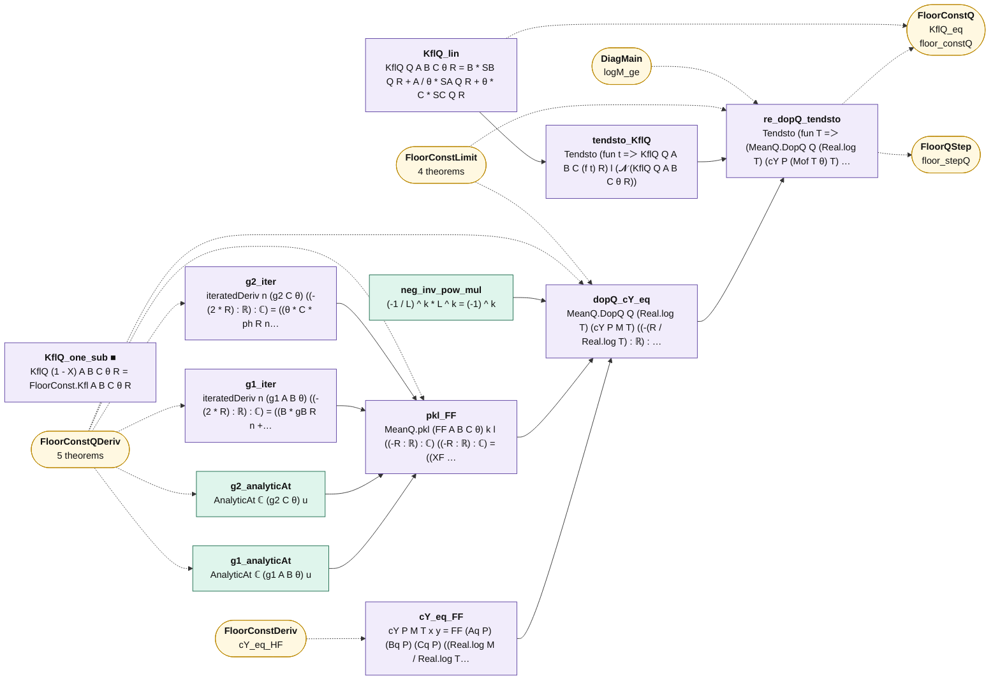

# `lean_stage3/Stage3/FloorConstQLimit.lean`

> **Read from the source text.** This file changed after the last `python3 utilities/lean_map.py --dump`, so the arrows on this page are names occurring in each proof and have not been confirmed by Lean.

# FloorConstQLimit — block S13 of `lean_stage3/design/stencil.md`, B4 step 4, the closed form for a general Q: the identity and the limit. 2026-11-25.

12 theorems, 9 definitions, 297 lines. 

**Imports:** [`FloorConstLimit`](../lean_stage3/FloorConstLimit.md), [`FloorConstQDeriv`](../lean_stage3/FloorConstQDeriv.md)  
**Imported by:** [`FloorConstQ`](../lean_stage3/FloorConstQ.md), [`FloorQStep`](../lean_stage3/FloorQStep.md)

## The picture



An arrow A → B reads "A is used in the proof of B". Green: counting, integers only. Violet: shape, analysis with no ζ. Blue: reads ζ. A name ending in ■ is an end: nothing else uses it. Red: contains `sorry`. Yellow: theorems in another file, counted; a dotted arrow crosses files. Definitions are not drawn; they are listed below the diagram.

## Definitions

<a name="FloorConstQ-g1"></a>
### `FloorConstQ.g1`

def · line 44

`g₁(u) = B(1 + e^(−u)) + A θ⁻¹ φ(u)`.

- **Is:** `` g1 (A B θ : ℂ) (u : ℂ) : ℂ := B * (1 + cexp (-u)) + A * θ⁻¹ * phi u ``
- **Built from:** [`FloorConstQ.phi`](../lean_stage3/FloorConstQDeriv.md#FloorConstQ-phi)
- **Used by 7:** [`FloorConstQ.inner_sum`](../lean_stage3/FloorConstQDeriv.md#FloorConstQ-inner_sum), [`FloorConstQ.pkl_sum`](../lean_stage3/FloorConstQDeriv.md#FloorConstQ-pkl_sum), [`FloorConstQ.FF`](#FloorConstQ-FF), [`FloorConstQ.cY_eq_FF`](#FloorConstQ-cY_eq_FF), [`FloorConstQ.g1_analyticAt`](#FloorConstQ-g1_analyticAt), [`FloorConstQ.g1_iter`](#FloorConstQ-g1_iter), [`FloorConstQ.pkl_FF`](#FloorConstQ-pkl_FF)

<a name="FloorConstQ-g2"></a>
### `FloorConstQ.g2`

def · line 47

`g₂(u) = θ C φ(u)`.

- **Is:** `` g2 (C θ : ℂ) (u : ℂ) : ℂ := θ * C * phi u ``
- **Built from:** [`FloorConstQ.phi`](../lean_stage3/FloorConstQDeriv.md#FloorConstQ-phi)
- **Used by 8:** [`FloorConstQ.inner_sum`](../lean_stage3/FloorConstQDeriv.md#FloorConstQ-inner_sum), [`FloorConstQ.outer_lin`](../lean_stage3/FloorConstQDeriv.md#FloorConstQ-outer_lin), [`FloorConstQ.pkl_sum`](../lean_stage3/FloorConstQDeriv.md#FloorConstQ-pkl_sum), [`FloorConstQ.FF`](#FloorConstQ-FF), [`FloorConstQ.cY_eq_FF`](#FloorConstQ-cY_eq_FF), [`FloorConstQ.g2_analyticAt`](#FloorConstQ-g2_analyticAt), [`FloorConstQ.g2_iter`](#FloorConstQ-g2_iter), [`FloorConstQ.pkl_FF`](#FloorConstQ-pkl_FF)

<a name="FloorConstQ-FF"></a>
### `FloorConstQ.FF`

def · line 50

`F(a,b) = g₁(a+b) + a b g₂(a+b)`, Young's `c` in the variables `a = Lα`, `b = Lβ`.

- **Is:** `` FF (A B C θ : ℂ) (a b : ℂ) : ℂ := g1 A B θ (a + b) + a * b * g2 C θ (a + b) ``
- **Built from:** [`FloorConstQ.g1`](#FloorConstQ-g1), [`FloorConstQ.g2`](#FloorConstQ-g2)
- **Used by 3:** [`FloorConstQ.cY_eq_FF`](#FloorConstQ-cY_eq_FF), [`FloorConstQ.dopQ_cY_eq`](#FloorConstQ-dopQ_cY_eq), [`FloorConstQ.pkl_FF`](#FloorConstQ-pkl_FF)

<a name="FloorConstQ-gB"></a>
### `FloorConstQ.gB`

def · line 53

`gB n = [n = 0] + (−1)^n e^(2R)`, the partials of `1 + E` at `(−R, −R)`.

- **Is:** `` gB (R : ℝ) (n : ℕ) : ℝ := (if n = 0 then 1 else 0) + (-1) ^ n * Real.exp (2 * R) ``
- **Used by 5:** [`FloorConstQ.SB_Q0`](../lean_stage3/FloorConstQ.md#FloorConstQ-SB_Q0), [`FloorConstQ.KflQ_one_sub`](#FloorConstQ-KflQ_one_sub), [`FloorConstQ.SB`](#FloorConstQ-SB), [`FloorConstQ.XF`](#FloorConstQ-XF), [`FloorConstQ.g1_iter`](#FloorConstQ-g1_iter)

<a name="FloorConstQ-XF"></a>
### `FloorConstQ.XF`

def · line 56

`∂b^l ∂a^k F` at `(−R, −R)`.

- **Is:** `` XF (A B C θ R : ℝ) (k l : ℕ) : ℝ := (B * gB R (l + k) + A / θ * FloorConstQ.ph R (l + k)) + ((-R) * ((-R) * (θ * C * ph R (l + k)) + k * (θ * C * ph R (l + (k - 1)))) + l * ((-R) * (θ * C * ph R (l - 1 + k)) + k * (θ * C * ph R (l - 1 + (k - 1))))) ``
- **Built from:** [`FloorConstQ.ph`](../lean_stage3/FloorConstQDeriv.md#FloorConstQ-ph), [`FloorConstQ.gB`](#FloorConstQ-gB)
- **Used by 5:** [`FloorConstQ.KflQ`](#FloorConstQ-KflQ), [`FloorConstQ.KflQ_lin`](#FloorConstQ-KflQ_lin), [`FloorConstQ.KflQ_one_sub`](#FloorConstQ-KflQ_one_sub), [`FloorConstQ.dopQ_cY_eq`](#FloorConstQ-dopQ_cY_eq), [`FloorConstQ.pkl_FF`](#FloorConstQ-pkl_FF)

<a name="FloorConstQ-KflQ"></a>
### `FloorConstQ.KflQ`

def · line 63

Levinson–Conrey's constant for a general `Q`: `Q(−∂a)Q(−∂b)F` at `a = b = −R`, `Σ_{k,l ≤ deg Q} q_k q_l (−1)^(k+l) ∂b^l ∂a^k F(−R,−R)`.

- **Is:** `` KflQ (Q : ℝ[X]) (A B C θ R : ℝ) : ℝ := ∑ k ∈ Finset.range (Q.natDegree + 1), ∑ l ∈ Finset.range (Q.natDegree + 1), Q.coeff k * Q.coeff l * (-1) ^ (k + l) * XF A B C θ R k l ``
- **Built from:** [`FloorConstQ.XF`](#FloorConstQ-XF)
- **Used by 15:** [`FloorConstQ.KflQ_eq`](../lean_stage3/FloorConstQ.md#FloorConstQ-KflQ_eq), [`FloorConstQ.KflQ_lt`](../lean_stage3/FloorConstQ.md#FloorConstQ-KflQ_lt), [`FloorConstQ.KflQ_pos`](../lean_stage3/FloorConstQ.md#FloorConstQ-KflQ_pos), [`FloorConstQ.floor_constQ`](../lean_stage3/FloorConstQ.md#FloorConstQ-floor_constQ), [`FloorConstQ.kappaQ`](../lean_stage3/FloorConstQ.md#FloorConstQ-kappaQ), [`FloorConstQ.kappaQ_gt`](../lean_stage3/FloorConstQ.md#FloorConstQ-kappaQ_gt), [`FloorConstQ.log_KflQ_lt`](../lean_stage3/FloorConstQ.md#FloorConstQ-log_KflQ_lt), [`FloorConstQ.KflQ_lin`](#FloorConstQ-KflQ_lin), [`FloorConstQ.KflQ_one_sub`](#FloorConstQ-KflQ_one_sub), [`FloorConstQ.dopQ_cY_eq`](#FloorConstQ-dopQ_cY_eq), [`FloorConstQ.re_dopQ_tendsto`](#FloorConstQ-re_dopQ_tendsto), [`FloorConstQ.tendsto_KflQ`](#FloorConstQ-tendsto_KflQ), [`FloorQ.logmaxQ_le`](../lean_stage3/FloorQ.md#FloorQ-logmaxQ_le), [`FloorQ.stepQ`](../lean_stage3/FloorQ.md#FloorQ-stepQ), [`FloorQ.floor_stepQ`](../lean_stage3/FloorQStep.md#FloorQ-floor_stepQ)

<a name="FloorConstQ-SB"></a>
### `FloorConstQ.SB`

def · line 68

The `θ`-free parts: `SB`, `SA`, `SC`.

- **Is:** `` SB (Q : ℝ[X]) (R : ℝ) : ℝ := ∑ k ∈ Finset.range (Q.natDegree + 1), ∑ l ∈ Finset.range (Q.natDegree + 1), Q.coeff k * Q.coeff l * (-1) ^ (k + l) * gB R (l + k) ``
- **Built from:** [`FloorConstQ.gB`](#FloorConstQ-gB)
- **Used by 2:** [`FloorConstQ.SB_Q0`](../lean_stage3/FloorConstQ.md#FloorConstQ-SB_Q0), [`FloorConstQ.KflQ_lin`](#FloorConstQ-KflQ_lin)

<a name="FloorConstQ-SA"></a>
### `FloorConstQ.SA`

def · line 72

- **Is:** `` SA (Q : ℝ[X]) (R : ℝ) : ℝ := ∑ k ∈ Finset.range (Q.natDegree + 1), ∑ l ∈ Finset.range (Q.natDegree + 1), Q.coeff k * Q.coeff l * (-1) ^ (k + l) * ph R (l + k) ``
- **Built from:** [`FloorConstQ.ph`](../lean_stage3/FloorConstQDeriv.md#FloorConstQ-ph)
- **Used by 2:** [`FloorConstQ.SA_Q0`](../lean_stage3/FloorConstQ.md#FloorConstQ-SA_Q0), [`FloorConstQ.KflQ_lin`](#FloorConstQ-KflQ_lin)

<a name="FloorConstQ-SC"></a>
### `FloorConstQ.SC`

def · line 76

- **Is:** `` SC (Q : ℝ[X]) (R : ℝ) : ℝ := ∑ k ∈ Finset.range (Q.natDegree + 1), ∑ l ∈ Finset.range (Q.natDegree + 1), Q.coeff k * Q.coeff l * (-1) ^ (k + l) * ((-R) * ((-R) * ph R (l + k) + k * ph R (l + (k - 1))) + l * ((-R) * ph R (l - 1 + k) + k * ph R (l - 1 + (k - 1)))) ``
- **Built from:** [`FloorConstQ.ph`](../lean_stage3/FloorConstQDeriv.md#FloorConstQ-ph)
- **Used by 2:** [`FloorConstQ.SC_Q0`](../lean_stage3/FloorConstQ.md#FloorConstQ-SC_Q0), [`FloorConstQ.KflQ_lin`](#FloorConstQ-KflQ_lin)

## Theorems

<a name="FloorConstQ-cY_eq_FF"></a>
### `FloorConstQ.cY_eq_FF`

line 85 · arrows read from text

**Shape.** Uses real or complex analysis; nothing in it or beneath it reads ζ.

**Why.** `c` in the variables `a = Lx`, `b = Ly`, off `x + y = 0`.

**Proves**

```lean
cY P M T x y = FF (Aq P) (Bq P) (Cq P) ((Real.log M / Real.log T : ℝ) : ℂ) ((Real.log T : ℝ) * x) ((Real.log T : ℝ) * y)
```

**Needs** (its hypotheses)

  - `` P : Polynomial ℝ ``
  - `` M : ℕ ``
  - `` hT : 1 < T ``
  - `` hℓ : Real.log M ≠ 0 ``
  - `` h : x + y ≠ 0 ``

**Fed by** (1 theorem its proof uses)

  - [`FloorConst.cY_eq_HF`](../lean_stage3/FloorConstDeriv.md#FloorConst-cY_eq_HF) (FloorConstDeriv) — `` cY P M T x y = HF (Aq P) (Bq P) (Cq P) ((Real.log M : ℝ) : ℂ) (Complex.log (T : ℂ)) x y ``

**Definitions its proof touches:** [`FloorConst.EF`](../lean_stage3/FloorConstDeriv.md#FloorConst-EF), [`FloorConst.HF`](../lean_stage3/FloorConstDeriv.md#FloorConst-HF), [`FloorConst.gF`](../lean_stage3/FloorConstDeriv.md#FloorConst-gF), [`FloorConstQ.phi`](../lean_stage3/FloorConstQDeriv.md#FloorConstQ-phi), [`FloorConstQ.FF`](#FloorConstQ-FF), [`FloorConstQ.g1`](#FloorConstQ-g1), [`FloorConstQ.g2`](#FloorConstQ-g2), [`Operator.Aq`](../lean_stage3/OperatorCY.md#Operator-Aq), [`Operator.Bq`](../lean_stage3/OperatorCY.md#Operator-Bq), [`Operator.Cq`](../lean_stage3/OperatorCY.md#Operator-Cq), [`TwistedMoment.cY`](../lean_stage3/TwistedMoment.md#TwistedMoment-cY)

**Feeds** (1 that use it)

  - [`FloorConstQ.dopQ_cY_eq`](#FloorConstQ-dopQ_cY_eq) — `` MeanQ.DopQ Q (Real.log T) (cY P M T) ((-(R / Real.log T) : ℝ) : ℂ) ((-(R / Real.log T) : ℝ) : ℂ) = ((KflQ Q (FloorConst.Ar P) (FloorConst.Br P) (Floor… ``

<a name="FloorConstQ-g1_analyticAt"></a>
### `FloorConstQ.g1_analyticAt`

line 108 · arrows read from text

**Counting.** Integers only: nothing in its statement or proof, or in anything it rests on, uses analysis or ζ.

**Proves**

```lean
AnalyticAt ℂ (g1 A B θ) u
```

**Needs** (its hypotheses)

  - `` A B θ : ℂ ``
  - `` hu : u ≠ 0 ``

**Fed by** (1 theorem its proof uses)

  - [`FloorConstQ.phi_analyticAt`](../lean_stage3/FloorConstQDeriv.md#FloorConstQ-phi_analyticAt) (FloorConstQDeriv) — `` AnalyticAt ℂ phi u ``

**Definitions its proof touches:** [`FloorConstQ.g1`](#FloorConstQ-g1)

**Feeds** (1 that use it)

  - [`FloorConstQ.pkl_FF`](#FloorConstQ-pkl_FF) — `` MeanQ.pkl (FF A B C θ) k l ((-R : ℝ) : ℂ) ((-R : ℝ) : ℂ) = ((XF A B C θ R k l : ℝ) : ℂ) ``

<a name="FloorConstQ-g2_analyticAt"></a>
### `FloorConstQ.g2_analyticAt`

line 113 · arrows read from text

**Counting.** Integers only: nothing in its statement or proof, or in anything it rests on, uses analysis or ζ.

**Proves**

```lean
AnalyticAt ℂ (g2 C θ) u
```

**Needs** (its hypotheses)

  - `` C θ : ℂ ``
  - `` hu : u ≠ 0 ``

**Fed by** (1 theorem its proof uses)

  - [`FloorConstQ.phi_analyticAt`](../lean_stage3/FloorConstQDeriv.md#FloorConstQ-phi_analyticAt) (FloorConstQDeriv) — `` AnalyticAt ℂ phi u ``

**Definitions its proof touches:** [`FloorConstQ.g2`](#FloorConstQ-g2)

**Feeds** (1 that use it)

  - [`FloorConstQ.pkl_FF`](#FloorConstQ-pkl_FF) — `` MeanQ.pkl (FF A B C θ) k l ((-R : ℝ) : ℂ) ((-R : ℝ) : ℂ) = ((XF A B C θ R k l : ℝ) : ℂ) ``

<a name="FloorConstQ-g1_iter"></a>
### `FloorConstQ.g1_iter`

line 118 · arrows read from text

**Shape.** Uses real or complex analysis; nothing in it or beneath it reads ζ.

**Proves**

```lean
iteratedDeriv n (g1 A B θ) ((-(2 * R) : ℝ) : ℂ) = ((B * gB R n + A / θ * ph R n : ℝ) : ℂ)
```

**Needs** (its hypotheses)

  - `` A B θ : ℝ ``
  - `` hR : R ≠ 0 ``
  - `` n : ℕ ``

**Fed by** (3 theorems its proof uses)

  - [`FloorConstQ.iteratedDeriv_one_add_exp`](../lean_stage3/FloorConstQDeriv.md#FloorConstQ-iteratedDeriv_one_add_exp) (FloorConstQDeriv) — `` iteratedDeriv n (fun z => 1 + cexp (-z)) u = (if n = 0 then 1 else 0) + (-1) ^ n * cexp (-u) ``
  - [`FloorConstQ.phi_analyticAt`](../lean_stage3/FloorConstQDeriv.md#FloorConstQ-phi_analyticAt) (FloorConstQDeriv) — `` AnalyticAt ℂ phi u ``
  - [`FloorConstQ.phi_iter_real`](../lean_stage3/FloorConstQDeriv.md#FloorConstQ-phi_iter_real) (FloorConstQDeriv) — `` iteratedDeriv n phi ((-(2 * R) : ℝ) : ℂ) = ((ph R n : ℝ) : ℂ) ``

**Definitions its proof touches:** [`FloorConstQ.ph`](../lean_stage3/FloorConstQDeriv.md#FloorConstQ-ph), [`FloorConstQ.phi`](../lean_stage3/FloorConstQDeriv.md#FloorConstQ-phi), [`FloorConstQ.g1`](#FloorConstQ-g1), [`FloorConstQ.gB`](#FloorConstQ-gB)

**Feeds** (1 that use it)

  - [`FloorConstQ.pkl_FF`](#FloorConstQ-pkl_FF) — `` MeanQ.pkl (FF A B C θ) k l ((-R : ℝ) : ℂ) ((-R : ℝ) : ℂ) = ((XF A B C θ R k l : ℝ) : ℂ) ``

<a name="FloorConstQ-g2_iter"></a>
### `FloorConstQ.g2_iter`

line 143 · arrows read from text

**Shape.** Uses real or complex analysis; nothing in it or beneath it reads ζ.

**Proves**

```lean
iteratedDeriv n (g2 C θ) ((-(2 * R) : ℝ) : ℂ) = ((θ * C * ph R n : ℝ) : ℂ)
```

**Needs** (its hypotheses)

  - `` C θ : ℝ ``
  - `` hR : R ≠ 0 ``
  - `` n : ℕ ``

**Fed by** (1 theorem its proof uses)

  - [`FloorConstQ.phi_iter_real`](../lean_stage3/FloorConstQDeriv.md#FloorConstQ-phi_iter_real) (FloorConstQDeriv) — `` iteratedDeriv n phi ((-(2 * R) : ℝ) : ℂ) = ((ph R n : ℝ) : ℂ) ``

**Definitions its proof touches:** [`FloorConstQ.ph`](../lean_stage3/FloorConstQDeriv.md#FloorConstQ-ph), [`FloorConstQ.phi`](../lean_stage3/FloorConstQDeriv.md#FloorConstQ-phi), [`FloorConstQ.g2`](#FloorConstQ-g2)

**Feeds** (1 that use it)

  - [`FloorConstQ.pkl_FF`](#FloorConstQ-pkl_FF) — `` MeanQ.pkl (FF A B C θ) k l ((-R : ℝ) : ℂ) ((-R : ℝ) : ℂ) = ((XF A B C θ R k l : ℝ) : ℂ) ``

<a name="FloorConstQ-pkl_FF"></a>
### `FloorConstQ.pkl_FF`

line 153 · arrows read from text

**Shape.** Uses real or complex analysis; nothing in it or beneath it reads ζ.

**Why.** The partials of `F` at `(−R, −R)`.

**Proves**

```lean
MeanQ.pkl (FF A B C θ) k l ((-R : ℝ) : ℂ) ((-R : ℝ) : ℂ) = ((XF A B C θ R k l : ℝ) : ℂ)
```

**Needs** (its hypotheses)

  - `` A B C θ : ℝ ``
  - `` hR : R ≠ 0 ``
  - `` k l : ℕ ``

**Fed by** (5 theorems its proof uses)

  - [`FloorConstQ.pkl_sum`](../lean_stage3/FloorConstQDeriv.md#FloorConstQ-pkl_sum) (FloorConstQDeriv) — `` MeanQ.pkl (fun x y => g1 (x + y) + x * y * g2 (x + y)) k l x0 y0 = iteratedDeriv (l + k) g1 (x0 + y0) + (y0 * (x0 * iteratedDeriv (l + k) g2 (x0 + y0)… ``
  - [`FloorConstQ.g1_analyticAt`](#FloorConstQ-g1_analyticAt) — `` AnalyticAt ℂ (g1 A B θ) u ``
  - [`FloorConstQ.g1_iter`](#FloorConstQ-g1_iter) — `` iteratedDeriv n (g1 A B θ) ((-(2 * R) : ℝ) : ℂ) = ((B * gB R n + A / θ * ph R n : ℝ) : ℂ) ``
  - [`FloorConstQ.g2_analyticAt`](#FloorConstQ-g2_analyticAt) — `` AnalyticAt ℂ (g2 C θ) u ``
  - [`FloorConstQ.g2_iter`](#FloorConstQ-g2_iter) — `` iteratedDeriv n (g2 C θ) ((-(2 * R) : ℝ) : ℂ) = ((θ * C * ph R n : ℝ) : ℂ) ``

**Definitions its proof touches:** [`FloorConstQ.FF`](#FloorConstQ-FF), [`FloorConstQ.XF`](#FloorConstQ-XF), [`FloorConstQ.g1`](#FloorConstQ-g1), [`FloorConstQ.g2`](#FloorConstQ-g2), [`MeanQ.pkl`](../lean_stage3/MeanQCauchy.md#MeanQ-pkl)

**Feeds** (1 that use it)

  - [`FloorConstQ.dopQ_cY_eq`](#FloorConstQ-dopQ_cY_eq) — `` MeanQ.DopQ Q (Real.log T) (cY P M T) ((-(R / Real.log T) : ℝ) : ℂ) ((-(R / Real.log T) : ℝ) : ℂ) = ((KflQ Q (FloorConst.Ar P) (FloorConst.Br P) (Floor… ``

<a name="FloorConstQ-neg_inv_pow_mul"></a>
### `FloorConstQ.neg_inv_pow_mul`

line 172 · arrows read from text

**Counting.** Integers only: nothing in its statement or proof, or in anything it rests on, uses analysis or ζ.

**Proves**

```lean
(-1 / L) ^ k * L ^ k = (-1) ^ k
```

**Needs** (its hypotheses)

  - `` hL : L ≠ 0 ``
  - `` k : ℕ ``

**Fed by:** no theorem of this repo; it stands on Mathlib.

**Feeds** (1 that use it)

  - [`FloorConstQ.dopQ_cY_eq`](#FloorConstQ-dopQ_cY_eq) — `` MeanQ.DopQ Q (Real.log T) (cY P M T) ((-(R / Real.log T) : ℝ) : ℂ) ((-(R / Real.log T) : ℝ) : ℂ) = ((KflQ Q (FloorConst.Ar P) (FloorConst.Br P) (Floor… ``

<a name="FloorConstQ-dopQ_cY_eq"></a>
### `FloorConstQ.dopQ_cY_eq`

line 179 · arrows read from text

**Shape.** Uses real or complex analysis; nothing in it or beneath it reads ζ.

**Why.** `DopQ(c)` in closed form: `DopQ Q L c (−R/L, −R/L) = KflQ Q A B C θ' R`, `θ' = log M / log T`, exactly, for `T > 1`, `log M ≠ 0`, `R ≠ 0`.

**Proves**

```lean
MeanQ.DopQ Q (Real.log T) (cY P M T) ((-(R / Real.log T) : ℝ) : ℂ) ((-(R / Real.log T) : ℝ) : ℂ) = ((KflQ Q (FloorConst.Ar P) (FloorConst.Br P) (FloorConst.Cr P) (Real.log M / Real.log T) R : ℝ) : ℂ)
```

**Needs** (its hypotheses)

  - `` Q : ℝ[X] ``
  - `` P : Polynomial ℝ ``
  - `` hT : 1 < T ``
  - `` hℓ : Real.log M ≠ 0 ``
  - `` hR : R ≠ 0 ``

**Fed by** (7 theorems its proof uses)

  - [`FloorConst.Aq_eq`](../lean_stage3/FloorConstLimit.md#FloorConst-Aq_eq) (FloorConstLimit) — `` Aq P = ((Ar P : ℝ) : ℂ) ``
  - [`FloorConst.Bq_eq`](../lean_stage3/FloorConstLimit.md#FloorConst-Bq_eq) (FloorConstLimit) — `` Bq P = ((Br P : ℝ) : ℂ) ``
  - [`FloorConst.Cq_eq`](../lean_stage3/FloorConstLimit.md#FloorConst-Cq_eq) (FloorConstLimit) — `` Cq P = ((Cr P : ℝ) : ℂ) ``
  - [`FloorConstQ.pkl_scale`](../lean_stage3/FloorConstQDeriv.md#FloorConstQ-pkl_scale) (FloorConstQDeriv) — `` MeanQ.pkl f k l α0 β0 = c ^ k * c ^ l * MeanQ.pkl g k l (c * α0) (c * β0) ``
  - [`FloorConstQ.cY_eq_FF`](#FloorConstQ-cY_eq_FF) — `` cY P M T x y = FF (Aq P) (Bq P) (Cq P) ((Real.log M / Real.log T : ℝ) : ℂ) ((Real.log T : ℝ) * x) ((Real.log T : ℝ) * y) ``
  - [`FloorConstQ.neg_inv_pow_mul`](#FloorConstQ-neg_inv_pow_mul) — `` (-1 / L) ^ k * L ^ k = (-1) ^ k ``
  - [`FloorConstQ.pkl_FF`](#FloorConstQ-pkl_FF) — `` MeanQ.pkl (FF A B C θ) k l ((-R : ℝ) : ℂ) ((-R : ℝ) : ℂ) = ((XF A B C θ R k l : ℝ) : ℂ) ``

**Definitions its proof touches:** [`FloorConst.Ar`](../lean_stage3/FloorConstLimit.md#FloorConst-Ar), [`FloorConst.Br`](../lean_stage3/FloorConstLimit.md#FloorConst-Br), [`FloorConst.Cr`](../lean_stage3/FloorConstLimit.md#FloorConst-Cr), [`FloorConstQ.FF`](#FloorConstQ-FF), [`FloorConstQ.KflQ`](#FloorConstQ-KflQ), [`FloorConstQ.XF`](#FloorConstQ-XF), [`MeanQ.DopQ`](../lean_stage3/MeanQCauchy.md#MeanQ-DopQ), [`MeanQ.qc`](../lean_stage3/MeanQCauchy.md#MeanQ-qc), [`Operator.Aq`](../lean_stage3/OperatorCY.md#Operator-Aq), [`Operator.Bq`](../lean_stage3/OperatorCY.md#Operator-Bq), [`Operator.Cq`](../lean_stage3/OperatorCY.md#Operator-Cq), [`TwistedMoment.cY`](../lean_stage3/TwistedMoment.md#TwistedMoment-cY)

**Feeds** (1 that use it)

  - [`FloorConstQ.re_dopQ_tendsto`](#FloorConstQ-re_dopQ_tendsto) — `` Tendsto (fun T => (MeanQ.DopQ Q (Real.log T) (cY P (Mof T θ) T) ((-(R / Real.log T) : ℝ) : ℂ) ((-(R / Real.log T) : ℝ) : ℂ)).re) atTop (𝓝 (KflQ Q (Flo… ``

<a name="FloorConstQ-KflQ_lin"></a>
### `FloorConstQ.KflQ_lin`

line 230 · arrows read from text

**Shape.** Uses real or complex analysis; nothing in it or beneath it reads ζ.

**Why.** `KflQ` is affine in `B`, `A/θ`, `θC`, with `θ`-free coefficients.

**Proves**

```lean
KflQ Q A B C θ R = B * SB Q R + A / θ * SA Q R + θ * C * SC Q R
```

**Needs** (its hypotheses)

  - `` Q : ℝ[X] ``
  - `` A B C θ R : ℝ ``

**Fed by:** no theorem of this repo; it stands on Mathlib and the definitions below.

**Definitions its proof touches:** [`FloorConstQ.KflQ`](#FloorConstQ-KflQ), [`FloorConstQ.SA`](#FloorConstQ-SA), [`FloorConstQ.SB`](#FloorConstQ-SB), [`FloorConstQ.SC`](#FloorConstQ-SC), [`FloorConstQ.XF`](#FloorConstQ-XF)

**Feeds** (2 that use it)

  - [`FloorConstQ.KflQ_eq`](../lean_stage3/FloorConstQ.md#FloorConstQ-KflQ_eq) (FloorConstQ) — `` KflQ Q0 (FloorConst.Ar P0) (FloorConst.Br P0) (FloorConst.Cr P0) (49 / 100) (3 / 2) = -43809258948013 / 28350000000000 + 82265943397751 / 396900000000… ``
  - [`FloorConstQ.tendsto_KflQ`](#FloorConstQ-tendsto_KflQ) — `` Tendsto (fun t => KflQ Q A B C (f t) R) l (𝓝 (KflQ Q A B C θ R)) ``

<a name="FloorConstQ-tendsto_KflQ"></a>
### `FloorConstQ.tendsto_KflQ`

line 239 · arrows read from text

**Shape.** Uses real or complex analysis; nothing in it or beneath it reads ζ.

**Why.** `KflQ` is continuous in `θ ≠ 0`.

**Proves**

```lean
Tendsto (fun t => KflQ Q A B C (f t) R) l (𝓝 (KflQ Q A B C θ R))
```

**Needs** (its hypotheses)

  - `` Q : ℝ[X] ``
  - `` A B C R : ℝ ``
  - `` hθ : θ ≠ 0 ``
  - `` h : Tendsto f l (𝓝 θ) ``

**Fed by** (1 theorem its proof uses)

  - [`FloorConstQ.KflQ_lin`](#FloorConstQ-KflQ_lin) — `` KflQ Q A B C θ R = B * SB Q R + A / θ * SA Q R + θ * C * SC Q R ``

**Definitions its proof touches:** [`FloorConstQ.KflQ`](#FloorConstQ-KflQ)

**Feeds** (1 that use it)

  - [`FloorConstQ.re_dopQ_tendsto`](#FloorConstQ-re_dopQ_tendsto) — `` Tendsto (fun T => (MeanQ.DopQ Q (Real.log T) (cY P (Mof T θ) T) ((-(R / Real.log T) : ℝ) : ℂ) ((-(R / Real.log T) : ℝ) : ℂ)).re) atTop (𝓝 (KflQ Q (Flo… ``

<a name="FloorConstQ-re_dopQ_tendsto"></a>
### `FloorConstQ.re_dopQ_tendsto`

line 248 · arrows read from text

**Shape.** Uses real or complex analysis; nothing in it or beneath it reads ζ.

**Why.** The limit for a general `Q`: `Re DopQ c (−R/L, −R/L) → KflQ Q A B C θ R` as `T → ∞`, `M = ⌊T^θ⌋`, for `θ > 0`, `R ≠ 0`.

**Proves**

```lean
Tendsto (fun T => (MeanQ.DopQ Q (Real.log T) (cY P (Mof T θ) T) ((-(R / Real.log T) : ℝ) : ℂ) ((-(R / Real.log T) : ℝ) : ℂ)).re) atTop (𝓝 (KflQ Q (FloorConst.Ar P) (FloorConst.Br P) (FloorConst.Cr P) θ R))
```

**Needs** (its hypotheses)

  - `` Q : ℝ[X] ``
  - `` P : Polynomial ℝ ``
  - `` hθ : 0 < θ ``
  - `` hR : R ≠ 0 ``

**Fed by** (4 theorems its proof uses)

  - [`DiagMain.logM_ge`](../lean_stage3/DiagMain.md#DiagMain-logM_ge) (DiagMain) — `` θ * Real.log T / 2 ≤ Real.log (Mof T θ) ``
  - [`FloorConst.theta_tendsto`](../lean_stage3/FloorConstLimit.md#FloorConst-theta_tendsto) (FloorConstLimit) — `` Tendsto (fun T => Real.log (Mof T θ) / Real.log T) atTop (𝓝 θ) ``
  - [`FloorConstQ.dopQ_cY_eq`](#FloorConstQ-dopQ_cY_eq) — `` MeanQ.DopQ Q (Real.log T) (cY P M T) ((-(R / Real.log T) : ℝ) : ℂ) ((-(R / Real.log T) : ℝ) : ℂ) = ((KflQ Q (FloorConst.Ar P) (FloorConst.Br P) (Floor… ``
  - [`FloorConstQ.tendsto_KflQ`](#FloorConstQ-tendsto_KflQ) — `` Tendsto (fun t => KflQ Q A B C (f t) R) l (𝓝 (KflQ Q A B C θ R)) ``

**Definitions its proof touches:** [`FloorConst.Ar`](../lean_stage3/FloorConstLimit.md#FloorConst-Ar), [`FloorConst.Br`](../lean_stage3/FloorConstLimit.md#FloorConst-Br), [`FloorConst.Cr`](../lean_stage3/FloorConstLimit.md#FloorConst-Cr), [`FloorConstQ.KflQ`](#FloorConstQ-KflQ), [`MeanQ.DopQ`](../lean_stage3/MeanQCauchy.md#MeanQ-DopQ), [`TwistedMoment.Mof`](../lean_stage3/TwistedMoment.md#TwistedMoment-Mof), [`TwistedMoment.cY`](../lean_stage3/TwistedMoment.md#TwistedMoment-cY)

**Feeds** (2 that use it)

  - [`FloorConstQ.floor_constQ`](../lean_stage3/FloorConstQ.md#FloorConstQ-floor_constQ) (FloorConstQ) — `` Tendsto (fun T => (MeanQ.DopQ Q0 (Real.log T) (cY P0 (Mof T (49 / 100)) T) ((-((3 / 2) / Real.log T) : ℝ) : ℂ) ((-((3 / 2) / Real.log T) : ℝ) : ℂ)).re… ``
  - [`FloorQ.floor_stepQ`](../lean_stage3/FloorQStep.md#FloorQ-floor_stepQ) (FloorQStep) — `` ∀ ε : ℝ, 0 < ε → ∃ T₀ : ℝ, ∀ T : ℝ, T₀ ≤ T → (riemannZeta.N T - riemannZeta.N (T / 2)) - Real.log (max 1 ((MeanQ.DopQ Q (Real.log T) (cY P (Mof T θ) T… ``

<a name="FloorConstQ-KflQ_one_sub"></a>
### `FloorConstQ.KflQ_one_sub`

line 266 · arrows read from text

**Shape.** Uses real or complex analysis; nothing in it or beneath it reads ζ.

**Why.** The check at Levinson's `Q = 1 − X`: `KflQ = FloorConst.Kfl`.

**Proves**

```lean
KflQ (1 - X) A B C θ R = FloorConst.Kfl A B C θ R
```

**Needs** (its hypotheses)

  - `` A B C θ R : ℝ ``
  - `` hθ : θ ≠ 0 ``
  - `` hR : R ≠ 0 ``

**Fed by:** no theorem of this repo; it stands on Mathlib and the definitions below.

**Definitions its proof touches:** [`FloorConst.Kfl`](../lean_stage3/FloorConstLimit.md#FloorConst-Kfl), [`FloorConstQ.ph`](../lean_stage3/FloorConstQDeriv.md#FloorConstQ-ph), [`FloorConstQ.KflQ`](#FloorConstQ-KflQ), [`FloorConstQ.XF`](#FloorConstQ-XF), [`FloorConstQ.gB`](#FloorConstQ-gB)

**Feeds:** nothing. It is an end.

