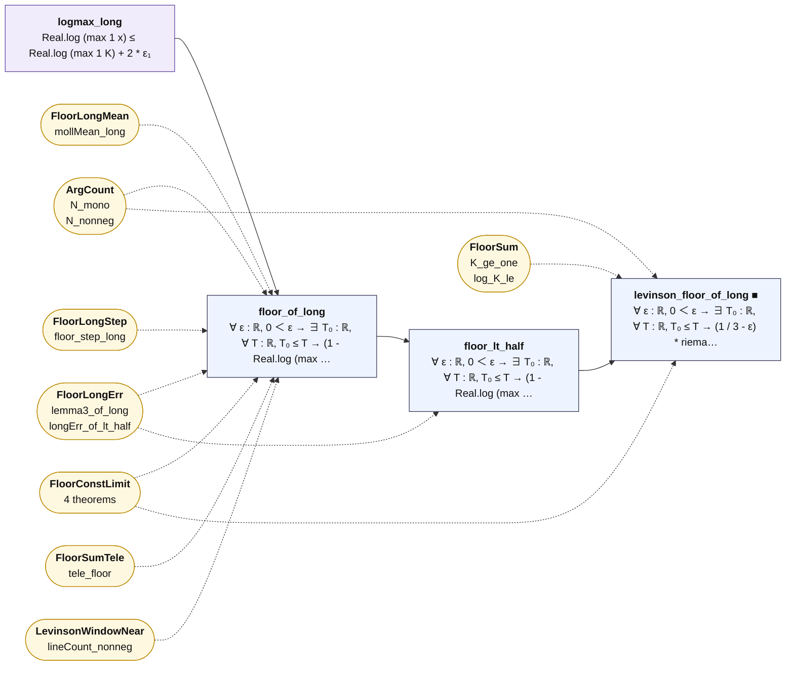

# `lean_stage3/Stage3/FloorLong.lean`

> **Read from the source text.** This file changed after the last `python3 utilities/lean_map.py --dump`, so the arrows on this page are names occurring in each proof and have not been confirmed by Lean.

# FloorLong — block S13 of `lean_stage3/design/stencil.md`, B1, the floor for every length. 2026-11-25.

4 theorems, 0 definitions, 235 lines. 

**Imports:** [`FloorLongStep`](../lean_stage3/FloorLongStep.md), [`FloorSum`](../lean_stage3/FloorSum.md)  
**Imported by:** [`Stage3`](../lean_stage3/Stage3.md)

## The picture



An arrow A → B reads "A is used in the proof of B". Green: counting, integers only. Violet: shape, analysis with no ζ. Blue: reads ζ. A name ending in ■ is an end: nothing else uses it. Red: contains `sorry`. Yellow: theorems in another file, counted; a dotted arrow crosses files. Definitions are not drawn; they are listed below the diagram.

## Theorems

<a name="FloorLong-logmax_long"></a>
### `FloorLong.logmax_long`

line 52 · arrows read from text

**Shape.** Uses real or complex analysis; nothing in it or beneath it reads ζ.

**Why.** The window's `max 1` and `ε₁`, priced for any `K`: `log(max 1 x) ≤ log(max 1 K) + 2ε₁`.

**Proves**

```lean
Real.log (max 1 x) ≤ Real.log (max 1 K) + 2 * ε₁
```

**Needs** (its hypotheses)

  - `` hε₁ : 0 < ε₁ ``
  - `` hx : x ≤ K + 2 * ε₁ ``

**Fed by:** no theorem of this repo; it stands on Mathlib.

**Feeds** (1 that use it)

  - [`FloorLong.floor_of_long`](#FloorLong-floor_of_long) — `` ∀ ε : ℝ, 0 < ε → ∃ T₀ : ℝ, ∀ T : ℝ, T₀ ≤ T → (1 - Real.log (max 1 (Kfl (Ar P) (Br P) (Cr P) θ R)) / R - ε) * riemannZeta.N T ≤ (LineCount.lineCount T … ``

<a name="FloorLong-floor_of_long"></a>
### `FloorLong.floor_of_long`

line 72 · arrows read from text

**Reads ζ.** It, or something it rests on, uses the zeta function, its zeros or the Riemann hypothesis.

**Why.** S13 B1, the floor for every length. If the three error statements hold at length `θ` (`StmtLongErr P θ R`), then for `P(0) = 0`, `P(1) = 1`, `θ > 0`, `R > 0`, every `ε > 0`, from some height on, `(1 − log(max 1 K)/R − ε) N T ≤ lineCount T`, `K = Kfl (∫P′²) (∫P′P) (∫P²) θ R`.

**Proves**

```lean
∀ ε : ℝ, 0 < ε → ∃ T₀ : ℝ, ∀ T : ℝ, T₀ ≤ T → (1 - Real.log (max 1 (Kfl (Ar P) (Br P) (Cr P) θ R)) / R - ε) * riemannZeta.N T ≤ (LineCount.lineCount T : ℝ)
```

**Needs** (its hypotheses)

  - `` P : Polynomial ℝ ``
  - `` hP0 : P.eval 0 = 0 ``
  - `` hP1 : P.eval 1 = 1 ``
  - `` hθ0 : 0 < θ ``
  - `` hR : 0 < R ``
  - `` hL : StmtLongErr P θ R ``

**Fed by** (9 theorems its proof uses)

  - [`ArgCount.N_mono`](../lean_stage3/ArgCount.md#ArgCount-N_mono) (ArgCount) — `` riemannZeta.N T ≤ riemannZeta.N T' ``
  - [`ArgCount.N_nonneg`](../lean_stage3/ArgCount.md#ArgCount-N_nonneg) (ArgCount) — `` 0 ≤ riemannZeta.N T ``
  - [`FloorConst.re_dop_tendsto`](../lean_stage3/FloorConstLimit.md#FloorConst-re_dop_tendsto) (FloorConstLimit) — `` Tendsto (fun T => (Dop (Real.log T) (cY P (Mof T θ) T) ((-(R / Real.log T) : ℝ) : ℂ) ((-(R / Real.log T) : ℝ) : ℂ)).re) atTop (𝓝 (Kfl (Ar P) (Br P) (C… ``
  - [`FloorLong.logmax_long`](#FloorLong-logmax_long) — `` Real.log (max 1 x) ≤ Real.log (max 1 K) + 2 * ε₁ ``
  - [`FloorLong.lemma3_of_long`](../lean_stage3/FloorLongErr.md#FloorLong-lemma3_of_long) (FloorLongErr) — `` StmtLemma3resO P θ R κ ``
  - [`FloorLong.mollMean_long`](../lean_stage3/FloorLongMean.md#FloorLong-mollMean_long) (FloorLongMean) — `` StmtMollMeanO P θ R ``
  - [`FloorLong.floor_step_long`](../lean_stage3/FloorLongStep.md#FloorLong-floor_step_long) (FloorLongStep) — `` ∀ ε : ℝ, 0 < ε → ∃ T₀ : ℝ, ∀ T : ℝ, T₀ ≤ T → (riemannZeta.N T - riemannZeta.N (T / 2)) - Real.log (max 1 ((Operator.Dop (Real.log T) (cY P (Mof T θ) T… ``
  - [`FloorSum.tele_floor`](../lean_stage3/FloorSumTele.md#FloorSum-tele_floor) (FloorSumTele) — `` ∀ T : ℝ, T₁ ≤ T → c * (g T - g T₁) - 2 * e * T * Real.log T ≤ f T ``
  - [`LevinsonWindowNear.lineCount_nonneg`](../lean_stage3/LevinsonWindowNear.md#LevinsonWindowNear-lineCount_nonneg) (LevinsonWindowNear) — `` 0 ≤ lineCount T ``

**Definitions its proof touches:** [`FloorConst.Ar`](../lean_stage3/FloorConstLimit.md#FloorConst-Ar), [`FloorConst.Br`](../lean_stage3/FloorConstLimit.md#FloorConst-Br), [`FloorConst.Cr`](../lean_stage3/FloorConstLimit.md#FloorConst-Cr), [`FloorConst.Kfl`](../lean_stage3/FloorConstLimit.md#FloorConst-Kfl), [`FloorLong.StmtLongErr`](../lean_stage3/FloorLongErr.md#FloorLong-StmtLongErr), [`LineCount.lineCount`](../lean_stage3/LineCount.md#LineCount-lineCount), [`Operator.StmtMollMeanO`](../lean_stage3/Operator.md#Operator-StmtMollMeanO), [`Operator.Dop`](../lean_stage3/OperatorCauchy.md#Operator-Dop), [`TwistedMoment.Mof`](../lean_stage3/TwistedMoment.md#TwistedMoment-Mof), [`TwistedMoment.cY`](../lean_stage3/TwistedMoment.md#TwistedMoment-cY)

**Feeds** (1 that use it)

  - [`FloorLong.floor_lt_half`](#FloorLong-floor_lt_half) — `` ∀ ε : ℝ, 0 < ε → ∃ T₀ : ℝ, ∀ T : ℝ, T₀ ≤ T → (1 - Real.log (max 1 (Kfl (Ar P) (Br P) (Cr P) θ R)) / R - ε) * riemannZeta.N T ≤ (LineCount.lineCount T … ``

<a name="FloorLong-floor_lt_half"></a>
### `FloorLong.floor_lt_half`

line 193 · arrows read from text

**Reads ζ.** It, or something it rests on, uses the zeta function, its zeros or the Riemann hypothesis.

**Why.** The floor for `0 < θ < 1/2`, unconditional: `floor_of_long` with `longErr_of_lt_half`.

**Proves**

```lean
∀ ε : ℝ, 0 < ε → ∃ T₀ : ℝ, ∀ T : ℝ, T₀ ≤ T → (1 - Real.log (max 1 (Kfl (Ar P) (Br P) (Cr P) θ R)) / R - ε) * riemannZeta.N T ≤ (LineCount.lineCount T : ℝ)
```

**Needs** (its hypotheses)

  - `` P : Polynomial ℝ ``
  - `` hP0 : P.eval 0 = 0 ``
  - `` hP1 : P.eval 1 = 1 ``
  - `` hθ0 : 0 < θ ``
  - `` hθ : θ < 1 / 2 ``
  - `` hR : 0 < R ``

**Fed by** (2 theorems its proof uses)

  - [`FloorLong.floor_of_long`](#FloorLong-floor_of_long) — `` ∀ ε : ℝ, 0 < ε → ∃ T₀ : ℝ, ∀ T : ℝ, T₀ ≤ T → (1 - Real.log (max 1 (Kfl (Ar P) (Br P) (Cr P) θ R)) / R - ε) * riemannZeta.N T ≤ (LineCount.lineCount T … ``
  - [`FloorLong.longErr_of_lt_half`](../lean_stage3/FloorLongErr.md#FloorLong-longErr_of_lt_half) (FloorLongErr) — `` StmtLongErr P θ R ``

**Definitions its proof touches:** [`FloorConst.Ar`](../lean_stage3/FloorConstLimit.md#FloorConst-Ar), [`FloorConst.Br`](../lean_stage3/FloorConstLimit.md#FloorConst-Br), [`FloorConst.Cr`](../lean_stage3/FloorConstLimit.md#FloorConst-Cr), [`FloorConst.Kfl`](../lean_stage3/FloorConstLimit.md#FloorConst-Kfl), [`LineCount.lineCount`](../lean_stage3/LineCount.md#LineCount-lineCount)

**Feeds** (1 that use it)

  - [`FloorLong.levinson_floor_of_long`](#FloorLong-levinson_floor_of_long) — `` ∀ ε : ℝ, 0 < ε → ∃ T₀ : ℝ, ∀ T : ℝ, T₀ ≤ T → (1 / 3 - ε) * riemannZeta.N T ≤ (LineCount.lineCount T : ℝ) ``

<a name="FloorLong-levinson_floor_of_long"></a>
### `FloorLong.levinson_floor_of_long`

line 202 · arrows read from text

**Reads ζ.** It, or something it rests on, uses the zeta function, its zeros or the Riemann hypothesis.

**Why.** The consistency check: `floor_of_long` at `P = X`, `θ = 49/100`, `R = 13/10`, with the input from `longErr_of_lt_half`, gives `FloorSum.levinson_floor`'s statement.

**Proves**

```lean
∀ ε : ℝ, 0 < ε → ∃ T₀ : ℝ, ∀ T : ℝ, T₀ ≤ T → (1 / 3 - ε) * riemannZeta.N T ≤ (LineCount.lineCount T : ℝ)
```

**Fed by** (7 theorems its proof uses)

  - [`ArgCount.N_nonneg`](../lean_stage3/ArgCount.md#ArgCount-N_nonneg) (ArgCount) — `` 0 ≤ riemannZeta.N T ``
  - [`FloorConst.Ar_X`](../lean_stage3/FloorConstLimit.md#FloorConst-Ar_X) (FloorConstLimit) — `` Ar Polynomial.X = 1 ``
  - [`FloorConst.Br_X`](../lean_stage3/FloorConstLimit.md#FloorConst-Br_X) (FloorConstLimit) — `` Br Polynomial.X = 1 / 2 ``
  - [`FloorConst.Cr_X`](../lean_stage3/FloorConstLimit.md#FloorConst-Cr_X) (FloorConstLimit) — `` Cr Polynomial.X = 1 / 3 ``
  - [`FloorLong.floor_lt_half`](#FloorLong-floor_lt_half) — `` ∀ ε : ℝ, 0 < ε → ∃ T₀ : ℝ, ∀ T : ℝ, T₀ ≤ T → (1 - Real.log (max 1 (Kfl (Ar P) (Br P) (Cr P) θ R)) / R - ε) * riemannZeta.N T ≤ (LineCount.lineCount T … ``
  - [`FloorSum.K_ge_one`](../lean_stage3/FloorSum.md#FloorSum-K_ge_one) (FloorSum) — `` 1 ≤ Kfl 1 (1 / 2) (1 / 3) (49 / 100) (13 / 10) ``
  - [`FloorSum.log_K_le`](../lean_stage3/FloorSum.md#FloorSum-log_K_le) (FloorSum) — `` Real.log (Kfl 1 (1 / 2) (1 / 3) (49 / 100) (13 / 10)) ≤ 13 / 15 ``

**Definitions its proof touches:** [`FloorConst.Kfl`](../lean_stage3/FloorConstLimit.md#FloorConst-Kfl), [`LineCount.lineCount`](../lean_stage3/LineCount.md#LineCount-lineCount)

**Feeds:** nothing. It is an end.

