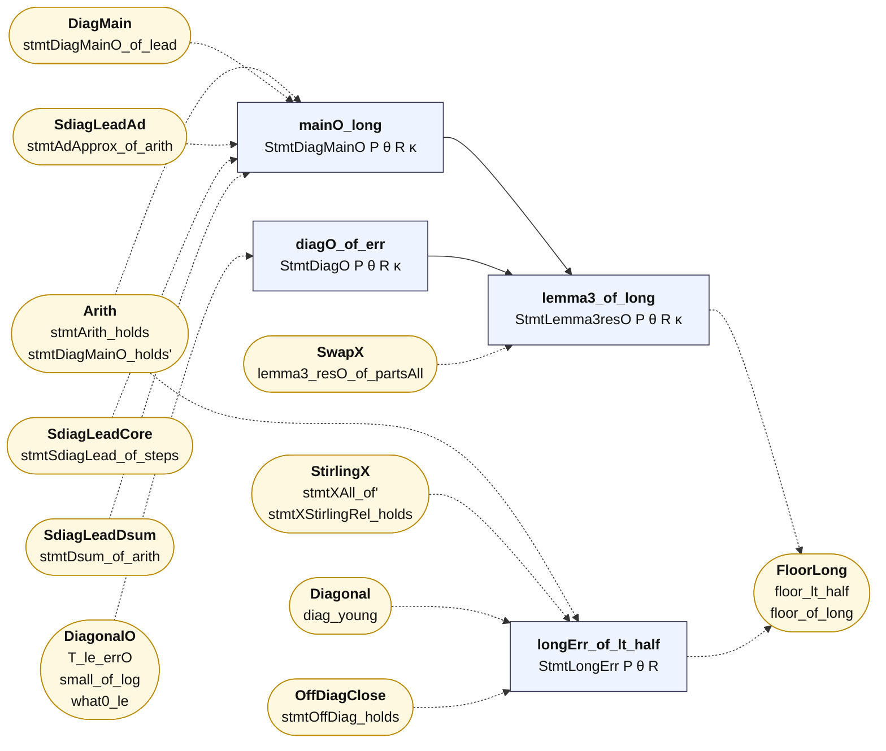

# `lean_stage3/Stage3/FloorLongErr.lean`

> **Read from the source text.** This file changed after the last `python3 utilities/lean_map.py --dump`, so the arrows on this page are names occurring in each proof and have not been confirmed by Lean.

# FloorLongErr — block S13 of `lean_stage3/design/stencil.md`, B1, the floor for every length: the one named input. 2026-11-25.

4 theorems, 2 definitions, 136 lines. 

**Imports:** [`Lemma3`](../lean_stage3/Lemma3.md)  
**Imported by:** [`DiagLong`](../lean_stage3/DiagLong.md), [`FloorLongMean`](../lean_stage3/FloorLongMean.md)

## The picture



An arrow A → B reads "A is used in the proof of B". Green: counting, integers only. Violet: shape, analysis with no ζ. Blue: reads ζ. A name ending in ■ is an end: nothing else uses it. Red: contains `sorry`. Yellow: theorems in another file, counted; a dotted arrow crosses files. Definitions are not drawn; they are listed below the diagram.

## Definitions

<a name="FloorLong-StmtDiagErr"></a>
### `FloorLong.StmtDiagErr`

def · line 42

- **Is:** `` StmtDiagErr (P : Polynomial ℝ) (θ R κ : ℝ) : Prop := ∃ C T₀ : ℝ, 0 ≤ C ∧ ∀ T : ℝ, T₀ ≤ T → ∀ W : Weight T (Real.log T), ∀ α β : ℂ, Regime κ T α β → ‖diagSum W (Mof T θ) (aY P T θ R) (sig0 T R) α β 1 - (what0 W : ℂ) * (riemannZeta (1 + α + β) * Diagonal.Sdiag (Mof T θ) (aY P T θ R) (sig0 T R) α β 0)‖ ≤ C * (T / Real.log T) noncomputable ``
- **Built from:** [`Diagonal.Sdiag`](../lean_stage3/Diagonal.md#Diagonal-Sdiag), [`TwistedMoment.Mof`](../lean_stage3/TwistedMoment.md#TwistedMoment-Mof), [`TwistedMoment.Regime`](../lean_stage3/TwistedMoment.md#TwistedMoment-Regime), [`TwistedMoment.Weight`](../lean_stage3/TwistedMoment.md#TwistedMoment-Weight), [`TwistedMoment.aY`](../lean_stage3/TwistedMoment.md#TwistedMoment-aY), [`TwistedMoment.diagSum`](../lean_stage3/TwistedMoment.md#TwistedMoment-diagSum), [`TwistedMoment.sig0`](../lean_stage3/TwistedMoment.md#TwistedMoment-sig0), [`TwistedMoment.what0`](../lean_stage3/TwistedMoment.md#TwistedMoment-what0)
- **Used by 5:** [`DiagLong.stmtDiagErr_holds`](../lean_stage3/DiagLong.md#DiagLong-stmtDiagErr_holds), [`DiagLong.stmtDiagErr_of_tail`](../lean_stage3/DiagLong.md#DiagLong-stmtDiagErr_of_tail), [`DiagLong.tail_of_stmtDiagErr`](../lean_stage3/DiagLong.md#DiagLong-tail_of_stmtDiagErr), [`FloorLong.StmtLongErr`](#FloorLong-StmtLongErr), [`FloorLong.diagO_of_err`](#FloorLong-diagO_of_err)

<a name="FloorLong-StmtLongErr"></a>
### `FloorLong.StmtLongErr`

def · line 56

- **Is:** `` StmtLongErr (P : Polynomial ℝ) (θ R : ℝ) : Prop := ∀ κ : ℝ, 0 < κ → StmtDiagErr P θ R κ ∧ StmtOffDiagAll P θ R κ ∧ StmtXAll P θ R κ ``
- **Built from:** [`FloorLong.StmtDiagErr`](#FloorLong-StmtDiagErr), [`OffDiagClose.StmtOffDiagAll`](../lean_stage3/OffDiagClose.md#OffDiagClose-StmtOffDiagAll), [`SwapX.StmtXAll`](../lean_stage3/SwapX.md#SwapX-StmtXAll)
- **Used by 3:** [`FloorLong.floor_of_long`](../lean_stage3/FloorLong.md#FloorLong-floor_of_long), [`FloorLong.lemma3_of_long`](#FloorLong-lemma3_of_long), [`FloorLong.longErr_of_lt_half`](#FloorLong-longErr_of_lt_half)

## Theorems

<a name="FloorLong-mainO_long"></a>
### `FloorLong.mainO_long`

line 62 · arrows read from text

**Reads ζ.** It, or something it rests on, uses the zeta function, its zeros or the Riemann hypothesis.

**Why.** The main term for every length: `SdiagLead.stmtDiagMainO_holds` with its unused `θ < 1/2` dropped (the proof is `stmtSdiagLead_holds`'s, with `Arith.stmtArith_holds`).

**Proves**

```lean
StmtDiagMainO P θ R κ
```

**Needs** (its hypotheses)

  - `` P : Polynomial ℝ ``
  - `` hP0 : P.eval 0 = 0 ``
  - `` hθ0 : 0 < θ ``
  - `` R : ℝ ``
  - `` hκ : 0 < κ ``

**Fed by** (5 theorems its proof uses)

  - [`Arith.stmtArith_holds`](../lean_stage3/Arith.md#Arith-stmtArith_holds) (Arith) — `` StmtArith ``
  - [`DiagMain.stmtDiagMainO_of_lead`](../lean_stage3/DiagMain.md#DiagMain-stmtDiagMainO_of_lead) (DiagMain) — `` StmtDiagMainO P θ R κ ``
  - [`SdiagLead.stmtAdApprox_of_arith`](../lean_stage3/SdiagLeadAd.md#SdiagLead-stmtAdApprox_of_arith) (SdiagLeadAd) — `` StmtAdApprox P A ``
  - [`SdiagLead.stmtSdiagLead_of_steps`](../lean_stage3/SdiagLeadCore.md#SdiagLead-stmtSdiagLead_of_steps) (SdiagLeadCore) — `` StmtSdiagLead P θ R κ ``
  - [`SdiagLead.stmtDsum_of_arith`](../lean_stage3/SdiagLeadDsum.md#SdiagLead-stmtDsum_of_arith) (SdiagLeadDsum) — `` StmtDsum P A ``

**Definitions its proof touches:** [`DiagMainStmt.StmtDiagMainO`](../lean_stage3/DiagMainStmt.md#DiagMainStmt-StmtDiagMainO)

**Feeds** (1 that use it)

  - [`FloorLong.lemma3_of_long`](#FloorLong-lemma3_of_long) — `` StmtLemma3resO P θ R κ ``

<a name="FloorLong-diagO_of_err"></a>
### `FloorLong.diagO_of_err`

line 73 · arrows read from text

**Reads ζ.** It, or something it rests on, uses the zeta function, its zeros or the Riemann hypothesis.

**Why.** The diagonal at `o(T)` from its error statement: `DiagonalO.stmtDiagO_of_mainO` with `diag_young` replaced by the hypothesis.

**Proves**

```lean
StmtDiagO P θ R κ
```

**Needs** (its hypotheses)

  - `` P : Polynomial ℝ ``
  - `` hdy0 : StmtDiagErr P θ R κ ``
  - `` hmain : StmtDiagMainO P θ R κ ``

**Fed by** (3 theorems its proof uses)

  - [`DiagonalO.T_le_errO`](../lean_stage3/DiagonalO.md#DiagonalO-T_le_errO) (DiagonalO) — `` T ≤ errO W ``
  - [`DiagonalO.small_of_log`](../lean_stage3/DiagonalO.md#DiagonalO-small_of_log) (DiagonalO) — `` C * (T / Real.log T) ≤ ε * T ``
  - [`DiagonalO.what0_le`](../lean_stage3/DiagonalO.md#DiagonalO-what0_le) (DiagonalO) — `` ‖(what0 W : ℂ)‖ ≤ 2 * T ``

**Definitions its proof touches:** [`DiagMainStmt.StmtDiagMainO`](../lean_stage3/DiagMainStmt.md#DiagMainStmt-StmtDiagMainO), [`DiagMainStmt.errO`](../lean_stage3/DiagMainStmt.md#DiagMainStmt-errO), [`Diagonal.Sdiag`](../lean_stage3/Diagonal.md#Diagonal-Sdiag), [`DiagonalO.StmtDiagO`](../lean_stage3/DiagonalO.md#DiagonalO-StmtDiagO), [`FloorLong.StmtDiagErr`](#FloorLong-StmtDiagErr), [`TwistedMoment.Mof`](../lean_stage3/TwistedMoment.md#TwistedMoment-Mof), [`TwistedMoment.aY`](../lean_stage3/TwistedMoment.md#TwistedMoment-aY), [`TwistedMoment.c1Y`](../lean_stage3/TwistedMoment.md#TwistedMoment-c1Y), [`TwistedMoment.diagSum`](../lean_stage3/TwistedMoment.md#TwistedMoment-diagSum), [`TwistedMoment.sig0`](../lean_stage3/TwistedMoment.md#TwistedMoment-sig0), [`TwistedMoment.what0`](../lean_stage3/TwistedMoment.md#TwistedMoment-what0)

**Feeds** (1 that use it)

  - [`FloorLong.lemma3_of_long`](#FloorLong-lemma3_of_long) — `` StmtLemma3resO P θ R κ ``

<a name="FloorLong-lemma3_of_long"></a>
### `FloorLong.lemma3_of_long`

line 106 · arrows read from text

**Reads ζ.** It, or something it rests on, uses the zeta function, its zeros or the Riemann hypothesis.

**Why.** Lemma 3 at `o(T)` for every length, from the one input: `lemma3_resO_of_partsAll` with the diagonal from `diagO_of_err` and `mainO_long`.

**Proves**

```lean
StmtLemma3resO P θ R κ
```

**Needs** (its hypotheses)

  - `` P : Polynomial ℝ ``
  - `` hP0 : P.eval 0 = 0 ``
  - `` hθ0 : 0 < θ ``
  - `` hL : StmtLongErr P θ R ``
  - `` hκ : 0 < κ ``

**Fed by** (3 theorems its proof uses)

  - [`FloorLong.diagO_of_err`](#FloorLong-diagO_of_err) — `` StmtDiagO P θ R κ ``
  - [`FloorLong.mainO_long`](#FloorLong-mainO_long) — `` StmtDiagMainO P θ R κ ``
  - [`SwapX.lemma3_resO_of_partsAll`](../lean_stage3/SwapX.md#SwapX-lemma3_resO_of_partsAll) (SwapX) — `` StmtLemma3resO P θ R κ ``

**Definitions its proof touches:** [`DiagonalO.StmtLemma3resO`](../lean_stage3/DiagonalO.md#DiagonalO-StmtLemma3resO), [`FloorLong.StmtLongErr`](#FloorLong-StmtLongErr)

**Feeds** (1 that use it)

  - [`FloorLong.floor_of_long`](../lean_stage3/FloorLong.md#FloorLong-floor_of_long) (FloorLong) — `` ∀ ε : ℝ, 0 < ε → ∃ T₀ : ℝ, ∀ T : ℝ, T₀ ≤ T → (1 - Real.log (max 1 (Kfl (Ar P) (Br P) (Cr P) θ R)) / R - ε) * riemannZeta.N T ≤ (LineCount.lineCount T … ``

<a name="FloorLong-longErr_of_lt_half"></a>
### `FloorLong.longErr_of_lt_half`

line 113 · arrows read from text

**Reads ζ.** It, or something it rests on, uses the zeta function, its zeros or the Riemann hypothesis.

**Why.** Stage A's length gives the input: for `0 < θ < 1/2` the three error statements are the tree's `diag_young`, `stmtOffDiag_holds` and `Stirling.stmtXAll_of'`.

**Proves**

```lean
StmtLongErr P θ R
```

**Needs** (its hypotheses)

  - `` P : Polynomial ℝ ``
  - `` hP0 : P.eval 0 = 0 ``
  - `` hθ0 : 0 < θ ``
  - `` hθ : θ < 1 / 2 ``
  - `` R : ℝ ``

**Fed by** (5 theorems its proof uses)

  - [`Arith.stmtDiagMainO_holds'`](../lean_stage3/Arith.md#Arith-stmtDiagMainO_holds-) (Arith) — `` StmtDiagMainO P θ R κ ``
  - [`Diagonal.diag_young`](../lean_stage3/Diagonal.md#Diagonal-diag_young) (Diagonal) — `` ∃ C T₀ : ℝ, 0 ≤ C ∧ ∀ T : ℝ, T₀ ≤ T → ∀ W : Weight T (Real.log T), ∀ α β : ℂ, Regime κ T α β → ‖diagSum W (Mof T θ) (aY P T θ R) (sig0 T R) α β 1 - (w… ``
  - [`OffDiagClose.stmtOffDiag_holds`](../lean_stage3/OffDiagClose.md#OffDiagClose-stmtOffDiag_holds) (OffDiagClose) — `` StmtOffDiagAll P θ R κ ``
  - [`Stirling.stmtXAll_of'`](../lean_stage3/StirlingX.md#Stirling-stmtXAll_of-) (StirlingX) — `` StmtXAll P θ R κ ``
  - [`Stirling.stmtXStirlingRel_holds`](../lean_stage3/StirlingX.md#Stirling-stmtXStirlingRel_holds) (StirlingX) — `` StmtXStirlingRel ``

**Definitions its proof touches:** [`FloorLong.StmtLongErr`](#FloorLong-StmtLongErr)

**Feeds** (1 that use it)

  - [`FloorLong.floor_lt_half`](../lean_stage3/FloorLong.md#FloorLong-floor_lt_half) (FloorLong) — `` ∀ ε : ℝ, 0 < ε → ∃ T₀ : ℝ, ∀ T : ℝ, T₀ ≤ T → (1 - Real.log (max 1 (Kfl (Ar P) (Br P) (Cr P) θ R)) / R - ε) * riemannZeta.N T ≤ (LineCount.lineCount T … ``

