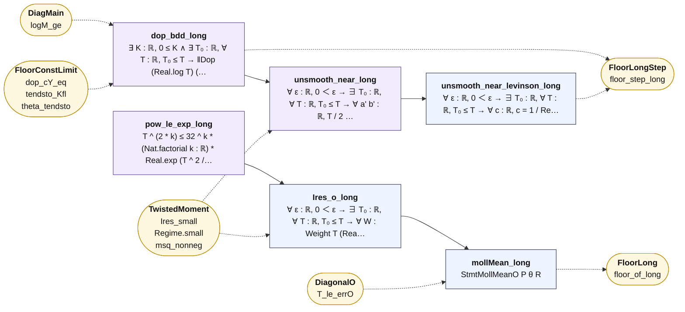

# `lean_stage3/Stage3/FloorLongMean.lean`

> **Read from the source text.** This file changed after the last `python3 utilities/lean_map.py --dump`, so the arrows on this page are names occurring in each proof and have not been confirmed by Lean.

# FloorLongMean — block S13 of `lean_stage3/design/stencil.md`, B1, the floor for every length: Lemma 3 to the sharp mean. 2026-11-25.

6 theorems, 0 definitions, 493 lines. 

**Imports:** [`FloorConstLimit`](../lean_stage3/FloorConstLimit.md), [`FloorLongErr`](../lean_stage3/FloorLongErr.md), [`Unsmooth`](../lean_stage3/Unsmooth.md)  
**Imported by:** [`FloorLongStep`](../lean_stage3/FloorLongStep.md)

## The picture



An arrow A → B reads "A is used in the proof of B". Green: counting, integers only. Violet: shape, analysis with no ζ. Blue: reads ζ. A name ending in ■ is an end: nothing else uses it. Red: contains `sorry`. Yellow: theorems in another file, counted; a dotted arrow crosses files. Definitions are not drawn; they are listed below the diagram.

## Theorems

<a name="FloorLong-pow_le_exp_long"></a>
### `FloorLong.pow_le_exp_long`

line 40 · arrows read from text

**Shape.** Uses real or complex analysis; nothing in it or beneath it reads ζ.

**Why.** `T^(2k) ≤ 32^k k! e^(T²/32)`, from `x^k/k! ≤ eˣ`.

**Proves**

```lean
T ^ (2 * k) ≤ 32 ^ k * (Nat.factorial k : ℝ) * Real.exp (T ^ 2 / 32)
```

**Needs** (its hypotheses)

  - `` T : ℝ ``
  - `` k : ℕ ``

**Fed by:** no theorem of this repo; it stands on Mathlib.

**Feeds** (1 that use it)

  - [`FloorLong.Ires_o_long`](#FloorLong-Ires_o_long) — `` ∀ ε : ℝ, 0 < ε → ∃ T₀ : ℝ, ∀ T : ℝ, T₀ ≤ T → ∀ W : Weight T (Real.log T), ∀ α β : ℂ, Regime κ T α β → ‖Ires W (Mof T θ) (aY P T θ R) (sig0 T R) α β‖ ≤… ``

<a name="FloorLong-Ires_o_long"></a>
### `FloorLong.Ires_o_long`

line 50 · arrows read from text

**Reads ζ.** It, or something it rests on, uses the zeta function, its zeros or the Riemann hypothesis.

**Why.** The remainder is `o(T)` for every length: `Operator.Ires_o` with `M ≤ T^⌈θ⌉₊`.

**Proves**

```lean
∀ ε : ℝ, 0 < ε → ∃ T₀ : ℝ, ∀ T : ℝ, T₀ ≤ T → ∀ W : Weight T (Real.log T), ∀ α β : ℂ, Regime κ T α β → ‖Ires W (Mof T θ) (aY P T θ R) (sig0 T R) α β‖ ≤ ε * T
```

**Needs** (its hypotheses)

  - `` P : Polynomial ℝ ``
  - `` R : ℝ ``
  - `` hκ : 0 < κ ``

**Fed by** (3 theorems its proof uses)

  - [`FloorLong.pow_le_exp_long`](#FloorLong-pow_le_exp_long) — `` T ^ (2 * k) ≤ 32 ^ k * (Nat.factorial k : ℝ) * Real.exp (T ^ 2 / 32) ``
  - [`TwistedMoment.Ires_small`](../lean_stage3/TwistedMoment.md#TwistedMoment-Ires_small) (TwistedMoment) — `` ∃ C : ℝ, 0 ≤ C ∧ ∀ (T L : ℝ) (W : Weight T L), 4 ≤ T → ∀ (M : ℕ) (a : ℕ → ℂ) (σ₀ : ℝ) (α β : ℂ), ‖α‖ ≤ 1 / 10 → ‖β‖ ≤ 1 / 10 → ‖Ires W M a σ₀ α β‖ ≤ C… ``
  - [`TwistedMoment.Regime.small`](../lean_stage3/TwistedMoment.md#TwistedMoment-Regime-small) (TwistedMoment) — `` ‖α‖ ≤ 1 / 10 ∧ ‖β‖ ≤ 1 / 10 ∧ α + β ≠ 0 ∧ 0 < Real.log T ``

**Definitions its proof touches:** [`TwistedMoment.Ires`](../lean_stage3/TwistedMoment.md#TwistedMoment-Ires), [`TwistedMoment.Mof`](../lean_stage3/TwistedMoment.md#TwistedMoment-Mof), [`TwistedMoment.Regime`](../lean_stage3/TwistedMoment.md#TwistedMoment-Regime), [`TwistedMoment.Weight`](../lean_stage3/TwistedMoment.md#TwistedMoment-Weight), [`TwistedMoment.aY`](../lean_stage3/TwistedMoment.md#TwistedMoment-aY), [`TwistedMoment.sig0`](../lean_stage3/TwistedMoment.md#TwistedMoment-sig0)

**Feeds** (1 that use it)

  - [`FloorLong.mollMean_long`](#FloorLong-mollMean_long) — `` StmtMollMeanO P θ R ``

<a name="FloorLong-mollMean_long"></a>
### `FloorLong.mollMean_long`

line 131 · arrows read from text

**Reads ζ.** It, or something it rests on, uses the zeta function, its zeros or the Riemann hypothesis.

**Why.** The mollified mean from Lemma 3, every length: `Operator.stmtMollMeanO_holds` with `Lemma3.lemma3_resO_holds` replaced by the hypothesis at `κ = 2R + 1 + 1/R`.

**Proves**

```lean
StmtMollMeanO P θ R
```

**Needs** (its hypotheses)

  - `` P : Polynomial ℝ ``
  - `` hR : 0 < R ``
  - `` hL3 : StmtLemma3resO P θ R (2 * R + 1 + 1 / R) ``

**Fed by** (2 theorems its proof uses)

  - [`DiagonalO.T_le_errO`](../lean_stage3/DiagonalO.md#DiagonalO-T_le_errO) (DiagonalO) — `` T ≤ errO W ``
  - [`FloorLong.Ires_o_long`](#FloorLong-Ires_o_long) — `` ∀ ε : ℝ, 0 < ε → ∃ T₀ : ℝ, ∀ T : ℝ, T₀ ≤ T → ∀ W : Weight T (Real.log T), ∀ α β : ℂ, Regime κ T α β → ‖Ires W (Mof T θ) (aY P T θ R) (sig0 T R) α β‖ ≤… ``

**Definitions its proof touches:** [`DiagMainStmt.errO`](../lean_stage3/DiagMainStmt.md#DiagMainStmt-errO), [`DiagonalO.StmtLemma3resO`](../lean_stage3/DiagonalO.md#DiagonalO-StmtLemma3resO), [`TwistedMoment.Imom`](../lean_stage3/TwistedMoment.md#TwistedMoment-Imom), [`TwistedMoment.Mof`](../lean_stage3/TwistedMoment.md#TwistedMoment-Mof), [`TwistedMoment.Regime`](../lean_stage3/TwistedMoment.md#TwistedMoment-Regime), [`TwistedMoment.aY`](../lean_stage3/TwistedMoment.md#TwistedMoment-aY), [`TwistedMoment.cY`](../lean_stage3/TwistedMoment.md#TwistedMoment-cY), [`TwistedMoment.sig0`](../lean_stage3/TwistedMoment.md#TwistedMoment-sig0), [`TwistedMoment.what0`](../lean_stage3/TwistedMoment.md#TwistedMoment-what0)

**Feeds** (1 that use it)

  - [`FloorLong.floor_of_long`](../lean_stage3/FloorLong.md#FloorLong-floor_of_long) (FloorLong) — `` ∀ ε : ℝ, 0 < ε → ∃ T₀ : ℝ, ∀ T : ℝ, T₀ ≤ T → (1 - Real.log (max 1 (Kfl (Ar P) (Br P) (Cr P) θ R)) / R - ε) * riemannZeta.N T ≤ (LineCount.lineCount T … ``

<a name="FloorLong-dop_bdd_long"></a>
### `FloorLong.dop_bdd_long`

line 291 · arrows read from text

**Shape.** Uses real or complex analysis; nothing in it or beneath it reads ζ.

**Why.** `D[c]` is bounded for every length: `‖D[c]‖ = |Kfl(A,B,C,θ′,R)|`, `θ′ → θ`.

**Proves**

```lean
∃ K : ℝ, 0 ≤ K ∧ ∃ T₀ : ℝ, ∀ T : ℝ, T₀ ≤ T → ‖Dop (Real.log T) (cY P (Mof T θ) T) ((-(R / Real.log T) : ℝ) : ℂ) ((-(R / Real.log T) : ℝ) : ℂ)‖ ≤ K
```

**Needs** (its hypotheses)

  - `` P : Polynomial ℝ ``
  - `` hθ0 : 0 < θ ``
  - `` hR : 0 < R ``

**Fed by** (4 theorems its proof uses)

  - [`DiagMain.logM_ge`](../lean_stage3/DiagMain.md#DiagMain-logM_ge) (DiagMain) — `` θ * Real.log T / 2 ≤ Real.log (Mof T θ) ``
  - [`FloorConst.dop_cY_eq`](../lean_stage3/FloorConstLimit.md#FloorConst-dop_cY_eq) (FloorConstLimit) — `` Dop (Real.log T) (cY P M T) ((-(R / Real.log T) : ℝ) : ℂ) ((-(R / Real.log T) : ℝ) : ℂ) = ((Kfl (Ar P) (Br P) (Cr P) (Real.log M / Real.log T) R : ℝ) … ``
  - [`FloorConst.tendsto_Kfl`](../lean_stage3/FloorConstLimit.md#FloorConst-tendsto_Kfl) (FloorConstLimit) — `` Tendsto (fun t => Kfl A B C (f t) R) l (𝓝 (Kfl A B C θ R)) ``
  - [`FloorConst.theta_tendsto`](../lean_stage3/FloorConstLimit.md#FloorConst-theta_tendsto) (FloorConstLimit) — `` Tendsto (fun T => Real.log (Mof T θ) / Real.log T) atTop (𝓝 θ) ``

**Definitions its proof touches:** [`FloorConst.Ar`](../lean_stage3/FloorConstLimit.md#FloorConst-Ar), [`FloorConst.Br`](../lean_stage3/FloorConstLimit.md#FloorConst-Br), [`FloorConst.Cr`](../lean_stage3/FloorConstLimit.md#FloorConst-Cr), [`FloorConst.Kfl`](../lean_stage3/FloorConstLimit.md#FloorConst-Kfl), [`TwistedMoment.Mof`](../lean_stage3/TwistedMoment.md#TwistedMoment-Mof), [`TwistedMoment.cY`](../lean_stage3/TwistedMoment.md#TwistedMoment-cY)

**Feeds** (2 that use it)

  - [`FloorLong.unsmooth_near_long`](#FloorLong-unsmooth_near_long) — `` ∀ ε : ℝ, 0 < ε → ∃ T₀ : ℝ, ∀ T : ℝ, T₀ ≤ T → ∀ a' b' : ℝ, T / 2 ≤ a' → a' ≤ T / 2 + 1 → T - 1 ≤ b' → b' ≤ T → (1 / (b' - a')) * ∫ t in a'..b', ‖Gl (Re… ``
  - [`FloorLong.floor_step_long`](../lean_stage3/FloorLongStep.md#FloorLong-floor_step_long) (FloorLongStep) — `` ∀ ε : ℝ, 0 < ε → ∃ T₀ : ℝ, ∀ T : ℝ, T₀ ≤ T → (riemannZeta.N T - riemannZeta.N (T / 2)) - Real.log (max 1 ((Operator.Dop (Real.log T) (cY P (Mof T θ) T… ``

<a name="FloorLong-unsmooth_near_long"></a>
### `FloorLong.unsmooth_near_long`

line 321 · arrows read from text

**Shape.** Uses real or complex analysis; nothing in it or beneath it reads ζ.

**Why.** The sharp one-sided mean from the mollified mean, every length: `Unsmooth.unsmooth_near` with `stmtMollMeanO_holds` replaced by the hypothesis and `dop_cY_bdd` by `dop_bdd_long`.

**Proves**

```lean
∀ ε : ℝ, 0 < ε → ∃ T₀ : ℝ, ∀ T : ℝ, T₀ ≤ T → ∀ a' b' : ℝ, T / 2 ≤ a' → a' ≤ T / 2 + 1 → T - 1 ≤ b' → b' ≤ T → (1 / (b' - a')) * ∫ t in a'..b', ‖Gl (Real.log T) ((sig0 T R : ℂ) + t * I) * psi (Mof T θ) (aY P T θ R) ((sig0 T R : ℂ) + t * I)‖ ^ 2 ≤ (Dop (Real.log T) (cY P (Mof T θ) T) ((-(R / Real.log T) : ℝ) : ℂ) ((-(R / Real.log T) : ℝ) : ℂ)).re + ε
```

**Needs** (its hypotheses)

  - `` P : Polynomial ℝ ``
  - `` hθ0 : 0 < θ ``
  - `` hR : 0 < R ``
  - `` hMM : StmtMollMeanO P θ R ``

**Fed by** (2 theorems its proof uses)

  - [`FloorLong.dop_bdd_long`](#FloorLong-dop_bdd_long) — `` ∃ K : ℝ, 0 ≤ K ∧ ∃ T₀ : ℝ, ∀ T : ℝ, T₀ ≤ T → ‖Dop (Real.log T) (cY P (Mof T θ) T) ((-(R / Real.log T) : ℝ) : ℂ) ((-(R / Real.log T) : ℝ) : ℂ)‖ ≤ K ``
  - [`TwistedMoment.msq_nonneg`](../lean_stage3/TwistedMoment.md#TwistedMoment-msq_nonneg) (TwistedMoment) — `` 0 ≤ msq M a σ₀ t ``

**Definitions its proof touches:** [`DiagMainStmt.errO`](../lean_stage3/DiagMainStmt.md#DiagMainStmt-errO), [`TwistedMoment.Mof`](../lean_stage3/TwistedMoment.md#TwistedMoment-Mof), [`TwistedMoment.aY`](../lean_stage3/TwistedMoment.md#TwistedMoment-aY), [`TwistedMoment.cY`](../lean_stage3/TwistedMoment.md#TwistedMoment-cY), [`TwistedMoment.msq`](../lean_stage3/TwistedMoment.md#TwistedMoment-msq), [`TwistedMoment.psi`](../lean_stage3/TwistedMoment.md#TwistedMoment-psi), [`TwistedMoment.sig0`](../lean_stage3/TwistedMoment.md#TwistedMoment-sig0), [`TwistedMoment.what0`](../lean_stage3/TwistedMoment.md#TwistedMoment-what0)

**Feeds** (1 that use it)

  - [`FloorLong.unsmooth_near_levinson_long`](#FloorLong-unsmooth_near_levinson_long) — `` ∀ ε : ℝ, 0 < ε → ∃ T₀ : ℝ, ∀ T : ℝ, T₀ ≤ T → ∀ c : ℝ, c = 1 / Real.log T → ∀ a' b' : ℝ, T / 2 ≤ a' → a' ≤ T / 2 + 1 → T - 1 ≤ b' → b' ≤ T → (1 / (b' -… ``

<a name="FloorLong-unsmooth_near_levinson_long"></a>
### `FloorLong.unsmooth_near_levinson_long`

line 444 · arrows read from text

**Reads ζ.** It, or something it rests on, uses the zeta function, its zeros or the Riemann hypothesis.

**Why.** The sharp one-sided mean in `levinson_window'`'s integrand, every length.

**Proves**

```lean
∀ ε : ℝ, 0 < ε → ∃ T₀ : ℝ, ∀ T : ℝ, T₀ ≤ T → ∀ c : ℝ, c = 1 / Real.log T → ∀ a' b' : ℝ, T / 2 ≤ a' → a' ≤ T / 2 + 1 → T - 1 ≤ b' → b' ≤ T → (1 / (b' - a')) * ∫ t in a'..b', ‖(riemannZeta (↑(sig0 T R) + ↑t * I) + c * deriv riemannZeta (↑(sig0 T R) + ↑t * I)) * LevinsonMollEdge.molli (Mof T θ) (aY P T θ R) (↑(sig0 T R) + ↑t * I)‖ ^ 2 ≤ (Dop (Real.log T) (cY P (Mof T θ) T) ((-(R / Real.log T) : ℝ) : ℂ) ((-(R / Real.log T) : ℝ) : ℂ)).re + ε
```

**Needs** (its hypotheses)

  - `` P : Polynomial ℝ ``
  - `` hθ0 : 0 < θ ``
  - `` hR : 0 < R ``
  - `` hMM : StmtMollMeanO P θ R ``

**Fed by** (1 theorem its proof uses)

  - [`FloorLong.unsmooth_near_long`](#FloorLong-unsmooth_near_long) — `` ∀ ε : ℝ, 0 < ε → ∃ T₀ : ℝ, ∀ T : ℝ, T₀ ≤ T → ∀ a' b' : ℝ, T / 2 ≤ a' → a' ≤ T / 2 + 1 → T - 1 ≤ b' → b' ≤ T → (1 / (b' - a')) * ∫ t in a'..b', ‖Gl (Re… ``

**Definitions its proof touches:** [`LevinsonMollEdge.molli`](../lean_stage3/LevinsonMollEdge.md#LevinsonMollEdge-molli), [`TwistedMoment.Mof`](../lean_stage3/TwistedMoment.md#TwistedMoment-Mof), [`TwistedMoment.aY`](../lean_stage3/TwistedMoment.md#TwistedMoment-aY), [`TwistedMoment.cY`](../lean_stage3/TwistedMoment.md#TwistedMoment-cY), [`TwistedMoment.psi`](../lean_stage3/TwistedMoment.md#TwistedMoment-psi), [`TwistedMoment.sig0`](../lean_stage3/TwistedMoment.md#TwistedMoment-sig0)

**Feeds** (1 that use it)

  - [`FloorLong.floor_step_long`](../lean_stage3/FloorLongStep.md#FloorLong-floor_step_long) (FloorLongStep) — `` ∀ ε : ℝ, 0 < ε → ∃ T₀ : ℝ, ∀ T : ℝ, T₀ ≤ T → (riemannZeta.N T - riemannZeta.N (T / 2)) - Real.log (max 1 ((Operator.Dop (Real.log T) (cY P (Mof T θ) T… ``

