# `lean_stage3/Stage3/FloorLongStep.lean`

> **Read from the source text.** This file changed after the last `python3 utilities/lean_map.py --dump`, so the arrows on this page are names occurring in each proof and have not been confirmed by Lean.

# FloorLongStep — block S13 of `lean_stage3/design/stencil.md`, B1, the floor for every length: one dyadic window. 2026-11-25.

2 theorems, 0 definitions, 211 lines. 

**Imports:** [`FloorLongMean`](../lean_stage3/FloorLongMean.md), [`FloorStep`](../lean_stage3/FloorStep.md)  
**Imported by:** [`FloorLong`](../lean_stage3/FloorLong.md)

## The picture

```mermaid
flowchart LR
  n0["<b>W2_long</b><br/>X * Real.pi + 2 * (X * (Real.pi * ((8 * X - 1) * (L + lM + lB + …"]:::shp
  n1["<b>floor_step_long</b><br/>∀ ε : ℝ, 0 ＜ ε → ∃ T₀ : ℝ, ∀ T : ℝ, T₀ ≤ T → (riemannZeta.N T - …"]:::thm
  x0(["<b>FloorStepSize</b><br/>9 theorems"]):::ext
  x1(["<b>FloorLongMean</b><br/>dop_bdd_long<br/>unsmooth_near_levinson_long"]):::ext
  x2(["<b>FloorStep</b><br/>combine"]):::ext
  x3(["<b>FloorStepCont</b><br/>hK_shift"]):::ext
  x4(["<b>LevinsonWindowNear</b><br/>levinson_window_diff"]):::ext
  x5(["<b>FloorLong</b><br/>floor_of_long"]):::ext
  n0 --> n1
  n1 -.-> x5
  x0 -.-> n0
  x0 -.-> n1
  x1 -.-> n1
  x2 -.-> n1
  x3 -.-> n1
  x4 -.-> n1
  classDef cnt fill:#dff5ec,stroke:#17694a,color:#111
  classDef shp fill:#f1ecfb,stroke:#5b3fa0,color:#111
  classDef rh fill:#ffe5e5,stroke:#c22,color:#111,stroke-width:2px
  classDef thm fill:#eef4ff,stroke:#335,color:#111
  classDef end_ fill:#e7f7e7,stroke:#2a7,color:#111,stroke-width:2px
  classDef lone fill:#fff,stroke:#999,color:#111,stroke-dasharray:4 3
  classDef bad fill:#ffe5e5,stroke:#c22,color:#111,stroke-width:2px
  classDef ext fill:#fff8e1,stroke:#b80,color:#111
```



An arrow A → B reads "A is used in the proof of B". Green: counting, integers only. Violet: shape, analysis with no ζ. Blue: reads ζ. A name ending in ■ is an end: nothing else uses it. Red: contains `sorry`. Yellow: theorems in another file, counted; a dotted arrow crosses files. Definitions are not drawn; they are listed below the diagram.

## Theorems

<a name="FloorLong-W2_long"></a>
### `FloorLong.W2_long`

line 38 · arrows read from text

**Shape.** Uses real or complex analysis; nothing in it or beneath it reads ζ.

**Why.** The edge terms for every length: `W2_le` at `n L`, and the expression is monotone in `L`.

**Proves**

```lean
X * Real.pi + 2 * (X * (Real.pi * ((8 * X - 1) * (L + lM + lB + 8) + 1))) ≤ Real.pi * ((12 + 256 * (10 + B)) * n ^ 3) * L ^ 3
```

**Needs** (its hypotheses)

  - `` hn : 1 ≤ n ``
  - `` hX3 : 3 ≤ X ``
  - `` hX : X ≤ 4 * (n * L) ``
  - `` hL : 1 ≤ L ``
  - `` hlM0 : 0 ≤ lM ``
  - `` hlM : lM ≤ n * L ``
  - `` hlB0 : 0 ≤ lB ``
  - `` hlB : lB ≤ B ``

**Fed by** (1 theorem its proof uses)

  - [`FloorStep.W2_le`](../lean_stage3/FloorStepSize.md#FloorStep-W2_le) (FloorStepSize) — `` X * Real.pi + 2 * (X * (Real.pi * ((8 * X - 1) * (L + lM + lB + 8) + 1))) ≤ Real.pi * (12 + 256 * (10 + B)) * L ^ 3 ``

**Feeds** (1 that use it)

  - [`FloorLong.floor_step_long`](#FloorLong-floor_step_long) — `` ∀ ε : ℝ, 0 < ε → ∃ T₀ : ℝ, ∀ T : ℝ, T₀ ≤ T → (riemannZeta.N T - riemannZeta.N (T / 2)) - Real.log (max 1 ((Operator.Dop (Real.log T) (cY P (Mof T θ) T… ``

<a name="FloorLong-floor_step_long"></a>
### `FloorLong.floor_step_long`

line 60 · arrows read from text

**Reads ζ.** It, or something it rests on, uses the zeta function, its zeros or the Riemann hypothesis.

**Why.** Levinson's floor on one dyadic window, every length. `FloorStep.floor_step` from the mollified mean at length `θ`: for `P(1) = 1`, `θ > 0`, `R > 0`, every `ε > 0`, from some height on, `(1 − log K/R)(N T − N(T/2)) − ε T log T ≤ lineCount T − lineCount(T/2)`, `K = max 1 (Re D[c](−R/L, −R/L) + ε)`.

**Proves**

```lean
∀ ε : ℝ, 0 < ε → ∃ T₀ : ℝ, ∀ T : ℝ, T₀ ≤ T → (riemannZeta.N T - riemannZeta.N (T / 2)) - Real.log (max 1 ((Operator.Dop (Real.log T) (cY P (Mof T θ) T) ((-(R / Real.log T) : ℝ) : ℂ) ((-(R / Real.log T) : ℝ) : ℂ)).re + ε)) / R * (riemannZeta.N T - riemannZeta.N (T / 2)) - ε * T * Real.log T ≤ (LineCount.lineCount T : ℝ) - (LineCount.lineCount (T / 2) : ℝ)
```

**Needs** (its hypotheses)

  - `` P : Polynomial ℝ ``
  - `` hP1 : P.eval 1 = 1 ``
  - `` hθ0 : 0 < θ ``
  - `` hR : 0 < R ``
  - `` hMM : Operator.StmtMollMeanO P θ R ``

**Fed by** (14 theorems its proof uses)

  - [`FloorLong.dop_bdd_long`](../lean_stage3/FloorLongMean.md#FloorLong-dop_bdd_long) (FloorLongMean) — `` ∃ K : ℝ, 0 ≤ K ∧ ∃ T₀ : ℝ, ∀ T : ℝ, T₀ ≤ T → ‖Dop (Real.log T) (cY P (Mof T θ) T) ((-(R / Real.log T) : ℝ) : ℂ) ((-(R / Real.log T) : ℝ) : ℂ)‖ ≤ K ``
  - [`FloorLong.unsmooth_near_levinson_long`](../lean_stage3/FloorLongMean.md#FloorLong-unsmooth_near_levinson_long) (FloorLongMean) — `` ∀ ε : ℝ, 0 < ε → ∃ T₀ : ℝ, ∀ T : ℝ, T₀ ≤ T → ∀ c : ℝ, c = 1 / Real.log T → ∀ a' b' : ℝ, T / 2 ≤ a' → a' ≤ T / 2 + 1 → T - 1 ≤ b' → b' ≤ T → (1 / (b' -… ``
  - [`FloorLong.W2_long`](#FloorLong-W2_long) — `` X * Real.pi + 2 * (X * (Real.pi * ((8 * X - 1) * (L + lM + lB + 8) + 1))) ≤ Real.pi * ((12 + 256 * (10 + B)) * n ^ 3) * L ^ 3 ``
  - [`FloorStep.combine`](../lean_stage3/FloorStep.md#FloorStep-combine) (FloorStep) — `` ND - lK / R * ND - ε * T * L ≤ LC ``
  - [`FloorStep.hK_shift`](../lean_stage3/FloorStepCont.md#FloorStep-hK_shift) (FloorStepCont) — `` ∃ δ : ℝ, 0 < δ ∧ δ ≤ 1 / 8 ∧ ∀ a' b' : ℝ, T / 2 ≤ a' → a' ≤ T / 2 + 1 → T - 1 ≤ b' → b' ≤ T → a' < b' → ∀ σ ∈ Icc (σ₀ - δ) σ₀, (1 / (b' - a')) * ∫ t i… ``
  - [`FloorStep.N_window_ge`](../lean_stage3/FloorStepSize.md#FloorStep-N_window_ge) (FloorStepSize) — `` T * Real.log T / (4 * Real.pi) - (riemannZeta.N T - riemannZeta.N (T / 2)) ≤ T + 224 * Real.log T + 1396 ``
  - [`FloorStep.XMB_le`](../lean_stage3/FloorStepSize.md#FloorStep-XMB_le) (FloorStepSize) — `` 32 * M * B ≤ (2 : ℝ) ^ X ``
  - [`FloorStep.X_bounds`](../lean_stage3/FloorStepSize.md#FloorStep-X_bounds) (FloorStepSize) — `` 3 ≤ Real.logb 2 (A * T) ∧ Real.logb 2 (A * T) ≤ 4 * Real.log T ``
  - [`FloorStep.betaC_bound`](../lean_stage3/FloorStepSize.md#FloorStep-betaC_bound) (FloorStepSize) — `` ∃ B : ℝ, 1 ≤ B ∧ ∀ (T θ R : ℝ), sig0 T R ≤ 1 / 2 → ∀ h : ℕ, ‖betaC P T θ R h‖ ≤ B ``
  - [`FloorStep.betaC_one`](../lean_stage3/FloorStepSize.md#FloorStep-betaC_one) (FloorStepSize) — `` betaC P T θ R 1 = 1 ``
  - [`FloorStep.eventually_logpow_le`](../lean_stage3/FloorStepSize.md#FloorStep-eventually_logpow_le) (FloorStepSize) — `` ∀ᶠ T : ℝ in atTop, C * Real.log T ^ n ≤ T ``
  - [`FloorStep.molli_betaC`](../lean_stage3/FloorStepSize.md#FloorStep-molli_betaC) (FloorStepSize) — `` LevinsonMollEdge.molli (Mof T θ) (betaC P T θ R) = LevinsonMollEdge.molli (Mof T θ) (aY P T θ R) ``
  - [`FloorStep.tail_le`](../lean_stage3/FloorStepSize.md#FloorStep-tail_le) (FloorStepSize) — `` LevinsonMollEdge.tailDelta M B X ≤ τ ``
  - [`LevinsonWindowNear.levinson_window_diff`](../lean_stage3/LevinsonWindowNear.md#LevinsonWindowNear-levinson_window_diff) (LevinsonWindowNear) — `` (riemannZeta.N b - riemannZeta.N a) - (1 / (Real.pi * (1 / 2 - σ₀))) * ((b - a) / 2 * Real.log K + windowE M B X T a b) - (134 * Real.log T + 2918) ≤ … ``

**Definitions its proof touches:** [`FloorStep.Fint`](../lean_stage3/FloorStepCont.md#FloorStep-Fint), [`FloorStep.betaC`](../lean_stage3/FloorStepSize.md#FloorStep-betaC), [`LevinsonMollEdge.tailDelta`](../lean_stage3/LevinsonMollEdge.md#LevinsonMollEdge-tailDelta), [`LevinsonWindow.windowE`](../lean_stage3/LevinsonWindow.md#LevinsonWindow-windowE), [`LineCount.lineCount`](../lean_stage3/LineCount.md#LineCount-lineCount), [`Operator.StmtMollMeanO`](../lean_stage3/Operator.md#Operator-StmtMollMeanO), [`Operator.Dop`](../lean_stage3/OperatorCauchy.md#Operator-Dop), [`TwistedMoment.Mof`](../lean_stage3/TwistedMoment.md#TwistedMoment-Mof), [`TwistedMoment.cY`](../lean_stage3/TwistedMoment.md#TwistedMoment-cY), [`TwistedMoment.sig0`](../lean_stage3/TwistedMoment.md#TwistedMoment-sig0)

**Feeds** (1 that use it)

  - [`FloorLong.floor_of_long`](../lean_stage3/FloorLong.md#FloorLong-floor_of_long) (FloorLong) — `` ∀ ε : ℝ, 0 < ε → ∃ T₀ : ℝ, ∀ T : ℝ, T₀ ≤ T → (1 - Real.log (max 1 (Kfl (Ar P) (Br P) (Cr P) θ R)) / R - ε) * riemannZeta.N T ≤ (LineCount.lineCount T … ``

