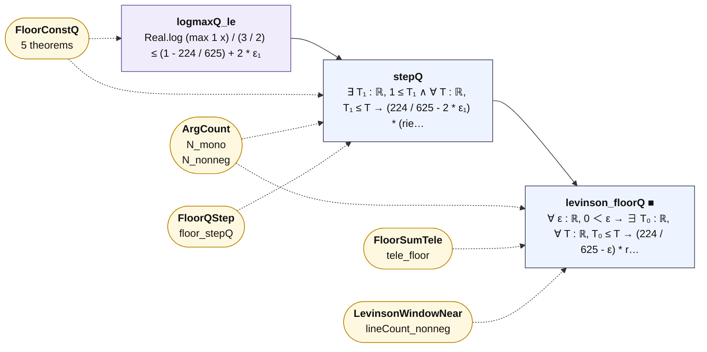

# `lean_stage3/Stage3/FloorQ.lean`

> **Read from the source text.** This file changed after the last `python3 utilities/lean_map.py --dump`, so the arrows on this page are names occurring in each proof and have not been confirmed by Lean.

# FloorQ — block S13 of `lean_stage3/design/stencil.md`, B4 step 5, the assembly: a proved floor above one third. 2026-11-25.

3 theorems, 0 definitions, 166 lines. 

**Imports:** [`FloorConstQ`](../lean_stage3/FloorConstQ.md), [`FloorQStep`](../lean_stage3/FloorQStep.md), [`FloorSum`](../lean_stage3/FloorSum.md)  
**Imported by:** [`Stage3`](../lean_stage3/Stage3.md)

## The picture



An arrow A → B reads "A is used in the proof of B". Green: counting, integers only. Violet: shape, analysis with no ζ. Blue: reads ζ. A name ending in ■ is an end: nothing else uses it. Red: contains `sorry`. Yellow: theorems in another file, counted; a dotted arrow crosses files. Definitions are not drawn; they are listed below the diagram.

## Theorems

<a name="FloorQ-logmaxQ_le"></a>
### `FloorQ.logmaxQ_le`

line 43 · arrows read from text

**Shape.** Uses real or complex analysis; nothing in it or beneath it reads ζ.

**Why.** The `max 1` and the `ε₁` of `floor_stepQ`, priced at `Q₀`, `P₀`, `θ = 49/100`, `R = 3/2`.

**Proves**

```lean
Real.log (max 1 x) / (3 / 2) ≤ (1 - 224 / 625) + 2 * ε₁
```

**Needs** (its hypotheses)

  - `` hε₁ : 0 < ε₁ ``
  - `` hx : x ≤ KflQ Q0 (FloorConst.Ar P0) (FloorConst.Br P0) (FloorConst.Cr P0) (49 / 100) (3 / 2) + 2 * ε₁ ``

**Fed by** (1 theorem its proof uses)

  - [`FloorConstQ.floor_constQ`](../lean_stage3/FloorConstQ.md#FloorConstQ-floor_constQ) (FloorConstQ) — `` Tendsto (fun T => (MeanQ.DopQ Q0 (Real.log T) (cY P0 (Mof T (49 / 100)) T) ((-((3 / 2) / Real.log T) : ℝ) : ℂ) ((-((3 / 2) / Real.log T) : ℝ) : ℂ)).re… ``

**Definitions its proof touches:** [`FloorConst.Ar`](../lean_stage3/FloorConstLimit.md#FloorConst-Ar), [`FloorConst.Br`](../lean_stage3/FloorConstLimit.md#FloorConst-Br), [`FloorConst.Cr`](../lean_stage3/FloorConstLimit.md#FloorConst-Cr), [`FloorConstQ.P0`](../lean_stage3/FloorConstQ.md#FloorConstQ-P0), [`FloorConstQ.Q0`](../lean_stage3/FloorConstQ.md#FloorConstQ-Q0), [`FloorConstQ.KflQ`](../lean_stage3/FloorConstQLimit.md#FloorConstQ-KflQ)

**Feeds** (1 that use it)

  - [`FloorQ.stepQ`](#FloorQ-stepQ) — `` ∃ T₁ : ℝ, 1 ≤ T₁ ∧ ∀ T : ℝ, T₁ ≤ T → (224 / 625 - 2 * ε₁) * (riemannZeta.N T - riemannZeta.N (T / 2)) - ε₁ * T * Real.log T ≤ (LineCount.lineCount T :… ``

<a name="FloorQ-stepQ"></a>
### `FloorQ.stepQ`

line 77 · arrows read from text

**Reads ζ.** It, or something it rests on, uses the zeta function, its zeros or the Riemann hypothesis.

**Why.** The window floor at `P₀`, `Q₀`. For `ε₁ > 0`, from some height `T₁ ≥ 1` on, `(224/625 − 2ε₁)(N T − N(T/2)) − ε₁ T log T ≤ lineCount T − lineCount(T/2)`.

**Proves**

```lean
∃ T₁ : ℝ, 1 ≤ T₁ ∧ ∀ T : ℝ, T₁ ≤ T → (224 / 625 - 2 * ε₁) * (riemannZeta.N T - riemannZeta.N (T / 2)) - ε₁ * T * Real.log T ≤ (LineCount.lineCount T : ℝ) - (LineCount.lineCount (T / 2) : ℝ)
```

**Needs** (its hypotheses)

  - `` hε₁ : 0 < ε₁ ``

**Fed by** (7 theorems its proof uses)

  - [`ArgCount.N_mono`](../lean_stage3/ArgCount.md#ArgCount-N_mono) (ArgCount) — `` riemannZeta.N T ≤ riemannZeta.N T' ``
  - [`FloorConstQ.P0_one`](../lean_stage3/FloorConstQ.md#FloorConstQ-P0_one) (FloorConstQ) — `` P0.eval 1 = 1 ``
  - [`FloorConstQ.P0_zero`](../lean_stage3/FloorConstQ.md#FloorConstQ-P0_zero) (FloorConstQ) — `` P0.eval 0 = 0 ``
  - [`FloorConstQ.Q0_deriv_symm`](../lean_stage3/FloorConstQ.md#FloorConstQ-Q0_deriv_symm) (FloorConstQ) — `` Q0.derivative.eval x = Q0.derivative.eval (1 - x) ``
  - [`FloorConstQ.Q0_zero`](../lean_stage3/FloorConstQ.md#FloorConstQ-Q0_zero) (FloorConstQ) — `` Q0.eval 0 = 1 ``
  - [`FloorQ.logmaxQ_le`](#FloorQ-logmaxQ_le) — `` Real.log (max 1 x) / (3 / 2) ≤ (1 - 224 / 625) + 2 * ε₁ ``
  - [`FloorQ.floor_stepQ`](../lean_stage3/FloorQStep.md#FloorQ-floor_stepQ) (FloorQStep) — `` ∀ ε : ℝ, 0 < ε → ∃ T₀ : ℝ, ∀ T : ℝ, T₀ ≤ T → (riemannZeta.N T - riemannZeta.N (T / 2)) - Real.log (max 1 ((MeanQ.DopQ Q (Real.log T) (cY P (Mof T θ) T… ``

**Definitions its proof touches:** [`FloorConst.Ar`](../lean_stage3/FloorConstLimit.md#FloorConst-Ar), [`FloorConst.Br`](../lean_stage3/FloorConstLimit.md#FloorConst-Br), [`FloorConst.Cr`](../lean_stage3/FloorConstLimit.md#FloorConst-Cr), [`FloorConstQ.P0`](../lean_stage3/FloorConstQ.md#FloorConstQ-P0), [`FloorConstQ.Q0`](../lean_stage3/FloorConstQ.md#FloorConstQ-Q0), [`FloorConstQ.KflQ`](../lean_stage3/FloorConstQLimit.md#FloorConstQ-KflQ), [`LineCount.lineCount`](../lean_stage3/LineCount.md#LineCount-lineCount), [`MeanQ.DopQ`](../lean_stage3/MeanQCauchy.md#MeanQ-DopQ), [`TwistedMoment.Mof`](../lean_stage3/TwistedMoment.md#TwistedMoment-Mof), [`TwistedMoment.cY`](../lean_stage3/TwistedMoment.md#TwistedMoment-cY)

**Feeds** (1 that use it)

  - [`FloorQ.levinson_floorQ`](#FloorQ-levinson_floorQ) — `` ∀ ε : ℝ, 0 < ε → ∃ T₀ : ℝ, ∀ T : ℝ, T₀ ≤ T → (224 / 625 - ε) * riemannZeta.N T ≤ (LineCount.lineCount T : ℝ) ``

<a name="FloorQ-levinson_floorQ"></a>
### `FloorQ.levinson_floorQ`

line 108 · arrows read from text

**Reads ζ.** It, or something it rests on, uses the zeta function, its zeros or the Riemann hypothesis.

**Why.** B4 step 5, a proved floor above one third. At `Q₀`, `P₀`, `θ = 49/100`, `R = 3/2`: for every `ε > 0`, from some height on, at least `(224/625 − ε) N T` of the zeros of `ζ` with height in `(0, T]` lie on the critical line, counted with multiplicity.

**Proves**

```lean
∀ ε : ℝ, 0 < ε → ∃ T₀ : ℝ, ∀ T : ℝ, T₀ ≤ T → (224 / 625 - ε) * riemannZeta.N T ≤ (LineCount.lineCount T : ℝ)
```

**Fed by** (5 theorems its proof uses)

  - [`ArgCount.N_mono`](../lean_stage3/ArgCount.md#ArgCount-N_mono) (ArgCount) — `` riemannZeta.N T ≤ riemannZeta.N T' ``
  - [`ArgCount.N_nonneg`](../lean_stage3/ArgCount.md#ArgCount-N_nonneg) (ArgCount) — `` 0 ≤ riemannZeta.N T ``
  - [`FloorQ.stepQ`](#FloorQ-stepQ) — `` ∃ T₁ : ℝ, 1 ≤ T₁ ∧ ∀ T : ℝ, T₁ ≤ T → (224 / 625 - 2 * ε₁) * (riemannZeta.N T - riemannZeta.N (T / 2)) - ε₁ * T * Real.log T ≤ (LineCount.lineCount T :… ``
  - [`FloorSum.tele_floor`](../lean_stage3/FloorSumTele.md#FloorSum-tele_floor) (FloorSumTele) — `` ∀ T : ℝ, T₁ ≤ T → c * (g T - g T₁) - 2 * e * T * Real.log T ≤ f T ``
  - [`LevinsonWindowNear.lineCount_nonneg`](../lean_stage3/LevinsonWindowNear.md#LevinsonWindowNear-lineCount_nonneg) (LevinsonWindowNear) — `` 0 ≤ lineCount T ``

**Definitions its proof touches:** [`LineCount.lineCount`](../lean_stage3/LineCount.md#LineCount-lineCount)

**Feeds:** nothing. It is an end.

