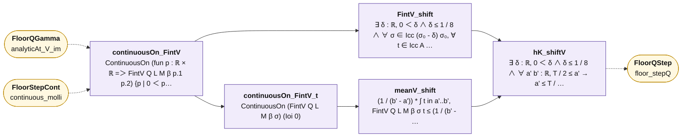

# `lean_stage3/Stage3/FloorQCont.lean`

> **Read from the source text.** This file changed after the last `python3 utilities/lean_map.py --dump`, so the arrows on this page are names occurring in each proof and have not been confirmed by Lean.

# FloorQCont — block S13 of `lean_stage3/design/stencil.md`, B4 step 5, the assembly: continuity in `σ` for `V ψ`. 2026-11-25.

5 theorems, 1 definition, 151 lines. 

**Imports:** [`FloorQGamma`](../lean_stage3/FloorQGamma.md), [`FloorStepCont`](../lean_stage3/FloorStepCont.md)  
**Imported by:** [`FloorQStep`](../lean_stage3/FloorQStep.md)

## The picture



An arrow A → B reads "A is used in the proof of B". Green: counting, integers only. Violet: shape, analysis with no ζ. Blue: reads ζ. A name ending in ■ is an end: nothing else uses it. Red: contains `sorry`. Yellow: theorems in another file, counted; a dotted arrow crosses files. Definitions are not drawn; they are listed below the diagram.

## Definitions

<a name="FloorQ-FintV"></a>
### `FloorQ.FintV`

def · line 30

- **Is:** `` FintV (Q : Polynomial ℝ) (L : ℝ) (M : ℕ) (β : ℕ → ℂ) (σ t : ℝ) : ℝ := ‖ConreyCount.V Q L (↑σ + ↑t * I) * LevinsonMollEdge.molli M β (↑σ + ↑t * I)‖ ^ 2 ``
- **Built from:** [`ConreyCount.V`](../lean_stage3/ConreyCountLine.md#ConreyCount-V), [`LevinsonMollEdge.molli`](../lean_stage3/LevinsonMollEdge.md#LevinsonMollEdge-molli)
- **Used by 6:** [`FloorQ.FintV_shift`](#FloorQ-FintV_shift), [`FloorQ.continuousOn_FintV`](#FloorQ-continuousOn_FintV), [`FloorQ.continuousOn_FintV_t`](#FloorQ-continuousOn_FintV_t), [`FloorQ.hK_shiftV`](#FloorQ-hK_shiftV), [`FloorQ.meanV_shift`](#FloorQ-meanV_shift), [`FloorQ.floor_stepQ`](../lean_stage3/FloorQStep.md#FloorQ-floor_stepQ)

## Theorems

<a name="FloorQ-continuousOn_FintV"></a>
### `FloorQ.continuousOn_FintV`

line 33 · arrows read from text

**Shape.** Uses real or complex analysis; nothing in it or beneath it reads ζ.

**Proves**

```lean
ContinuousOn (fun p : ℝ × ℝ => FintV Q L M β p.1 p.2) {p | 0 < p.2}
```

**Needs** (its hypotheses)

  - `` Q : Polynomial ℝ ``
  - `` L : ℝ ``
  - `` M : ℕ ``
  - `` β : ℕ → ℂ ``

**Fed by** (2 theorems its proof uses)

  - [`FloorQ.analyticAt_V_im`](../lean_stage3/FloorQGamma.md#FloorQ-analyticAt_V_im) (FloorQGamma) — `` AnalyticAt ℂ (ConreyCount.V Q L) w ``
  - [`FloorStep.continuous_molli`](../lean_stage3/FloorStepCont.md#FloorStep-continuous_molli) (FloorStepCont) — `` Continuous (LevinsonMollEdge.molli M β) ``

**Definitions its proof touches:** [`ConreyCount.V`](../lean_stage3/ConreyCountLine.md#ConreyCount-V), [`FloorQ.FintV`](#FloorQ-FintV), [`LevinsonMollEdge.molli`](../lean_stage3/LevinsonMollEdge.md#LevinsonMollEdge-molli)

**Feeds** (2 that use it)

  - [`FloorQ.FintV_shift`](#FloorQ-FintV_shift) — `` ∃ δ : ℝ, 0 < δ ∧ δ ≤ 1 / 8 ∧ ∀ σ ∈ Icc (σ₀ - δ) σ₀, ∀ t ∈ Icc A B, FintV Q L M β σ t ≤ FintV Q L M β σ₀ t + ε ``
  - [`FloorQ.continuousOn_FintV_t`](#FloorQ-continuousOn_FintV_t) — `` ContinuousOn (FintV Q L M β σ) (Ioi 0) ``

<a name="FloorQ-continuousOn_FintV_t"></a>
### `FloorQ.continuousOn_FintV_t`

line 48 · arrows read from text

**Shape.** Uses real or complex analysis; nothing in it or beneath it reads ζ.

**Proves**

```lean
ContinuousOn (FintV Q L M β σ) (Ioi 0)
```

**Needs** (its hypotheses)

  - `` Q : Polynomial ℝ ``
  - `` L : ℝ ``
  - `` M : ℕ ``
  - `` β : ℕ → ℂ ``
  - `` σ : ℝ ``

**Fed by** (1 theorem its proof uses)

  - [`FloorQ.continuousOn_FintV`](#FloorQ-continuousOn_FintV) — `` ContinuousOn (fun p : ℝ × ℝ => FintV Q L M β p.1 p.2) {p | 0 < p.2} ``

**Definitions its proof touches:** [`FloorQ.FintV`](#FloorQ-FintV)

**Feeds** (1 that use it)

  - [`FloorQ.meanV_shift`](#FloorQ-meanV_shift) — `` (1 / (b' - a')) * ∫ t in a'..b', FintV Q L M β σ t ≤ (1 / (b' - a')) * (∫ t in a'..b', FintV Q L M β σ₀ t) + ε ``

<a name="FloorQ-FintV_shift"></a>
### `FloorQ.FintV_shift`

line 61 · arrows read from text

**Shape.** Uses real or complex analysis; nothing in it or beneath it reads ζ.

**Why.** Continuity in `σ`, uniform in `t ∈ [A, B]`, `A > 0`.

**Proves**

```lean
∃ δ : ℝ, 0 < δ ∧ δ ≤ 1 / 8 ∧ ∀ σ ∈ Icc (σ₀ - δ) σ₀, ∀ t ∈ Icc A B, FintV Q L M β σ t ≤ FintV Q L M β σ₀ t + ε
```

**Needs** (its hypotheses)

  - `` Q : Polynomial ℝ ``
  - `` L : ℝ ``
  - `` M : ℕ ``
  - `` β : ℕ → ℂ ``
  - `` hA : 0 < A ``
  - `` hε : 0 < ε ``

**Fed by** (1 theorem its proof uses)

  - [`FloorQ.continuousOn_FintV`](#FloorQ-continuousOn_FintV) — `` ContinuousOn (fun p : ℝ × ℝ => FintV Q L M β p.1 p.2) {p | 0 < p.2} ``

**Definitions its proof touches:** [`FloorQ.FintV`](#FloorQ-FintV)

**Feeds** (1 that use it)

  - [`FloorQ.hK_shiftV`](#FloorQ-hK_shiftV) — `` ∃ δ : ℝ, 0 < δ ∧ δ ≤ 1 / 8 ∧ ∀ a' b' : ℝ, T / 2 ≤ a' → a' ≤ T / 2 + 1 → T - 1 ≤ b' → b' ≤ T → a' < b' → ∀ σ ∈ Icc (σ₀ - δ) σ₀, (1 / (b' - a')) * ∫ t i… ``

<a name="FloorQ-meanV_shift"></a>
### `FloorQ.meanV_shift`

line 90 · arrows read from text

**Shape.** Uses real or complex analysis; nothing in it or beneath it reads ζ.

**Why.** A pointwise shift by `ε` on `[a′, b′] ⊆ (0, ∞)` moves the mean by at most `ε`.

**Proves**

```lean
(1 / (b' - a')) * ∫ t in a'..b', FintV Q L M β σ t ≤ (1 / (b' - a')) * (∫ t in a'..b', FintV Q L M β σ₀ t) + ε
```

**Needs** (its hypotheses)

  - `` Q : Polynomial ℝ ``
  - `` L : ℝ ``
  - `` M : ℕ ``
  - `` β : ℕ → ℂ ``
  - `` ha : 0 < a' ``
  - `` hab : a' < b' ``
  - `` h : ∀ t ∈ Icc a' b', FintV Q L M β σ t ≤ FintV Q L M β σ₀ t + ε ``

**Fed by** (1 theorem its proof uses)

  - [`FloorQ.continuousOn_FintV_t`](#FloorQ-continuousOn_FintV_t) — `` ContinuousOn (FintV Q L M β σ) (Ioi 0) ``

**Definitions its proof touches:** [`FloorQ.FintV`](#FloorQ-FintV)

**Feeds** (1 that use it)

  - [`FloorQ.hK_shiftV`](#FloorQ-hK_shiftV) — `` ∃ δ : ℝ, 0 < δ ∧ δ ≤ 1 / 8 ∧ ∀ a' b' : ℝ, T / 2 ≤ a' → a' ≤ T / 2 + 1 → T - 1 ≤ b' → b' ≤ T → a' < b' → ∀ σ ∈ Icc (σ₀ - δ) σ₀, (1 / (b' - a')) * ∫ t i… ``

<a name="FloorQ-hK_shiftV"></a>
### `FloorQ.hK_shiftV`

line 118 · arrows read from text

**Shape.** Uses real or complex analysis; nothing in it or beneath it reads ζ.

**Why.** The mean from `σ₀` to `[σ₀ − δ, σ₀]`. For `T > 0`: if the mean at `σ₀` is at most `K + ε/2` on every window `[a′, b′]`, `a′ ∈ [T/2, T/2 + 1]`, `b′ ∈ [T − 1, T]`, then for some `δ ∈ (0, 1/8]` the mean at every `σ ∈ [σ₀ − δ, σ₀]` is at most `K + ε` there.

**Proves**

```lean
∃ δ : ℝ, 0 < δ ∧ δ ≤ 1 / 8 ∧ ∀ a' b' : ℝ, T / 2 ≤ a' → a' ≤ T / 2 + 1 → T - 1 ≤ b' → b' ≤ T → a' < b' → ∀ σ ∈ Icc (σ₀ - δ) σ₀, (1 / (b' - a')) * ∫ t in a'..b', FintV Q L M β σ t ≤ K + ε
```

**Needs** (its hypotheses)

  - `` Q : Polynomial ℝ ``
  - `` L : ℝ ``
  - `` M : ℕ ``
  - `` β : ℕ → ℂ ``
  - `` hT : 0 < T ``
  - `` hε : 0 < ε ``
  - `` h0 : ∀ a' b' : ℝ, T / 2 ≤ a' → a' ≤ T / 2 + 1 → T - 1 ≤ b' → b' ≤ T → (1 / (b' - a')) * ∫ t in a'..b', FintV Q L M β σ₀ t ≤ K + ε / 2 ``

**Fed by** (2 theorems its proof uses)

  - [`FloorQ.FintV_shift`](#FloorQ-FintV_shift) — `` ∃ δ : ℝ, 0 < δ ∧ δ ≤ 1 / 8 ∧ ∀ σ ∈ Icc (σ₀ - δ) σ₀, ∀ t ∈ Icc A B, FintV Q L M β σ t ≤ FintV Q L M β σ₀ t + ε ``
  - [`FloorQ.meanV_shift`](#FloorQ-meanV_shift) — `` (1 / (b' - a')) * ∫ t in a'..b', FintV Q L M β σ t ≤ (1 / (b' - a')) * (∫ t in a'..b', FintV Q L M β σ₀ t) + ε ``

**Definitions its proof touches:** [`FloorQ.FintV`](#FloorQ-FintV)

**Feeds** (1 that use it)

  - [`FloorQ.floor_stepQ`](../lean_stage3/FloorQStep.md#FloorQ-floor_stepQ) (FloorQStep) — `` ∀ ε : ℝ, 0 < ε → ∃ T₀ : ℝ, ∀ T : ℝ, T₀ ≤ T → (riemannZeta.N T - riemannZeta.N (T / 2)) - Real.log (max 1 ((MeanQ.DopQ Q (Real.log T) (cY P (Mof T θ) T… ``

