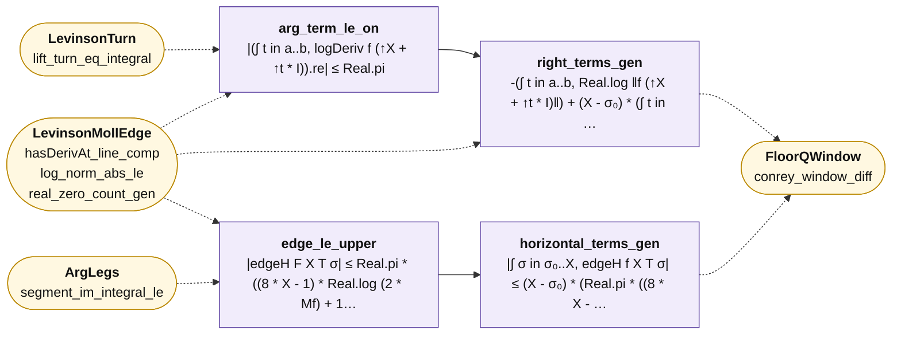

# `lean_stage3/Stage3/FloorQEdge.lean`

> **Read from the source text.** This file changed after the last `python3 utilities/lean_map.py --dump`, so the arrows on this page are names occurring in each proof and have not been confirmed by Lean.

# FloorQEdge — block S13 of `lean_stage3/design/stencil.md`, B4 step 5, the assembly: the edge terms of Littlewood's lemma for a function given on the upper half-plane. 2026-11-25.

4 theorems, 0 definitions, 284 lines. 

**Imports:** [`LevinsonMollEdge`](../lean_stage3/LevinsonMollEdge.md)  
**Imported by:** [`FloorQWindow`](../lean_stage3/FloorQWindow.md)

## The picture



An arrow A → B reads "A is used in the proof of B". Green: counting, integers only. Violet: shape, analysis with no ζ. Blue: reads ζ. A name ending in ■ is an end: nothing else uses it. Red: contains `sorry`. Yellow: theorems in another file, counted; a dotted arrow crosses files. Definitions are not drawn; they are listed below the diagram.

## Theorems

<a name="FloorQ-arg_term_le_on"></a>
### `FloorQ.arg_term_le_on`

line 32 · arrows read from text

**Shape.** Uses real or complex analysis; nothing in it or beneath it reads ζ.

**Why.** The argument term on `[a, b]`. `LevinsonMollEdge.arg_term_le_of_pos` with analyticity and `Re f > 0` asked on `X + [a, b] i` only.

**Proves**

```lean
|(∫ t in a..b, logDeriv f (↑X + ↑t * I)).re| ≤ Real.pi
```

**Needs** (its hypotheses)

  - `` hab : a ≤ b ``
  - `` hfa : ∀ t ∈ Set.Icc a b, AnalyticAt ℂ f (↑X + ↑t * I) ``
  - `` hpos : ∀ t ∈ Set.Icc a b, 0 < (f (↑X + ↑t * I)).re ``

**Fed by** (2 theorems its proof uses)

  - [`LevinsonMollEdge.hasDerivAt_line_comp`](../lean_stage3/LevinsonMollEdge.md#LevinsonMollEdge-hasDerivAt_line_comp) (LevinsonMollEdge) — `` HasDerivAt (fun y : ℝ => f (↑X + ↑y * I)) (deriv f (↑X + ↑t * I) * I) t ``
  - [`LevinsonTurn.lift_turn_eq_integral`](../lean_stage3/LevinsonTurn.md#LevinsonTurn-lift_turn_eq_integral) (LevinsonTurn) — `` φ b - φ a = (∫ t in a..b, F' t / F t).im ``

**Feeds** (1 that use it)

  - [`FloorQ.right_terms_gen`](#FloorQ-right_terms_gen) — `` -(∫ t in a..b, Real.log ‖f (↑X + ↑t * I)‖) + (X - σ₀) * (∫ t in a..b, logDeriv f (↑X + ↑t * I)).re ≤ (b - a) * (2 * δ) + (X - σ₀) * Real.pi ``

<a name="FloorQ-right_terms_gen"></a>
### `FloorQ.right_terms_gen`

line 80 · arrows read from text

**Shape.** Uses real or complex analysis; nothing in it or beneath it reads ζ.

**Why.** The two right-edge terms, from `‖f − 1‖ ≤ δ ≤ 1/2` on `X + [a, b] i`.

**Proves**

```lean
-(∫ t in a..b, Real.log ‖f (↑X + ↑t * I)‖) + (X - σ₀) * (∫ t in a..b, logDeriv f (↑X + ↑t * I)).re ≤ (b - a) * (2 * δ) + (X - σ₀) * Real.pi
```

**Needs** (its hypotheses)

  - `` hab : a ≤ b ``
  - `` hσX : σ₀ ≤ X ``
  - `` hfa : ∀ t ∈ Set.Icc a b, AnalyticAt ℂ f (↑X + ↑t * I) ``
  - `` hf1 : ∀ t ∈ Set.Icc a b, ‖f (↑X + ↑t * I) - 1‖ ≤ δ ``
  - `` hδ : δ ≤ 1 / 2 ``

**Fed by** (2 theorems its proof uses)

  - [`FloorQ.arg_term_le_on`](#FloorQ-arg_term_le_on) — `` |(∫ t in a..b, logDeriv f (↑X + ↑t * I)).re| ≤ Real.pi ``
  - [`LevinsonMollEdge.log_norm_abs_le`](../lean_stage3/LevinsonMollEdge.md#LevinsonMollEdge-log_norm_abs_le) (LevinsonMollEdge) — `` |Real.log ‖z‖| ≤ 2 * δ ``

**Feeds** (1 that use it)

  - [`FloorQ.conrey_window_diff`](../lean_stage3/FloorQWindow.md#FloorQ-conrey_window_diff) (FloorQWindow) — `` (riemannZeta.N b - riemannZeta.N a) - (1 / (Real.pi * (1 / 2 - σ₀))) * ((b - a) / 2 * Real.log K + windowEQ δR Mf X a b) - (Ec + 62 * Real.log T + 250… ``

<a name="FloorQ-edge_le_upper"></a>
### `FloorQ.edge_le_upper`

line 108 · arrows read from text

**Shape.** Uses real or complex analysis; nothing in it or beneath it reads ζ.

**Why.** The edge, analyticity above the real axis only. `LevinsonMollEdge.edge_le_gen` with `hFa` asked on `Im > 0`; the proof is a copy. For `1 ≤ X`, `2X ≤ T`, `F` analytic off `1`, `Re F(X + iT) ≥ 1/2`, `‖F‖ ≤ Mf` on `‖w − (X + iT)‖ ≤ X − 1/8`, `1/4 ≤ σ ≤ X` and `F ≠ 0` on `[σ, X] + iT`: `|edgeH F X T σ| ≤ π ((8X − 1) log (2 Mf) + 1)`.

**Proves**

```lean
|edgeH F X T σ| ≤ Real.pi * ((8 * X - 1) * Real.log (2 * Mf) + 1)
```

**Needs** (its hypotheses)

  - `` hX : 1 ≤ X ``
  - `` hXT : 2 * X ≤ T ``
  - `` hFa : ∀ w : ℂ, 0 < w.im → AnalyticAt ℂ F w ``
  - `` h0 : 1 / 2 ≤ (F (↑X + ↑T * I)).re ``
  - `` hM : ∀ w : ℂ, ‖w - (↑X + ↑T * I)‖ ≤ X - 1 / 8 → ‖F w‖ ≤ Mf ``
  - `` hσ : 1 / 4 ≤ σ ``
  - `` hσX : σ ≤ X ``
  - `` hne : ∀ x ∈ Set.Icc σ X, F (↑x + ↑T * I) ≠ 0 ``

**Fed by** (2 theorems its proof uses)

  - [`ArgLegs.segment_im_integral_le`](../lean_stage3/ArgLegs.md#ArgLegs-segment_im_integral_le) (ArgLegs) — `` |(∫ x in a..b, g' x / g x).im| ≤ Real.pi * ((Z.card : ℝ) + 1) ``
  - [`LevinsonMollEdge.real_zero_count_gen`](../lean_stage3/LevinsonMollEdge.md#LevinsonMollEdge-real_zero_count_gen) (LevinsonMollEdge) — `` ∃ Z : Finset ℝ, (∀ x : ℝ, |x| ≤ r → (g x).re = 0 → x ∈ Z) ∧ (Z.card : ℝ) ≤ 1 / Real.log (R / r) * Real.log (M / m) ``

**Definitions its proof touches:** [`Littlewood.edgeH`](../lean_stage3/Littlewood.md#Littlewood-edgeH)

**Feeds** (1 that use it)

  - [`FloorQ.horizontal_terms_gen`](#FloorQ-horizontal_terms_gen) — `` |∫ σ in σ₀..X, edgeH f X T σ| ≤ (X - σ₀) * (Real.pi * ((8 * X - 1) * Real.log (2 * Mf) + 1)) ``

<a name="FloorQ-horizontal_terms_gen"></a>
### `FloorQ.horizontal_terms_gen`

line 250 · arrows read from text

**Shape.** Uses real or complex analysis; nothing in it or beneath it reads ζ.

**Why.** The horizontal edge terms, from the growth. For `1 ≤ X`, `2X ≤ T`, `f` analytic on `Im > 0`, `Re f(X + iT) ≥ 1/2`, `‖f‖ ≤ Mf` on `‖w − (X + iT)‖ ≤ X − 1/8`, `1/4 ≤ σ₀ ≤ X` and `f ≠ 0` on `[σ₀, X] + iT`: `|∫_{σ₀}^X edgeH f X T σ dσ| ≤ (X − σ₀) π ((8X − 1) log (2 Mf) + 1)`.

**Proves**

```lean
|∫ σ in σ₀..X, edgeH f X T σ| ≤ (X - σ₀) * (Real.pi * ((8 * X - 1) * Real.log (2 * Mf) + 1))
```

**Needs** (its hypotheses)

  - `` hX : 1 ≤ X ``
  - `` hXT : 2 * X ≤ T ``
  - `` hFa : ∀ w : ℂ, 0 < w.im → AnalyticAt ℂ f w ``
  - `` h0 : 1 / 2 ≤ (f (↑X + ↑T * I)).re ``
  - `` hM : ∀ w : ℂ, ‖w - (↑X + ↑T * I)‖ ≤ X - 1 / 8 → ‖f w‖ ≤ Mf ``
  - `` hσ₀ : 1 / 4 ≤ σ₀ ``
  - `` hσX : σ₀ ≤ X ``
  - `` hne : ∀ x ∈ Set.Icc σ₀ X, f (↑x + ↑T * I) ≠ 0 ``

**Fed by** (1 theorem its proof uses)

  - [`FloorQ.edge_le_upper`](#FloorQ-edge_le_upper) — `` |edgeH F X T σ| ≤ Real.pi * ((8 * X - 1) * Real.log (2 * Mf) + 1) ``

**Definitions its proof touches:** [`Littlewood.edgeH`](../lean_stage3/Littlewood.md#Littlewood-edgeH)

**Feeds** (1 that use it)

  - [`FloorQ.conrey_window_diff`](../lean_stage3/FloorQWindow.md#FloorQ-conrey_window_diff) (FloorQWindow) — `` (riemannZeta.N b - riemannZeta.N a) - (1 / (Real.pi * (1 / 2 - σ₀))) * ((b - a) / 2 * Real.log K + windowEQ δR Mf X a b) - (Ec + 62 * Real.log T + 250… ``

