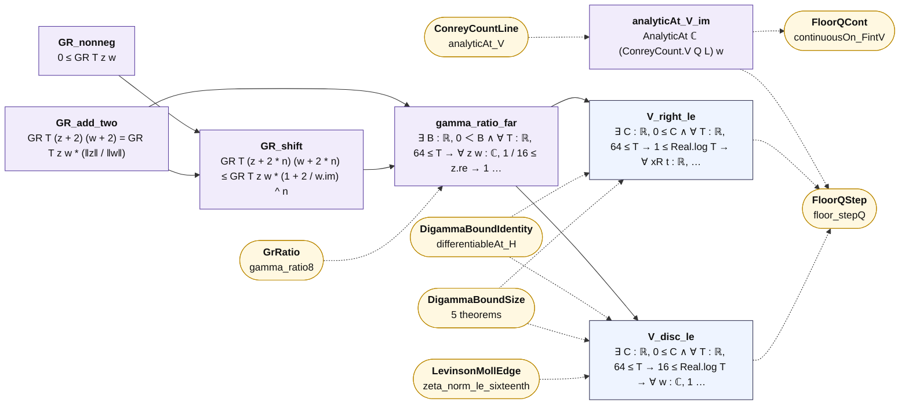

# `lean_stage3/Stage3/FloorQGamma.lean`

> **Read from the source text.** This file changed after the last `python3 utilities/lean_map.py --dump`, so the arrows on this page are names occurring in each proof and have not been confirmed by Lean.

# FloorQGamma — block S13 of `lean_stage3/design/stencil.md`, B4 step 5, the assembly: the size of `V` far right and on the growth discs. 2026-11-25.

7 theorems, 1 definition, 321 lines. 

**Imports:** [`DigammaBound`](../lean_stage3/DigammaBound.md), [`GrRatio`](../lean_stage3/GrRatio.md), [`LevinsonMollEdge`](../lean_stage3/LevinsonMollEdge.md)  
**Imported by:** [`FloorQCont`](../lean_stage3/FloorQCont.md)

## The picture



An arrow A → B reads "A is used in the proof of B". Green: counting, integers only. Violet: shape, analysis with no ζ. Blue: reads ζ. A name ending in ■ is an end: nothing else uses it. Red: contains `sorry`. Yellow: theorems in another file, counted; a dotted arrow crosses files. Definitions are not drawn; they are listed below the diagram.

## Definitions

<a name="FloorQ-GR"></a>
### `FloorQ.GR`

def · line 40

The shifted ratio `‖Γℝ z‖/‖Γℝ w‖ · e^{−(log T/2)(Re z − Re w)}`.

- **Is:** `` GR (T : ℝ) (z w : ℂ) : ℝ := ‖Gammaℝ z‖ / ‖Gammaℝ w‖ * Real.exp (-(Real.log T / 2) * (z.re - w.re)) ``
- **Used by 6:** [`FloorQ.GR_add_two`](#FloorQ-GR_add_two), [`FloorQ.GR_nonneg`](#FloorQ-GR_nonneg), [`FloorQ.GR_shift`](#FloorQ-GR_shift), [`FloorQ.V_disc_le`](#FloorQ-V_disc_le), [`FloorQ.V_right_le`](#FloorQ-V_right_le), [`FloorQ.gamma_ratio_far`](#FloorQ-gamma_ratio_far)

## Theorems

<a name="FloorQ-GR_nonneg"></a>
### `FloorQ.GR_nonneg`

line 43 · arrows read from text

**Shape.** Uses real or complex analysis; nothing in it or beneath it reads ζ.

**Proves**

```lean
0 ≤ GR T z w
```

**Needs** (its hypotheses)

  - `` T : ℝ ``
  - `` z w : ℂ ``

**Fed by:** no theorem of this repo; it stands on Mathlib and the definitions below.

**Definitions its proof touches:** [`FloorQ.GR`](#FloorQ-GR)

**Feeds** (1 that use it)

  - [`FloorQ.GR_shift`](#FloorQ-GR_shift) — `` GR T (z + 2 * n) (w + 2 * n) ≤ GR T z w * (1 + 2 / w.im) ^ n ``

<a name="FloorQ-GR_add_two"></a>
### `FloorQ.GR_add_two`

line 47 · arrows read from text

**Shape.** Uses real or complex analysis; nothing in it or beneath it reads ζ.

**Why.** The shift by `2`.

**Proves**

```lean
GR T (z + 2) (w + 2) = GR T z w * (‖z‖ / ‖w‖)
```

**Needs** (its hypotheses)

  - `` T : ℝ ``
  - `` hz : 0 < z.re ``
  - `` hw : 0 < w.re ``

**Fed by:** no theorem of this repo; it stands on Mathlib and the definitions below.

**Definitions its proof touches:** [`FloorQ.GR`](#FloorQ-GR)

**Feeds** (2 that use it)

  - [`FloorQ.GR_shift`](#FloorQ-GR_shift) — `` GR T (z + 2 * n) (w + 2 * n) ≤ GR T z w * (1 + 2 / w.im) ^ n ``
  - [`FloorQ.gamma_ratio_far`](#FloorQ-gamma_ratio_far) — `` ∃ B : ℝ, 0 < B ∧ ∀ T : ℝ, 64 ≤ T → ∀ z w : ℂ, 1 / 16 ≤ z.re → 1 / 16 ≤ w.re → |z.re - w.re| ≤ 1 → w.re ≤ T / 64 → T / 4 ≤ z.im → z.im ≤ 2 * T → T / 4 … ``

<a name="FloorQ-GR_shift"></a>
### `FloorQ.GR_shift`

line 64 · arrows read from text

**Shape.** Uses real or complex analysis; nothing in it or beneath it reads ζ.

**Why.** The shift by `2n`, priced.

**Proves**

```lean
GR T (z + 2 * n) (w + 2 * n) ≤ GR T z w * (1 + 2 / w.im) ^ n
```

**Needs** (its hypotheses)

  - `` T : ℝ ``
  - `` hz : 0 < z.re ``
  - `` hw : 0 < w.re ``
  - `` hzw : ‖z - w‖ ≤ 2 ``
  - `` hwi : 0 < w.im ``
  - `` n : ℕ ``

**Fed by** (2 theorems its proof uses)

  - [`FloorQ.GR_add_two`](#FloorQ-GR_add_two) — `` GR T (z + 2) (w + 2) = GR T z w * (‖z‖ / ‖w‖) ``
  - [`FloorQ.GR_nonneg`](#FloorQ-GR_nonneg) — `` 0 ≤ GR T z w ``

**Definitions its proof touches:** [`FloorQ.GR`](#FloorQ-GR)

**Feeds** (1 that use it)

  - [`FloorQ.gamma_ratio_far`](#FloorQ-gamma_ratio_far) — `` ∃ B : ℝ, 0 < B ∧ ∀ T : ℝ, 64 ≤ T → ∀ z w : ℂ, 1 / 16 ≤ z.re → 1 / 16 ≤ w.re → |z.re - w.re| ≤ 1 → w.re ≤ T / 64 → T / 4 ≤ z.im → z.im ≤ 2 * T → T / 4 … ``

<a name="FloorQ-gamma_ratio_far"></a>
### `FloorQ.gamma_ratio_far`

line 97 · arrows read from text

**Shape.** Uses real or complex analysis; nothing in it or beneath it reads ζ.

**Why.** The gamma ratio far right. For `T ≥ 64`, `Re z, Re w ≥ 1/16`, `|Re z − Re w| ≤ 1`, `Re w ≤ T/64`, `Im z, Im w ∈ [T/4, 2T]` and `|Im z − Im w| ≤ 1`: `GR T z w ≤ B`.

**Proves**

```lean
∃ B : ℝ, 0 < B ∧ ∀ T : ℝ, 64 ≤ T → ∀ z w : ℂ, 1 / 16 ≤ z.re → 1 / 16 ≤ w.re → |z.re - w.re| ≤ 1 → w.re ≤ T / 64 → T / 4 ≤ z.im → z.im ≤ 2 * T → T / 4 ≤ w.im → w.im ≤ 2 * T → |z.im - w.im| ≤ 1 → GR T z w ≤ B
```

**Fed by** (3 theorems its proof uses)

  - [`FloorQ.GR_add_two`](#FloorQ-GR_add_two) — `` GR T (z + 2) (w + 2) = GR T z w * (‖z‖ / ‖w‖) ``
  - [`FloorQ.GR_shift`](#FloorQ-GR_shift) — `` GR T (z + 2 * n) (w + 2 * n) ≤ GR T z w * (1 + 2 / w.im) ^ n ``
  - [`GrRatio.gamma_ratio8`](../lean_stage3/GrRatio.md#GrRatio-gamma_ratio8) (GrRatio) — `` ∃ B : ℝ, 0 < B ∧ ∀ T : ℝ, 16 ≤ T → ∀ z w : ℂ, 1 / 8 ≤ z.re → z.re ≤ 7 → 1 / 8 ≤ w.re → w.re ≤ 7 → T / 8 ≤ z.im → z.im ≤ 3 * T → T / 8 ≤ w.im → w.im ≤ … ``

**Definitions its proof touches:** [`FloorQ.GR`](#FloorQ-GR)

**Feeds** (2 that use it)

  - [`FloorQ.V_disc_le`](#FloorQ-V_disc_le) — `` ∃ C : ℝ, 0 ≤ C ∧ ∀ T : ℝ, 64 ≤ T → 16 ≤ Real.log T → ∀ w : ℂ, 1 / 8 ≤ w.re → w.re ≤ T / 128 → T / 4 + 1 ≤ w.im → w.im ≤ 2 * T - 1 → ‖ConreyCount.V Q (… ``
  - [`FloorQ.V_right_le`](#FloorQ-V_right_le) — `` ∃ C : ℝ, 0 ≤ C ∧ ∀ T : ℝ, 64 ≤ T → 1 ≤ Real.log T → ∀ xR t : ℝ, 3 ≤ xR → xR ≤ T / 128 → T / 4 + 1 ≤ t → t ≤ 2 * T - 1 → ‖ConreyCount.V Q (Real.log T) … ``

<a name="FloorQ-analyticAt_V_im"></a>
### `FloorQ.analyticAt_V_im`

line 183 · arrows read from text

**Shape.** Uses real or complex analysis; nothing in it or beneath it reads ζ.

**Why.** `V` is analytic on `Im > 0`.

**Proves**

```lean
AnalyticAt ℂ (ConreyCount.V Q L) w
```

**Needs** (its hypotheses)

  - `` Q : ℝ[X] ``
  - `` L : ℝ ``
  - `` hw : 0 < w.im ``

**Fed by** (1 theorem its proof uses)

  - [`ConreyCount.analyticAt_V`](../lean_stage3/ConreyCountLine.md#ConreyCount-analyticAt_V) (ConreyCountLine) — `` AnalyticAt ℂ (V Q L) s ``

**Definitions its proof touches:** [`ConreyCount.V`](../lean_stage3/ConreyCountLine.md#ConreyCount-V)

**Feeds** (2 that use it)

  - [`FloorQ.continuousOn_FintV`](../lean_stage3/FloorQCont.md#FloorQ-continuousOn_FintV) (FloorQCont) — `` ContinuousOn (fun p : ℝ × ℝ => FintV Q L M β p.1 p.2) {p | 0 < p.2} ``
  - [`FloorQ.floor_stepQ`](../lean_stage3/FloorQStep.md#FloorQ-floor_stepQ) (FloorQStep) — `` ∀ ε : ℝ, 0 < ε → ∃ T₀ : ℝ, ∀ T : ℝ, T₀ ≤ T → (riemannZeta.N T - riemannZeta.N (T / 2)) - Real.log (max 1 ((MeanQ.DopQ Q (Real.log T) (cY P (Mof T θ) T… ``

<a name="FloorQ-V_right_le"></a>
### `FloorQ.V_right_le`

line 191 · arrows read from text

**Reads ζ.** It, or something it rests on, uses the zeta function, its zeros or the Riemann hypothesis.

**Why.** `V` far right. For `Q` and `T ≥ max 64 (e)`, `3 ≤ X ≤ T/128`, `t ∈ [T/4 + 1, 2T − 1]`: `‖V(X + it) − Q(0) ζ(X + it)‖ ≤ C_V / log T`, `C_V = 2 K_Q B`.

**Proves**

```lean
∃ C : ℝ, 0 ≤ C ∧ ∀ T : ℝ, 64 ≤ T → 1 ≤ Real.log T → ∀ xR t : ℝ, 3 ≤ xR → xR ≤ T / 128 → T / 4 + 1 ≤ t → t ≤ 2 * T - 1 → ‖ConreyCount.V Q (Real.log T) ((xR : ℂ) + t * I) - (Q.coeff 0 : ℂ) * riemannZeta ((xR : ℂ) + t * I)‖ ≤ C / Real.log T
```

**Needs** (its hypotheses)

  - `` Q : ℝ[X] ``

**Fed by** (6 theorems its proof uses)

  - [`DigammaBound.differentiableAt_H`](../lean_stage3/DigammaBoundIdentity.md#DigammaBound-differentiableAt_H) (DigammaBoundIdentity) — `` DifferentiableAt ℂ (H L w) z ``
  - [`DigammaBound.KQ_nonneg`](../lean_stage3/DigammaBoundSize.md#DigammaBound-KQ_nonneg) (DigammaBoundSize) — `` 0 ≤ KQ Q ``
  - [`DigammaBound.V_sub_le`](../lean_stage3/DigammaBoundSize.md#DigammaBound-V_sub_le) (DigammaBoundSize) — `` ‖ConreyCount.V Q L w - (Q.coeff 0 : ℂ) * riemannZeta w‖ ≤ KQ Q * M / (L * R) ``
  - [`DigammaBound.norm_H`](../lean_stage3/DigammaBoundSize.md#DigammaBound-norm_H) (DigammaBoundSize) — `` ‖H L w z‖ = ‖riemannZeta z‖ * (‖Gammaℝ z‖ / ‖Gammaℝ w‖ * Real.exp (-(L / 2) * (z.re - w.re))) ``
  - [`DigammaBound.zeta_norm_le_two`](../lean_stage3/DigammaBoundSize.md#DigammaBound-zeta_norm_le_two) (DigammaBoundSize) — `` ‖riemannZeta z‖ ≤ Real.pi ^ 2 / 6 ``
  - [`FloorQ.gamma_ratio_far`](#FloorQ-gamma_ratio_far) — `` ∃ B : ℝ, 0 < B ∧ ∀ T : ℝ, 64 ≤ T → ∀ z w : ℂ, 1 / 16 ≤ z.re → 1 / 16 ≤ w.re → |z.re - w.re| ≤ 1 → w.re ≤ T / 64 → T / 4 ≤ z.im → z.im ≤ 2 * T → T / 4 … ``

**Definitions its proof touches:** [`ConreyCount.V`](../lean_stage3/ConreyCountLine.md#ConreyCount-V), [`DigammaBound.H`](../lean_stage3/DigammaBoundIdentity.md#DigammaBound-H), [`DigammaBound.KQ`](../lean_stage3/DigammaBoundSize.md#DigammaBound-KQ), [`FloorQ.GR`](#FloorQ-GR)

**Feeds** (1 that use it)

  - [`FloorQ.floor_stepQ`](../lean_stage3/FloorQStep.md#FloorQ-floor_stepQ) (FloorQStep) — `` ∀ ε : ℝ, 0 < ε → ∃ T₀ : ℝ, ∀ T : ℝ, T₀ ≤ T → (riemannZeta.N T - riemannZeta.N (T / 2)) - Real.log (max 1 ((MeanQ.DopQ Q (Real.log T) (cY P (Mof T θ) T… ``

<a name="FloorQ-V_disc_le"></a>
### `FloorQ.V_disc_le`

line 241 · arrows read from text

**Reads ζ.** It, or something it rests on, uses the zeta function, its zeros or the Riemann hypothesis.

**Why.** `V` on the growth discs. For `T ≥ 64` with `16 ≤ log T`, `Re w ∈ [1/8, T/128]`, `Im w ∈ [T/4 + 1, 2T − 1]`: `‖V w‖ ≤ C_D T`, `C_D = 34 K_Q B`.

**Proves**

```lean
∃ C : ℝ, 0 ≤ C ∧ ∀ T : ℝ, 64 ≤ T → 16 ≤ Real.log T → ∀ w : ℂ, 1 / 8 ≤ w.re → w.re ≤ T / 128 → T / 4 + 1 ≤ w.im → w.im ≤ 2 * T - 1 → ‖ConreyCount.V Q (Real.log T) w‖ ≤ C * T
```

**Needs** (its hypotheses)

  - `` Q : ℝ[X] ``

**Fed by** (6 theorems its proof uses)

  - [`DigammaBound.differentiableAt_H`](../lean_stage3/DigammaBoundIdentity.md#DigammaBound-differentiableAt_H) (DigammaBoundIdentity) — `` DifferentiableAt ℂ (H L w) z ``
  - [`DigammaBound.KQ_nonneg`](../lean_stage3/DigammaBoundSize.md#DigammaBound-KQ_nonneg) (DigammaBoundSize) — `` 0 ≤ KQ Q ``
  - [`DigammaBound.V_norm_le`](../lean_stage3/DigammaBoundSize.md#DigammaBound-V_norm_le) (DigammaBoundSize) — `` ‖ConreyCount.V Q L w‖ ≤ KQ Q * M ``
  - [`DigammaBound.norm_H`](../lean_stage3/DigammaBoundSize.md#DigammaBound-norm_H) (DigammaBoundSize) — `` ‖H L w z‖ = ‖riemannZeta z‖ * (‖Gammaℝ z‖ / ‖Gammaℝ w‖ * Real.exp (-(L / 2) * (z.re - w.re))) ``
  - [`FloorQ.gamma_ratio_far`](#FloorQ-gamma_ratio_far) — `` ∃ B : ℝ, 0 < B ∧ ∀ T : ℝ, 64 ≤ T → ∀ z w : ℂ, 1 / 16 ≤ z.re → 1 / 16 ≤ w.re → |z.re - w.re| ≤ 1 → w.re ≤ T / 64 → T / 4 ≤ z.im → z.im ≤ 2 * T → T / 4 … ``
  - [`LevinsonMollEdge.zeta_norm_le_sixteenth`](../lean_stage3/LevinsonMollEdge.md#LevinsonMollEdge-zeta_norm_le_sixteenth) (LevinsonMollEdge) — `` ‖riemannZeta u‖ ≤ 2 + 16 * ‖u‖ ``

**Definitions its proof touches:** [`ConreyCount.V`](../lean_stage3/ConreyCountLine.md#ConreyCount-V), [`DigammaBound.H`](../lean_stage3/DigammaBoundIdentity.md#DigammaBound-H), [`DigammaBound.KQ`](../lean_stage3/DigammaBoundSize.md#DigammaBound-KQ), [`FloorQ.GR`](#FloorQ-GR)

**Feeds** (1 that use it)

  - [`FloorQ.floor_stepQ`](../lean_stage3/FloorQStep.md#FloorQ-floor_stepQ) (FloorQStep) — `` ∀ ε : ℝ, 0 < ε → ∃ T₀ : ℝ, ∀ T : ℝ, T₀ ≤ T → (riemannZeta.N T - riemannZeta.N (T / 2)) - Real.log (max 1 ((MeanQ.DopQ Q (Real.log T) (cY P (Mof T θ) T… ``

