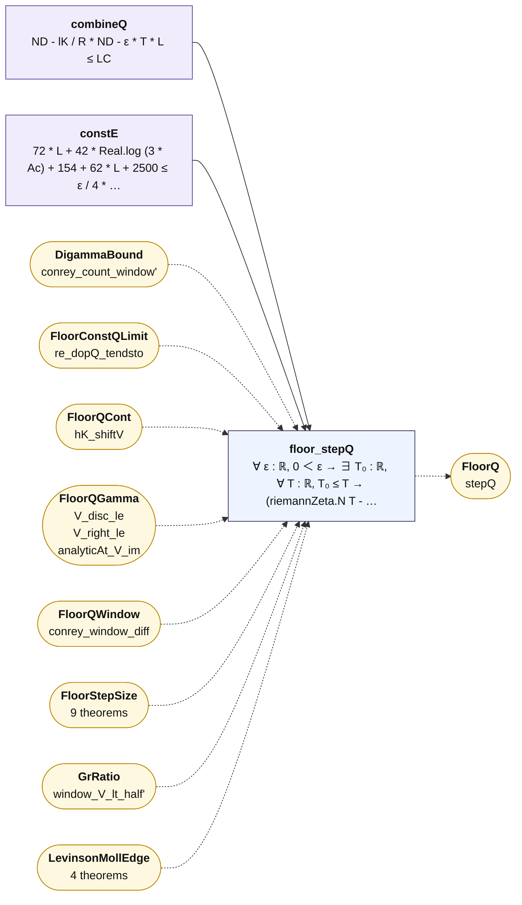

# `lean_stage3/Stage3/FloorQStep.lean`

> **Read from the source text.** This file changed after the last `python3 utilities/lean_map.py --dump`, so the arrows on this page are names occurring in each proof and have not been confirmed by Lean.

# FloorQStep — block S13 of `lean_stage3/design/stencil.md`, B4 step 5, the assembly: Conrey's floor on `[T/2, T]` for a general `Q`. 2026-11-25.

3 theorems, 0 definitions, 423 lines. 

**Imports:** [`DigammaBound`](../lean_stage3/DigammaBound.md), [`FloorConstQLimit`](../lean_stage3/FloorConstQLimit.md), [`FloorQCont`](../lean_stage3/FloorQCont.md), [`FloorQWindow`](../lean_stage3/FloorQWindow.md), [`FloorStep`](../lean_stage3/FloorStep.md), [`GrRatio`](../lean_stage3/GrRatio.md)  
**Imported by:** [`FloorQ`](../lean_stage3/FloorQ.md)

## The picture



An arrow A → B reads "A is used in the proof of B". Green: counting, integers only. Violet: shape, analysis with no ζ. Blue: reads ζ. A name ending in ■ is an end: nothing else uses it. Red: contains `sorry`. Yellow: theorems in another file, counted; a dotted arrow crosses files. Definitions are not drawn; they are listed below the diagram.

## Theorems

<a name="FloorQ-combineQ"></a>
### `FloorQ.combineQ`

line 53 · arrows read from text

**Shape.** Uses real or complex analysis; nothing in it or beneath it reads ζ.

**Why.** The arithmetic of the floor, `FloorStep.combine` with the constant term `E0`.

**Proves**

```lean
ND - lK / R * ND - ε * T * L ≤ LC
```

**Needs** (its hypotheses)

  - `` hL1 : 1 ≤ L ``
  - `` hT0 : 0 < T ``
  - `` hR : 0 < R ``
  - `` hε : 0 < ε ``
  - `` hwin : ND - (1 / (Real.pi * (R / L))) * ((T - T / 2) / 2 * lK + ((T - T / 2) * (2 * td) + Wp)) - E0 ≤ LC ``
  - `` htd : td ≤ τ ``
  - `` hτ : τ ≤ ε * Real.pi * R / 4 ``
  - `` hWp : Wp ≤ Real.pi * Cw * L ^ 3 ``
  - `` hCw : 4 * Cw / (R * ε) * L ^ 3 ≤ T ``
  - `` hN : T * L / (4 * Real.pi) - ND ≤ T + 224 * L + 1396 ``
  - `` hlK0 : 0 ≤ lK ``
  - `` hlK : lK ≤ Kb ``
  - `` hT224 : 224 * L + 1396 ≤ T ``
  - `` hKbL : 8 * Kb / (R * ε) ≤ L ``
  - `` hE : E0 ≤ ε / 4 * T * L ``

**Fed by:** no theorem of this repo; it stands on Mathlib.

**Feeds** (1 that use it)

  - [`FloorQ.floor_stepQ`](#FloorQ-floor_stepQ) — `` ∀ ε : ℝ, 0 < ε → ∃ T₀ : ℝ, ∀ T : ℝ, T₀ ≤ T → (riemannZeta.N T - riemannZeta.N (T / 2)) - Real.log (max 1 ((MeanQ.DopQ Q (Real.log T) (cY P (Mof T θ) T… ``

<a name="FloorQ-constE"></a>
### `FloorQ.constE`

line 111 · arrows read from text

**Shape.** Uses real or complex analysis; nothing in it or beneath it reads ζ.

**Why.** The constant term of the window, priced.

**Proves**

```lean
72 * L + 42 * Real.log (3 * Ac) + 154 + 62 * L + 2500 ≤ ε / 4 * T * L
```

**Needs** (its hypotheses)

  - `` hL1 : 1 ≤ L ``
  - `` hε : 0 < ε ``
  - `` hC₀def : C₀ = 2788 + 42 * |Real.log (3 * Ac)| ``
  - `` hTC₀ : 4 * C₀ / ε ≤ T ``

**Fed by:** no theorem of this repo; it stands on Mathlib.

**Feeds** (1 that use it)

  - [`FloorQ.floor_stepQ`](#FloorQ-floor_stepQ) — `` ∀ ε : ℝ, 0 < ε → ∃ T₀ : ℝ, ∀ T : ℝ, T₀ ≤ T → (riemannZeta.N T - riemannZeta.N (T / 2)) - Real.log (max 1 ((MeanQ.DopQ Q (Real.log T) (cY P (Mof T θ) T… ``

<a name="FloorQ-floor_stepQ"></a>
### `FloorQ.floor_stepQ`

line 131 · arrows read from text

**Reads ζ.** It, or something it rests on, uses the zeta function, its zeros or the Riemann hypothesis.

**Why.** B4 step 5, Conrey's floor on one dyadic window. For real `Q` with `Q′(x) = Q′(1 − x)`, `Q(1/2) ≠ 0`, `Q(0) = 1`, `P(0) = 0`, `P(1) = 1`, `0 < θ < 1/2`, `R > 0`, every `ε > 0`: from some height on, the zeros on the line with height in `(T/2, T]` number at least `(1 − log K/R)(N T − N(T/2)) − ε T log T`, `K = max 1 (Re DopQ(cY)(−R/L, −R/L) + ε)`.

**Proves**

```lean
∀ ε : ℝ, 0 < ε → ∃ T₀ : ℝ, ∀ T : ℝ, T₀ ≤ T → (riemannZeta.N T - riemannZeta.N (T / 2)) - Real.log (max 1 ((MeanQ.DopQ Q (Real.log T) (cY P (Mof T θ) T) ((-(R / Real.log T) : ℝ) : ℂ) ((-(R / Real.log T) : ℝ) : ℂ)).re + ε)) / R * (riemannZeta.N T - riemannZeta.N (T / 2)) - ε * T * Real.log T ≤ (LineCount.lineCount T : ℝ) - (LineCount.lineCount (T / 2) : ℝ)
```

**Needs** (its hypotheses)

  - `` Q P : Polynomial ℝ ``
  - `` hQ : ∀ x : ℝ, Q.derivative.eval x = Q.derivative.eval (1 - x) ``
  - `` hQh : Q.eval (1/2) ≠ 0 ``
  - `` hQ0 : Q.eval 0 = 1 ``
  - `` hP0 : P.eval 0 = 0 ``
  - `` hP1 : P.eval 1 = 1 ``
  - `` hθ0 : 0 < θ ``
  - `` hθ : θ < 1 / 2 ``
  - `` hR : 0 < R ``

**Fed by** (23 theorems its proof uses)

  - [`DigammaBound.conrey_count_window'`](../lean_stage3/DigammaBound.md#DigammaBound-conrey_count_window-) (DigammaBound) — `` ∃ A T₀ : ℝ, 0 < A ∧ ∀ {T a b : ℝ}, T₀ ≤ T → T / 4 ≤ a → 4 ≤ a → a < b → b ≤ 2 * T → (∀ x ∈ Icc (1/2 : ℝ) 3, ConreyCount.V Q (Real.log T) (↑x + ↑a * I)… ``
  - [`FloorConstQ.re_dopQ_tendsto`](../lean_stage3/FloorConstQLimit.md#FloorConstQ-re_dopQ_tendsto) (FloorConstQLimit) — `` Tendsto (fun T => (MeanQ.DopQ Q (Real.log T) (cY P (Mof T θ) T) ((-(R / Real.log T) : ℝ) : ℂ) ((-(R / Real.log T) : ℝ) : ℂ)).re) atTop (𝓝 (KflQ Q (Flo… ``
  - [`FloorQ.hK_shiftV`](../lean_stage3/FloorQCont.md#FloorQ-hK_shiftV) (FloorQCont) — `` ∃ δ : ℝ, 0 < δ ∧ δ ≤ 1 / 8 ∧ ∀ a' b' : ℝ, T / 2 ≤ a' → a' ≤ T / 2 + 1 → T - 1 ≤ b' → b' ≤ T → a' < b' → ∀ σ ∈ Icc (σ₀ - δ) σ₀, (1 / (b' - a')) * ∫ t i… ``
  - [`FloorQ.V_disc_le`](../lean_stage3/FloorQGamma.md#FloorQ-V_disc_le) (FloorQGamma) — `` ∃ C : ℝ, 0 ≤ C ∧ ∀ T : ℝ, 64 ≤ T → 16 ≤ Real.log T → ∀ w : ℂ, 1 / 8 ≤ w.re → w.re ≤ T / 128 → T / 4 + 1 ≤ w.im → w.im ≤ 2 * T - 1 → ‖ConreyCount.V Q (… ``
  - [`FloorQ.V_right_le`](../lean_stage3/FloorQGamma.md#FloorQ-V_right_le) (FloorQGamma) — `` ∃ C : ℝ, 0 ≤ C ∧ ∀ T : ℝ, 64 ≤ T → 1 ≤ Real.log T → ∀ xR t : ℝ, 3 ≤ xR → xR ≤ T / 128 → T / 4 + 1 ≤ t → t ≤ 2 * T - 1 → ‖ConreyCount.V Q (Real.log T) … ``
  - [`FloorQ.analyticAt_V_im`](../lean_stage3/FloorQGamma.md#FloorQ-analyticAt_V_im) (FloorQGamma) — `` AnalyticAt ℂ (ConreyCount.V Q L) w ``
  - [`FloorQ.combineQ`](#FloorQ-combineQ) — `` ND - lK / R * ND - ε * T * L ≤ LC ``
  - [`FloorQ.constE`](#FloorQ-constE) — `` 72 * L + 42 * Real.log (3 * Ac) + 154 + 62 * L + 2500 ≤ ε / 4 * T * L ``
  - [`FloorQ.conrey_window_diff`](../lean_stage3/FloorQWindow.md#FloorQ-conrey_window_diff) (FloorQWindow) — `` (riemannZeta.N b - riemannZeta.N a) - (1 / (Real.pi * (1 / 2 - σ₀))) * ((b - a) / 2 * Real.log K + windowEQ δR Mf X a b) - (Ec + 62 * Real.log T + 250… ``
  - [`FloorStep.N_window_ge`](../lean_stage3/FloorStepSize.md#FloorStep-N_window_ge) (FloorStepSize) — `` T * Real.log T / (4 * Real.pi) - (riemannZeta.N T - riemannZeta.N (T / 2)) ≤ T + 224 * Real.log T + 1396 ``
  - [`FloorStep.W2_le`](../lean_stage3/FloorStepSize.md#FloorStep-W2_le) (FloorStepSize) — `` X * Real.pi + 2 * (X * (Real.pi * ((8 * X - 1) * (L + lM + lB + 8) + 1))) ≤ Real.pi * (12 + 256 * (10 + B)) * L ^ 3 ``
  - [`FloorStep.XMB_le`](../lean_stage3/FloorStepSize.md#FloorStep-XMB_le) (FloorStepSize) — `` 32 * M * B ≤ (2 : ℝ) ^ X ``
  - [`FloorStep.X_bounds`](../lean_stage3/FloorStepSize.md#FloorStep-X_bounds) (FloorStepSize) — `` 3 ≤ Real.logb 2 (A * T) ∧ Real.logb 2 (A * T) ≤ 4 * Real.log T ``
  - [`FloorStep.betaC_bound`](../lean_stage3/FloorStepSize.md#FloorStep-betaC_bound) (FloorStepSize) — `` ∃ B : ℝ, 1 ≤ B ∧ ∀ (T θ R : ℝ), sig0 T R ≤ 1 / 2 → ∀ h : ℕ, ‖betaC P T θ R h‖ ≤ B ``
  - [`FloorStep.betaC_one`](../lean_stage3/FloorStepSize.md#FloorStep-betaC_one) (FloorStepSize) — `` betaC P T θ R 1 = 1 ``
  - [`FloorStep.eventually_logpow_le`](../lean_stage3/FloorStepSize.md#FloorStep-eventually_logpow_le) (FloorStepSize) — `` ∀ᶠ T : ℝ in atTop, C * Real.log T ^ n ≤ T ``
  - [`FloorStep.molli_betaC`](../lean_stage3/FloorStepSize.md#FloorStep-molli_betaC) (FloorStepSize) — `` LevinsonMollEdge.molli (Mof T θ) (betaC P T θ R) = LevinsonMollEdge.molli (Mof T θ) (aY P T θ R) ``
  - [`FloorStep.tail_le`](../lean_stage3/FloorStepSize.md#FloorStep-tail_le) (FloorStepSize) — `` LevinsonMollEdge.tailDelta M B X ≤ τ ``
  - [`GrRatio.window_V_lt_half'`](../lean_stage3/GrRatio.md#GrRatio-window_V_lt_half-) (GrRatio) — `` ∀ ε : ℝ, 0 < ε → ∃ T₀ : ℝ, ∀ T : ℝ, T₀ ≤ T → ∀ a' b' : ℝ, T / 2 ≤ a' → a' ≤ T / 2 + 1 → T - 1 ≤ b' → b' ≤ T → (1 / (b' - a')) * ∫ t in a'..b', ‖Conrey… ``
  - [`LevinsonMollEdge.molli_differentiable`](../lean_stage3/LevinsonMollEdge.md#LevinsonMollEdge-molli_differentiable) (LevinsonMollEdge) — `` Differentiable ℂ (molli M β) ``
  - [`LevinsonMollEdge.molli_norm_le`](../lean_stage3/LevinsonMollEdge.md#LevinsonMollEdge-molli_norm_le) (LevinsonMollEdge) — `` ‖molli M β s‖ ≤ M * B ``
  - [`LevinsonMollEdge.molli_sub_one_le`](../lean_stage3/LevinsonMollEdge.md#LevinsonMollEdge-molli_sub_one_le) (LevinsonMollEdge) — `` ‖molli M β s - 1‖ ≤ M * B / (2 : ℝ) ^ X ``
  - [`LevinsonMollEdge.norm_G_sub_one_le_X`](../lean_stage3/LevinsonMollEdge.md#LevinsonMollEdge-norm_G_sub_one_le_X) (LevinsonMollEdge) — `` ‖riemannZeta s + c * deriv riemannZeta s - 1‖ ≤ 8 / (2 : ℝ) ^ X ``

**Definitions its proof touches:** [`ConreyCount.V`](../lean_stage3/ConreyCountLine.md#ConreyCount-V), [`FloorConst.Ar`](../lean_stage3/FloorConstLimit.md#FloorConst-Ar), [`FloorConst.Br`](../lean_stage3/FloorConstLimit.md#FloorConst-Br), [`FloorConst.Cr`](../lean_stage3/FloorConstLimit.md#FloorConst-Cr), [`FloorConstQ.KflQ`](../lean_stage3/FloorConstQLimit.md#FloorConstQ-KflQ), [`FloorQ.FintV`](../lean_stage3/FloorQCont.md#FloorQ-FintV), [`FloorQ.windowEQ`](../lean_stage3/FloorQWindow.md#FloorQ-windowEQ), [`FloorStep.betaC`](../lean_stage3/FloorStepSize.md#FloorStep-betaC), [`LevinsonMollEdge.molli`](../lean_stage3/LevinsonMollEdge.md#LevinsonMollEdge-molli), [`LevinsonMollEdge.tailDelta`](../lean_stage3/LevinsonMollEdge.md#LevinsonMollEdge-tailDelta), [`LineCount.lineCount`](../lean_stage3/LineCount.md#LineCount-lineCount), [`Littlewood.countRight`](../lean_stage3/Littlewood.md#Littlewood-countRight), [`MeanQ.DopQ`](../lean_stage3/MeanQCauchy.md#MeanQ-DopQ), [`TwistedMoment.Mof`](../lean_stage3/TwistedMoment.md#TwistedMoment-Mof), [`TwistedMoment.cY`](../lean_stage3/TwistedMoment.md#TwistedMoment-cY), [`TwistedMoment.sig0`](../lean_stage3/TwistedMoment.md#TwistedMoment-sig0)

**Feeds** (1 that use it)

  - [`FloorQ.stepQ`](../lean_stage3/FloorQ.md#FloorQ-stepQ) (FloorQ) — `` ∃ T₁ : ℝ, 1 ≤ T₁ ∧ ∀ T : ℝ, T₁ ≤ T → (224 / 625 - 2 * ε₁) * (riemannZeta.N T - riemannZeta.N (T / 2)) - ε₁ * T * Real.log T ≤ (LineCount.lineCount T :… ``

