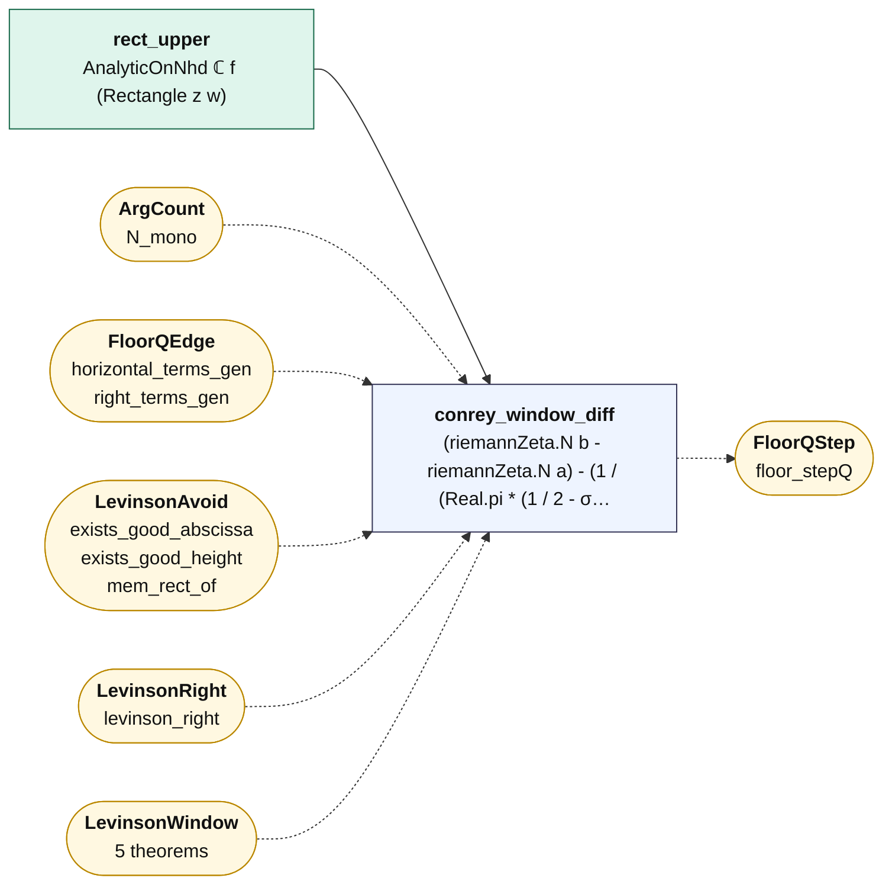

# `lean_stage3/Stage3/FloorQWindow.lean`

> **Read from the source text.** This file changed after the last `python3 utilities/lean_map.py --dump`, so the arrows on this page are names occurring in each proof and have not been confirmed by Lean.

# FloorQWindow — block S13 of `lean_stage3/design/stencil.md`, B4 step 5, the assembly: the window for a general `Q`. 2026-11-25.

2 theorems, 1 definition, 276 lines. 

**Imports:** [`FloorQEdge`](../lean_stage3/FloorQEdge.md), [`LevinsonWindowNear`](../lean_stage3/LevinsonWindowNear.md)  
**Imported by:** [`FloorQStep`](../lean_stage3/FloorQStep.md)

## The picture



An arrow A → B reads "A is used in the proof of B". Green: counting, integers only. Violet: shape, analysis with no ζ. Blue: reads ζ. A name ending in ■ is an end: nothing else uses it. Red: contains `sorry`. Yellow: theorems in another file, counted; a dotted arrow crosses files. Definitions are not drawn; they are listed below the diagram.

## Definitions

<a name="FloorQ-windowEQ"></a>
### `FloorQ.windowEQ`

def · line 41

- **Is:** `` windowEQ (δR Mf X a b : ℝ) : ℝ := (b - a) * (2 * δR) + X * Real.pi + 2 * (X * (Real.pi * ((8 * X - 1) * Real.log (2 * Mf) + 1))) ``
- **Used by 2:** [`FloorQ.floor_stepQ`](../lean_stage3/FloorQStep.md#FloorQ-floor_stepQ), [`FloorQ.conrey_window_diff`](#FloorQ-conrey_window_diff)

## Theorems

<a name="FloorQ-rect_upper"></a>
### `FloorQ.rect_upper`

line 46 · arrows read from text

**Counting.** Integers only: nothing in its statement or proof, or in anything it rests on, uses analysis or ζ.

**Why.** Analytic on `Im > 0`, a function is analytic near any rectangle above the real axis.

**Proves**

```lean
AnalyticOnNhd ℂ f (Rectangle z w)
```

**Needs** (its hypotheses)

  - `` hf : ∀ w : ℂ, 0 < w.im → AnalyticAt ℂ f w ``
  - `` hz : 0 < z.im ``
  - `` hw : 0 < w.im ``

**Fed by:** no theorem of this repo; it stands on Mathlib.

**Feeds** (1 that use it)

  - [`FloorQ.conrey_window_diff`](#FloorQ-conrey_window_diff) — `` (riemannZeta.N b - riemannZeta.N a) - (1 / (Real.pi * (1 / 2 - σ₀))) * ((b - a) / 2 * Real.log K + windowEQ δR Mf X a b) - (Ec + 62 * Real.log T + 250… ``

<a name="FloorQ-conrey_window_diff"></a>
### `FloorQ.conrey_window_diff`

line 61 · arrows read from text

**Reads ζ.** It, or something it rests on, uses the zeta function, its zeros or the Riemann hypothesis.

**Why.** The window for a general `G`, difference form. For `G` analytic on `Im > 0`, `ψ` entire, `σ₀ < 1/2` with a margin `δ > 0`, `1/4 ≤ σ₀ − δ`, `X ≥ 3`, `2X ≤ a`, `a + 3 ≤ b ≤ T`, `1 ≤ K`, the right edge `‖G ψ − 1‖ ≤ δ_R ≤ 1/2` on `X + [a, b] i`, the growth `‖G ψ‖ ≤ Mf` on the discs of radius `X − 1/8` about `X + y i`, `y ∈ [a, b]`, the count `hcount` at the good heights and the mean `hK` there: the zeros of `ζ` on the line with height in `(a, b]` number at least `(N b − N a) − (1/(π(1/2 − σ₀)))((b − a)/2 · log K + windowEQ) − (Ec + 62 log T + 2500)`.

**Proves**

```lean
(riemannZeta.N b - riemannZeta.N a) - (1 / (Real.pi * (1 / 2 - σ₀))) * ((b - a) / 2 * Real.log K + windowEQ δR Mf X a b) - (Ec + 62 * Real.log T + 2500) ≤ (lineCount b : ℝ) - (lineCount a : ℝ)
```

**Needs** (its hypotheses)

  - `` hGa : ∀ w : ℂ, 0 < w.im → AnalyticAt ℂ G w ``
  - `` hψ : Differentiable ℂ ψ ``
  - `` hσ₀ : σ₀ < 1 / 2 ``
  - `` hδ : 0 < δ ``
  - `` hσδ : 1 / 4 ≤ σ₀ - δ ``
  - `` hX : 3 ≤ X ``
  - `` hXa : 2 * X ≤ a ``
  - `` hab : a + 3 ≤ b ``
  - `` hbT : b ≤ T ``
  - `` hK1 : 1 ≤ K ``
  - `` hδR : δR ≤ 1 / 2 ``
  - `` hR : ∀ t ∈ Icc a b, ‖G (↑X + ↑t * I) * ψ (↑X + ↑t * I) - 1‖ ≤ δR ``
  - `` hMf : ∀ y ∈ Icc a b, ∀ w : ℂ, ‖w - (↑X + ↑y * I)‖ ≤ X - 1 / 8 → ‖G w * ψ w‖ ≤ Mf ``
  - `` hcount : ∀ a' b' : ℝ, a ≤ a' → a' ≤ a + 1 → b - 1 ≤ b' → b' ≤ b → a' < b' → (∀ x ∈ Icc (1/2 : ℝ) 3, G (↑x + ↑a' * I) ≠ 0) → (∀ x ∈ Icc (1/2 : ℝ) 3, G (↑x + ↑b' * I) ≠ 0) → riemannZeta (1/2 + a' * I) ≠ 0 → (riemannZeta.N b' - riemannZeta.N a') - 2 * Littlewood.countRight G ((1/2 : ℂ) + a' * I) ((3 : … ``
  - `` hK : ∀ a' b' : ℝ, a ≤ a' → a' ≤ a + 1 → b - 1 ≤ b' → b' ≤ b → a' < b' → ∀ σ ∈ Icc (σ₀ - δ) σ₀, (1 / (b' - a')) * ∫ t in a'..b', ‖G (↑σ + ↑t * I) * ψ (↑σ + ↑t * I)‖ ^ 2 ≤ K ``

**Fed by** (13 theorems its proof uses)

  - [`ArgCount.N_mono`](../lean_stage3/ArgCount.md#ArgCount-N_mono) (ArgCount) — `` riemannZeta.N T ≤ riemannZeta.N T' ``
  - [`FloorQ.horizontal_terms_gen`](../lean_stage3/FloorQEdge.md#FloorQ-horizontal_terms_gen) (FloorQEdge) — `` |∫ σ in σ₀..X, edgeH f X T σ| ≤ (X - σ₀) * (Real.pi * ((8 * X - 1) * Real.log (2 * Mf) + 1)) ``
  - [`FloorQ.right_terms_gen`](../lean_stage3/FloorQEdge.md#FloorQ-right_terms_gen) (FloorQEdge) — `` -(∫ t in a..b, Real.log ‖f (↑X + ↑t * I)‖) + (X - σ₀) * (∫ t in a..b, logDeriv f (↑X + ↑t * I)).re ≤ (b - a) * (2 * δ) + (X - σ₀) * Real.pi ``
  - [`FloorQ.rect_upper`](#FloorQ-rect_upper) — `` AnalyticOnNhd ℂ f (Rectangle z w) ``
  - [`LevinsonAvoid.exists_good_abscissa`](../lean_stage3/LevinsonAvoid.md#LevinsonAvoid-exists_good_abscissa) (LevinsonAvoid) — `` ∃ σ ∈ Icc (σ₀ - δ) σ₀, ∀ y ∈ Icc a b, f ((σ : ℂ) + y * I) ≠ 0 ``
  - [`LevinsonAvoid.exists_good_height`](../lean_stage3/LevinsonAvoid.md#LevinsonAvoid-exists_good_height) (LevinsonAvoid) — `` ∃ t ∈ Icc t₀ (t₀ + 1), ∀ x ∈ Icc σ₀ X, f ((x : ℂ) + t * I) ≠ 0 ``
  - [`LevinsonAvoid.mem_rect_of`](../lean_stage3/LevinsonAvoid.md#LevinsonAvoid-mem_rect_of) (LevinsonAvoid) — `` ((x : ℂ) + y * I) ∈ Rectangle z w ``
  - [`LevinsonRight.levinson_right`](../lean_stage3/LevinsonRight.md#LevinsonRight-levinson_right) (LevinsonRight) — `` countRight G ((1 / 2 : ℂ) + a * I) ((X : ℂ) + b * I) (1 / 2) ≤ (1 / (2 * Real.pi * (1 / 2 - σ₀))) * ((b - a) / 2 * Real.log ((1 / (b - a)) * ∫ t in a.… ``
  - [`LevinsonWindow.N_step_le`](../lean_stage3/LevinsonWindow.md#LevinsonWindow-N_step_le) (LevinsonWindow) — `` riemannZeta.N u - riemannZeta.N t ≤ 31 * Real.log u + 1250 ``
  - [`LevinsonWindow.border_cases`](../lean_stage3/LevinsonWindow.md#LevinsonWindow-border_cases) (LevinsonWindow) — `` (p.im = z.im ∧ p.re ∈ Icc z.re w.re) ∨ (p.re = z.re ∧ p.im ∈ Icc z.im w.im) ∨ (p.im = w.im ∧ p.re ∈ Icc z.re w.re) ∨ (p.re = w.re ∧ p.im ∈ Icc z.im w.… ``
  - [`LevinsonWindow.countRight_right_le`](../lean_stage3/LevinsonWindow.md#LevinsonWindow-countRight_right_le) (LevinsonWindow) — `` countRight f z w' σ ≤ countRight f z w σ ``
  - [`LevinsonWindow.half_log_mean_le`](../lean_stage3/LevinsonWindow.md#LevinsonWindow-half_log_mean_le) (LevinsonWindow) — `` (b - a) / 2 * Real.log ((1 / (b - a)) * ∫ t in a..b, ‖F t‖ ^ 2) ≤ (b - a) / 2 * Real.log K ``
  - [`LevinsonWindow.lineCount_mono`](../lean_stage3/LevinsonWindow.md#LevinsonWindow-lineCount_mono) (LevinsonWindow) — `` lineCount T ≤ lineCount T' ``

**Definitions its proof touches:** [`FloorQ.windowEQ`](#FloorQ-windowEQ), [`LineCount.lineCount`](../lean_stage3/LineCount.md#LineCount-lineCount), [`Littlewood.countRight`](../lean_stage3/Littlewood.md#Littlewood-countRight)

**Feeds** (1 that use it)

  - [`FloorQ.floor_stepQ`](../lean_stage3/FloorQStep.md#FloorQ-floor_stepQ) (FloorQStep) — `` ∀ ε : ℝ, 0 < ε → ∃ T₀ : ℝ, ∀ T : ℝ, T₀ ≤ T → (riemannZeta.N T - riemannZeta.N (T / 2)) - Real.log (max 1 ((MeanQ.DopQ Q (Real.log T) (cY P (Mof T θ) T… ``

