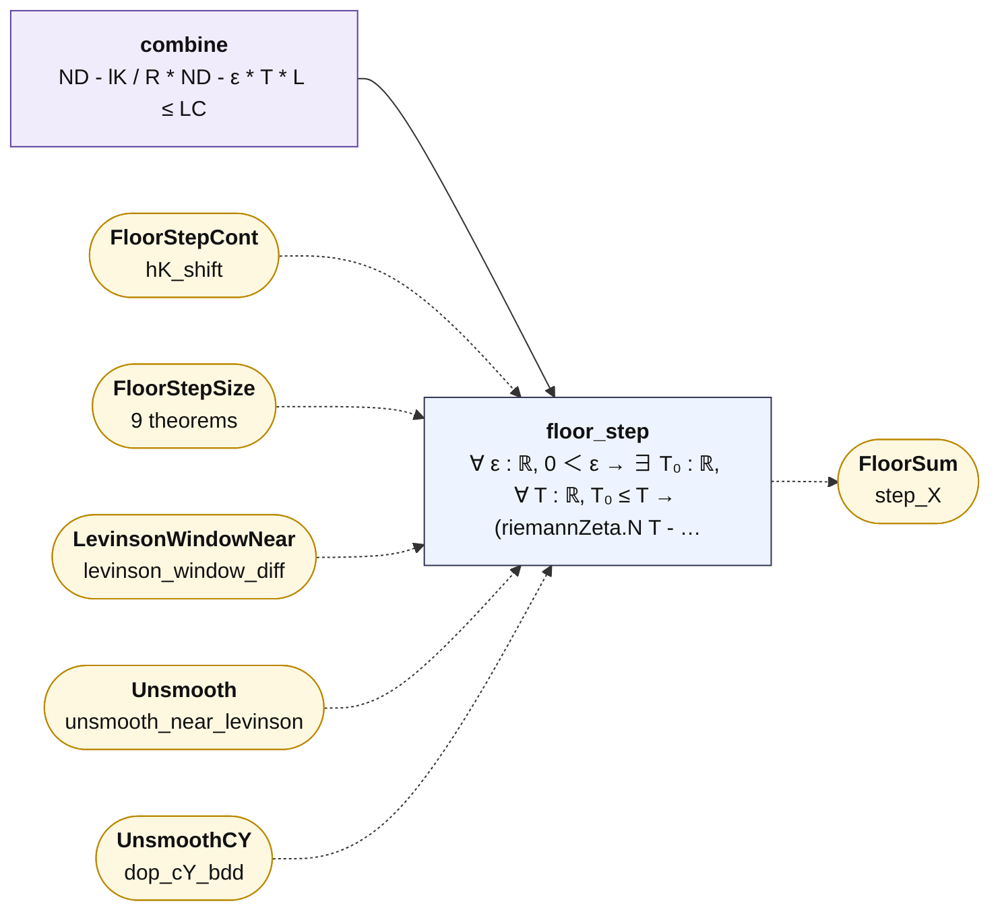

# `lean_stage3/Stage3/FloorStep.lean`

> **Read from the source text.** This file changed after the last `python3 utilities/lean_map.py --dump`, so the arrows on this page are names occurring in each proof and have not been confirmed by Lean.

# FloorStep — block S12 of `lean_stage3/design/stencil.md`, piece 5b, one height: Levinson's floor on `[T/2, T]`. 2026-11-25.

2 theorems, 0 definitions, 268 lines. 

**Imports:** [`FloorStepCont`](../lean_stage3/FloorStepCont.md), [`FloorStepSize`](../lean_stage3/FloorStepSize.md)  
**Imported by:** [`Stage3`](../lean_stage3/Stage3.md), [`FloorSum`](../lean_stage3/FloorSum.md)

## The picture



An arrow A → B reads "A is used in the proof of B". Green: counting, integers only. Violet: shape, analysis with no ζ. Blue: reads ζ. A name ending in ■ is an end: nothing else uses it. Red: contains `sorry`. Yellow: theorems in another file, counted; a dotted arrow crosses files. Definitions are not drawn; they are listed below the diagram.

## Theorems

<a name="FloorStep-combine"></a>
### `FloorStep.combine`

line 57 · arrows read from text

**Shape.** Uses real or complex analysis; nothing in it or beneath it reads ζ.

**Why.** The arithmetic of the floor. The window's inequality with its terms bounded: each of the four error terms costs at most `(ε/4) T L`.

**Proves**

```lean
ND - lK / R * ND - ε * T * L ≤ LC
```

**Needs** (its hypotheses)

  - `` hL1 : 1 ≤ L ``
  - `` hT0 : 0 < T ``
  - `` hR : 0 < R ``
  - `` hε : 0 < ε ``
  - `` hwin : ND - (1 / (Real.pi * (R / L))) * ((T - T / 2) / 2 * lK + ((T - T / 2) * (2 * td) + Wp)) - (134 * L + 2918) ≤ LC ``
  - `` htd : td ≤ τ ``
  - `` hτ : τ ≤ ε * Real.pi * R / 4 ``
  - `` hWp : Wp ≤ Real.pi * Cw * L ^ 3 ``
  - `` hCw : 4 * Cw / (R * ε) * L ^ 3 ≤ T ``
  - `` hN : T * L / (4 * Real.pi) - ND ≤ T + 224 * L + 1396 ``
  - `` hlK0 : 0 ≤ lK ``
  - `` hlK : lK ≤ Kb ``
  - `` hT224 : 224 * L + 1396 ≤ T ``
  - `` hKbL : 8 * Kb / (R * ε) ≤ L ``
  - `` h134 : 4 * 3052 / ε ≤ T ``

**Fed by:** no theorem of this repo; it stands on Mathlib.

**Feeds** (1 that use it)

  - [`FloorStep.floor_step`](#FloorStep-floor_step) — `` ∀ ε : ℝ, 0 < ε → ∃ T₀ : ℝ, ∀ T : ℝ, T₀ ≤ T → (riemannZeta.N T - riemannZeta.N (T / 2)) - Real.log (max 1 ((Operator.Dop (Real.log T) (cY P (Mof T θ) T… ``

<a name="FloorStep-floor_step"></a>
### `FloorStep.floor_step`

line 127 · arrows read from text

**Reads ζ.** It, or something it rests on, uses the zeta function, its zeros or the Riemann hypothesis.

**Why.** S12 piece 5b, Levinson's floor on one dyadic window. For `P(0) = 0`, `P(1) = 1`, `0 < θ < 1/2`, `R > 0`, every `ε > 0`: from some height on, the zeros on the line with height in `(T/2, T]` number at least `(1 − log K/R)(N T − N(T/2)) − ε T log T`, with `K = max 1 (Re D[c](−R/L, −R/L) + ε)`, `L = log T`.

**Proves**

```lean
∀ ε : ℝ, 0 < ε → ∃ T₀ : ℝ, ∀ T : ℝ, T₀ ≤ T → (riemannZeta.N T - riemannZeta.N (T / 2)) - Real.log (max 1 ((Operator.Dop (Real.log T) (cY P (Mof T θ) T) ((-(R / Real.log T) : ℝ) : ℂ) ((-(R / Real.log T) : ℝ) : ℂ)).re + ε)) / R * (riemannZeta.N T - riemannZeta.N (T / 2)) - ε * T * Real.log T ≤ (LineCount.lineCount T : ℝ) - (LineCount.lineCount (T / 2) : ℝ)
```

**Needs** (its hypotheses)

  - `` P : Polynomial ℝ ``
  - `` hP0 : P.eval 0 = 0 ``
  - `` hP1 : P.eval 1 = 1 ``
  - `` hθ0 : 0 < θ ``
  - `` hθ : θ < 1 / 2 ``
  - `` hR : 0 < R ``

**Fed by** (14 theorems its proof uses)

  - [`FloorStep.combine`](#FloorStep-combine) — `` ND - lK / R * ND - ε * T * L ≤ LC ``
  - [`FloorStep.hK_shift`](../lean_stage3/FloorStepCont.md#FloorStep-hK_shift) (FloorStepCont) — `` ∃ δ : ℝ, 0 < δ ∧ δ ≤ 1 / 8 ∧ ∀ a' b' : ℝ, T / 2 ≤ a' → a' ≤ T / 2 + 1 → T - 1 ≤ b' → b' ≤ T → a' < b' → ∀ σ ∈ Icc (σ₀ - δ) σ₀, (1 / (b' - a')) * ∫ t i… ``
  - [`FloorStep.N_window_ge`](../lean_stage3/FloorStepSize.md#FloorStep-N_window_ge) (FloorStepSize) — `` T * Real.log T / (4 * Real.pi) - (riemannZeta.N T - riemannZeta.N (T / 2)) ≤ T + 224 * Real.log T + 1396 ``
  - [`FloorStep.W2_le`](../lean_stage3/FloorStepSize.md#FloorStep-W2_le) (FloorStepSize) — `` X * Real.pi + 2 * (X * (Real.pi * ((8 * X - 1) * (L + lM + lB + 8) + 1))) ≤ Real.pi * (12 + 256 * (10 + B)) * L ^ 3 ``
  - [`FloorStep.XMB_le`](../lean_stage3/FloorStepSize.md#FloorStep-XMB_le) (FloorStepSize) — `` 32 * M * B ≤ (2 : ℝ) ^ X ``
  - [`FloorStep.X_bounds`](../lean_stage3/FloorStepSize.md#FloorStep-X_bounds) (FloorStepSize) — `` 3 ≤ Real.logb 2 (A * T) ∧ Real.logb 2 (A * T) ≤ 4 * Real.log T ``
  - [`FloorStep.betaC_bound`](../lean_stage3/FloorStepSize.md#FloorStep-betaC_bound) (FloorStepSize) — `` ∃ B : ℝ, 1 ≤ B ∧ ∀ (T θ R : ℝ), sig0 T R ≤ 1 / 2 → ∀ h : ℕ, ‖betaC P T θ R h‖ ≤ B ``
  - [`FloorStep.betaC_one`](../lean_stage3/FloorStepSize.md#FloorStep-betaC_one) (FloorStepSize) — `` betaC P T θ R 1 = 1 ``
  - [`FloorStep.eventually_logpow_le`](../lean_stage3/FloorStepSize.md#FloorStep-eventually_logpow_le) (FloorStepSize) — `` ∀ᶠ T : ℝ in atTop, C * Real.log T ^ n ≤ T ``
  - [`FloorStep.molli_betaC`](../lean_stage3/FloorStepSize.md#FloorStep-molli_betaC) (FloorStepSize) — `` LevinsonMollEdge.molli (Mof T θ) (betaC P T θ R) = LevinsonMollEdge.molli (Mof T θ) (aY P T θ R) ``
  - [`FloorStep.tail_le`](../lean_stage3/FloorStepSize.md#FloorStep-tail_le) (FloorStepSize) — `` LevinsonMollEdge.tailDelta M B X ≤ τ ``
  - [`LevinsonWindowNear.levinson_window_diff`](../lean_stage3/LevinsonWindowNear.md#LevinsonWindowNear-levinson_window_diff) (LevinsonWindowNear) — `` (riemannZeta.N b - riemannZeta.N a) - (1 / (Real.pi * (1 / 2 - σ₀))) * ((b - a) / 2 * Real.log K + windowE M B X T a b) - (134 * Real.log T + 2918) ≤ … ``
  - [`Unsmooth.unsmooth_near_levinson`](../lean_stage3/Unsmooth.md#Unsmooth-unsmooth_near_levinson) (Unsmooth) — `` ∀ ε : ℝ, 0 < ε → ∃ T₀ : ℝ, ∀ T : ℝ, T₀ ≤ T → ∀ c : ℝ, c = 1 / Real.log T → ∀ a' b' : ℝ, T / 2 ≤ a' → a' ≤ T / 2 + 1 → T - 1 ≤ b' → b' ≤ T → (1 / (b' -… ``
  - [`Unsmooth.dop_cY_bdd`](../lean_stage3/UnsmoothCY.md#Unsmooth-dop_cY_bdd) (UnsmoothCY) — `` ∃ K : ℝ, 0 ≤ K ∧ ∃ T₀ : ℝ, ∀ T : ℝ, T₀ ≤ T → ‖Dop (Real.log T) (cY P (Mof T θ) T) ((-(R / Real.log T) : ℝ) : ℂ) ((-(R / Real.log T) : ℝ) : ℂ)‖ ≤ K ``

**Definitions its proof touches:** [`FloorStep.Fint`](../lean_stage3/FloorStepCont.md#FloorStep-Fint), [`FloorStep.betaC`](../lean_stage3/FloorStepSize.md#FloorStep-betaC), [`LevinsonMollEdge.tailDelta`](../lean_stage3/LevinsonMollEdge.md#LevinsonMollEdge-tailDelta), [`LevinsonWindow.windowE`](../lean_stage3/LevinsonWindow.md#LevinsonWindow-windowE), [`LineCount.lineCount`](../lean_stage3/LineCount.md#LineCount-lineCount), [`Operator.Dop`](../lean_stage3/OperatorCauchy.md#Operator-Dop), [`TwistedMoment.Mof`](../lean_stage3/TwistedMoment.md#TwistedMoment-Mof), [`TwistedMoment.cY`](../lean_stage3/TwistedMoment.md#TwistedMoment-cY), [`TwistedMoment.sig0`](../lean_stage3/TwistedMoment.md#TwistedMoment-sig0)

**Feeds** (1 that use it)

  - [`FloorSum.step_X`](../lean_stage3/FloorSum.md#FloorSum-step_X) (FloorSum) — `` ∃ T₁ : ℝ, 1 ≤ T₁ ∧ ∀ T : ℝ, T₁ ≤ T → (1 / 3 - 2 * ε₁) * (riemannZeta.N T - riemannZeta.N (T / 2)) - ε₁ * T * Real.log T ≤ (LineCount.lineCount T : ℝ) … ``

