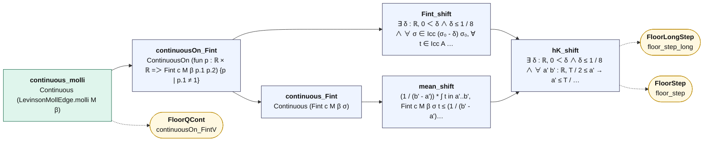

# `lean_stage3/Stage3/FloorStepCont.lean`

> **Read from the source text.** This file changed after the last `python3 utilities/lean_map.py --dump`, so the arrows on this page are names occurring in each proof and have not been confirmed by Lean.

# FloorStepCont — block S12 of `lean_stage3/design/stencil.md`, piece 5b, one height: continuity in `σ`. 2026-11-25.

6 theorems, 1 definition, 162 lines. 

**Imports:** [`LevinsonWindowNear`](../lean_stage3/LevinsonWindowNear.md), [`Unsmooth`](../lean_stage3/Unsmooth.md)  
**Imported by:** [`FloorQCont`](../lean_stage3/FloorQCont.md), [`FloorStep`](../lean_stage3/FloorStep.md)

## The picture



An arrow A → B reads "A is used in the proof of B". Green: counting, integers only. Violet: shape, analysis with no ζ. Blue: reads ζ. A name ending in ■ is an end: nothing else uses it. Red: contains `sorry`. Yellow: theorems in another file, counted; a dotted arrow crosses files. Definitions are not drawn; they are listed below the diagram.

## Definitions

<a name="FloorStep-Fint"></a>
### `FloorStep.Fint`

def · line 32

- **Is:** `` Fint (c : ℝ) (M : ℕ) (β : ℕ → ℂ) (σ t : ℝ) : ℝ := ‖(riemannZeta (↑σ + ↑t * I) + c * deriv riemannZeta (↑σ + ↑t * I)) * LevinsonMollEdge.molli M β (↑σ + ↑t * I)‖ ^ 2 ``
- **Built from:** [`LevinsonMollEdge.molli`](../lean_stage3/LevinsonMollEdge.md#LevinsonMollEdge-molli)
- **Used by 7:** [`FloorLong.floor_step_long`](../lean_stage3/FloorLongStep.md#FloorLong-floor_step_long), [`FloorStep.floor_step`](../lean_stage3/FloorStep.md#FloorStep-floor_step), [`FloorStep.Fint_shift`](#FloorStep-Fint_shift), [`FloorStep.continuousOn_Fint`](#FloorStep-continuousOn_Fint), [`FloorStep.continuous_Fint`](#FloorStep-continuous_Fint), [`FloorStep.hK_shift`](#FloorStep-hK_shift), [`FloorStep.mean_shift`](#FloorStep-mean_shift)

## Theorems

<a name="FloorStep-continuous_molli"></a>
### `FloorStep.continuous_molli`

line 36 · arrows read from text

**Counting.** Integers only: nothing in its statement or proof, or in anything it rests on, uses analysis or ζ.

**Proves**

```lean
Continuous (LevinsonMollEdge.molli M β)
```

**Needs** (its hypotheses)

  - `` M : ℕ ``
  - `` β : ℕ → ℂ ``

**Fed by:** no theorem of this repo; it stands on Mathlib and the definitions below.

**Definitions its proof touches:** [`LevinsonMollEdge.molli`](../lean_stage3/LevinsonMollEdge.md#LevinsonMollEdge-molli)

**Feeds** (2 that use it)

  - [`FloorQ.continuousOn_FintV`](../lean_stage3/FloorQCont.md#FloorQ-continuousOn_FintV) (FloorQCont) — `` ContinuousOn (fun p : ℝ × ℝ => FintV Q L M β p.1 p.2) {p | 0 < p.2} ``
  - [`FloorStep.continuousOn_Fint`](#FloorStep-continuousOn_Fint) — `` ContinuousOn (fun p : ℝ × ℝ => Fint c M β p.1 p.2) {p | p.1 ≠ 1} ``

<a name="FloorStep-continuousOn_Fint"></a>
### `FloorStep.continuousOn_Fint`

line 43 · arrows read from text

**Reads ζ.** It, or something it rests on, uses the zeta function, its zeros or the Riemann hypothesis.

**Proves**

```lean
ContinuousOn (fun p : ℝ × ℝ => Fint c M β p.1 p.2) {p | p.1 ≠ 1}
```

**Needs** (its hypotheses)

  - `` c : ℝ ``
  - `` M : ℕ ``
  - `` β : ℕ → ℂ ``

**Fed by** (1 theorem its proof uses)

  - [`FloorStep.continuous_molli`](#FloorStep-continuous_molli) — `` Continuous (LevinsonMollEdge.molli M β) ``

**Definitions its proof touches:** [`FloorStep.Fint`](#FloorStep-Fint), [`LevinsonMollEdge.molli`](../lean_stage3/LevinsonMollEdge.md#LevinsonMollEdge-molli)

**Feeds** (2 that use it)

  - [`FloorStep.Fint_shift`](#FloorStep-Fint_shift) — `` ∃ δ : ℝ, 0 < δ ∧ δ ≤ 1 / 8 ∧ ∀ σ ∈ Icc (σ₀ - δ) σ₀, ∀ t ∈ Icc A B, Fint c M β σ t ≤ Fint c M β σ₀ t + ε ``
  - [`FloorStep.continuous_Fint`](#FloorStep-continuous_Fint) — `` Continuous (Fint c M β σ) ``

<a name="FloorStep-continuous_Fint"></a>
### `FloorStep.continuous_Fint`

line 58 · arrows read from text

**Reads ζ.** It, or something it rests on, uses the zeta function, its zeros or the Riemann hypothesis.

**Proves**

```lean
Continuous (Fint c M β σ)
```

**Needs** (its hypotheses)

  - `` c : ℝ ``
  - `` M : ℕ ``
  - `` β : ℕ → ℂ ``
  - `` hσ : σ ≠ 1 ``

**Fed by** (1 theorem its proof uses)

  - [`FloorStep.continuousOn_Fint`](#FloorStep-continuousOn_Fint) — `` ContinuousOn (fun p : ℝ × ℝ => Fint c M β p.1 p.2) {p | p.1 ≠ 1} ``

**Definitions its proof touches:** [`FloorStep.Fint`](#FloorStep-Fint)

**Feeds** (1 that use it)

  - [`FloorStep.mean_shift`](#FloorStep-mean_shift) — `` (1 / (b' - a')) * ∫ t in a'..b', Fint c M β σ t ≤ (1 / (b' - a')) * (∫ t in a'..b', Fint c M β σ₀ t) + ε ``

<a name="FloorStep-Fint_shift"></a>
### `FloorStep.Fint_shift`

line 70 · arrows read from text

**Reads ζ.** It, or something it rests on, uses the zeta function, its zeros or the Riemann hypothesis.

**Why.** Continuity in `σ`, uniform in `t`.

**Proves**

```lean
∃ δ : ℝ, 0 < δ ∧ δ ≤ 1 / 8 ∧ ∀ σ ∈ Icc (σ₀ - δ) σ₀, ∀ t ∈ Icc A B, Fint c M β σ t ≤ Fint c M β σ₀ t + ε
```

**Needs** (its hypotheses)

  - `` c : ℝ ``
  - `` M : ℕ ``
  - `` β : ℕ → ℂ ``
  - `` hσ₀ : σ₀ < 1 ``
  - `` hε : 0 < ε ``

**Fed by** (1 theorem its proof uses)

  - [`FloorStep.continuousOn_Fint`](#FloorStep-continuousOn_Fint) — `` ContinuousOn (fun p : ℝ × ℝ => Fint c M β p.1 p.2) {p | p.1 ≠ 1} ``

**Definitions its proof touches:** [`FloorStep.Fint`](#FloorStep-Fint)

**Feeds** (1 that use it)

  - [`FloorStep.hK_shift`](#FloorStep-hK_shift) — `` ∃ δ : ℝ, 0 < δ ∧ δ ≤ 1 / 8 ∧ ∀ a' b' : ℝ, T / 2 ≤ a' → a' ≤ T / 2 + 1 → T - 1 ≤ b' → b' ≤ T → a' < b' → ∀ σ ∈ Icc (σ₀ - δ) σ₀, (1 / (b' - a')) * ∫ t i… ``

<a name="FloorStep-mean_shift"></a>
### `FloorStep.mean_shift`

line 98 · arrows read from text

**Reads ζ.** It, or something it rests on, uses the zeta function, its zeros or the Riemann hypothesis.

**Why.** A pointwise shift by `ε` on `[a′, b′]` moves the mean by at most `ε`.

**Proves**

```lean
(1 / (b' - a')) * ∫ t in a'..b', Fint c M β σ t ≤ (1 / (b' - a')) * (∫ t in a'..b', Fint c M β σ₀ t) + ε
```

**Needs** (its hypotheses)

  - `` c : ℝ ``
  - `` M : ℕ ``
  - `` β : ℕ → ℂ ``
  - `` hσ : σ ≠ 1 ``
  - `` hσ₀ : σ₀ ≠ 1 ``
  - `` hab : a' < b' ``
  - `` h : ∀ t ∈ Icc a' b', Fint c M β σ t ≤ Fint c M β σ₀ t + ε ``

**Fed by** (1 theorem its proof uses)

  - [`FloorStep.continuous_Fint`](#FloorStep-continuous_Fint) — `` Continuous (Fint c M β σ) ``

**Definitions its proof touches:** [`FloorStep.Fint`](#FloorStep-Fint)

**Feeds** (1 that use it)

  - [`FloorStep.hK_shift`](#FloorStep-hK_shift) — `` ∃ δ : ℝ, 0 < δ ∧ δ ≤ 1 / 8 ∧ ∀ a' b' : ℝ, T / 2 ≤ a' → a' ≤ T / 2 + 1 → T - 1 ≤ b' → b' ≤ T → a' < b' → ∀ σ ∈ Icc (σ₀ - δ) σ₀, (1 / (b' - a')) * ∫ t i… ``

<a name="FloorStep-hK_shift"></a>
### `FloorStep.hK_shift`

line 122 · arrows read from text

**Reads ζ.** It, or something it rests on, uses the zeta function, its zeros or the Riemann hypothesis.

**Why.** `hK` from `σ₀` to `[σ₀ − δ, σ₀]`. If the mean at `σ₀` is at most `V + ε/2` on every window `[a′, b′]`, `a′ ∈ [T/2, T/2 + 1]`, `b′ ∈ [T − 1, T]`, then for some `δ ∈ (0, 1/8]` the mean at every `σ ∈ [σ₀ − δ, σ₀]` is at most `V + ε` on the same windows.

**Proves**

```lean
∃ δ : ℝ, 0 < δ ∧ δ ≤ 1 / 8 ∧ ∀ a' b' : ℝ, T / 2 ≤ a' → a' ≤ T / 2 + 1 → T - 1 ≤ b' → b' ≤ T → a' < b' → ∀ σ ∈ Icc (σ₀ - δ) σ₀, (1 / (b' - a')) * ∫ t in a'..b', Fint c M β σ t ≤ V + ε
```

**Needs** (its hypotheses)

  - `` c : ℝ ``
  - `` M : ℕ ``
  - `` β : ℕ → ℂ ``
  - `` hσ₀ : σ₀ < 1 ``
  - `` hε : 0 < ε ``
  - `` h0 : ∀ a' b' : ℝ, T / 2 ≤ a' → a' ≤ T / 2 + 1 → T - 1 ≤ b' → b' ≤ T → (1 / (b' - a')) * ∫ t in a'..b', Fint c M β σ₀ t ≤ V + ε / 2 ``

**Fed by** (2 theorems its proof uses)

  - [`FloorStep.Fint_shift`](#FloorStep-Fint_shift) — `` ∃ δ : ℝ, 0 < δ ∧ δ ≤ 1 / 8 ∧ ∀ σ ∈ Icc (σ₀ - δ) σ₀, ∀ t ∈ Icc A B, Fint c M β σ t ≤ Fint c M β σ₀ t + ε ``
  - [`FloorStep.mean_shift`](#FloorStep-mean_shift) — `` (1 / (b' - a')) * ∫ t in a'..b', Fint c M β σ t ≤ (1 / (b' - a')) * (∫ t in a'..b', Fint c M β σ₀ t) + ε ``

**Definitions its proof touches:** [`FloorStep.Fint`](#FloorStep-Fint)

**Feeds** (2 that use it)

  - [`FloorLong.floor_step_long`](../lean_stage3/FloorLongStep.md#FloorLong-floor_step_long) (FloorLongStep) — `` ∀ ε : ℝ, 0 < ε → ∃ T₀ : ℝ, ∀ T : ℝ, T₀ ≤ T → (riemannZeta.N T - riemannZeta.N (T / 2)) - Real.log (max 1 ((Operator.Dop (Real.log T) (cY P (Mof T θ) T… ``
  - [`FloorStep.floor_step`](../lean_stage3/FloorStep.md#FloorStep-floor_step) (FloorStep) — `` ∀ ε : ℝ, 0 < ε → ∃ T₀ : ℝ, ∀ T : ℝ, T₀ ≤ T → (riemannZeta.N T - riemannZeta.N (T / 2)) - Real.log (max 1 ((Operator.Dop (Real.log T) (cY P (Mof T θ) T… ``

