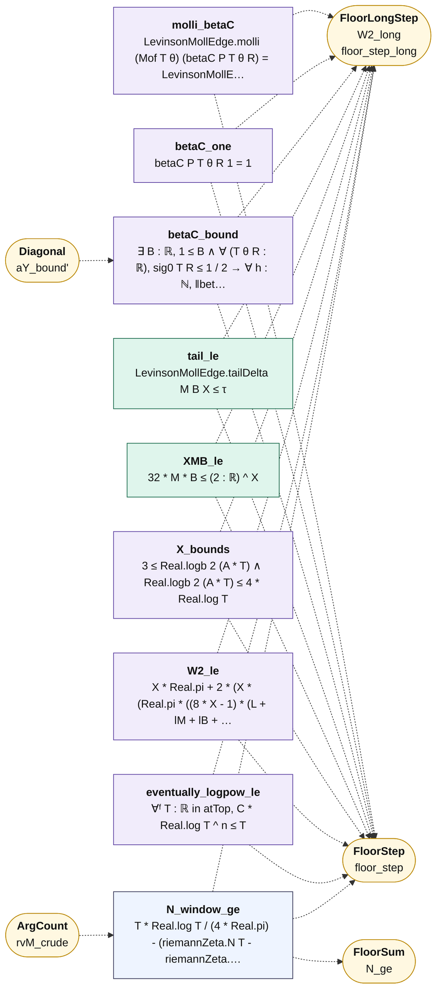

# `lean_stage3/Stage3/FloorStepSize.lean`

> **Read from the source text.** This file changed after the last `python3 utilities/lean_map.py --dump`, so the arrows on this page are names occurring in each proof and have not been confirmed by Lean.

# FloorStepSize — block S12 of `lean_stage3/design/stencil.md`, piece 5b, one height: the sizes. 2026-11-25.

9 theorems, 1 definition, 267 lines. 

**Imports:** [`Diagonal`](../lean_stage3/Diagonal.md), [`LevinsonWindowNear`](../lean_stage3/LevinsonWindowNear.md), [`Unsmooth`](../lean_stage3/Unsmooth.md)  
**Imported by:** [`FloorStep`](../lean_stage3/FloorStep.md)

## The picture



An arrow A → B reads "A is used in the proof of B". Green: counting, integers only. Violet: shape, analysis with no ζ. Blue: reads ζ. A name ending in ■ is an end: nothing else uses it. Red: contains `sorry`. Yellow: theorems in another file, counted; a dotted arrow crosses files. Definitions are not drawn; they are listed below the diagram.

## Definitions

<a name="FloorStep-betaC"></a>
### `FloorStep.betaC`

def · line 43

- **Is:** `` betaC (P : Polynomial ℝ) (T θ R : ℝ) (h : ℕ) : ℂ := if 1 ≤ h ∧ h ≤ Mof T θ then aY P T θ R h else 0 ``
- **Built from:** [`TwistedMoment.Mof`](../lean_stage3/TwistedMoment.md#TwistedMoment-Mof), [`TwistedMoment.aY`](../lean_stage3/TwistedMoment.md#TwistedMoment-aY)
- **Used by 5:** [`FloorLong.floor_step_long`](../lean_stage3/FloorLongStep.md#FloorLong-floor_step_long), [`FloorStep.floor_step`](../lean_stage3/FloorStep.md#FloorStep-floor_step), [`FloorStep.betaC_bound`](#FloorStep-betaC_bound), [`FloorStep.betaC_one`](#FloorStep-betaC_one), [`FloorStep.molli_betaC`](#FloorStep-molli_betaC)

## Theorems

<a name="FloorStep-molli_betaC"></a>
### `FloorStep.molli_betaC`

line 46 · arrows read from text

**Shape.** Uses real or complex analysis; nothing in it or beneath it reads ζ.

**Proves**

```lean
LevinsonMollEdge.molli (Mof T θ) (betaC P T θ R) = LevinsonMollEdge.molli (Mof T θ) (aY P T θ R)
```

**Needs** (its hypotheses)

  - `` P : Polynomial ℝ ``
  - `` T θ R : ℝ ``

**Fed by:** no theorem of this repo; it stands on Mathlib and the definitions below.

**Definitions its proof touches:** [`FloorStep.betaC`](#FloorStep-betaC), [`LevinsonMollEdge.molli`](../lean_stage3/LevinsonMollEdge.md#LevinsonMollEdge-molli), [`TwistedMoment.Mof`](../lean_stage3/TwistedMoment.md#TwistedMoment-Mof), [`TwistedMoment.aY`](../lean_stage3/TwistedMoment.md#TwistedMoment-aY)

**Feeds** (2 that use it)

  - [`FloorLong.floor_step_long`](../lean_stage3/FloorLongStep.md#FloorLong-floor_step_long) (FloorLongStep) — `` ∀ ε : ℝ, 0 < ε → ∃ T₀ : ℝ, ∀ T : ℝ, T₀ ≤ T → (riemannZeta.N T - riemannZeta.N (T / 2)) - Real.log (max 1 ((Operator.Dop (Real.log T) (cY P (Mof T θ) T… ``
  - [`FloorStep.floor_step`](../lean_stage3/FloorStep.md#FloorStep-floor_step) (FloorStep) — `` ∀ ε : ℝ, 0 < ε → ∃ T₀ : ℝ, ∀ T : ℝ, T₀ ≤ T → (riemannZeta.N T - riemannZeta.N (T / 2)) - Real.log (max 1 ((Operator.Dop (Real.log T) (cY P (Mof T θ) T… ``

<a name="FloorStep-betaC_one"></a>
### `FloorStep.betaC_one`

line 56 · arrows read from text

**Shape.** Uses real or complex analysis; nothing in it or beneath it reads ζ.

**Proves**

```lean
betaC P T θ R 1 = 1
```

**Needs** (its hypotheses)

  - `` P : Polynomial ℝ ``
  - `` hP1 : P.eval 1 = 1 ``
  - `` hM : 2 ≤ Mof T θ ``

**Fed by:** no theorem of this repo; it stands on Mathlib and the definitions below.

**Definitions its proof touches:** [`FloorStep.betaC`](#FloorStep-betaC), [`TwistedMoment.Mof`](../lean_stage3/TwistedMoment.md#TwistedMoment-Mof), [`TwistedMoment.aY`](../lean_stage3/TwistedMoment.md#TwistedMoment-aY)

**Feeds** (2 that use it)

  - [`FloorLong.floor_step_long`](../lean_stage3/FloorLongStep.md#FloorLong-floor_step_long) (FloorLongStep) — `` ∀ ε : ℝ, 0 < ε → ∃ T₀ : ℝ, ∀ T : ℝ, T₀ ≤ T → (riemannZeta.N T - riemannZeta.N (T / 2)) - Real.log (max 1 ((Operator.Dop (Real.log T) (cY P (Mof T θ) T… ``
  - [`FloorStep.floor_step`](../lean_stage3/FloorStep.md#FloorStep-floor_step) (FloorStep) — `` ∀ ε : ℝ, 0 < ε → ∃ T₀ : ℝ, ∀ T : ℝ, T₀ ≤ T → (riemannZeta.N T - riemannZeta.N (T / 2)) - Real.log (max 1 ((Operator.Dop (Real.log T) (cY P (Mof T θ) T… ``

<a name="FloorStep-betaC_bound"></a>
### `FloorStep.betaC_bound`

line 65 · arrows read from text

**Shape.** Uses real or complex analysis; nothing in it or beneath it reads ζ.

**Proves**

```lean
∃ B : ℝ, 1 ≤ B ∧ ∀ (T θ R : ℝ), sig0 T R ≤ 1 / 2 → ∀ h : ℕ, ‖betaC P T θ R h‖ ≤ B
```

**Needs** (its hypotheses)

  - `` P : Polynomial ℝ ``

**Fed by** (1 theorem its proof uses)

  - [`Diagonal.aY_bound'`](../lean_stage3/Diagonal.md#Diagonal-aY_bound-) (Diagonal) — `` ∃ B : ℝ, 0 ≤ B ∧ ∀ (T θ R : ℝ) (h : ℕ), 1 ≤ h → h ≤ Mof T θ → ‖aY P T θ R h‖ * (h : ℝ) ^ (-sig0 T R) ≤ B * (h : ℝ) ^ (-(1 / 2) : ℝ) ``

**Definitions its proof touches:** [`FloorStep.betaC`](#FloorStep-betaC), [`TwistedMoment.aY`](../lean_stage3/TwistedMoment.md#TwistedMoment-aY), [`TwistedMoment.sig0`](../lean_stage3/TwistedMoment.md#TwistedMoment-sig0)

**Feeds** (2 that use it)

  - [`FloorLong.floor_step_long`](../lean_stage3/FloorLongStep.md#FloorLong-floor_step_long) (FloorLongStep) — `` ∀ ε : ℝ, 0 < ε → ∃ T₀ : ℝ, ∀ T : ℝ, T₀ ≤ T → (riemannZeta.N T - riemannZeta.N (T / 2)) - Real.log (max 1 ((Operator.Dop (Real.log T) (cY P (Mof T θ) T… ``
  - [`FloorStep.floor_step`](../lean_stage3/FloorStep.md#FloorStep-floor_step) (FloorStep) — `` ∀ ε : ℝ, 0 < ε → ∃ T₀ : ℝ, ∀ T : ℝ, T₀ ≤ T → (riemannZeta.N T - riemannZeta.N (T / 2)) - Real.log (max 1 ((Operator.Dop (Real.log T) (cY P (Mof T θ) T… ``

<a name="FloorStep-tail_le"></a>
### `FloorStep.tail_le`

line 93 · arrows read from text

**Counting.** Integers only: nothing in its statement or proof, or in anything it rests on, uses analysis or ζ.

**Why.** `tailDelta ≤ τ` once `2^X = A T` with `64 (B + 1) ≤ A τ`, `M ≤ T`.

**Proves**

```lean
LevinsonMollEdge.tailDelta M B X ≤ τ
```

**Needs** (its hypotheses)

  - `` hB : 0 ≤ B ``
  - `` hτ : 0 < τ ``
  - `` hτ1 : τ ≤ 1 ``
  - `` hA : 64 * (B + 1) ≤ A * τ ``
  - `` hT : 1 ≤ T ``
  - `` hMT : (M : ℝ) ≤ T ``
  - `` hq : (2 : ℝ) ^ X = A * T ``

**Fed by:** no theorem of this repo; it stands on Mathlib and the definitions below.

**Definitions its proof touches:** [`LevinsonMollEdge.tailDelta`](../lean_stage3/LevinsonMollEdge.md#LevinsonMollEdge-tailDelta)

**Feeds** (2 that use it)

  - [`FloorLong.floor_step_long`](../lean_stage3/FloorLongStep.md#FloorLong-floor_step_long) (FloorLongStep) — `` ∀ ε : ℝ, 0 < ε → ∃ T₀ : ℝ, ∀ T : ℝ, T₀ ≤ T → (riemannZeta.N T - riemannZeta.N (T / 2)) - Real.log (max 1 ((Operator.Dop (Real.log T) (cY P (Mof T θ) T… ``
  - [`FloorStep.floor_step`](../lean_stage3/FloorStep.md#FloorStep-floor_step) (FloorStep) — `` ∀ ε : ℝ, 0 < ε → ∃ T₀ : ℝ, ∀ T : ℝ, T₀ ≤ T → (riemannZeta.N T - riemannZeta.N (T / 2)) - Real.log (max 1 ((Operator.Dop (Real.log T) (cY P (Mof T θ) T… ``

<a name="FloorStep-XMB_le"></a>
### `FloorStep.XMB_le`

line 117 · arrows read from text

**Counting.** Integers only: nothing in its statement or proof, or in anything it rests on, uses analysis or ζ.

**Why.** `32 M B ≤ 2^X` under the same choice.

**Proves**

```lean
32 * M * B ≤ (2 : ℝ) ^ X
```

**Needs** (its hypotheses)

  - `` hB : 0 ≤ B ``
  - `` hτ : 0 < τ ``
  - `` hτ1 : τ ≤ 1 ``
  - `` hA : 64 * (B + 1) ≤ A * τ ``
  - `` hMT : (M : ℝ) ≤ T ``
  - `` hq : (2 : ℝ) ^ X = A * T ``

**Fed by:** no theorem of this repo; it stands on Mathlib.

**Feeds** (2 that use it)

  - [`FloorLong.floor_step_long`](../lean_stage3/FloorLongStep.md#FloorLong-floor_step_long) (FloorLongStep) — `` ∀ ε : ℝ, 0 < ε → ∃ T₀ : ℝ, ∀ T : ℝ, T₀ ≤ T → (riemannZeta.N T - riemannZeta.N (T / 2)) - Real.log (max 1 ((Operator.Dop (Real.log T) (cY P (Mof T θ) T… ``
  - [`FloorStep.floor_step`](../lean_stage3/FloorStep.md#FloorStep-floor_step) (FloorStep) — `` ∀ ε : ℝ, 0 < ε → ∃ T₀ : ℝ, ∀ T : ℝ, T₀ ≤ T → (riemannZeta.N T - riemannZeta.N (T / 2)) - Real.log (max 1 ((Operator.Dop (Real.log T) (cY P (Mof T θ) T… ``

<a name="FloorStep-X_bounds"></a>
### `FloorStep.X_bounds`

line 133 · arrows read from text

**Shape.** Uses real or complex analysis; nothing in it or beneath it reads ζ.

**Why.** `X = log₂(A T)` lies in `[3, 4 log T]` once `8 ≤ A T` and `log A ≤ log T`.

**Proves**

```lean
3 ≤ Real.logb 2 (A * T) ∧ Real.logb 2 (A * T) ≤ 4 * Real.log T
```

**Needs** (its hypotheses)

  - `` hA : 1 ≤ A ``
  - `` hT : 1 ≤ T ``
  - `` h8 : 8 ≤ A * T ``
  - `` hAL : Real.log A ≤ Real.log T ``

**Fed by:** no theorem of this repo; it stands on Mathlib.

**Feeds** (2 that use it)

  - [`FloorLong.floor_step_long`](../lean_stage3/FloorLongStep.md#FloorLong-floor_step_long) (FloorLongStep) — `` ∀ ε : ℝ, 0 < ε → ∃ T₀ : ℝ, ∀ T : ℝ, T₀ ≤ T → (riemannZeta.N T - riemannZeta.N (T / 2)) - Real.log (max 1 ((Operator.Dop (Real.log T) (cY P (Mof T θ) T… ``
  - [`FloorStep.floor_step`](../lean_stage3/FloorStep.md#FloorStep-floor_step) (FloorStep) — `` ∀ ε : ℝ, 0 < ε → ∃ T₀ : ℝ, ∀ T : ℝ, T₀ ≤ T → (riemannZeta.N T - riemannZeta.N (T / 2)) - Real.log (max 1 ((Operator.Dop (Real.log T) (cY P (Mof T θ) T… ``

<a name="FloorStep-W2_le"></a>
### `FloorStep.W2_le`

line 148 · arrows read from text

**Shape.** Uses real or complex analysis; nothing in it or beneath it reads ζ.

**Why.** The window's polynomial edge terms, size `O(L³)`.

**Proves**

```lean
X * Real.pi + 2 * (X * (Real.pi * ((8 * X - 1) * (L + lM + lB + 8) + 1))) ≤ Real.pi * (12 + 256 * (10 + B)) * L ^ 3
```

**Needs** (its hypotheses)

  - `` hX3 : 3 ≤ X ``
  - `` hX : X ≤ 4 * L ``
  - `` hL : 1 ≤ L ``
  - `` hlM0 : 0 ≤ lM ``
  - `` hlM : lM ≤ L ``
  - `` hlB0 : 0 ≤ lB ``
  - `` hlB : lB ≤ B ``

**Fed by:** no theorem of this repo; it stands on Mathlib.

**Feeds** (2 that use it)

  - [`FloorLong.W2_long`](../lean_stage3/FloorLongStep.md#FloorLong-W2_long) (FloorLongStep) — `` X * Real.pi + 2 * (X * (Real.pi * ((8 * X - 1) * (L + lM + lB + 8) + 1))) ≤ Real.pi * ((12 + 256 * (10 + B)) * n ^ 3) * L ^ 3 ``
  - [`FloorStep.floor_step`](../lean_stage3/FloorStep.md#FloorStep-floor_step) (FloorStep) — `` ∀ ε : ℝ, 0 < ε → ∃ T₀ : ℝ, ∀ T : ℝ, T₀ ≤ T → (riemannZeta.N T - riemannZeta.N (T / 2)) - Real.log (max 1 ((Operator.Dop (Real.log T) (cY P (Mof T θ) T… ``

<a name="FloorStep-eventually_logpow_le"></a>
### `FloorStep.eventually_logpow_le`

line 176 · arrows read from text

**Shape.** Uses real or complex analysis; nothing in it or beneath it reads ζ.

**Why.** `C (log T)^n ≤ T` from some height on.

**Proves**

```lean
∀ᶠ T : ℝ in atTop, C * Real.log T ^ n ≤ T
```

**Needs** (its hypotheses)

  - `` C : ℝ ``
  - `` n : ℕ ``

**Fed by:** no theorem of this repo; it stands on Mathlib.

**Feeds** (2 that use it)

  - [`FloorLong.floor_step_long`](../lean_stage3/FloorLongStep.md#FloorLong-floor_step_long) (FloorLongStep) — `` ∀ ε : ℝ, 0 < ε → ∃ T₀ : ℝ, ∀ T : ℝ, T₀ ≤ T → (riemannZeta.N T - riemannZeta.N (T / 2)) - Real.log (max 1 ((Operator.Dop (Real.log T) (cY P (Mof T θ) T… ``
  - [`FloorStep.floor_step`](../lean_stage3/FloorStep.md#FloorStep-floor_step) (FloorStep) — `` ∀ ε : ℝ, 0 < ε → ∃ T₀ : ℝ, ∀ T : ℝ, T₀ ≤ T → (riemannZeta.N T - riemannZeta.N (T / 2)) - Real.log (max 1 ((Operator.Dop (Real.log T) (cY P (Mof T θ) T… ``

<a name="FloorStep-N_window_ge"></a>
### `FloorStep.N_window_ge`

line 196 · arrows read from text

**Reads ζ.** It, or something it rests on, uses the zeta function, its zeros or the Riemann hypothesis.

**Why.** Riemann–von Mangoldt on `[T/2, T]`. `T log T/(4π) − (N T − N(T/2)) ≤ T + 224 log T + 1396`.

**Proves**

```lean
T * Real.log T / (4 * Real.pi) - (riemannZeta.N T - riemannZeta.N (T / 2)) ≤ T + 224 * Real.log T + 1396
```

**Needs** (its hypotheses)

  - `` hT : 4 ≤ T ``

**Fed by** (1 theorem its proof uses)

  - [`ArgCount.rvM_crude`](../lean_stage3/ArgCount.md#ArgCount-rvM_crude) (ArgCount) — `` riemannZeta.Riemann_vonMangoldt_bound 112 0 698 ``

**Feeds** (3 that use it)

  - [`FloorLong.floor_step_long`](../lean_stage3/FloorLongStep.md#FloorLong-floor_step_long) (FloorLongStep) — `` ∀ ε : ℝ, 0 < ε → ∃ T₀ : ℝ, ∀ T : ℝ, T₀ ≤ T → (riemannZeta.N T - riemannZeta.N (T / 2)) - Real.log (max 1 ((Operator.Dop (Real.log T) (cY P (Mof T θ) T… ``
  - [`FloorStep.floor_step`](../lean_stage3/FloorStep.md#FloorStep-floor_step) (FloorStep) — `` ∀ ε : ℝ, 0 < ε → ∃ T₀ : ℝ, ∀ T : ℝ, T₀ ≤ T → (riemannZeta.N T - riemannZeta.N (T / 2)) - Real.log (max 1 ((Operator.Dop (Real.log T) (cY P (Mof T θ) T… ``
  - [`FloorSum.N_ge`](../lean_stage3/FloorSum.md#FloorSum-N_ge) (FloorSum) — `` ∀ᶠ T : ℝ in atTop, T * Real.log T / 20 ≤ riemannZeta.N T ``

