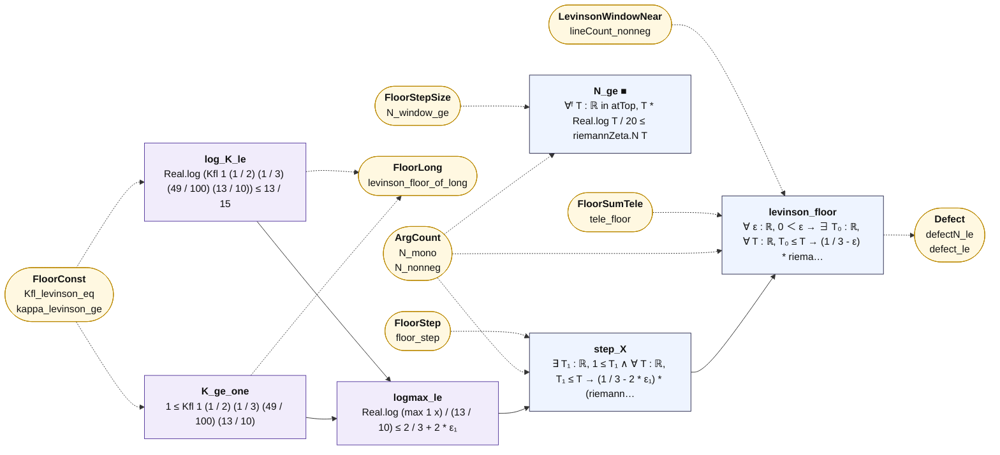

# `lean_stage3/Stage3/FloorSum.lean`

> **Read from the source text.** This file changed after the last `python3 utilities/lean_map.py --dump`, so the arrows on this page are names occurring in each proof and have not been confirmed by Lean.

# FloorSum — block S12 of `lean_stage3/design/stencil.md`, piece 5c, the sum: a positive proportion of the zeros on the line. 2026-11-25.

6 theorems, 0 definitions, 195 lines. 

**Imports:** [`FloorConst`](../lean_stage3/FloorConst.md), [`FloorStep`](../lean_stage3/FloorStep.md), [`FloorSumTele`](../lean_stage3/FloorSumTele.md)  
**Imported by:** [`Stage3`](../lean_stage3/Stage3.md), [`Defect`](../lean_stage3/Defect.md), [`FloorLong`](../lean_stage3/FloorLong.md), [`FloorQ`](../lean_stage3/FloorQ.md)

## The picture



An arrow A → B reads "A is used in the proof of B". Green: counting, integers only. Violet: shape, analysis with no ζ. Blue: reads ζ. A name ending in ■ is an end: nothing else uses it. Red: contains `sorry`. Yellow: theorems in another file, counted; a dotted arrow crosses files. Definitions are not drawn; they are listed below the diagram.

## Theorems

<a name="FloorSum-K_ge_one"></a>
### `FloorSum.K_ge_one`

line 47 · arrows read from text

**Shape.** Uses real or complex analysis; nothing in it or beneath it reads ζ.

**Why.** `1 ≤ K` at `P(x) = x`, `θ = 49/100`, `R = 13/10`.

**Proves**

```lean
1 ≤ Kfl 1 (1 / 2) (1 / 3) (49 / 100) (13 / 10)
```

**Fed by** (1 theorem its proof uses)

  - [`FloorConst.Kfl_levinson_eq`](../lean_stage3/FloorConst.md#FloorConst-Kfl_levinson_eq) (FloorConst) — `` Kfl 1 (1 / 2) (1 / 3) (49 / 100) (13 / 10) = -760154441 / 645918000 + 3405769 / 12918360 * Real.exp (13 / 10) ^ 2 ``

**Definitions its proof touches:** [`FloorConst.Kfl`](../lean_stage3/FloorConstLimit.md#FloorConst-Kfl)

**Feeds** (2 that use it)

  - [`FloorLong.levinson_floor_of_long`](../lean_stage3/FloorLong.md#FloorLong-levinson_floor_of_long) (FloorLong) — `` ∀ ε : ℝ, 0 < ε → ∃ T₀ : ℝ, ∀ T : ℝ, T₀ ≤ T → (1 / 3 - ε) * riemannZeta.N T ≤ (LineCount.lineCount T : ℝ) ``
  - [`FloorSum.logmax_le`](#FloorSum-logmax_le) — `` Real.log (max 1 x) / (13 / 10) ≤ 2 / 3 + 2 * ε₁ ``

<a name="FloorSum-log_K_le"></a>
### `FloorSum.log_K_le`

line 57 · arrows read from text

**Shape.** Uses real or complex analysis; nothing in it or beneath it reads ζ.

**Why.** `log K ≤ 13/15`, from `1/3 ≤ κ`.

**Proves**

```lean
Real.log (Kfl 1 (1 / 2) (1 / 3) (49 / 100) (13 / 10)) ≤ 13 / 15
```

**Fed by** (1 theorem its proof uses)

  - [`FloorConst.kappa_levinson_ge`](../lean_stage3/FloorConst.md#FloorConst-kappa_levinson_ge) (FloorConst) — `` 1 / 3 ≤ kappaL (49 / 100) (13 / 10) ``

**Definitions its proof touches:** [`FloorConst.kappaL`](../lean_stage3/FloorConst.md#FloorConst-kappaL), [`FloorConst.Kfl`](../lean_stage3/FloorConstLimit.md#FloorConst-Kfl)

**Feeds** (2 that use it)

  - [`FloorLong.levinson_floor_of_long`](../lean_stage3/FloorLong.md#FloorLong-levinson_floor_of_long) (FloorLong) — `` ∀ ε : ℝ, 0 < ε → ∃ T₀ : ℝ, ∀ T : ℝ, T₀ ≤ T → (1 / 3 - ε) * riemannZeta.N T ≤ (LineCount.lineCount T : ℝ) ``
  - [`FloorSum.logmax_le`](#FloorSum-logmax_le) — `` Real.log (max 1 x) / (13 / 10) ≤ 2 / 3 + 2 * ε₁ ``

<a name="FloorSum-logmax_le"></a>
### `FloorSum.logmax_le`

line 66 · arrows read from text

**Shape.** Uses real or complex analysis; nothing in it or beneath it reads ζ.

**Why.** The `max 1` and the `ε₁` of `floor_step`, priced: `log (max 1 x) / R ≤ 2/3 + 2ε₁`.

**Proves**

```lean
Real.log (max 1 x) / (13 / 10) ≤ 2 / 3 + 2 * ε₁
```

**Needs** (its hypotheses)

  - `` hε₁ : 0 < ε₁ ``
  - `` hx : x ≤ Kfl 1 (1 / 2) (1 / 3) (49 / 100) (13 / 10) + 2 * ε₁ ``

**Fed by** (2 theorems its proof uses)

  - [`FloorSum.K_ge_one`](#FloorSum-K_ge_one) — `` 1 ≤ Kfl 1 (1 / 2) (1 / 3) (49 / 100) (13 / 10) ``
  - [`FloorSum.log_K_le`](#FloorSum-log_K_le) — `` Real.log (Kfl 1 (1 / 2) (1 / 3) (49 / 100) (13 / 10)) ≤ 13 / 15 ``

**Definitions its proof touches:** [`FloorConst.Kfl`](../lean_stage3/FloorConstLimit.md#FloorConst-Kfl)

**Feeds** (1 that use it)

  - [`FloorSum.step_X`](#FloorSum-step_X) — `` ∃ T₁ : ℝ, 1 ≤ T₁ ∧ ∀ T : ℝ, T₁ ≤ T → (1 / 3 - 2 * ε₁) * (riemannZeta.N T - riemannZeta.N (T / 2)) - ε₁ * T * Real.log T ≤ (LineCount.lineCount T : ℝ) … ``

<a name="FloorSum-step_X"></a>
### `FloorSum.step_X`

line 88 · arrows read from text

**Reads ζ.** It, or something it rests on, uses the zeta function, its zeros or the Riemann hypothesis.

**Why.** The window floor at `P = X`. For `ε₁ > 0`, from some height `T₁ ≥ 1` on, `(1/3 − 2ε₁)(N T − N(T/2)) − ε₁ T log T ≤ lineCount T − lineCount(T/2)`.

**Proves**

```lean
∃ T₁ : ℝ, 1 ≤ T₁ ∧ ∀ T : ℝ, T₁ ≤ T → (1 / 3 - 2 * ε₁) * (riemannZeta.N T - riemannZeta.N (T / 2)) - ε₁ * T * Real.log T ≤ (LineCount.lineCount T : ℝ) - (LineCount.lineCount (T / 2) : ℝ)
```

**Needs** (its hypotheses)

  - `` hε₁ : 0 < ε₁ ``

**Fed by** (3 theorems its proof uses)

  - [`ArgCount.N_mono`](../lean_stage3/ArgCount.md#ArgCount-N_mono) (ArgCount) — `` riemannZeta.N T ≤ riemannZeta.N T' ``
  - [`FloorStep.floor_step`](../lean_stage3/FloorStep.md#FloorStep-floor_step) (FloorStep) — `` ∀ ε : ℝ, 0 < ε → ∃ T₀ : ℝ, ∀ T : ℝ, T₀ ≤ T → (riemannZeta.N T - riemannZeta.N (T / 2)) - Real.log (max 1 ((Operator.Dop (Real.log T) (cY P (Mof T θ) T… ``
  - [`FloorSum.logmax_le`](#FloorSum-logmax_le) — `` Real.log (max 1 x) / (13 / 10) ≤ 2 / 3 + 2 * ε₁ ``

**Definitions its proof touches:** [`FloorConst.Kfl`](../lean_stage3/FloorConstLimit.md#FloorConst-Kfl), [`LineCount.lineCount`](../lean_stage3/LineCount.md#LineCount-lineCount), [`Operator.Dop`](../lean_stage3/OperatorCauchy.md#Operator-Dop), [`TwistedMoment.Mof`](../lean_stage3/TwistedMoment.md#TwistedMoment-Mof), [`TwistedMoment.cY`](../lean_stage3/TwistedMoment.md#TwistedMoment-cY)

**Feeds** (1 that use it)

  - [`FloorSum.levinson_floor`](#FloorSum-levinson_floor) — `` ∀ ε : ℝ, 0 < ε → ∃ T₀ : ℝ, ∀ T : ℝ, T₀ ≤ T → (1 / 3 - ε) * riemannZeta.N T ≤ (LineCount.lineCount T : ℝ) ``

<a name="FloorSum-N_ge"></a>
### `FloorSum.N_ge`

line 114 · arrows read from text

**Reads ζ.** It, or something it rests on, uses the zeta function, its zeros or the Riemann hypothesis.

**Why.** `N T ≥ T log T / 20` eventually, from the Riemann–von Mangoldt bound in the tree.

**Proves**

```lean
∀ᶠ T : ℝ in atTop, T * Real.log T / 20 ≤ riemannZeta.N T
```

**Fed by** (2 theorems its proof uses)

  - [`ArgCount.N_nonneg`](../lean_stage3/ArgCount.md#ArgCount-N_nonneg) (ArgCount) — `` 0 ≤ riemannZeta.N T ``
  - [`FloorStep.N_window_ge`](../lean_stage3/FloorStepSize.md#FloorStep-N_window_ge) (FloorStepSize) — `` T * Real.log T / (4 * Real.pi) - (riemannZeta.N T - riemannZeta.N (T / 2)) ≤ T + 224 * Real.log T + 1396 ``

**Feeds:** nothing. It is an end.

<a name="FloorSum-levinson_floor"></a>
### `FloorSum.levinson_floor`

line 132 · arrows read from text

**Reads ζ.** It, or something it rests on, uses the zeta function, its zeros or the Riemann hypothesis.

**Why.** S12 piece 5c, Levinson's floor. At `P(x) = x`, `θ = 49/100`, `R = 13/10`: for every `ε > 0`, from some height on, at least `(1/3 − ε) N T` of the zeros of `ζ` with height in `(0, T]` lie on the critical line, counted with multiplicity.

**Proves**

```lean
∀ ε : ℝ, 0 < ε → ∃ T₀ : ℝ, ∀ T : ℝ, T₀ ≤ T → (1 / 3 - ε) * riemannZeta.N T ≤ (LineCount.lineCount T : ℝ)
```

**Fed by** (5 theorems its proof uses)

  - [`ArgCount.N_mono`](../lean_stage3/ArgCount.md#ArgCount-N_mono) (ArgCount) — `` riemannZeta.N T ≤ riemannZeta.N T' ``
  - [`ArgCount.N_nonneg`](../lean_stage3/ArgCount.md#ArgCount-N_nonneg) (ArgCount) — `` 0 ≤ riemannZeta.N T ``
  - [`FloorSum.step_X`](#FloorSum-step_X) — `` ∃ T₁ : ℝ, 1 ≤ T₁ ∧ ∀ T : ℝ, T₁ ≤ T → (1 / 3 - 2 * ε₁) * (riemannZeta.N T - riemannZeta.N (T / 2)) - ε₁ * T * Real.log T ≤ (LineCount.lineCount T : ℝ) … ``
  - [`FloorSum.tele_floor`](../lean_stage3/FloorSumTele.md#FloorSum-tele_floor) (FloorSumTele) — `` ∀ T : ℝ, T₁ ≤ T → c * (g T - g T₁) - 2 * e * T * Real.log T ≤ f T ``
  - [`LevinsonWindowNear.lineCount_nonneg`](../lean_stage3/LevinsonWindowNear.md#LevinsonWindowNear-lineCount_nonneg) (LevinsonWindowNear) — `` 0 ≤ lineCount T ``

**Definitions its proof touches:** [`LineCount.lineCount`](../lean_stage3/LineCount.md#LineCount-lineCount)

**Feeds** (2 that use it)

  - [`Defect.defectN_le`](../lean_stage3/Defect.md#Defect-defectN_le) (Defect) — `` ∀ ε : ℝ, 0 < ε → ∃ T₀ : ℝ, ∀ T : ℝ, T₀ ≤ T → defectN T ≤ (2 / 3 + ε) * riemannZeta.N T ``
  - [`Defect.defect_le`](../lean_stage3/Defect.md#Defect-defect_le) (Defect) — `` ∀ ε : ℝ, 0 < ε → ∃ T₀ : ℝ, ∀ T : ℝ, T₀ ≤ T → (defect T : ℝ) ≤ (2 / 3 + ε) * (allCount T : ℝ) ``

