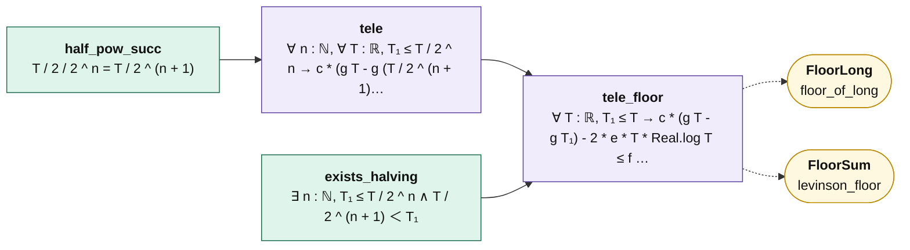

# `lean_stage3/Stage3/FloorSumTele.lean`

> **Read from the source text.** This file changed after the last `python3 utilities/lean_map.py --dump`, so the arrows on this page are names occurring in each proof and have not been confirmed by Lean.

# FloorSumTele — block S12 of `lean_stage3/design/stencil.md`, piece 5c, the sum: the telescoping over halvings. 2026-11-25.

4 theorems, 0 definitions, 115 lines. 

**Imports:** nothing in this tree  
**Imported by:** [`FloorSum`](../lean_stage3/FloorSum.md)

## The picture



An arrow A → B reads "A is used in the proof of B". Green: counting, integers only. Violet: shape, analysis with no ζ. Blue: reads ζ. A name ending in ■ is an end: nothing else uses it. Red: contains `sorry`. Yellow: theorems in another file, counted; a dotted arrow crosses files. Definitions are not drawn; they are listed below the diagram.

## Theorems

<a name="FloorSum-half_pow_succ"></a>
### `FloorSum.half_pow_succ`

line 24 · arrows read from text

**Counting.** Integers only: nothing in its statement or proof, or in anything it rests on, uses analysis or ζ.

**Proves**

```lean
T / 2 / 2 ^ n = T / 2 ^ (n + 1)
```

**Needs** (its hypotheses)

  - `` T : ℝ ``
  - `` n : ℕ ``

**Fed by:** no theorem of this repo; it stands on Mathlib.

**Feeds** (1 that use it)

  - [`FloorSum.tele`](#FloorSum-tele) — `` ∀ n : ℕ, ∀ T : ℝ, T₁ ≤ T / 2 ^ n → c * (g T - g (T / 2 ^ (n + 1))) - 2 * e * T * Real.log T ≤ f T - f (T / 2 ^ (n + 1)) ``

<a name="FloorSum-tele"></a>
### `FloorSum.tele`

line 28 · arrows read from text

**Shape.** Uses real or complex analysis; nothing in it or beneath it reads ζ.

**Why.** The telescoping. The window floors at `T, T/2, …, T/2^n` sum, with error `2 e T log T`.

**Proves**

```lean
∀ n : ℕ, ∀ T : ℝ, T₁ ≤ T / 2 ^ n → c * (g T - g (T / 2 ^ (n + 1))) - 2 * e * T * Real.log T ≤ f T - f (T / 2 ^ (n + 1))
```

**Needs** (its hypotheses)

  - `` hT₁ : 1 ≤ T₁ ``
  - `` he : 0 ≤ e ``
  - `` hstep : ∀ T : ℝ, T₁ ≤ T → c * (g T - g (T / 2)) - e * T * Real.log T ≤ f T - f (T / 2) ``

**Fed by** (1 theorem its proof uses)

  - [`FloorSum.half_pow_succ`](#FloorSum-half_pow_succ) — `` T / 2 / 2 ^ n = T / 2 ^ (n + 1) ``

**Feeds** (1 that use it)

  - [`FloorSum.tele_floor`](#FloorSum-tele_floor) — `` ∀ T : ℝ, T₁ ≤ T → c * (g T - g T₁) - 2 * e * T * Real.log T ≤ f T ``

<a name="FloorSum-exists_halving"></a>
### `FloorSum.exists_halving`

line 67 · arrows read from text

**Counting.** Integers only: nothing in its statement or proof, or in anything it rests on, uses analysis or ζ.

**Why.** The bottom of the halvings.

**Proves**

```lean
∃ n : ℕ, T₁ ≤ T / 2 ^ n ∧ T / 2 ^ (n + 1) < T₁
```

**Needs** (its hypotheses)

  - `` hT₁ : 0 < T₁ ``
  - `` hT : T₁ ≤ T ``

**Fed by:** no theorem of this repo; it stands on Mathlib.

**Feeds** (1 that use it)

  - [`FloorSum.tele_floor`](#FloorSum-tele_floor) — `` ∀ T : ℝ, T₁ ≤ T → c * (g T - g T₁) - 2 * e * T * Real.log T ≤ f T ``

<a name="FloorSum-tele_floor"></a>
### `FloorSum.tele_floor`

line 90 · arrows read from text

**Shape.** Uses real or complex analysis; nothing in it or beneath it reads ζ.

**Why.** The floor from the window floors.

**Proves**

```lean
∀ T : ℝ, T₁ ≤ T → c * (g T - g T₁) - 2 * e * T * Real.log T ≤ f T
```

**Needs** (its hypotheses)

  - `` hT₁ : 1 ≤ T₁ ``
  - `` he : 0 ≤ e ``
  - `` hc : 0 ≤ c ``
  - `` hf : ∀ T : ℝ, 0 ≤ f T ``
  - `` hg : Monotone g ``
  - `` hstep : ∀ T : ℝ, T₁ ≤ T → c * (g T - g (T / 2)) - e * T * Real.log T ≤ f T - f (T / 2) ``

**Fed by** (2 theorems its proof uses)

  - [`FloorSum.exists_halving`](#FloorSum-exists_halving) — `` ∃ n : ℕ, T₁ ≤ T / 2 ^ n ∧ T / 2 ^ (n + 1) < T₁ ``
  - [`FloorSum.tele`](#FloorSum-tele) — `` ∀ n : ℕ, ∀ T : ℝ, T₁ ≤ T / 2 ^ n → c * (g T - g (T / 2 ^ (n + 1))) - 2 * e * T * Real.log T ≤ f T - f (T / 2 ^ (n + 1)) ``

**Feeds** (2 that use it)

  - [`FloorLong.floor_of_long`](../lean_stage3/FloorLong.md#FloorLong-floor_of_long) (FloorLong) — `` ∀ ε : ℝ, 0 < ε → ∃ T₀ : ℝ, ∀ T : ℝ, T₀ ≤ T → (1 - Real.log (max 1 (Kfl (Ar P) (Br P) (Cr P) θ R)) / R - ε) * riemannZeta.N T ≤ (LineCount.lineCount T … ``
  - [`FloorSum.levinson_floor`](../lean_stage3/FloorSum.md#FloorSum-levinson_floor) (FloorSum) — `` ∀ ε : ℝ, 0 < ε → ∃ T₀ : ℝ, ∀ T : ℝ, T₀ ≤ T → (1 / 3 - ε) * riemannZeta.N T ≤ (LineCount.lineCount T : ℝ) ``

