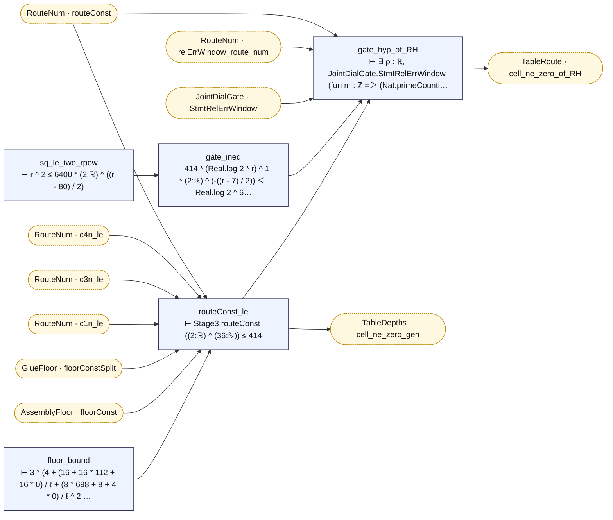

# `lean_stage3/Stage3/GateEval.lean`

**What it does** (its own header): GateEval — block E9 of `lean_stage3/design/joints.md`. 2026-11-22. The table gate's own inequality, evaluated on the explicit-formula route at the floor `x₀ = 2^36` and depth six.

**Imports:** [`RouteNum`](../lean_stage3/RouteNum.md).
**Imported by:** [`Stage3`](../lean_stage3/Stage3.md), [`TableRoute`](../lean_stage3/TableRoute.md).

Blue: theorem. Green: a theorem nothing else uses (an end). Dashed white: connects to nothing. Grey: definition. Red: contains `sorry`. Yellow: in another file. An arrow A → B reads "A is used by B".

## Every declaration

| declaration | proves (output) | needs (input) | why (its own docstring) | uses | used by |
|---|---|---|---|---|---|
| `GateEval.floor_bound` theorem, line 30 | 3 * (4 + (16 + 16 * 112 + 16 * 0) / ℓ + (8 * 698 + 8 + 4 * 0) / ℓ ^ 2 + 18 * c1 / ((2:ℝ) ^ (36:ℕ) * (2:ℝ) ^ (18:ℕ)) + c3 / ((2:ℝ) ^ (18:ℕ) * ℓ) + c4 * (1 / (2:ℝ) ^ (9:ℕ)) / (2:ℝ) ^ (18:ℕ)) + 13 ≤ 414 | hc1' : c1 ≤ 88216610000; hc3' : c3 ≤ 15; hc4' : c4 ≤ 6468930000; hℓ : 24.95 ≤ ℓ | — | — | `GateEval.routeConst_le` |
| `GateEval.routeConst_le` theorem, line 56 | Stage3.routeConst ((2:ℝ) ^ (36:ℕ)) ≤ 414 | — | — | `Stage3.floorConst`, `GateEval.floor_bound`, `Stage3.floorConstSplit`, `RouteNum.c1n_le`, `RouteNum.c3n_le`, `RouteNum.c4n_le`, `Stage3.routeConst` | `GateEval.gate_hyp_of_RH`, `TableDepths.cell_ne_zero_gen` |
| `GateEval.sq_le_two_rpow` theorem, line 77 | r ^ 2 ≤ 6400 * (2:ℝ) ^ ((r - 80) / 2) | hr : 80 ≤ r | — | — | `GateEval.gate_ineq` |
| `GateEval.gate_ineq` theorem, line 99 | 414 * (Real.log 2 * r) ^ 1 * (2:ℝ) ^ (-((r - 7) / 2)) &lt; Real.log 2 ^ 6 / (2 * r * 3 ^ 7) | hr : 80 ≤ r | — | `GateEval.sq_le_two_rpow` | `GateEval.gate_hyp_of_RH` |
| `GateEval.gate_hyp_of_RH` theorem, line 145 | ∃ ρ : ℝ, JointDialGate.StmtRelErrWindow (fun m : ℤ =&gt; (Nat.primeCounting ⌊(2 : ℝ) ^ (m : ℝ)⌋₊ : ℝ)) (fun m : ℤ =&gt; 2 / Real.log 2 + ∫ t in (1 : ℝ)..(m : ℝ), Real.exp (Real.log 2 * t) / t) r (6 + 1) ρ ∧ ρ &lt; Real.log 2 ^ 6 / (2 * r * 3 ^ (6 + 1)) | hRH : RiemannHypothesis; hr : 80 ≤ r | The gate's two hypotheses, under RH, at depth six from row 80. | `GateEval.gate_ineq`, `GateEval.routeConst_le`, `JointDialGate.StmtRelErrWindow`, `RouteNum.relErrWindow_route_num`, `Stage3.routeConst` | `TableRoute.cell_ne_zero_of_RH` |
