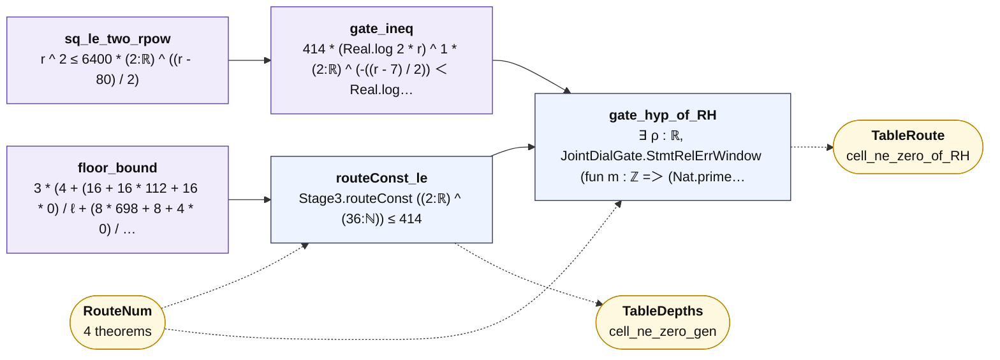

# `lean_stage3/Stage3/GateEval.lean`

GateEval — block E9 of `lean_stage3/design/joints.md`. 2026-11-22. The table gate's own inequality, evaluated on the explicit-formula route at the floor `x₀ = 2^36` and depth six.

5 theorems, 0 definitions, 195 lines. Arrows are Lean's own record of what each proof uses.

**Imports:** [`RouteNum`](../lean_stage3/RouteNum.md)  
**Imported by:** [`Stage3`](../lean_stage3/Stage3.md), [`TableRoute`](../lean_stage3/TableRoute.md)

## The picture



An arrow A → B reads "A is used in the proof of B". Green: counting, integers only. Violet: shape, analysis with no ζ. Blue: reads ζ. A name ending in ■ is an end: nothing else uses it. Red: contains `sorry`. Yellow: theorems in another file, counted; a dotted arrow crosses files. Definitions are not drawn; they are listed below the diagram.

## Theorems

<a name="GateEval-floor_bound"></a>
### `GateEval.floor_bound`

line 30

**Shape.** Uses real or complex analysis; nothing in it or beneath it reads ζ.

**Proves**

```lean
3 * (4 + (16 + 16 * 112 + 16 * 0) / ℓ + (8 * 698 + 8 + 4 * 0) / ℓ ^ 2 + 18 * c1 / ((2:ℝ) ^ (36:ℕ) * (2:ℝ) ^ (18:ℕ)) + c3 / ((2:ℝ) ^ (18:ℕ) * ℓ) + c4 * (1 / (2:ℝ) ^ (9:ℕ)) / (2:ℝ) ^ (18:ℕ)) + 13 ≤ 414
```

**Needs** (its hypotheses)

  - `` hc1' : c1 ≤ 88216610000 ``
  - `` hc3' : c3 ≤ 15 ``
  - `` hc4' : c4 ≤ 6468930000 ``
  - `` hℓ : 24.95 ≤ ℓ ``

**Fed by:** no theorem of this repo; it stands on Mathlib.

**Feeds** (1 that use it)

  - [`GateEval.routeConst_le`](#GateEval-routeConst_le) — `` Stage3.routeConst ((2:ℝ) ^ (36:ℕ)) ≤ 414 ``

<a name="GateEval-routeConst_le"></a>
### `GateEval.routeConst_le`

line 56

**Reads ζ.** It, or something it rests on, uses the zeta function, its zeros or the Riemann hypothesis.

**Proves**

```lean
Stage3.routeConst ((2:ℝ) ^ (36:ℕ)) ≤ 414
```

**Stated with:** [`Stage3.routeConst`](../lean_stage3/RouteNum.md#Stage3-routeConst)

**Fed by** (4 theorems its proof uses)

  - [`GateEval.floor_bound`](#GateEval-floor_bound) — `` 3 * (4 + (16 + 16 * 112 + 16 * 0) / ℓ + (8 * 698 + 8 + 4 * 0) / ℓ ^ 2 + 18 * c1 / ((2:ℝ) ^ (36:ℕ) * (2:ℝ) ^ (18:ℕ)) + c3 / ((2:ℝ) ^ (18:ℕ) * ℓ) + c4 *… ``
  - [`RouteNum.c1n_le`](../lean_stage3/RouteNum.md#RouteNum-c1n_le) (RouteNum) — `` Glue.c1n ≤ 88216610000 ``
  - [`RouteNum.c3n_le`](../lean_stage3/RouteNum.md#RouteNum-c3n_le) (RouteNum) — `` Glue.c3n ≤ 15 ``
  - [`RouteNum.c4n_le`](../lean_stage3/RouteNum.md#RouteNum-c4n_le) (RouteNum) — `` Glue.c4n ≤ 6468930000 ``

**Definitions its proof touches:** [`Stage3.floorConst`](../lean_stage3/AssemblyFloor.md#Stage3-floorConst), [`Stage3.floorConstSplit`](../lean_stage3/GlueFloor.md#Stage3-floorConstSplit), [`Glue.c1n`](../lean_stage3/GlueNum.md#Glue-c1n), [`Glue.c3n`](../lean_stage3/GlueNum.md#Glue-c3n), [`Glue.c4n`](../lean_stage3/GlueNum.md#Glue-c4n)

**Feeds** (2 that use it)

  - [`GateEval.gate_hyp_of_RH`](#GateEval-gate_hyp_of_RH) — `` ∃ ρ : ℝ, JointDialGate.StmtRelErrWindow (fun m : ℤ => (Nat.primeCounting ⌊(2 : ℝ) ^ (m : ℝ)⌋₊ : ℝ)) (fun m : ℤ => 2 / Real.log 2 + ∫ t in (1 : ℝ)..(m … ``
  - [`TableDepths.cell_ne_zero_gen`](../lean_stage3/TableDepths.md#TableDepths-cell_ne_zero_gen) (TableDepths) — `` Construction.tableFrom TableRoute.rowN r d ≠ 0 ``

<a name="GateEval-sq_le_two_rpow"></a>
### `GateEval.sq_le_two_rpow`

line 77

**Shape.** Uses real or complex analysis; nothing in it or beneath it reads ζ.

**Proves**

```lean
r ^ 2 ≤ 6400 * (2:ℝ) ^ ((r - 80) / 2)
```

**Needs** (its hypotheses)

  - `` hr : 80 ≤ r ``

**Fed by:** no theorem of this repo; it stands on Mathlib.

**Feeds** (1 that use it)

  - [`GateEval.gate_ineq`](#GateEval-gate_ineq) — `` 414 * (Real.log 2 * r) ^ 1 * (2:ℝ) ^ (-((r - 7) / 2)) < Real.log 2 ^ 6 / (2 * r * 3 ^ 7) ``

<a name="GateEval-gate_ineq"></a>
### `GateEval.gate_ineq`

line 99

**Shape.** Uses real or complex analysis; nothing in it or beneath it reads ζ.

**Proves**

```lean
414 * (Real.log 2 * r) ^ 1 * (2:ℝ) ^ (-((r - 7) / 2)) < Real.log 2 ^ 6 / (2 * r * 3 ^ 7)
```

**Needs** (its hypotheses)

  - `` hr : 80 ≤ r ``

**Fed by** (1 theorem its proof uses)

  - [`GateEval.sq_le_two_rpow`](#GateEval-sq_le_two_rpow) — `` r ^ 2 ≤ 6400 * (2:ℝ) ^ ((r - 80) / 2) ``

**Feeds** (1 that use it)

  - [`GateEval.gate_hyp_of_RH`](#GateEval-gate_hyp_of_RH) — `` ∃ ρ : ℝ, JointDialGate.StmtRelErrWindow (fun m : ℤ => (Nat.primeCounting ⌊(2 : ℝ) ^ (m : ℝ)⌋₊ : ℝ)) (fun m : ℤ => 2 / Real.log 2 + ∫ t in (1 : ℝ)..(m … ``

<a name="GateEval-gate_hyp_of_RH"></a>
### `GateEval.gate_hyp_of_RH`

line 145

**Reads ζ.** It, or something it rests on, uses the zeta function, its zeros or the Riemann hypothesis.

**Why.** The gate's two hypotheses, under RH, at depth six from row 80.

**Proves**

```lean
∃ ρ : ℝ, JointDialGate.StmtRelErrWindow (fun m : ℤ => (Nat.primeCounting ⌊(2 : ℝ) ^ (m : ℝ)⌋₊ : ℝ)) (fun m : ℤ => 2 / Real.log 2 + ∫ t in (1 : ℝ)..(m : ℝ), Real.exp (Real.log 2 * t) / t) r (6 + 1) ρ ∧ ρ < Real.log 2 ^ 6 / (2 * r * 3 ^ (6 + 1))
```

**Needs** (its hypotheses)

  - `` hRH : RiemannHypothesis ``
  - `` hr : 80 ≤ r ``

**Stated with:** [`JointDialGate.StmtRelErrWindow`](../lean_stage3/JointDialGate.md#JointDialGate-StmtRelErrWindow)

**Fed by** (3 theorems its proof uses)

  - [`GateEval.gate_ineq`](#GateEval-gate_ineq) — `` 414 * (Real.log 2 * r) ^ 1 * (2:ℝ) ^ (-((r - 7) / 2)) < Real.log 2 ^ 6 / (2 * r * 3 ^ 7) ``
  - [`GateEval.routeConst_le`](#GateEval-routeConst_le) — `` Stage3.routeConst ((2:ℝ) ^ (36:ℕ)) ≤ 414 ``
  - [`RouteNum.relErrWindow_route_num`](../lean_stage3/RouteNum.md#RouteNum-relErrWindow_route_num) (RouteNum) — `` JointDialGate.StmtRelErrWindow (fun m : ℤ => (Nat.primeCounting ⌊(2 : ℝ) ^ (m : ℝ)⌋₊ : ℝ)) (fun m : ℤ => 2 / Real.log 2 + ∫ t in (1 : ℝ)..(m : ℝ), Rea… ``

**Definitions its proof touches:** [`Stage3.routeConst`](../lean_stage3/RouteNum.md#Stage3-routeConst)

**Feeds** (1 that use it)

  - [`TableRoute.cell_ne_zero_of_RH`](../lean_stage3/TableRoute.md#TableRoute-cell_ne_zero_of_RH) (TableRoute) — `` Construction.tableFrom rowN r 6 ≠ 0 ``

