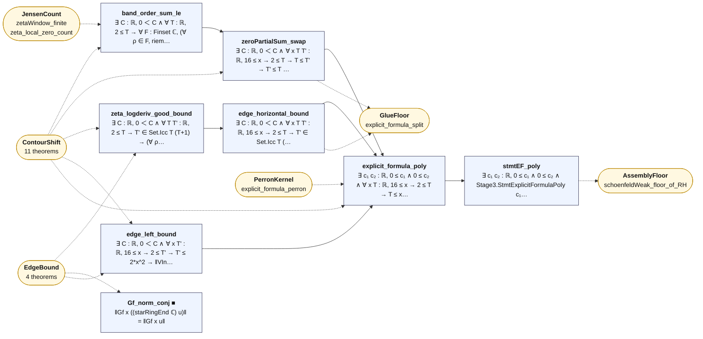

# `lean_stage3/Stage3/Glue.lean`

# The glue — assembling StmtExplicitFormula from the four slices Pieces, in build order: - the band count and the `zeroPartialSum` swap (`T′ → T`), - the edge-integral estimates (S3's pointwise bounds integrated), - the rectangle-edge splitting matching S1's line integral, - the final assembly in the `T ≤ x²` regime + the consumer patch.

8 theorems, 1 definition, 1208 lines. Arrows are Lean's own record of what each proof uses.

**Imports:** [`EdgeBound`](../lean_stage3/EdgeBound.md)  
**Imported by:** [`Stage3`](../lean_stage3/Stage3.md), [`AssemblyFloor`](../lean_stage3/AssemblyFloor.md)

## The picture



An arrow A → B reads "A is used in the proof of B". Green: counting, integers only. Violet: shape, analysis with no ζ. Blue: reads ζ. A name ending in ■ is an end: nothing else uses it. Red: contains `sorry`. Yellow: theorems in another file, counted; a dotted arrow crosses files. Definitions are not drawn; they are listed below the diagram.

## Definitions

<a name="Glue-Gf"></a>
### `Glue.Gf`

def · line 347

The contour integrand of the explicit formula.

- **Is:** `` Gf (x : ℝ) : ℂ → ℂ := fun s ↦ (- deriv riemannZeta s / riemannZeta s) * ((x:ℝ):ℂ) ^ s / s ``
- **Used by 12:** [`ExplicitLeft.edge_left_any`](../lean_stage3/ExplicitLeft.md#ExplicitLeft-edge_left_any), [`ExplicitLeft.explicit_formula_left`](../lean_stage3/ExplicitLeft.md#ExplicitLeft-explicit_formula_left), [`Glue.Gf_norm_conj`](#Glue-Gf_norm_conj), [`Glue.edge_horizontal_bound`](#Glue-edge_horizontal_bound), [`Glue.edge_left_bound`](#Glue-edge_left_bound), [`Glue.explicit_formula_poly`](#Glue-explicit_formula_poly), [`Glue.edge_left_sharp`](../lean_stage3/GlueFloor.md#Glue-edge_left_sharp), [`Glue.explicit_formula_split`](../lean_stage3/GlueFloor.md#Glue-explicit_formula_split), [`Glue.edge_horizontal_bound_num`](../lean_stage3/GlueNum.md#Glue-edge_horizontal_bound_num), [`Glue.edge_left_sharp_num`](../lean_stage3/GlueNum.md#Glue-edge_left_sharp_num), [`Glue.explicit_formula_split_num`](../lean_stage3/GlueNum.md#Glue-explicit_formula_split_num), [`LeftSmooth.left_edge_bound`](../lean_stage3/LeftSmooth.md#LeftSmooth-left_edge_bound)

## Theorems

<a name="Glue-band_order_sum_le"></a>
### `Glue.band_order_sum_le`

line 19

**Reads ζ.** It, or something it rests on, uses the zeta function, its zeros or the Riemann hypothesis.

**Why.** The band count: any finite set of strip zeros with `|im|` in `[T, T+1]` has total multiplicity `≤ C·log T` — two windows per sign, reflection for the left half, conjugation for the negative sign.

**Proves**

```lean
∃ C : ℝ, 0 < C ∧ ∀ T : ℝ, 2 ≤ T → ∀ F : Finset ℂ, (∀ ρ ∈ F, riemannZeta ρ = 0 ∧ (0 < ρ.re ∧ ρ.re < 1) ∧ T ≤ |ρ.im| ∧ |ρ.im| ≤ T + 1) → (∑ ρ ∈ F, (analyticOrderNatAt riemannZeta ρ : ℝ)) ≤ C * Real.log T
```

**Fed by** (5 theorems its proof uses)

  - [`ContourShift.mem_zetaWindow`](../lean_stage3/ContourShift.md#ContourShift-mem_zetaWindow) (ContourShift) — `` ρ ∈ Stage3.zetaWindow T₀ ``
  - [`ContourShift.zeta_order_conj`](../lean_stage3/ContourShift.md#ContourShift-zeta_order_conj) (ContourShift) — `` analyticOrderNatAt riemannZeta ((starRingEnd ℂ) ρ) = analyticOrderNatAt riemannZeta ρ ``
  - [`ContourShift.zeta_order_reflect`](../lean_stage3/ContourShift.md#ContourShift-zeta_order_reflect) (ContourShift) — `` analyticOrderNatAt riemannZeta (1 - (starRingEnd ℂ) ρ) = analyticOrderNatAt riemannZeta ρ ``
  - [`Stage3.zetaWindow_finite`](../lean_stage3/JensenCount.md#Stage3-zetaWindow_finite) (JensenCount) — `` (zetaWindow T).Finite ``
  - [`Stage3.zeta_local_zero_count`](../lean_stage3/JensenCount.md#Stage3-zeta_local_zero_count) (JensenCount) — `` ∑ ρ ∈ (zetaWindow_finite hT).toFinset, (analyticOrderNatAt ζ ρ : ℝ) ≤ 15 * Real.log T + 73 ``

**Definitions its proof touches:** [`Stage3.zetaWindow`](../lean_stage3/JensenCount.md#Stage3-zetaWindow)

**Feeds** (1 that use it)

  - [`Glue.zeroPartialSum_swap`](#Glue-zeroPartialSum_swap) — `` ∃ C : ℝ, 0 < C ∧ ∀ x T T' : ℝ, 16 ≤ x → 2 ≤ T → T ≤ T' → T' ≤ T + 1 → ‖Stage3.zeroPartialSum x T' - Stage3.zeroPartialSum x T‖ ≤ C * x * Real.log T / … ``

<a name="Glue-zeroPartialSum_swap"></a>
### `Glue.zeroPartialSum_swap`

line 242

**Reads ζ.** It, or something it rests on, uses the zeta function, its zeros or the Riemann hypothesis.

**Why.** The swap: moving the zero sum from a height `T′ ∈ [T, T+1]` back to `T` costs `≤ C·x·log T / T`.

**Proves**

```lean
∃ C : ℝ, 0 < C ∧ ∀ x T T' : ℝ, 16 ≤ x → 2 ≤ T → T ≤ T' → T' ≤ T + 1 → ‖Stage3.zeroPartialSum x T' - Stage3.zeroPartialSum x T‖ ≤ C * x * Real.log T / T
```

**Stated with:** [`Stage3.zeroPartialSum`](../lean_stage3/Assembly.md#Stage3-zeroPartialSum)

**Fed by** (4 theorems its proof uses)

  - [`ContourShift.zeroPartialSum_eq_sum`](../lean_stage3/ContourShift.md#ContourShift-zeroPartialSum_eq_sum) (ContourShift) — `` Stage3.zeroPartialSum x T' = ∑ p ∈ ZF, ((analyticOrderNatAt riemannZeta p : ℂ) * ((x : ℂ) ^ p / p)) ``
  - [`ContourShift.zeta_ne_zero_of_re_mem`](../lean_stage3/ContourShift.md#ContourShift-zeta_ne_zero_of_re_mem) (ContourShift) — `` riemannZeta w ≠ 0 ``
  - [`ContourShift.zeta_zeros_rectangle_finite`](../lean_stage3/ContourShift.md#ContourShift-zeta_zeros_rectangle_finite) (ContourShift) — `` {ρ : ℂ | riemannZeta ρ = 0 ∧ ρ ∈ Rectangle z w}.Finite ``
  - [`Glue.band_order_sum_le`](#Glue-band_order_sum_le) — `` ∃ C : ℝ, 0 < C ∧ ∀ T : ℝ, 2 ≤ T → ∀ F : Finset ℂ, (∀ ρ ∈ F, riemannZeta ρ = 0 ∧ (0 < ρ.re ∧ ρ.re < 1) ∧ T ≤ |ρ.im| ∧ |ρ.im| ≤ T + 1) → (∑ ρ ∈ F, (anal… ``

**Feeds** (2 that use it)

  - [`Glue.explicit_formula_poly`](#Glue-explicit_formula_poly) — `` ∃ c₁ c₂ : ℝ, 0 ≤ c₁ ∧ 0 ≤ c₂ ∧ ∀ x T : ℝ, 16 ≤ x → 2 ≤ T → T ≤ x^2 → ‖(Chebyshev.psi x : ℂ) - (x:ℂ) + Stage3.zeroPartialSum x T‖ ≤ c₁ * x * Real.log (… ``
  - [`Glue.explicit_formula_split`](../lean_stage3/GlueFloor.md#Glue-explicit_formula_split) (GlueFloor) — `` ∃ c₁ c₃ c₄ : ℝ, 0 ≤ c₁ ∧ 0 ≤ c₃ ∧ 0 ≤ c₄ ∧ ∀ x T : ℝ, 16 ≤ x → 2 ≤ T → T ≤ x^2 → ‖(Chebyshev.psi x : ℂ) - (x:ℂ) + Stage3.zeroPartialSum x T‖ ≤ c₁ * x … ``

<a name="Glue-zeta_logderiv_good_bound"></a>
### `Glue.zeta_logderiv_good_bound`

line 351

**Reads ζ.** It, or something it rests on, uses the zeta function, its zeros or the Riemann hypothesis.

**Why.** The pointwise good-height bound, both signs of the height.

**Proves**

```lean
∃ C : ℝ, 0 < C ∧ ∀ T T' : ℝ, 2 ≤ T → T' ∈ Set.Icc T (T+1) → (∀ ρ : ℂ, riemannZeta ρ = 0 → 0 < ρ.re → ContourShift.zeroGap T ≤ |ρ.im - T'|) → ∀ u : ℂ, |u.im| = T' → -1/4 ≤ u.re → u.re ≤ 2 → ‖deriv riemannZeta u / riemannZeta u‖ ≤ C * Real.log T ^ 2
```

**Stated with:** [`ContourShift.zeroGap`](../lean_stage3/ContourShift.md#ContourShift-zeroGap)

**Fed by** (7 theorems its proof uses)

  - [`ContourShift.zeroGap_le`](../lean_stage3/ContourShift.md#ContourShift-zeroGap_le) (ContourShift) — `` zeroGap T ≤ 9/10 ``
  - [`ContourShift.zeroGap_pos`](../lean_stage3/ContourShift.md#ContourShift-zeroGap_pos) (ContourShift) — `` 0 < zeroGap T ``
  - [`ContourShift.zeta_ne_zero_of_re_mem`](../lean_stage3/ContourShift.md#ContourShift-zeta_ne_zero_of_re_mem) (ContourShift) — `` riemannZeta w ≠ 0 ``
  - [`EdgeBound.ball_zero_shape`](../lean_stage3/EdgeBound.md#EdgeBound-ball_zero_shape) (EdgeBound) — `` riemannZeta w = 0 ∧ (0 < w.re ∧ w.re < 1) ∧ |w.im - T'| ≤ 46/25 ``
  - [`EdgeBound.deriv_zeta_conj`](../lean_stage3/EdgeBound.md#EdgeBound-deriv_zeta_conj) (EdgeBound) — `` deriv riemannZeta ((starRingEnd ℂ) s) = (starRingEnd ℂ) (deriv riemannZeta s) ``
  - [`EdgeBound.edge_bound_core`](../lean_stage3/EdgeBound.md#EdgeBound-edge_bound_core) (EdgeBound) — `` ∃ C : ℝ, 0 < C ∧ ∀ t : ℝ, 2 ≤ t → ∀ u : ℂ, u.im = t → -1/4 ≤ u.re → u.re ≤ 2 → riemannZeta u ≠ 0 → ∀ δ : ℝ, 0 < δ → δ ≤ 1 → (∀ w ∈ (gz_zeros_ball_fini… ``
  - [`EdgeBound.gz_zeros_ball_finite`](../lean_stage3/EdgeBound.md#EdgeBound-gz_zeros_ball_finite) (EdgeBound) — `` {w : ℂ | gz w = 0 ∧ ‖w - c0 T'‖ ≤ ρ}.Finite ``

**Definitions its proof touches:** [`EdgeBound.c0`](../lean_stage3/EdgeBound.md#EdgeBound-c0), [`EdgeBound.gz`](../lean_stage3/EdgeBound.md#EdgeBound-gz)

**Feeds** (1 that use it)

  - [`Glue.edge_horizontal_bound`](#Glue-edge_horizontal_bound) — `` ∃ C : ℝ, 0 < C ∧ ∀ x T T' : ℝ, 16 ≤ x → 2 ≤ T → T' ∈ Set.Icc T (T+1) → (∀ ρ : ℂ, riemannZeta ρ = 0 → 0 < ρ.re → ContourShift.zeroGap T ≤ |ρ.im - T'|) … ``

<a name="Glue-edge_horizontal_bound"></a>
### `Glue.edge_horizontal_bound`

line 442

**Reads ζ.** It, or something it rests on, uses the zeta function, its zeros or the Riemann hypothesis.

**Why.** The horizontal-edge integral bound at a good height, both signs: `≤ C·x·log²T/T`.

**Proves**

```lean
∃ C : ℝ, 0 < C ∧ ∀ x T T' : ℝ, 16 ≤ x → 2 ≤ T → T' ∈ Set.Icc T (T+1) → (∀ ρ : ℂ, riemannZeta ρ = 0 → 0 < ρ.re → ContourShift.zeroGap T ≤ |ρ.im - T'|) → ∀ y : ℝ, |y| = T' → ‖HIntegral (Gf x) (-1/4) (1 + 1/Real.log x) y‖ ≤ C * x * Real.log T ^ 2 / T
```

**Stated with:** [`ContourShift.zeroGap`](../lean_stage3/ContourShift.md#ContourShift-zeroGap), [`Glue.Gf`](#Glue-Gf)

**Fed by** (1 theorem its proof uses)

  - [`Glue.zeta_logderiv_good_bound`](#Glue-zeta_logderiv_good_bound) — `` ∃ C : ℝ, 0 < C ∧ ∀ T T' : ℝ, 2 ≤ T → T' ∈ Set.Icc T (T+1) → (∀ ρ : ℂ, riemannZeta ρ = 0 → 0 < ρ.re → ContourShift.zeroGap T ≤ |ρ.im - T'|) → ∀ u : ℂ, … ``

**Feeds** (2 that use it)

  - [`Glue.explicit_formula_poly`](#Glue-explicit_formula_poly) — `` ∃ c₁ c₂ : ℝ, 0 ≤ c₁ ∧ 0 ≤ c₂ ∧ ∀ x T : ℝ, 16 ≤ x → 2 ≤ T → T ≤ x^2 → ‖(Chebyshev.psi x : ℂ) - (x:ℂ) + Stage3.zeroPartialSum x T‖ ≤ c₁ * x * Real.log (… ``
  - [`Glue.explicit_formula_split`](../lean_stage3/GlueFloor.md#Glue-explicit_formula_split) (GlueFloor) — `` ∃ c₁ c₃ c₄ : ℝ, 0 ≤ c₁ ∧ 0 ≤ c₃ ∧ 0 ≤ c₄ ∧ ∀ x T : ℝ, 16 ≤ x → 2 ≤ T → T ≤ x^2 → ‖(Chebyshev.psi x : ℂ) - (x:ℂ) + Stage3.zeroPartialSum x T‖ ≤ c₁ * x … ``

<a name="Glue-Gf_norm_conj"></a>
### `Glue.Gf_norm_conj`

line 535

**Reads ζ.** It, or something it rests on, uses the zeta function, its zeros or the Riemann hypothesis.

**Why.** Conjugation symmetry of the integrand's norm.

**Proves**

```lean
‖Gf x ((starRingEnd ℂ) u)‖ = ‖Gf x u‖
```

**Needs** (its hypotheses)

  - `` hx : 0 < x ``
  - `` hu1 : u ≠ 1 ``

**Stated with:** [`Glue.Gf`](#Glue-Gf)

**Fed by** (1 theorem its proof uses)

  - [`EdgeBound.deriv_zeta_conj`](../lean_stage3/EdgeBound.md#EdgeBound-deriv_zeta_conj) (EdgeBound) — `` deriv riemannZeta ((starRingEnd ℂ) s) = (starRingEnd ℂ) (deriv riemannZeta s) ``

**Feeds:** nothing. It is an end.

<a name="Glue-edge_left_bound"></a>
### `Glue.edge_left_bound`

line 557

**Reads ζ.** It, or something it rests on, uses the zeta function, its zeros or the Riemann hypothesis.

**Why.** The left-edge integral bound: `≤ C·log x` for `T′ ≤ x²`.

**Proves**

```lean
∃ C : ℝ, 0 < C ∧ ∀ x T' : ℝ, 16 ≤ x → 2 ≤ T' → T' ≤ 2*x^2 → ‖VIntegral (Gf x) (-1/4) (-T') T'‖ ≤ C * Real.log x
```

**Stated with:** [`Glue.Gf`](#Glue-Gf)

**Fed by** (6 theorems its proof uses)

  - [`ContourShift.zeta_analyticAt`](../lean_stage3/ContourShift.md#ContourShift-zeta_analyticAt) (ContourShift) — `` AnalyticAt ℂ riemannZeta ρ ``
  - [`ContourShift.zeta_ne_zero_of_re_mem`](../lean_stage3/ContourShift.md#ContourShift-zeta_ne_zero_of_re_mem) (ContourShift) — `` riemannZeta w ≠ 0 ``
  - [`EdgeBound.ball_zero_shape`](../lean_stage3/EdgeBound.md#EdgeBound-ball_zero_shape) (EdgeBound) — `` riemannZeta w = 0 ∧ (0 < w.re ∧ w.re < 1) ∧ |w.im - T'| ≤ 46/25 ``
  - [`EdgeBound.deriv_zeta_conj`](../lean_stage3/EdgeBound.md#EdgeBound-deriv_zeta_conj) (EdgeBound) — `` deriv riemannZeta ((starRingEnd ℂ) s) = (starRingEnd ℂ) (deriv riemannZeta s) ``
  - [`EdgeBound.edge_bound_core`](../lean_stage3/EdgeBound.md#EdgeBound-edge_bound_core) (EdgeBound) — `` ∃ C : ℝ, 0 < C ∧ ∀ t : ℝ, 2 ≤ t → ∀ u : ℂ, u.im = t → -1/4 ≤ u.re → u.re ≤ 2 → riemannZeta u ≠ 0 → ∀ δ : ℝ, 0 < δ → δ ≤ 1 → (∀ w ∈ (gz_zeros_ball_fini… ``
  - [`EdgeBound.gz_zeros_ball_finite`](../lean_stage3/EdgeBound.md#EdgeBound-gz_zeros_ball_finite) (EdgeBound) — `` {w : ℂ | gz w = 0 ∧ ‖w - c0 T'‖ ≤ ρ}.Finite ``

**Definitions its proof touches:** [`EdgeBound.c0`](../lean_stage3/EdgeBound.md#EdgeBound-c0), [`EdgeBound.gz`](../lean_stage3/EdgeBound.md#EdgeBound-gz)

**Feeds** (1 that use it)

  - [`Glue.explicit_formula_poly`](#Glue-explicit_formula_poly) — `` ∃ c₁ c₂ : ℝ, 0 ≤ c₁ ∧ 0 ≤ c₂ ∧ ∀ x T : ℝ, 16 ≤ x → 2 ≤ T → T ≤ x^2 → ‖(Chebyshev.psi x : ℂ) - (x:ℂ) + Stage3.zeroPartialSum x T‖ ≤ c₁ * x * Real.log (… ``

<a name="Glue-explicit_formula_poly"></a>
### `Glue.explicit_formula_poly`

line 979

**Reads ζ.** It, or something it rests on, uses the zeta function, its zeros or the Riemann hypothesis.

**Why.** THE TRUNCATED EXPLICIT FORMULA — hEF's deliverable, in the `T ≤ x²` regime the consumer uses: constants exist with `‖ψ(x) − x + Σ_{|γ|<T} m·x^ρ/ρ‖ ≤ c₁·x·log²(xT)/T + c₂·log x`.

**Proves**

```lean
∃ c₁ c₂ : ℝ, 0 ≤ c₁ ∧ 0 ≤ c₂ ∧ ∀ x T : ℝ, 16 ≤ x → 2 ≤ T → T ≤ x^2 → ‖(Chebyshev.psi x : ℂ) - (x:ℂ) + Stage3.zeroPartialSum x T‖ ≤ c₁ * x * Real.log (x*T)^2 / T + c₂ * Real.log x
```

**Stated with:** [`Stage3.zeroPartialSum`](../lean_stage3/Assembly.md#Stage3-zeroPartialSum)

**Fed by** (6 theorems its proof uses)

  - [`ContourShift.goodT_exists`](../lean_stage3/ContourShift.md#ContourShift-goodT_exists) (ContourShift) — `` ∃ T' ∈ Set.Icc T (T+1), ∀ ρ : ℂ, riemannZeta ρ = 0 → 0 < ρ.re → zeroGap T ≤ |ρ.im - T'| ``
  - [`ContourShift.residue_identity`](../lean_stage3/ContourShift.md#ContourShift-residue_identity) (ContourShift) — `` RectangleIntegral' (fun s : ℂ ↦ (- deriv riemannZeta s / riemannZeta s) * ((x:ℝ):ℂ) ^ s / s) (((-1/4 : ℝ):ℂ) - Complex.I * T') (((1 + 1/Real.log x : ℝ… ``
  - [`Glue.edge_horizontal_bound`](#Glue-edge_horizontal_bound) — `` ∃ C : ℝ, 0 < C ∧ ∀ x T T' : ℝ, 16 ≤ x → 2 ≤ T → T' ∈ Set.Icc T (T+1) → (∀ ρ : ℂ, riemannZeta ρ = 0 → 0 < ρ.re → ContourShift.zeroGap T ≤ |ρ.im - T'|) … ``
  - [`Glue.edge_left_bound`](#Glue-edge_left_bound) — `` ∃ C : ℝ, 0 < C ∧ ∀ x T' : ℝ, 16 ≤ x → 2 ≤ T' → T' ≤ 2*x^2 → ‖VIntegral (Gf x) (-1/4) (-T') T'‖ ≤ C * Real.log x ``
  - [`Glue.zeroPartialSum_swap`](#Glue-zeroPartialSum_swap) — `` ∃ C : ℝ, 0 < C ∧ ∀ x T T' : ℝ, 16 ≤ x → 2 ≤ T → T ≤ T' → T' ≤ T + 1 → ‖Stage3.zeroPartialSum x T' - Stage3.zeroPartialSum x T‖ ≤ C * x * Real.log T / … ``
  - [`PerronKernel.explicit_formula_perron`](../lean_stage3/PerronKernel.md#PerronKernel-explicit_formula_perron) (PerronKernel) — `` ‖(Chebyshev.psi x : ℂ) - (2 * (Real.pi:ℂ) * Complex.I)⁻¹ * ∫ t in (-T)..T, (- deriv riemannZeta (((1 + 1/Real.log x : ℝ):ℂ) + Complex.I * t) / riemann… ``

**Definitions its proof touches:** [`ContourShift.zeroGap`](../lean_stage3/ContourShift.md#ContourShift-zeroGap), [`Glue.Gf`](#Glue-Gf)

**Feeds** (1 that use it)

  - [`Glue.stmtEF_poly`](#Glue-stmtEF_poly) — `` ∃ c₁ c₂ : ℝ, 0 ≤ c₁ ∧ 0 ≤ c₂ ∧ Stage3.StmtExplicitFormulaPoly c₁ c₂ 16 ``

<a name="Glue-stmtEF_poly"></a>
### `Glue.stmtEF_poly`

line 1195

**Reads ζ.** It, or something it rests on, uses the zeta function, its zeros or the Riemann hypothesis.

**Why.** hEF DISCHARGED: constants realizing the ledger's leaf.

**Proves**

```lean
∃ c₁ c₂ : ℝ, 0 ≤ c₁ ∧ 0 ≤ c₂ ∧ Stage3.StmtExplicitFormulaPoly c₁ c₂ 16
```

**Stated with:** [`Stage3.StmtExplicitFormulaPoly`](../lean_stage3/Assembly.md#Stage3-StmtExplicitFormulaPoly)

**Fed by** (1 theorem its proof uses)

  - [`Glue.explicit_formula_poly`](#Glue-explicit_formula_poly) — `` ∃ c₁ c₂ : ℝ, 0 ≤ c₁ ∧ 0 ≤ c₂ ∧ ∀ x T : ℝ, 16 ≤ x → 2 ≤ T → T ≤ x^2 → ‖(Chebyshev.psi x : ℂ) - (x:ℂ) + Stage3.zeroPartialSum x T‖ ≤ c₁ * x * Real.log (… ``

**Feeds** (1 that use it)

  - [`Stage3.schoenfeldWeak_floor_of_RH`](../lean_stage3/AssemblyFloor.md#Stage3-schoenfeldWeak_floor_of_RH) (AssemblyFloor) — `` ∃ c₁ c₂ : ℝ, 0 ≤ c₁ ∧ 0 ≤ c₂ ∧ ∀ x₀ : ℝ, 16 ≤ x₀ → StmtSchoenfeldWeak (3 * floorConst c₁ c₂ 112 0 698 weightedZeroHeightBucket x₀ + 13) 1 (max (x₀ ^ 2… ``

