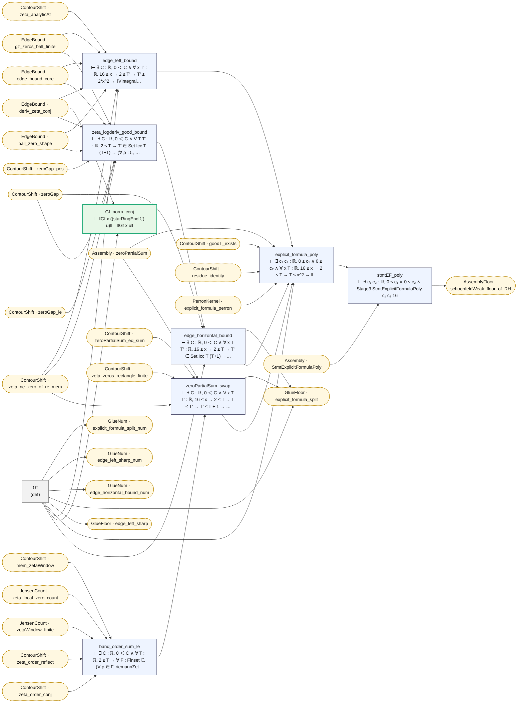

# `lean_stage3/Stage3/Glue.lean`

**What it does** (its own header): # The glue — assembling StmtExplicitFormula from the four slices Pieces, in build order: - the band count and the `zeroPartialSum` swap (`T′ → T`), - the edge-integral estimates (S3's pointwise bounds integrated), - the rectangle-edge splitting matching S1's line integral, - the final assembly in the `T ≤ x²` regime + the consumer patch.

**Imports:** [`EdgeBound`](../lean_stage3/EdgeBound.md).
**Imported by:** [`Stage3`](../lean_stage3/Stage3.md), [`AssemblyFloor`](../lean_stage3/AssemblyFloor.md).

Blue: theorem. Green: a theorem nothing else uses (an end). Dashed white: connects to nothing. Grey: definition. Red: contains `sorry`. Yellow: in another file. An arrow A → B reads "A is used by B".

## Every declaration

| declaration | proves (output) | needs (input) | why (its own docstring) | uses | used by |
|---|---|---|---|---|---|
| `Glue.band_order_sum_le` theorem, line 19 | ∃ C : ℝ, 0 &lt; C ∧ ∀ T : ℝ, 2 ≤ T → ∀ F : Finset ℂ, (∀ ρ ∈ F, riemannZeta ρ = 0 ∧ (0 &lt; ρ.re ∧ ρ.re &lt; 1) ∧ T ≤ \|ρ.im\| ∧ \|ρ.im\| ≤ T + 1) → (∑ ρ ∈ F, (analyticOrderNatAt riemannZeta ρ : ℝ)) ≤ C * Real.log T | — | The band count: any finite set of strip zeros with `\|im\|` in `[T, T+1]` has total multiplicity `≤ C·log T` — two windows per sign, reflection for the left half, conjugation for the negative sign. | `ContourShift.mem_zetaWindow`, `ContourShift.zeta_order_conj`, `ContourShift.zeta_order_reflect`, `Stage3.zetaWindow_finite`, `Stage3.zeta_local_zero_count` | `Glue.zeroPartialSum_swap` |
| `Glue.zeroPartialSum_swap` theorem, line 242 | ∃ C : ℝ, 0 &lt; C ∧ ∀ x T T' : ℝ, 16 ≤ x → 2 ≤ T → T ≤ T' → T' ≤ T + 1 → ‖Stage3.zeroPartialSum x T' - Stage3.zeroPartialSum x T‖ ≤ C * x * Real.log T / T | — | The swap: moving the zero sum from a height `T′ ∈ [T, T+1]` back to `T` costs `≤ C·x·log T / T`. | `Stage3.zeroPartialSum`, `ContourShift.zeroPartialSum_eq_sum`, `ContourShift.zeta_ne_zero_of_re_mem`, `ContourShift.zeta_zeros_rectangle_finite`, `Glue.band_order_sum_le` | `Glue.explicit_formula_poly`, `Glue.explicit_formula_split` |
| `Glue.Gf` def, line 347 | ℂ → ℂ | x : ℝ | The contour integrand of the explicit formula. | — | `Glue.Gf_norm_conj`, `Glue.edge_horizontal_bound`, `Glue.edge_left_bound`, `Glue.explicit_formula_poly`, `Glue.edge_left_sharp`, `Glue.explicit_formula_split`, `Glue.edge_horizontal_bound_num`, `Glue.edge_left_sharp_num`, `Glue.explicit_formula_split_num` |
| `Glue.zeta_logderiv_good_bound` theorem, line 351 | ∃ C : ℝ, 0 &lt; C ∧ ∀ T T' : ℝ, 2 ≤ T → T' ∈ Set.Icc T (T+1) → (∀ ρ : ℂ, riemannZeta ρ = 0 → 0 &lt; ρ.re → ContourShift.zeroGap T ≤ \|ρ.im - T'\|) → ∀ u : ℂ, \|u.im\| = T' → -1/4 ≤ u.re → u.re ≤ 2 → ‖deriv riemannZeta u / riemannZeta u‖ ≤ C * Real.log T ^ 2 | — | The pointwise good-height bound, both signs of the height. | `ContourShift.zeroGap`, `ContourShift.zeroGap_le`, `ContourShift.zeroGap_pos`, `ContourShift.zeta_ne_zero_of_re_mem`, `EdgeBound.ball_zero_shape`, `EdgeBound.deriv_zeta_conj`, `EdgeBound.edge_bound_core`, `EdgeBound.gz_zeros_ball_finite` | `Glue.edge_horizontal_bound` |
| `Glue.edge_horizontal_bound` theorem, line 442 | ∃ C : ℝ, 0 &lt; C ∧ ∀ x T T' : ℝ, 16 ≤ x → 2 ≤ T → T' ∈ Set.Icc T (T+1) → (∀ ρ : ℂ, riemannZeta ρ = 0 → 0 &lt; ρ.re → ContourShift.zeroGap T ≤ \|ρ.im - T'\|) → ∀ y : ℝ, \|y\| = T' → ‖HIntegral (Gf x) (-1/4) (1 + 1/Real.log x) y‖ ≤ C * x * Real.log T ^ 2 / T | — | The horizontal-edge integral bound at a good height, both signs: `≤ C·x·log²T/T`. | `ContourShift.zeroGap`, `Glue.Gf`, `Glue.zeta_logderiv_good_bound` | `Glue.explicit_formula_poly`, `Glue.explicit_formula_split` |
| `Glue.Gf_norm_conj` theorem, line 535 | ‖Gf x ((starRingEnd ℂ) u)‖ = ‖Gf x u‖ | hx : 0 &lt; x; hu1 : u ≠ 1 | Conjugation symmetry of the integrand's norm. | `EdgeBound.deriv_zeta_conj`, `Glue.Gf` | — |
| `Glue.edge_left_bound` theorem, line 557 | ∃ C : ℝ, 0 &lt; C ∧ ∀ x T' : ℝ, 16 ≤ x → 2 ≤ T' → T' ≤ 2*x^2 → ‖VIntegral (Gf x) (-1/4) (-T') T'‖ ≤ C * Real.log x | — | The left-edge integral bound: `≤ C·log x` for `T′ ≤ x²`. | `ContourShift.zeta_analyticAt`, `ContourShift.zeta_ne_zero_of_re_mem`, `EdgeBound.ball_zero_shape`, `EdgeBound.deriv_zeta_conj`, `EdgeBound.edge_bound_core`, `EdgeBound.gz_zeros_ball_finite`, `Glue.Gf` | `Glue.explicit_formula_poly` |
| `Glue.explicit_formula_poly` theorem, line 979 | ∃ c₁ c₂ : ℝ, 0 ≤ c₁ ∧ 0 ≤ c₂ ∧ ∀ x T : ℝ, 16 ≤ x → 2 ≤ T → T ≤ x^2 → ‖(Chebyshev.psi x : ℂ) - (x:ℂ) + Stage3.zeroPartialSum x T‖ ≤ c₁ * x * Real.log (x*T)^2 / T + c₂ * Real.log x | — | THE TRUNCATED EXPLICIT FORMULA — hEF's deliverable, in the `T ≤ x²` regime the consumer uses: constants exist with `‖ψ(x) − x + Σ_{\|γ\|&lt;T} m·x^ρ/ρ‖ ≤ c₁·x·log²(xT)/T + c₂·log x`. | `Stage3.zeroPartialSum`, `ContourShift.goodT_exists`, `ContourShift.residue_identity`, `Glue.Gf`, `Glue.edge_horizontal_bound`, `Glue.edge_left_bound`, `Glue.zeroPartialSum_swap`, `PerronKernel.explicit_formula_perron` | `Glue.stmtEF_poly` |
| `Glue.stmtEF_poly` theorem, line 1195 | ∃ c₁ c₂ : ℝ, 0 ≤ c₁ ∧ 0 ≤ c₂ ∧ Stage3.StmtExplicitFormulaPoly c₁ c₂ 16 | — | hEF DISCHARGED: constants realizing the ledger's leaf. | `Stage3.StmtExplicitFormulaPoly`, `Glue.explicit_formula_poly` | `Stage3.schoenfeldWeak_floor_of_RH` |
