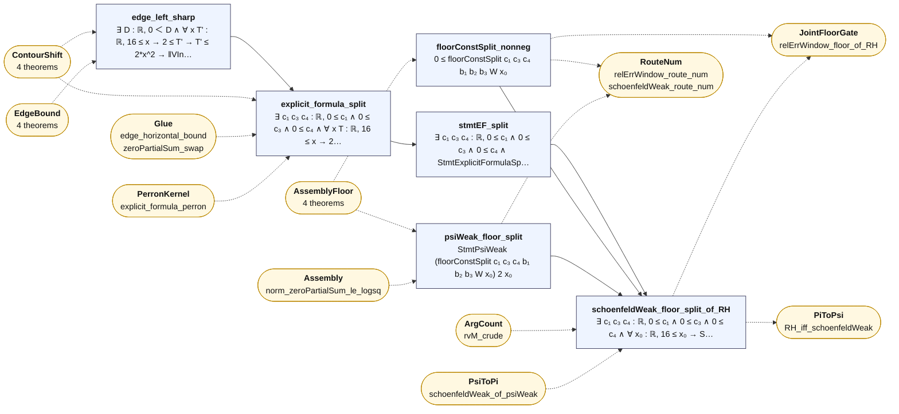

# `lean_stage3/Stage3/GlueFloor.lean`

GlueFloor — block E2 of `lean_stage3/design/joints.md`. 2026-11-22. `Glue.edge_left_bound` proves the left edge of the explicit formula's contour is at most `72·D·log²x·x^(−1/4)` and then rounds that to `C·log x` (unit 0408: that rounding is the whole of `c₂`). Three copies with a different last line each (`LOOP.md` § 3); `Glue.lean` is untouched.

6 theorems, 2 definitions, 834 lines. Arrows are Lean's own record of what each proof uses.

**Imports:** [`AssemblyFloor`](../lean_stage3/AssemblyFloor.md)  
**Imported by:** [`Stage3`](../lean_stage3/Stage3.md), [`GlueNum`](../lean_stage3/GlueNum.md), [`JointFloorGate`](../lean_stage3/JointFloorGate.md), [`PiToPsi`](../lean_stage3/PiToPsi.md)

## The picture



An arrow A → B reads "A is used in the proof of B". Blue: theorem. Green: a theorem nothing else uses (an end). Dashed: connects to nothing. Red: contains `sorry`. Yellow: theorems in another file, counted; a dotted arrow crosses files. Definitions are not drawn; they are listed below the diagram.

## Definitions

<a name="Stage3-StmtExplicitFormulaSplit"></a>
### `Stage3.StmtExplicitFormulaSplit`

def · line 644

The truncated explicit formula with the left edge as its own term.

- **Is:** `` StmtExplicitFormulaSplit (c₁ c₃ c₄ x₁ : ℝ) : Prop := ∀ x T : ℝ, x₁ ≤ x → 2 ≤ T → T ≤ x^2 → ‖((ψ x : ℝ) : ℂ) - (x : ℂ) + zeroPartialSum x T‖ ≤ c₁ * x * Real.log (x * T) ^ 2 / T + c₃ * Real.log x + c₄ * ((Real.log x)^2 * x ^ (-(1:ℝ)/4)) ``
- **Built from:** [`Stage3.zeroPartialSum`](../lean_stage3/Assembly.md#Stage3-zeroPartialSum)
- **Used by 4:** [`Stage3.psiWeak_floor_split`](#Stage3-psiWeak_floor_split), [`Stage3.schoenfeldWeak_floor_split_of_RH`](#Stage3-schoenfeldWeak_floor_split_of_RH), [`Stage3.stmtEF_split`](#Stage3-stmtEF_split), [`Stage3.stmtEF_split_num`](../lean_stage3/RouteNum.md#Stage3-stmtEF_split_num)

<a name="Stage3-floorConstSplit"></a>
### `Stage3.floorConstSplit`

def · line 655

The constant of the assembly at floor `x₀`, left edge at its own size.

- **Is:** `` floorConstSplit (c₁ c₃ c₄ b₁ b₂ b₃ W x₀ : ℝ) : ℝ := floorConst c₁ c₃ b₁ b₂ b₃ W x₀ + c₄ * x₀ ^ (-(1:ℝ)/4) / Real.sqrt x₀ ``
- **Built from:** [`Stage3.floorConst`](../lean_stage3/AssemblyFloor.md#Stage3-floorConst)
- **Used by 10:** [`GateEval.routeConst_le`](../lean_stage3/GateEval.md#GateEval-routeConst_le), [`Stage3.floorConstSplit_nonneg`](#Stage3-floorConstSplit_nonneg), [`Stage3.psiWeak_floor_split`](#Stage3-psiWeak_floor_split), [`Stage3.schoenfeldWeak_floor_split_of_RH`](#Stage3-schoenfeldWeak_floor_split_of_RH), [`JointFloorGate.relErrWindow_floor_of_RH`](../lean_stage3/JointFloorGate.md#JointFloorGate-relErrWindow_floor_of_RH), [`PiToPsi.RH_iff_schoenfeldWeak`](../lean_stage3/PiToPsi.md#PiToPsi-RH_iff_schoenfeldWeak), [`RouteGate.relErrWindow_route`](../lean_stage3/RouteGate.md#RouteGate-relErrWindow_route), [`RouteNum.relErrWindow_route_num`](../lean_stage3/RouteNum.md#RouteNum-relErrWindow_route_num), [`Stage3.routeConst`](../lean_stage3/RouteNum.md#Stage3-routeConst), [`Stage3.schoenfeldWeak_route_num`](../lean_stage3/RouteNum.md#Stage3-schoenfeldWeak_route_num)

## Theorems

<a name="Glue-edge_left_sharp"></a>
### `Glue.edge_left_sharp`

line 37

**Why.** The left edge at its own size: `≤ 72·D·log²x·x^(−1/4)` for `T′ ≤ 2x²`. `Glue.edge_left_bound`'s proof, stopped before its last two steps.

**Proves**

```lean
∃ D : ℝ, 0 < D ∧ ∀ x T' : ℝ, 16 ≤ x → 2 ≤ T' → T' ≤ 2*x^2 → ‖VIntegral (Gf x) (-1/4) (-T') T'‖ ≤ 72 * D * ((Real.log x)^2 * x ^ (-(1:ℝ)/4))
```

**Stated with:** [`Glue.Gf`](../lean_stage3/Glue.md#Glue-Gf)

**Fed by** (6 theorems its proof uses)

  - [`ContourShift.zeta_analyticAt`](../lean_stage3/ContourShift.md#ContourShift-zeta_analyticAt) (ContourShift) — `` AnalyticAt ℂ riemannZeta ρ ``
  - [`ContourShift.zeta_ne_zero_of_re_mem`](../lean_stage3/ContourShift.md#ContourShift-zeta_ne_zero_of_re_mem) (ContourShift) — `` riemannZeta w ≠ 0 ``
  - [`EdgeBound.ball_zero_shape`](../lean_stage3/EdgeBound.md#EdgeBound-ball_zero_shape) (EdgeBound) — `` riemannZeta w = 0 ∧ (0 < w.re ∧ w.re < 1) ∧ |w.im - T'| ≤ 46/25 ``
  - [`EdgeBound.deriv_zeta_conj`](../lean_stage3/EdgeBound.md#EdgeBound-deriv_zeta_conj) (EdgeBound) — `` deriv riemannZeta ((starRingEnd ℂ) s) = (starRingEnd ℂ) (deriv riemannZeta s) ``
  - [`EdgeBound.edge_bound_core`](../lean_stage3/EdgeBound.md#EdgeBound-edge_bound_core) (EdgeBound) — `` ∃ C : ℝ, 0 < C ∧ ∀ t : ℝ, 2 ≤ t → ∀ u : ℂ, u.im = t → -1/4 ≤ u.re → u.re ≤ 2 → riemannZeta u ≠ 0 → ∀ δ : ℝ, 0 < δ → δ ≤ 1 → (∀ w ∈ (gz_zeros_ball_fini… ``
  - [`EdgeBound.gz_zeros_ball_finite`](../lean_stage3/EdgeBound.md#EdgeBound-gz_zeros_ball_finite) (EdgeBound) — `` {w : ℂ | gz w = 0 ∧ ‖w - c0 T'‖ ≤ ρ}.Finite ``

**Definitions its proof touches:** [`EdgeBound.c0`](../lean_stage3/EdgeBound.md#EdgeBound-c0), [`EdgeBound.gz`](../lean_stage3/EdgeBound.md#EdgeBound-gz)

**Feeds** (1 that use it)

  - [`Glue.explicit_formula_split`](#Glue-explicit_formula_split) — `` ∃ c₁ c₃ c₄ : ℝ, 0 ≤ c₁ ∧ 0 ≤ c₃ ∧ 0 ≤ c₄ ∧ ∀ x T : ℝ, 16 ≤ x → 2 ≤ T → T ≤ x^2 → ‖(Chebyshev.psi x : ℂ) - (x:ℂ) + Stage3.zeroPartialSum x T‖ ≤ c₁ * x … ``

<a name="Glue-explicit_formula_split"></a>
### `Glue.explicit_formula_split`

line 408

**Why.** THE TRUNCATED EXPLICIT FORMULA — hEF's deliverable, in the `T ≤ x²` regime the consumer uses: constants exist with `‖ψ(x) − x + Σ_{|γ|<T} m·x^ρ/ρ‖ ≤ c₁·x·log²(xT)/T + c₂·log x`.

**Proves**

```lean
∃ c₁ c₃ c₄ : ℝ, 0 ≤ c₁ ∧ 0 ≤ c₃ ∧ 0 ≤ c₄ ∧ ∀ x T : ℝ, 16 ≤ x → 2 ≤ T → T ≤ x^2 → ‖(Chebyshev.psi x : ℂ) - (x:ℂ) + Stage3.zeroPartialSum x T‖ ≤ c₁ * x * Real.log (x*T)^2 / T + c₃ * Real.log x + c₄ * ((Real.log x)^2 * x ^ (-(1:ℝ)/4))
```

**Stated with:** [`Stage3.zeroPartialSum`](../lean_stage3/Assembly.md#Stage3-zeroPartialSum)

**Fed by** (6 theorems its proof uses)

  - [`ContourShift.goodT_exists`](../lean_stage3/ContourShift.md#ContourShift-goodT_exists) (ContourShift) — `` ∃ T' ∈ Set.Icc T (T+1), ∀ ρ : ℂ, riemannZeta ρ = 0 → 0 < ρ.re → zeroGap T ≤ |ρ.im - T'| ``
  - [`ContourShift.residue_identity`](../lean_stage3/ContourShift.md#ContourShift-residue_identity) (ContourShift) — `` RectangleIntegral' (fun s : ℂ ↦ (- deriv riemannZeta s / riemannZeta s) * ((x:ℝ):ℂ) ^ s / s) (((-1/4 : ℝ):ℂ) - Complex.I * T') (((1 + 1/Real.log x : ℝ… ``
  - [`Glue.edge_horizontal_bound`](../lean_stage3/Glue.md#Glue-edge_horizontal_bound) (Glue) — `` ∃ C : ℝ, 0 < C ∧ ∀ x T T' : ℝ, 16 ≤ x → 2 ≤ T → T' ∈ Set.Icc T (T+1) → (∀ ρ : ℂ, riemannZeta ρ = 0 → 0 < ρ.re → ContourShift.zeroGap T ≤ |ρ.im - T'|) … ``
  - [`Glue.zeroPartialSum_swap`](../lean_stage3/Glue.md#Glue-zeroPartialSum_swap) (Glue) — `` ∃ C : ℝ, 0 < C ∧ ∀ x T T' : ℝ, 16 ≤ x → 2 ≤ T → T ≤ T' → T' ≤ T + 1 → ‖Stage3.zeroPartialSum x T' - Stage3.zeroPartialSum x T‖ ≤ C * x * Real.log T / … ``
  - [`Glue.edge_left_sharp`](#Glue-edge_left_sharp) — `` ∃ D : ℝ, 0 < D ∧ ∀ x T' : ℝ, 16 ≤ x → 2 ≤ T' → T' ≤ 2*x^2 → ‖VIntegral (Gf x) (-1/4) (-T') T'‖ ≤ 72 * D * ((Real.log x)^2 * x ^ (-(1:ℝ)/4)) ``
  - [`PerronKernel.explicit_formula_perron`](../lean_stage3/PerronKernel.md#PerronKernel-explicit_formula_perron) (PerronKernel) — `` ‖(Chebyshev.psi x : ℂ) - (2 * (Real.pi:ℂ) * Complex.I)⁻¹ * ∫ t in (-T)..T, (- deriv riemannZeta (((1 + 1/Real.log x : ℝ):ℂ) + Complex.I * t) / riemann… ``

**Definitions its proof touches:** [`ContourShift.zeroGap`](../lean_stage3/ContourShift.md#ContourShift-zeroGap), [`Glue.Gf`](../lean_stage3/Glue.md#Glue-Gf)

**Feeds** (1 that use it)

  - [`Stage3.stmtEF_split`](#Stage3-stmtEF_split) — `` ∃ c₁ c₃ c₄ : ℝ, 0 ≤ c₁ ∧ 0 ≤ c₃ ∧ 0 ≤ c₄ ∧ StmtExplicitFormulaSplit c₁ c₃ c₄ 16 ``

<a name="Stage3-stmtEF_split"></a>
### `Stage3.stmtEF_split`

line 650

**Proves**

```lean
∃ c₁ c₃ c₄ : ℝ, 0 ≤ c₁ ∧ 0 ≤ c₃ ∧ 0 ≤ c₄ ∧ StmtExplicitFormulaSplit c₁ c₃ c₄ 16
```

**Stated with:** [`Stage3.StmtExplicitFormulaSplit`](#Stage3-StmtExplicitFormulaSplit)

**Fed by** (1 theorem its proof uses)

  - [`Glue.explicit_formula_split`](#Glue-explicit_formula_split) — `` ∃ c₁ c₃ c₄ : ℝ, 0 ≤ c₁ ∧ 0 ≤ c₃ ∧ 0 ≤ c₄ ∧ ∀ x T : ℝ, 16 ≤ x → 2 ≤ T → T ≤ x^2 → ‖(Chebyshev.psi x : ℂ) - (x:ℂ) + Stage3.zeroPartialSum x T‖ ≤ c₁ * x … ``

**Feeds** (1 that use it)

  - [`Stage3.schoenfeldWeak_floor_split_of_RH`](#Stage3-schoenfeldWeak_floor_split_of_RH) — `` ∃ c₁ c₃ c₄ : ℝ, 0 ≤ c₁ ∧ 0 ≤ c₃ ∧ 0 ≤ c₄ ∧ ∀ x₀ : ℝ, 16 ≤ x₀ → StmtSchoenfeldWeak (3 * floorConstSplit c₁ c₃ c₄ 112 0 698 weightedZeroHeightBucket x₀ … ``

<a name="Stage3-floorConstSplit_nonneg"></a>
### `Stage3.floorConstSplit_nonneg`

line 658

**Proves**

```lean
0 ≤ floorConstSplit c₁ c₃ c₄ b₁ b₂ b₃ W x₀
```

**Needs** (its hypotheses)

  - `` hc₁ : 0 ≤ c₁ ``
  - `` hc₃ : 0 ≤ c₃ ``
  - `` hc₄ : 0 ≤ c₄ ``
  - `` hb₁ : 0 ≤ b₁ ``
  - `` hb₂ : 0 ≤ b₂ ``
  - `` hb₃ : 0 ≤ b₃ ``
  - `` hW : 0 ≤ W ``
  - `` hx₀ : 16 ≤ x₀ ``

**Stated with:** [`Stage3.floorConstSplit`](#Stage3-floorConstSplit)

**Fed by** (1 theorem its proof uses)

  - [`Stage3.floorConst_nonneg`](../lean_stage3/AssemblyFloor.md#Stage3-floorConst_nonneg) (AssemblyFloor) — `` 0 ≤ floorConst c₁ c₂ b₁ b₂ b₃ W x₀ ``

**Definitions its proof touches:** [`Stage3.floorConst`](../lean_stage3/AssemblyFloor.md#Stage3-floorConst)

**Feeds** (4 that use it)

  - [`Stage3.schoenfeldWeak_floor_split_of_RH`](#Stage3-schoenfeldWeak_floor_split_of_RH) — `` ∃ c₁ c₃ c₄ : ℝ, 0 ≤ c₁ ∧ 0 ≤ c₃ ∧ 0 ≤ c₄ ∧ ∀ x₀ : ℝ, 16 ≤ x₀ → StmtSchoenfeldWeak (3 * floorConstSplit c₁ c₃ c₄ 112 0 698 weightedZeroHeightBucket x₀ … ``
  - [`JointFloorGate.relErrWindow_floor_of_RH`](../lean_stage3/JointFloorGate.md#JointFloorGate-relErrWindow_floor_of_RH) (JointFloorGate) — `` ∃ c₁ c₃ c₄ : ℝ, 0 ≤ c₁ ∧ 0 ≤ c₃ ∧ 0 ≤ c₄ ∧ ∀ x₀ : ℝ, 16 ≤ x₀ → ∀ (r : ℤ) (n : ℕ), x₀ ^ 2 ≤ (2 : ℝ) ^ ((r : ℝ) - n) → 0 ≤ (r : ℝ) - n → JointDialGate.S… ``
  - [`RouteNum.relErrWindow_route_num`](../lean_stage3/RouteNum.md#RouteNum-relErrWindow_route_num) (RouteNum) — `` JointDialGate.StmtRelErrWindow (fun m : ℤ => (Nat.primeCounting ⌊(2 : ℝ) ^ (m : ℝ)⌋₊ : ℝ)) (fun m : ℤ => 2 / Real.log 2 + ∫ t in (1 : ℝ)..(m : ℝ), Rea… ``
  - [`Stage3.schoenfeldWeak_route_num`](../lean_stage3/RouteNum.md#Stage3-schoenfeldWeak_route_num) (RouteNum) — `` StmtSchoenfeldWeak (routeConst x₀) 1 (max (x₀ ^ 2) 9) (fun x => (Nat.primeCounting ⌊x⌋₊ : ℝ)) Li ``

<a name="Stage3-psiWeak_floor_split"></a>
### `Stage3.psiWeak_floor_split`

line 672

**Why.** The assembly at floor `x₀`, left edge at its own size. Under RH, the truncated explicit formula and the zero-count band, `|ψ x − x| ≤ floorConst … x₀ · √x · log²x` for `x ≥ x₀`. The height is the power of two in `(x²/2, x²]`.

**Proves**

```lean
StmtPsiWeak (floorConstSplit c₁ c₃ c₄ b₁ b₂ b₃ W x₀) 2 x₀
```

**Needs** (its hypotheses)

  - `` hRH : RiemannHypothesis ``
  - `` hc₁ : 0 ≤ c₁ ``
  - `` hc₃ : 0 ≤ c₃ ``
  - `` hc₄ : 0 ≤ c₄ ``
  - `` hb₁ : 0 ≤ b₁ ``
  - `` hb₂ : 0 ≤ b₂ ``
  - `` hb₃ : 0 ≤ b₃ ``
  - `` hWeq : W = weightedZeroHeightBucket ``
  - `` hRvM2 : 0 ≤ riemannZeta.RvM b₁ b₂ b₃ 2 ``
  - `` hEF : StmtExplicitFormulaSplit c₁ c₃ c₄ x₁ ``
  - `` hNT : riemannZeta.Riemann_vonMangoldt_bound b₁ b₂ b₃ ``
  - `` hx₀ : 16 ≤ x₀ ``
  - `` hx₁ : x₁ ≤ x₀ ``

**Stated with:** [`Stage3.StmtExplicitFormulaSplit`](#Stage3-StmtExplicitFormulaSplit), [`Stage3.floorConstSplit`](#Stage3-floorConstSplit), [`Stage3.StmtPsiWeak`](../lean_stage3/PsiToPi.md#Stage3-StmtPsiWeak)

**Fed by** (4 theorems its proof uses)

  - [`Stage3.norm_zeroPartialSum_le_logsq`](../lean_stage3/Assembly.md#Stage3-norm_zeroPartialSum_le_logsq) (Assembly) — `` ‖zeroPartialSum x ((2 : ℝ) ^ (K + 1))‖ ≤ 2 * Real.sqrt x * (2 * (Real.log 2 / (2 * Real.pi) * (K + 1) * (K + 2) + 3 * (K + 1) / Real.pi + 2 * (riemann… ``
  - [`Stage3.floor_arith`](../lean_stage3/AssemblyFloor.md#Stage3-floor_arith) (AssemblyFloor) — `` A ≤ (4 + P / L₀ + Q / L₀ ^ 2 + 18 * c₁ / (x₀ * S₀) + c₂ / (S₀ * L₀)) * S * L ^ 2 ``
  - [`Stage3.rem_floor`](../lean_stage3/AssemblyFloor.md#Stage3-rem_floor) (AssemblyFloor) — `` c₁ * xx * G ^ 2 / TT ≤ 18 * c₁ * L ^ 2 / xx ``
  - [`Stage3.zeroinner_floor`](../lean_stage3/AssemblyFloor.md#Stage3-zeroinner_floor) (AssemblyFloor) — `` 2 * (Real.log 2 / (2 * Real.pi) * (KK + 1) * (KK + 2) + 3 * (KK + 1) / Real.pi + 2 * (R + 7 / 8)) + 2 * W ≤ 2 * (L ^ 2 + (4 + 4 * b₁ + 4 * b₂) * L + 2… ``

**Definitions its proof touches:** [`Stage3.zeroPartialSum`](../lean_stage3/Assembly.md#Stage3-zeroPartialSum), [`Stage3.floorConst`](../lean_stage3/AssemblyFloor.md#Stage3-floorConst)

**Feeds** (2 that use it)

  - [`Stage3.schoenfeldWeak_floor_split_of_RH`](#Stage3-schoenfeldWeak_floor_split_of_RH) — `` ∃ c₁ c₃ c₄ : ℝ, 0 ≤ c₁ ∧ 0 ≤ c₃ ∧ 0 ≤ c₄ ∧ ∀ x₀ : ℝ, 16 ≤ x₀ → StmtSchoenfeldWeak (3 * floorConstSplit c₁ c₃ c₄ 112 0 698 weightedZeroHeightBucket x₀ … ``
  - [`Stage3.schoenfeldWeak_route_num`](../lean_stage3/RouteNum.md#Stage3-schoenfeldWeak_route_num) (RouteNum) — `` StmtSchoenfeldWeak (routeConst x₀) 1 (max (x₀ ^ 2) 9) (fun x => (Nat.primeCounting ⌊x⌋₊ : ℝ)) Li ``

<a name="Stage3-schoenfeldWeak_floor_split_of_RH"></a>
### `Stage3.schoenfeldWeak_floor_split_of_RH`

line 806

**Why.** From RH to the `π` side, floor a parameter, left edge at its own size.

**Proves**

```lean
∃ c₁ c₃ c₄ : ℝ, 0 ≤ c₁ ∧ 0 ≤ c₃ ∧ 0 ≤ c₄ ∧ ∀ x₀ : ℝ, 16 ≤ x₀ → StmtSchoenfeldWeak (3 * floorConstSplit c₁ c₃ c₄ 112 0 698 weightedZeroHeightBucket x₀ + 13) 1 (max (x₀ ^ 2) 9) (fun x => (Nat.primeCounting ⌊x⌋₊ : ℝ)) Li
```

**Needs** (its hypotheses)

  - `` hRH : RiemannHypothesis ``

**Stated with:** [`Stage3.floorConstSplit`](#Stage3-floorConstSplit), [`Stage3.Li`](../lean_stage3/PsiToPi.md#Stage3-Li), [`Stage3.StmtSchoenfeldWeak`](../lean_stage3/Statement.md#Stage3-StmtSchoenfeldWeak)

**Fed by** (5 theorems its proof uses)

  - [`ArgCount.rvM_crude`](../lean_stage3/ArgCount.md#ArgCount-rvM_crude) (ArgCount) — `` riemannZeta.Riemann_vonMangoldt_bound 112 0 698 ``
  - [`Stage3.floorConstSplit_nonneg`](#Stage3-floorConstSplit_nonneg) — `` 0 ≤ floorConstSplit c₁ c₃ c₄ b₁ b₂ b₃ W x₀ ``
  - [`Stage3.psiWeak_floor_split`](#Stage3-psiWeak_floor_split) — `` StmtPsiWeak (floorConstSplit c₁ c₃ c₄ b₁ b₂ b₃ W x₀) 2 x₀ ``
  - [`Stage3.stmtEF_split`](#Stage3-stmtEF_split) — `` ∃ c₁ c₃ c₄ : ℝ, 0 ≤ c₁ ∧ 0 ≤ c₃ ∧ 0 ≤ c₄ ∧ StmtExplicitFormulaSplit c₁ c₃ c₄ 16 ``
  - [`Stage3.schoenfeldWeak_of_psiWeak`](../lean_stage3/PsiToPi.md#Stage3-schoenfeldWeak_of_psiWeak) (PsiToPi) — `` StmtSchoenfeldWeak (3 * C + 13) (k - 1) (max (x₀ ^ 2) 9) (fun x => (Nat.primeCounting ⌊x⌋₊ : ℝ)) Li ``

**Definitions its proof touches:** [`Stage3.StmtExplicitFormulaSplit`](#Stage3-StmtExplicitFormulaSplit), [`Stage3.StmtPsiWeak`](../lean_stage3/PsiToPi.md#Stage3-StmtPsiWeak)

**Feeds** (2 that use it)

  - [`JointFloorGate.relErrWindow_floor_of_RH`](../lean_stage3/JointFloorGate.md#JointFloorGate-relErrWindow_floor_of_RH) (JointFloorGate) — `` ∃ c₁ c₃ c₄ : ℝ, 0 ≤ c₁ ∧ 0 ≤ c₃ ∧ 0 ≤ c₄ ∧ ∀ x₀ : ℝ, 16 ≤ x₀ → ∀ (r : ℤ) (n : ℕ), x₀ ^ 2 ≤ (2 : ℝ) ^ ((r : ℝ) - n) → 0 ≤ (r : ℝ) - n → JointDialGate.S… ``
  - [`PiToPsi.RH_iff_schoenfeldWeak`](../lean_stage3/PiToPsi.md#PiToPsi-RH_iff_schoenfeldWeak) (PiToPsi) — `` RiemannHypothesis ↔ ∃ C x₀ : ℝ, StmtSchoenfeldWeak C 1 x₀ (fun x => (Nat.primeCounting ⌊x⌋₊ : ℝ)) Stage3.Li ``

