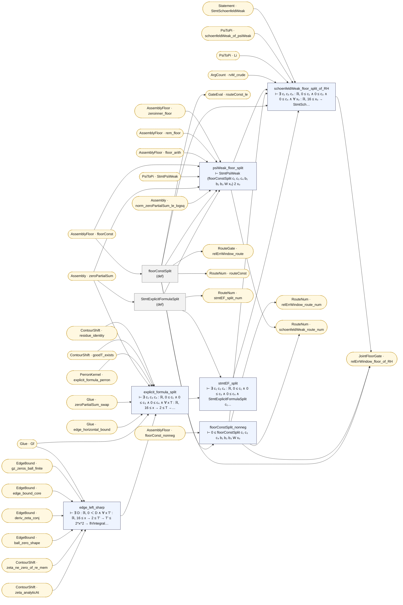

# `lean_stage3/Stage3/GlueFloor.lean`

**What it does** (its own header): GlueFloor — block E2 of `lean_stage3/design/joints.md`. 2026-11-22. `Glue.edge_left_bound` proves the left edge of the explicit formula's contour is at most `72·D·log²x·x^(−1/4)` and then rounds that to `C·log x` (unit 0408: that rounding is the whole of `c₂`). Three copies with a different last line each (`LOOP.md` § 3); `Glue.lean` is untouched.

**Imports:** [`AssemblyFloor`](../lean_stage3/AssemblyFloor.md).
**Imported by:** [`Stage3`](../lean_stage3/Stage3.md), [`GlueNum`](../lean_stage3/GlueNum.md), [`JointFloorGate`](../lean_stage3/JointFloorGate.md).

Blue: theorem. Green: a theorem nothing else uses (an end). Dashed white: connects to nothing. Grey: definition. Red: contains `sorry`. Yellow: in another file. An arrow A → B reads "A is used by B".

## Every declaration

| declaration | proves (output) | needs (input) | why (its own docstring) | uses | used by |
|---|---|---|---|---|---|
| `Glue.edge_left_sharp` theorem, line 37 | ∃ D : ℝ, 0 &lt; D ∧ ∀ x T' : ℝ, 16 ≤ x → 2 ≤ T' → T' ≤ 2*x^2 → ‖VIntegral (Gf x) (-1/4) (-T') T'‖ ≤ 72 * D * ((Real.log x)^2 * x ^ (-(1:ℝ)/4)) | — | The left edge at its own size: `≤ 72·D·log²x·x^(−1/4)` for `T′ ≤ 2x²`. `Glue.edge_left_bound`'s proof, stopped before its last two steps. | `ContourShift.zeta_analyticAt`, `ContourShift.zeta_ne_zero_of_re_mem`, `EdgeBound.ball_zero_shape`, `EdgeBound.deriv_zeta_conj`, `EdgeBound.edge_bound_core`, `EdgeBound.gz_zeros_ball_finite`, `Glue.Gf` | `Glue.explicit_formula_split` |
| `Glue.explicit_formula_split` theorem, line 408 | ∃ c₁ c₃ c₄ : ℝ, 0 ≤ c₁ ∧ 0 ≤ c₃ ∧ 0 ≤ c₄ ∧ ∀ x T : ℝ, 16 ≤ x → 2 ≤ T → T ≤ x^2 → ‖(Chebyshev.psi x : ℂ) - (x:ℂ) + Stage3.zeroPartialSum x T‖ ≤ c₁ * x * Real.log (x*T)^2 / T + c₃ * Real.log x + c₄ * ((Real.log x)^2 * x ^ (-(1:ℝ)/4)) | — | THE TRUNCATED EXPLICIT FORMULA — hEF's deliverable, in the `T ≤ x²` regime the consumer uses: constants exist with `‖ψ(x) − x + Σ_{\|γ\|&lt;T} m·x^ρ/ρ‖ ≤ c₁·x·log²(xT)/T + c₂·log x`. | `Stage3.zeroPartialSum`, `ContourShift.goodT_exists`, `ContourShift.residue_identity`, `Glue.Gf`, `Glue.edge_horizontal_bound`, `Glue.zeroPartialSum_swap`, `Glue.edge_left_sharp`, `PerronKernel.explicit_formula_perron` | `Stage3.stmtEF_split` |
| `Stage3.StmtExplicitFormulaSplit` def, line 644 | Prop | c₁ c₃ c₄ x₁ : ℝ | The truncated explicit formula with the left edge as its own term. | `Stage3.zeroPartialSum` | `Stage3.psiWeak_floor_split`, `Stage3.stmtEF_split`, `Stage3.stmtEF_split_num` |
| `Stage3.stmtEF_split` theorem, line 650 | ∃ c₁ c₃ c₄ : ℝ, 0 ≤ c₁ ∧ 0 ≤ c₃ ∧ 0 ≤ c₄ ∧ StmtExplicitFormulaSplit c₁ c₃ c₄ 16 | — | — | `Glue.explicit_formula_split`, `Stage3.StmtExplicitFormulaSplit` | `Stage3.schoenfeldWeak_floor_split_of_RH` |
| `Stage3.floorConstSplit` def, line 655 | ℝ | c₁ c₃ c₄ b₁ b₂ b₃ W x₀ : ℝ | The constant of the assembly at floor `x₀`, left edge at its own size. | `Stage3.floorConst` | `GateEval.routeConst_le`, `Stage3.floorConstSplit_nonneg`, `Stage3.psiWeak_floor_split`, `Stage3.schoenfeldWeak_floor_split_of_RH`, `JointFloorGate.relErrWindow_floor_of_RH`, `RouteGate.relErrWindow_route`, `Stage3.routeConst` |
| `Stage3.floorConstSplit_nonneg` theorem, line 658 | 0 ≤ floorConstSplit c₁ c₃ c₄ b₁ b₂ b₃ W x₀ | hc₁ : 0 ≤ c₁; hc₃ : 0 ≤ c₃; hc₄ : 0 ≤ c₄; hb₁ : 0 ≤ b₁; hb₂ : 0 ≤ b₂; hb₃ : 0 ≤ b₃; hW : 0 ≤ W; hx₀ : 16 ≤ x₀ | — | `Stage3.floorConst_nonneg`, `Stage3.floorConstSplit` | `Stage3.schoenfeldWeak_floor_split_of_RH`, `JointFloorGate.relErrWindow_floor_of_RH`, `RouteNum.relErrWindow_route_num`, `Stage3.schoenfeldWeak_route_num` |
| `Stage3.psiWeak_floor_split` theorem, line 672 | StmtPsiWeak (floorConstSplit c₁ c₃ c₄ b₁ b₂ b₃ W x₀) 2 x₀ | hRH : RiemannHypothesis; hc₁ : 0 ≤ c₁; hc₃ : 0 ≤ c₃; hc₄ : 0 ≤ c₄; hb₁ : 0 ≤ b₁; hb₂ : 0 ≤ b₂; hb₃ : 0 ≤ b₃; hWeq : W = weightedZeroHeightBucket; hRvM2 : 0 ≤ riemannZeta.RvM b₁ b₂ b₃ 2; hEF : StmtExplicitFormulaSplit c₁ c₃ c₄ x₁; hNT : riemannZeta.Riemann_vonMangoldt_bound b₁ b₂ b₃; hx₀ : 16 ≤ x₀; hx₁ : x₁ ≤ x₀ | The assembly at floor `x₀`, left edge at its own size. Under RH, the truncated explicit formula and the zero-count band, `\|ψ x − x\| ≤ floorConst … x₀ · √x · log²x` for `x ≥ x₀`. The height is the power of two in `(x²/2, x²]`. | `Stage3.norm_zeroPartialSum_le_logsq`, `Stage3.zeroPartialSum`, `Stage3.floorConst`, `Stage3.floor_arith`, `Stage3.rem_floor`, `Stage3.zeroinner_floor`, `Stage3.StmtExplicitFormulaSplit`, `Stage3.floorConstSplit`, `Stage3.StmtPsiWeak` | `Stage3.schoenfeldWeak_floor_split_of_RH`, `Stage3.schoenfeldWeak_route_num` |
| `Stage3.schoenfeldWeak_floor_split_of_RH` theorem, line 806 | ∃ c₁ c₃ c₄ : ℝ, 0 ≤ c₁ ∧ 0 ≤ c₃ ∧ 0 ≤ c₄ ∧ ∀ x₀ : ℝ, 16 ≤ x₀ → StmtSchoenfeldWeak (3 * floorConstSplit c₁ c₃ c₄ 112 0 698 weightedZeroHeightBucket x₀ + 13) 1 (max (x₀ ^ 2) 9) (fun x =&gt; (Nat.primeCounting ⌊x⌋₊ : ℝ)) Li | hRH : RiemannHypothesis | From RH to the `π` side, floor a parameter, left edge at its own size. | `ArgCount.rvM_crude`, `Stage3.floorConstSplit`, `Stage3.floorConstSplit_nonneg`, `Stage3.psiWeak_floor_split`, `Stage3.stmtEF_split`, `Stage3.Li`, `Stage3.schoenfeldWeak_of_psiWeak`, `Stage3.StmtSchoenfeldWeak` | `JointFloorGate.relErrWindow_floor_of_RH` |
