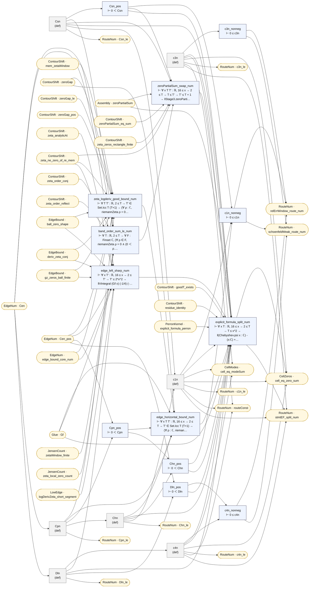

# `lean_stage3/Stage3/GlueNum.lean`

**What it does** (its own header): GlueNum — block E8b of `lean_stage3/design/joints.md`. 2026-11-22. `Glue`'s theorems under the truncated explicit formula, and the formula itself, with their constants as definitions. Each proof is the original with its existence step replaced (`LOOP.md` § 3); the left edge takes `EdgeBound.logDerivZeta_short_segment` where the original called compactness. `Glue.lean` and `GlueFloor.lean` are untouched.

**Imports:** [`EdgeNum`](../lean_stage3/EdgeNum.md), [`GlueFloor`](../lean_stage3/GlueFloor.md).
**Imported by:** [`Stage3`](../lean_stage3/Stage3.md), [`CellZeros`](../lean_stage3/CellZeros.md), [`RouteNum`](../lean_stage3/RouteNum.md).

Blue: theorem. Green: a theorem nothing else uses (an end). Dashed white: connects to nothing. Grey: definition. Red: contains `sorry`. Yellow: in another file. An arrow A → B reads "A is used by B".

## Every declaration

| declaration | proves (output) | needs (input) | why (its own docstring) | uses | used by |
|---|---|---|---|---|---|
| `Glue.Csn` def, line 34 | ℝ | — | The band count's constant. | — | `Glue.Csn_pos`, `Glue.band_order_sum_le_num`, `Glue.c1n`, `Glue.explicit_formula_split_num`, `Glue.zeroPartialSum_swap_num`, `RouteNum.Csn_le` |
| `Glue.Csn_pos` theorem, line 36 | 0 &lt; Csn | — | — | `Glue.Csn` | `Glue.c1n_nonneg`, `Glue.explicit_formula_split_num`, `Glue.zeroPartialSum_swap_num` |
| `Glue.Cpn` def, line 42 | ℝ | — | The good-height constant. | `EdgeBound.Cen` | `Glue.Chn`, `Glue.Cpn_pos`, `Glue.edge_horizontal_bound_num`, `Glue.zeta_logderiv_good_bound_num`, `RouteNum.Cpn_le` |
| `Glue.Cpn_pos` theorem, line 44 | 0 &lt; Cpn | — | — | `EdgeBound.Cen_pos`, `Glue.Cpn` | `Glue.Chn_pos`, `Glue.edge_horizontal_bound_num` |
| `Glue.Chn` def, line 51 | ℝ | — | The horizontal-edge constant. | `Glue.Cpn` | `Glue.Chn_pos`, `Glue.c1n`, `Glue.edge_horizontal_bound_num`, `Glue.explicit_formula_split_num`, `RouteNum.Chn_le` |
| `Glue.Chn_pos` theorem, line 53 | 0 &lt; Chn | — | — | `Glue.Chn`, `Glue.Cpn_pos` | `Glue.c1n_nonneg`, `Glue.explicit_formula_split_num` |
| `Glue.Dln` def, line 59 | ℝ | — | The left-edge constant. | `EdgeBound.Cen` | `Glue.Dln_pos`, `Glue.c4n`, `Glue.edge_left_sharp_num`, `Glue.explicit_formula_split_num`, `RouteNum.Dln_le` |
| `Glue.Dln_pos` theorem, line 61 | 0 &lt; Dln | — | — | `EdgeBound.Cen_pos`, `Glue.Dln` | `Glue.c4n_nonneg`, `Glue.explicit_formula_split_num` |
| `Glue.c1n` def, line 68 | ℝ | — | The explicit formula's three constants. | `Glue.Chn`, `Glue.Csn` | `CellModes.cell_eq_modeSum`, `CellZeros.cell_eq_zero_sum`, `Glue.c1n_nonneg`, `Glue.explicit_formula_split_num`, `RouteNum.c1n_le`, `Stage3.routeConst`, `Stage3.stmtEF_split_num` |
| `Glue.c3n` def, line 69 | ℝ | — | — | — | `CellModes.cell_eq_modeSum`, `CellZeros.cell_eq_zero_sum`, `Glue.c3n_nonneg`, `Glue.explicit_formula_split_num`, `RouteNum.c3n_le`, `Stage3.routeConst`, `Stage3.stmtEF_split_num` |
| `Glue.c4n` def, line 70 | ℝ | — | — | `Glue.Dln` | `CellModes.cell_eq_modeSum`, `CellZeros.cell_eq_zero_sum`, `Glue.c4n_nonneg`, `Glue.explicit_formula_split_num`, `RouteNum.c4n_le`, `Stage3.routeConst`, `Stage3.stmtEF_split_num` |
| `Glue.c1n_nonneg` theorem, line 72 | 0 ≤ c1n | — | — | `Glue.Chn_pos`, `Glue.Csn_pos`, `Glue.c1n` | `RouteNum.relErrWindow_route_num`, `Stage3.schoenfeldWeak_route_num` |
| `Glue.c3n_nonneg` theorem, line 78 | 0 ≤ c3n | — | — | `Glue.c3n` | `RouteNum.relErrWindow_route_num`, `Stage3.schoenfeldWeak_route_num` |
| `Glue.c4n_nonneg` theorem, line 82 | 0 ≤ c4n | — | — | `Glue.Dln_pos`, `Glue.c4n` | `RouteNum.relErrWindow_route_num`, `Stage3.schoenfeldWeak_route_num` |
| `Glue.band_order_sum_le_num` theorem, line 90 | ∀ T : ℝ, 2 ≤ T → ∀ F : Finset ℂ, (∀ ρ ∈ F, riemannZeta ρ = 0 ∧ (0 &lt; ρ.re ∧ ρ.re &lt; 1) ∧ T ≤ \|ρ.im\| ∧ \|ρ.im\| ≤ T + 1) → (∑ ρ ∈ F, (analyticOrderNatAt riemannZeta ρ : ℝ)) ≤ Csn * Real.log T | — | The band count: any finite set of strip zeros with `\|im\|` in `[T, T+1]` has total multiplicity `≤ C·log T` — two windows per sign, reflection for the left half, conjugation for the negative sign. | `ContourShift.mem_zetaWindow`, `ContourShift.zeta_order_conj`, `ContourShift.zeta_order_reflect`, `Glue.Csn`, `Stage3.zetaWindow_finite`, `Stage3.zeta_local_zero_count` | `Glue.zeroPartialSum_swap_num` |
| `Glue.zeroPartialSum_swap_num` theorem, line 316 | ∀ x T T' : ℝ, 16 ≤ x → 2 ≤ T → T ≤ T' → T' ≤ T + 1 → ‖Stage3.zeroPartialSum x T' - Stage3.zeroPartialSum x T‖ ≤ Csn * x * Real.log T / T | — | The swap: moving the zero sum from a height `T′ ∈ [T, T+1]` back to `T` costs `≤ C·x·log T / T`. | `Stage3.zeroPartialSum`, `ContourShift.zeroPartialSum_eq_sum`, `ContourShift.zeta_ne_zero_of_re_mem`, `ContourShift.zeta_zeros_rectangle_finite`, `Glue.Csn`, `Glue.Csn_pos`, `Glue.band_order_sum_le_num` | `Glue.explicit_formula_split_num` |
| `Glue.zeta_logderiv_good_bound_num` theorem, line 423 | ∀ T T' : ℝ, 2 ≤ T → T' ∈ Set.Icc T (T+1) → (∀ ρ : ℂ, riemannZeta ρ = 0 → 0 &lt; ρ.re → ContourShift.zeroGap T ≤ \|ρ.im - T'\|) → ∀ u : ℂ, \|u.im\| = T' → -1/4 ≤ u.re → u.re ≤ 2 → ‖deriv riemannZeta u / riemannZeta u‖ ≤ Cpn * Real.log T ^ 2 | — | The pointwise good-height bound, both signs of the height. | `ContourShift.zeroGap`, `ContourShift.zeroGap_le`, `ContourShift.zeroGap_pos`, `ContourShift.zeta_ne_zero_of_re_mem`, `EdgeBound.ball_zero_shape`, `EdgeBound.deriv_zeta_conj`, `EdgeBound.gz_zeros_ball_finite`, `EdgeBound.Cen`, `EdgeBound.Cen_pos`, `EdgeBound.edge_bound_core_num`, `Glue.Cpn` | `Glue.edge_horizontal_bound_num` |
| `Glue.edge_horizontal_bound_num` theorem, line 520 | ∀ x T T' : ℝ, 16 ≤ x → 2 ≤ T → T' ∈ Set.Icc T (T+1) → (∀ ρ : ℂ, riemannZeta ρ = 0 → 0 &lt; ρ.re → ContourShift.zeroGap T ≤ \|ρ.im - T'\|) → ∀ y : ℝ, \|y\| = T' → ‖HIntegral (Gf x) (-1/4) (1 + 1/Real.log x) y‖ ≤ Chn * x * Real.log T ^ 2 / T | — | The horizontal-edge integral bound at a good height, both signs: `≤ C·x·log²T/T`. | `ContourShift.zeroGap`, `Glue.Gf`, `Glue.Chn`, `Glue.Cpn`, `Glue.Cpn_pos`, `Glue.zeta_logderiv_good_bound_num` | `Glue.explicit_formula_split_num` |
| `Glue.edge_left_sharp_num` theorem, line 621 | ∀ x T' : ℝ, 16 ≤ x → 2 ≤ T' → T' ≤ 2*x^2 → ‖VIntegral (Gf x) (-1/4) (-T') T'‖ ≤ 72 * Dln * ((Real.log x)^2 * x ^ (-(1:ℝ)/4)) | — | The left edge at its own size: `≤ 72·D·log²x·x^(−1/4)` for `T′ ≤ 2x²`. `Glue.edge_left_bound`'s proof, stopped before its last two steps. | `ContourShift.zeta_analyticAt`, `ContourShift.zeta_ne_zero_of_re_mem`, `EdgeBound.ball_zero_shape`, `EdgeBound.deriv_zeta_conj`, `EdgeBound.gz_zeros_ball_finite`, `EdgeBound.Cen`, `EdgeBound.Cen_pos`, `EdgeBound.edge_bound_core_num`, `Glue.Gf`, `Glue.Dln`, `EdgeBound.logDerivZeta_short_segment` | `Glue.explicit_formula_split_num` |
| `Glue.explicit_formula_split_num` theorem, line 1004 | ∀ x T : ℝ, 16 ≤ x → 2 ≤ T → T ≤ x^2 → ‖(Chebyshev.psi x : ℂ) - (x:ℂ) + Stage3.zeroPartialSum x T‖ ≤ c1n * x * Real.log (x*T)^2 / T + c3n * Real.log x + c4n * ((Real.log x)^2 * x ^ (-(1:ℝ)/4)) | — | THE TRUNCATED EXPLICIT FORMULA — hEF's deliverable, in the `T ≤ x²` regime the consumer uses: constants exist with `‖ψ(x) − x + Σ_{\|γ\|&lt;T} m·x^ρ/ρ‖ ≤ c₁·x·log²(xT)/T + c₂·log x`. | `Stage3.zeroPartialSum`, `ContourShift.goodT_exists`, `ContourShift.residue_identity`, `Glue.Gf`, `Glue.Chn`, `Glue.Chn_pos`, `Glue.Csn`, `Glue.Csn_pos`, `Glue.Dln`, `Glue.Dln_pos`, `Glue.c1n`, `Glue.c3n`, `Glue.c4n`, `Glue.edge_horizontal_bound_num`, `Glue.edge_left_sharp_num`, `Glue.zeroPartialSum_swap_num`, `PerronKernel.explicit_formula_perron` | `CellZeros.cell_eq_zero_sum`, `Stage3.stmtEF_split_num` |
