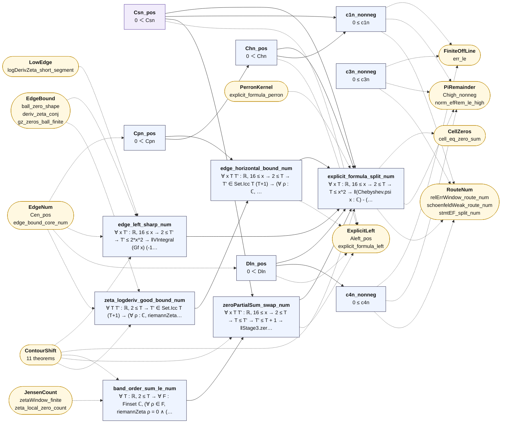

# `lean_stage3/Stage3/GlueNum.lean`

GlueNum — block E8b of `lean_stage3/design/joints.md`. 2026-11-22. `Glue`'s theorems under the truncated explicit formula, and the formula itself, with their constants as definitions. Each proof is the original with its existence step replaced (`LOOP.md` § 3); the left edge takes `EdgeBound.logDerivZeta_short_segment` where the original called compactness. `Glue.lean` and `GlueFloor.lean` are untouched.

13 theorems, 7 definitions, 1270 lines. Arrows are Lean's own record of what each proof uses.

**Imports:** [`EdgeNum`](../lean_stage3/EdgeNum.md), [`GlueFloor`](../lean_stage3/GlueFloor.md)  
**Imported by:** [`Stage3`](../lean_stage3/Stage3.md), [`CellZeros`](../lean_stage3/CellZeros.md), [`ExplicitLeft`](../lean_stage3/ExplicitLeft.md), [`RouteNum`](../lean_stage3/RouteNum.md)

## The picture



An arrow A → B reads "A is used in the proof of B". Green: counting, integers only. Violet: shape, analysis with no ζ. Blue: reads ζ. A name ending in ■ is an end: nothing else uses it. Red: contains `sorry`. Yellow: theorems in another file, counted; a dotted arrow crosses files. Definitions are not drawn; they are listed below the diagram.

## Definitions

<a name="Glue-Csn"></a>
### `Glue.Csn`

def · line 34

The band count's constant.

- **Is:** `` Csn : ℝ := 8 * (15 + 88 / Real.log 2) ``
- **Used by 9:** [`ExplicitLeft.explicit_formula_left`](../lean_stage3/ExplicitLeft.md#ExplicitLeft-explicit_formula_left), [`Glue.Csn_pos`](#Glue-Csn_pos), [`Glue.band_order_sum_le_num`](#Glue-band_order_sum_le_num), [`Glue.c1n`](#Glue-c1n), [`Glue.c1n_nonneg`](#Glue-c1n_nonneg), [`Glue.explicit_formula_split_num`](#Glue-explicit_formula_split_num), [`Glue.zeroPartialSum_swap_num`](#Glue-zeroPartialSum_swap_num), [`RouteNum.Csn_le`](../lean_stage3/RouteNum.md#RouteNum-Csn_le), [`RouteNum.c1n_le`](../lean_stage3/RouteNum.md#RouteNum-c1n_le)

<a name="Glue-Cpn"></a>
### `Glue.Cpn`

def · line 43

The good-height constant.

- **Is:** `` Cpn : ℝ := EdgeBound.Cen * 2 * (180 + 1060 / Real.log 2) ``
- **Built from:** [`EdgeBound.Cen`](../lean_stage3/EdgeNum.md#EdgeBound-Cen)
- **Used by 7:** [`Glue.Chn`](#Glue-Chn), [`Glue.Chn_pos`](#Glue-Chn_pos), [`Glue.Cpn_pos`](#Glue-Cpn_pos), [`Glue.edge_horizontal_bound_num`](#Glue-edge_horizontal_bound_num), [`Glue.zeta_logderiv_good_bound_num`](#Glue-zeta_logderiv_good_bound_num), [`RouteNum.Chn_le`](../lean_stage3/RouteNum.md#RouteNum-Chn_le), [`RouteNum.Cpn_le`](../lean_stage3/RouteNum.md#RouteNum-Cpn_le)

<a name="Glue-Chn"></a>
### `Glue.Chn`

def · line 53

The horizontal-edge constant.

- **Is:** `` Chn : ℝ := Cpn * 3 * (9/4) ``
- **Built from:** [`Glue.Cpn`](#Glue-Cpn)
- **Used by 8:** [`ExplicitLeft.explicit_formula_left`](../lean_stage3/ExplicitLeft.md#ExplicitLeft-explicit_formula_left), [`Glue.Chn_pos`](#Glue-Chn_pos), [`Glue.c1n`](#Glue-c1n), [`Glue.c1n_nonneg`](#Glue-c1n_nonneg), [`Glue.edge_horizontal_bound_num`](#Glue-edge_horizontal_bound_num), [`Glue.explicit_formula_split_num`](#Glue-explicit_formula_split_num), [`RouteNum.Chn_le`](../lean_stage3/RouteNum.md#RouteNum-Chn_le), [`RouteNum.c1n_le`](../lean_stage3/RouteNum.md#RouteNum-c1n_le)

<a name="Glue-Dln"></a>
### `Glue.Dln`

def · line 62

The left-edge constant.

- **Is:** `` Dln : ℝ := 36 * EdgeBound.Cen + 9 * (1620000 + 1) / Real.log 2 ``
- **Built from:** [`EdgeBound.Cen`](../lean_stage3/EdgeNum.md#EdgeBound-Cen)
- **Used by 9:** [`ExplicitLeft.Aleft`](../lean_stage3/ExplicitLeft.md#ExplicitLeft-Aleft), [`ExplicitLeft.edge_left_any`](../lean_stage3/ExplicitLeft.md#ExplicitLeft-edge_left_any), [`Glue.Dln_pos`](#Glue-Dln_pos), [`Glue.c4n`](#Glue-c4n), [`Glue.c4n_nonneg`](#Glue-c4n_nonneg), [`Glue.edge_left_sharp_num`](#Glue-edge_left_sharp_num), [`Glue.explicit_formula_split_num`](#Glue-explicit_formula_split_num), [`RouteNum.Dln_le`](../lean_stage3/RouteNum.md#RouteNum-Dln_le), [`RouteNum.c4n_le`](../lean_stage3/RouteNum.md#RouteNum-c4n_le)

<a name="Glue-c1n"></a>
### `Glue.c1n`

def · line 72

The explicit formula's three constants.

- **Is:** `` c1n : ℝ := 2400 + 2 * Chn + Csn ``
- **Built from:** [`Glue.Chn`](#Glue-Chn), [`Glue.Csn`](#Glue-Csn)
- **Used by 21:** [`CellBdiff.cell_eq_modeSum_bdiff`](../lean_stage3/CellBdiff.md#CellBdiff-cell_eq_modeSum_bdiff), [`CellModes.cell_eq_modeSum`](../lean_stage3/CellModes.md#CellModes-cell_eq_modeSum), [`CellRows.cell_eq_zero_sum_rows`](../lean_stage3/CellRows.md#CellRows-cell_eq_zero_sum_rows), [`CellRows.cell_tail_tendsto`](../lean_stage3/CellRows.md#CellRows-cell_tail_tendsto), [`CellZeros.cell_eq_zero_sum`](../lean_stage3/CellZeros.md#CellZeros-cell_eq_zero_sum), [`ExplicitLeft.explicit_formula_any`](../lean_stage3/ExplicitLeft.md#ExplicitLeft-explicit_formula_any), [`ExplicitLeft.explicit_formula_left`](../lean_stage3/ExplicitLeft.md#ExplicitLeft-explicit_formula_left), [`FiniteOffLine.cell_zero_sum_finset`](../lean_stage3/FiniteOffLine.md#FiniteOffLine-cell_zero_sum_finset), [`FiniteOffLine.err_le`](../lean_stage3/FiniteOffLine.md#FiniteOffLine-err_le), [`FiniteOffLine.finite_off_line`](../lean_stage3/FiniteOffLine.md#FiniteOffLine-finite_off_line), [`GateEval.routeConst_le`](../lean_stage3/GateEval.md#GateEval-routeConst_le), [`Glue.c1n_nonneg`](#Glue-c1n_nonneg), [`Glue.explicit_formula_split_num`](#Glue-explicit_formula_split_num), [`PiRemainder.Chigh`](../lean_stage3/PiRemainder.md#PiRemainder-Chigh), [`PiRemainder.Chigh_nonneg`](../lean_stage3/PiRemainder.md#PiRemainder-Chigh_nonneg), [`PiRemainder.norm_efRem_le_high`](../lean_stage3/PiRemainder.md#PiRemainder-norm_efRem_le_high), [`RouteNum.c1n_le`](../lean_stage3/RouteNum.md#RouteNum-c1n_le), [`RouteNum.relErrWindow_route_num`](../lean_stage3/RouteNum.md#RouteNum-relErrWindow_route_num), [`Stage3.routeConst`](../lean_stage3/RouteNum.md#Stage3-routeConst), [`Stage3.schoenfeldWeak_route_num`](../lean_stage3/RouteNum.md#Stage3-schoenfeldWeak_route_num), [`Stage3.stmtEF_split_num`](../lean_stage3/RouteNum.md#Stage3-stmtEF_split_num)

<a name="Glue-c3n"></a>
### `Glue.c3n`

def · line 73

- **Is:** `` c3n : ℝ := 13 + ‖deriv riemannZeta 0 / riemannZeta 0‖ / 2 ``
- **Used by 21:** [`CellBdiff.cell_eq_modeSum_bdiff`](../lean_stage3/CellBdiff.md#CellBdiff-cell_eq_modeSum_bdiff), [`CellModes.cell_eq_modeSum`](../lean_stage3/CellModes.md#CellModes-cell_eq_modeSum), [`CellRows.cell_eq_zero_sum_rows`](../lean_stage3/CellRows.md#CellRows-cell_eq_zero_sum_rows), [`CellRows.cell_tail_tendsto`](../lean_stage3/CellRows.md#CellRows-cell_tail_tendsto), [`CellZeros.cell_eq_zero_sum`](../lean_stage3/CellZeros.md#CellZeros-cell_eq_zero_sum), [`ExplicitLeft.explicit_formula_any`](../lean_stage3/ExplicitLeft.md#ExplicitLeft-explicit_formula_any), [`ExplicitLeft.explicit_formula_left`](../lean_stage3/ExplicitLeft.md#ExplicitLeft-explicit_formula_left), [`FiniteOffLine.cell_zero_sum_finset`](../lean_stage3/FiniteOffLine.md#FiniteOffLine-cell_zero_sum_finset), [`FiniteOffLine.err_le`](../lean_stage3/FiniteOffLine.md#FiniteOffLine-err_le), [`FiniteOffLine.finite_off_line`](../lean_stage3/FiniteOffLine.md#FiniteOffLine-finite_off_line), [`GateEval.routeConst_le`](../lean_stage3/GateEval.md#GateEval-routeConst_le), [`Glue.c3n_nonneg`](#Glue-c3n_nonneg), [`Glue.explicit_formula_split_num`](#Glue-explicit_formula_split_num), [`PiRemainder.Chigh`](../lean_stage3/PiRemainder.md#PiRemainder-Chigh), [`PiRemainder.Chigh_nonneg`](../lean_stage3/PiRemainder.md#PiRemainder-Chigh_nonneg), [`PiRemainder.norm_efRem_le_high`](../lean_stage3/PiRemainder.md#PiRemainder-norm_efRem_le_high), [`RouteNum.c3n_le`](../lean_stage3/RouteNum.md#RouteNum-c3n_le), [`RouteNum.relErrWindow_route_num`](../lean_stage3/RouteNum.md#RouteNum-relErrWindow_route_num), [`Stage3.routeConst`](../lean_stage3/RouteNum.md#Stage3-routeConst), [`Stage3.schoenfeldWeak_route_num`](../lean_stage3/RouteNum.md#Stage3-schoenfeldWeak_route_num), [`Stage3.stmtEF_split_num`](../lean_stage3/RouteNum.md#Stage3-stmtEF_split_num)

<a name="Glue-c4n"></a>
### `Glue.c4n`

def · line 74

- **Is:** `` c4n : ℝ := 72 * Dln ``
- **Built from:** [`Glue.Dln`](#Glue-Dln)
- **Used by 19:** [`CellBdiff.cell_eq_modeSum_bdiff`](../lean_stage3/CellBdiff.md#CellBdiff-cell_eq_modeSum_bdiff), [`CellModes.cell_eq_modeSum`](../lean_stage3/CellModes.md#CellModes-cell_eq_modeSum), [`CellRows.cell_eq_zero_sum_rows`](../lean_stage3/CellRows.md#CellRows-cell_eq_zero_sum_rows), [`CellRows.cell_tail_tendsto`](../lean_stage3/CellRows.md#CellRows-cell_tail_tendsto), [`CellZeros.cell_eq_zero_sum`](../lean_stage3/CellZeros.md#CellZeros-cell_eq_zero_sum), [`FiniteOffLine.cell_zero_sum_finset`](../lean_stage3/FiniteOffLine.md#FiniteOffLine-cell_zero_sum_finset), [`FiniteOffLine.err_le`](../lean_stage3/FiniteOffLine.md#FiniteOffLine-err_le), [`FiniteOffLine.finite_off_line`](../lean_stage3/FiniteOffLine.md#FiniteOffLine-finite_off_line), [`GateEval.routeConst_le`](../lean_stage3/GateEval.md#GateEval-routeConst_le), [`Glue.c4n_nonneg`](#Glue-c4n_nonneg), [`Glue.explicit_formula_split_num`](#Glue-explicit_formula_split_num), [`PiRemainder.Chigh`](../lean_stage3/PiRemainder.md#PiRemainder-Chigh), [`PiRemainder.Chigh_nonneg`](../lean_stage3/PiRemainder.md#PiRemainder-Chigh_nonneg), [`PiRemainder.norm_efRem_le_high`](../lean_stage3/PiRemainder.md#PiRemainder-norm_efRem_le_high), [`RouteNum.c4n_le`](../lean_stage3/RouteNum.md#RouteNum-c4n_le), [`RouteNum.relErrWindow_route_num`](../lean_stage3/RouteNum.md#RouteNum-relErrWindow_route_num), [`Stage3.routeConst`](../lean_stage3/RouteNum.md#Stage3-routeConst), [`Stage3.schoenfeldWeak_route_num`](../lean_stage3/RouteNum.md#Stage3-schoenfeldWeak_route_num), [`Stage3.stmtEF_split_num`](../lean_stage3/RouteNum.md#Stage3-stmtEF_split_num)

## Theorems

<a name="Glue-Csn_pos"></a>
### `Glue.Csn_pos`

line 37

**Shape.** Uses real or complex analysis; nothing in it or beneath it reads ζ.

**Why.** The band count's constant `Csn` is positive.

**Proves**

```lean
0 < Csn
```

**Stated with:** [`Glue.Csn`](#Glue-Csn)

**Fed by:** no theorem of this repo; it stands on Mathlib and the definitions below.

**Feeds** (4 that use it)

  - [`ExplicitLeft.explicit_formula_left`](../lean_stage3/ExplicitLeft.md#ExplicitLeft-explicit_formula_left) (ExplicitLeft) — `` ∃ T' : ℝ, T ≤ T' ∧ T' ≤ T + 1 ∧ ‖(Chebyshev.psi x : ℂ) - (x:ℂ) + Stage3.zeroPartialSum x T‖ ≤ Glue.c1n * x * Real.log (x*T)^2 / T + Glue.c3n * Real.lo… ``
  - [`Glue.c1n_nonneg`](#Glue-c1n_nonneg) — `` 0 ≤ c1n ``
  - [`Glue.explicit_formula_split_num`](#Glue-explicit_formula_split_num) — `` ∀ x T : ℝ, 16 ≤ x → 2 ≤ T → T ≤ x^2 → ‖(Chebyshev.psi x : ℂ) - (x:ℂ) + Stage3.zeroPartialSum x T‖ ≤ c1n * x * Real.log (x*T)^2 / T + c3n * Real.log x … ``
  - [`Glue.zeroPartialSum_swap_num`](#Glue-zeroPartialSum_swap_num) — `` ∀ x T T' : ℝ, 16 ≤ x → 2 ≤ T → T ≤ T' → T' ≤ T + 1 → ‖Stage3.zeroPartialSum x T' - Stage3.zeroPartialSum x T‖ ≤ Csn * x * Real.log T / T ``

<a name="Glue-Cpn_pos"></a>
### `Glue.Cpn_pos`

line 46

**Reads ζ.** It, or something it rests on, uses the zeta function, its zeros or the Riemann hypothesis.

**Why.** The good-height constant `Cpn` is positive.

**Proves**

```lean
0 < Cpn
```

**Stated with:** [`Glue.Cpn`](#Glue-Cpn)

**Fed by** (1 theorem its proof uses)

  - [`EdgeBound.Cen_pos`](../lean_stage3/EdgeNum.md#EdgeBound-Cen_pos) (EdgeNum) — `` 0 < Cen ``

**Definitions its proof touches:** [`EdgeBound.Cen`](../lean_stage3/EdgeNum.md#EdgeBound-Cen)

**Feeds** (2 that use it)

  - [`Glue.Chn_pos`](#Glue-Chn_pos) — `` 0 < Chn ``
  - [`Glue.edge_horizontal_bound_num`](#Glue-edge_horizontal_bound_num) — `` ∀ x T T' : ℝ, 16 ≤ x → 2 ≤ T → T' ∈ Set.Icc T (T+1) → (∀ ρ : ℂ, riemannZeta ρ = 0 → 0 < ρ.re → ContourShift.zeroGap T ≤ |ρ.im - T'|) → ∀ y : ℝ, |y| = … ``

<a name="Glue-Chn_pos"></a>
### `Glue.Chn_pos`

line 56

**Reads ζ.** It, or something it rests on, uses the zeta function, its zeros or the Riemann hypothesis.

**Why.** The horizontal-edge constant `Chn` is positive.

**Proves**

```lean
0 < Chn
```

**Stated with:** [`Glue.Chn`](#Glue-Chn)

**Fed by** (1 theorem its proof uses)

  - [`Glue.Cpn_pos`](#Glue-Cpn_pos) — `` 0 < Cpn ``

**Definitions its proof touches:** [`Glue.Cpn`](#Glue-Cpn)

**Feeds** (3 that use it)

  - [`ExplicitLeft.explicit_formula_left`](../lean_stage3/ExplicitLeft.md#ExplicitLeft-explicit_formula_left) (ExplicitLeft) — `` ∃ T' : ℝ, T ≤ T' ∧ T' ≤ T + 1 ∧ ‖(Chebyshev.psi x : ℂ) - (x:ℂ) + Stage3.zeroPartialSum x T‖ ≤ Glue.c1n * x * Real.log (x*T)^2 / T + Glue.c3n * Real.lo… ``
  - [`Glue.c1n_nonneg`](#Glue-c1n_nonneg) — `` 0 ≤ c1n ``
  - [`Glue.explicit_formula_split_num`](#Glue-explicit_formula_split_num) — `` ∀ x T : ℝ, 16 ≤ x → 2 ≤ T → T ≤ x^2 → ‖(Chebyshev.psi x : ℂ) - (x:ℂ) + Stage3.zeroPartialSum x T‖ ≤ c1n * x * Real.log (x*T)^2 / T + c3n * Real.log x … ``

<a name="Glue-Dln_pos"></a>
### `Glue.Dln_pos`

line 65

**Reads ζ.** It, or something it rests on, uses the zeta function, its zeros or the Riemann hypothesis.

**Why.** The left-edge constant `Dln` is positive.

**Proves**

```lean
0 < Dln
```

**Stated with:** [`Glue.Dln`](#Glue-Dln)

**Fed by** (1 theorem its proof uses)

  - [`EdgeBound.Cen_pos`](../lean_stage3/EdgeNum.md#EdgeBound-Cen_pos) (EdgeNum) — `` 0 < Cen ``

**Definitions its proof touches:** [`EdgeBound.Cen`](../lean_stage3/EdgeNum.md#EdgeBound-Cen)

**Feeds** (3 that use it)

  - [`ExplicitLeft.Aleft_pos`](../lean_stage3/ExplicitLeft.md#ExplicitLeft-Aleft_pos) (ExplicitLeft) — `` 0 < Aleft ``
  - [`Glue.c4n_nonneg`](#Glue-c4n_nonneg) — `` 0 ≤ c4n ``
  - [`Glue.explicit_formula_split_num`](#Glue-explicit_formula_split_num) — `` ∀ x T : ℝ, 16 ≤ x → 2 ≤ T → T ≤ x^2 → ‖(Chebyshev.psi x : ℂ) - (x:ℂ) + Stage3.zeroPartialSum x T‖ ≤ c1n * x * Real.log (x*T)^2 / T + c3n * Real.log x … ``

<a name="Glue-c1n_nonneg"></a>
### `Glue.c1n_nonneg`

line 77

**Reads ζ.** It, or something it rests on, uses the zeta function, its zeros or the Riemann hypothesis.

**Why.** The explicit formula's first constant `c1n` is nonnegative.

**Proves**

```lean
0 ≤ c1n
```

**Stated with:** [`Glue.c1n`](#Glue-c1n)

**Fed by** (2 theorems its proof uses)

  - [`Glue.Chn_pos`](#Glue-Chn_pos) — `` 0 < Chn ``
  - [`Glue.Csn_pos`](#Glue-Csn_pos) — `` 0 < Csn ``

**Definitions its proof touches:** [`Glue.Chn`](#Glue-Chn), [`Glue.Csn`](#Glue-Csn)

**Feeds** (5 that use it)

  - [`FiniteOffLine.err_le`](../lean_stage3/FiniteOffLine.md#FiniteOffLine-err_le) (FiniteOffLine) — `` ∑ j ∈ range (d + 1), (d.choose j : ℝ) * (Glue.c1n * (2:ℝ) ^ ((r : ℤ) - (j : ℤ)) * Real.log ((2:ℝ) ^ ((r : ℤ) - (j : ℤ)) * (2:ℝ) ^ (K + 1)) ^ 2 / (2:ℝ)… ``
  - [`PiRemainder.Chigh_nonneg`](../lean_stage3/PiRemainder.md#PiRemainder-Chigh_nonneg) (PiRemainder) — `` 0 ≤ Chigh ``
  - [`PiRemainder.norm_efRem_le_high`](../lean_stage3/PiRemainder.md#PiRemainder-norm_efRem_le_high) (PiRemainder) — `` ‖efRem x t‖ ≤ Chigh * Real.log x ^ 2 ``
  - [`RouteNum.relErrWindow_route_num`](../lean_stage3/RouteNum.md#RouteNum-relErrWindow_route_num) (RouteNum) — `` JointDialGate.StmtRelErrWindow (fun m : ℤ => (Nat.primeCounting ⌊(2 : ℝ) ^ (m : ℝ)⌋₊ : ℝ)) (fun m : ℤ => 2 / Real.log 2 + ∫ t in (1 : ℝ)..(m : ℝ), Rea… ``
  - [`Stage3.schoenfeldWeak_route_num`](../lean_stage3/RouteNum.md#Stage3-schoenfeldWeak_route_num) (RouteNum) — `` StmtSchoenfeldWeak (routeConst x₀) 1 (max (x₀ ^ 2) 9) (fun x => (Nat.primeCounting ⌊x⌋₊ : ℝ)) Li ``

<a name="Glue-c3n_nonneg"></a>
### `Glue.c3n_nonneg`

line 84

**Reads ζ.** It, or something it rests on, uses the zeta function, its zeros or the Riemann hypothesis.

**Why.** The explicit formula's constant `c3n` is nonnegative.

**Proves**

```lean
0 ≤ c3n
```

**Stated with:** [`Glue.c3n`](#Glue-c3n)

**Fed by:** no theorem of this repo; it stands on Mathlib and the definitions below.

**Feeds** (5 that use it)

  - [`FiniteOffLine.err_le`](../lean_stage3/FiniteOffLine.md#FiniteOffLine-err_le) (FiniteOffLine) — `` ∑ j ∈ range (d + 1), (d.choose j : ℝ) * (Glue.c1n * (2:ℝ) ^ ((r : ℤ) - (j : ℤ)) * Real.log ((2:ℝ) ^ ((r : ℤ) - (j : ℤ)) * (2:ℝ) ^ (K + 1)) ^ 2 / (2:ℝ)… ``
  - [`PiRemainder.Chigh_nonneg`](../lean_stage3/PiRemainder.md#PiRemainder-Chigh_nonneg) (PiRemainder) — `` 0 ≤ Chigh ``
  - [`PiRemainder.norm_efRem_le_high`](../lean_stage3/PiRemainder.md#PiRemainder-norm_efRem_le_high) (PiRemainder) — `` ‖efRem x t‖ ≤ Chigh * Real.log x ^ 2 ``
  - [`RouteNum.relErrWindow_route_num`](../lean_stage3/RouteNum.md#RouteNum-relErrWindow_route_num) (RouteNum) — `` JointDialGate.StmtRelErrWindow (fun m : ℤ => (Nat.primeCounting ⌊(2 : ℝ) ^ (m : ℝ)⌋₊ : ℝ)) (fun m : ℤ => 2 / Real.log 2 + ∫ t in (1 : ℝ)..(m : ℝ), Rea… ``
  - [`Stage3.schoenfeldWeak_route_num`](../lean_stage3/RouteNum.md#Stage3-schoenfeldWeak_route_num) (RouteNum) — `` StmtSchoenfeldWeak (routeConst x₀) 1 (max (x₀ ^ 2) 9) (fun x => (Nat.primeCounting ⌊x⌋₊ : ℝ)) Li ``

<a name="Glue-c4n_nonneg"></a>
### `Glue.c4n_nonneg`

line 89

**Reads ζ.** It, or something it rests on, uses the zeta function, its zeros or the Riemann hypothesis.

**Why.** The explicit formula's constant `c4n` is nonnegative.

**Proves**

```lean
0 ≤ c4n
```

**Stated with:** [`Glue.c4n`](#Glue-c4n)

**Fed by** (1 theorem its proof uses)

  - [`Glue.Dln_pos`](#Glue-Dln_pos) — `` 0 < Dln ``

**Definitions its proof touches:** [`Glue.Dln`](#Glue-Dln)

**Feeds** (5 that use it)

  - [`FiniteOffLine.err_le`](../lean_stage3/FiniteOffLine.md#FiniteOffLine-err_le) (FiniteOffLine) — `` ∑ j ∈ range (d + 1), (d.choose j : ℝ) * (Glue.c1n * (2:ℝ) ^ ((r : ℤ) - (j : ℤ)) * Real.log ((2:ℝ) ^ ((r : ℤ) - (j : ℤ)) * (2:ℝ) ^ (K + 1)) ^ 2 / (2:ℝ)… ``
  - [`PiRemainder.Chigh_nonneg`](../lean_stage3/PiRemainder.md#PiRemainder-Chigh_nonneg) (PiRemainder) — `` 0 ≤ Chigh ``
  - [`PiRemainder.norm_efRem_le_high`](../lean_stage3/PiRemainder.md#PiRemainder-norm_efRem_le_high) (PiRemainder) — `` ‖efRem x t‖ ≤ Chigh * Real.log x ^ 2 ``
  - [`RouteNum.relErrWindow_route_num`](../lean_stage3/RouteNum.md#RouteNum-relErrWindow_route_num) (RouteNum) — `` JointDialGate.StmtRelErrWindow (fun m : ℤ => (Nat.primeCounting ⌊(2 : ℝ) ^ (m : ℝ)⌋₊ : ℝ)) (fun m : ℤ => 2 / Real.log 2 + ∫ t in (1 : ℝ)..(m : ℝ), Rea… ``
  - [`Stage3.schoenfeldWeak_route_num`](../lean_stage3/RouteNum.md#Stage3-schoenfeldWeak_route_num) (RouteNum) — `` StmtSchoenfeldWeak (routeConst x₀) 1 (max (x₀ ^ 2) 9) (fun x => (Nat.primeCounting ⌊x⌋₊ : ℝ)) Li ``

<a name="Glue-band_order_sum_le_num"></a>
### `Glue.band_order_sum_le_num`

line 97

**Reads ζ.** It, or something it rests on, uses the zeta function, its zeros or the Riemann hypothesis.

**Why.** The band count: any finite set of strip zeros with `|im|` in `[T, T+1]` has total multiplicity `≤ C·log T` — two windows per sign, reflection for the left half, conjugation for the negative sign.

**Proves**

```lean
∀ T : ℝ, 2 ≤ T → ∀ F : Finset ℂ, (∀ ρ ∈ F, riemannZeta ρ = 0 ∧ (0 < ρ.re ∧ ρ.re < 1) ∧ T ≤ |ρ.im| ∧ |ρ.im| ≤ T + 1) → (∑ ρ ∈ F, (analyticOrderNatAt riemannZeta ρ : ℝ)) ≤ Csn * Real.log T
```

**Stated with:** [`Glue.Csn`](#Glue-Csn)

**Fed by** (5 theorems its proof uses)

  - [`ContourShift.mem_zetaWindow`](../lean_stage3/ContourShift.md#ContourShift-mem_zetaWindow) (ContourShift) — `` ρ ∈ Stage3.zetaWindow T₀ ``
  - [`ContourShift.zeta_order_conj`](../lean_stage3/ContourShift.md#ContourShift-zeta_order_conj) (ContourShift) — `` analyticOrderNatAt riemannZeta ((starRingEnd ℂ) ρ) = analyticOrderNatAt riemannZeta ρ ``
  - [`ContourShift.zeta_order_reflect`](../lean_stage3/ContourShift.md#ContourShift-zeta_order_reflect) (ContourShift) — `` analyticOrderNatAt riemannZeta (1 - (starRingEnd ℂ) ρ) = analyticOrderNatAt riemannZeta ρ ``
  - [`Stage3.zetaWindow_finite`](../lean_stage3/JensenCount.md#Stage3-zetaWindow_finite) (JensenCount) — `` (zetaWindow T).Finite ``
  - [`Stage3.zeta_local_zero_count`](../lean_stage3/JensenCount.md#Stage3-zeta_local_zero_count) (JensenCount) — `` ∑ ρ ∈ (zetaWindow_finite hT).toFinset, (analyticOrderNatAt ζ ρ : ℝ) ≤ 15 * Real.log T + 73 ``

**Definitions its proof touches:** [`Stage3.zetaWindow`](../lean_stage3/JensenCount.md#Stage3-zetaWindow)

**Feeds** (1 that use it)

  - [`Glue.zeroPartialSum_swap_num`](#Glue-zeroPartialSum_swap_num) — `` ∀ x T T' : ℝ, 16 ≤ x → 2 ≤ T → T ≤ T' → T' ≤ T + 1 → ‖Stage3.zeroPartialSum x T' - Stage3.zeroPartialSum x T‖ ≤ Csn * x * Real.log T / T ``

<a name="Glue-zeroPartialSum_swap_num"></a>
### `Glue.zeroPartialSum_swap_num`

line 323

**Reads ζ.** It, or something it rests on, uses the zeta function, its zeros or the Riemann hypothesis.

**Why.** The swap: moving the zero sum from a height `T′ ∈ [T, T+1]` back to `T` costs `≤ C·x·log T / T`.

**Proves**

```lean
∀ x T T' : ℝ, 16 ≤ x → 2 ≤ T → T ≤ T' → T' ≤ T + 1 → ‖Stage3.zeroPartialSum x T' - Stage3.zeroPartialSum x T‖ ≤ Csn * x * Real.log T / T
```

**Stated with:** [`Stage3.zeroPartialSum`](../lean_stage3/Assembly.md#Stage3-zeroPartialSum), [`Glue.Csn`](#Glue-Csn)

**Fed by** (5 theorems its proof uses)

  - [`ContourShift.zeroPartialSum_eq_sum`](../lean_stage3/ContourShift.md#ContourShift-zeroPartialSum_eq_sum) (ContourShift) — `` Stage3.zeroPartialSum x T' = ∑ p ∈ ZF, ((analyticOrderNatAt riemannZeta p : ℂ) * ((x : ℂ) ^ p / p)) ``
  - [`ContourShift.zeta_ne_zero_of_re_mem`](../lean_stage3/ContourShift.md#ContourShift-zeta_ne_zero_of_re_mem) (ContourShift) — `` riemannZeta w ≠ 0 ``
  - [`ContourShift.zeta_zeros_rectangle_finite`](../lean_stage3/ContourShift.md#ContourShift-zeta_zeros_rectangle_finite) (ContourShift) — `` {ρ : ℂ | riemannZeta ρ = 0 ∧ ρ ∈ Rectangle z w}.Finite ``
  - [`Glue.Csn_pos`](#Glue-Csn_pos) — `` 0 < Csn ``
  - [`Glue.band_order_sum_le_num`](#Glue-band_order_sum_le_num) — `` ∀ T : ℝ, 2 ≤ T → ∀ F : Finset ℂ, (∀ ρ ∈ F, riemannZeta ρ = 0 ∧ (0 < ρ.re ∧ ρ.re < 1) ∧ T ≤ |ρ.im| ∧ |ρ.im| ≤ T + 1) → (∑ ρ ∈ F, (analyticOrderNatAt ri… ``

**Feeds** (2 that use it)

  - [`ExplicitLeft.explicit_formula_left`](../lean_stage3/ExplicitLeft.md#ExplicitLeft-explicit_formula_left) (ExplicitLeft) — `` ∃ T' : ℝ, T ≤ T' ∧ T' ≤ T + 1 ∧ ‖(Chebyshev.psi x : ℂ) - (x:ℂ) + Stage3.zeroPartialSum x T‖ ≤ Glue.c1n * x * Real.log (x*T)^2 / T + Glue.c3n * Real.lo… ``
  - [`Glue.explicit_formula_split_num`](#Glue-explicit_formula_split_num) — `` ∀ x T : ℝ, 16 ≤ x → 2 ≤ T → T ≤ x^2 → ‖(Chebyshev.psi x : ℂ) - (x:ℂ) + Stage3.zeroPartialSum x T‖ ≤ c1n * x * Real.log (x*T)^2 / T + c3n * Real.log x … ``

<a name="Glue-zeta_logderiv_good_bound_num"></a>
### `Glue.zeta_logderiv_good_bound_num`

line 430

**Reads ζ.** It, or something it rests on, uses the zeta function, its zeros or the Riemann hypothesis.

**Why.** The pointwise good-height bound, both signs of the height.

**Proves**

```lean
∀ T T' : ℝ, 2 ≤ T → T' ∈ Set.Icc T (T+1) → (∀ ρ : ℂ, riemannZeta ρ = 0 → 0 < ρ.re → ContourShift.zeroGap T ≤ |ρ.im - T'|) → ∀ u : ℂ, |u.im| = T' → -1/4 ≤ u.re → u.re ≤ 2 → ‖deriv riemannZeta u / riemannZeta u‖ ≤ Cpn * Real.log T ^ 2
```

**Stated with:** [`ContourShift.zeroGap`](../lean_stage3/ContourShift.md#ContourShift-zeroGap), [`Glue.Cpn`](#Glue-Cpn)

**Fed by** (8 theorems its proof uses)

  - [`ContourShift.zeroGap_le`](../lean_stage3/ContourShift.md#ContourShift-zeroGap_le) (ContourShift) — `` zeroGap T ≤ 9/10 ``
  - [`ContourShift.zeroGap_pos`](../lean_stage3/ContourShift.md#ContourShift-zeroGap_pos) (ContourShift) — `` 0 < zeroGap T ``
  - [`ContourShift.zeta_ne_zero_of_re_mem`](../lean_stage3/ContourShift.md#ContourShift-zeta_ne_zero_of_re_mem) (ContourShift) — `` riemannZeta w ≠ 0 ``
  - [`EdgeBound.ball_zero_shape`](../lean_stage3/EdgeBound.md#EdgeBound-ball_zero_shape) (EdgeBound) — `` riemannZeta w = 0 ∧ (0 < w.re ∧ w.re < 1) ∧ |w.im - T'| ≤ 46/25 ``
  - [`EdgeBound.deriv_zeta_conj`](../lean_stage3/EdgeBound.md#EdgeBound-deriv_zeta_conj) (EdgeBound) — `` deriv riemannZeta ((starRingEnd ℂ) s) = (starRingEnd ℂ) (deriv riemannZeta s) ``
  - [`EdgeBound.gz_zeros_ball_finite`](../lean_stage3/EdgeBound.md#EdgeBound-gz_zeros_ball_finite) (EdgeBound) — `` {w : ℂ | gz w = 0 ∧ ‖w - c0 T'‖ ≤ ρ}.Finite ``
  - [`EdgeBound.Cen_pos`](../lean_stage3/EdgeNum.md#EdgeBound-Cen_pos) (EdgeNum) — `` 0 < Cen ``
  - [`EdgeBound.edge_bound_core_num`](../lean_stage3/EdgeNum.md#EdgeBound-edge_bound_core_num) (EdgeNum) — `` ∀ t : ℝ, 2 ≤ t → ∀ u : ℂ, u.im = t → -1/4 ≤ u.re → u.re ≤ 2 → riemannZeta u ≠ 0 → ∀ δ : ℝ, 0 < δ → δ ≤ 1 → (∀ w ∈ (gz_zeros_ball_finite t (by norm_num… ``

**Definitions its proof touches:** [`EdgeBound.c0`](../lean_stage3/EdgeBound.md#EdgeBound-c0), [`EdgeBound.gz`](../lean_stage3/EdgeBound.md#EdgeBound-gz), [`EdgeBound.Cen`](../lean_stage3/EdgeNum.md#EdgeBound-Cen)

**Feeds** (1 that use it)

  - [`Glue.edge_horizontal_bound_num`](#Glue-edge_horizontal_bound_num) — `` ∀ x T T' : ℝ, 16 ≤ x → 2 ≤ T → T' ∈ Set.Icc T (T+1) → (∀ ρ : ℂ, riemannZeta ρ = 0 → 0 < ρ.re → ContourShift.zeroGap T ≤ |ρ.im - T'|) → ∀ y : ℝ, |y| = … ``

<a name="Glue-edge_horizontal_bound_num"></a>
### `Glue.edge_horizontal_bound_num`

line 527

**Reads ζ.** It, or something it rests on, uses the zeta function, its zeros or the Riemann hypothesis.

**Why.** The horizontal-edge integral bound at a good height, both signs: `≤ C·x·log²T/T`.

**Proves**

```lean
∀ x T T' : ℝ, 16 ≤ x → 2 ≤ T → T' ∈ Set.Icc T (T+1) → (∀ ρ : ℂ, riemannZeta ρ = 0 → 0 < ρ.re → ContourShift.zeroGap T ≤ |ρ.im - T'|) → ∀ y : ℝ, |y| = T' → ‖HIntegral (Gf x) (-1/4) (1 + 1/Real.log x) y‖ ≤ Chn * x * Real.log T ^ 2 / T
```

**Stated with:** [`ContourShift.zeroGap`](../lean_stage3/ContourShift.md#ContourShift-zeroGap), [`Glue.Gf`](../lean_stage3/Glue.md#Glue-Gf), [`Glue.Chn`](#Glue-Chn)

**Fed by** (2 theorems its proof uses)

  - [`Glue.Cpn_pos`](#Glue-Cpn_pos) — `` 0 < Cpn ``
  - [`Glue.zeta_logderiv_good_bound_num`](#Glue-zeta_logderiv_good_bound_num) — `` ∀ T T' : ℝ, 2 ≤ T → T' ∈ Set.Icc T (T+1) → (∀ ρ : ℂ, riemannZeta ρ = 0 → 0 < ρ.re → ContourShift.zeroGap T ≤ |ρ.im - T'|) → ∀ u : ℂ, |u.im| = T' → -1/… ``

**Definitions its proof touches:** [`Glue.Cpn`](#Glue-Cpn)

**Feeds** (2 that use it)

  - [`ExplicitLeft.explicit_formula_left`](../lean_stage3/ExplicitLeft.md#ExplicitLeft-explicit_formula_left) (ExplicitLeft) — `` ∃ T' : ℝ, T ≤ T' ∧ T' ≤ T + 1 ∧ ‖(Chebyshev.psi x : ℂ) - (x:ℂ) + Stage3.zeroPartialSum x T‖ ≤ Glue.c1n * x * Real.log (x*T)^2 / T + Glue.c3n * Real.lo… ``
  - [`Glue.explicit_formula_split_num`](#Glue-explicit_formula_split_num) — `` ∀ x T : ℝ, 16 ≤ x → 2 ≤ T → T ≤ x^2 → ‖(Chebyshev.psi x : ℂ) - (x:ℂ) + Stage3.zeroPartialSum x T‖ ≤ c1n * x * Real.log (x*T)^2 / T + c3n * Real.log x … ``

<a name="Glue-edge_left_sharp_num"></a>
### `Glue.edge_left_sharp_num`

line 628

**Reads ζ.** It, or something it rests on, uses the zeta function, its zeros or the Riemann hypothesis.

**Why.** The left edge at its own size: `≤ 72·D·log²x·x^(−1/4)` for `T′ ≤ 2x²`. `Glue.edge_left_bound`'s proof, stopped before its last two steps.

**Proves**

```lean
∀ x T' : ℝ, 16 ≤ x → 2 ≤ T' → T' ≤ 2*x^2 → ‖VIntegral (Gf x) (-1/4) (-T') T'‖ ≤ 72 * Dln * ((Real.log x)^2 * x ^ (-(1:ℝ)/4))
```

**Stated with:** [`Glue.Gf`](../lean_stage3/Glue.md#Glue-Gf), [`Glue.Dln`](#Glue-Dln)

**Fed by** (8 theorems its proof uses)

  - [`ContourShift.zeta_analyticAt`](../lean_stage3/ContourShift.md#ContourShift-zeta_analyticAt) (ContourShift) — `` AnalyticAt ℂ riemannZeta ρ ``
  - [`ContourShift.zeta_ne_zero_of_re_mem`](../lean_stage3/ContourShift.md#ContourShift-zeta_ne_zero_of_re_mem) (ContourShift) — `` riemannZeta w ≠ 0 ``
  - [`EdgeBound.ball_zero_shape`](../lean_stage3/EdgeBound.md#EdgeBound-ball_zero_shape) (EdgeBound) — `` riemannZeta w = 0 ∧ (0 < w.re ∧ w.re < 1) ∧ |w.im - T'| ≤ 46/25 ``
  - [`EdgeBound.deriv_zeta_conj`](../lean_stage3/EdgeBound.md#EdgeBound-deriv_zeta_conj) (EdgeBound) — `` deriv riemannZeta ((starRingEnd ℂ) s) = (starRingEnd ℂ) (deriv riemannZeta s) ``
  - [`EdgeBound.gz_zeros_ball_finite`](../lean_stage3/EdgeBound.md#EdgeBound-gz_zeros_ball_finite) (EdgeBound) — `` {w : ℂ | gz w = 0 ∧ ‖w - c0 T'‖ ≤ ρ}.Finite ``
  - [`EdgeBound.Cen_pos`](../lean_stage3/EdgeNum.md#EdgeBound-Cen_pos) (EdgeNum) — `` 0 < Cen ``
  - [`EdgeBound.edge_bound_core_num`](../lean_stage3/EdgeNum.md#EdgeBound-edge_bound_core_num) (EdgeNum) — `` ∀ t : ℝ, 2 ≤ t → ∀ u : ℂ, u.im = t → -1/4 ≤ u.re → u.re ≤ 2 → riemannZeta u ≠ 0 → ∀ δ : ℝ, 0 < δ → δ ≤ 1 → (∀ w ∈ (gz_zeros_ball_finite t (by norm_num… ``
  - [`EdgeBound.logDerivZeta_short_segment`](../lean_stage3/LowEdge.md#EdgeBound-logDerivZeta_short_segment) (LowEdge) — `` ‖deriv riemannZeta (((-1/4 : ℝ):ℂ) + t * Complex.I) / riemannZeta (((-1/4 : ℝ):ℂ) + t * Complex.I)‖ ≤ 1620000 ``

**Definitions its proof touches:** [`EdgeBound.c0`](../lean_stage3/EdgeBound.md#EdgeBound-c0), [`EdgeBound.gz`](../lean_stage3/EdgeBound.md#EdgeBound-gz), [`EdgeBound.Cen`](../lean_stage3/EdgeNum.md#EdgeBound-Cen)

**Feeds** (1 that use it)

  - [`Glue.explicit_formula_split_num`](#Glue-explicit_formula_split_num) — `` ∀ x T : ℝ, 16 ≤ x → 2 ≤ T → T ≤ x^2 → ‖(Chebyshev.psi x : ℂ) - (x:ℂ) + Stage3.zeroPartialSum x T‖ ≤ c1n * x * Real.log (x*T)^2 / T + c3n * Real.log x … ``

<a name="Glue-explicit_formula_split_num"></a>
### `Glue.explicit_formula_split_num`

line 1011

**Reads ζ.** It, or something it rests on, uses the zeta function, its zeros or the Riemann hypothesis.

**Why.** THE TRUNCATED EXPLICIT FORMULA — hEF's deliverable, in the `T ≤ x²` regime the consumer uses: constants exist with `‖ψ(x) − x + Σ_{|γ|<T} m·x^ρ/ρ‖ ≤ c₁·x·log²(xT)/T + c₂·log x`.

**Proves**

```lean
∀ x T : ℝ, 16 ≤ x → 2 ≤ T → T ≤ x^2 → ‖(Chebyshev.psi x : ℂ) - (x:ℂ) + Stage3.zeroPartialSum x T‖ ≤ c1n * x * Real.log (x*T)^2 / T + c3n * Real.log x + c4n * ((Real.log x)^2 * x ^ (-(1:ℝ)/4))
```

**Stated with:** [`Stage3.zeroPartialSum`](../lean_stage3/Assembly.md#Stage3-zeroPartialSum), [`Glue.c1n`](#Glue-c1n), [`Glue.c3n`](#Glue-c3n), [`Glue.c4n`](#Glue-c4n)

**Fed by** (9 theorems its proof uses)

  - [`ContourShift.goodT_exists`](../lean_stage3/ContourShift.md#ContourShift-goodT_exists) (ContourShift) — `` ∃ T' ∈ Set.Icc T (T+1), ∀ ρ : ℂ, riemannZeta ρ = 0 → 0 < ρ.re → zeroGap T ≤ |ρ.im - T'| ``
  - [`ContourShift.residue_identity`](../lean_stage3/ContourShift.md#ContourShift-residue_identity) (ContourShift) — `` RectangleIntegral' (fun s : ℂ ↦ (- deriv riemannZeta s / riemannZeta s) * ((x:ℝ):ℂ) ^ s / s) (((-1/4 : ℝ):ℂ) - Complex.I * T') (((1 + 1/Real.log x : ℝ… ``
  - [`Glue.Chn_pos`](#Glue-Chn_pos) — `` 0 < Chn ``
  - [`Glue.Csn_pos`](#Glue-Csn_pos) — `` 0 < Csn ``
  - [`Glue.Dln_pos`](#Glue-Dln_pos) — `` 0 < Dln ``
  - [`Glue.edge_horizontal_bound_num`](#Glue-edge_horizontal_bound_num) — `` ∀ x T T' : ℝ, 16 ≤ x → 2 ≤ T → T' ∈ Set.Icc T (T+1) → (∀ ρ : ℂ, riemannZeta ρ = 0 → 0 < ρ.re → ContourShift.zeroGap T ≤ |ρ.im - T'|) → ∀ y : ℝ, |y| = … ``
  - [`Glue.edge_left_sharp_num`](#Glue-edge_left_sharp_num) — `` ∀ x T' : ℝ, 16 ≤ x → 2 ≤ T' → T' ≤ 2*x^2 → ‖VIntegral (Gf x) (-1/4) (-T') T'‖ ≤ 72 * Dln * ((Real.log x)^2 * x ^ (-(1:ℝ)/4)) ``
  - [`Glue.zeroPartialSum_swap_num`](#Glue-zeroPartialSum_swap_num) — `` ∀ x T T' : ℝ, 16 ≤ x → 2 ≤ T → T ≤ T' → T' ≤ T + 1 → ‖Stage3.zeroPartialSum x T' - Stage3.zeroPartialSum x T‖ ≤ Csn * x * Real.log T / T ``
  - [`PerronKernel.explicit_formula_perron`](../lean_stage3/PerronKernel.md#PerronKernel-explicit_formula_perron) (PerronKernel) — `` ‖(Chebyshev.psi x : ℂ) - (2 * (Real.pi:ℂ) * Complex.I)⁻¹ * ∫ t in (-T)..T, (- deriv riemannZeta (((1 + 1/Real.log x : ℝ):ℂ) + Complex.I * t) / riemann… ``

**Definitions its proof touches:** [`ContourShift.zeroGap`](../lean_stage3/ContourShift.md#ContourShift-zeroGap), [`Glue.Gf`](../lean_stage3/Glue.md#Glue-Gf), [`Glue.Chn`](#Glue-Chn), [`Glue.Csn`](#Glue-Csn), [`Glue.Dln`](#Glue-Dln)

**Feeds** (3 that use it)

  - [`CellZeros.cell_eq_zero_sum`](../lean_stage3/CellZeros.md#CellZeros-cell_eq_zero_sum) (CellZeros) — `` ‖stencil d (fun n : ℤ => (Chebyshev.psi ((2:ℝ) ^ n) : ℂ)) r - (2:ℂ) ^ r * (1 - (2:ℂ)⁻¹) ^ d + ∑' ρ : {ρ : Kadiri.NontrivialZeros // |(ρ : ℂ).im| < T},… ``
  - [`PiRemainder.norm_efRem_le_high`](../lean_stage3/PiRemainder.md#PiRemainder-norm_efRem_le_high) (PiRemainder) — `` ‖efRem x t‖ ≤ Chigh * Real.log x ^ 2 ``
  - [`Stage3.stmtEF_split_num`](../lean_stage3/RouteNum.md#Stage3-stmtEF_split_num) (RouteNum) — `` StmtExplicitFormulaSplit Glue.c1n Glue.c3n Glue.c4n 16 ``

