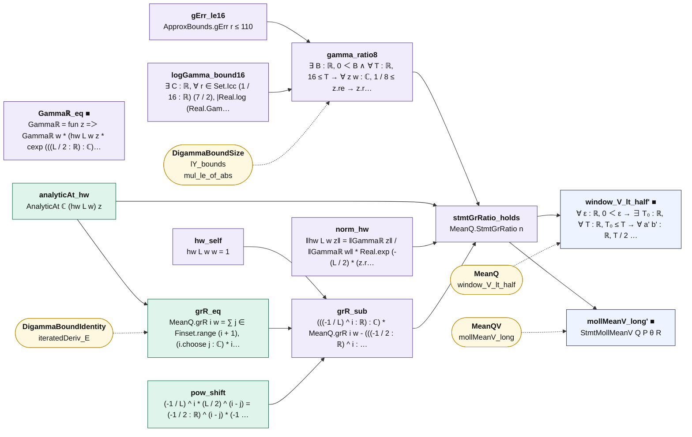

# `lean_stage3/Stage3/GrRatio.lean`

> **Read from the source text.** This file changed after the last `python3 utilities/lean_map.py --dump`, so the arrows on this page are names occurring in each proof and have not been confirmed by Lean.

GrRatio — block S13 of `lean_stage3/design/stencil.md`, B4, the gamma ratio. 2026-11-25.

13 theorems, 1 definition, 365 lines. 

**Imports:** [`DigammaBoundSize`](../lean_stage3/DigammaBoundSize.md), [`MeanQ`](../lean_stage3/MeanQ.md)  
**Imported by:** [`Stage3`](../lean_stage3/Stage3.md)

## The picture



An arrow A → B reads "A is used in the proof of B". Green: counting, integers only. Violet: shape, analysis with no ζ. Blue: reads ζ. A name ending in ■ is an end: nothing else uses it. Red: contains `sorry`. Yellow: theorems in another file, counted; a dotted arrow crosses files. Definitions are not drawn; they are listed below the diagram.

## Definitions

<a name="GrRatio-hw"></a>
### `GrRatio.hw`

def · line 163

`h_w(z) = Gammaℝ(z)/Gammaℝ(w) · e^{−(L/2)(z − w)}`.

- **Is:** `` hw (L : ℝ) (w z : ℂ) : ℂ := Gammaℝ z / Gammaℝ w * cexp (-((L / 2 : ℝ) : ℂ) * (z - w)) ``
- **Used by 7:** [`GrRatio.Gammaℝ_eq`](#GrRatio-Gamma-_eq), [`GrRatio.analyticAt_hw`](#GrRatio-analyticAt_hw), [`GrRatio.grR_eq`](#GrRatio-grR_eq), [`GrRatio.grR_sub`](#GrRatio-grR_sub), [`GrRatio.hw_self`](#GrRatio-hw_self), [`GrRatio.norm_hw`](#GrRatio-norm_hw), [`GrRatio.stmtGrRatio_holds`](#GrRatio-stmtGrRatio_holds)

## Theorems

<a name="GrRatio-gErr_le16"></a>
### `GrRatio.gErr_le16`

line 53 · arrows read from text

**Shape.** Uses real or complex analysis; nothing in it or beneath it reads ζ.

**Why.** The Stirling error is bounded on `[1/16, 7/2]`.

**Proves**

```lean
ApproxBounds.gErr r ≤ 110
```

**Needs** (its hypotheses)

  - `` h1 : 1 / 16 ≤ r ``
  - `` h2 : r ≤ 7 / 2 ``

**Fed by:** no theorem of this repo; it stands on Mathlib and the definitions below.

**Definitions its proof touches:** [`ApproxBounds.gErr`](../lean_stage3/ApproxBounds.md#ApproxBounds-gErr)

**Feeds** (1 that use it)

  - [`GrRatio.gamma_ratio8`](#GrRatio-gamma_ratio8) — `` ∃ B : ℝ, 0 < B ∧ ∀ T : ℝ, 16 ≤ T → ∀ z w : ℂ, 1 / 8 ≤ z.re → z.re ≤ 7 → 1 / 8 ≤ w.re → w.re ≤ 7 → T / 8 ≤ z.im → z.im ≤ 3 * T → T / 8 ≤ w.im → w.im ≤ … ``

<a name="GrRatio-logGamma_bound16"></a>
### `GrRatio.logGamma_bound16`

line 75 · arrows read from text

**Shape.** Uses real or complex analysis; nothing in it or beneath it reads ζ.

**Why.** `log Γ` is bounded on `[1/16, 7/2]`.

**Proves**

```lean
∃ C : ℝ, ∀ r ∈ Set.Icc (1 / 16 : ℝ) (7 / 2), |Real.log (Real.Gamma r)| ≤ C
```

**Fed by:** no theorem of this repo; it stands on Mathlib.

**Feeds** (1 that use it)

  - [`GrRatio.gamma_ratio8`](#GrRatio-gamma_ratio8) — `` ∃ B : ℝ, 0 < B ∧ ∀ T : ℝ, 16 ≤ T → ∀ z w : ℂ, 1 / 8 ≤ z.re → z.re ≤ 7 → 1 / 8 ≤ w.re → w.re ≤ 7 → T / 8 ≤ z.im → z.im ≤ 3 * T → T / 8 ≤ w.im → w.im ≤ … ``

<a name="GrRatio-gamma_ratio8"></a>
### `GrRatio.gamma_ratio8`

line 88 · arrows read from text

**Shape.** Uses real or complex analysis; nothing in it or beneath it reads ζ.

**Why.** The ratio of `Gammaℝ` at nearby heights, with the shift taken out, on `Re ∈ [1/8, 7]`.

**Proves**

```lean
∃ B : ℝ, 0 < B ∧ ∀ T : ℝ, 16 ≤ T → ∀ z w : ℂ, 1 / 8 ≤ z.re → z.re ≤ 7 → 1 / 8 ≤ w.re → w.re ≤ 7 → T / 8 ≤ z.im → z.im ≤ 3 * T → T / 8 ≤ w.im → w.im ≤ 3 * T → |z.im - w.im| ≤ 1 → ‖Gammaℝ z‖ / ‖Gammaℝ w‖ * Real.exp (-(Real.log T / 2) * (z.re - w.re)) ≤ B
```

**Fed by** (4 theorems its proof uses)

  - [`DigammaBound.lY_bounds`](../lean_stage3/DigammaBoundSize.md#DigammaBound-lY_bounds) (DigammaBoundSize) — `` Real.log T - 3 ≤ ApproxBounds.lY (y / 2) ∧ ApproxBounds.lY (y / 2) ≤ Real.log T + 1 ``
  - [`DigammaBound.mul_le_of_abs`](../lean_stage3/DigammaBoundSize.md#DigammaBound-mul_le_of_abs) (DigammaBoundSize) — `` a * b ≤ A * B ``
  - [`GrRatio.gErr_le16`](#GrRatio-gErr_le16) — `` ApproxBounds.gErr r ≤ 110 ``
  - [`GrRatio.logGamma_bound16`](#GrRatio-logGamma_bound16) — `` ∃ C : ℝ, ∀ r ∈ Set.Icc (1 / 16 : ℝ) (7 / 2), |Real.log (Real.Gamma r)| ≤ C ``

**Definitions its proof touches:** [`ApproxBounds.gModel`](../lean_stage3/ApproxBounds.md#ApproxBounds-gModel), [`ApproxBounds.gRModel`](../lean_stage3/ApproxBounds.md#ApproxBounds-gRModel), [`ApproxBounds.lY`](../lean_stage3/ApproxBounds.md#ApproxBounds-lY)

**Feeds** (1 that use it)

  - [`GrRatio.stmtGrRatio_holds`](#GrRatio-stmtGrRatio_holds) — `` MeanQ.StmtGrRatio n ``

<a name="GrRatio-Gamma-_eq"></a>
### `GrRatio.Gammaℝ_eq`

line 166 · arrows read from text

**Shape.** Uses real or complex analysis; nothing in it or beneath it reads ζ.

**Why.** `Gammaℝ = Gammaℝ(w) · h_w · e^{(L/2)(· − w)}`, exactly.

**Proves**

```lean
Gammaℝ = fun z => Gammaℝ w * (hw L w z * cexp (((L / 2 : ℝ) : ℂ) * (z - w)))
```

**Needs** (its hypotheses)

  - `` L : ℝ ``
  - `` hGw : Gammaℝ w ≠ 0 ``

**Fed by:** no theorem of this repo; it stands on Mathlib and the definitions below.

**Definitions its proof touches:** [`GrRatio.hw`](#GrRatio-hw)

**Feeds:** nothing. It is an end.

<a name="GrRatio-analyticAt_hw"></a>
### `GrRatio.analyticAt_hw`

line 177 · arrows read from text

**Counting.** Integers only: nothing in its statement or proof, or in anything it rests on, uses analysis or ζ.

**Proves**

```lean
AnalyticAt ℂ (hw L w) z
```

**Needs** (its hypotheses)

  - `` L : ℝ ``
  - `` w : ℂ ``
  - `` hz : 0 < z.re ``

**Fed by:** no theorem of this repo; it stands on Mathlib and the definitions below.

**Definitions its proof touches:** [`GrRatio.hw`](#GrRatio-hw)

**Feeds** (2 that use it)

  - [`GrRatio.grR_eq`](#GrRatio-grR_eq) — `` MeanQ.grR i w = ∑ j ∈ Finset.range (i + 1), (i.choose j : ℂ) * iteratedDeriv j (hw L w) w * (((L / 2 : ℝ) : ℂ)) ^ (i - j) ``
  - [`GrRatio.stmtGrRatio_holds`](#GrRatio-stmtGrRatio_holds) — `` MeanQ.StmtGrRatio n ``

<a name="GrRatio-hw_self"></a>
### `GrRatio.hw_self`

line 182 · arrows read from text

**Shape.** Uses real or complex analysis; nothing in it or beneath it reads ζ.

**Proves**

```lean
hw L w w = 1
```

**Needs** (its hypotheses)

  - `` L : ℝ ``
  - `` hw0 : 0 < w.re ``

**Fed by:** no theorem of this repo; it stands on Mathlib and the definitions below.

**Definitions its proof touches:** [`GrRatio.hw`](#GrRatio-hw)

**Feeds** (1 that use it)

  - [`GrRatio.grR_sub`](#GrRatio-grR_sub) — `` (((-1 / L) ^ i : ℝ) : ℂ) * MeanQ.grR i w - (((-1 / 2 : ℝ) ^ i : ℝ) : ℂ) = ∑ j ∈ Finset.range i, (i.choose (j + 1) : ℂ) * (((-1 / 2 : ℝ) ^ (i - (j + 1)… ``

<a name="GrRatio-norm_hw"></a>
### `GrRatio.norm_hw`

line 187 · arrows read from text

**Shape.** Uses real or complex analysis; nothing in it or beneath it reads ζ.

**Proves**

```lean
‖hw L w z‖ = ‖Gammaℝ z‖ / ‖Gammaℝ w‖ * Real.exp (-(L / 2) * (z.re - w.re))
```

**Needs** (its hypotheses)

  - `` L : ℝ ``
  - `` w z : ℂ ``

**Fed by:** no theorem of this repo; it stands on Mathlib and the definitions below.

**Definitions its proof touches:** [`GrRatio.hw`](#GrRatio-hw)

**Feeds** (1 that use it)

  - [`GrRatio.stmtGrRatio_holds`](#GrRatio-stmtGrRatio_holds) — `` MeanQ.StmtGrRatio n ``

<a name="GrRatio-grR_eq"></a>
### `GrRatio.grR_eq`

line 195 · arrows read from text

**Counting.** Integers only: nothing in its statement or proof, or in anything it rests on, uses analysis or ζ.

**Why.** Leibniz: `grR i w = Σ_j C(i,j) h_w^{(j)}(w) (L/2)^{i−j}`.

**Proves**

```lean
MeanQ.grR i w = ∑ j ∈ Finset.range (i + 1), (i.choose j : ℂ) * iteratedDeriv j (hw L w) w * (((L / 2 : ℝ) : ℂ)) ^ (i - j)
```

**Needs** (its hypotheses)

  - `` L : ℝ ``
  - `` i : ℕ ``
  - `` hw0 : 0 < w.re ``

**Fed by** (2 theorems its proof uses)

  - [`DigammaBound.iteratedDeriv_E`](../lean_stage3/DigammaBoundIdentity.md#DigammaBound-iteratedDeriv_E) (DigammaBoundIdentity) — `` iteratedDeriv m (fun z => cexp (a * (z - w))) w = a ^ m ``
  - [`GrRatio.analyticAt_hw`](#GrRatio-analyticAt_hw) — `` AnalyticAt ℂ (hw L w) z ``

**Definitions its proof touches:** [`GrRatio.hw`](#GrRatio-hw), [`MeanQ.grR`](../lean_stage3/MeanQRed.md#MeanQ-grR)

**Feeds** (1 that use it)

  - [`GrRatio.grR_sub`](#GrRatio-grR_sub) — `` (((-1 / L) ^ i : ℝ) : ℂ) * MeanQ.grR i w - (((-1 / 2 : ℝ) ^ i : ℝ) : ℂ) = ∑ j ∈ Finset.range i, (i.choose (j + 1) : ℂ) * (((-1 / 2 : ℝ) ^ (i - (j + 1)… ``

<a name="GrRatio-pow_shift"></a>
### `GrRatio.pow_shift`

line 211 · arrows read from text

**Counting.** Integers only: nothing in its statement or proof, or in anything it rests on, uses analysis or ζ.

**Why.** The scalar identity `(−1/L)^{j+k} (L/2)^k = (−1/2)^k (−1/L)^j`.

**Proves**

```lean
(-1 / L) ^ i * (L / 2) ^ (i - j) = (-1 / 2 : ℝ) ^ (i - j) * (-1 / L) ^ j
```

**Needs** (its hypotheses)

  - `` hL : L ≠ 0 ``
  - `` hj : j ≤ i ``

**Fed by:** no theorem of this repo; it stands on Mathlib.

**Feeds** (1 that use it)

  - [`GrRatio.grR_sub`](#GrRatio-grR_sub) — `` (((-1 / L) ^ i : ℝ) : ℂ) * MeanQ.grR i w - (((-1 / 2 : ℝ) ^ i : ℝ) : ℂ) = ∑ j ∈ Finset.range i, (i.choose (j + 1) : ℂ) * (((-1 / 2 : ℝ) ^ (i - (j + 1)… ``

<a name="GrRatio-grR_sub"></a>
### `GrRatio.grR_sub`

line 220 · arrows read from text

**Shape.** Uses real or complex analysis; nothing in it or beneath it reads ζ.

**Why.** The error, exactly: `(−1/L)^i grR i w − (−1/2)^i = Σ_{j<i} C(i,j+1) (−1/2)^{i−j−1} (−1/L)^{j+1} h_w^{(j+1)}(w)`.

**Proves**

```lean
(((-1 / L) ^ i : ℝ) : ℂ) * MeanQ.grR i w - (((-1 / 2 : ℝ) ^ i : ℝ) : ℂ) = ∑ j ∈ Finset.range i, (i.choose (j + 1) : ℂ) * (((-1 / 2 : ℝ) ^ (i - (j + 1)) : ℝ) : ℂ) * ((((-1 / L) ^ (j + 1) : ℝ) : ℂ) * iteratedDeriv (j + 1) (hw L w) w)
```

**Needs** (its hypotheses)

  - `` hL : L ≠ 0 ``
  - `` i : ℕ ``
  - `` hw0 : 0 < w.re ``

**Fed by** (3 theorems its proof uses)

  - [`GrRatio.grR_eq`](#GrRatio-grR_eq) — `` MeanQ.grR i w = ∑ j ∈ Finset.range (i + 1), (i.choose j : ℂ) * iteratedDeriv j (hw L w) w * (((L / 2 : ℝ) : ℂ)) ^ (i - j) ``
  - [`GrRatio.hw_self`](#GrRatio-hw_self) — `` hw L w w = 1 ``
  - [`GrRatio.pow_shift`](#GrRatio-pow_shift) — `` (-1 / L) ^ i * (L / 2) ^ (i - j) = (-1 / 2 : ℝ) ^ (i - j) * (-1 / L) ^ j ``

**Definitions its proof touches:** [`GrRatio.hw`](#GrRatio-hw), [`MeanQ.grR`](../lean_stage3/MeanQRed.md#MeanQ-grR)

**Feeds** (1 that use it)

  - [`GrRatio.stmtGrRatio_holds`](#GrRatio-stmtGrRatio_holds) — `` MeanQ.StmtGrRatio n ``

<a name="GrRatio-stmtGrRatio_holds"></a>
### `GrRatio.stmtGrRatio_holds`

line 243 · arrows read from text

**Shape.** Uses real or complex analysis; nothing in it or beneath it reads ζ.

**Why.** `StmtGrRatio`, discharged.

**Proves**

```lean
MeanQ.StmtGrRatio n
```

**Needs** (its hypotheses)

  - `` n : ℕ ``

**Fed by** (4 theorems its proof uses)

  - [`GrRatio.analyticAt_hw`](#GrRatio-analyticAt_hw) — `` AnalyticAt ℂ (hw L w) z ``
  - [`GrRatio.gamma_ratio8`](#GrRatio-gamma_ratio8) — `` ∃ B : ℝ, 0 < B ∧ ∀ T : ℝ, 16 ≤ T → ∀ z w : ℂ, 1 / 8 ≤ z.re → z.re ≤ 7 → 1 / 8 ≤ w.re → w.re ≤ 7 → T / 8 ≤ z.im → z.im ≤ 3 * T → T / 8 ≤ w.im → w.im ≤ … ``
  - [`GrRatio.grR_sub`](#GrRatio-grR_sub) — `` (((-1 / L) ^ i : ℝ) : ℂ) * MeanQ.grR i w - (((-1 / 2 : ℝ) ^ i : ℝ) : ℂ) = ∑ j ∈ Finset.range i, (i.choose (j + 1) : ℂ) * (((-1 / 2 : ℝ) ^ (i - (j + 1)… ``
  - [`GrRatio.norm_hw`](#GrRatio-norm_hw) — `` ‖hw L w z‖ = ‖Gammaℝ z‖ / ‖Gammaℝ w‖ * Real.exp (-(L / 2) * (z.re - w.re)) ``

**Definitions its proof touches:** [`GrRatio.hw`](#GrRatio-hw), [`MeanQ.StmtGrRatio`](../lean_stage3/MeanQRed.md#MeanQ-StmtGrRatio)

**Feeds** (2 that use it)

  - [`GrRatio.mollMeanV_long'`](#GrRatio-mollMeanV_long-) — `` StmtMollMeanV Q P θ R ``
  - [`GrRatio.window_V_lt_half'`](#GrRatio-window_V_lt_half-) — `` ∀ ε : ℝ, 0 < ε → ∃ T₀ : ℝ, ∀ T : ℝ, T₀ ≤ T → ∀ a' b' : ℝ, T / 2 ≤ a' → a' ≤ T / 2 + 1 → T - 1 ≤ b' → b' ≤ T → (1 / (b' - a')) * ∫ t in a'..b', ‖Conrey… ``

<a name="GrRatio-window_V_lt_half-"></a>
### `GrRatio.window_V_lt_half'`

line 324 · arrows read from text

**Reads ζ.** It, or something it rests on, uses the zeta function, its zeros or the Riemann hypothesis.

**Why.** `window_V_lt_half` without `hG`.

**Proves**

```lean
∀ ε : ℝ, 0 < ε → ∃ T₀ : ℝ, ∀ T : ℝ, T₀ ≤ T → ∀ a' b' : ℝ, T / 2 ≤ a' → a' ≤ T / 2 + 1 → T - 1 ≤ b' → b' ≤ T → (1 / (b' - a')) * ∫ t in a'..b', ‖ConreyCount.V Q (Real.log T) ((sig0 T R : ℂ) + t * I) * psi (Mof T θ) (aY P T θ R) ((sig0 T R : ℂ) + t * I)‖ ^ 2 ≤ (DopQ Q (Real.log T) (cY P (Mof T θ) T) ((-(R / Real.log T) : ℝ) : ℂ) ((-(R / Real.log T) : ℝ) : ℂ)).re + ε
```

**Needs** (its hypotheses)

  - `` Q P : ℝ[X] ``
  - `` hP0 : P.eval 0 = 0 ``
  - `` hθ0 : 0 < θ ``
  - `` hθ : θ < 1 / 2 ``
  - `` hR : 0 < R ``

**Fed by** (2 theorems its proof uses)

  - [`GrRatio.stmtGrRatio_holds`](#GrRatio-stmtGrRatio_holds) — `` MeanQ.StmtGrRatio n ``
  - [`MeanQ.window_V_lt_half`](../lean_stage3/MeanQ.md#MeanQ-window_V_lt_half) (MeanQ) — `` ∀ ε : ℝ, 0 < ε → ∃ T₀ : ℝ, ∀ T : ℝ, T₀ ≤ T → ∀ a' b' : ℝ, T / 2 ≤ a' → a' ≤ T / 2 + 1 → T - 1 ≤ b' → b' ≤ T → (1 / (b' - a')) * ∫ t in a'..b', ‖Conrey… ``

**Definitions its proof touches:** [`ConreyCount.V`](../lean_stage3/ConreyCountLine.md#ConreyCount-V), [`MeanQ.DopQ`](../lean_stage3/MeanQCauchy.md#MeanQ-DopQ), [`TwistedMoment.Mof`](../lean_stage3/TwistedMoment.md#TwistedMoment-Mof), [`TwistedMoment.aY`](../lean_stage3/TwistedMoment.md#TwistedMoment-aY), [`TwistedMoment.cY`](../lean_stage3/TwistedMoment.md#TwistedMoment-cY), [`TwistedMoment.psi`](../lean_stage3/TwistedMoment.md#TwistedMoment-psi), [`TwistedMoment.sig0`](../lean_stage3/TwistedMoment.md#TwistedMoment-sig0)

**Feeds:** nothing. It is an end.

<a name="GrRatio-mollMeanV_long-"></a>
### `GrRatio.mollMeanV_long'`

line 337 · arrows read from text

**Reads ζ.** It, or something it rests on, uses the zeta function, its zeros or the Riemann hypothesis.

**Why.** `mollMeanV_long` without `hG`.

**Proves**

```lean
StmtMollMeanV Q P θ R
```

**Needs** (its hypotheses)

  - `` Q P : ℝ[X] ``
  - `` hθ0 : 0 < θ ``
  - `` hR : 0 < R ``
  - `` hL3 : StmtLemma3resO P θ R (2 * R + 1 + 1 / R) ``

**Fed by** (2 theorems its proof uses)

  - [`GrRatio.stmtGrRatio_holds`](#GrRatio-stmtGrRatio_holds) — `` MeanQ.StmtGrRatio n ``
  - [`MeanQ.mollMeanV_long`](../lean_stage3/MeanQV.md#MeanQ-mollMeanV_long) (MeanQV) — `` StmtMollMeanV Q P θ R ``

**Definitions its proof touches:** [`MeanQ.StmtMollMeanV`](../lean_stage3/MeanQV.md#MeanQ-StmtMollMeanV)

**Feeds:** nothing. It is an end.

