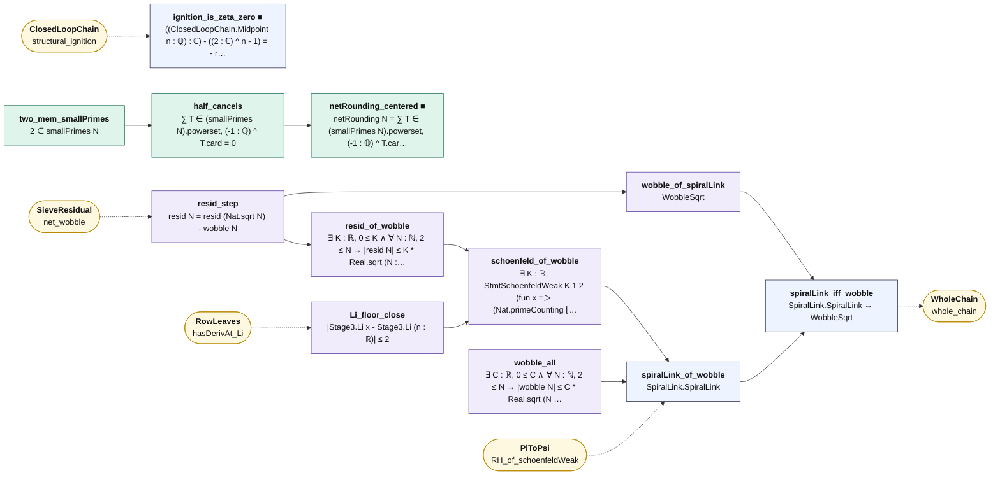

# `lean_stage3/Stage3/HalfSieve.lean`

> **Read from the source text.** This file changed after the last `python3 utilities/lean_map.py --dump`, so the arrows on this page are names occurring in each proof and have not been confirmed by Lean.

HalfSieve — block R6 of `lean_stage3/design/runs.md`. 2026-11-23. The half of the closed loop, carried into the sieve.

12 theorems, 3 definitions, 350 lines. 

**Imports:** [`OneChain`](../lean_stage3/OneChain.md), [`PiToPsi`](../lean_stage3/PiToPsi.md), [`RowLeaves`](../lean_stage3/RowLeaves.md), [`StepsPole`](../lean_stage3/StepsPole.md)  
**Imported by:** [`Stage3`](../lean_stage3/Stage3.md), [`BandJoin`](../lean_stage3/BandJoin.md), [`SelfBound`](../lean_stage3/SelfBound.md)

## The picture



An arrow A → B reads "A is used in the proof of B". Green: counting, integers only. Violet: shape, analysis with no ζ. Blue: reads ζ. A name ending in ■ is an end: nothing else uses it. Red: contains `sorry`. Yellow: theorems in another file, counted; a dotted arrow crosses files. Definitions are not drawn; they are listed below the diagram.

## Definitions

<a name="HalfSieve-wobble"></a>
### `HalfSieve.wobble`

def · line 73

The wobble of the sieve at `N`: its net rounding less its smooth part.

- **Is:** `` wobble (N : ℕ) : ℝ := ((netRounding N : ℚ) : ℝ) - smoothNet N ``
- **Built from:** [`SieveExact.netRounding`](../lean_stage3/SieveExact.md#SieveExact-netRounding), [`SieveResidual.smoothNet`](../lean_stage3/SieveResidual.md#SieveResidual-smoothNet)
- **Used by 6:** [`HalfSieve.WobbleSqrt`](#HalfSieve-WobbleSqrt), [`HalfSieve.resid_of_wobble`](#HalfSieve-resid_of_wobble), [`HalfSieve.resid_step`](#HalfSieve-resid_step), [`HalfSieve.schoenfeld_of_wobble`](#HalfSieve-schoenfeld_of_wobble), [`HalfSieve.wobble_all`](#HalfSieve-wobble_all), [`HalfSieve.wobble_of_spiralLink`](#HalfSieve-wobble_of_spiralLink)

<a name="HalfSieve-resid"></a>
### `HalfSieve.resid`

def · line 76

The residual of the count at `N`.

- **Is:** `` resid (N : ℕ) : ℝ := (Nat.primeCounting N : ℝ) - Stage3.Li (N : ℝ) ``
- **Built from:** [`Stage3.Li`](../lean_stage3/PsiToPi.md#Stage3-Li)
- **Used by 4:** [`HalfSieve.resid_of_wobble`](#HalfSieve-resid_of_wobble), [`HalfSieve.resid_step`](#HalfSieve-resid_step), [`HalfSieve.schoenfeld_of_wobble`](#HalfSieve-schoenfeld_of_wobble), [`HalfSieve.wobble_of_spiralLink`](#HalfSieve-wobble_of_spiralLink)

<a name="HalfSieve-WobbleSqrt"></a>
### `HalfSieve.WobbleSqrt`

def · line 226

The wobble of the sieve stays at square-root size from some `N₀` on.

- **Is:** `` WobbleSqrt : Prop := ∃ (C : ℝ) (N₀ : ℕ), ∀ N : ℕ, N₀ ≤ N → |wobble N| ≤ C * Real.sqrt (N : ℝ) * Real.log (N : ℝ) ``
- **Built from:** [`HalfSieve.wobble`](#HalfSieve-wobble)
- **Used by 5:** [`HalfSieve.spiralLink_iff_wobble`](#HalfSieve-spiralLink_iff_wobble), [`HalfSieve.spiralLink_of_wobble`](#HalfSieve-spiralLink_of_wobble), [`HalfSieve.wobble_all`](#HalfSieve-wobble_all), [`HalfSieve.wobble_of_spiralLink`](#HalfSieve-wobble_of_spiralLink), [`WholeChain.whole_chain`](../lean_stage3/WholeChain.md#WholeChain-whole_chain)

## Theorems

<a name="HalfSieve-ignition_is_zeta_zero"></a>
### `HalfSieve.ignition_is_zeta_zero`

line 37 · arrows read from text

**Reads ζ.** It, or something it rests on, uses the zeta function, its zeros or the Riemann hypothesis.

**Why.** The half is zeta at zero. The offset of the midpoint of the `n`-th doubling above `2^n − 1` is minus the value of zeta at zero, at every `n`.

**Proves**

```lean
((ClosedLoopChain.Midpoint n : ℚ) : ℂ) - ((2 : ℂ) ^ n - 1) = - riemannZeta 0
```

**Needs** (its hypotheses)

  - `` n : ℕ ``

**Fed by** (1 theorem its proof uses)

  - [`ClosedLoopChain.structural_ignition`](../lean_stage3/ClosedLoopChain.md#ClosedLoopChain-structural_ignition) (ClosedLoopChain) — `` Midpoint n = (2 ^ n : ℚ) - 1 / 2 ``

**Definitions its proof touches:** [`ClosedLoopChain.Midpoint`](../lean_stage3/ClosedLoopChain.md#ClosedLoopChain-Midpoint)

**Feeds:** nothing. It is an end.

<a name="HalfSieve-two_mem_smallPrimes"></a>
### `HalfSieve.two_mem_smallPrimes`

line 44 · arrows read from text

**Counting.** Integers only: nothing in its statement or proof, or in anything it rests on, uses analysis or ζ.

**Why.** From `N = 4` on the prime `2` is among the sieve's primes.

**Proves**

```lean
2 ∈ smallPrimes N
```

**Needs** (its hypotheses)

  - `` hN : 4 ≤ N ``

**Fed by:** no theorem of this repo; it stands on Mathlib and the definitions below.

**Definitions its proof touches:** [`SieveExact.smallPrimes`](../lean_stage3/SieveExact.md#SieveExact-smallPrimes)

**Feeds** (1 that use it)

  - [`HalfSieve.half_cancels`](#HalfSieve-half_cancels) — `` ∑ T ∈ (smallPrimes N).powerset, (-1 : ℚ) ^ T.card = 0 ``

<a name="HalfSieve-half_cancels"></a>
### `HalfSieve.half_cancels`

line 53 · arrows read from text

**Counting.** Integers only: nothing in its statement or proof, or in anything it rests on, uses analysis or ζ.

**Why.** The signs of the sieve add to nothing. Over all the sieve's terms the signs `(−1)^|T|` sum to zero: the alternating sum of a Pascal row.

**Proves**

```lean
∑ T ∈ (smallPrimes N).powerset, (-1 : ℚ) ^ T.card = 0
```

**Needs** (its hypotheses)

  - `` hN : 4 ≤ N ``

**Fed by** (1 theorem its proof uses)

  - [`HalfSieve.two_mem_smallPrimes`](#HalfSieve-two_mem_smallPrimes) — `` 2 ∈ smallPrimes N ``

**Definitions its proof touches:** [`SieveExact.smallPrimes`](../lean_stage3/SieveExact.md#SieveExact-smallPrimes)

**Feeds** (1 that use it)

  - [`HalfSieve.netRounding_centered`](#HalfSieve-netRounding_centered) — `` netRounding N = ∑ T ∈ (smallPrimes N).powerset, (-1 : ℚ) ^ T.card * (Int.fract ((N : ℚ) / ((∏ p ∈ T, p : ℕ) : ℚ)) - 1 / 2) ``

<a name="HalfSieve-netRounding_centered"></a>
### `HalfSieve.netRounding_centered`

line 64 · arrows read from text

**Counting.** Integers only: nothing in its statement or proof, or in anything it rests on, uses analysis or ζ.

**Why.** The roundings measured from one half. The half of every rounding cancels identically in the sieve's sum.

**Proves**

```lean
netRounding N = ∑ T ∈ (smallPrimes N).powerset, (-1 : ℚ) ^ T.card * (Int.fract ((N : ℚ) / ((∏ p ∈ T, p : ℕ) : ℚ)) - 1 / 2)
```

**Needs** (its hypotheses)

  - `` hN : 4 ≤ N ``

**Fed by** (1 theorem its proof uses)

  - [`HalfSieve.half_cancels`](#HalfSieve-half_cancels) — `` ∑ T ∈ (smallPrimes N).powerset, (-1 : ℚ) ^ T.card = 0 ``

**Definitions its proof touches:** [`SieveExact.netRounding`](../lean_stage3/SieveExact.md#SieveExact-netRounding), [`SieveExact.smallPrimes`](../lean_stage3/SieveExact.md#SieveExact-smallPrimes)

**Feeds:** nothing. It is an end.

<a name="HalfSieve-resid_step"></a>
### `HalfSieve.resid_step`

line 79 · arrows read from text

**Shape.** Uses real or complex analysis; nothing in it or beneath it reads ζ.

**Why.** The residual, one square root down.

**Proves**

```lean
resid N = resid (Nat.sqrt N) - wobble N
```

**Needs** (its hypotheses)

  - `` hN : 2 ≤ N ``

**Fed by** (1 theorem its proof uses)

  - [`SieveResidual.net_wobble`](../lean_stage3/SieveResidual.md#SieveResidual-net_wobble) (SieveResidual) — `` ((netRounding N : ℚ) : ℝ) - smoothNet N = -(((Nat.primeCounting N : ℝ) - Stage3.Li (N : ℝ)) - ((Nat.primeCounting (Nat.sqrt N) : ℝ) - Stage3.Li ((Nat.… ``

**Definitions its proof touches:** [`HalfSieve.resid`](#HalfSieve-resid), [`HalfSieve.wobble`](#HalfSieve-wobble)

**Feeds** (2 that use it)

  - [`HalfSieve.resid_of_wobble`](#HalfSieve-resid_of_wobble) — `` ∃ K : ℝ, 0 ≤ K ∧ ∀ N : ℕ, 2 ≤ N → |resid N| ≤ K * Real.sqrt (N : ℝ) * Real.log (N : ℝ) ``
  - [`HalfSieve.wobble_of_spiralLink`](#HalfSieve-wobble_of_spiralLink) — `` WobbleSqrt ``

<a name="HalfSieve-resid_of_wobble"></a>
### `HalfSieve.resid_of_wobble`

line 86 · arrows read from text

**Shape.** Uses real or complex analysis; nothing in it or beneath it reads ζ.

**Why.** The wobble carries the residual. If the wobble is at square-root size at every `N ≥ 2`, so is the residual of the count.

**Proves**

```lean
∃ K : ℝ, 0 ≤ K ∧ ∀ N : ℕ, 2 ≤ N → |resid N| ≤ K * Real.sqrt (N : ℝ) * Real.log (N : ℝ)
```

**Needs** (its hypotheses)

  - `` hC : 0 ≤ C ``
  - `` h : ∀ N : ℕ, 2 ≤ N → |wobble N| ≤ C * Real.sqrt (N : ℝ) * Real.log (N : ℝ) ``

**Fed by** (1 theorem its proof uses)

  - [`HalfSieve.resid_step`](#HalfSieve-resid_step) — `` resid N = resid (Nat.sqrt N) - wobble N ``

**Definitions its proof touches:** [`HalfSieve.resid`](#HalfSieve-resid), [`HalfSieve.wobble`](#HalfSieve-wobble)

**Feeds** (1 that use it)

  - [`HalfSieve.schoenfeld_of_wobble`](#HalfSieve-schoenfeld_of_wobble) — `` ∃ K : ℝ, StmtSchoenfeldWeak K 1 2 (fun x => (Nat.primeCounting ⌊x⌋₊ : ℝ)) Stage3.Li ``

<a name="HalfSieve-Li_floor_close"></a>
### `HalfSieve.Li_floor_close`

line 163 · arrows read from text

**Shape.** Uses real or complex analysis; nothing in it or beneath it reads ζ.

**Why.** Li moves by at most `2` between an integer `n ≥ 2` and a real `x` in `[n, n+1)`.

**Proves**

```lean
|Stage3.Li x - Stage3.Li (n : ℝ)| ≤ 2
```

**Needs** (its hypotheses)

  - `` hn : 2 ≤ n ``
  - `` hnx : (n : ℝ) ≤ x ``
  - `` hx : x < (n : ℝ) + 1 ``

**Fed by** (1 theorem its proof uses)

  - [`Stage3.hasDerivAt_Li`](../lean_stage3/RowLeaves.md#Stage3-hasDerivAt_Li) (RowLeaves) — `` HasDerivAt Li (1 / Real.log y) y ``

**Definitions its proof touches:** [`Stage3.Li`](../lean_stage3/PsiToPi.md#Stage3-Li)

**Feeds** (1 that use it)

  - [`HalfSieve.schoenfeld_of_wobble`](#HalfSieve-schoenfeld_of_wobble) — `` ∃ K : ℝ, StmtSchoenfeldWeak K 1 2 (fun x => (Nat.primeCounting ⌊x⌋₊ : ℝ)) Stage3.Li ``

<a name="HalfSieve-schoenfeld_of_wobble"></a>
### `HalfSieve.schoenfeld_of_wobble`

line 186 · arrows read from text

**Shape.** Uses real or complex analysis; nothing in it or beneath it reads ζ.

**Why.** The wobble gives the square-root bound on the count.

**Proves**

```lean
∃ K : ℝ, StmtSchoenfeldWeak K 1 2 (fun x => (Nat.primeCounting ⌊x⌋₊ : ℝ)) Stage3.Li
```

**Needs** (its hypotheses)

  - `` hC : 0 ≤ C ``
  - `` h : ∀ N : ℕ, 2 ≤ N → |wobble N| ≤ C * Real.sqrt (N : ℝ) * Real.log (N : ℝ) ``

**Fed by** (2 theorems its proof uses)

  - [`HalfSieve.Li_floor_close`](#HalfSieve-Li_floor_close) — `` |Stage3.Li x - Stage3.Li (n : ℝ)| ≤ 2 ``
  - [`HalfSieve.resid_of_wobble`](#HalfSieve-resid_of_wobble) — `` ∃ K : ℝ, 0 ≤ K ∧ ∀ N : ℕ, 2 ≤ N → |resid N| ≤ K * Real.sqrt (N : ℝ) * Real.log (N : ℝ) ``

**Definitions its proof touches:** [`HalfSieve.resid`](#HalfSieve-resid), [`HalfSieve.wobble`](#HalfSieve-wobble), [`Stage3.Li`](../lean_stage3/PsiToPi.md#Stage3-Li), [`Stage3.StmtSchoenfeldWeak`](../lean_stage3/Statement.md#Stage3-StmtSchoenfeldWeak)

**Feeds** (1 that use it)

  - [`HalfSieve.spiralLink_of_wobble`](#HalfSieve-spiralLink_of_wobble) — `` SpiralLink.SpiralLink ``

<a name="HalfSieve-wobble_all"></a>
### `HalfSieve.wobble_all`

line 231 · arrows read from text

**Shape.** Uses real or complex analysis; nothing in it or beneath it reads ζ.

**Why.** A bound from some `N₀` on is a bound from `2` on, with a larger constant.

**Proves**

```lean
∃ C : ℝ, 0 ≤ C ∧ ∀ N : ℕ, 2 ≤ N → |wobble N| ≤ C * Real.sqrt (N : ℝ) * Real.log (N : ℝ)
```

**Needs** (its hypotheses)

  - `` h : WobbleSqrt ``

**Fed by:** no theorem of this repo; it stands on Mathlib and the definitions below.

**Definitions its proof touches:** [`HalfSieve.WobbleSqrt`](#HalfSieve-WobbleSqrt), [`HalfSieve.wobble`](#HalfSieve-wobble)

**Feeds** (1 that use it)

  - [`HalfSieve.spiralLink_of_wobble`](#HalfSieve-spiralLink_of_wobble) — `` SpiralLink.SpiralLink ``

<a name="HalfSieve-spiralLink_of_wobble"></a>
### `HalfSieve.spiralLink_of_wobble`

line 271 · arrows read from text

**Reads ζ.** It, or something it rests on, uses the zeta function, its zeros or the Riemann hypothesis.

**Why.** From the wobble to the loop. If the sieve's wobble stays at square-root size, the spiral link holds.

**Proves**

```lean
SpiralLink.SpiralLink
```

**Needs** (its hypotheses)

  - `` h : WobbleSqrt ``

**Fed by** (3 theorems its proof uses)

  - [`HalfSieve.schoenfeld_of_wobble`](#HalfSieve-schoenfeld_of_wobble) — `` ∃ K : ℝ, StmtSchoenfeldWeak K 1 2 (fun x => (Nat.primeCounting ⌊x⌋₊ : ℝ)) Stage3.Li ``
  - [`HalfSieve.wobble_all`](#HalfSieve-wobble_all) — `` ∃ C : ℝ, 0 ≤ C ∧ ∀ N : ℕ, 2 ≤ N → |wobble N| ≤ C * Real.sqrt (N : ℝ) * Real.log (N : ℝ) ``
  - [`PiToPsi.RH_of_schoenfeldWeak`](../lean_stage3/PiToPsi.md#PiToPsi-RH_of_schoenfeldWeak) (PiToPsi) — `` RiemannHypothesis ``

**Definitions its proof touches:** [`HalfSieve.WobbleSqrt`](#HalfSieve-WobbleSqrt), [`SpiralLink.SpiralLink`](../lean_stage3/SpiralLink.md#SpiralLink-SpiralLink)

**Feeds** (1 that use it)

  - [`HalfSieve.spiralLink_iff_wobble`](#HalfSieve-spiralLink_iff_wobble) — `` SpiralLink.SpiralLink ↔ WobbleSqrt ``

<a name="HalfSieve-wobble_of_spiralLink"></a>
### `HalfSieve.wobble_of_spiralLink`

line 278 · arrows read from text

**Shape.** Uses real or complex analysis; nothing in it or beneath it reads ζ.

**Why.** From the loop to the wobble. If the spiral link holds, the sieve's wobble stays at square-root size.

**Proves**

```lean
WobbleSqrt
```

**Needs** (its hypotheses)

  - `` h : SpiralLink.SpiralLink ``

**Fed by** (1 theorem its proof uses)

  - [`HalfSieve.resid_step`](#HalfSieve-resid_step) — `` resid N = resid (Nat.sqrt N) - wobble N ``

**Definitions its proof touches:** [`HalfSieve.WobbleSqrt`](#HalfSieve-WobbleSqrt), [`HalfSieve.resid`](#HalfSieve-resid), [`HalfSieve.wobble`](#HalfSieve-wobble), [`SpiralLink.SpiralLink`](../lean_stage3/SpiralLink.md#SpiralLink-SpiralLink)

**Feeds** (1 that use it)

  - [`HalfSieve.spiralLink_iff_wobble`](#HalfSieve-spiralLink_iff_wobble) — `` SpiralLink.SpiralLink ↔ WobbleSqrt ``

<a name="HalfSieve-spiralLink_iff_wobble"></a>
### `HalfSieve.spiralLink_iff_wobble`

line 330 · arrows read from text

**Reads ζ.** It, or something it rests on, uses the zeta function, its zeros or the Riemann hypothesis.

**Why.** The loop is the sieve's wobble. The spiral link holds exactly when the sieve's roundings, measured from one half and less their smooth part, stay at square-root size.

**Proves**

```lean
SpiralLink.SpiralLink ↔ WobbleSqrt
```

**Fed by** (2 theorems its proof uses)

  - [`HalfSieve.spiralLink_of_wobble`](#HalfSieve-spiralLink_of_wobble) — `` SpiralLink.SpiralLink ``
  - [`HalfSieve.wobble_of_spiralLink`](#HalfSieve-wobble_of_spiralLink) — `` WobbleSqrt ``

**Definitions its proof touches:** [`HalfSieve.WobbleSqrt`](#HalfSieve-WobbleSqrt), [`SpiralLink.SpiralLink`](../lean_stage3/SpiralLink.md#SpiralLink-SpiralLink)

**Feeds** (1 that use it)

  - [`WholeChain.whole_chain`](../lean_stage3/WholeChain.md#WholeChain-whole_chain) (WholeChain) — `` (RiemannHypothesis ↔ SpiralLink.SpiralLink) ∧ (SpiralLink.SpiralLink ↔ OneAtEachHeight) ∧ (SpiralLink.SpiralLink ↔ ∃ (C : ℝ) (r₀ : ℤ), CellResidual.Ce… ``

