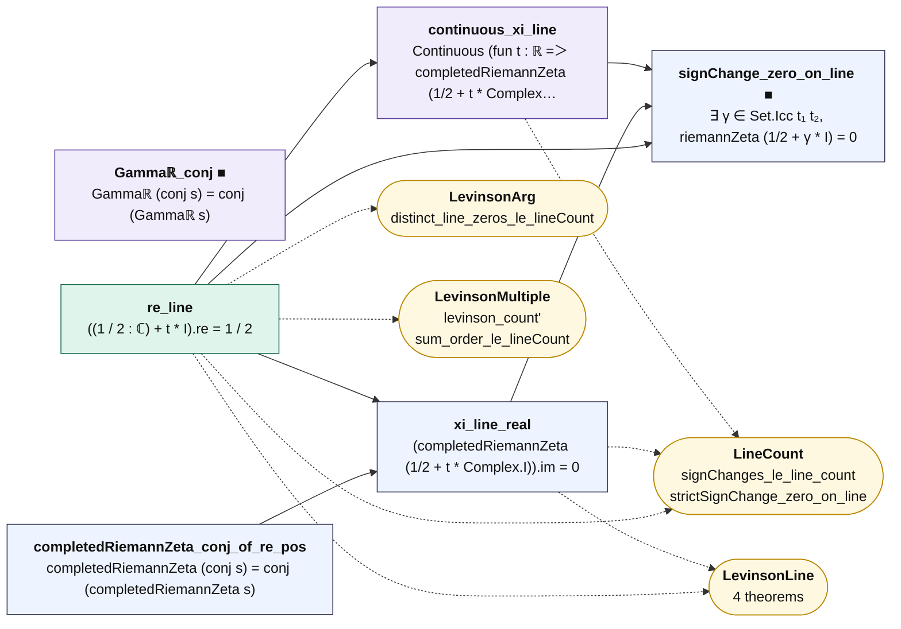

# `lean_stage3/Stage3/HardyZ.lean`

> **Read from the source text.** This file changed after the last `python3 utilities/lean_map.py --dump`, so the arrows on this page are names occurring in each proof and have not been confirmed by Lean.

HardyZ — block S10 of `lean_stage3/design/stencil.md`, steps 1 and 2. 2026-11-24.

6 theorems, 0 definitions, 128 lines. 

**Imports:** nothing in this tree  
**Imported by:** [`Stage3`](../lean_stage3/Stage3.md), [`LevinsonLine`](../lean_stage3/LevinsonLine.md), [`LineCount`](../lean_stage3/LineCount.md)

## The picture



An arrow A → B reads "A is used in the proof of B". Green: counting, integers only. Violet: shape, analysis with no ζ. Blue: reads ζ. A name ending in ■ is an end: nothing else uses it. Red: contains `sorry`. Yellow: theorems in another file, counted; a dotted arrow crosses files. Definitions are not drawn; they are listed below the diagram.

## Theorems

<a name="HardyZ-Gamma-_conj"></a>
### `HardyZ.Gammaℝ_conj`

line 35 · arrows read from text

**Shape.** Uses real or complex analysis; nothing in it or beneath it reads ζ.

**Why.** `Gammaℝ` commutes with conjugation.

**Proves**

```lean
Gammaℝ (conj s) = conj (Gammaℝ s)
```

**Needs** (its hypotheses)

  - `` s : ℂ ``

**Fed by:** no theorem of this repo; it stands on Mathlib.

**Feeds:** nothing. It connects to nothing.

<a name="HardyZ-completedRiemannZeta_conj_of_re_pos"></a>
### `HardyZ.completedRiemannZeta_conj_of_re_pos`

line 48 · arrows read from text

**Reads ζ.** It, or something it rests on, uses the zeta function, its zeros or the Riemann hypothesis.

**Why.** Conjugation. Right of zero, `Λ (conj s) = conj (Λ s)`, from `ζ`'s conjugation and `ζ = Λ / Gammaℝ`.

**Proves**

```lean
completedRiemannZeta (conj s) = conj (completedRiemannZeta s)
```

**Needs** (its hypotheses)

  - `` hs : 0 < s.re ``

**Fed by:** no theorem of this repo; it stands on Mathlib.

**Feeds** (1 that use it)

  - [`HardyZ.xi_line_real`](#HardyZ-xi_line_real) — `` (completedRiemannZeta (1/2 + t * Complex.I)).im = 0 ``

<a name="HardyZ-re_line"></a>
### `HardyZ.re_line`

line 62 · arrows read from text

**Counting.** Integers only: nothing in its statement or proof, or in anything it rests on, uses analysis or ζ.

**Why.** The point `1/2 + t i` of the critical line has real part one half.

**Proves**

```lean
((1 / 2 : ℂ) + t * I).re = 1 / 2
```

**Needs** (its hypotheses)

  - `` t : ℝ ``

**Fed by:** no theorem of this repo; it stands on Mathlib.

**Feeds** (9 that use it)

  - [`HardyZ.continuous_xi_line`](#HardyZ-continuous_xi_line) — `` Continuous (fun t : ℝ => completedRiemannZeta (1/2 + t * Complex.I)) ``
  - [`HardyZ.signChange_zero_on_line`](#HardyZ-signChange_zero_on_line) — `` ∃ γ ∈ Set.Icc t₁ t₂, riemannZeta (1/2 + γ * I) = 0 ``
  - [`HardyZ.xi_line_real`](#HardyZ-xi_line_real) — `` (completedRiemannZeta (1/2 + t * Complex.I)).im = 0 ``
  - [`LevinsonArg.distinct_line_zeros_le_lineCount`](../lean_stage3/LevinsonArg.md#LevinsonArg-distinct_line_zeros_le_lineCount) (LevinsonArg) — `` (k : ℤ) ≤ lineCount T ``
  - [`LevinsonLine.line_facts`](../lean_stage3/LevinsonLine.md#LevinsonLine-line_facts) (LevinsonLine) — `` ((1/2 : ℂ) + t * I) ≠ 0 ∧ ((1/2 : ℂ) + t * I) ≠ 1 ∧ 0 < ((1/2 : ℂ) + t * I).re ``
  - [`LevinsonMultiple.levinson_count'`](../lean_stage3/LevinsonMultiple.md#LevinsonMultiple-levinson_count-) (LevinsonMultiple) — `` (riemannZeta.N b - riemannZeta.N a) - 2 * Littlewood.countRight (fun s => riemannZeta s + c * deriv riemannZeta s) ((1/2 : ℂ) + a * I) ((3 : ℂ) + b * … ``
  - [`LevinsonMultiple.sum_order_le_lineCount`](../lean_stage3/LevinsonMultiple.md#LevinsonMultiple-sum_order_le_lineCount) (LevinsonMultiple) — `` ∑ γ ∈ E, riemannZeta.order (1/2 + γ * I) ≤ lineCount T ``
  - [`LineCount.signChanges_le_line_count`](../lean_stage3/LineCount.md#LineCount-signChanges_le_line_count) (LineCount) — `` (k : ℤ) ≤ lineCount T ``
  - [`LineCount.strictSignChange_zero_on_line`](../lean_stage3/LineCount.md#LineCount-strictSignChange_zero_on_line) (LineCount) — `` ∃ γ ∈ Set.Ioo t₁ t₂, riemannZeta (1/2 + γ * I) = 0 ``

<a name="HardyZ-xi_line_real"></a>
### `HardyZ.xi_line_real`

line 66 · arrows read from text

**Reads ζ.** It, or something it rests on, uses the zeta function, its zeros or the Riemann hypothesis.

**Why.** Step 1. `Λ` is real on the critical line.

**Proves**

```lean
(completedRiemannZeta (1/2 + t * Complex.I)).im = 0
```

**Needs** (its hypotheses)

  - `` t : ℝ ``

**Fed by** (2 theorems its proof uses)

  - [`HardyZ.completedRiemannZeta_conj_of_re_pos`](#HardyZ-completedRiemannZeta_conj_of_re_pos) — `` completedRiemannZeta (conj s) = conj (completedRiemannZeta s) ``
  - [`HardyZ.re_line`](#HardyZ-re_line) — `` ((1 / 2 : ℂ) + t * I).re = 1 / 2 ``

**Feeds** (5 that use it)

  - [`HardyZ.signChange_zero_on_line`](#HardyZ-signChange_zero_on_line) — `` ∃ γ ∈ Set.Icc t₁ t₂, riemannZeta (1/2 + γ * I) = 0 ``
  - [`LevinsonLine.deriv_xi_line_im`](../lean_stage3/LevinsonLine.md#LevinsonLine-deriv_xi_line_im) (LevinsonLine) — `` (deriv completedRiemannZeta (1/2 + t * I)).re = 0 ``
  - [`LevinsonLine.re_gammaR_G_line`](../lean_stage3/LevinsonLine.md#LevinsonLine-re_gammaR_G_line) (LevinsonLine) — `` (Gammaℝ (1/2 + t * I) * (riemannZeta (1/2 + t * I) + c * deriv riemannZeta (1/2 + t * I))).re = (completedRiemannZeta (1/2 + t * I)).re * (1 - c * (de… ``
  - [`LevinsonLine.zeta_line_zero_iff`](../lean_stage3/LevinsonLine.md#LevinsonLine-zeta_line_zero_iff) (LevinsonLine) — `` riemannZeta (1/2 + t * I) = 0 ↔ (Gammaℝ (1/2 + t * I) * (riemannZeta (1/2 + t * I) + c * deriv riemannZeta (1/2 + t * I))).re = 0 ``
  - [`LineCount.strictSignChange_zero_on_line`](../lean_stage3/LineCount.md#LineCount-strictSignChange_zero_on_line) (LineCount) — `` ∃ γ ∈ Set.Ioo t₁ t₂, riemannZeta (1/2 + γ * I) = 0 ``

<a name="HardyZ-continuous_xi_line"></a>
### `HardyZ.continuous_xi_line`

line 76 · arrows read from text

**Shape.** Uses real or complex analysis; nothing in it or beneath it reads ζ.

**Why.** `t ↦ Λ(1/2 + t i)` is continuous.

**Proves**

```lean
Continuous (fun t : ℝ => completedRiemannZeta (1/2 + t * Complex.I))
```

**Fed by** (1 theorem its proof uses)

  - [`HardyZ.re_line`](#HardyZ-re_line) — `` ((1 / 2 : ℂ) + t * I).re = 1 / 2 ``

**Feeds** (2 that use it)

  - [`HardyZ.signChange_zero_on_line`](#HardyZ-signChange_zero_on_line) — `` ∃ γ ∈ Set.Icc t₁ t₂, riemannZeta (1/2 + γ * I) = 0 ``
  - [`LineCount.strictSignChange_zero_on_line`](../lean_stage3/LineCount.md#LineCount-strictSignChange_zero_on_line) (LineCount) — `` ∃ γ ∈ Set.Ioo t₁ t₂, riemannZeta (1/2 + γ * I) = 0 ``

<a name="HardyZ-signChange_zero_on_line"></a>
### `HardyZ.signChange_zero_on_line`

line 97 · arrows read from text

**Reads ζ.** It, or something it rests on, uses the zeta function, its zeros or the Riemann hypothesis.

**Why.** Step 2. A sign change of `t ↦ Λ(1/2 + t i)` on `[t₁, t₂]` gives a zero of `ζ` on the critical line at height in `[t₁, t₂]`.

**Proves**

```lean
∃ γ ∈ Set.Icc t₁ t₂, riemannZeta (1/2 + γ * I) = 0
```

**Needs** (its hypotheses)

  - `` h : t₁ ≤ t₂ ``
  - `` hs : (completedRiemannZeta (1/2 + t₁ * I)).re * (completedRiemannZeta (1/2 + t₂ * I)).re ≤ 0 ``

**Fed by** (3 theorems its proof uses)

  - [`HardyZ.continuous_xi_line`](#HardyZ-continuous_xi_line) — `` Continuous (fun t : ℝ => completedRiemannZeta (1/2 + t * Complex.I)) ``
  - [`HardyZ.re_line`](#HardyZ-re_line) — `` ((1 / 2 : ℂ) + t * I).re = 1 / 2 ``
  - [`HardyZ.xi_line_real`](#HardyZ-xi_line_real) — `` (completedRiemannZeta (1/2 + t * Complex.I)).im = 0 ``

**Feeds:** nothing. It is an end.

