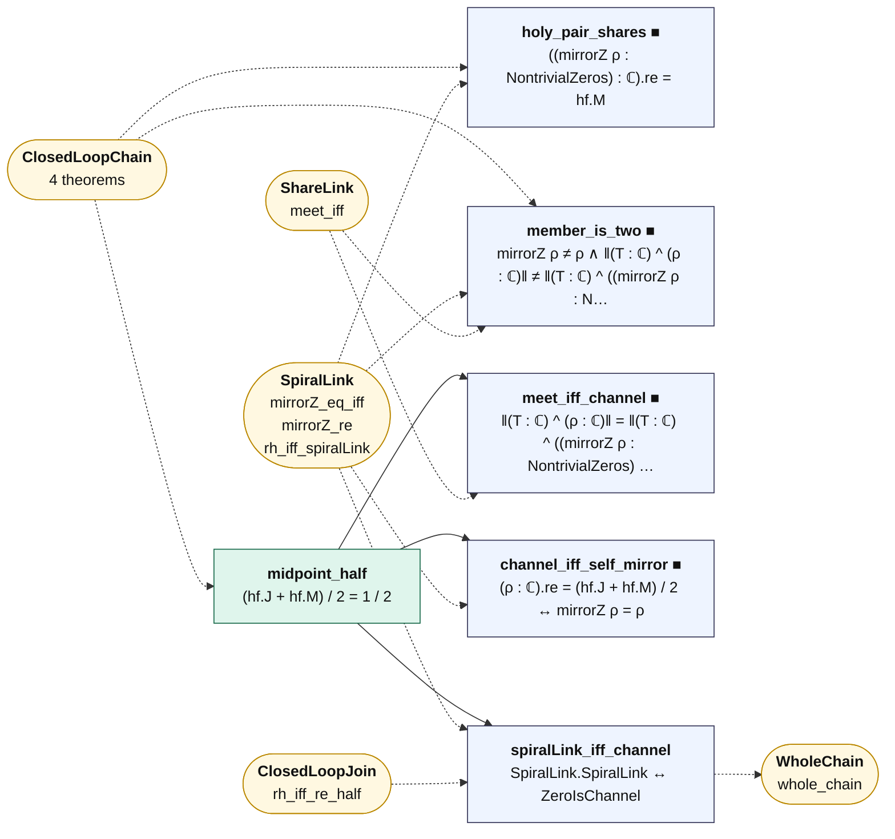

# `lean_stage3/Stage3/HolyChannel.lean`

> **Read from the source text.** This file changed after the last `python3 utilities/lean_map.py --dump`, so the arrows on this page are names occurring in each proof and have not been confirmed by Lean.

HolyChannel — block J9 of `lean_stage3/design/closedloop.md`. 2026-11-23. Julian's Holy Family is an uneven mirror pair: support `J = 1/3`, condition `M = 2/3`, adding to one, the condition the mirror of the support. Every prime carries that pair as its residual and never resolves it. The zero is the channel the residual passes through: it sits at the pair's midpoint and is never a member. Two facing mirrors cannot tell A from B exactly when they are one mirror; a zero is its own mirror exactly at the midpoint.

6 theorems, 2 definitions, 102 lines. 

**Imports:** [`ClosedLoopChain`](../lean_stage3/ClosedLoopChain.md), [`ShareLink`](../lean_stage3/ShareLink.md)  
**Imported by:** [`Stage3`](../lean_stage3/Stage3.md), [`WholeChain`](../lean_stage3/WholeChain.md)

## The picture



An arrow A → B reads "A is used in the proof of B". Green: counting, integers only. Violet: shape, analysis with no ζ. Blue: reads ζ. A name ending in ■ is an end: nothing else uses it. Red: contains `sorry`. Yellow: theorems in another file, counted; a dotted arrow crosses files. Definitions are not drawn; they are listed below the diagram.

## Definitions

<a name="HolyChannel-holy"></a>
### `HolyChannel.holy`

def · line 29

- **Is:** `` holy : HolyFamily := ⟨1 / 3, 2 / 3, by norm_num, by norm_num⟩ ``
- **Built from:** [`ClosedLoopChain.HolyFamily`](../lean_stage3/ClosedLoopChain.md#ClosedLoopChain-HolyFamily)
- **Used by 1:** [`HolyChannel.spiralLink_iff_channel`](#HolyChannel-spiralLink_iff_channel)

<a name="HolyChannel-ZeroIsChannel"></a>
### `HolyChannel.ZeroIsChannel`

def · line 71

Every zero sits at the midpoint of the Holy Family: the channel.

- **Is:** `` ZeroIsChannel : Prop := ∀ ρ : NontrivialZeros, (ρ : ℂ).re = (holy.J + holy.M) / 2 ``
- **Used by 2:** [`HolyChannel.spiralLink_iff_channel`](#HolyChannel-spiralLink_iff_channel), [`WholeChain.whole_chain`](../lean_stage3/WholeChain.md#WholeChain-whole_chain)

## Theorems

<a name="HolyChannel-midpoint_half"></a>
### `HolyChannel.midpoint_half`

line 32 · arrows read from text

**Counting.** Integers only: nothing in its statement or proof, or in anything it rests on, uses analysis or ζ.

**Why.** The midpoint of any Holy Family is one half.

**Proves**

```lean
(hf.J + hf.M) / 2 = 1 / 2
```

**Needs** (its hypotheses)

  - `` hf : HolyFamily ``

**Fed by** (1 theorem its proof uses)

  - [`ClosedLoopChain.derive_critical_line`](../lean_stage3/ClosedLoopChain.md#ClosedLoopChain-derive_critical_line) (ClosedLoopChain) — `` (hf.J + hf.M) / 2 = 1 / 2 ``

**Definitions its proof touches:** [`ClosedLoopChain.HolyFamily`](../lean_stage3/ClosedLoopChain.md#ClosedLoopChain-HolyFamily)

**Feeds** (3 that use it)

  - [`HolyChannel.channel_iff_self_mirror`](#HolyChannel-channel_iff_self_mirror) — `` (ρ : ℂ).re = (hf.J + hf.M) / 2 ↔ mirrorZ ρ = ρ ``
  - [`HolyChannel.meet_iff_channel`](#HolyChannel-meet_iff_channel) — `` ‖(T : ℂ) ^ (ρ : ℂ)‖ = ‖(T : ℂ) ^ ((mirrorZ ρ : NontrivialZeros) : ℂ)‖ ↔ (ρ : ℂ).re = (hf.J + hf.M) / 2 ``
  - [`HolyChannel.spiralLink_iff_channel`](#HolyChannel-spiralLink_iff_channel) — `` SpiralLink.SpiralLink ↔ ZeroIsChannel ``

<a name="HolyChannel-holy_pair_shares"></a>
### `HolyChannel.holy_pair_shares`

line 37 · arrows read from text

**Reads ζ.** It, or something it rests on, uses the zeta function, its zeros or the Riemann hypothesis.

**Why.** The pair's shape. A zero whose share is the support has its mirror at the condition.

**Proves**

```lean
((mirrorZ ρ : NontrivialZeros) : ℂ).re = hf.M
```

**Needs** (its hypotheses)

  - `` hf : HolyFamily ``
  - `` ρ : NontrivialZeros ``
  - `` h : (ρ : ℂ).re = hf.J ``

**Fed by** (2 theorems its proof uses)

  - [`ClosedLoopChain.holyFamily_is_mirror_pair`](../lean_stage3/ClosedLoopChain.md#ClosedLoopChain-holyFamily_is_mirror_pair) (ClosedLoopChain) — `` hf.M = 1 - hf.J ``
  - [`SpiralLink.mirrorZ_re`](../lean_stage3/SpiralLink.md#SpiralLink-mirrorZ_re) (SpiralLink) — `` ((mirrorZ ρ : NontrivialZeros) : ℂ).re = 1 - (ρ : ℂ).re ``

**Definitions its proof touches:** [`ClosedLoopChain.HolyFamily`](../lean_stage3/ClosedLoopChain.md#ClosedLoopChain-HolyFamily), [`SpiralLink.mirrorZ`](../lean_stage3/SpiralLink.md#SpiralLink-mirrorZ)

**Feeds:** nothing. It is an end.

<a name="HolyChannel-member_is_two"></a>
### `HolyChannel.member_is_two`

line 44 · arrows read from text

**Reads ζ.** It, or something it rests on, uses the zeta function, its zeros or the Riemann hypothesis.

**Why.** A member is two mirrors. A zero at the share of either member of the Holy Family is a different point from its mirror, and at every total above one its mode and its mirror's are different sizes.

**Proves**

```lean
mirrorZ ρ ≠ ρ ∧ ‖(T : ℂ) ^ (ρ : ℂ)‖ ≠ ‖(T : ℂ) ^ ((mirrorZ ρ : NontrivialZeros) : ℂ)‖
```

**Needs** (its hypotheses)

  - `` hf : HolyFamily ``
  - `` ρ : NontrivialZeros ``
  - `` h : (ρ : ℂ).re = hf.J ∨ (ρ : ℂ).re = hf.M ``
  - `` hT : 1 < T ``

**Fed by** (4 theorems its proof uses)

  - [`ClosedLoopChain.derive_joseph`](../lean_stage3/ClosedLoopChain.md#ClosedLoopChain-derive_joseph) (ClosedLoopChain) — `` hf.J = 1 / 3 ``
  - [`ClosedLoopChain.derive_mary`](../lean_stage3/ClosedLoopChain.md#ClosedLoopChain-derive_mary) (ClosedLoopChain) — `` hf.M = 2 / 3 ``
  - [`ShareLink.meet_iff`](../lean_stage3/ShareLink.md#ShareLink-meet_iff) (ShareLink) — `` ‖(T : ℂ) ^ (ρ : ℂ)‖ = ‖(T : ℂ) ^ ((mirrorZ ρ : NontrivialZeros) : ℂ)‖ ↔ (ρ : ℂ).re = 1 / 2 ``
  - [`SpiralLink.mirrorZ_eq_iff`](../lean_stage3/SpiralLink.md#SpiralLink-mirrorZ_eq_iff) (SpiralLink) — `` mirrorZ ρ = ρ ↔ (ρ : ℂ).re = 1 / 2 ``

**Definitions its proof touches:** [`ClosedLoopChain.HolyFamily`](../lean_stage3/ClosedLoopChain.md#ClosedLoopChain-HolyFamily), [`SpiralLink.mirrorZ`](../lean_stage3/SpiralLink.md#SpiralLink-mirrorZ)

**Feeds:** nothing. It is an end.

<a name="HolyChannel-meet_iff_channel"></a>
### `HolyChannel.meet_iff_channel`

line 57 · arrows read from text

**Reads ζ.** It, or something it rests on, uses the zeta function, its zeros or the Riemann hypothesis.

**Why.** The channel. A zero's mode meets its mirror's exactly when the zero's share is the Holy Family's midpoint.

**Proves**

```lean
‖(T : ℂ) ^ (ρ : ℂ)‖ = ‖(T : ℂ) ^ ((mirrorZ ρ : NontrivialZeros) : ℂ)‖ ↔ (ρ : ℂ).re = (hf.J + hf.M) / 2
```

**Needs** (its hypotheses)

  - `` hf : HolyFamily ``
  - `` hT : 1 < T ``
  - `` ρ : NontrivialZeros ``

**Fed by** (2 theorems its proof uses)

  - [`HolyChannel.midpoint_half`](#HolyChannel-midpoint_half) — `` (hf.J + hf.M) / 2 = 1 / 2 ``
  - [`ShareLink.meet_iff`](../lean_stage3/ShareLink.md#ShareLink-meet_iff) (ShareLink) — `` ‖(T : ℂ) ^ (ρ : ℂ)‖ = ‖(T : ℂ) ^ ((mirrorZ ρ : NontrivialZeros) : ℂ)‖ ↔ (ρ : ℂ).re = 1 / 2 ``

**Definitions its proof touches:** [`ClosedLoopChain.HolyFamily`](../lean_stage3/ClosedLoopChain.md#ClosedLoopChain-HolyFamily), [`SpiralLink.mirrorZ`](../lean_stage3/SpiralLink.md#SpiralLink-mirrorZ)

**Feeds:** nothing. It is an end.

<a name="HolyChannel-channel_iff_self_mirror"></a>
### `HolyChannel.channel_iff_self_mirror`

line 65 · arrows read from text

**Reads ζ.** It, or something it rests on, uses the zeta function, its zeros or the Riemann hypothesis.

**Why.** One mirror. A zero is at the channel exactly when it is its own mirror.

**Proves**

```lean
(ρ : ℂ).re = (hf.J + hf.M) / 2 ↔ mirrorZ ρ = ρ
```

**Needs** (its hypotheses)

  - `` hf : HolyFamily ``
  - `` ρ : NontrivialZeros ``

**Fed by** (2 theorems its proof uses)

  - [`HolyChannel.midpoint_half`](#HolyChannel-midpoint_half) — `` (hf.J + hf.M) / 2 = 1 / 2 ``
  - [`SpiralLink.mirrorZ_eq_iff`](../lean_stage3/SpiralLink.md#SpiralLink-mirrorZ_eq_iff) (SpiralLink) — `` mirrorZ ρ = ρ ↔ (ρ : ℂ).re = 1 / 2 ``

**Definitions its proof touches:** [`ClosedLoopChain.HolyFamily`](../lean_stage3/ClosedLoopChain.md#ClosedLoopChain-HolyFamily), [`SpiralLink.mirrorZ`](../lean_stage3/SpiralLink.md#SpiralLink-mirrorZ)

**Feeds:** nothing. It is an end.

<a name="HolyChannel-spiralLink_iff_channel"></a>
### `HolyChannel.spiralLink_iff_channel`

line 76 · arrows read from text

**Reads ζ.** It, or something it rests on, uses the zeta function, its zeros or the Riemann hypothesis.

**Why.** The link, as the channel. The spiral link holds exactly when every zero is the channel of the Holy Family.

**Proves**

```lean
SpiralLink.SpiralLink ↔ ZeroIsChannel
```

**Fed by** (3 theorems its proof uses)

  - [`ClosedLoopJoin.rh_iff_re_half`](../lean_stage3/ClosedLoopJoin.md#ClosedLoopJoin-rh_iff_re_half) (ClosedLoopJoin) — `` RiemannHypothesis ↔ ∀ ρ : NontrivialZeros, (ρ : ℂ).re = 1 / 2 ``
  - [`HolyChannel.midpoint_half`](#HolyChannel-midpoint_half) — `` (hf.J + hf.M) / 2 = 1 / 2 ``
  - [`SpiralLink.rh_iff_spiralLink`](../lean_stage3/SpiralLink.md#SpiralLink-rh_iff_spiralLink) (SpiralLink) — `` RiemannHypothesis ↔ SpiralLink ``

**Definitions its proof touches:** [`HolyChannel.ZeroIsChannel`](#HolyChannel-ZeroIsChannel), [`HolyChannel.holy`](#HolyChannel-holy), [`SpiralLink.SpiralLink`](../lean_stage3/SpiralLink.md#SpiralLink-SpiralLink)

**Feeds** (1 that use it)

  - [`WholeChain.whole_chain`](../lean_stage3/WholeChain.md#WholeChain-whole_chain) (WholeChain) — `` (RiemannHypothesis ↔ SpiralLink.SpiralLink) ∧ (SpiralLink.SpiralLink ↔ OneAtEachHeight) ∧ (SpiralLink.SpiralLink ↔ ∃ (C : ℝ) (r₀ : ℤ), CellResidual.Ce… ``

