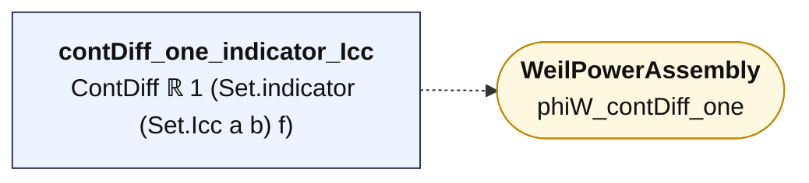

# `lean_stage3/Stage3/IndicatorContDiff.lean`

IndicatorContDiff — the C¹ indicator lemma (follow-up to block 15 of rung5.md, to unit 0369; the second of the two lemmas unit 0368 named as blocking `WeilPowerAssembly`'s `isTest_phiWC`).

1 theorem, 0 definitions, 250 lines. Arrows are Lean's own record of what each proof uses.

**Imports:** nothing in this tree  
**Imported by:** [`Stage3`](../lean_stage3/Stage3.md), [`WeilPowerAssembly`](../lean_stage3/WeilPowerAssembly.md)

## The picture



An arrow A → B reads "A is used in the proof of B". Blue: theorem. Green: a theorem nothing else uses (an end). Dashed: connects to nothing. Red: contains `sorry`. Yellow: theorems in another file, counted; a dotted arrow crosses files. Definitions are not drawn; they are listed below the diagram.

## Theorems

<a name="Stage3-contDiff_one_indicator_Icc"></a>
### `Stage3.contDiff_one_indicator_Icc`

line 29

**Why.** C¹ indicator on a closed interval with vanishing boundary data. If `f : ℝ → ℝ` is `C¹`, and both `f` and its derivative vanish at the endpoints `a` and `b` of `Icc a b`, then the set-indicator of `f` on `Icc a b` is `C¹` on all of `ℝ`.

**Proves**

```lean
ContDiff ℝ 1 (Set.indicator (Set.Icc a b) f)
```

**Needs** (its hypotheses)

  - `` hab : a ≤ b ``
  - `` hf : ContDiff ℝ 1 f ``
  - `` ha : f a = 0 ``
  - `` hb : f b = 0 ``
  - `` hda : deriv f a = 0 ``
  - `` hdb : deriv f b = 0 ``

**Fed by:** no theorem of this repo; it stands on Mathlib.

**Feeds** (1 that use it)

  - [`WeilPowerAssembly.phiW_contDiff_one`](../lean_stage3/WeilPowerAssembly.md#WeilPowerAssembly-phiW_contDiff_one) (WeilPowerAssembly) — `` ContDiff ℝ 1 (WeilPowerBackground.phiW h γ m) ``

