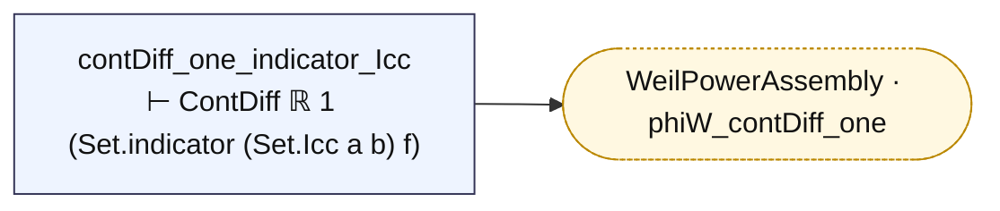

# `lean_stage3/Stage3/IndicatorContDiff.lean`

**What it does** (its own header): IndicatorContDiff — the C¹ indicator lemma (follow-up to block 15 of rung5.md, to unit 0369; the second of the two lemmas unit 0368 named as blocking `WeilPowerAssembly`'s `isTest_phiWC`).

**Imports:** nothing in this tree.
**Imported by:** [`Stage3`](../lean_stage3/Stage3.md), [`WeilPowerAssembly`](../lean_stage3/WeilPowerAssembly.md).

Blue: theorem. Green: a theorem nothing else uses (an end). Dashed white: connects to nothing. Grey: definition. Red: contains `sorry`. Yellow: in another file. An arrow A → B reads "A is used by B".

## Every declaration

| declaration | proves (output) | needs (input) | why (its own docstring) | uses | used by |
|---|---|---|---|---|---|
| `Stage3.contDiff_one_indicator_Icc` theorem, line 29 | ContDiff ℝ 1 (Set.indicator (Set.Icc a b) f) | hab : a ≤ b; hf : ContDiff ℝ 1 f; ha : f a = 0; hb : f b = 0; hda : deriv f a = 0; hdb : deriv f b = 0 | C¹ indicator on a closed interval with vanishing boundary data. If `f : ℝ → ℝ` is `C¹`, and both `f` and its derivative vanish at the endpoints `a` and `b` of `Icc a b`, then the set-indicator of `f` on `Icc a b` is `C¹` on all of `ℝ`. | — | `WeilPowerAssembly.phiW_contDiff_one` |
